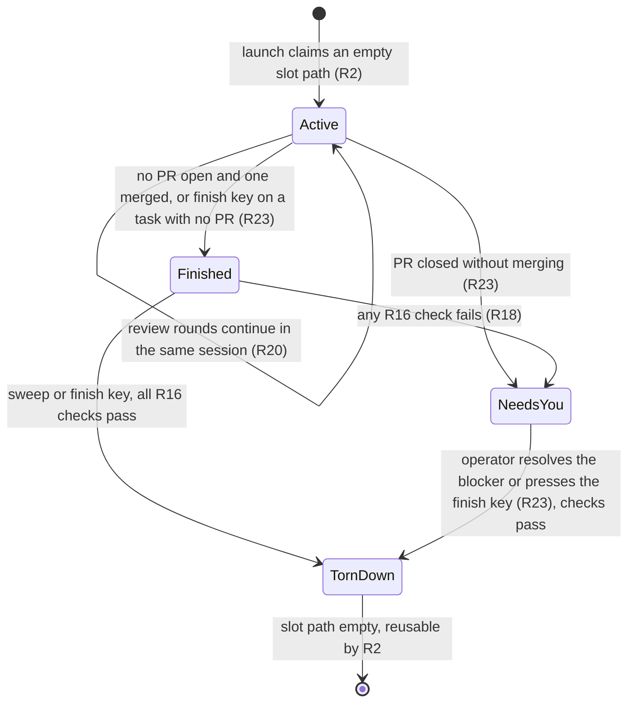
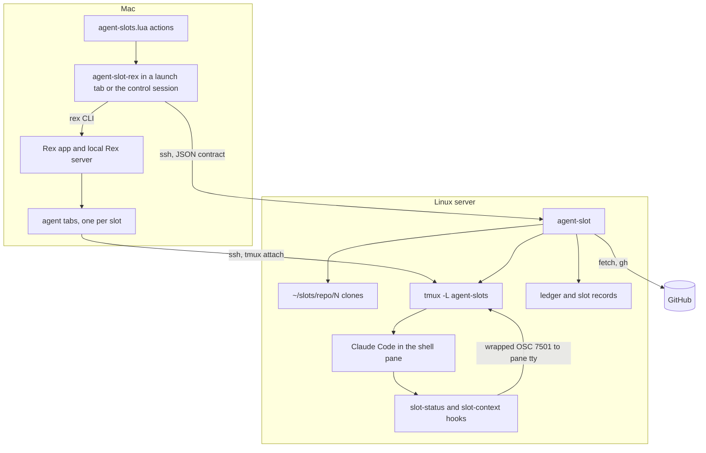
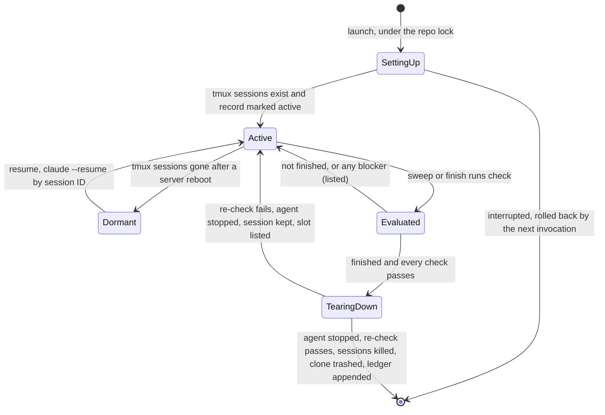
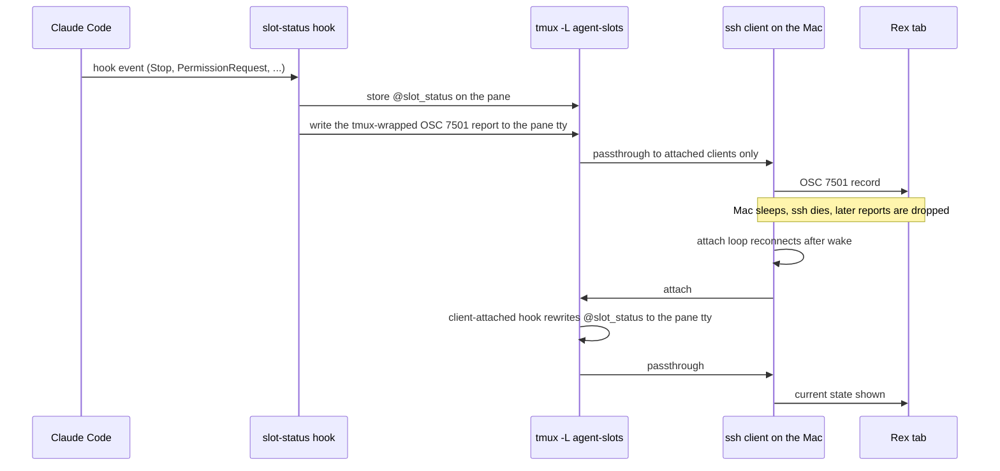
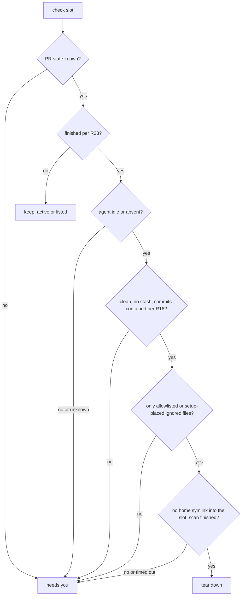
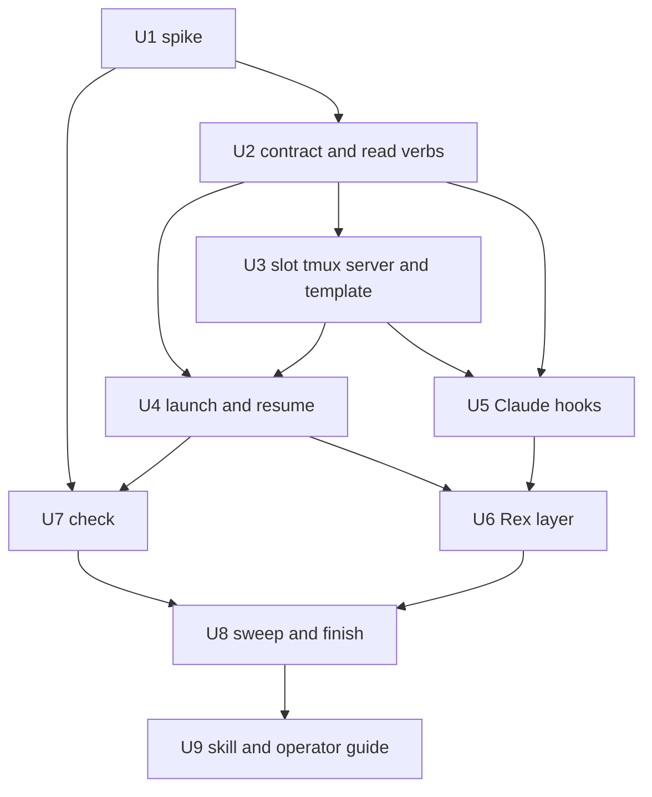

# Parallel Agent Slots with Rex - Plan

## Goal Capsule

- **Objective:** From Rex on the Mac, the operator starts another Claude Code agent on any repo with one key press that
  asks nothing and never takes focus, and without choosing a checkout. Agents can start and brief slots too. Each agent
  works on the Linux server in its own full clone, set up as safely as the repo's prime checkout. Rex shows which agents
  are working, done, or waiting on the operator. A finished clone goes away without losing work.
- **Means:** A server-side `agent-slot` command owns every clone, every safety check, and the trust of its own slot
  paths (KTD14), and a Mac-side helper driven by a few Rex key bindings calls it over SSH from a background tab (KTD1,
  KTD10). Until the Rex Linux server is available, a dedicated tmux server keeps every slot pane alive (KTD6) and a
  Claude hook carries their status through tmux to Rex (KTD7).
- **Product authority:** Requirements govern behavior; Key Decisions record why. KTDs govern mechanism within the
  Requirements. Measurements on the two live machines outrank any doc or memory claim. The Linux-server cutover is
  deferred and not active scope; R22 is the only requirement it places on this work.
- **Execution profile:** Bash CLIs and Claude hook scripts in dotfiles with bats suites that stub tmux, ssh, rex, gh,
  git network calls, and claude; tmux configuration; one new Mac stow package carrying `init.lua`, `layout.lua`, and
  `agent-slots.lua`. CI runs on Ubuntu without tmux or Lua, so the Rex bindings and the end-to-end path are proven by
  hand on the two machines (see Verification Contract).
- **Stop conditions:** Stop and ask when U1 shows that a wrapped status report written to a slot pane's terminal never
  reaches the Rex tab and the KTD7 fallback also fails; when `claude agents --json` cannot tell an idle agent from one
  mid-turn on the Linux server (KTD8); when U1 shows that trust accepted at a slot path does not hold once a clone is
  made there again (KTD14); or when any teardown test shows a deletion the evaluator should have blocked.
- **Who finishes:** `ce-work` executes the units in order on a `feat/` branch cut from `dev` in dotfiles and opens the
  PR; the operator runs the two-machine checklist before merge.
- **Open blockers:** None.

---

## Product Contract

### Summary

A slot command on the Linux server hands out full clones of a repo at stable paths, one task per clone, and sets each
one up like the repo's prime checkout. It tears a clone down once the task has finished, but never one holding unpushed,
unmerged, or unknown local work. On the Mac, a Rex key opens a background tab in the repo's Rex session; that tab runs
the launch and becomes the agent's tab, in the operator's Rex dev layout: yazi on the left, Claude top right, and
lazygit bottom right, each pane attached to its own tmux session in the slot and reattaching by itself after the Mac
sleeps. Agents call the slot command directly to start a slot and give it its first message.

### Problem Frame

The operator runs many Claude Code sessions on the Linux server, but the tmuxinator setup gives each repo one session
with one shell. Parallel work on the same repo therefore means steering worktrees from inside a single Claude session.
Checkouts sprawl with no inventory: meum-sites alone has worktrees under `.claude/worktrees/`, `~/dev/meum-worktrees/`,
a Claude scratchpad, and `/tmp`, three of them marked prunable, and hand-numbered clones exist on the Mac. Nothing says
which checkout is free.

Worktrees have also produced a recurring bug class here: hooks that inherit git's environment and act on the wrong
repository, `core.bare = true` written into shared config, and git-crypt smudge paths that fail (see Sources). Twelve
repos on the Linux server run hooks that do not isolate git's environment.

Finally, nothing tells the operator which agent needs attention without visiting each tmux session in turn.

### Actors

- A1. Operator: at the Mac, working in Rex.
- A2. Agent: a Claude Code session on the Linux server, running in a slot or handing a task to one.
- A3. Slot command: runs on the Linux server; owns slot state and every safety check.
- A4. Rex layer: key bindings in Rex on the Mac that open a Mac-side helper in a background tab, which calls A3 over SSH
  and manages tabs.

### Key Decisions

- **Full clones, never worktrees.** (session-settled: user-directed — chosen over worktrees after rolling hook isolation
  out to the twelve repos: worktrees have bitten this setup repeatedly, and a clone is an ordinary repository outside
  the whole bug class.) Governs R3, R7.
- **Stable slot paths, one task per slot.** (session-settled: user-directed — chosen over resetting slots between tasks
  and over a unique path per task: Claude's workspace trust and per-project state key on the path, and a reset would
  carry one task's local-only files into the next.) Governs R2, R3, R16.
- **tmux plus a status hook for the interim.** (session-settled: user-directed — chosen over plain SSH, Claude
  background sessions, and no interim at all, with the Linux server about three weeks out: agents must survive the Mac
  sleeping.) Governs R13, R14.
- **Slot command on the Linux server, thin Rex Lua layer on the Mac.** (session-settled: user-directed — chosen over
  doing everything in Rex Lua and over Claude's worktree lifecycle with clone-making hooks: safety logic stays testable
  on the machine that holds the clones, and the cutover moves only the thin layer.) Governs R1, R22.
- **Slot tabs use the Rex dev layout, and every pane lives in tmux.** The tab is the operator's `layout.lua`
  arrangement, and each pane attaches to its own tmux session in the slot, so every program keeps its state through
  sleep. (session-settled: user-directed — chosen over a three-pane tmux template inside a single Rex pane, over side
  panes that restart their programs after each wake, and over mosh: the operator's own layout, nothing to redo after a
  wake, and no dependency beyond the tmux the agent already needs.) Governs R11, R12, R14.
- **One Rex session per repo, one tab per agent.** (session-settled: user-directed — chosen over a session per agent and
  over one shared agents session: it keeps the one-session-per-repo habit, and tab indicators show which agent needs the
  operator.) Governs R11.
- **Teardown when a task finishes, swept after each launch or run by a finish key.** (session-settled: user-directed —
  chosen over an automatic watcher and over explicit-only teardown: nothing vanishes while the operator looks at it, and
  nothing depends on remembering. The sweep runs after the launch, in the control session: user-approved — chosen over
  sweeping before the launch, which put every repo's fetch and `gh` call in front of a ready agent.) Governs R16, R17,
  R20, R23.
- **A launch never blocks the operator.** The key opens a background tab in the repo's Rex session that runs the launch
  and becomes the agent's tab; the repo comes from the session's name, and no task name is asked. (session-settled:
  user-approved — chosen over a focused helper in the control session that asked for the repo and a task name and waited
  for the clone: a key pressed many times a day must be a reflex.) Governs R1, R5, R11.
- **The slot command trusts its own slot paths, through Claude's own dialog.** (session-settled: user-approved — chosen
  over accepting each new path by hand, over only labelling a tab that waits on the dialog, and over writing trust into
  Claude's app-state file: no flag or setting pre-trusts a path, a parent folder's trust does not cover a clone, and
  delegated agents must never wait on a dialog nobody sees.) Governs R24.
- **Agents start and brief slots.** A skill teaches any agent the slot command, and a launch can carry Claude's first
  message. (session-settled: user-approved — chosen over keeping slots operator-only: an agent delegates a task in one
  call.) Governs R25.
- **Auto-delete only provably safe slots; list the rest.** (session-settled: user-directed — chosen over asking before
  each teardown with last-asked and hold-until tracking: once the safety rule exists, asking adds state without adding
  safety.) Governs R16, R18.
- **Tabs come back by themselves.** Each pane reattaches after a sleep or a network drop, and Rex runs a restore when it
  starts; every launch and a restore key reconcile as a fallback. (session-settled: user-directed — the operator gives
  no input after a wake; chosen over a restore key alone, over an automatic watcher on the Mac, and over mosh, which
  likely strips the status escape sequences.) Governs R15.
- **Share Claude memory through a Claude setting written into each slot.** (session-settled: user-approved — chosen over
  pinning Claude's project directory with `CLAUDE_CONFIG_DIR` and `CLAUDE_CODE_PROJECT_DIR_NAME`, which switches Claude
  to a separate app-state file without the user's MCP servers and trust records.) Slot setup puts the setting in the
  slot's local Claude settings, so a Claude the operator starts by hand in a slot shares the same memory. Governs R8.
- **The prime checkout stays the operator's.** The pool is made only of slot clones, so the slot command cannot disturb
  the operator's own work. Governs R10.
- **A task is finished only when nothing about it is still open.** A closed-unmerged PR, a second PR still in review, or
  commits pushed after the last merge leave the task on the "needs you" list rather than deleting its slot; this closes
  the squash-merge orphan-branch case documented in `docs/solutions/`. Governs R16, R17, R23.
- **Rex configuration lives in dotfiles.** Rex's `init.lua`, the operator's `layout.lua`, and the slot Lua layer become
  a new stow package for the Mac; `init.lua` keeps its rexurrect restore line with `$HOME` in place of absolute paths,
  and the layout actions' key bindings stay unbound. (session-settled: user-directed — everything Rex-related belongs in
  dotfiles.) The Rex SessionStart hook already added to `stow/claude/dot-claude/settings.json` (uncommitted) is kept and
  committed with this work; on hosts without `rex` it does nothing.

### Requirements

**Starting an agent**

- R1. The operator starts a new agent on a repo from Rex on the Mac with one key or command-palette action. Pressed in
  the repo's Rex session, it asks nothing and never takes focus; pressed anywhere else, it asks only for the repo.
- R2. The slot command uses the lowest-numbered empty slot path for that repo, and creates a new slot path when every
  existing one holds a task, up to 8 live slots per repo; past that it refuses, and an override raises the number.
- R3. A slot is a full clone of the repo from origin, at a stable path outside `~/dev`, named so it reads as that repo's
  numbered slot.
- R4. The agent starts on a freshly fetched base branch, and creates its own `feat/` or `fix/` branch following the
  repo's conventions.
- R5. A slot is labelled `<repo>/<N>`. Its task name is the name an agent passes to the launch, or else the agent's
  branch once it exists, and the Rex tab shows it after the next launch or restore. A task resumes by its Claude session
  ID.
- R24. Each slot path is trusted in Claude before its first agent starts, through Claude's own trust dialog, so no
  launch waits on the operator; a path whose dialog the slot command does not recognize is labelled "trust needed" on
  its tab instead.
- R25. An agent starts a slot and gives it its first message without Rex or the operator, and a skill tells any agent
  how; a repeated request with the same request ID returns the same slot.
- R26. A doctor command on each machine checks every launch prerequisite, reports versions that differ from the last
  verified ones, and reports recent launch times against the 30-second target.

**Slot parity with the prime checkout**

- R6. Every slot contains the `docs/solutions` symlink to the shared solutions repo; the slot command refuses to hand
  out a slot without it.
- R7. Commits and pushes in a slot run the repo's hooks from that slot's own checkout, never missing and never the prime
  checkout's copies.
- R8. Agents in every slot of a repo read and write that repo's single Claude auto memory.
- R9. A new slot starts with the prime checkout's local Claude permission grants.
- R10. The slot command never claims, modifies, or deletes a repo's prime checkout.

**Seeing agents in Rex**

- R11. Each repo has one Rex session; each of its agents is one tab, whose panes attach to that slot's tmux sessions on
  the Linux server.
- R12. Every slot tab uses the operator's Rex dev layout from `layout.lua`: yazi on the left (33%), the agent's shell
  running Claude top right, and lazygit bottom right (33%). Each pane attaches to its own tmux session started in the
  slot path; yazi and lazygit are typed into a shell with the tmuxinator commands, and the Claude session's shell starts
  Claude with the optional task and first message.
- R13. A tab shows its agent's state (working, waiting on the operator, or done) through Rex's program status, and Rex's
  session picker marks a repo's session when any of its agents is done or waiting.
- R14. Agents, and the yazi and lazygit sessions beside them, keep running on the Linux server while the Mac sleeps or
  the network drops.
- R15. After the Mac sleeps, the network drops, Rex restarts, or the Linux server reboots, every slot tab and each pane
  in it come back as they were with no input from the operator, showing the agent's current state, including a state
  reached while no tab was attached. Every launch and a restore key also reconcile tabs, as a fallback.

**Ending a task**

- R16. A slot is torn down only when its task has finished (R23) and the slot is provably safe:
  - the agent is idle or absent;
  - the tree is clean and nothing is stashed;
  - every local commit is contained in the final head commit of one of the task's PRs, or, for a task that never had a
    PR, sits on a branch on origin;
  - no untracked or ignored file exists other than recognized build and dependency output and the files the slot command
    placed at setup (the `docs/solutions` symlink and the local permission grants);
  - no symlink under the home directory resolves into the slot.
- R17. Teardown runs as a sweep right after every launch, and on demand from a finish key on the current tab; the finish
  key refuses a task with an open PR.
- R18. A slot that fails any R16 check is never deleted. It appears on a "needs you" list that names the slot and what
  blocks it, shown in a control-session tab that stays open while the list is non-empty, and its own tab label carries
  its first blocker.
- R19. Teardown ends the slot's agent and tmux session, closes its Rex tab, and moves the clone to the trash.
- R20. Until its PR merges or closes, a task keeps its slot, so review rounds happen in place in the task's own Claude
  session, resumed by its session ID when the tab or the tmux session was lost.
- R21. Teardown leaves the task's Claude conversation history on disk and resumable.
- R23. A task has finished when none of its PRs is open or closed without merging and at least one has merged, or when
  the operator presses the finish key on a task with no open PR; until then, a task with a PR closed without merging is
  listed as needing the operator.

**Cutover readiness**

- R22. The slot command works without Rex and without the Mac, so the Linux-server cutover changes only the Rex layer.



### Delivery Order

1. Start and see agents: R1–R15, R22, and R24–R26. Until step 2 ships, nothing frees a slot path, so every launch
   creates a new slot; disk on the Linux server covers that.
2. End tasks: R16–R21 and R23.
3. Linux-server cutover: deferred (see Scope Boundaries).

### Key Flows

- F1. Start an agent
  - **Trigger:** The operator presses the new-agent key in a repo's Rex session, or an agent runs `agent-slot launch`.
  - **Steps:** The key opens a background tab in that session. The helper takes the repo from the session's name, mints
    a request ID, and calls the slot command over SSH. The command claims or creates a slot, trusts the slot path if
    needed, sets it up, and starts the slot's three tmux sessions, with Claude in the Claude session (with its first
    message, when one was given). The tab is relabelled `<repo>/<N>`, becomes the Claude pane, and gains the yazi and
    lazygit panes around it. From delivery step 2 on, a control-session tab then runs the sweep (R17).
  - **Outcome:** A new tab shows Claude idle at its prompt, or working on its first message, in a fresh slot, and the
    operator's focus never moved.
  - **Covers:** R1–R13, R24, R25
- F2. Come back after sleep
  - **Trigger:** The Mac wakes, the network returns, Rex restarts, or the Linux server reboots.
  - **Steps:** Each pane's attach loop reconnects to its tmux session, resuming the slot first when its sessions are
    gone; after a Rex restart, the restore that `init.lua` runs opens a tab for each live slot without one.
  - **Outcome:** Every slot tab and its three panes are back as they were, with no input from the operator.
  - **Covers:** R14, R15
- F3. Review round
  - **Trigger:** A task's PR receives review comments.
  - **Steps:** The operator focuses that task's tab (restoring it if needed) and continues the same Claude session.
  - **Outcome:** The agent addresses the review in the same slot and conversation.
  - **Covers:** R5, R20
- F4. Finish a task
  - **Trigger:** The task finishes (R23), or its PR closes without merging; the next launch's sweep or the finish key
    runs.
  - **Steps:** The slot command checks R23 and R16. If every check passes, it ends the agent and tmux session, and the
    Rex layer closes the tab before the clone moves to the trash. Otherwise the slot stays and appears on the "needs
    you" list.
  - **Covers:** R16–R19, R21, R23

### Acceptance Examples

- AE1. **Covers R2, R3.** Given repo X has slots 1–3 holding tasks and slot 4 was torn down, when the operator starts an
  agent on X, then the agent gets a fresh clone at slot 4's path.
- AE2. **Covers R6.** Given the shared solutions repo is missing on the Linux server, when the operator starts an agent,
  then no tab opens and the launcher says the symlink could not be created.
- AE3. **Covers R7.** Given a repo whose prime checkout sets `core.hooksPath` to an absolute path inside the prime
  checkout, when an agent commits in a slot, then the hooks that run are the slot's own scripts.
- AE4. **Covers R13.** Given an agent in a background tab stops at a permission prompt, then that tab shows a waiting
  indicator and the repo's session is marked in Rex's session picker.
- AE5. **Covers R16, R18.** Given a task's PR merged but its slot holds one unpushed commit, when the sweep runs, then
  the slot remains and the "needs you" list names it with "1 unpushed commit".
- AE6. **Covers R16.** Given a task's PR merged but its agent is mid-turn, when the sweep runs, then that slot is
  skipped and listed.
- AE7. **Covers R16, R19, R21.** Given a task's PR merged, its slot is clean and fully pushed, and its agent is idle,
  when the operator next starts any agent, then the old tab closes, its tmux session ends, the clone is in the trash,
  and the old conversation is still resumable.
- AE8. **Covers R14, R15.** Given three agents on two repos and a Mac that slept for two hours, when the Mac wakes, then
  within about ten seconds every pane in all three tabs is reattached with no key press, each yazi and lazygit where it
  was, and each Claude pane showing its agent's current state.
- AE9. **Covers R18, R23.** Given a task's only PR was closed without merging, when the sweep runs, then the slot
  remains and the "needs you" list names the closed PR.
- AE10. **Covers R16, R18.** Given a task's PR merged and the agent then pushed one more commit, which recreated the
  deleted branch on origin with no PR, when the sweep runs, then the slot remains and the list names "1 commit on a
  branch with no PR".
- AE11. **Covers R23.** Given a task opened two PRs and only the first has merged, when the sweep runs, then the slot is
  not torn down.
- AE12. **Covers R17.** Given a task's PR is still open, when the operator presses the finish key on its tab, then
  nothing is deleted and the helper names the open PR.
- AE13. **Covers R17, R23.** Given a task whose only PR closed without merging is on the "needs you" list, when the
  operator presses the finish key on its tab and every R16 check passes, then the slot is torn down.
- AE14. **Covers R1, R11.** Given the operator is typing in a tab of repo X's Rex session, when they press the new-agent
  key, then focus stays on that tab, nothing asks a question, and a new tab labelled `X/<N>` appears showing Claude
  idle.
- AE15. **Covers R24.** Given slot path `X/5` was never trusted in Claude, when a launch creates slot 5, then Claude
  starts without showing the trust dialog.
- AE16. **Covers R25.** Given an agent runs `agent-slot launch X --prompt-file <file> --request-id <id>` twice, then one
  slot exists and its Claude started on that message.

### Success Criteria

- Starting an agent takes one key press that asks nothing and never takes focus, and the operator never names, picks, or
  prepares a checkout. Once a slot path is trusted, Claude is idle in the new tab within 30 seconds of the key press
  (median of the last 20 launches).
- With three or more agents across repos, the operator can tell from Rex alone (tab indicators and the session picker)
  which agents need input, without visiting each tab.
- No teardown ever deletes work that is not on origin.

### Scope Boundaries

**Deferred for later**

- The Linux-server cutover: the Rex layer moves to the Linux server; tmux, the attach loops, the status hook, and the
  restore key go away; Rex's agent session-renaming is turned off there, because several agents share one repo session.
- Warm dependency caches or build seeding across slots; each task installs and builds cold.
- Port allocation for dev servers in parallel slots; they collide on the ports forwarded by the `bd-dev` entry in
  `stow/ssh/dot-ssh/config`.

- Carrying permission grants approved inside a slot back to the prime checkout; new slots start from the prime
  checkout's grants (R9), and grants approved in a slot end with it.
- Moving old transcripts into a single project folder.

**Outside this work**

- Worktrees in any form, including Claude's `--worktree` with clone-making `WorktreeCreate` hooks.
- An automatic background teardown watcher, and asking before teardown with snooze state.
- mosh, and running agents on the Mac.
- Pinning Claude's project directory with `CLAUDE_CONFIG_DIR` and `CLAUDE_CODE_PROJECT_DIR_NAME`.
- Writing trust, or anything else, into Claude's app-state file.

### Upstream Asks

- Claude Code: share auto memory across clones of the same remote, as it already does across worktrees of one
  repository.
- Claude Code: a supported way to pre-trust a path, as a CLI command or a setting, so KTD14's screen check can go.
- Rex: the open questions on session restore, OSC 7501 through tmux, and dotfile-managed setups, kept in the Obsidian
  vault at `resources/rex/rex-discord-questions.md`.

### Dependencies / Assumptions

- The operator expects Rex Linux-server access within about three weeks; the interim pieces (tmux anchoring, the status
  hook, restore) are built to last only until the cutover.
- Measured on 2026-10-22 with Claude Code 2.1.308 and Rex Beta 0.1.0 (1347):
  - Claude Code reports idle, working, and done natively to a Rex terminal, both locally and through plain SSH.
  - It reports nothing through tmux or through `claude attach`.
  - A wrapped OSC 7501 report written inside a tmux pane with `allow-passthrough on` arrives in the Rex tab intact.
  - `--settings` with `autoMemoryDirectory` redirects a session's auto memory, while transcripts stay keyed to the
    working path.
  - Setting `CLAUDE_CONFIG_DIR` switches Claude to a different app-state file.
- tmux forwards a passthrough report only to clients attached when the report is written, so a state an agent reports
  while the Mac sleeps never reaches Rex on its own.
- The repos merge PRs by squash only and GitHub deletes the head branch on merge (checked on agentnative-cli and bird),
  so a merged task's commits sit on no origin branch afterward; GitHub keeps the PR's final head commit as a pull ref.
- Claude's workspace trust keys on each clone's root path, so the first launch at a brand-new slot path shows a trust
  dialog, and hooks (the status hook included) do not run until it is accepted. Checked on 2026-10-23 with Claude Code
  2.1.309: no flag skips the dialog in an interactive session, `--dangerously-skip-permissions` included; its
  highlighted default is "No, exit"; `-p` skips it without recording trust; and trust on a parent folder does not cover
  a git repository inside it.
- Eleven of the 42 repos under `~/dev` set `core.hooksPath` to an absolute path, each inside its own checkout (measured
  2026-10-23), among them agentnative-site, bird, meum-api, meum-sites, and xurl-rs. A plain clone therefore runs no
  hooks, and copying the config would run the prime checkout's hooks.
- `docs/solutions` is an untracked, gitignored symlink in each checkout, so a fresh clone lacks it.

### Sources / Research

- `stow/local/dot-local/bin/tmux-new-session`: the standard three-pane layout template; the per-repo configs in
  `stow/tmuxinator/dot-config/tmuxinator/` all share it, and their yazi pane runs
  `command -v y >/dev/null && y || yazi`.
- `~/.config/rex/layout.lua` on the Mac: the operator's Rex dev layout (`dev_layout`, `dev_layout_here`), with 33% side
  and bottom panes and commands typed into shells; it moves into `stow/rex`.
- `stow/tmux/dot-config/tmux/tmux.conf`: `allow-passthrough on` (line 11), `detach-on-destroy off` (line 26), the
  `client-detached` prune hook (line 31), and resurrect/continuum (lines 78-91).
- `stow/claude/dot-claude/settings.json`: hook registrations and the uncommitted Rex SessionStart hook.
- `docs/solutions/test-failures/linked-worktree-push-exports-git-dir-into-prepush-test-suite.md`: the worktree
  hook-environment bug class, including the `commit -a` index leak that full clones do not remove.
- `docs/solutions/workflow-issues/git-crypt-worktree-smudge-key-path-2026-06-22.md`: git-crypt in worktrees.
- `docs/solutions/deployment-issues/stow-symlink-breakage-by-atomic-writers.md`: why symlinking Claude's app-state file
  is not a fix.
- Rex knowledge store in the Obsidian vault, `resources/rex/`: concepts, the tmux-to-Rex map, remote access and Linux
  server modes, agents and the program status protocol (with the tests above), and the Discord questions.
- Rex docs: <https://www.superlogical.com/rex/docs> (Program Status Protocol, Remote Access, Server Modes, Lua API).
- Claude Code docs: <https://code.claude.com/docs/en/memory> (auto memory storage and `autoMemoryDirectory`),
  <https://code.claude.com/docs/en/sessions> (`CLAUDE_CODE_PROJECT_DIR_NAME`, resume),
  <https://code.claude.com/docs/en/permissions> (trust keyed on the repository root),
  <https://code.claude.com/docs/en/worktrees> (`WorktreeCreate` hooks), <https://code.claude.com/docs/en/hooks> (hook
  events, `terminalSequence` allowlist, hooks have no controlling terminal).

---

## Planning Contract

**Product Contract preservation:** changed: R16, R17, new R23 — a task with a closed-unmerged PR, a second PR still
open, or commits pushed after its last merge is no longer torn down, and the finish key refuses a task with an open PR;
confirmed at plan scoping. Restructured, no scope change: R16's checks rendered as a list; Outstanding Questions
resolved into KTD1–KTD13 and removed. Changed in review: R23 and R16 — the finish key finishes any task with no open PR,
and a closed PR's final head counts for reachability, so a closed-unmerged task can be cleared (AE13). Clarified, no
scope change: A4 (the Lua side only opens the helper), R16 (an absent agent passes like an idle one), R19 and AE7
(clones move to the trash), AE1 (slot numbering matches R2), and the teardown Key Decision's heading and F4's trigger (a
task finishes per R23). Changed in the DX review, confirmed with the operator: R1, R5, R17, R18, F1, A2, A4, the Success
Criteria, and the teardown Key Decision — a launch asks nothing, never takes focus, and sweeps afterwards; new R24–R26,
AE14–AE16, KTD14, KTD15, and three Key Decisions — slot paths trusted by the slot command, agents that start and brief
slots, and a doctor on each machine.

### Key Technical Decisions

- KTD1. **Two programs, one owner of safety.** `agent-slot` on the Linux server owns slot state, setup, and every check;
  `agent-slot-rex` is a bash helper on the Mac that drives Rex through the `rex` CLI and reaches the server over SSH;
  `agent-slots.lua` only binds keys and palette actions that open the helper, and adds a slot tab's yazi and lazygit
  panes with `layout.lua`'s builder. Rex stops an action's commands after 30 seconds and its Lua has no text prompt, so
  no slot work runs inside a Lua action. (session-settled: user-directed — chosen over doing everything in Rex Lua and
  over Claude's worktree lifecycle with clone-making hooks: safety logic stays testable on the machine that holds the
  clones, and the cutover moves only the thin layer.) Covers R1, R11, R22.
- KTD2. **One machine-readable contract for every caller.** Every verb accepts `--output json`; success prints one JSON
  object on stdout, errors print one JSON object on stderr carrying `reason` (kebab-case, closed set), `exit_code`,
  `message`, the offending value, and `next_step {action, command, docs}`. Exit codes follow the agent-native dialect: 0
  success, 1 general, 2 usage, 77 auth or permission, 78 configuration. The schema is versioned
  (`dotfiles.agent-slot/1`, fields only added) and the emitter mirrors `scripts/upgrade/lib/run-log.sh`. Verbs:
  - read: `repos`, `list`, `whoami`, `check`;
  - write: `launch`, `resume`, `warm`, `sweep`, `finish`, where `sweep` and `finish` report only, unless given `--yes`;
  - `doctor` (KTD15) reads only.

  Every error also carries three added fields:
  - `recovery`: `side_effects` (`none`, `partial`, `complete`, or `unknown`), `retryable`, `max_retries`, and a
    `reconcile` command whenever side effects are unknown;
  - `context`: the `agent-slot` version, the versions of the tools the failed step used, the config paths in effect, and
    the names, never the values, of relevant environment variables;
  - `log`: the path of the failed step's captured output (KTD12).

  `next_step.docs` points at the README's table of reasons, and a test keeps that table equal to the closed set. An
  `EXIT` trap turns an unexpected failure into `script-error` with `next_step` `rerun`, as `run-log.sh` does. Every
  verb answers `--help`. The Rex helper, the operator's shell, and agents all read the same "needs you" list from
  `list` and `check`. (session-settled: user-approved — `recovery` and `context` chosen over the base envelope alone:
  an agent must know whether a retry is safe without guessing from the reason name.) Covers R18, R22, R25.
- KTD3. **Slot root, record, ledger, and lock.** A slot lives at `~/slots/<repo>/<N>`. Beside the numbered slots,
  `~/slots/<repo>/` holds a symlink to each prime checkout that the repo's tracked relative symlinks reference
  (`../<sibling>`), so those links resolve as they do under `~/dev`. Each clone carries its record in
  `.git/agent-slot.json`, always written to a temporary file and renamed, under the slot lock:
  - repo, slot number, task, and prime path;
  - base branch and Claude session ID;
  - PR numbers once seen, lifecycle state, and the operator-finished flag;
  - the launch's request ID and its first-message file, when given.

  An append-only ledger at `~/.local/state/agent-slot/ledger.jsonl` keeps task → session ID → slot path → PRs after a
  teardown. Each launch appends a ledger line with `requested_at` (taken by the caller and carried with the request ID)
  and the duration of each phase (clone, setup, trust, tmux, Claude start); the SessionStart hook appends a `ready` line
  with the same request ID and `ready_at` (KTD9), and doctor joins the two. Records and ledger lines carry a `schema`
  field (`dotfiles.agent-slot/1`, fields only added); `agent-slot` reads older schemas and refuses a newer one with
  `record-schema-newer`. A per-repo `flock` on `~/slots/<repo>/.lock` serializes picking a slot number. Each slot has
  its own `flock` on `~/slots/<repo>/.<N>.lock`, held by the launching process from the claim to the commit point and
  taken by teardown, `resume`, and every record update; a setting-up or tearing-down record is finished or rolled back
  only by a process that takes that lock without waiting, which succeeds only once its owner has died. (session-settled:
  user-directed — chosen over resetting slots between tasks and over a unique path per task: Claude's workspace trust
  and per-project state key on the path, and a reset would carry one task's local-only files into the next.) Covers R2,
  R3, R21, R26.
- KTD4. **Clone and git parity recipe.** Each step's ordering matters:
  1. Clone from origin with `--reference-if-able` to the prime checkout plus `--dissociate`, so the clone is fast and
     owns its objects.
  2. Check out the base: `dev` when origin has it, else origin's default branch.
  3. For git-crypt repos (`filter=git-crypt` in `.gitattributes`), unlock with `~/.config/git-crypt/key` on the fresh
     tree before any hook path is set, then verify that nothing is still encrypted and the git-crypt filter is
     configured. Otherwise refuse with `git-crypt-locked` (exit 78) and roll the slot back: a locked clone commits
     plaintext into encrypted paths.
  4. Set `core.hooksPath` to the prime's value made relative to the prime root. Refuse with
     `hooks-path-outside-checkout` when the prime's path points outside its own tree. When the prime sets no
     `core.hooksPath` but has non-sample hooks in `.git/hooks`, copy those into the slot's `.git/hooks`.
  5. Create `docs/solutions` as an absolute symlink to the shared corpus, and refuse with `solutions-symlink-missing`
     unless it resolves.

  (session-settled: user-directed — chosen over worktrees after rolling hook isolation out to the twelve repos:
  worktrees have bitten this setup repeatedly, and a clone is an ordinary repository outside the whole bug class.)
  Covers R3, R4, R6, R7, R10.
- KTD5. **Claude settings written into each slot.** Setup writes the slot's `.claude/settings.local.json` with two keys
  and nothing else:
  - `autoMemoryDirectory`, pointing at the memory directory Claude already uses for the prime checkout;
  - the prime's `permissions` block, with every absolute prime path rewritten to the slot path.

  Other keys in the prime file, hooks among them, are not copied. The file is copied, never symlinked, because Claude
  rewrites it atomically. (session-settled: user-approved — chosen over pinning Claude's project directory with
  `CLAUDE_CONFIG_DIR` and `CLAUDE_CODE_PROJECT_DIR_NAME`, which switches Claude to a separate app-state file without the
  user's MCP servers and trust records.) Covers R8, R9, R10.
- KTD6. **A dedicated tmux server for slots, three sessions per slot.** Slots run on `tmux -L agent-slots` with
  `~/.config/tmux/slots.conf`. That file sources the shared settings extracted from `tmux.conf` into `base.conf`, loads
  no plugins (so no resurrect or continuum), and sets:
  - `detach-on-destroy on` and `set-titles off`;
  - `allow-passthrough all` in the Claude session;
  - a `client-detached` hook that runs `prune-orphans.sh` against this socket;
  - a `client-attached` hook for status replay (KTD7).

  `sessions.sh` creates each slot's sessions with plain `tmux new-session -d -c <slot>`, always passing
  `-L agent-slots -f ~/.config/tmux/slots.conf`, because tmux otherwise loads `tmux.conf` and its session-restore
  plugins:
  - `<repo>-<N>`: a shell that starts Claude with the session ID, the task name only when given, and the first-message
    file only when given;
  - `<repo>-<N>-files`: a shell with `command -v y >/dev/null && y || yazi` typed into it with `send-keys`, as the
    tmuxinator configs do, so the `y` function resolves and quitting yazi leaves a shell;
  - `<repo>-<N>-git`: a shell with `lazygit` typed into it the same way.

  Every session pins `PATH`, never inherits the SSH caller's environment, and sets explicitly whatever git push and
  commit signing need on the Linux server (U1 records which). Each program runs under a shell, so its pane outlives a
  stopped program. The separate server keeps a wedge or restore in the operator's tmuxinator sessions from touching
  agents, and the reverse. (session-settled: user-directed — three sessions in tmux, each shown in its own Rex pane,
  chosen over a three-pane tmuxinator template inside one Rex pane and over side panes outside tmux: the operator's Rex
  layout, with every program's state kept through sleep.) Covers R5, R12, R14.
- KTD7. **Status path through tmux.** Hooks have no controlling terminal, and Claude's `terminalSequence` allowlist
  excludes OSC 7501. So a global, async Claude hook (`slot-status.sh`) acts only when `$TMUX` names the `agent-slots`
  socket and the pane belongs to a slot's Claude session (`<repo>-<N>`). It maps events to states:

| Claude event                      | State                      |
| --------------------------------- | -------------------------- |
| `SessionStart`                    | idle                       |
| `UserPromptSubmit`, `PostToolUse` | working                    |
| `PermissionRequest`               | blocked, `kind=permission` |
| `Elicitation`                     | blocked, `kind=question`   |
| `PreToolUse` on `AskUserQuestion` | blocked, `kind=question`   |
| `Stop`                            | done                       |
| `StopFailure`                     | error                      |
| `SessionEnd`                      | clear                      |

  For each report the hook does three things:

  1. Resolves the pane's terminal with a bounded `tmux display -p -t "$TMUX_PANE" '#{pane_tty}'`.
  2. Writes the tmux-wrapped OSC 7501 report there, with `app=claude-code`.
  3. Stores the same report in the pane option `@slot_status`; the `client-attached` hook rewrites it to the pane
     terminal, so a restored tab shows the current state.

  Each report carries the time its hook process started; the hook stores and writes under a per-pane lock and drops any
  report older than the stored one, because async hooks can finish out of order. Only the pane's top-level Claude
  reports; a nested `claude -p` run inside the pane is ignored.

  Fallback if U1 disproves the pane-terminal write: the Rex helper polls `agent-slot list` and puts the state in the tab
  label. (session-settled: user-directed — chosen over plain SSH, Claude background sessions, and no interim at all,
  with the Linux server about three weeks out: agents must survive the Mac sleeping.) Covers R13, R15.

- KTD8. **Agent identity and state.** `launch` mints a UUID and starts Claude with `--session-id <uuid>`, adds
  `-n <task>` when a task name was given, and records both. With `--prompt-file`, launch copies the file into the slot's
  `.git/` and the shell pane passes its contents as Claude's first message, reading the file itself, so the prompt never
  passes through tmux or shell quoting. Agent state for `list` and `check` comes from `claude agents --json` joined on a
  working directory under the slot path, with three outcomes:
  - idle;
  - absent, meaning no session and no process under the slot;
  - unknown, meaning the lookup failed, more than one session matched, or a process outside the slot's own tmux panes
    has its working directory or open files under the slot.

  `claude agents --json` statuses `busy` and `waiting` mean not idle.

  Only idle and absent pass R16. A slot whose tmux sessions are missing after a server reboot is dormant: `resume`
  rebuilds the three sessions and runs `claude --resume <session-id>` in the Claude session; the attach loops and
  restore call it, so two calls at once create each session once. The record's session ID follows the live conversation:
  the slot SessionStart hook (KTD9) writes each new `session_id`, including after `/clear`, to the record and the
  ledger. The ledger also keeps each session's transcript path, so R21 resumes with `claude --resume <transcript-path>`
  after the slot path is reused. Covers R5, R16, R20, R21.
- KTD9. **In-slot context for agents.** A global SessionStart hook (`slot-context.sh`) runs
  `agent-slot whoami --output json` and, only inside a slot and only for the pane's top-level Claude, records the
  session ID (KTD8), appends the launch's `ready` line on the first start (KTD3), and returns `additionalContext`
  naming:
  - the slot, task, base branch, and prime checkout (read-only for the agent);
  - that `docs/solutions` is shared and commits to it go through `sd-commit-doc`;
  - that `agent-slot check` lists what blocks teardown;
  - that review rounds should re-check PR state before stacking commits;
  - that the agent should stage with `git add`, then run a plain `git commit`, rather than `commit -a`;
  - that the agent should create no worktrees inside the slot.

  Covers R10, R20, R21, A2.
- KTD10. **Rex helper, background launch tab, control session, and reconcile.** `init.lua` binds new-agent, restore, and
  finish, and the helper's verbs are `launch`, `restore`, `finish`, `sweep`, and `doctor`, named as on the server. The
  new-agent action opens a tab with `rex run --focus=false` in the session it was pressed in, running
  `agent-slot-rex launch`:
  1. The repo is the session's name when it matches `agent-slot repos`. Otherwise the tab takes focus and shows the
     numbered repo list, then opens the slot's tab in the repo's session, creating that session if needed. With no
     terminal attached, the helper refuses with `repo-required` and `next_step` `agent-slot-rex launch --repo <name>`.
  2. The helper mints a request ID, takes `requested_at`, and runs `launch` on the server.
  3. On success it relabels the tab `<repo>/<N>`, runs `rex do agent_slot_layout` to add the yazi and lazygit panes
     around its own block with `layout.lua`'s ratios, and execs `agent-slot-rex attach <repo>/<N> claude`, so the launch
     tab becomes the agent's tab. When launch reports `trust_prompt_expected` (KTD14's screen check failed), the label
     adds `trust needed`.
  4. On failure the tab stays open, labelled `<repo> · launch failed`, and shows the message, the offending value,
     `next_step.command`, and the log path. For a retryable reason, Enter retries with the same request ID; q closes the
     tab.
  5. It then opens a tab in a dedicated `agent-slots` control session, without focus, running `agent-slot-rex sweep`
     (KTD11), which reconciles and closes itself when the "needs you" list is empty.

  Restore and finish run in the control session, so a teardown never closes the window its own helper runs in. The
  helper:
  - calls the server through the plain server alias, never `bd-dev`, using `ssh -n -o BatchMode=yes` under `timeout`,
    and runs `~/.local/bin/agent-slot` by path, as `mac-open` does;
  - tells ssh's exit code 255 apart from the slot command's own codes;
  - labels each agent tab `<repo>/<N> · <task>`, where `<repo>/<N>` is the stable key and the task is the branch or the
    launch's task name, and appends the first "needs you" blocker, such as `needs you: 1 unpushed commit`;
  - runs every pane as `agent-slot-rex attach <repo>/<N> claude|files|git`, a loop around
    `ssh -o ServerAliveInterval=5 -o ServerAliveCountMax=2 -t <server> tmux -L agent-slots attach -t =<session>`: a
    dropped connection is noticed within about ten seconds and retried every few seconds, plus up to 3 seconds of random
    jitter so many panes reconnecting after a wake stay under sshd's `MaxStartups`, until the network is back, with the
    last ssh error and the retry count shown in the pane, a missing session runs `agent-slot resume` before attaching, a
    slot that is gone ends the loop, and a deliberate tmux detach stops it until Enter is pressed; the pane never exits
    on a disconnect, so the tab and its layout stay.

  Reconcile is one function used by sweep, restore, and finish. It counts a keyed tab as present when the Rex tab with
  that key exists and its Claude pane's attach loop is still running. It opens a tab for each live slot without one,
  resumes dormant slots, relabels keyed tabs, closes keyed tabs whose slot is gone, and closes a duplicate keyed tab,
  such as one rexurrect recreated. It closes tabs only once every server call has returned. When Rex loads, `init.lua`
  starts `agent-slot-rex restore` in the background with `rex.exec`; it waits up to 10 minutes for the server's ssh to
  answer, then reconciles, so tabs return after a Rex or Mac restart with no key press. A slot an agent started gets its
  tab at the next launch or restore; launch's `next_step` for a caller without Rex says so. (session-settled:
  user-directed — chosen over an automatic watcher on the Mac and over mosh: mosh likely strips the status escape
  sequences. Panes that reattach by themselves and the restore at Rex start are user-directed: the operator gives no
  input after a wake. The background launch tab, the repo from the session's name, and the retry key are user-approved —
  chosen over a focused helper that asked for the repo and a task name.) Covers R1, R5, R11, R15, R18, R19.
- KTD11. **Teardown is a fail-closed verdict, then a separate deletion.** `check` builds the verdict in four parts:
  1. **Branch state:** `git fetch --prune` plus the PR head refs.
  2. **PR state:** one batched, bounded `gh` call per repo, recording PR numbers in the record when first seen.
  3. **Agent state:** per KTD8.
  4. **Ignored files:** enumerated with `git status --ignored`, checked against a shared build/dependency allowlist (for
     example `node_modules`, `target`, `dist`, `build`, `.venv`, `__pycache__`). The allowlist never includes
     `.context`, `todos`, `TODO*`, or `.env*`.

  One sweep fetches each repo once, makes one `gh` call per repo, reads `claude agents --json` once, and runs the
  home-directory symlink scan once, sharing those results across every slot it checks. The home-directory symlink scan
  covers bounded roots under `$HOME` within a time limit; a timeout, or any lookup that fails or returns nothing to
  check, is a blocker. `sweep --yes` and `finish --yes` then run, in order, holding the slot's lock (a sweep skips any
  slot whose lock is held and lists it as `slot-busy`):
  1. Mark the slot tearing-down.
  2. Stop the agent by its PID.
  3. Re-check the tree; on failure, mark the slot active again, with the agent stopped and its tmux sessions intact, and
     list it.
  4. Kill the slot's three tmux sessions.
  5. Move the clone to the trash with `trash`, after asserting the path sits under `~/slots`.
  6. Append the ledger.

  (session-settled: user-directed — chosen over asking before each teardown with last-asked and hold-until tracking:
  once the safety rule exists, asking adds state without adding safety.) Covers R16–R19, R21, R23.
- KTD12. **Bounded calls, idempotent launch, recoverable states.** Every tmux, ssh, `gh`, and git network call runs
  under `timeout` with stdin from `/dev/null`, its output captured to a file. Each failure maps to a stable `reason`
  (`tmux-unresponsive`, `server-unreachable`, `pr-state-unknown`). `launch` is idempotent per request ID, and per repo
  and task when a task name is given: a repeat returns the existing slot with `created: false`. With neither, every call
  creates a slot, so the Rex helper and the skill always pass a request ID. Past 8 live slots on one repo, `launch`
  refuses with `slot-limit-reached` (exit 78), naming the live slots and the `AGENT_SLOT_MAX_PER_REPO` override in
  `next_step`, so a looping caller stops there. Task names are optional and limited to a charset safe as a Rex label,
  Claude `-n`, and branch fragment; the slot's tmux sessions are named `<repo>-<N>`, `<repo>-<N>-files`, and
  `<repo>-<N>-git`. `agent-slot` sets a known `PATH` at startup and resolves `tmux`, `claude`, `gh`, and `git-crypt`
  once, refusing with `dependency-missing` when one is absent; the environment overrides the tests use replace those
  resolved paths, never a bare name. A slot whose record says setting-up or tearing-down is finished or rolled back by
  the next invocation that can take its slot lock (KTD3); the launch commit point is the slot's three tmux sessions
  existing with the record marked active. Covers R2, R5.
- KTD13. **Agents ask before destructive verbs; interim terminal type stays put.** Global Claude permissions add `ask`
  rules for `agent-slot sweep *` and `agent-slot finish *`, so no flag order bypasses them; R23 makes finishing a task
  without a merged PR the operator's call. Rex terminals keep `xterm-256color` for the interim, because
  `rex terminfo setup` would edit the stowed SSH config. Covers R17, A2.
- KTD14. **Slot paths trusted through Claude's own dialog.** One function trusts a slot path, used by
  `agent-slot warm <repo> [--count N]`, which trusts paths 1 through N ahead of time, and by `launch`, which runs it
  after the clone and before the slot's session starts:
  1. It starts Claude at the path in a scratch pane on its own tmux socket (`-L agent-slot-trust`), so the slot hooks,
     which act only on the `agent-slots` socket, ignore it. `warm` creates the path's directory first when no clone is
     there yet.
  2. The scratch pane starts at a fixed size wide enough for the path, and the function polls `capture-pane -p -J` until
     a known screen appears or a time bound passes. When the screen shows the trust dialog naming exactly the path's
     `realpath`, it sends `Down` and then `Enter` as separate named keys, moving to "Yes, I trust this folder"; when it
     shows Claude's prompt with no dialog, the path was already trusted. Either way it waits for the prompt and exits
     that Claude. An `EXIT` trap kills the scratch tmux server on every path out.
  3. Any other screen stops it with `trust-dialog-unrecognized` (exit 78, `next_step` `cd <path> && claude` to accept by
     hand). `launch` then continues, reports `trust_prompt_expected`, and the tab is labelled `trust needed`.

  `launch` skips the step when Claude's app-state file, read only, already marks the path trusted; that key is not a
  supported interface, so a missing or unreadable entry counts as untrusted. The function never writes Claude's
  app-state file, and it is the one place to replace when Claude ships a supported way to pre-trust a path (Upstream
  Asks). (session-settled: user-approved — chosen over accepting each new path by hand, over only labelling a tab that
  waits on the dialog, and over writing trust into Claude's app-state file; running it inside `launch` was chosen over
  refusing agents' launches at untrusted paths.) Covers R24, R25.
- KTD15. **Doctor on both machines.** `agent-slot doctor` checks, on the Linux server, each binary KTD12 resolves, `gh`
  authentication, the git-crypt key, the shared solutions repo, `slots.conf` and the template, the prune timer, and, for
  each repo, the next slot path not yet trusted. `agent-slot-rex doctor` checks, on the Mac, `rex` through
  `REX_BIN_DIR`, that the new-agent action is registered, and the server alias over `ssh -n -o BatchMode=yes`; then it
  runs the server's doctor and rewrites each `next_step.command` to run through the alias. Both compare the installed
  Claude and Rex versions with `scripts/agent-slot/verified-versions`, which U1 and the two-machine checklist update,
  and warn, never fail, on a difference. The server's doctor also reads the end of the ledger and prints the median and
  90th-percentile time from key press to `ready_at` over the last 20 launches against the 30-second target, discarding a
  negative duration as clock skew between the two machines. Each finding uses the KTD2 error shape. (session-settled:
  user-approved — chosen over checks inside `launch` only and over a BOOTSTRAP checklist.) Covers R26.

### High-Level Technical Design

Components and where they run:



Slot lifecycle as `agent-slot` tracks it (technical states behind the Product Contract diagram):



Status from an agent to a Rex tab, including replay after the Mac wakes:



Teardown verdict, evaluated per slot; every unknown is a blocker:



### Assumptions

- The Linux server keeps tmux 3.8, `jaq`, `trash`, `git-crypt` with its key at `~/.config/git-crypt/key`, and an
  authenticated `gh`; the plan does not install them.
- Claude Code on the Linux server is 2.1.308 or later, with `claude agents --json`, `--session-id`, and the hook events
  KTD7 names.
- One operator; no other account uses the slot root or the `agent-slots` socket.

### Deferred to Implementation

- Exact JSON field names beyond those KTD2 fixes, and the full closed `reason` set.
- How Claude derives the prime checkout's memory directory name; read it from the existing directory under
  `~/.claude/projects/` rather than re-deriving the sanitization rule.
- How `layout.lua` exposes its builder to `agent-slots.lua` (a returned module table) while its two actions keep their
  behavior.
- Whether Rex rewrites `init.lua` itself; U1 checks before the stow package is shaped.
- The bounded roots and time limit for the home-directory symlink scan, tuned against the Linux server's home.
- How the hooks recognize the pane's top-level Claude, for example the Claude process whose parent is the pane's shell.
- Which credentials git push and commit signing use from a slot pane (an SSH agent, a key file, or the `gh` helper); U1
  records them.
- `warm`'s default `--count`, and the time bound for KTD14's screen check.
- Which reasons are retryable, which sets the reasons the failed-launch tab offers to retry (KTD10).
- How the helper reads a session's name from `ctx.session_id`: a Rex API call or `rex ls --json`.

### Sequencing

U1 runs first and can change KTD7, KTD8, KTD10, and KTD14. U2–U6 deliver step 1 of the Delivery Order; U7–U9 deliver
step 2, and U7–U8 wait on U1's idle measurements.



---

## Implementation Units

### U1. Prove the risky paths on the two machines

- **Goal:** Measure the behaviors the plan rests on before product code depends on them.
- **Requirements:** R1, R13, R14, R15, R16, R21, R24; KTD6, KTD7, KTD8, KTD10, KTD14.
- **Dependencies:** none.
- **Files:** none committed; results go into the vault's `resources/rex/rex-agents-and-program-status.md` and, where a
  measurement contradicts a KTD, into this plan.
- **Approach:**
  1. On a throwaway `tmux -L` server with `allow-passthrough all`, write a wrapped OSC 7501 report to a pane's terminal
     from a process with no controlling terminal, and read `rex block call … program_status` on the Mac tab.
  2. Detach, write a new state, reattach through a `client-attached` hook that rewrites a stored report, and confirm the
     Rex tab shows it.
  3. On the Linux server, record what `claude agents --json` reports:
     - at a fresh prompt and after a finished turn;
     - mid-turn;
     - at a permission prompt and at a pending question;
     - after `/clear`;
     - with two sessions in one directory.
  4. Start Claude with `--session-id` in one directory, then check whether `claude --resume <id>` works from a different
     path and from the same path after the directory was deleted and re-cloned.
  5. Check whether Rex rewrites `~/.config/rex/init.lua` (for example after **Change Shortcut…**), and what rexurrect
     recreates for a slot tab after a Rex restart, so reconcile can close duplicates by key.
  6. Record which hook events fire while an AskUserQuestion is pending, and which credentials a signed commit and a push
     use from a tmux pane started without the SSH caller's environment.
  7. Close the lid for 10 minutes or more with a slot tab attached, then record what the tab and `tmux list-clients`
     show after wake.
  8. Accept Claude's trust dialog at a path with no clone, then clone a repo there and start Claude; trash the clone,
     clone again, and start Claude; record whether the dialog appears each time (KTD14).
  9. Capture the trust dialog's screen on the installed Claude as the fixture for KTD14's screen check, and record the
     Claude and Rex versions in `scripts/agent-slot/verified-versions`.
  10. From a Lua action, open a tab with `rex run --focus=false` through `rex.exec` and read the name of
      `ctx.session_id`'s session; confirm focus stays on the tab the key was pressed in (KTD10).
  11. With a slot tab open, close the lid for 10 minutes, turn the network off and on, restart Rex, and reboot a test
      tmux server; record how long each pane takes to come back with no key press (KTD10).
- **Execution note:** Measurement spike; clean up every throwaway session and Rex tab, as the brainstorm's probes did.
- **Test expectation:** none -- measurement only; its results become fixtures and assertions in U5 and U7.
- **Verification:** Each measurement is recorded with the versions used, and KTD6, KTD7, KTD8, KTD10, and KTD14 are
  either confirmed or switched to their stated fallback before U2 starts.

### U2. Slot command contract, records, and read verbs

- **Goal:** Ship `agent-slot` with the KTD2 contract, slot records, ledger, the read verbs `repos`, `list`, and
  `whoami`, and the server's `doctor`.
- **Requirements:** R22, R26; KTD2, KTD3, KTD12, KTD15.
- **Dependencies:** U1.
- **Files:**
  - Create `scripts/agent-slot/agent-slot`, `scripts/agent-slot/lib/contract.sh`, `scripts/agent-slot/lib/record.sh`,
    `scripts/agent-slot/lib/bounded.sh`, `scripts/agent-slot/lib/doctor.sh`, `scripts/agent-slot/verified-versions`, and
    `stow/local/dot-local/bin/agent-slot`.
  - Test with `tests/agent-slot-contract.bats`, `tests/agent-slot-read.bats`, and `tests/agent-slot-doctor.bats`.
  - Modify `README.md` (local binaries table).
- **Approach:**
  1. Use the multi-file CLI shape of `scripts/upgrade/`, with a stowed dispatcher in `stow/local/dot-local/bin/` (the
     CONCEPTS *Stowed dispatcher* pattern).
  2. Parse verb, then flags.
  3. Build the `--output json` envelope with the `run-log.sh` emitter shape.
  4. Map exit codes 0/1/2/77/78.
  5. `repos` lists prime checkouts under `~/dev` that have an origin.
  6. `list` reads every slot record under the slot root and joins agent state per KTD8.
  7. `whoami` resolves the slot from any directory inside it, or returns `not-in-slot`.
  8. Wrap each tmux, git network, and `gh` call in `bounded.sh` per KTD12.
  9. Make the slot root, ledger path, and the binaries the verbs call (`tmux`, `claude`, `gh`) overridable through
     environment variables, the seam the tests use; the defaults are the paths resolved at startup (KTD12).
  10. Emit `recovery`, `context`, and `log` on every error, and install the `EXIT` trap (KTD2).
  11. Stamp `schema` on records and ledger lines; read older schemas and refuse a newer one (KTD3).
  12. `doctor` runs the server checks of KTD15 and summarizes launch times from the ledger.
  13. Give every verb a `--help` with its usage line and one example.
- **Patterns to follow:**
  - `scripts/upgrade/lib/run-log.sh` (envelope, closed reasons, `next_step`).
  - `stow/local/dot-local/bin/mac-open` (bounded tmux query to a file; exit-code mapping).
  - `stow/qmd/dot-local/bin/qmd` (stowed dispatcher).
  - `scripts/stow-deploy` (named exit constants).
- **Test scenarios:**
  - `repos --output json` against a fixture `~/dev` with two clones and one directory without origin lists exactly the
    two clones.
  - `list --output json` with no slot root returns an empty list and exit 0, not an error.
  - `list` with one slot record whose tmux session is missing reports that slot as dormant.
  - `whoami` from a nested directory of a slot returns that slot's record; from a prime checkout it returns
    `not-in-slot` with exit 1 and a JSON error on stderr.
  - An unknown verb exits 2 with a usage reason, and `--help` prints the header usage and exits 0.
  - A tmux stub that hangs past the timeout yields `reason: tmux-unresponsive` within the bound and does not hang the
    test.
  - Every JSON error from either dispatcher, `agent-slot` or `agent-slot-rex`, carries `reason`, `exit_code`, `message`,
    `next_step` with `action`, `command`, `docs`, `recovery`, `context`, and `log`; `side_effects` is `unknown` only
    together with a `reconcile` command.
  - A verb that dies on an unexpected failure emits `script-error` with a log path and a non-zero exit.
  - A record whose `schema` is newer than the binary's yields `record-schema-newer`; an older one is read.
  - A missing `tmux` yields `dependency-missing` naming it.
  - `doctor` with the git-crypt key absent reports that finding with its `next_step` and still runs every other check;
    with a Claude version absent from `verified-versions` it warns and exits 0; over a fixture ledger it prints the
    median and 90th-percentile launch time, and reports a launch with no `ready` line as not ready, outside the median.
- **Verification:** Both suites pass, `scripts/lint-shell` covers the new files, and `agent-slot list --output json`
  runs on the Linux server with no Mac involved.

### U3. Slot tmux server and configuration

- **Goal:** Give slots their own tmux server and configuration.
- **Requirements:** R5, R12, R14; KTD6.
- **Dependencies:** U2 (session naming rules from KTD12).
- **Files:**
  - Create `stow/tmux/dot-config/tmux/base.conf`, `stow/tmux/dot-config/tmux/slots.conf`, and
    `stow/tmux/dot-config/systemd/user/tmux-prune-orphans-slots.service` with its `.timer`.
  - Modify `stow/tmux/dot-config/tmux/tmux.conf` and `scripts/tmux/prune-orphans.sh`.
  - Test with `tests/tmux-slots-config.bats` and `tests/tmux-prune-orphans.bats`.
- **Approach:**
  1. Move every non-plugin setting from `tmux.conf` into `base.conf`, sourced by both `tmux.conf` and `slots.conf`, so
     the operator's tmux behaves exactly as it does today.
  2. `slots.conf` adds the KTD6 overrides and the `client-detached` prune hook.
  3. `prune-orphans.sh` gains a socket-name override.
  4. Each slot's three sessions come from `sessions.sh` (U4, KTD6); this unit provides the server they run on.
- **Patterns to follow:**
  - `stow/tmux/dot-config/tmux/tmux.conf` (the settings `base.conf` takes over).
  - `tests/tmuxinator-configs.bats` (real tmux under `TMUX_TMPDIR`).
- **Test scenarios:**
  - A session started with `-L agent-slots -f ~/.config/tmux/slots.conf` under `TMUX_TMPDIR` loads `slots.conf` and none
    of `tmux.conf`'s plugins.
  - `slots.conf` sets `detach-on-destroy on`, `set-titles off`, and the `client-attached` replay hook, and loads no
    plugins.
  - `tmux.conf` still loads the plugins, and every setting moved to `base.conf` is still applied, asserted by key
    settings in a real tmux under `TMUX_TMPDIR` when tmux is installed (skip otherwise).
  - `prune-orphans.sh` with the socket override prunes only clients of that server (stubbed tmux).
- **Verification:** Suites pass, and on the Linux server a hand-started session on the slot socket loads `slots.conf`
  and shows in `tmux -L agent-slots ls` while the default server's sessions are untouched.

### U4. Launch and resume

- **Goal:** `launch` claims or creates a slot, sets it up per KTD4 and KTD5, trusts its path per KTD14, and starts its
  three tmux sessions; `resume` revives a dormant slot; `warm` trusts slot paths ahead of time.
- **Requirements:** R2–R10, R12, R24, R25; F1 (server side), F3; KTD3, KTD4, KTD5, KTD8, KTD12, KTD14.
- **Dependencies:** U2, U3.
- **Files:**
  - Create `scripts/agent-slot/lib/launch.sh`, `scripts/agent-slot/lib/parity.sh`, `scripts/agent-slot/lib/trust.sh`,
    and `scripts/agent-slot/lib/sessions.sh`.
  - Test with `tests/agent-slot-launch.bats` and `tests/agent-slot-trust.bats`.
- **Approach:**
  1. Take the repo lock, pick the lowest empty slot number, take that slot's lock, and release the repo lock; the slot
     lock is held until the commit point (KTD3).
  2. Write the record as setting-up.
  3. Run the KTD4 recipe, then KTD5.
  4. Create sibling links for tracked relative symlinks that point at `../<sibling>`, and report any whose sibling has
     no prime checkout.
  5. Run KTD14's trust step when the path is not trusted; return `trust_prompt_expected` only when its screen check
     failed. `warm <repo> --count N` runs the same function for paths 1 through N.
  6. Start the three sessions with `sessions.sh` (KTD6), mark the record active, and append the ledger.
  7. Accept `--request-id`, an optional `--task`, and `--prompt-file` (KTD8, KTD12), and write `requested_at` and each
     phase's duration to the launch's ledger line (KTD3).
  8. `resume` rebuilds the three sessions, running `claude --resume <session-id>` in the Claude session; two calls at
     once create each session once.
  9. `exec </dev/null` after argument parsing.
- **Execution note:** Implement the refusal paths (AE2, hooks outside checkout, git-crypt locked, prime path)
  test-first; they guard R6 and R10.
- **Patterns to follow:**
  - `tests/sd-commit-doc.bats` and `tests/github-stars.bats` (bare-origin fixtures with an `insteadOf` rewrite).
  - `.githooks/post-checkout` (git-crypt unlock).
  - `stow/local/dot-local/bin/github-stars` (clone and remote URL handling).
- **Test scenarios:**
  - Covers AE1. With slots 1–3 active and slot 4's path empty, `launch` creates the clone at slot 4.
  - Covers AE2. With the shared corpus missing, `launch` exits 78 with `solutions-symlink-missing`, leaves no slot
    directory, and starts no tmux session.
  - Covers AE3. With a prime `core.hooksPath` of `<prime>/scripts/hooks`, the slot's value is `scripts/hooks`, and
    `git -C <slot> rev-parse --git-path hooks` resolves inside the slot.
  - A prime `core.hooksPath` pointing outside the prime tree fails with `hooks-path-outside-checkout`.
  - A prime with no `core.hooksPath` and a non-sample `pre-commit` in `.git/hooks` yields a slot whose `.git/hooks` has
    the same hook.
  - A git-crypt fixture repo with the key absent, or with `git-crypt` missing from `PATH`, exits 78 with
    `git-crypt-locked`, leaves no slot directory, and starts no session.
  - The slot's `.claude/settings.local.json` holds `autoMemoryDirectory` set to the prime's memory directory and
    permission rules rewritten from the prime path to the slot path, with the prime's `hooks` key absent.
  - A tracked `VOICE.md -> ../meum-control/brand/VOICE.md` resolves in the slot through the sibling link to the prime
    checkout.
  - A second `launch` with the same repo and task returns the existing slot with `created: false`.
  - Covers AE16. A second `launch` with the same `--request-id` and no task returns the existing slot with
    `created: false`; two launches with neither create two slots.
  - An unreadable `--prompt-file` exits 2 with `prompt-file-unreadable` and creates nothing.
  - `--prompt-file` contents containing quotes, `$`, and newlines reach the stubbed Claude's first message unchanged.
  - The launch's ledger line carries `requested_at`, each phase's duration, and `schema`.
  - Covers AE15. With a stubbed screen showing the trust dialog naming the slot path, the trust step sends the keys and
    launch reports no `trust_prompt_expected`; the scratch Claude ran on the `agent-slot-trust` socket.
  - A screen showing the dialog for a different path, or an unknown screen, sends no keys, yields
    `trust-dialog-unrecognized`, and launch continues with `trust_prompt_expected: true`.
  - A screen showing Claude's prompt with no dialog sends no acceptance keys and counts the path as trusted.
  - A dialog naming the slot's `realpath`, when `~/slots` is reached through a symlink, is accepted.
  - `warm X --count 3` runs the trust step for paths 1–3, creating the empty directories first, and never touches a path
    that holds a clone with a live session.
  - Two concurrent launches of different tasks get different slot numbers (the lock serializes the claim).
  - A launch killed mid-clone leaves a setting-up record; the next `launch` rolls it back and reuses the number, and no
    tmux session or Claude exists for it.
  - While a launch holds slot 2's lock, a sweep lists slot 2 as `slot-busy`, a second launch takes slot 3, and neither
    rolls slot 2 back; a `resume` of slot 2 waits for the lock.
  - Two writers updating one record (the SessionStart hook and a sweep) both land: neither field is lost.
  - Task names with `.`, `:`, spaces, or a leading `-` exit 2 with the allowed charset in the message.
  - With 8 live slots on a repo, a ninth `launch` exits 78 with `slot-limit-reached`, lists the eight, and creates
    nothing; with `AGENT_SLOT_MAX_PER_REPO=9` it creates slot 9.
  - The prime checkout's tree, config, and `.claude/` are byte-identical before and after every scenario (R10).
  - `resume` on a dormant slot starts three sessions, the Claude one running `claude --resume` with the recorded ID; two
    concurrent `resume` calls create each session once (stubbed claude and tmux).
  - `sessions.sh` creates `<repo>-<N>`, `<repo>-<N>-files`, and `<repo>-<N>-git` rooted at the slot path, each with
    `-L agent-slots -f ~/.config/tmux/slots.conf`; the files and git sessions type the tmuxinator commands into a shell,
    so quitting the program leaves a shell; the Claude session's command carries the session ID, the task name only when
    given, and the first-message file only when given.
- **Verification:** Suite passes against fixtures, and one real `agent-slot launch` on the Linux server produces a slot
  whose hooks run, whose `docs/solutions` resolves, whose Claude shares the prime's memory, and from whose Claude pane a
  signed commit pushes to a scratch branch; and a launch at a never-trusted path starts Claude with no trust dialog.

### U5. Claude hooks for slot status and context

- **Goal:** Report agent status to Rex through tmux and give agents their slot context, without touching sessions
  outside slots.
- **Requirements:** R10, R13, R15, R20, R21; KTD7, KTD8, KTD9, KTD13.
- **Dependencies:** U2, U3.
- **Files:**
  - Create `stow/claude/dot-claude/slot-status.sh` and `stow/claude/dot-claude/slot-context.sh`.
  - Modify `stow/claude/dot-claude/settings.json`: register both hooks, add the KTD13 `ask` rules, and commit the
    existing Rex SessionStart hook.
  - Test with `tests/slot-status.bats`, `tests/slot-context.bats`, and `tests/claude-settings.bats`.
- **Approach:**
  1. Both scripts fail open and exit 0.
  2. Both read stdin with `$(cat)`, act only when `$TMUX` names the `agent-slots` socket, and return within the hook
     budget.
  3. `slot-status.sh` is registered with `async: true` on the KTD7 events.
  4. Its terminal write is bounded, and a missing pane or a write error is logged, never raised.
  5. `slot-context.sh` returns `additionalContext` only when `agent-slot whoami` succeeds, records the payload's
     `session_id` in the slot record and ledger, and on the slot's first start appends the launch's `ready` line.
  6. Both act only for the pane's top-level Claude (Deferred to Implementation names how it is recognized).
- **Patterns to follow:**
  - `stow/claude/dot-claude/claude-code-archive.sh` (stdin parsing, fail open).
  - `stow/claude/dot-claude/sleep-guard.sh` and `tests/sleep-guard.bats` (fake payloads, structured output).
  - `config/shell/shell-functions` (OSC emission with `printf`).
- **Test scenarios:**
  - A `Stop` payload with `$TMUX` naming the slot socket writes one wrapped report (`state=done`, `app=claude-code`) to
    the pane terminal path that the tmux stub reports, and sets `@slot_status`.
  - A `PermissionRequest` payload writes `state=blocked:kind=permission`.
  - A `PreToolUse` payload for `AskUserQuestion` writes `state=blocked:kind=question`.
  - A `PostToolUse` report stamped earlier than a stored `PermissionRequest` report is dropped, and the state stays
    blocked.
  - A hook run from a nested `claude -p` inside the pane writes nothing and leaves `@slot_status` unchanged.
  - A hook run by a Claude started by hand in a slot's files or git session writes nothing.
  - A SessionStart payload with source `clear` and a new `session_id` updates the slot record and appends the ledger.
  - The first SessionStart in a slot appends one `ready` line carrying its launch's request ID; later ones append none.
  - `SessionEnd` writes `state=clear`.
  - With `$TMUX` naming the default socket, or unset, the script writes nothing and exits 0.
  - A tmux stub that hangs makes the hook exit 0 within its bound.
  - `slot-context.sh` inside a slot fixture returns `additionalContext` naming the task and prime path; outside a slot
    it prints nothing.
  - `tests/claude-settings.bats` still passes: hook commands use `~/.claude/` paths, and `ask` rules for
    `agent-slot sweep *` and `agent-slot finish *` are present.
- **Verification:** Suites pass, and a real agent in a slot shows working, waiting, and done in its Rex tab.

### U6. Rex layer on the Mac

- **Goal:** One key starts an agent from a background tab without a question, one key restores tabs, and a sweep tab
  reconciles tabs with the server's live slots after each launch.
- **Requirements:** R1, R5, R11, R13, R15, R18, R22, R26; F1, F2; KTD1, KTD10, KTD15.
- **Dependencies:** U4, U5.
- **Files:**
  - Move `~/.config/rex/init.lua` and `~/.config/rex/layout.lua` into `stow/rex/dot-config/rex/` before the first
    deploy, rewriting the rexurrect line with `os.getenv("HOME")` and adding `require("agent-slots")`; create
    `stow/rex/dot-config/rex/agent-slots.lua`, `scripts/agent-slot-rex/agent-slot-rex` with
    `scripts/agent-slot-rex/lib/` (`launch.sh`, `attach.sh`, `reconcile.sh`, `doctor.sh`, and `rex.sh`, which holds
    every `rex` CLI call), and the stowed dispatcher `stow/local/dot-local/bin/agent-slot-rex`.
  - Modify `scripts/stow-deploy`, `tests/stow-deploy-packages.bats`, `README.md` (package and binaries tables),
    `PROJECT.md` (package counts), and `BOOTSTRAP.md` (Mac setup for the Rex package).
  - Test with `tests/agent-slot-rex.bats` and `tests/rex-config.bats`.
- **Approach:**
  1. `agent-slots.lua` defines palette actions and key bindings, and `init.lua` requires it. New-agent runs
     `rex run --focus=false` in the session it was pressed in, running `agent-slot-rex launch`; restore and finish open
     a tab in the control session running `agent-slot-rex restore` or `agent-slot-rex finish`.
  2. `agent-slot-rex launch` follows KTD10 steps 1–5: the repo from the session's name, a request ID, `launch`, then the
     relabel and the attach in the same tab, or the failed-launch screen with its retry key, and finally the sweep tab.
  3. Reconcile finds or creates the repo's Rex session, opens keyed tabs in the dev layout whose panes run
     `agent-slot-rex attach`, resumes dormant slots, relabels keyed tabs with the task and the first "needs you"
     blocker, and closes keyed tabs whose slot is gone.
  4. The helper finds `rex` through `REX_BIN_DIR`, takes the server alias from an environment override with a default,
     runs `~/.local/bin/agent-slot` by path, and sources `scripts/agent-slot/lib/contract.sh` for every error it emits
     (KTD2).
  5. `agent-slot-rex doctor` runs the Mac checks of KTD15, then the server's doctor through the alias.
  6. Register `rex` as a desktop package with its macOS-only guard; deploying it runs `rex config reload`, because Rex
     reads a changed `init.lua` only on reload.
  7. `agent-slot-rex attach <repo>/<N> claude|files|git` is KTD10's reconnect loop, and `agent_slot_layout` in
     `agent-slots.lua` adds the files and git panes around a block with `layout.lua`'s ratios.
  8. `init.lua` starts `agent-slot-rex restore` once at load, in the background.
- **Patterns to follow:**
  - `stow/local/dot-local/bin/mac-open` (bounded SSH, exit-code map, quoting).
  - `scripts/stow-deploy` (desktop package set and macOS-only guard).
  - The Rex agent guide (`rex __internal skill`) for `rex` CLI calls.
- **Test scenarios:**
  - Covers AE14. `launch` from a stubbed session named `X`, with a stubbed ssh returning a launch envelope, calls
    `agent-slot launch X` with a request ID, opens its tab with `--focus=false`, relabels it `X/<N>`, and execs the
    attach (stubbed `rex` records argv); with `trust_prompt_expected` the label adds `trust needed`.
  - From a session whose name matches no repo, with a terminal attached, the tab shows the numbered repo list; with
    none, the helper exits with `repo-required` and its `next_step`.
  - A failed launch with a retryable reason waits for Enter and retries with the same request ID; a `git-crypt-locked`
    failure offers no retry.
  - After a launch, a sweep tab opens in the control session without focus and closes itself when the list is empty;
    with a blocker it stays open, and the slot's tab label carries that blocker.
  - `doctor` rewrites each server `next_step.command` to run through the alias.
  - `attach` with a stubbed ssh exiting 255 retries without exiting; with the session missing it runs
    `agent-slot resume` once, then attaches; with the slot gone it exits 0 after printing why.
  - `agent-slots.lua` defines `agent_slot_layout` and requires `layout`; `layout.lua` still defines `dev_layout` and
    `dev_layout_here` (grep-level).
  - `init.lua` holds the rexurrect line with no `/Users/` path, `require("layout")`, and `require("agent-slots")`.
  - `layout.lua` keeps both actions' names and titles, the 0.33 side and bottom ratios, the `y` and `lazygit` commands,
    and focus on the shell after `dev_layout` (grep-level; eng D9).
  - `attach` after a deliberate tmux detach (exit 0) stops looping and waits for Enter to reattach.
  - `restore` at Rex start, with a stubbed ssh that never answers, gives up after its bound and logs why.
  - Reconcile with two tabs keyed to one slot closes the one whose attach loop is not running.
  - Reconcile relabels `X/2` to `X/2 · feat/y` once slot 2's record names that branch.
  - `doctor` with the server unreachable still reports every Mac check, plus `server-unreachable`.
  - A sweep tab whose ssh fails stays open, showing the error and its log path.
  - Covers AE8. `restore`, with `list` reporting three live slots on two repos and no keyed tabs, opens three tabs in
    two repo sessions.
  - `restore` with a keyed tab whose slot no longer exists closes that tab and leaves unkeyed tabs alone.
  - `restore` with a dormant slot calls `agent-slot resume` before opening its tab.
  - `restore` with a keyed tab whose session has no attached client on the server closes that tab and opens a fresh one.
  - ssh exit 255 prints `server-unreachable` with the alias and changes no tabs.
  - A launch error envelope (for example `solutions-symlink-missing`) leaves the launch tab open showing the readable
    error and its log path, and opens no slot tab.
  - The stow-deploy package suite asserts `rex` is a desktop package.
  - `agent-slots.lua` binds the new-agent and restore actions and names the helper verbs (grep-level, since CI has no
    Lua).
- **Verification:** Suites pass; on the Mac, the new-agent key starts an agent on the Linux server in a fresh slot tab
  without moving focus or asking a question, and after closing the lid for a few minutes every pane reattaches with its
  state and no key press.

### U7. Teardown verdict (`check`)

- **Goal:** A read-only, fail-closed verdict per slot that the "needs you" list, `sweep`, and `finish` all share.
- **Requirements:** R16, R18, R20, R23; KTD8, KTD11, KTD12.
- **Dependencies:** U1 (idle predicate), U4.
- **Files:**
  - Create `scripts/agent-slot/lib/check.sh`, `scripts/agent-slot/lib/prstate.sh`, and
    `scripts/agent-slot/lib/homescan.sh`.
  - Test with `tests/agent-slot-check.bats`.
- **Approach:**
  1. Fetch with prune and fetch the PR head refs.
  2. Get PR state for every slot of a repo in one bounded `gh` call, and record PR numbers in the record.
  3. Evaluate R23, then each R16 check, collecting blockers with a closed `code`, a count or values, and a message.
  4. Never return a pass from an empty input: every lookup proves it ran.
  5. Shape the "needs you" text from the same records as the JSON.
- **Execution note:** Write each check's test against a degraded guard first (the check stubbed to always pass) to prove
  the test can fail, then restore the guard.
- **Patterns to follow:**
  - `docs/solutions/best-practices/vacuous-truth-bypass-in-filter-style-gate-checks-2026-04-14.md` and
    `docs/solutions/best-practices/a-zero-result-is-a-claim-about-the-filter-not-evidence-of-absence.md`.
  - `docs/solutions/workflow-issues/rebuild-from-origin-after-fast-squash-merge-orphans-branch.md`.
- **Test scenarios:**
  - Covers AE5. A merged PR plus one unpushed commit yields a blocker with code `unpushed-commits` and count 1.
  - Covers AE6. An agent reported busy, or waiting, by stubbed `claude agents` yields `agent-not-idle`.
  - Processes from the slot's own tmux panes (yazi, the shell, lazygit) do not make agent state unknown; a separate
    shell with its working directory in the slot yields `agent-state-unknown`.
  - Covers AE9. A closed-unmerged PR yields `pr-closed-unmerged`.
  - Covers AE10. A commit beyond the merged PR's head, present on an origin branch with no PR, yields
    `commits-without-pr`.
  - Covers AE11. Two PRs, one merged and one open, yields not finished.
  - A merged PR whose head contains every local commit, after the remote branch was deleted, passes the reachability
    check through the PR head ref.
  - A stale remote-tracking ref for a deleted branch does not count once fetch prunes it.
  - A `gh` failure yields `pr-state-unknown`, and `claude agents` failing yields `agent-state-unknown`; neither passes.
  - A `.context/handoffs/` file blocks with `local-only-files`; `node_modules/` does not; the `docs/solutions` link is
    not followed and does not block.
  - A symlink in the fixture home pointing into the slot yields `home-symlink-into-slot`; a scan that times out yields
    `home-scan-incomplete`.
  - A linked worktree inside the slot holding an unpushed commit blocks teardown.
- **Verification:** Suite passes, including every degraded-guard control, and `agent-slot check --output json` on a real
  merged slot reports a pass while a slot with a dirty file reports the right blocker.

### U8. Sweep, finish, and the finish key

- **Goal:** Delete only slots `check` passes, end their agents and sessions cleanly, and keep the Rex tabs in step.
- **Requirements:** R17, R19, R21, R23; F4; KTD10, KTD11, KTD13.
- **Dependencies:** U6, U7.
- **Files:**
  - Create `scripts/agent-slot/lib/teardown.sh`.
  - Modify `scripts/agent-slot-rex/lib/` (the sweep tab after launch, the `finish` verb) and
    `stow/rex/dot-config/rex/agent-slots.lua` (finish key).
  - Test with `tests/agent-slot-teardown.bats` and `tests/agent-slot-rex.bats`.
- **Approach:**
  1. `sweep --yes` runs `check` over every slot, then tears down each one that passes.
  2. `finish --yes <slot>` sets the operator-finished flag for a task with no open PR, and refuses with
     `task-has-open-pr` when one is open.
  3. Teardown follows the KTD11 order under the slot's lock; a failed re-check after the agent stops leaves the slot's
     tmux sessions intact and the slot listed.
  4. After every launch, the sweep tab runs `sweep --yes` in the control session (KTD10 step 5), and the finish key runs
     `finish --yes` there for the focused tab's slot; both then reconcile, labelling each listed slot's tab with its
     first blocker.
- **Execution note:** Use fixtures only; no test runs against the live home directory or a real slot root.
- **Patterns to follow:**
  - `docs/solutions/workflow-issues/chained-worktree-integration-teardown-outruns-a-rejected-commit.md` (no deletion
    chained after a fallible step).
  - `tests/sd-commit-doc.bats` fixtures.
- **Test scenarios:**
  - Covers AE7. A finished, clean, idle slot: after `sweep --yes` the agent stub got the stop signal, the slot's three
    tmux sessions are gone, the clone is in the trash, the ledger has the task's session ID, and `list` no longer shows
    it.
  - Covers AE12. `finish --yes` on a task with an open PR exits 1 with `task-has-open-pr` and deletes nothing.
  - `finish --yes` on a task that never had a PR, with every commit on an origin branch and everything else clean, tears
    the slot down.
  - Covers AE13. `finish --yes` on a task whose only PR closed without merging, with the closed PR's head containing
    every local commit and everything else clean, tears the slot down.
  - `sweep --yes` alone leaves that same task listed with `pr-closed-unmerged`.
  - `sweep` without `--yes` reports what it would delete and deletes nothing.
  - A file written into the slot between the verdict and the final re-check stops the teardown, keeps the slot's tmux
    sessions, and lists the slot.
  - A slot path that resolves outside `~/slots` is refused before anything is trashed.
  - The helper's finish run from the task's own tab prints its result in the control session and then closes the task's
    tab.
  - Launching from a just-merged task's tab opens the new tab first; the sweep then tears that slot down and closes its
    tab.
- **Verification:** Suites pass, and on the Linux server a real merged task's slot goes away after the next launch while
  a slot with an unpushed commit stays, is listed, and has its tab labelled.

### U9. Agent skill and operator guide

- **Goal:** Any agent finds and uses the slot command, and the operator has one place for setup, keys, tab labels, and
  error reasons.
- **Requirements:** R25, R26; KTD2.
- **Dependencies:** U8.
- **Files:**
  - Create the `agent-slot` skill in the shared agent-skills repo, committed there in its own change, which merges after
    the dotfiles PR because the skill names verbs that exist only once that lands.
  - Modify `README.md` (a "Parallel agents" section and the table of reasons) and `BOOTSTRAP.md`.
  - Test with `tests/agent-slot-docs.bats`.
- **Approach:**
  1. The skill covers when to use a slot; `launch` with `--request-id` and `--prompt-file`; the JSON envelope, exit
     codes, and `recovery`; the "needs you" list; that `sweep` and `finish` ask first (KTD13); `doctor` and `warm`; and
     that a slot an agent starts gets its tab at the operator's next launch or restore. It points at `--help` for flags
     rather than repeating them.
  2. The README section gives the three setup steps (deploy, `agent-slot-rex doctor`, `agent-slot warm`), the three
     keys, what each tab label means (`trust needed`, `needs you: …`, `launch failed`), and the table of reasons that
     `next_step.docs` points at.
- **Patterns to follow:**
  - The skills already in the agent-skills repo (frontmatter, triggers).
- **Test scenarios:**
  - The README's table of reasons lists exactly the closed set in `contract.sh`.
  - The README names every verb the dispatcher accepts.
- **Verification:** Suite passes, and an agent in a prime checkout, given only the skill, hands a task to a slot with
  one `launch` call.

---

## System-Wide Impact

- **Every Claude session on both machines** runs the two new hooks; they return immediately unless `$TMUX` names the
  slot socket, so prime-checkout sessions pay one process start per event.
- **The operator's tmux** gets its settings from `base.conf`; behavior must not change, which U3's tests and a manual
  check of an existing tmuxinator session confirm.
- **Claude's global permissions** gain two `ask` rules that apply to every agent, in or out of slots.
- **Disk on the Linux server** grows with each slot and with trashed clones, `node_modules` and `target` included; trash
  expiry has no owner yet (Deferred to Follow-Up Work).
- **The shared solutions corpus** is mounted in every slot; commits to it still go through `sd-commit-doc`, and writing
  formatters in each repo must already exclude `docs/solutions/**`.
- **Claude's app-state file** gains one trust entry per slot path, written by Claude itself when KTD14 accepts its
  dialog; the slot command only reads that file.
- **Human-only boundaries** stay with the operator: accepting a trust dialog KTD14 does not recognize, finishing a task
  without a merged PR, and resolving another slot's "needs you" blockers.

## Risks & Dependencies

| Risk                                                                     | Mitigation                                                                                                               |
| ------------------------------------------------------------------------ | ------------------------------------------------------------------------------------------------------------------------ |
| Rex is a 0.1 beta; its CLI and API can change                            | The Rex surface is one helper and two small Lua files; every `rex` CLI call sits in `scripts/agent-slot-rex/lib/rex.sh`. |
| The pane-terminal status write fails or interleaves with Claude's output | U1 proves it first; reports are short single writes; the KTD7 fallback puts state in tab labels.                         |
| A wedged tmux server freezes every agent                                 | Slots use their own server with orphan pruning; every tmux call is bounded and reports `tmux-unresponsive`.              |
| `claude agents --json` changes shape or meaning                          | The idle predicate fails closed, and U1's recorded fixtures pin the expected shape in tests.                             |
| `gh` auth lapses or rate limits                                          | PR state is one call per repo; a failure becomes `pr-state-unknown` and blocks teardown.                                 |
| The Linux server arrives later than three weeks                          | Nothing in the interim expires; the deferred cutover keeps the same slot command.                                        |
| Claude changes the trust dialog's wording or default                     | KTD14 fails closed with `trust-dialog-unrecognized` and a `trust needed` label; doctor flags the version.                |
| An ssh drop after a launch succeeded on the server                       | Retries reuse the request ID, so the worst case reattaches to the slot already built (KTD12).                            |
| rexurrect and the start-up restore both recreate slot tabs               | Reconcile matches tabs by slot key and closes duplicates; U1 records what rexurrect recreates.                           |
| Three ssh connections per slot tab                                       | Each reconnect is one handshake per pane; SSH connection sharing is deferred until handshakes prove slow.                |

## Alternatives Considered

- **A three-pane tmuxinator template inside one Rex pane:** one ssh connection per tab, but the panes are tmux panes
  rather than the operator's Rex layout.
- **Side panes as plain ssh shells that reconnect, or under mosh:** fewer tmux sessions, but yazi and lazygit restart
  after every wake, or mosh adds a dependency, drops yazi's image previews, and leaves servers behind when a tab closes.
- **Slots on the operator's default tmux server:** no new config, but one wedge freezes both agents and the operator's
  own sessions, and resurrect would restore slot sessions without Claude.
- **Status by polling `claude agents --json` into Rex tab labels:** works without the pane-terminal write but loses
  Rex's native indicators and the session-picker marks; kept as the KTD7 fallback.
- **Slots as siblings under `~/dev`:** relative links would resolve with no extra setup, but R3 keeps slots out of
  `~/dev` (qmd's `meum*` collection and `cargo-target-sweep` scan it).

## Documentation / Operational Notes

- `README.md` gains rows for `agent-slot`, `agent-slot-rex`, and the `rex` package, plus the "Parallel agents" section
  and table of reasons (U9); `PROJECT.md` counts change; `BOOTSTRAP.md` gains the Mac Rex package step (moving the
  existing `init.lua` and `layout.lua` into the package first), enabling the slot prune timer on the Linux server,
  `agent-slot-rex doctor`, and `agent-slot warm` for each repo.
- `CONCEPTS.md` defines *Agent slot* (with the needs-you list and the dormant state) and *prime checkout*; update the
  entry if U1 or U7 change what "finished" or "idle" means.
- After U1 and after first real use, capture what was measured (OSC 7501 through tmux, trust at new slot paths,
  `autoMemoryDirectory` sharing, resume across reused paths) as `docs/solutions/` entries; the corpus has none today.

## Deferred to Follow-Up Work

- The Linux-server cutover plan: `agent-slot-rex` runs on the server, the SSH hop and tmux go away, and Rex
  session-renaming is turned off.
- A trash-expiry timer for torn-down clones on the Linux server.
- SSH connection sharing for the Rex helper, if handshakes prove slow.
- `agent-slot history` over the ledger.
- Moving rexurrect's install (binary, zsh recorder, launchd agent) into dotfiles.
- Key bindings or palette entries for `dev_layout` and `dev_layout_here`.

## Non-goals Considered and Not Built

- **`xterm-rex` terminfo on the Linux server:** `xterm-256color` works through tmux; revisit at the cutover.

---

## Verification Contract

| Gate                          | Command or check                                                                                                                                                                                                                                                                                                                                                                                                                                                                                                                                                                                                                                                          | Applies to                                 |
| ----------------------------- | ------------------------------------------------------------------------------------------------------------------------------------------------------------------------------------------------------------------------------------------------------------------------------------------------------------------------------------------------------------------------------------------------------------------------------------------------------------------------------------------------------------------------------------------------------------------------------------------------------------------------------------------------------------------------- | ------------------------------------------ |
| Unit and behavior tests       | `scripts/run-tests tests/agent-slot-*.bats tests/slot-*.bats tests/tmux-slots-config.bats tests/tmux-prune-orphans.bats tests/claude-settings.bats tests/stow-deploy-packages.bats tests/rex-config.bats`                                                                                                                                                                                                                                                                                                                                                                                                                                                                 | U2–U8                                      |
| Single suite while iterating  | `bats tests/<name>.bats`                                                                                                                                                                                                                                                                                                                                                                                                                                                                                                                                                                                                                                                  | each unit                                  |
| Shell lint                    | `scripts/lint-shell <changed files>`                                                                                                                                                                                                                                                                                                                                                                                                                                                                                                                                                                                                                                      | every unit with shell                      |
| Test isolation                | `scripts/core-env-guard.sh <new test files>`                                                                                                                                                                                                                                                                                                                                                                                                                                                                                                                                                                                                                              | every new suite                            |
| Full local mirror             | `.githooks/pre-push`                                                                                                                                                                                                                                                                                                                                                                                                                                                                                                                                                                                                                                                      | before push                                |
| Agent-native audit (advisory) | `anc audit --command agent-slot --output json`                                                                                                                                                                                                                                                                                                                                                                                                                                                                                                                                                                                                                            | U2, U8                                     |
| Two-machine checklist         | AE1–AE16 by hand, plus: lid closed for 10 minutes then restore; tmux server restart on the Linux server then restore (dormant resume); first launch at a never-trusted slot path shows no dialog; finish from the task's own tab; launch from a just-merged task's tab; five warm launches, one at a never-trusted path, and one of the largest repo, each timed from key press to Claude idle; `agent-slot-rex doctor` clean; lid closed 10 minutes, network off and on, and a Rex restart each bring every pane back with no key press; both `dev_layout` actions on a throwaway tab (33%/67%, programs, cwd); a Rex restart that rexurrect restores without duplicates | after U6 (step 1 items) and after U8 (all) |

## Definition of Done

- Every unit's verification holds, and every suite and lint gate in the Verification Contract passes.
- The two-machine checklist is run and its results recorded in the PR body.
- U1's measurements are recorded, and any KTD they changed is updated in this plan.
- No abandoned-attempt code, debug output, or throwaway sessions remain; the operator's prime checkouts are unchanged.
- `README.md`, `PROJECT.md`, `BOOTSTRAP.md`, and `CONCEPTS.md` describe what shipped.
- The measured behaviors are captured as `docs/solutions/` entries.
- Warm launches in the two-machine checklist take under 30 seconds from key press to Claude idle, and the timings are in
  the PR body.
- `scripts/agent-slot/verified-versions` names the Claude and Rex versions the checklist ran on.
- The `agent-slot` skill is committed in the agent-skills repo.

---

## Developer Experience Review

Mode: DX EXPANSION. Product type: CLI tool plus platform (the `agent-slot` contract that the Rex layer and agents both
call).

### Developer Persona Card

| Persona                       | Who                                                                                          | Wants                                                                      | Reads                                   |
| ----------------------------- | -------------------------------------------------------------------------------------------- | -------------------------------------------------------------------------- | --------------------------------------- |
| Operator at the Mac (primary) | A1. Works in Rex many times a day; starts, watches, and finishes agents on the Linux server. | Starting an agent is a reflex: one key, no question, no wait, no checkout. | Tab labels, Rex status marks, doctor.   |
| Agent (secondary)             | A2. A Claude Code session in a slot, or one handing a task to a slot, with no human present. | Errors it can act on literally: what failed, whether a retry is safe.      | The JSON envelope, the skill, `--help`. |

Setting up a fresh machine is not a persona for this review; doctor and BOOTSTRAP cover it.

### Developer Empathy Narrative

Predicted from the plan as it stood before this review (nothing built), and confirmed by the operator, who asked for two
changes: pre-trusting the known slot paths, and taking the repo from the Rex session.

> Operator: "I press the new-agent key in Rex. A tab opens in an `agent-slots` control session and asks for a repo,
> then a task name. The server clones; I wait. A tab appears in the repo's session. It's a new slot path, so Claude
> shows its trust prompt; the helper focused the tab but nothing tells me status and context hooks stay off until I
> accept. I accept and type my first prompt. Later the tab spins, then shows done. After lunch the tabs are gone or
> frozen; restore rebuilds them with state. Days later the PR merges; next launch, the old tab vanishes."
>
> Agent in a slot: "My context hook tells me my slot, task, and prime path. I call `agent-slot check --output json`
> and get blocker codes. Running `agent-slot finish` triggers a permission ask to the operator."

The same journey after this review (predicted): the operator presses the key in `repo`'s session and keeps typing. A tab
labelled `repo/2` appears in the background with Claude idle and no trust dialog. They type the task; the agent creates
its branch, and the next launch or restore relabels the tab `repo/2 · feat/<topic>`. When the PR merges, the next
launch's sweep closes that tab a few seconds after the new one opens. An agent in a prime checkout hands a task to a
slot with one `agent-slot launch <repo> --prompt-file <file> --request-id <id>`, and the tab appears at the next launch
or restore, already working.

### Competitive DX Benchmark

Clock: the operator presses the new-agent key in a repo's Rex session; it stops when Claude is idle in a fresh slot tab.
No peer publishes a time, so only the approaches compare; every peer below uses worktrees, which this plan rules out.

| Tool                       | Start → result                                   | Time and evidence                                                   | Approach                                                                         |
| -------------------------- | ------------------------------------------------ | ------------------------------------------------------------------- | -------------------------------------------------------------------------------- |
| `claude --worktree <name>` | command in repo → Claude in a new worktree       | not published                                                       | Worktree under `.claude/worktrees/`; errors if the repo was never trusted        |
| Claude Squad               | new-session key in its TUI → agent in a worktree | not published                                                       | tmux session and worktree per agent, list view                                   |
| Conductor                  | new workspace → Claude in it                     | not published; one guide names the setup script as the main wait    | Worktree, branch, and setup script per workspace; Mac app                        |
| Before this plan           | want a second agent → Claude in a free checkout  | minutes (estimate)                                                  | One session per repo; hand-picked clones or worktrees steered from inside Claude |
| This plan, as written      | new-agent key → Claude idle in a slot tab        | 15–30 s (estimate), two questions, a focused helper, a trust prompt | Full clone at a stable path, server-side lock                                    |
| This plan, after review    | new-agent key → Claude idle in a slot tab        | target under 30 s warm (median of 20), measured on every launch     | Background tab, no question, slot paths trusted by the slot command              |

Target (D5): Champion tier, with a measured 30-second limit for warm launches, and above all a launch that never blocks
the operator.

Sources: [Conductor docs](https://www.conductor.build/docs/guides/parallel-agents/run-multiple-claude-code-sessions),
[Conductor guide](https://codepick.dev/en/guides/conductor-build-intro/),
[Claude Squad](https://starlog.is/articles/ai-dev-tools/smtg-ai-claude-squad), and the Claude Code worktrees docs.

### Magical Moment Specification

The moment: the operator presses the new-agent key, keeps typing in the tab they were in, and a new `repo/N` tab shows
Claude idle in a fresh clone; later that tab's status mark says the agent needs them. Vehicle (D6): a background tab
that becomes the agent. It requires:

- the new-agent action opening its tab with `rex run --focus=false` in `ctx.session_id`'s session (KTD10, U1 step 10);
- no question: the repo from the session's name (D11) and no task name (D12);
- no dialog: the slot path trusted by the slot command (D10, D20);
- the tab relabelled `repo/N`, attached in place as the Claude pane with status from the KTD7 hooks, and given yazi and
  lazygit panes in the operator's dev layout;
- a failed launch staying visible in that tab, with a retry key for transient reasons (D16);
- the sweep moved after the launch (D13), so cleanup never delays the moment.

### Developer Journey Map

| Stage        | Operator or agent does                                                     | Friction found → resolution                                         | Status |
| ------------ | -------------------------------------------------------------------------- | ------------------------------------------------------------------- | ------ |
| 1. Discover  | Agents load the `agent-slot` skill; slot agents also get KTD9 context      | Agents outside slots could not find the command → D8                | fixed  |
| 2. Install   | Deploy both machines; `agent-slot-rex doctor`; `agent-slot warm <repo>`    | Unchecked prerequisites → D9; trust → D10; `rex config reload` (U6) | fixed  |
| 3. First run | Key in the repo's session, keep working; `repo/N` tab appears, Claude idle | Repo prompt → D11; task prompt → D12; sweep wait → D13; list → D14  | fixed  |
| 4. Real use  | Type the task, or an agent passes `--prompt-file`; review rounds in place  | Agent-started slots wait for a tab → `next_step` (KTD10); D15       | fixed  |
| 5. Debug     | A failed tab shows the error, log path, and a retry key                    | Raw JSON, no log path → KTD2; D16; retries after a drop → D18       | fixed  |
| 6. Upgrade   | doctor warns on unverified Claude or Rex versions; records carry `schema`  | Silent version drift → D17                                          | fixed  |

### First-Time Developer Confusion Report

```text
Persona: operator at the Mac, plus an agent in a planning session
Attempting: first agent on repo X after both machines are deployed

T+0:00  Deploys the rex package and presses the new-agent key; nothing happens, because Rex reads a changed
        init.lua only on `rex config reload`.                          -> addressed: deploy runs it (U6); doctor checks
T+0:30  Runs `agent-slot-rex doctor`; it reports X's slot paths as not trusted, with a next_step that must run from the
        Mac.                                                           -> addressed: Mac doctor rewrites it through ssh
T+1:00  First launch ever for X: no Rex session for X exists yet, so the key is pressed elsewhere; the repo list
        appears with focus and the slot tab opens in the new X session. -> addressed: D11 fallback, focus follows
T+1:30  Second launch in X's session: tab X/2 appears without focus; Claude idle; no dialog.
T+2:00  The agent creates its branch; the label still reads X/2 until the next launch or restore.
                                                                       -> accepted cost of D12
T+2:30  An agent in X's prime checkout runs `agent-slot launch X --prompt-file <file> --request-id <id>`; next_step
        says to press restore; the tab appears, already working.       -> addressed: KTD10 next_step, D8 skill
Final:  succeeded; no open decisions.
```

### Error Path Matrix (agent-ready-v1, after review)

| Path                                         | Class                       | what | fix  | recovery | code | context | trace | redaction | channel |
| -------------------------------------------- | --------------------------- | ---- | ---- | -------- | ---- | ------- | ----- | --------- | ------- |
| `launch`: `git-crypt-locked`                 | config, rolled back         | pass | pass | pass     | pass | pass    | N/A   | pass      | pass    |
| helper `launch`: `server-unreachable`        | dependency, outcome unknown | pass | pass | pass     | pass | pass    | N/A   | pass      | pass    |
| `finish --yes`: `task-has-open-pr`           | refusal before any work     | pass | pass | pass     | pass | N/A     | N/A   | pass      | pass    |
| agent `launch` at a never-trusted path       | partial, then continues     | pass | pass | pass     | pass | pass    | N/A   | pass      | pass    |
| unexpected failure mid-verb (`script-error`) | unexpected                  | pass | pass | pass     | pass | pass    | pass  | pass      | pass    |

No path waits on a terminal: `sweep` and `finish` report unless given `--yes`, the helper's repo list refuses without a
terminal (`repo-required`), and `launch` runs with stdin from `/dev/null`. The remaining gap is the
`trust-dialog-unrecognized` fallback, which needs the operator by design.

### Decision Log

| ID  | Decision                       | Answer                                                               |
| --- | ------------------------------ | -------------------------------------------------------------------- |
| D1  | Product type                   | CLI tool and platform                                                |
| D2  | Persona                        | Operator at the Mac and agent in a slot; not fresh-machine setup     |
| D3  | Run `/office-hours` first      | Skipped                                                              |
| D4  | Empathy narrative              | Accurate; pre-trust slot paths and take the repo from the session    |
| D5  | Launch target                  | Champion, warm launch under 30 s and faster, above all non-blocking  |
| D6  | Magical-moment vehicle         | Background tab that becomes the agent                                |
| D7  | Review mode                    | DX EXPANSION                                                         |
| D8  | Discover                       | `agent-slot` skill brought into scope                                |
| D9  | Install                        | doctor on both machines                                              |
| D10 | Trust prompt                   | Scripted trust with a screen check (read as A from "I'd rather not") |
| D11 | Repo selection                 | From the session's name, list as fallback                            |
| D12 | Task name                      | None asked; from the branch, or `--task` for agents                  |
| D13 | Sweep placement                | After the launch, in the control session                             |
| D14 | Needs-you surface              | Tab label plus a control-session list                                |
| D15 | First message                  | `--prompt-file` on launch                                            |
| D16 | Failed launch                  | Readable error plus a retry key for transient reasons                |
| D17 | Upgrades                       | `schema` on records and ledger; doctor warns on unverified versions  |
| D18 | Safe retries                   | `--request-id`                                                       |
| D19 | Verb naming                    | `launch` on both machines                                            |
| D20 | Launch at a never-trusted path | Launch runs the trust step itself                                    |
| D21 | Error fields                   | `recovery` and `context` on every error                              |
| D22 | Upstream                       | Ask Claude Code for a supported pre-trust                            |
| D23 | Measurement                    | Ledger timing on every launch, summarized by doctor                  |

### NOT in Scope

- An automatic reconcile watcher on the Mac: the restore key and every launch reconcile, as settled before this review.
- A macOS notification for "needs you" entries: D14 chose tab labels and a control-session list.
- Writing Claude's app-state file, for trust or anything else: D10.
- Help pages with JSON samples for each verb: D8 chose the skill; each verb keeps a usage line and one example.
- Finding a fresh slot by time before a retry: D18 chose request IDs.
- Taking the repo from the focused pane's working directory: D11 chose the session's name.
- Warm dependency caches across slots: an existing scope boundary.

### What Already Exists

- `scripts/upgrade/lib/run-log.sh`: the envelope, closed reasons, `next_step`, `docs` anchor, and `EXIT` trap that KTD2
  copies.
- `stow/local/dot-local/bin/mac-open`: bounded ssh, the exit-code map, and calling the remote binary by path.
- `tests/sd-commit-doc.bats` and `tests/github-stars.bats`: bare-origin fixtures.
- `stow/local/dot-local/bin/tmux-new-session`: the three-pane layout.
- `stow/tmuxinator/dot-config/tmuxinator/vault.yml`: ERB settings; tmuxinator hooks run under `/bin/sh` and ignore exit
  codes, so the first-message file is read by the pane, not a hook.
- Rex: `rex run --focus=false`, `ctx.session_id` in actions, and `rex config reload`, recorded in the Obsidian vault's
  `resources/rex/` notes.
- Claude Code: `--session-id`, `-n`, `claude agents --json`, and an initial prompt argument.

### DX Implementation Checklist

```text
[ ] Warm launch under 30 s from key press to Claude idle (median of 20), and the key never moves focus
[ ] Setup is deploy, `agent-slot-rex doctor`, `agent-slot warm <repo>`
[ ] First launch shows a repo/N tab with Claude idle and no dialog
[ ] After sleep, a network drop, or a Rex restart, every pane is back with no key press
[ ] Magical moment delivered through the background launch tab
[ ] Every error carries reason, exit_code, message, offending value, next_step, recovery, context, and log
[ ] Verb names match on both machines; every verb answers --help with one example
[ ] Every flag has a default; launch needs only a repo
[ ] README "Parallel agents" section and table of reasons match the code (tested)
[ ] The skill shows a real delegation: launch with --prompt-file and --request-id
[ ] Records and ledger carry schema; a newer one is refused with a clear reason
[ ] Works headless: no verb waits on a terminal
```

## Implementation Tasks

Synthesized from this review's findings; each folds into the unit named. Effort assumes features at roughly 30x and
tests at roughly 50x between a human team and Claude Code.

- [ ] **T1 (P1, human: ~3h / CC: ~20min)**: U1: prove trust carry-over, capture the dialog fixture, check Rex focus
  - Surfaced by: 0F first run, D10, D6
  - Files: `scripts/agent-slot/verified-versions`; vault notes
  - Verify: U1 verification, KTD14 confirmed or switched
- [ ] **T2 (P1, human: ~1d / CC: ~30min)**: U2: `recovery`, `context`, `log`, `EXIT` trap, `schema`, `PATH` pin, help
  - Surfaced by: Pass 3 (D21), Pass 5 (D17), Pass 6
  - Files: `scripts/agent-slot/lib/contract.sh`, `scripts/agent-slot/lib/record.sh`, `tests/agent-slot-contract.bats`
  - Verify: `bats tests/agent-slot-contract.bats`
- [ ] **T3 (P1, human: ~1d / CC: ~30min)**: U2 and U6: doctor on both machines with versions and launch times
  - Surfaced by: D9, D17, D23
  - Files: `scripts/agent-slot/lib/doctor.sh`, `stow/local/dot-local/bin/agent-slot-rex`
  - Verify: `bats tests/agent-slot-doctor.bats tests/agent-slot-rex.bats`
- [ ] **T4 (P1, human: ~1d / CC: ~30min)**: U4: the trust function, `warm`, and launch's trust step
  - Surfaced by: D10, D20
  - Files: `scripts/agent-slot/lib/trust.sh`, `tests/agent-slot-trust.bats`
  - Verify: `bats tests/agent-slot-trust.bats`; AE15 by hand
- [ ] **T5 (P1, human: ~1d / CC: ~30min)**: U4 and U5: request ID, optional task, `--prompt-file`, ledger timings
  - Surfaced by: D12, D15, D18, D23
  - Files: `scripts/agent-slot/lib/launch.sh`, `stow/claude/dot-claude/slot-context.sh`
  - Verify: `bats tests/agent-slot-launch.bats tests/slot-context.bats`; AE16
- [ ] **T6 (P1, human: ~1d / CC: ~45min)**: U6: background launch tab, repo from the session, retry key, sweep tab
  - Surfaced by: D6, D11, D13, D14, D16, D19
  - Files: `stow/rex/dot-config/rex/init.lua`, `stow/local/dot-local/bin/agent-slot-rex`
  - Verify: `bats tests/agent-slot-rex.bats`; AE14 by hand
- [ ] **T7 (P2, human: ~4h / CC: ~15min)**: U8: sweep after launch and "needs you" tab labels
  - Surfaced by: D13, D14
  - Files: `scripts/agent-slot/lib/teardown.sh`, `stow/local/dot-local/bin/agent-slot-rex`
  - Verify: `bats tests/agent-slot-teardown.bats`
- [ ] **T8 (P2, human: ~4h / CC: ~15min)**: U9: the skill, the README section, and the reasons-table test
  - Surfaced by: D8, Pass 4
  - Files: `README.md`, `BOOTSTRAP.md`, `tests/agent-slot-docs.bats`, the skill in the agent-skills repo
  - Verify: `bats tests/agent-slot-docs.bats`
- [ ] **T9 (P3, human: ~30min / CC: ~5min)**: file the pre-trust request with Claude Code once the operator approves
  - Surfaced by: D22
  - Files: none
  - Verify: the issue link is added under Upstream Asks

## DX Review Scorecard

```text
+====================================================================+
|              DX PLAN REVIEW: SCORECARD                              |
+====================================================================+
| Dimension            | Score  | Prior  | Trend  |
|----------------------|--------|--------|--------|
| Getting Started      |  8/10  |  5/10  |  +3    |
| API/CLI/SDK          |  9/10  |  7/10  |  +2    |
| Error Messages       |  9/10  |  6/10  |  +3    |
| Documentation        |  8/10  |  6/10  |  +2    |
| Upgrade Path         |  8/10  |  5/10  |  +3    |
| Dev Environment      |  8/10  |  7/10  |  +1    |
| Community            |  7/10  |  6/10  |  +1    |
| DX Measurement       |  8/10  |  3/10  |  +5    |
+--------------------------------------------------------------------+
| TTHW                 | <0.5 min target (warm) | ~0.5 min est., blocking |
| Competitive Rank     | Champion (estimated until measured)          |
| Magical Moment       | designed, via a background launch tab        |
| Product Type         | CLI tool and platform                        |
| Mode                 | EXPANSION                                    |
| Overall DX           |  8/10  |  6/10  |  +2    |
+====================================================================+
| DX PRINCIPLE COVERAGE                                               |
| Zero Friction                 | covered (D6, D10-D13, D20)          |
| Learn by Doing                | covered (doctor, next_step)         |
| Fight Uncertainty             | covered (labels, recovery, doctor)  |
| Opinionated + Escape Hatches  | covered (defaults; --repo, --task)  |
| Code in Context               | covered (--help examples, skill)    |
| Magical Moments               | covered (D6)                        |
| Agents Are Users              | covered (D8, D15, D18, D21)         |
+====================================================================+
```

Every dimension scores 7 or higher; Community stays at 7 because this is a personal tool whose ecosystem is the two
upstream asks and the skill. Scores are plan scores, not measurements: `/devex-review` after the build checks the
30-second target against real launches.

**Unresolved Decisions:** none.

## Eng Review

Target: this plan, `docs/plans/2026-10-22-1818-feat-rex-parallel-agent-slots-plan.md`, reviewed with `/plan-eng-review`
after the DX review.

### Scope record

Feature answers: no cuts proposed; every feature was approved in the DX review (D5–D23). Structure: A, original
arrangement (eng D1). Operator-requested change, eng D2: A, slot tabs use the Rex dev layout — the Claude pane top right
attaches to a tmux session holding only Claude, and yazi (left, 33%) and lazygit (bottom right, 33%) are direct Rex
panes in the slot's directory on the Linux server, typing the tmuxinator commands; the tmuxinator template gives way to
plain `tmux new-session`. Operator follow-up: the side panes must reconnect by themselves when the Mac wakes and must
start in the tab's slot directory (mechanism pending, eng D4). Eng D3: everything Rex-related belongs in dotfiles
eventually, timing left to the reviewer; this plan moves `init.lua` (rexurrect line made `$HOME`-relative),
`layout.lua`, and a new `agent-slots.lua` into `stow/rex`, and leaves rexurrect's own install for a follow-up. Key
bindings for the layout actions stay a later decision. Accepted scope: the plan as written, amended by D2 and D3, with
12 server library files and 13 test suites. Pending remedies: R1 (setting-up rollback race), R2 (splitting the Rex
helper into modules). Scope Challenge result: scope accepted as-is, plus the operator's D2 and D3 changes.

### Findings and dispositions

Scope Challenge (reviewer: eng review): SC1 [P3] (9/10) the hooks-path count corrected to 11 of 42, all inside their
checkout; SC2 [P3] (8/10) KTD14 gains the tmux screen-driving details; SC3 [P3] (8/10) the skill's PR merges after the
dotfiles PR. All three applied as corrections. Operator changes: eng D2 (Rex dev layout), D3 (Rex config into dotfiles),
D4 (every pane back after sleep with no input; reviewer decision under delegation).

Section 1, Architecture:

- [P1] (8/10) KTD12/KTD3 — a second invocation could roll back an in-flight launch → accepted, eng D5 (per-slot lock).
- [P2] (7/10) Non-goals — agent launches had no bound → accepted, eng D6 (cap of 8 live slots per repo).
- [P2] (8/10) KTD10 — ssh exit 255 hides a permanent auth failure → accepted, routine: the pane shows the last error and
  the retry count.
- [P3] (5/10, medium confidence, verify) KTD3/KTD15 — two clocks in the launch timing → accepted, routine: doctor
  discards negative durations.
- [P3] (7/10) KTD10 — the start-up restore waited on ssh with no bound → accepted, routine: 10 minutes.
- [P2] (8/10) KTD10 — rexurrect can recreate slot tabs → accepted under eng D4: reconcile closes duplicates by key.

Section 2, Code quality:

- [P2] (9/10) KTD3 — an append-only ledger line was edited in place for `ready_at` → corrected: a `ready` line is
  appended and joined by request ID.
- [P2] (8/10) U6 — one large helper script → accepted, eng D7 (dispatcher plus modules, every `rex` call in `rex.sh`).
- [P2] (7/10) KTD2/U6 — two error emitters for one contract → accepted, eng D8 (the helper sources `contract.sh`).
- [P3] (8/10) KTD3 — record writes need atomic replace → accepted, routine: temporary file and rename under the slot
  lock.
- [P3] (8/10) U4 — an unreadable `--prompt-file` → accepted, routine: `prompt-file-unreadable`, exit 2.

Section 3, Tests: one regression contract, eng D9 (contract tests plus a Mac run for the Rex config move); nine gaps
added as required proof of approved behavior (concurrency, cap, request ID, trust realpath, prompt file, detach, auth
error, duplicate tabs, missing `ready` line, record writers, Mac doctor, sweep tab failure). Test plan for `/qa`:
`~/.gstack/projects/brettdavies-dotfiles/brett-dev-eng-review-test-plan-20261025-223826.md`.

Section 4, Performance:

- [P2] (6/10, medium confidence, verify) KTD11 — per-slot work in each sweep → accepted, routine: shared inputs computed
  once per sweep.
- [P2] (7/10) KTD10 — reconnect bursts after a wake can exceed sshd's `MaxStartups` (3 panes per tab) → accepted,
  routine: up to 3 s of random jitter.
- [P3] (8/10) KTD15 — the ledger grows without bound → accepted, routine: doctor reads its end.

### Launch and reconnect flow

```text
key press in repo X's Rex session
  └─ rex run --focus=false ── tab "X/…" runs agent-slot-rex launch
       ├─ repo = session name ─(no match)─> focused repo list ─(no TTY)─> repo-required
       ├─ ssh: agent-slot launch X --request-id U
       │    ├─ repo lock: pick N, take slot lock N, release repo lock
       │    ├─ cap check ─(8 live)─> slot-limit-reached
       │    ├─ clone, parity, trust step ─(screen unknown)─> trust needed label
       │    └─ tmux: X-N (Claude), X-N-files (yazi), X-N-git (lazygit); commit point; release slot lock
       ├─ fail ─> readable error + log; Enter retries with U (retryable reasons)
       ├─ relabel "X/N", rex do agent_slot_layout (files left 33%, git below 33%)
       ├─ exec attach loop (claude) ── every pane: ssh … tmux attach -t =X-N[-files|-git]
       │    ├─ exit 255 ─> show error, wait a few s + jitter, retry
       │    ├─ session missing ─> agent-slot resume, then attach
       │    ├─ slot gone ─> exit; reconcile closes the tab
       │    └─ deliberate detach ─> wait for Enter
       └─ control session: sweep tab (sweep --yes, reconcile, needs-you labels)
Rex start ─> init.lua: rexurrect restore; agent-slot-rex restore (bounded) ─> reconcile by key
```

### Failure modes

| New path                    | Realistic failure                  | Handling and test                                       | Seen by the operator |
| --------------------------- | ---------------------------------- | ------------------------------------------------------- | -------------------- |
| Background launch tab       | server unreachable after wake      | readable error, retry key with the same request ID; U6  | yes, in the tab      |
| Trust step                  | Claude changes the dialog          | `trust-dialog-unrecognized`, `trust needed` label; U4   | yes, tab label       |
| Attach loop                 | ssh auth fails after wake          | last error and retry count in the pane; U6              | yes, in the pane     |
| Attach loop                 | slot torn down                     | loop exits, reconcile closes the tab; U6                | yes, tab closes      |
| Start-up restore            | network down at Rex start          | gives up after 10 minutes and logs; panes reconnect; U6 | logged               |
| Concurrent launch and sweep | rollback of an in-flight launch    | slot lock, `slot-busy`; U4                              | yes, needs-you list  |
| Agent loop                  | unbounded launches                 | `slot-limit-reached`; U4                                | yes, error JSON      |
| Rex restart                 | duplicate slot tabs from rexurrect | reconcile closes the duplicate; U6, U1 step 5           | yes, one tab remains |

No failure mode lacks both a test and handling, and none is silent: 0 critical gaps.

### NOT in scope

- mosh, and yazi and lazygit panes outside tmux: rejected under eng D4 for state kept through sleep with no new
  dependency.
- A three-pane tmuxinator template inside one Rex pane: replaced by the Rex dev layout (eng D2).
- Holding the repo lock for a whole launch, and an `ask` rule on agent launches: rejected in eng D5 and D6.
- One helper file and a second error emitter: rejected in eng D7 and D8.
- SSH connection sharing, rexurrect's own install in dotfiles, and key bindings for the layout actions: listed under
  Deferred to Follow-Up Work.

### What already exists

- `scripts/upgrade/lib/run-log.sh`: the envelope, `EXIT` trap, and `docs` anchor that `contract.sh` copies; both
  dispatchers then share `contract.sh` (eng D8).
- `stow/local/dot-local/bin/mac-open`: bounded ssh, the exit-code map, and the remote binary called by path.
- `stow/tmuxinator/dot-config/tmuxinator/*.yml`: the `command -v y >/dev/null && y || yazi` and `lazygit` commands the
  slot sessions type.
- `~/.config/rex/layout.lua`: the operator's layout, reused for slot tabs after its move into `stow/rex`.
- rexurrect: Rex session save and restore, which reconcile works alongside.
- `flock` from util-linux on the Linux server for both locks [Layer 1]; tmux `capture-pane -J` and `send-keys` for the
  trust step [Layer 1].

### Parallelization

| Step | Modules touched                                       | Depends on |
| ---- | ----------------------------------------------------- | ---------- |
| U1   | none committed                                        | —          |
| U2   | `scripts/agent-slot/`                                 | U1         |
| U3   | `stow/tmux/`, `scripts/tmux/`                         | U1         |
| U4   | `scripts/agent-slot/`                                 | U2, U3     |
| U5   | `stow/claude/`                                        | U2, U3     |
| U6   | `scripts/agent-slot-rex/`, `stow/rex/`, `stow/local/` | U4, U5     |
| U7   | `scripts/agent-slot/`                                 | U1, U4     |
| U8   | `scripts/agent-slot/`, `scripts/agent-slot-rex/`      | U6, U7     |
| U9   | `README.md`, `BOOTSTRAP.md`, the agent-skills repo    | U8         |

Lane A: U2 → U4 → U7 (`scripts/agent-slot/`). Lane B: U3, alongside U2. Lane C: U5 after U2 and U3, alongside U4. Then
U6, U8, and U9 in order. Conflict flags: U4 and U7 share `scripts/agent-slot/`, so they stay in one lane; U8 touches
both script trees and waits for U6 and U7. dotfiles hooks isolate git's environment (`.githooks/lib/git-env.sh`), so
lanes may run in linked worktrees.

### Eng implementation tasks

- [ ] **E1 (P1, human: ~3h / CC: ~15min)**: U4: the per-slot lock and its interleaving tests (eng D5)
  - Files: `scripts/agent-slot/lib/launch.sh`, `scripts/agent-slot/lib/record.sh`, `tests/agent-slot-launch.bats`
  - Verify: `bats tests/agent-slot-launch.bats`
- [ ] **E2 (P1, human: ~1d / CC: ~30min)**: U3/U4/U6: three tmux sessions per slot and the attach loop (eng D2, D4)
  - Files: `scripts/agent-slot/lib/sessions.sh`, `scripts/agent-slot-rex/lib/attach.sh`
  - Verify: `bats tests/agent-slot-launch.bats tests/agent-slot-rex.bats`; lid-close checklist step
- [ ] **E3 (P1, human: ~1d / CC: ~30min)**: U6: the Rex config move, `agent-slots.lua`, and the start-up restore (eng
  D3, D9)
  - Files: `stow/rex/dot-config/rex/`, `tests/rex-config.bats`
  - Verify: `bats tests/rex-config.bats`; both layout actions and a Rex restart on the Mac
- [ ] **E4 (P1, human: ~3h / CC: ~15min)**: U6: the helper as a dispatcher with modules, sourcing `contract.sh` (eng D7,
  D8)
  - Files: `scripts/agent-slot-rex/`, `stow/local/dot-local/bin/agent-slot-rex`
  - Verify: `bats tests/agent-slot-rex.bats tests/agent-slot-contract.bats`
- [ ] **E5 (P2, human: ~1h / CC: ~10min)**: U4: the slot cap (eng D6)
  - Files: `scripts/agent-slot/lib/launch.sh`
  - Verify: `bats tests/agent-slot-launch.bats`
- [ ] **E6 (P2, human: ~2h / CC: ~10min)**: U2/U5/U7: the `ready` line, the ledger tail, and shared sweep inputs
  - Files: `stow/claude/dot-claude/slot-context.sh`, `scripts/agent-slot/lib/doctor.sh`,
    `scripts/agent-slot/lib/check.sh`
  - Verify: `bats tests/slot-context.bats tests/agent-slot-doctor.bats tests/agent-slot-check.bats`

### Completion summary

- Step 0: Scope Challenge — scope accepted as-is, plus the operator's changes (eng D2, D3)
- Reality rows: 7/7 applicable rows emitted (`PLAN_REALITY: phase=eng rows=7/7 missing=none unverified=0`), 0 unverified
  premises
- Architecture Review: 6 issues found
- Code Quality Review: 5 issues found
- Test Review: diagram produced, 10 gaps identified (one regression contract, nine required tests)
- Performance Review: 3 issues found
- NOT in scope: written
- What already exists: written
- TODOS.md updates: 0 items proposed (no `TODOS.md`; follow-ups live in Deferred to Follow-Up Work)
- Failure modes: 0 critical gaps flagged
- Unresolved decisions: 0 in this review
- Outside voice: codex, disabled by configuration (`codex_reviews`)
- Parallelization: 3 lanes, 2 parallel / 4 sequential steps
- Lake Score: 1/5 (D5 picked a 10/10 option; D6–D9 picked 9/10 options; D1–D4 differ in kind)

### Suppressed findings

None below confidence 5.

## Decision ledger

### R3: How the side panes reconnect after the Mac wakes

Finding: SC4, P1, confidence 9/10, KTD10 ("so a tab whose connection died during sleep exits instead of freezing"),
operator requirement after eng D2; reviewer: eng review.

Plan baseline: a pane whose ssh dies exits, and the restore key rebuilds the tab (KTD10, R15).

Runtime evidence: `mosh-server` is installed on the Linux server (Linuxbrew); the Mac has no `mosh` (probe 2026-10-23).

Comparison grid:

| Choice                      | Current                          | A                               | B                        |
| --------------------------- | -------------------------------- | ------------------------------- | ------------------------ |
| R3 side-pane reconnect      | pane exits; restore key rebuilds | ssh reconnect loop in each pane | mosh for both side panes |
| D2 slot layout              | approved A (eng D2)              | unchanged                       | unchanged                |
| Side panes in the slot path | operator requirement             | unchanged                       | unchanged                |
| R4 Claude pane reconnect    | pending                          | pending                         | pending                  |
| New dependency              | none                             | none                            | mosh client on the Mac   |

Question D4:

```text
D4 — How the yazi and lazygit panes reconnect after the Mac wakes
Project/branch/task: dotfiles dev, parallel agent slots plan, eng review (mechanism for your D2 follow-up).
ELI10: After D2, a slot tab's yazi and lazygit panes are Rex panes that ssh into the slot's directory on the server. When the Mac sleeps, their ssh connections die. As planned, a dead connection simply ends the pane (KTD10's ServerAlive settings) and the restore key rebuilds it. You asked for these two panes to come back by themselves after wake, in the slot's directory. Two ways do that: a small reconnect loop around ssh, or mosh (mosh-server is on the server, and you're fine installing the Mac client). Either one is interim: once Rex runs on the Linux server, these panes are native there.
Stakes if we pick wrong: after every wake you either face dead side panes, or you add a dependency that drops yazi's image previews and leaves orphaned servers behind.
Recommendation: A because for an interim of a few weeks it adds no process to clean up at teardown, keeps yazi's image previews, and stops cleanly when the slot is torn down.
Note: options differ in kind, not coverage — no completeness score.
Pros / cons:
A) Reconnecting ssh wrapper (recommended) (human: ~3 h / CC: ~15 min)
  ✅ Each side pane runs `agent-slot-rex pane <repo>/<N> files|git`: ssh into the slot path, start the tmuxinator command in an interactive shell, and stay in that shell
  ✅ On a dropped connection (exit 255) it retries every few seconds until the network is back; it stops when the slot path is gone or you exit the remote shell
  ❌ yazi and lazygit restart fresh after each wake, so a browsing position or open lazygit view is lost
B) mosh for the side panes
  ✅ yazi and lazygit keep running through sleep and redraw on wake with their state intact
  ✅ mosh-server is already installed on the Linux server (Linuxbrew)
  ❌ Drops yazi's image previews (mosh passes no graphics protocol), and leaves mosh-servers behind when a tab closes unless teardown kills them
Net: A reconnects with tools already in place but restarts the two programs; B keeps their state at the cost of lost previews and orphan cleanup.
```

Header: Reconnect

Options:

```text
A) A: ssh reconnect loop (Recommended)
Each side pane runs a small loop around ssh into the slot path; it reconnects after wake and exits when the slot is gone.
B) B: mosh side panes
yazi and lazygit run under mosh and keep their state through sleep; mosh gets installed on the Mac.
```

State: approved

Actual answer: neither option as offered. Operator, eng D4: "I'm not picky as long as it works. I prefer fewer
dependencies ... You make the decision as long as everytime I come back from sleep or when the internet is restored,
etc, *all* sessions and tabs and windows inside those tabs are back to the way they were before losing connection with
no input from me".

Accepted scope (reviewer decision under that delegation): all three panes of a slot tab run in tmux on the `agent-slots`
socket, as three sessions per slot — `<repo>-<N>` (Claude), `<repo>-<N>-files` (the tmuxinator yazi command typed into a
shell), and `<repo>-<N>-git` (lazygit) — so every program keeps its state through sleep, network loss, and a Mac
restart. Each Rex pane runs `agent-slot-rex attach <repo>/<N> claude|files|git`, a loop that reattaches over ssh
(`ServerAliveInterval=5`, `ServerAliveCountMax=2`) and retries every few seconds while the connection is down; the pane
never exits on a disconnect, so the tab and its layout stay intact. When the slot's sessions are missing (a server
reboot) the loop runs `agent-slot resume` first; when the slot is gone it exits and reconcile closes the tab. The Claude
pane uses the same loop, which settles R4 without a separate question. When Rex loads, `init.lua` runs a one-time
`agent-slot-rex restore` in the background, so tabs come back after a Rex or Mac restart with no key press; the restore
key stays as a manual fallback. No new dependency: tmuxinator is dropped for plain `tmux new-session`, and mosh is not
used.

History: first draft said the Mac lacked mosh; revised after the operator said installing it is fine. Options A (ssh
loop, programs restart after wake) and B (mosh) were offered; the operator delegated the choice with a stricter
requirement, which A alone does not meet.

### R1: Who may roll back a half-built slot

Finding: A1, P1, confidence 8/10, KTD12 ("A slot whose record says setting-up or tearing-down is finished or rolled back
by the next invocation") and KTD3 ("A per-repo `flock` on `~/slots/<repo>/.lock` serializes claiming and teardown");
reviewer: eng review Section 1.

Plan baseline: the per-repo lock serializes claiming and teardown; how long a launch holds it is unstated; any next
invocation finishes or rolls back a setting-up record.

Runtime evidence: unknown; nothing is built. Overlapping invocations follow from approved decisions: the sweep tab after
every launch (DX D13), agent launches (DX D15), and three attach loops per tab calling `resume` (eng D4).

Comparison grid:

| Choice                      | Current                                   | A                                                                    | B                                   |
| --------------------------- | ----------------------------------------- | -------------------------------------------------------------------- | ----------------------------------- |
| R1 rollback ownership       | next invocation rolls back; scope unclear | per-slot `flock` held claim to commit; rollback only when it is free | repo lock held for the whole launch |
| Same-repo launches          | unstated                                  | run in parallel                                                      | wait behind each other              |
| Record and `resume` locking | unstated                                  | per-slot lock                                                        | repo lock                           |
| R6 agent launch bound       | pending                                   | pending                                                              | pending                             |

Question D5:

```text
D5 — Who may roll back a half-built slot
Project/branch/task: dotfiles dev, parallel agent slots plan, eng review Section 1 (architecture).
ELI10: A launch writes a "setting-up" record, clones, trusts the path, and starts three tmux sessions, which takes 10 to 30 seconds. KTD12 says "the next invocation" finishes or rolls back any setting-up record, and KTD3's per-repo lock "serializes claiming and teardown" without saying it covers the whole launch. After this review many invocations overlap: the sweep tab after each launch, agents launching in parallel, and three attach loops per tab calling resume. If the lock covers only the claim, a second invocation can roll back a launch that is still running and trash its clone.
Stakes if we pick wrong: an in-flight launch is deleted under its own process, or every launch on a repo waits behind the one before it.
Recommendation: A because flock releases itself when the owning process dies, so "roll back only abandoned setups" needs no PID bookkeeping, and same-repo launches still run in parallel.
Completeness: A=10/10, B=8/10
Pros / cons:
A) A per-slot owner lock (recommended) (human: ~3 h / CC: ~15 min)
  ✅ The launching process holds flock on ~/slots/<repo>/.<N>.lock from claim to commit point; the repo lock covers only picking the number
  ✅ Anything else rolls back a setting-up or tearing-down slot only after taking that lock without waiting, which succeeds only when the owner died; resume and record updates take the same lock
  ❌ Two locks to reason about instead of one, with a test for each interleaving
B) Hold the repo lock for the whole launch
  ✅ One lock, and no rollback can run while a launch on that repo is in flight
  ✅ Smallest change to KTD3 and KTD12
  ❌ Launches, sweeps, and resumes on one repo queue behind each other; three delegated launches take three times as long, and an attach loop's resume waits behind a clone
Net: A keeps parallelism and makes rollback safe by construction; B is simpler but serializes everything on a repo.
```

Header: Rollback

Options:

```text
A) A: Per-slot owner lock (Recommended)
The launcher holds a per-slot flock from claim to commit; rollback, resume, and record updates take it, so only abandoned setups roll back.
B) B: Repo lock for whole launch
One lock held through each launch; everything else on that repo waits for it.
```

State: approved

Actual answer: A, per-slot owner lock (eng D5).

Accepted scope: the per-repo lock covers only picking a slot number; each slot has a `flock` on
`~/slots/<repo>/.<N>.lock`, held by the launching process from the claim to the commit point and taken by teardown,
`resume`, and every record update; a setting-up or tearing-down record is finished or rolled back only by a process that
takes that lock without waiting; a sweep skips a slot whose lock is held and lists it as `slot-busy`; tests cover each
interleaving (KTD3, KTD11, KTD12, U4, U8).

History: none

### R6: A bound on agent-started slots

Finding: A2, P2, confidence 7/10, Non-goals ("A cap on slots per repo: disk covers the interim; revisit if the slot root
passes a size the operator names"); changed assumption: DX D8 and D15 made agents launchers; reviewer: eng review
Section 1.

Plan baseline: no cap on slots per repo (non-goal, settled before agents could launch).

Runtime evidence: unknown; nothing is built.

Comparison grid:

| Choice             | Current           | A                                  | B                                   | C         |
| ------------------ | ----------------- | ---------------------------------- | ----------------------------------- | --------- |
| R6 launch bound    | none (non-goal)   | 8 live slots per repo, overridable | `ask` rule on `agent-slot launch *` | none      |
| R1 slot lock       | approved A (D5)   | unchanged                          | unchanged                           | unchanged |
| Request-ID retries | approved (DX D18) | unchanged                          | unchanged                           | unchanged |

Question D6:

```text
D6 — A bound on agent-started slots
Project/branch/task: dotfiles dev, parallel agent slots plan, eng review Section 1 (architecture).
ELI10: The plan's non-goals say "A cap on slots per repo: disk covers the interim". That was decided when only you started slots. DX D8 and D15 let any agent start a slot and hand it a task, and D18's request ID makes a retry safe only when the caller reuses the ID. An agent stuck in a loop that mints a new ID each time would create a new full clone and a new Claude session on every pass, until disk or your usage limit runs out. A cap stops that at a number you would never reach by hand.
Stakes if we pick wrong: one runaway agent fills the server's disk with clones and burns through Claude usage overnight, or a cap blocks a launch you meant to make.
Recommendation: A because it stops a runaway at a number you won't hit by hand and keeps delegation free, which D15 was for.
Completeness: A=9/10, B=8/10, C=5/10
Pros / cons:
A) Cap live slots per repo (recommended) (human: ~1 h / CC: ~10 min)
  ✅ launch refuses past 8 live slots on one repo with slot-limit-reached (exit 78), naming the live slots and an AGENT_SLOT_MAX_PER_REPO override in next_step
  ✅ Applies to every caller, so a stuck agent and a stuck key both stop at the same number
  ❌ One more refusal path to test, and a number to raise if real use outgrows it
B) Make agents ask before launching
  ✅ An ask permission rule on `agent-slot launch *`, like the sweep and finish rules (KTD13), so every agent launch waits for your approval
  ✅ No number to pick, and nothing new in the slot command
  ❌ Every delegation stops at a permission prompt, which is the friction D15 removed
C) Keep the non-goal: no bound
  ✅ Nothing to build or tune
  ✅ Matches the plan as reviewed before agents could launch
  ❌ A looping agent is limited only by disk and your usage quota
Net: A bounds runaways without slowing normal delegation; B bounds them by asking every time; C leaves them unbounded.
```

Header: Launch cap

Options:

```text
A) A: Cap per repo (Recommended)
launch refuses past 8 live slots on one repo (slot-limit-reached, exit 78); AGENT_SLOT_MAX_PER_REPO overrides.
B) B: Agents ask first
An ask permission rule on agent-slot launch, so each agent launch waits for your approval.
C) C: No bound
Keep the non-goal; a looping agent is limited only by disk and quota.
```

State: approved

Actual answer: A, cap per repo (eng D6).

Accepted scope: `launch` refuses past 8 live slots on one repo with `slot-limit-reached` (exit 78), naming the live
slots and the `AGENT_SLOT_MAX_PER_REPO` override in `next_step`; the cap applies to every caller; the non-goal and the
deferred cap are retired (R2, KTD12, U4, Scope Boundaries, Non-goals).

History: none

### R2: Shape of the Mac helper

Finding: CQ2, P2, confidence 8/10, U6 Files ("create `stow/rex/dot-config/rex/agent-slots.lua` and
`stow/local/dot-local/bin/agent-slot-rex`"); `stow/local/dot-local/bin/mac-open` is 314 lines as one file with fewer
jobs; reviewer: eng review Section 2.

Plan baseline: one stowed bash file holding every helper verb.

Runtime evidence: `wc -l` of `mac-open` (314) and `scripts/upgrade/` (largest file 196 lines), 2026-10-23.

Comparison grid:

| Choice                 | Current                    | A                                                     | B                                  |
| ---------------------- | -------------------------- | ----------------------------------------------------- | ---------------------------------- |
| R2 helper shape        | one file in `~/.local/bin` | dispatcher plus `scripts/agent-slot-rex/lib/` modules | one file; split when it passes 200 |
| Where `rex` calls live | the helper                 | `lib/rex.sh` only                                     | the helper                         |
| R7 shared emitter      | pending                    | pending                                               | pending                            |

Question D7:

```text
D7 — How the Mac helper is laid out
Project/branch/task: dotfiles dev, parallel agent slots plan, eng review Section 2 (code quality).
ELI10: The plan puts every Mac-side job in one bash file, agent-slot-rex: six verbs (launch, attach, restore, finish, sweep, doctor), reconciling tabs, labels, the repo list, the retry screen, and the reconnect loop. Your existing single-file helper mac-open is already 314 lines with fewer jobs, and your 200-line rule would fire on day one. The server command is already planned as a small dispatcher plus library files, the shape of scripts/upgrade/. The Rex beta API is the part most likely to change, and today it would be spread through the whole file.
Stakes if we pick wrong: a 600-line script where a Rex API change means hunting through every verb, or a few more files than strictly needed.
Recommendation: A because it matches the server's layout, keeps each file under 200 lines, and puts every rex call in one module for when the beta API changes.
Completeness: A=9/10, B=6/10
Pros / cons:
A) Dispatcher plus library modules (recommended) (human: ~2 h / CC: ~10 min)
  ✅ scripts/agent-slot-rex/agent-slot-rex dispatches to lib/launch.sh, attach.sh, reconcile.sh, doctor.sh, and rex.sh, with a stowed dispatcher in ~/.local/bin, the same shape as the server command
  ✅ lib/rex.sh holds every rex CLI call, so a Rex beta change touches one file, and each verb's tests stub one seam
  ❌ About six files instead of one, and the stowed dispatcher has to find the dotfiles checkout on the Mac
B) One file, split later
  ✅ Simplest to start: one script, no dispatcher
  ✅ Matches mac-open's existing shape
  ❌ Passes 200 lines almost immediately, and rex calls end up spread across every verb until someone splits it
Net: A pays a few files now for one Rex seam and small files; B starts simple and defers the split.
```

Header: Helper shape

Options:

```text
A) A: Dispatcher plus modules (Recommended)
scripts/agent-slot-rex/ with lib/ modules and a stowed dispatcher; every rex call in lib/rex.sh.
B) B: One file, split later
One stowed script now; split it when it passes 200 lines.
```

State: approved

Actual answer: A, dispatcher plus modules (eng D7).

Accepted scope: `scripts/agent-slot-rex/agent-slot-rex` dispatches to `lib/launch.sh`, `lib/attach.sh`,
`lib/reconcile.sh`, `lib/doctor.sh`, and `lib/rex.sh`, which holds every `rex` CLI call;
`stow/local/dot-local/bin/agent-slot-rex` is the stowed dispatcher (U6, U8, Risks).

History: none

### R7: One error emitter on both machines

Finding: CQ3, P2, confidence 7/10, KTD2 ("Every verb accepts `--output json`; success prints one JSON object on stdout,
errors print one JSON object on stderr") applied to the Mac helper's own errors (`repo-required`, `server-unreachable`,
the attach loop's reasons); reviewer: eng review Section 2. Shared-code rubric: two proposed callers, `agent-slot` on
the Linux server and `agent-slot-rex` on the Mac, both in this repo and both deployed by stow; the Mac has the dotfiles
checkout and `jq`/`jaq` (brew list, 2026-10-23).

Plan baseline: unstated; the helper's errors follow KTD2 by implication.

Runtime evidence: unknown; nothing is built.

Comparison grid:

| Choice           | Current  | A                                                       | B                                    |
| ---------------- | -------- | ------------------------------------------------------- | ------------------------------------ |
| R7 error emitter | unstated | the helper sources `scripts/agent-slot/lib/contract.sh` | the helper has its own small emitter |
| R2 helper shape  | pending  | pending                                                 | pending                              |

Question D8:

```text
D8 — One error emitter for both machines
Project/branch/task: dotfiles dev, parallel agent slots plan, eng review Section 2 (code quality).
ELI10: The Mac helper raises its own errors (repo-required, server-unreachable, attach-loop reasons), and after DX D21 every error carries reason, exit_code, message, offending value, next_step, recovery, context, and log. The server command builds that shape in scripts/agent-slot/lib/contract.sh. The helper can source that same file, since both machines deploy this repo, or it can carry a second copy of the logic. A second copy is how the two drift apart: a field added on one side and forgotten on the other.
Stakes if we pick wrong: agents reading errors from the Mac helper get a different shape from the server's, or the two machines get coupled through one shared file.
Recommendation: A because one emitter is your single-truth rule applied, and both callers already deploy from the same checkout.
Completeness: A=9/10, B=6/10
Pros / cons:
A) Share contract.sh (recommended) (human: ~1 h / CC: ~5 min)
  ✅ The helper sources scripts/agent-slot/lib/contract.sh, so both machines emit exactly the same envelope, closed reasons, and exit codes
  ✅ One table-driven contract test covers both callers, and the README reasons table stays complete in one place
  ❌ contract.sh must run under the Mac's bash and tools too, so its tests run on both machines' shells
B) The helper keeps its own emitter
  ✅ The Mac and server scripts stay independent of each other's files
  ✅ The helper's emitter can stay smaller, covering only its few reasons
  ❌ Two emitters for one contract; a field added on one side is easy to miss on the other
Net: A applies single-truth with one shared, tested file; B keeps the machines decoupled at the cost of drift.
```

Header: Shared emitter

Options:

```text
A) A: Share contract.sh (Recommended)
The Mac helper sources scripts/agent-slot/lib/contract.sh; one envelope, one test, both machines.
B) B: Helper's own emitter
A small separate emitter in the helper for its few reasons.
```

State: approved

Actual answer: A, share `contract.sh` (eng D8).

Accepted scope: the Mac helper sources `scripts/agent-slot/lib/contract.sh` for every error it emits; the contract suite
asserts both dispatchers' errors and runs under the Mac's bash in the local pre-push mirror as well as in CI (U2, U6).

History: none

### R8: Regression contract for moving the Mac's Rex config into dotfiles

Finding: T1, P1 (regression), confidence 9/10, U6 Files ("Move `~/.config/rex/init.lua` and `~/.config/rex/layout.lua`
into `stow/rex/dot-config/rex/`"); existing behavior at risk: the `dev_layout` and `dev_layout_here` actions in
`~/.config/rex/layout.lua` (lines 34-69) and the rexurrect auto-restore line in `~/.config/rex/init.lua` (line 1);
reviewer: eng review Section 3.

Plan baseline: grep-level checks only ("`layout.lua` still defines `dev_layout` and `dev_layout_here`"; "`init.lua`
holds the rexurrect line with no `/Users/` path").

Runtime evidence: both actions were tested on throwaway tabs on 2026-10-23 (33%/67% splits, yazi via `y`, lazygit, cwd),
per the operator's message; CI has no Rex or Lua.

Comparison grid:

| Choice                 | Current         | A                                                                                           | B                        |
| ---------------------- | --------------- | ------------------------------------------------------------------------------------------- | ------------------------ |
| R8 regression coverage | grep-level only | grep-level contract tests plus a by-hand Mac run                                            | the by-hand Mac run only |
| Behavior to preserve   | unstated        | both layout actions as they are; rexurrect restore                                          | same                     |
| Intentional changes    | unstated        | `layout.lua` returns its builders; `init.lua` adds `require("agent-slots")` and one restore | same                     |

Question D9:

```text
D9 — How to prove the Rex config move breaks nothing you use today
Project/branch/task: dotfiles dev, parallel agent slots plan, eng review Section 3 (tests, regression rule).
ELI10: U6 moves your Mac-only layout.lua and init.lua into stow/rex. That puts two things you rely on at risk: the dev_layout and dev_layout_here actions you tested on 2026-10-23, and rexurrect's restore when Rex starts. The intended changes are small: layout.lua also returns its pane and split builders for slot tabs, and init.lua adds require("agent-slots") and one restore call. CI has no Rex or Lua, so a real check only happens on the Mac. The plan today only greps the files.
Stakes if we pick wrong: after the move, a layout action opens the wrong split or rexurrect stops restoring your sessions, and you find out the next time you need it.
Recommendation: A because the grep tests catch an edit that drops an action or a path on every push, and the Mac run is the only proof the actions still behave.
Completeness: A=9/10, B=7/10
Pros / cons:
A) Contract tests plus a Mac run (recommended) (human: ~2 h / CC: ~10 min)
  ✅ tests/rex-config.bats asserts both actions keep their names, the 0.33 ratios, the y and lazygit commands, and focus on the shell, and that init.lua's rexurrect line has no /Users/ path
  ✅ The two-machine checklist runs both actions on a throwaway tab (33%/67%, programs, cwd) and restarts Rex to confirm rexurrect restores your sessions with no duplicates
  ❌ Grep-level assertions check the text, not the behavior, so they add maintenance without proving the split
B) The Mac run only
  ✅ Checks the real behavior, the only thing that matters for these actions
  ✅ Nothing extra to keep in step with layout.lua
  ❌ Nothing catches a later edit that drops an action or a ratio until you next run the checklist
Net: A adds cheap text checks on every push to the real Mac run; B relies on the Mac run alone.
```

Header: Rex regression

Options:

```text
A) A: Contract tests + Mac run (Recommended)
Grep-level rex-config.bats assertions on every push, plus both actions and a Rex restart in the two-machine checklist.
B) B: Mac run only
Both actions and a Rex restart in the two-machine checklist; no text assertions.
```

State: approved

Actual answer: A, contract tests plus a Mac run (eng D9).

Accepted scope: behavior to preserve: both `dev_layout` actions exactly as they are and rexurrect's restore at Rex
start; intentional changes: `layout.lua` returns its builders, and `init.lua` adds `require("agent-slots")` and one
restore; acceptance: `tests/rex-config.bats` asserts the action names and titles, the 0.33 ratios, the `y` and `lazygit`
commands, focus on the shell, and no `/Users/` path in `init.lua`; the two-machine checklist runs both actions on a
throwaway tab (33%/67%, programs, cwd) and restarts Rex to confirm rexurrect restores sessions without duplicates (U6,
Verification Contract).

History: none

Approval readiness: PASS — R3 (eng D4), R1 (eng D5), R6 (eng D6), R2 (eng D7), R7 (eng D8), R8 (eng D9); scope D1–D3 in
the scope record.

## GSTACK REVIEW REPORT

| Review         | Trigger               | Why                             | Runs | Status      | Findings                                                                       |
| -------------- | --------------------- | ------------------------------- | ---- | ----------- | ------------------------------------------------------------------------------ |
| CEO Review     | `/plan-ceo-review`    | Scope & strategy                | 0    | —           | —                                                                              |
| Outside Review | codex (plan review)   | Independent 2nd opinion         | 2    | disabled    | not run: `codex_reviews` is disabled                                           |
| Eng Review     | `/plan-eng-review`    | Architecture & tests (required) | 1    | issues_open | 24 issues, 0 critical gaps                                                     |
| Design Review  | `/plan-design-review` | UI/UX gaps                      | 0    | —           | —                                                                              |
| DX Review      | `/plan-devex-review`  | Developer experience gaps       | 1    | clean       | score: 6/10 → 8/10, TTHW: ~0.5 min est, blocking → <0.5 min warm, non-blocking |

- **OUTSIDE COVERAGE:** codex, plan-review phase, disabled by configuration for both the DX and the eng review; no
  outside or native reviewer ran.
- **VERDICT:** DX CLEARED. Eng Review logged issues_open: 24 findings, each answered (eng D1–D9) or applied as a routine
  fix, 0 unresolved, 0 critical gaps; eng review required by the dashboard rule until a clean run.

NO UNRESOLVED DECISIONS
