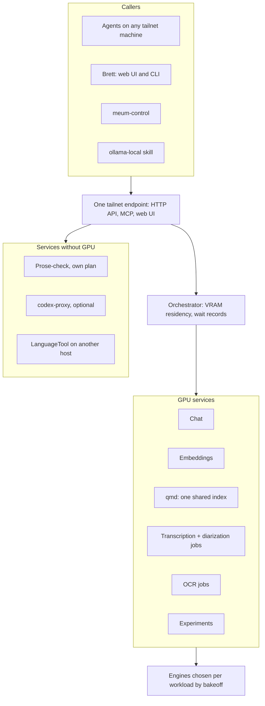
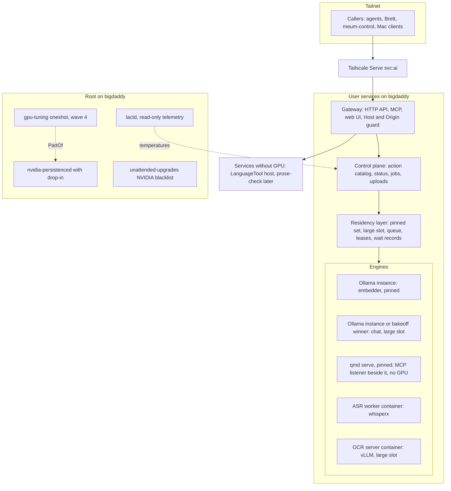
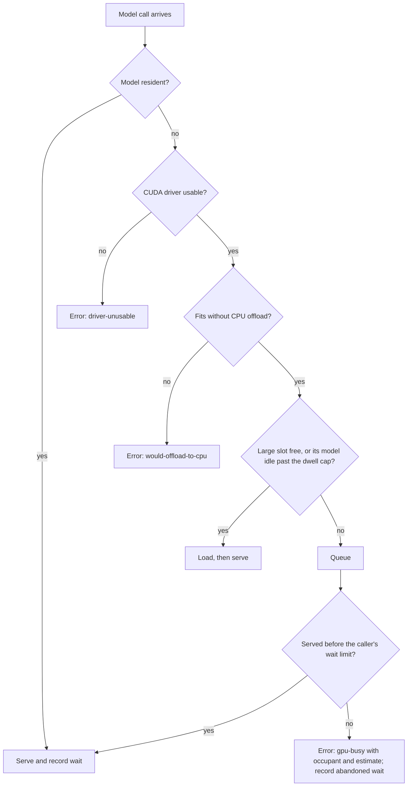
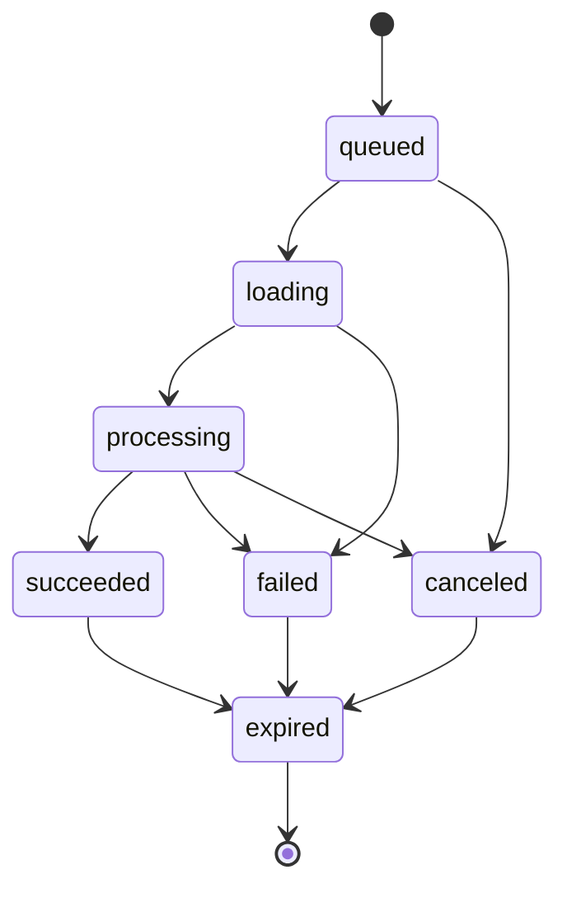
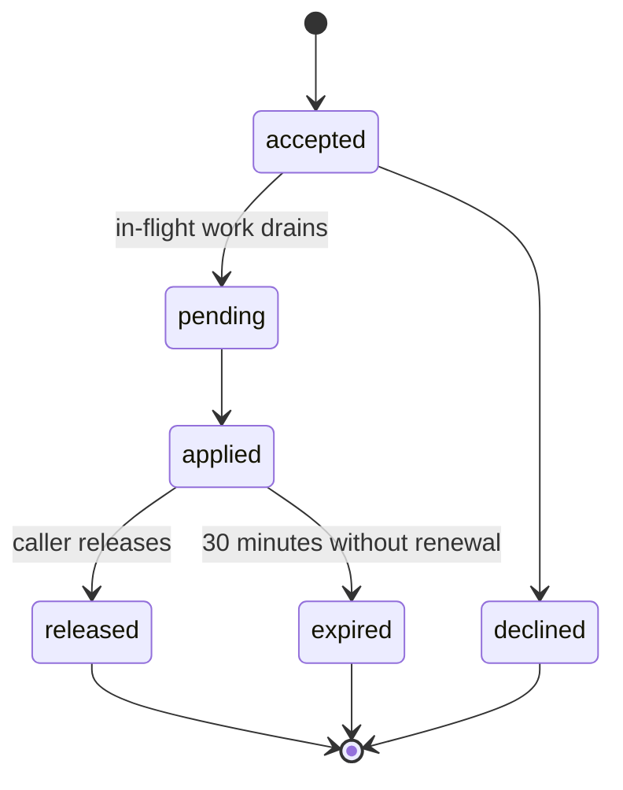
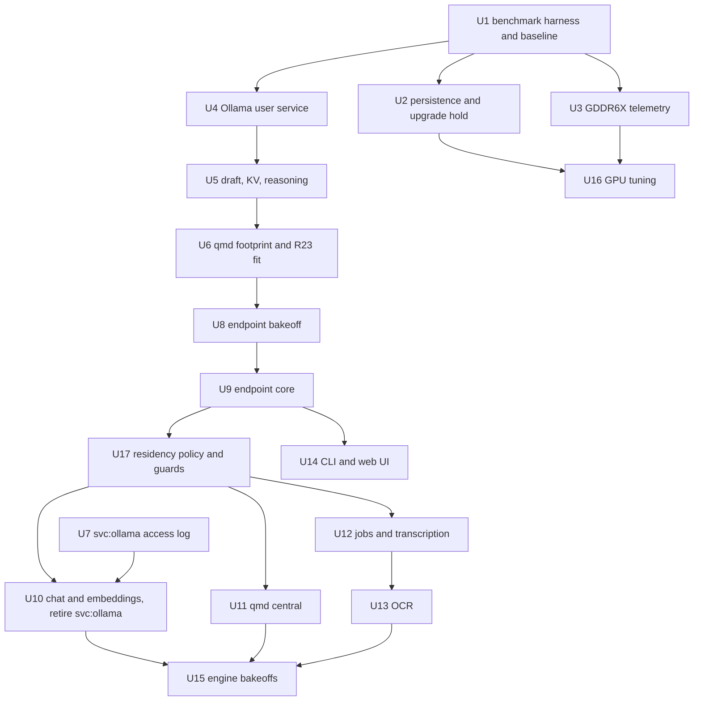

# GPU Host Performance and AI Endpoint - Plan

## Goal Capsule

- **Objective:** Every AI workload on bigdaddy (LLM chat, embeddings, qmd search, transcription, OCR) gets every
  measured speedup or cooling gain the four waves can buy against the program baseline R2 records, with any workload
  that has no winning change recorded at baseline, and every machine and agent on the tailnet reaches every AI service
  on the host through one endpoint that decides what occupies the GPU.
- **Means:** Staged waves on the existing RTX 3090 Ti: config flips on today's stack (KTD1 to KTD6); one tailnet
  endpoint backed by a residency orchestrator, assembled from existing open-source projects where they fit (KTD7 to
  KTD15); per-workload engine bakeoffs; test-gated GPU tuning (KTD16). Software only.
- **Product authority:** Brett. The Product Contract wins on behavior; Key Technical Decisions win on mechanism within
  it; units add only local deltas.
- **Execution profile:** Waves run in order and each closes with a before/after results table from the benchmark
  harness. Config and unit changes are smoke-first with static Bats coverage; no test suite loads the GPU.
- **Stop conditions:**
  - The R23 fit check (U6) finds gemma4 26B does not fit the large slot: Brett chooses the layout before wave 2.
  - The R35 bakeoff (U8) finds no candidate set that meets its criteria: stop and bring the gap list to Brett.
  - GDDR6X temperatures cannot be read headless without a kernel boot flag: wave 1 does not close (R7) until Brett
    decides, and wave 4 cannot start without them.
  - The Homebrew cask's Ollama cannot reach its CUDA runners: stop before retiring the standalone install.
  - Any evidence that a session-settled decision cannot work: stop and report it.
- **Who finishes:** `ce-work` executes the units wave by wave. Brett confirms each bakeoff decision record and runs
  deliberate NVIDIA upgrades.
- **Open blockers:** None.

---

## Product Contract

### Summary

A four-wave program for the bigdaddy GPU host, where every change is benchmarked before and after on the box and kept
only if it wins. Wave 1 lands config flips on today's stack: durable persistence, VRAM temperature telemetry, an
upgraded Ollama with its draft model, and KV cache and thinking settings. Wave 2 stands up one tailnet endpoint, backed
by an orchestrator that owns VRAM, and moves today's GPU services and a single shared qmd index behind it; jobs,
prose-check and other services join one at a time. Wave 3 picks each workload's engine by bakeoff, and wave 4 adds
test-gated GPU tuning.

### Problem Frame

bigdaddy's RTX 3090 Ti Founders Edition (24 GB, driver 580.178.04 open modules) is fast hardware running a stale stack
that is coordinated by hand. Ollama is 0.20.4 while upstream is 0.40.10, and the current `gemma4:26b` tag ships a draft
model the local copy lacks. Persistence mode is on only because of a manual `nvidia-smi -pm 1` on 2026-10-05: Ubuntu's
`nvidia-persistenced` unit starts with `--no-persistence-mode`, so the next reboot turns it off, and a driver teardown
already reset a power-limit test that day. Under CUDA the card sits in power state P2 with memory at 10251 MHz, below
its rated 10501 MHz, and token generation is bandwidth-bound.

Each GPU consumer manages VRAM for itself. Ollama pins models forever, qmd-serve loads and drops its models per query in
low-vram mode, and `transcribe-diarize` and bakeoffs unload Ollama models before they run. On the tailnet each service
gets its own URL: `svc:ollama` and `svc:codex-proxy` are live, an implementation-ready plan would add `svc:qmd`, and
every backend answers on its own with no shared view of the GPU. A Mac agent cannot search the brain host's qmd corpus
without a local index.

Nothing is blocked today: Ollama loaded models on 3 days in the last 45. The goal is headroom (every speedup a config
flip, driver patch or software change can buy) plus one front door that decides what is resident so services stop
stepping on each other. The box sits in a hot garage with no case fans, and its CPU has already hit a thermal trip, so
changes that add heat are unwelcome and GDDR6X temperature is currently invisible.

### Key Decisions

- **Software only; hardware is out.** (session-settled: user-directed — chosen over a hardware track such as a second
  GPU or cooling work: "config flips and also driver patches, etc. software mods, no hardware mods".)
- **Everything software lands in one staged plan.** (session-settled: user-directed — chosen over a config-flip-only,
  Ollama-only or GPU-baseline-only scope: the user wants all available performance, engine swaps included.)
- **Staged waves, quick wins first.** (session-settled: user-directed — chosen over building the orchestrator first and
  over one engine for everything: early measured gains, and the upgraded Ollama becomes a real bakeoff incumbent.)
- **Stock-safe now, tuning later behind tests.** Governs R9, R39, R40, R41, R42, R43. (session-settled: user-directed —
  chosen over immediate test-gated tuning and over maximum overclocking: low risk now, grow into tuning once proven.)
- **One endpoint for every AI service on the host, built in stages.** Governs R14, R15, R16, R17, R18. (session-settled:
  user-directed — chosen over a GPU-only front door now, over moving everything in one wave, and over keeping
  per-service URLs with the orchestrator underneath: one maintainable entry point that any downstream product can join.)
- **One orchestrator owns all residency, and every existing caller keeps working.** Governs R20, R31. (session-settled:
  user-directed — chosen over two engines side by side, callers adapting after a switch, or staying on Ollama: one place
  decides loads and unloads.)
- **Every GPU workload is a service.** Governs R21, R27, R30. (session-settled: user-directed — chosen over VRAM leases
  for one-shot jobs and over covering served models only.)
- **Callers state intent; the orchestrator owns state; tailnet callers get full capability.** Governs R19, R22.
  (session-settled: user-directed — chosen over agents-use/you-control tiers and over observe-only remote access: agents
  are first-class.)
- **Pinned small set plus first come, first served now; interactive-first only on measured contention.** Governs R23,
  R24, R25, R26. (session-settled: user-approved — proposed after the user preferred interactive-first but flagged
  coordination risk and noted the pinned set has worked.)
- **One shared qmd index, served by qmd's own node-llama-cpp backend as a managed service.** Governs R13, R32, R33.
  (session-settled: user-approved — keeping the node backend avoids a re-index, and the user wants one index and
  document set for every machine and agent.)
- **Adopt before building.** Governs R35. Existing open-source projects are used or adapted first, a closed or paid
  product's design may be replicated, and new code covers only the gaps.
- **Engines vary per workload; the incumbent wins a close bakeoff.** Governs R36, R37. (session-settled: user-approved —
  a separate orchestrator removes the need to standardize engines, and the tie rule keeps the engine count down.)
- **Prose-check is its own plan, hosted on this endpoint.** Governs R16, R17. (session-settled: user-directed — chosen
  over specifying prose-check inside this plan and over leaving it unlinked.)
- **Nothing kept in the stack falls behind again, and updates stay with the existing upgrade jobs.** Governs R44, R45.
  Ollama sat 20 minor versions behind because its standalone install is outside the repo's scheduled upgrade jobs.
  (session-settled: user-directed — chosen over gating every scheduled upgrade with the benchmark suite and over
  narrowing the schedule to Ollama: engines update through their package managers' existing timers, and the orchestrator
  stays out of the update path.)
- **Experiments run only what this repo defines.** Governs R27, R49. (session-settled: user-directed — chosen over
  letting any tailnet caller launch any engine command or container: no remote code execution on the host that holds the
  secrets.)
- **NVIDIA packages are excluded from unattended upgrades.** Governs R56. (session-settled: user-directed — chosen over
  draining then auto-rebooting and over freezing residency behind a reboot-required flag: no driver/library mismatch
  window opens unattended; driver security fixes wait for a deliberate upgrade.)
- **Plan-time defaults for residency, safety and cutover.** Governs R50, R51, R52, R53, R54, R55, R57. (session-settled:
  user-approved — chosen over unbounded waits, holds with no expiry, strict arrival-order swaps, tuning re-applied after
  any shutdown, and job files kept indefinitely: they close the gaps the brainstorm left open.)
- **Ollama installs the current cask release.** Governs R10. (session-settled: user-directed — chosen over waiting for a
  release at least 7 days old and over a 7-day-lagged cask in the brettdavies tap: Homebrew carries only the newest
  version and Ollama ships every few days, so a gate would stall wave 1, and a lagged tap cask adds an automation to
  maintain.)

### Actors

- A1. Brett, from the terminal on any tailnet machine, a CLI client, or the endpoint's web UI.
- A2. Agents on bigdaddy and on other tailnet machines (Claude Code, Cursor, skills), calling through the API or MCP.
- A3. Existing callers: meum-control's embeddings, the qmd CLI, the ollama-local skill, and clients of the `svc:ollama`
  URL.
- A4. The endpoint and its orchestrator, which route every call and own VRAM residency.

### Requirements

**Measurement and acceptance**

- R1. Every performance change is measured before and after on bigdaddy with one fixed benchmark suite and kept only
  when it improves its target metric without a quality regression. Endpoint and orchestrator changes in wave 2 serve
  coordination rather than speed, so each is kept when every R2 metric measured through the endpoint stays within
  run-to-run noise of the same call made directly to its backend.
- R2. The suite covers every GPU workload (LLM prompt and generation tokens per second and time to first token,
  embedding throughput, qmd query latency, transcription real-time factor, OCR seconds per page) plus GPU power, core
  temperature and, once R7 lands, VRAM temperature. Before any wave 1 change the full suite runs on today's stack, and
  that run is the program baseline, carrying forward the 2026-10-05 gemma4 and `arctic-embed-l-v2` figures.
- R3. A change that touches numerics (KV cache type, quantization, speculative decoding, clocks, engine swaps) also
  passes a quality check against the stock baseline: matching greedy LLM output or perplexity, and embedding vector
  parity or a planned re-index.
- R4. Every change deploys from this repo, reverts cleanly, and survives a reboot and a driver reload.

**Wave 1: GPU baseline (stock-safe)**

- R5. Persistence mode is on from boot and stays on without a manual command.
- R6. Any GPU setting this plan applies re-applies on its own after a reboot or a driver reload.
- R7. GDDR6X memory temperatures are readable headless and recorded with each benchmark run.
- R8. The NVIDIA driver runbook states present truth about persistence mode.
- R9. Wave 1 changes no clocks, voltages or power limits; the card stays at its stock 450 W.

**Wave 1: serving flips on today's stack**

- R10. Ollama runs the current Homebrew cask release, and gemma4 26B uses its bundled draft model at a draft depth
  chosen by measurement.
- R11. The KV cache type is chosen by measurement at the context lengths agents actually use.
- R12. Callers can turn model reasoning off per request, and agent-facing defaults follow the measured token savings.
- R13. qmd-serve's low-vram cost is measured, and qmd runs with a fixed VRAM footprint when that is faster and leaves
  the R23 large slot big enough.

**Wave 2: the endpoint**

- R14. One tailnet endpoint is the only front door for AI services on bigdaddy, except codex-proxy until its own move
  (R18), and its HTTP API, MCP server, web UI and CLI clients reach the same set of services.
- R15. Backends on bigdaddy are reachable only through the endpoint, never directly from the tailnet, except codex-proxy
  until its own move (R18).
- R16. Services that need no GPU, and services on other tailnet hosts such as the LanguageTool server, can sit behind
  the endpoint without GPU allocation.
- R17. The endpoint goes live with today's GPU services and the shared qmd index; jobs, prose-check and other services
  join one at a time afterward.
- R18. Per-service tailnet URLs retire once their callers move: `svc:ollama` after its callers are repointed, and
  `svc:codex-proxy` if codex-proxy moves behind the endpoint; `svc:qmd` is never published.
- R19. Every tailnet caller, agent or human, can make model calls, run jobs, read status and send pin or drain requests,
  and the tailnet is the trust boundary.

**Wave 2: residency**

- R20. One orchestrator behind the endpoint decides everything resident in VRAM, and no other component loads or unloads
  GPU models by itself.
- R21. Every GPU workload runs as a service behind it: chat, embeddings, qmd's models, transcription with diarization,
  and OCR.
- R22. Callers state intent (a model call, a job, a pin or drain request), and only the orchestrator changes residency.
- R23. qmd's models and the embedder stay pinned, and the rest of the card forms the large slot, which serves one large
  workload at a time, first come, first served. Wave 1 measures the pinned set's footprint with every pinned model
  resident, CUDA contexts included, and wave 2 adopts this layout only if gemma4 26B with its draft model and
  agent-length KV cache fits the large slot; if it does not, Brett chooses the layout before wave 2 starts.
- R24. A model that needs the whole card may evict the pinned set, which reloads when that model is released.
- R25. The orchestrator records how long each request and job waited for the GPU.
- R26. Interactive-first scheduling, where batch services yield between units of work, is built only when R25's data
  shows contention.
- R27. Bakeoffs and experiments run through the orchestrator, either as a temporary service or as an exclusive request
  that clears the GPU.
- R28. The orchestrator replaces every ad-hoc unload step (`ollama stop` loops, `qmd-ollama-unload-all`) once its
  services cover the work those steps made room for.
- R50. R20 binds local processes on bigdaddy as well as tailnet callers, and the orchestrator reports any GPU process it
  did not start.
- R51. A synchronous call waits for the GPU at most a caller-set limit, about a minute by default, then receives a
  structured GPU-busy answer naming the occupant and the estimated wait; the abandoned wait still counts under R25.
- R52. Pin, drain and exclusive requests are leases that expire after 30 minutes unless renewed.
- R53. When the large slot holds a model, queued work for that same model runs before a swap, for at most 10 minutes
  while other work waits.

**Wave 2: services and callers**

- R29. Synchronous model calls are served over the OpenAI-compatible API; the Ollama API is optional, and its current
  callers move under R31.
- R30. Transcription and OCR run as jobs that a caller submits, polls and fetches results from.
- R31. Every existing caller keeps working, repointed to the endpoint in the same change that moves its service:
  meum-control embeddings, `svc:ollama` clients, the ollama-local skill and qmd.
- R32. One qmd index and document set behind the endpoint serves every machine and agent, and no other machine keeps its
  own index.
- R33. qmd keeps its node-llama-cpp backend as one pinned service with a fixed footprint.
- R34. Transcription keeps diarization quality at least equal to today's whisperx and pyannote pipeline.
- R35. The endpoint and orchestrator are assembled from existing open-source projects where they fit, chosen by bakeoff
  against R14 to R34, with new code only for the gaps. The orchestrator must be able to run any engine this repo defines
  as a service, so R36's per-workload engine choice stays open.
- R55. Job inputs and results are deleted once the complete result has been fetched or after 7 days, whichever comes
  first; fetching some pages does not count.
- R57. Every agent instruction that teaches how to reach a moved service, including the global solutions-first rule, is
  rewritten in the same change that moves the service.

**Wave 3: engine bakeoffs**

- R36. Each workload's engine is chosen by its own bakeoff on bigdaddy, following the repo's local bakeoff methodology,
  with the upgraded Ollama as the incumbent for chat and embeddings.
- R37. When a challenger's gain is within run-to-run noise, the incumbent engine stays.
- R38. Wherever llama.cpp or whisper.cpp serves a workload directly, it is a CUDA build rather than the Homebrew Vulkan
  build.

**Wave 4: GPU tuning (test-gated)**

- R39. Tuning starts only after R7's memory temperature telemetry is in place.
- R40. The first tuning step restores the memory clock under CUDA to its rated 10501 MHz.
- R41. Undervolting (a clock lock plus an offset) is adopted only when it holds performance within noise and lowers
  power or temperature, with 450 W kept as the ceiling.
- R42. A memory overclock beyond rated speed is adopted only when a stepwise sweep shows a generation gain and R3's
  quality check passes at that step.
- R43. Each tuning step reverts with one command and is not applied after a failed validation.
- R54. Tuning re-applies at boot only when the previous shutdown was clean; otherwise the card stays stock and the
  endpoint status says why.

**Staying current**

- R44. Every engine and adopted project stays current through the repo's existing scheduled package-manager upgrade
  jobs, and the orchestrator itself never performs or schedules updates.
- R45. If Ollama stays, a package-manager build that keeps its CUDA runners replaces the standalone install, so an
  existing upgrade job keeps it current.
- R56. NVIDIA packages are excluded from unattended upgrades, and the endpoint status shows when an NVIDIA update is
  waiting.

**Safety guards**

- R46. The orchestrator refuses to start or route a GPU workload when the CUDA driver is unusable, such as the
  driver/library mismatch an NVIDIA package upgrade leaves until reboot, or when a model would fit only by offloading
  layers to the CPU; models already resident keep serving.
- R47. Calls to a pinned service that a whole-card model or an exclusive request evicted wait until it reloads, the wait
  is recorded under R25, and no evicted GPU service falls back to the CPU.
- R48. The endpoint accepts a request only when its Host is the endpoint's tailnet name or loopback and its Origin is
  absent or the endpoint's own web UI, and it never allows wildcard origins.
- R49. Temporary services and experiments run only engines and models this repo defines; callers choose among them and
  set allowlisted parameters, and no caller supplies a launch command, binary or container.

### Key Flows

- F1. Synchronous model call
  - **Trigger:** A caller sends a chat or embedding request to the endpoint over the OpenAI-compatible API.
  - **Actors:** A2 or A3, A4
  - **Steps:** The endpoint routes the call; the orchestrator serves it from a resident model or loads the model under
    the R23 and R24 policy; it records the wait; the response returns on the API the caller used.
  - **Covered by:** R14, R20, R23, R24, R25, R29, R31, R51, R53
- F2. Transcription or OCR job
  - **Trigger:** A caller submits audio or a PDF to the endpoint through the API or MCP.
  - **Actors:** A1 or A2, A4
  - **Steps:** The job queues; the orchestrator runs it when the large slot frees, first come, first served; the caller
    polls status and fetches the result.
  - **Covered by:** R14, R21, R23, R25, R30, R34, R55
- F3. Search from another machine
  - **Trigger:** An agent on the Mac searches the qmd corpus.
  - **Actors:** A2, A4
  - **Steps:** The agent calls the endpoint's MCP; the request reaches the pinned qmd service; results come from the one
    shared index, with no index on the Mac.
  - **Covered by:** R14, R15, R32, R33
- F4. Bakeoff or experiment
  - **Trigger:** Brett or an agent wants to try a model or engine this repo defines that is not yet a running service.
  - **Actors:** A1 or A2, A4
  - **Steps:** The caller registers a temporary service or sends an exclusive request; the orchestrator clears the GPU
    once in-flight work ends; the experiment runs; the pinned set reloads afterward.
  - **Covered by:** R19, R22, R27, R49, R52
- F5. Boot or driver reload
  - **Trigger:** The host reboots, or the GPU is torn down and reinitialized.
  - **Actors:** A4
  - **Steps:** Persistence comes up on; applied GPU settings re-apply; the endpoint and orchestrator start and load the
    pinned set.
  - **Covered by:** R5, R6, R23, R46, R54

### Acceptance Examples

- AE1. **Covers R23, R25.** Given gemma4 26B resident and idle in the large slot, when an OCR job arrives, the
  orchestrator unloads gemma4 and runs the job; a chat call that arrives mid-job waits until the job ends, and its wait
  is recorded.
- AE2. **Covers R24.** Given qmd's models pinned, when a caller requests a model that needs all 24 GB, the pinned set
  unloads, the model runs, and the pinned set reloads after the model is released.
- AE3. **Covers R5, R6.** Given the host reboots or the GPU reinitializes, when it comes back, persistence mode reads
  Enabled and every applied GPU setting is back with no manual command.
- AE4. **Covers R31, R3.** Given meum-control repointed to the endpoint's embeddings API for `arctic-embed-l-v2`, it
  gets 1024-dimension vectors that match its pre-switch vectors within the parity threshold.
- AE5. **Covers R15.** Given a backend that serves through the endpoint, when a tailnet machine calls the backend's own
  port directly, the call fails, and the same call through the endpoint succeeds.
- AE6. **Covers R37.** Given a bakeoff where the challenger beats the incumbent by less than run-to-run noise, the
  incumbent engine stays.
- AE7. **Covers R42, R3.** Given a memory offset step that raises generation speed but changes greedy output, the step
  is rejected and the previous step stays.
- AE8. **Covers R46.** Given an NVIDIA package upgrade has left a driver/library mismatch, when a caller requests a
  model that is not resident, the orchestrator returns an error instead of loading it or falling back to the CPU, and
  resident models keep serving until the host reboots.
- AE9. **Covers R48.** Given a page from another origin in a browser on a tailnet machine, when it posts a job, pin or
  drain request to the endpoint, the endpoint returns 403 and residency is unchanged.
- AE10. **Covers R51, R25.** Given a 40-minute OCR job holding the large slot, when an agent sends a chat call with the
  default wait, it receives a GPU-busy answer naming the OCR job and its estimated finish after about a minute, and the
  abandoned wait is recorded.
- AE11. **Covers R52.** Given an agent holds an exclusive request and then crashes, when 30 minutes pass without a
  renewal, the lease expires and the pinned set reloads.
- AE12. **Covers R53.** Given gemma4 resident and a queue of chat calls followed by an OCR job, chat calls keep being
  served for at most 10 minutes after the OCR job queued, then the swap happens.
- AE13. **Covers R54.** Given wave 4 tuning is active and the host loses power, when it boots, the card runs stock
  clocks and the status names the unclean shutdown.
- AE14. **Covers R50.** Given a script on bigdaddy starts a CUDA process outside the orchestrator, the endpoint status
  lists that process and its VRAM as foreign.

### Success Criteria

- Each wave closes with a before/after results table on bigdaddy, comparable to the R2 program baseline, which carries
  forward the 2026-10-05 figures: gemma4 26B at 3,976 prompt and 138.9 generation tokens per second at 450 W, and
  `arctic-embed-l-v2` at 219 texts per second.
- After wave 2, every load and unload shows up in the orchestrator's records, and no script or service clears VRAM by
  itself.
- Once callers have moved, the endpoint is the only tailnet URL that carries AI traffic to bigdaddy, except codex-proxy
  until its own move (R18), and agents on every machine search the one qmd index.
- After a reboot, every GPU setting and service is back with no manual step.

<!-- ce-section: work-relationships -->
### How This Work Fits Together

This plan covers the GPU host performance program and the single AI endpoint. The breakdown below is the current
understanding, not a committed roadmap.

- Prose-check service: Depends on this plan's endpoint (R14, R16, R17). Its rules, LLM recast behavior and output
  contract are still to decide in its own brainstorm.
- qmd MCP HTTP VIP plan (`docs/plans/2026-08-25-1628-feat-qmd-mcp-http-vip-plan.md`): Shares its goal of one corpus with
  thin clients on the Mac (R32). Its MCP HTTP listener design, Host guard and agent-instruction rewrites carry into U11;
  its separate `svc:qmd` URL gives way to the endpoint under R18.
- codex-proxy behind the endpoint: Depends on R14 and R16. Optional, and still to decide.
- A second GPU: Can proceed independently of this plan. Still to decide, on a shown use case.

### Scope Boundaries

**Deferred for later**

- A second GPU. Research so far: 48 GB fits 70B-class dense models at Q4 (16 to 32 tokens per second against about 5
  offloaded); NVLink is not required for Ollama's layer split and adds the most for vLLM or SGLang tensor-parallel; it
  needs a second 3090 Ti and the 3-slot bridge; the board gives x8/x8 in the two CPU slots, or Gen4 x4 through a
  CPU-wired M.2 slot with an OCuLink adapter (which M.2 slots are CPU-wired is unverified).
- Moving codex-proxy behind the endpoint.
- Parakeet for the ASR stage of transcription. Transcription already runs on CUDA through whisperx.
- A driver branch change (595 and later), CUDA MPS, `iommu=pt` and an HWE kernel, which show little expected gain for
  this workload.
- Pruning Ollama models not loaded in the last 45 days (`qwen3-embed-8b`, `gemma4:e2b`, `qwen3:1.7b`,
  `snowflake-arctic-embed`).

**Outside this plan**

- Prose-check's own behavior, which its separate plan defines.
- Hardware changes: case fans and cooling, thermal pads or repaste, a GPU purchase, VBIOS flashing.
- The `aikitoria/open-gpu-kernel-modules` P2P fork: it does nothing with one GPU, has no 580.178.04 branch, and cannot
  patch Ubuntu's packaged driver, whose patched core ships as a prebuilt binary.
- `keylase/nvidia-patch`: nothing on the box encodes video, `libnvidia-encode` is not installed, and NVENC did not speed
  up Remotion renders.
- Overclocking without R1 and R3 gates.
- qmd's slow collection-scoped vector search, a CPU problem with a measured fix already in the qmd fork.

**Considered and not built**

- A release cooldown for Ollama: Homebrew carries only the newest cask version, so a brew-side cooldown would block
  updates entirely, and a 7-day-lagged cask in the brettdavies tap needs its own bump automation; revisit if a bad
  Ollama release lands.
- Job webhooks: agents have no listener and poll in short checks; revisit when a service such as meum-control needs push
  delivery.
- Streaming over MCP: tool calls are request and response; streaming stays on the HTTP API.
- Automatic reboot after NVIDIA upgrades: Brett chose to hold the packages instead.
- Access tiers per caller: settled against; attribution is recorded for audit only (KTD9).

### Deferred to Follow-Up Work

- Correct the persistence claim in `docs/solutions/configuration-fixes/node-llama-cpp-gpu-backend-pin-2026-05-18.md` and
  capture the persistenced fix and the thermal-trip diagnosis as solutions docs, through `ce-compound` once U2 lands.

### Dependencies / Assumptions

- Usage is light: Ollama loaded only `arctic-embed-l-v2` and `gemma4:26b` in the last 45 days, so qmd is assumed to be
  the most-exercised GPU consumer.
- The tailnet stays the trust boundary, reached through loopback binds published by Tailscale Serve; the loopback Caddy
  proxy fronts Ollama until U10 retires `svc:ollama`.
- The LanguageTool server runs on another tailnet host (`languagetool:8081`), which R16 lets the endpoint reach.
- No single surveyed project covers the endpoint, so expect to combine projects and write some new code under R35:
  - agentgateway routes plain HTTP, LLM and MCP traffic and wraps OpenAPI services as MCP tools, but has no job API.
  - Bifrost has async jobs (transcription and OCR included) but cannot route plain HTTP.
  - LiteLLM covers most of it but needs Python and Postgres.
  - No gateway accepts the Ollama API from clients, and no hosted job queue is open source.
  - No published setup puts LLM, embeddings, diarized ASR and OCR behind one orchestrator on one GPU.
- New system-level units follow AGENTS.md (`config/systemd/system/` plus a deploy script); U4 retires the hand-stowed
  `stow/ollama` exception.
- Wave 1 adds no heat; wave 4 is gated on memory temperatures because the garage runs hot.
- The 2026-10-05 benchmark harness lives at `~/.cache/bigdaddy-diag/bench-v2.sh`, outside the repo; U1 ports it.

### Sources / Research

- Host and Origin guard (R48): KTD2 in `docs/plans/2026-08-25-1628-feat-qmd-mcp-http-vip-plan.md`; driver-mismatch guard
  (R46): the `ExecCondition` in `stow/local/dot-config/systemd/user/qmd-embed.service`.
- Persistence: `docs/runbooks/headless-gpu-server-nvidia-driver.md` (lines 102 to 105); Ubuntu `nvidia-persistenced` man
  page, https://manpages.ubuntu.com/manpages/noble/man1/nvidia-persistenced.1.html
- Prior measurements: `~/obsidian-vault/areas/infrastructure/2026-10-05-bigdaddy-thermal-shutdown.md` (300 W cap
  benchmark) and `~/obsidian-vault/areas/infrastructure/infrastructure-backlog.md` (persistence, airflow).
- Current serving config: `stow/ollama/systemd/system/ollama.service.d/override.conf`,
  `stow/local/dot-config/systemd/user/qmd-serve.service`, `stow/local/dot-local/bin/transcribe-diarize`,
  `scripts/tailscale-serve-setup.sh` (`svc:ollama`, `svc:codex-proxy`), `CONCEPTS.md` (low-vram mode).
- Learnings:
  `docs/solutions/best-practices/benchmark-against-a-re-measured-interleaved-reference-on-a-drifting-host.md`;
  `docs/solutions/best-practices/local-model-bakeoff-methodology.md`;
  `docs/solutions/integration-issues/qmd-serve-sequential-vram-coexistence-2026-04-10.md`;
  `docs/solutions/configuration-fixes/ollama-403-host-header-caddy-proxy-2026-06-22.md`;
  `docs/solutions/configuration-fixes/nvidia-addon-userspace-packages-match-driver-branch-and-version.md`;
  `docs/solutions/integration-issues/systemd-user-unit-privatetmp-hides-other-processes-in-proc.md`;
  `docs/solutions/design-patterns/vram-precondition-gating-for-gpu-test-suites.md`;
  `docs/solutions/performance-issues/vllm-server-startup-is-mostly-cpu-compile-bytecode-and-size-multimodal-profiling.md`;
  `docs/solutions/tooling/nemo-asr-faster-whisper-gpu-on-demand-with-uv-2026-09-24.md`; prior OCR choice in
  `docs/solutions/integration-issues/pdf-to-markdown-converter-migration-opendataloader.md`.
- Ollama draft model: https://ollama.com/library/gemma4:26b ; Ollama 0.30 runner change,
  https://github.com/ollama/ollama/releases/tag/v0.30.0 ; MoE draft measurements,
  https://carteakey.dev/blog/local-inference/gemma-4-26b-qat-mtp/ and https://github.com/ggml-org/llama.cpp/pull/23398 ;
  draft divergence on quantized targets, https://github.com/ggml-org/llama.cpp/issues/25618
- KV cache on CUDA: https://github.com/ggml-org/llama.cpp/issues/30790
- Undervolting and memory offsets: 3090 Ti FE results,
  https://forum.level1techs.com/t/some-gpu-5090-4090-3090-a600-idle-power-consumption-headless-on-linux-fedora-42-and-some-undervolt-overclock-info/237064
  ; 3x 3090 clock lock, https://hbfreed.com/2026/03/12/power-limits-undervolting.html ; NVML offsets,
  https://docs.nvidia.com/deploy/nvml-api/structnvmlClockOffset__v1__t.html ; CUDA P2 state,
  https://github.com/NVIDIA/open-gpu-kernel-modules/discussions/261
- Memory temperatures: LACT per-chip GDDR6X readout, https://github.com/ilya-zlobintsev/LACT/pull/1125 ;
  https://github.com/olealgoritme/gddr6
- Endpoint layer: https://github.com/agentgateway/agentgateway ; https://github.com/maximhq/bifrost (async jobs,
  https://docs.getbifrost.ai/features/async-inference) ; https://github.com/BerriAI/litellm ;
  https://github.com/IBM/mcp-context-forge
- Job API designs: Replicate predictions, https://replicate.com/docs/reference/http ; Cog,
  https://github.com/replicate/cog ; fal queue, https://fal.ai/docs/model-endpoints/queue ; whisperx job worker,
  https://github.com/pavelzbornik/whisperX-FastAPI
- Residency orchestrators: https://github.com/mostlygeek/llama-swap (Ollama API declined in issue 87 and PRs 147 and
  666; fork https://github.com/kooshi/llama-swappo), https://github.com/mudler/LocalAI (Ollama routes in
  `core/http/routes/ollama.go`), https://github.com/lordmathis/llamactl ; vLLM sleep mode,
  https://docs.vllm.ai/en/latest/features/sleep_mode/
- Upgrade jobs: `scripts/upgrade/brew.sh` (no release cooldown) and `scripts/upgrade/uv-tools.sh` (release cooldown);
  `config/shell/supply-chain.sh` (`_sc_days=7`); `scripts/upgrade/lib/stale-procs.sh` (user services only); Homebrew's
  Linux `ollama` formula is CPU-only, while the `ollama-binary` cask declares a Linux build,
  https://github.com/Homebrew/homebrew-cask/blob/HEAD/Casks/o/ollama-binary.rb
- Starred repos: https://github.com/aikitoria/open-gpu-kernel-modules ; https://github.com/keylase/nvidia-patch
- Second GPU: P2P and NVLink numbers, https://github.com/noonghunna/club-3090 ; board layout,
  https://www.asus.com/us/motherboards-components/motherboards/proart/proart-x670e-creator-wifi/

---

## Planning Contract

**Product Contract preservation:** changed R10 (the current cask release, which Brett chose over a 7-day release age),
and, through approved review fixes, R14 and R15 (codex-proxy exception), R55 (deletion after the complete result is
fetched) and the Objective (headroom wording); added R50 to R57, AE10 to AE14 and two Key Decisions, all confirmed in
the plan-time scoping synthesis; the Outstanding Questions resolved into KTD1 to KTD16 and Deferred to Implementation;
R1 to R49, A1 to A4, F1 to F5 and AE1 to AE9 keep their IDs and meaning.

### Key Technical Decisions

- KTD1. **Persistence comes from a drop-in on Ubuntu's own `nvidia-persistenced` unit.** The unit is static and started
  by the nvidia device's udev rule, so a drop-in that resets `ExecStart=` without `--no-persistence-mode` returns on
  every boot and driver reload with no `enable`. The deploy script restarts the unit and never enables it. Governs R5,
  R6.
- KTD2. **NVIDIA packages leave unattended upgrades through an `unattended-upgrades` package blacklist, not
  `apt-mark hold`.** A hold would also block the deliberate `apt upgrade` Brett runs on purpose. The blacklist file
  ships from `config/apt/` with the same deploy script as KTD1. Instantiates the NVIDIA Key Decision; governs R56.
- KTD3. **GDDR6X telemetry comes from LACT 0.10 or later in headless mode, configured read-only.** LACT reads per-chip
  memory temperatures through NvAPI with no `iomem=relaxed` boot flag, which the `gddr6` register reader would need. Its
  config carries no clock, fan, power or voltage entries, so it applies nothing in wave 1. The `.deb` is pinned by
  version and SHA-256 in the deploy script. Governs R7, R9.
- KTD4. **Ollama becomes a user service installed from the Homebrew `ollama-binary` cask.** The brew job's stale-process
  restart covers user services only, so a root service would keep running the old binary after each upgrade. The unit is
  host-gated like the other shared-package units and carries the `nvidia-smi -L` start condition from
  `qmd-embed.service`. Models move to the user model store; gemma4 is re-pulled for its draft model anyway. Governs R44,
  R45, R10. (session-settled: user-approved — chosen over keeping the root system service with a cask binary and a root
  restart hook: the existing brew job can then upgrade and restart it.)
- KTD5. **The benchmark harness lives in `scripts/gpu-bench/` and follows the drifting-host method.** It re-measures an
  interleaved stock reference, refuses any sample whose workload process shows no VRAM (a run that landed on the CPU),
  and writes results under the XDG state directory. It is not a `tests/perf` suite, because pre-push would then load the
  GPU. Governs R1, R2, R3.
- KTD6. **Quality checks per change type.** Clock and memory-offset changes must match stock greedy output byte for
  byte. Speculative decoding, KV cache type, quantization and engine swaps must stay within a perplexity delta on a
  fixed text, because greedy output diverges under drafts on quantized targets. Embedding changes must meet a
  cosine-parity threshold or schedule a re-index. Governs R3.
- KTD7. **The endpoint has two layers, chosen together by the U8 bakeoff:** a gateway (HTTP API, MCP aggregation, web
  UI, Host and Origin guard, deny-by-default route allowlist, routing to services without GPU) and a residency layer
  (loads, pinned set, large slot, queue). The shortlists are agentgateway, Bifrost and LiteLLM for the gateway and
  llama-swap, LocalAI and llamactl for residency; one project may cover both. New code covers only the gap list U8's
  decision record names. The expected gaps are leases, wait records, the status document and the action catalog, plus
  the job API unless a chosen project's async jobs meet R30 and R55. Governs R35.
- KTD8. **New code lives in its own repository and ships through an existing upgrade job.** AGENTS.md holds dotfiles to
  configuration plus deploy scripts. The control plane ships as a uv tool or a formula in the brettdavies Homebrew tap,
  so the existing `uv-tools-upgrade` or `brew-upgrade` job keeps it current, and dotfiles carries its units, config and
  install line. Every adopted project needs the same kind of upgrade path, which U8 checks as pass or fail. Governs R44,
  R35.
- KTD9. **One action catalog behind every surface, with one error contract.** MCP tools, CLI subcommands and web UI
  controls are thin layers over the same HTTP operations and return the same objects. Errors follow the repo owner's
  contract: a stable kebab-case `reason` from a closed set (starting with `gpu-busy`, `model-loading`,
  `service-evicted`, `driver-unusable`, `would-offload-to-cpu`, `not-repo-defined`, `parameter-not-allowed`,
  `origin-rejected`, `job-not-found`, `input-too-large`, `result-expired`, `lease-expired`), an exit code, a message,
  the offending value and a `next_step`. The endpoint's status tool is `endpoint_status`, because qmd's MCP already
  ships `status`, and qmd's tool names stay as they are. Attribution (Tailscale identity headers plus a caller label) is
  recorded for audit and never gates anything. Governs R14, R19, R51.
- KTD10. **Jobs copy Replicate's prediction object, split into finer states.** The states are `queued`, `loading`,
  `processing`, `succeeded`, `failed`, `canceled` and `expired`. Each job carries wait, load and run metrics. Submits
  are idempotent by key, and results are partial per page or segment. Inputs arrive through an upload call that returns
  a file id, because agents on other machines cannot pass a host path. Jobs live in a store that survives restarts.
  Callers poll; there are no webhooks. Governs R30, R55.
- KTD11. **Callers reach only catalog routes, and Ollama runs behind the orchestrator as single-model instances.** The
  gateway allows only the OpenAI inference routes, the MCP endpoint, the optional Ollama inference routes and the action
  catalog. Any other route of an adopted project (install, model management, admin, unload) returns `not-repo-defined`
  and changes nothing, and request-level `keep_alive` is stripped or turned into a residency request. If Ollama stays an
  engine, each instance holds one model (`OLLAMA_MAX_LOADED_MODELS=1`, residency set by the orchestrator), and the
  pinned embedder and the large-slot chat model run as separate instances. Governs R20, R22, R49.
- KTD12. **Privilege split: the endpoint, orchestrator and engines run as user services; root runs only GPU hardware
  settings, the read-only `lactd` telemetry daemon and apt policy.** User services fit the brew job's restart path and
  need no root to manage engines. Units that map GPU process IDs through `/proc` leave out `PrivateTmp=`, `ProtectHome=`
  and `PrivateDevices=`, which hide other processes on this host. Governs R20, R50, R44.
- KTD13. **The endpoint is published as `svc:ai` (`ai.<tailnet>`), with a Host allowlist of that name plus loopback and
  no wildcard origins**, following the qmd plan's KTD2. `svc:ollama` gains Caddy access logging in wave 1, and retires
  once its log shows no remaining callers after repointing. Governs R18, R48. (session-settled: user-approved — chosen
  over retiring `svc:ollama` blind: the log shows who still calls it.)
- KTD14. **`qmd serve` stays the one pinned qmd GPU process, and qmd's MCP HTTP listener runs beside it with no GPU.**
  `qmd mcp --http` builds its own model runtime today, so the qmd fork gains two things: an option that loads all three
  models at start with idle disposal off, and `QMD_REMOTE_URL` support in the store the MCP listener uses, so it sends
  inference to `qmd serve`. `qmd-embed` and local CLI queries also reach `qmd serve` through `QMD_REMOTE_URL`.
  `qmd serve` drops `--low-vram` only when U6 records that as faster. Mac clients reach qmd only through the endpoint's
  MCP, and the qmd plan's own URL is not published. Governs R13, R32, R33, R50.
- KTD15. **Residency defaults live in orchestrator config with the values R51 to R53 own.** The defaults are a 60-second
  default wait, a 30-minute renewable lease and a 10-minute same-model dwell. Wait records include abandoned waits.
  Governs R51, R52, R53.
- KTD16. **Wave 4 settings apply through one root oneshot tied to `nvidia-persistenced`.** It is `PartOf=` and
  `WantedBy=` the persistenced service, so it re-applies whenever persistenced restarts. It reads one repo config of
  offsets and clock locks and applies nothing unless the previous shutdown was clean and the step's validation record
  exists. One revert command resets clocks and offsets to stock. Governs R6, R40, R41, R42, R43, R54.
- KTD17. **Workers that parse uploaded files run in containers.** The ASR worker (ffmpeg, whisperx, pyannote) and the
  OCR server parse files agents may have fetched from the web, and user-unit sandboxing is inert on this host. Each runs
  as a container under its user unit, following `stow/codex-proxy/`, with `nvidia-container-toolkit` for the GPU. It
  mounts only the GPU, the job-store directory and a read-only model cache: no home directory, no Docker socket and no
  credentials. Gated model weights are fetched once at deploy time, and the workers run offline. Governs R30, R49.

### High-Level Technical Design

Process and privilege topology after wave 2. Root owns only hardware settings and apt policy; everything that loads
models runs as the user.

How a synchronous model call is decided (R46, R47, R50 to R53):

Job lifecycle (KTD10):

Residency request lease lifecycle (R52):

Unit dependencies across the waves:

### Assumptions

- LACT 0.10 or later reads GDDR6X temperatures on this card with the 580 open modules; research verified Ampere support,
  not this host.
- The `ollama-binary` cask's binary finds its CUDA runners inside the Caskroom tree; U4 verifies this before retiring
  the standalone install.
- Tailscale Serve passes identity headers to loopback backends, which the access log and attribution use.
- The mc-pdf OCR entry point is present on bigdaddy for the harness's OCR stage; when absent, the stage is recorded as
  skipped.
- The existing Ollama store copies into the user store unchanged, including the locally built `arctic-embed-l-v2`, which
  the registry does not carry; only the draft-carrying `gemma4:26b` tag is pulled.

### Alternatives Considered

- **Keep Ollama a root service with the cask binary and a root restart hook.** Rejected: it needs a new privileged hook,
  and whether the `ollama` system user can read the Homebrew prefix is unverified (KTD4).
- **A boot oneshot running `nvidia-smi -pm 1`.** Rejected: a driver teardown resets it, and the persistenced flag is the
  supported path (KTD1).
- **The `gddr6` register reader for temperatures.** Rejected: it needs `iomem=relaxed`, a kernel boot change inside the
  stock-safe wave (KTD3).
- **Writing the control plane inside dotfiles.** Rejected: the repo is configuration-only by its own rules (KTD8).
- **`apt-mark hold` for NVIDIA packages.** Rejected: it blocks deliberate upgrades too (KTD2).
- **A planning-time bake-off for the orchestrator.** Not needed: R35 already makes the choice a measured bakeoff on the
  box (U8), which needs the real host rather than more design work.

### System-Wide Impact

- **Every agent session:** U11 rewrites the global solutions-first rule in `stow/claude/dot-claude/CLAUDE.md`, which
  every Claude Code session loads, so the rewrite lands in the same change as the qmd move (R57).
- **The Mac:** loses its local qmd index and reaches search only through the endpoint (R32); it depends on bigdaddy and
  the tailnet being up.
- **Tailnet clients of `svc:ollama`:** repointed before the URL retires (R18, R31).
- **Other repositories:** meum-control (embeddings URL), `~/dev/agent-skills` (the ollama-local and qmd skills), mc-pdf
  (the OCR job path) and the new control-plane repo all change.
- **Security patch latency:** NVIDIA driver fixes now wait for a deliberate upgrade (R56).
- **Thermals:** wave 4 changes power and heat on a box with a CPU thermal-trip history, gated on telemetry (R39) and
  clean shutdowns (R54).

### Risks & Dependencies

| Risk                                                                                                        | Mitigation                                                                                |
| ----------------------------------------------------------------------------------------------------------- | ----------------------------------------------------------------------------------------- |
| Ollama ships every few days, and its updates land as soon as Homebrew carries them (R10, R44)               | U4 benchmarks the install; each wave's benchmark run shows any later regression           |
| gemma4 with draft and agent-length KV cache does not fit beside the pinned set                              | U6 measures it, and R23 stops for Brett's layout choice                                   |
| LACT's NvAPI register path is undocumented                                                                  | Read-only use in wave 1; a failure blocks wave 4 rather than forcing a kernel flag        |
| No endpoint candidate covers enough                                                                         | U8 stops with the gap list; KTD8 puts the glue in its own repo                            |
| A tuning step corrupts output silently (NaNs, garbage tokens) before it crashes                             | KTD6 greedy-match for clock steps, and R43 revert                                         |
| An unclean power-off re-applies a bad tuning step on boot                                                   | R54 clean-shutdown gate                                                                   |
| `needrestart` restarts a GPU service mid-upgrade onto a mismatched driver                                   | The `nvidia-smi -L` start condition on GPU units (KTD4) and R46 refuse to start           |
| Concurrent sessions edit `CONCEPTS.md`, `stow/claude/dot-claude/CLAUDE.md` and `.github/workflows/bats.yml` | Units touching them rebase on the current file; nothing here depends on uncommitted edits |

### Deferred to Implementation

- The exact LACT read interface (its CLI or its socket) for the harness sampler.
- Whether the mc-pdf OCR container runs always-on or under vLLM sleep mode; this depends on the U8 choice.
- The exact package-name patterns the unattended-upgrades blacklist needs, checked against installed package names.
- The clean-shutdown marker mechanism for R54.
- The control-plane repo's name and language, and the CLI's name.
- The Ollama instance layout behind the orchestrator; KTD11 sets the constraint and U8 decides the mechanism.

### Documentation / Operational Notes

- AGENTS.md's System-Level Units list gains the persistenced drop-in, the apt blacklist, lactd and the gpu-tuning
  oneshot; the `stow/ollama` exception and its README go away.
- `docs/runbooks/headless-gpu-server-nvidia-driver.md` states present truth about persistence and documents the
  deliberate NVIDIA upgrade: upgrade, reboot, verify.
- Per-wave results land in `docs/research/gpu-host-performance-results.md`; the bakeoff decision records land beside it
  in `docs/research/`.
- `CONCEPTS.md` gains pinned set, large slot, residency request, exclusive request, temporary service and program
  baseline when U9 makes them real.

---

## Implementation Units

Units that change another repository name it as the target repo; their paths are relative to that repo.

| U-ID | Title                                        | Files touched                                                                                     | Depends on    |
| ---- | -------------------------------------------- | ------------------------------------------------------------------------------------------------- | ------------- |
| U1   | Benchmark harness and program baseline       | `scripts/gpu-bench/`, `tests/gpu-bench.bats`                                                      | —             |
| U2   | Persistence and NVIDIA upgrade hold          | `config/systemd/system/nvidia-persistenced.service.d/`, `config/apt/`, `scripts/nvidia-deploy.sh` | U1            |
| U3   | GDDR6X telemetry                             | `scripts/lact-deploy.sh`, `config/lact/`, `scripts/gpu-bench/`                                    | U1            |
| U4   | Ollama as a user service from the cask       | `stow/local/dot-config/systemd/user/ollama.service`, `stow/brew/Brewfile`, `stow/ollama/`         | U1            |
| U5   | Draft model, KV type and reasoning defaults  | `stow/local/dot-config/systemd/user/ollama.service`, results doc                                  | U4            |
| U6   | qmd footprint and the R23 fit check          | `stow/local/dot-config/systemd/user/qmd-serve.service`, `tests/qmd-serve.bats`                    | U5            |
| U7   | svc:ollama access log                        | `stow/caddy/dot-config/caddy/Caddyfile`                                                           | —             |
| U8   | Endpoint and orchestrator bakeoff            | `docs/research/` decision record                                                                  | U6            |
| U9   | Endpoint core                                | new stow package, control-plane repo                                                              | U8            |
| U17  | Residency policy and safety guards           | control-plane repo, endpoint stow package                                                         | U9            |
| U10  | Chat and embeddings behind the endpoint      | `scripts/tailscale-serve-setup.sh`, `stow/caddy/`, caller configs                                 | U17, U7       |
| U11  | qmd central behind the endpoint              | qmd fork, qmd units, `stow/claude/dot-claude/CLAUDE.md`, skills                                   | U17           |
| U12  | Jobs, uploads and the transcription service  | control-plane repo, `stow/local/dot-local/bin/transcribe-diarize`                                 | U17           |
| U13  | OCR as a job service                         | mc-pdf repo, endpoint config                                                                      | U12           |
| U14  | CLI client and web UI                        | control-plane repo, install line                                                                  | U9            |
| U15  | Per-workload engine bakeoffs and CUDA builds | `docs/research/`, endpoint config                                                                 | U10, U11, U13 |
| U16  | Test-gated GPU tuning                        | `config/systemd/system/gpu-tuning.service`, `config/gpu-tuning/`, `scripts/gpu-tuning-deploy.sh`  | U2, U3        |

### U1. Benchmark harness and program baseline

- **Goal:** One fixed suite measures every GPU workload on bigdaddy with quality checks, and its first run records the
  program baseline before any other change.
- **Requirements:** R1, R2, R3; KTD5, KTD6.
- **Dependencies:** None.
- **Files:**
  - Create `scripts/gpu-bench/gpu-bench` (entry point) and `scripts/gpu-bench/lib/` (stages, sampler, quality checks,
    interleaving).
  - Create `scripts/gpu-bench/fixtures.tsv` (fixed inputs by name and SHA-256; the files themselves live outside the
    repo).
  - Create `tests/gpu-bench.bats`.
  - Create `docs/research/gpu-host-performance-results.md` with the baseline table.
- **Approach:**
  1. Port `~/.cache/bigdaddy-diag/bench-v2.sh`: the cooldown wait on CPU temperature, the background sampler, and the
     qmd timers stopped for the run and restored by an exit trap.
  2. Add stages for LLM prompt, generation and time to first token at agent context lengths, embedding batch throughput,
     qmd query latency, transcription real-time factor on a fixed clip, and OCR seconds per page through mc-pdf's entry
     point.
  3. Sample power, core temperature, P-state and memory clock per sample, plus GDDR6X temperature once U3 lands.
  4. Run each comparison as interleaved arms against a re-measured stock reference and report paired medians.
  5. Reject a sample whose workload process shows zero VRAM in the compute-apps query.
  6. Implement the KTD6 checks: greedy byte match at a fixed seed, perplexity on a fixed text when a GGUF path is
     available, and cosine parity against stored baseline vectors.
  7. Write JSON Lines plus a markdown table under the XDG state directory; `--baseline` writes the program baseline
     once.
- **Execution note:** Build the static suite with stubbed `nvidia-smi`, `curl` and `ollama` first; the first live run is
  the program baseline.
- **Patterns to follow:** `stow/local/dot-local/bin/qmd-gpu-verify` (process-to-VRAM check),
  `scripts/upgrade/lib/run-log.sh` (JSON Lines shape),
  `docs/solutions/best-practices/benchmark-against-a-re-measured-interleaved-reference-on-a-drifting-host.md`, the bash
  4.4 guard and error prefixes from AGENTS.md.
- **Test scenarios:**
  - A stage whose process shows 0 MiB VRAM is recorded as rejected with reason `cpu-fallback` and left out of the
    medians.
  - A two-arm comparison runs in the order reference, candidate, reference, candidate.
  - The qmd timers are stopped before the run and restored afterward, including when a stage fails.
  - With no OCR entry point, the OCR stage is recorded as skipped with a `NOTE:` and the run still exits 0.
  - A second `--baseline` refuses to overwrite the stored baseline without `--force`.
  - The greedy check reports a mismatch when two completions differ by one byte.
  - An embedding pair below the parity threshold is reported as a quality failure.
  - An unknown option exits 2 with a usage message.
- **Verification:** A live `--baseline` run on bigdaddy produces a table covering all five workloads, or names any it
  skipped, with power and temperatures, and the table is committed to the results doc.

### U2. Persistence and NVIDIA upgrade hold

- **Goal:** Persistence is on from every boot and driver reload, NVIDIA packages are out of unattended upgrades, and the
  runbook says so.
- **Requirements:** R4, R5, R6, R8, R9, R56; KTD1, KTD2; the NVIDIA Key Decision.
- **Dependencies:** U1.
- **Files:**
  - Create `config/systemd/system/nvidia-persistenced.service.d/override.conf`.
  - Create `config/apt/apt.conf.d/52unattended-upgrades-nvidia`.
  - Create `scripts/nvidia-deploy.sh` and `tests/nvidia-deploy.bats`.
  - Modify `docs/runbooks/headless-gpu-server-nvidia-driver.md` and `AGENTS.md` (System-Level Units).
- **Approach:**
  1. The drop-in resets `ExecStart=` and runs the daemon with `--persistence-mode`.
  2. The apt file adds NVIDIA package patterns to `Unattended-Upgrade::Package-Blacklist`.
  3. The deploy script follows the existing deploy scripts: root gate, copy, `daemon-reload`, restart
     `nvidia-persistenced` (static, so never enable), then confirm persistence reads Enabled. A `--render` mode prints
     both files without root for tests.
  4. The runbook replaces the "Disabled is expected" note with present truth and adds the deliberate upgrade procedure:
     upgrade, reboot, verify.
  5. Before closing, confirm what `needrestart` does to GPU services during a deliberate upgrade, and record the answer
     in the runbook.
- **Patterns to follow:** `scripts/apparmor-deploy.sh`, `scripts/nas-deploy.sh`, `tests/tailscale-serve-deploy.bats`,
  `tests/nas-units.bats`.
- **Test scenarios:**
  - The rendered drop-in has an empty `ExecStart=` followed by exactly one `ExecStart=` with `--persistence-mode` and no
    `--no-persistence-mode`.
  - `systemd-analyze verify` passes on the drop-in merged with a stub base unit, and is skipped when the tool is absent.
  - The apt file lists patterns covering the `nvidia-` and `libnvidia-` package families.
  - Run without root, the deploy script exits 1 with a `FATAL:` message.
  - With a stubbed `systemctl`, the deploy script restarts `nvidia-persistenced` and never calls `enable`.
  - A usage error exits 2.
- **Verification:** Covers AE3. After deploy and a reboot, persistence reads Enabled with no manual command.
  `unattended-upgrade --dry-run --debug` shows the NVIDIA packages blacklisted, and the runbook matches the host.

### U3. GDDR6X telemetry

- **Goal:** Per-chip GDDR6X temperatures are readable headless and recorded by every benchmark run, without changing any
  GPU setting.
- **Requirements:** R7, R9, R39 (prerequisite); KTD3.
- **Dependencies:** U1.
- **Files:**
  - Create `scripts/lact-deploy.sh`, `config/lact/config.yaml` and `tests/lact-deploy.bats`.
  - Modify `scripts/gpu-bench/lib/` (sampler column) and `AGENTS.md`.
- **Approach:**
  1. The deploy script installs the pinned `lact-headless` `.deb` after checking its SHA-256, places the read-only
     config, and enables `lactd`.
  2. The config has no clock, fan, power or voltage entries.
  3. The harness sampler records the hottest memory chip per sample through LACT's interface, and records `null` with a
     `NOTE:` when `lactd` is absent.
- **Execution note:** Mostly packaging and config; prove it with an install-and-read smoke check on the host.
- **Patterns to follow:** `scripts/apparmor-deploy.sh` (root gate, pre-flight), the supply-chain pinning rule in the
  global instructions.
- **Test scenarios:**
  - The deploy script refuses a `.deb` whose SHA-256 differs from the pinned value.
  - A static check fails if the LACT config contains any clock, fan, power or voltage key.
  - Run without root, the deploy script exits 1 with a `FATAL:` message.
  - The sampler emits a memory temperature when the stubbed reader returns one, and `null` with a `NOTE:` when it is
    missing.
- **Verification:** A gemma4 benchmark run shows the per-run maximum GDDR6X temperature. `nvidia-smi` shows stock clocks
  and power limits after `lactd` starts.

### U4. Ollama as a user service from the cask

- **Goal:** Ollama runs as a host-gated user service from the Homebrew cask, so the existing brew job upgrades and
  restarts it, and the standalone root install is gone with no model or caller lost.
- **Requirements:** R1, R3, R4, R10, R31, R44, R45, R46; KTD4, KTD6.
- **Dependencies:** U1.
- **Files:**
  - Create `stow/local/dot-config/systemd/user/ollama.service` and `tests/ollama-service.bats`.
  - Create `scripts/ollama-cask-preflight.sh` (the user-side CUDA check) and `scripts/ollama-system-retire.sh` (the
    one-time root step that stops, disables and removes the old system unit and drop-in).
  - Modify `stow/brew/Brewfile`: add the Linux-gated cask line with its reason, and correct the out-of-date "casks are
    macOS-only" comment.
  - Modify `config/shell/shell-functions` (retire `ollama-update`) and `tests/stow-deploy-packages.bats` (drop `ollama`
    from `NOT_DEPLOYED`).
  - Delete `stow/ollama/`.
- **Approach:**
  1. As the user, the preflight installs the current cask release (R10).
  2. It runs the binary once on `127.0.0.1:11435` against a copy of the store, and confirms the CUDA backend in its log.
  3. Run the U1 chat and embedding stages interleaved between the system service and the temporary instance, with the
     KTD6 perplexity check for gemma4 and cosine parity for `arctic-embed-l-v2`. A regression or parity failure stops U4
     here.
  4. Copy the system store's manifests and blobs into the user store, and confirm `ollama list` shows every tag with
     unchanged digests. `arctic-embed-l-v2` was built locally and cannot be re-pulled.
  5. Run the root retire script, which stops, disables and removes the system unit and its drop-in.
  6. Start the user unit on `127.0.0.1:11434` with the old override's environment, the `nvidia-smi -L` start condition,
     `ConditionHost=bigdaddy`, and no `PrivateTmp=`.
  7. Pull `gemma4:26b` for its draft model. Remove the system store only after the user service serves every caller.
  8. Caddy and `svc:ollama` stay as they are, because the port is unchanged.
- **Patterns to follow:** `stow/local/dot-config/systemd/user/qmd-embed.service` (start condition),
  `stow/local/dot-config/systemd/user/brew-upgrade.service` (host gate, Homebrew PATH), `Brewfile` `if OS.linux?` lines.
- **Test scenarios:**
  - The unit has `ExecCondition=/usr/bin/nvidia-smi -L`, a loopback `OLLAMA_HOST`, `ConditionHost=bigdaddy`, an
    `ExecStart` under the Homebrew prefix, and no `PrivateTmp=`.
  - The Brewfile's `ollama-binary` cask line carries `if OS.linux?`.
  - The preflight stops when the temporary instance's log shows no CUDA backend.
  - Run without root, the retire script exits 1 with a `FATAL:` message.
  - The store-copy step refuses to remove the system store when any digest differs.
  - `ollama-update` is no longer defined after sourcing the shell functions.
  - `tests/stow-deploy-packages.bats` passes with `stow/ollama/` removed.
- **Verification:**
  - `ollama --version` resolves to the Homebrew prefix, and the journal shows the CUDA backend.
  - The results doc shows the upgrade's interleaved comparison within noise and passing the quality checks.
  - `svc:ollama` still answers `/api/tags` through Caddy, and meum-control's embeddings still match its stored vectors.
  - After the next scheduled brew upgrade, the run log shows the user service restarted.

### U5. Draft model, KV type and reasoning defaults

- **Goal:** gemma4's draft depth, the KV cache type and agent-facing reasoning defaults are each set from measurement.
- **Requirements:** R3, R10 (draft depth), R11, R12; KTD6.
- **Dependencies:** U4.
- **Files:**
  - Modify `stow/local/dot-config/systemd/user/ollama.service` (KV cache setting).
  - Modify `docs/research/gpu-host-performance-results.md`.
  - Target repo `~/dev/agent-skills`: modify `ollama-local/SKILL.md` (reasoning toggle and its default).
- **Approach:**
  1. Run draft depths 0 to 3 as interleaved arms, judged by perplexity rather than greedy match, because drafts diverge
     on quantized targets.
  2. Run f16 against q8_0 KV at the context lengths agents use, with flash attention on, since q8_0 without it silently
     stays f16.
  3. Measure tokens saved with reasoning off for agent-style calls, and set the skill's default from that number.
- **Test scenarios:**
  - The Ollama unit test asserts flash attention stays on whenever the KV type is q8_0.
- **Verification:** The results doc shows each arm against the baseline. The chosen draft depth beats baseline
  generation beyond noise and passes the perplexity check.

### U6. qmd footprint and the R23 fit check

- **Goal:** Measure qmd's low-vram cost and every pinned footprint, keep qmd resident when that is faster, and record
  whether gemma4 fits the large slot.
- **Requirements:** R13, R23 (measurement); KTD14.
- **Dependencies:** U5.
- **Files:** Modify `stow/local/dot-config/systemd/user/qmd-serve.service`, `tests/qmd-serve.bats` (the `--low-vram`
  assertion) and `docs/research/gpu-host-performance-results.md`.
- **Approach:**
  1. Measure qmd query latency with and without `--low-vram`, interleaved, after the 2048-token embed-batch change.
  2. Measure resident VRAM for qmd-serve with all models loaded, the embedder instance, and gemma4 with its draft at the
     chosen KV and agent context, each with its CUDA context.
  3. Record the large slot (24,564 MiB minus the pinned set) and the fit verdict; a failed fit is a stop condition.
- **Test scenarios:**
  - When adopted, the qmd-serve unit no longer passes `--low-vram`, and the test asserts that.
  - The unit still sets `NODE_LLAMA_CPP_GPU=cuda`.
- **Verification:** The results doc holds both latencies, the footprint table and a fit verdict.

### U7. svc:ollama access log

- **Goal:** Every request through `svc:ollama` is logged with its caller, so its retirement waits on evidence.
- **Requirements:** R18, R31; KTD13.
- **Dependencies:** None.
- **Files:** Modify `stow/caddy/dot-config/caddy/Caddyfile`; create `tests/caddy.bats`.
- **Approach:** Add a Caddy `log` block that writes to a rotated file under the XDG state directory and records the
  Tailscale identity headers.
- **Execution note:** Config only; prove it with a request through the VIP.
- **Test scenarios:**
  - The Caddyfile's site block has a `log` directive writing to a file under the state directory, with rotation.
  - `caddy validate` accepts the file, and the check is skipped when Caddy is absent.
- **Verification:** A request from another tailnet machine appears in the log with its identity.

### U8. Endpoint and orchestrator bakeoff

- **Goal:** Choose the gateway and residency layers, or one project for both, by a measured bakeoff on bigdaddy.
- **Requirements:** R1, R35, R44, with R14 to R34 and R46 to R53 as criteria; KTD7, KTD8, KTD11.
- **Dependencies:** U6.
- **Files:** Create `docs/research/<date>-gpu-endpoint-bakeoff.md` (the decision record). Candidate configs stay outside
  the repo.
- **Approach:**
  1. Follow `docs/solutions/best-practices/local-model-bakeoff-methodology.md`: isolated environments, and the card
     freed before each run.
  2. Score each candidate set on:
     - residency control (pinned set, large slot, external engine commands, vLLM sleep and wake);
     - the OpenAI API;
     - MCP aggregation with qmd's tool names unchanged;
     - the Host and Origin guard;
     - blocking every admin, install and model-management route at the gateway (KTD11);
     - plain-HTTP routing;
     - async jobs that meet R30 and R55, or a clean seam for the job layer;
     - an install and upgrade path through the existing brew or uv-tools job (pass or fail, KTD8);
     - headless systemd operation, license and release cadence.
  3. Measure proxy overhead per R2 metric against direct backend calls (R1).
  4. Record the chosen stack and the gap list that new code fills.
- **Test expectation:** none -- research and a decision record; no code ships in this unit.
- **Verification:** Brett confirms a decision record that names the chosen layers, their measured overhead, their
  upgrade path and the gap list. If no set clears the criteria, the stop condition applies.

### U9. Endpoint core

- **Goal:** The chosen layers run as user services on `svc:ai`, with the action catalog, status document, error
  contract, route allowlist and Host and Origin guard in place.
- **Requirements:** R14, R15, R16, R19, R48, R49, R50, R56; KTD7, KTD9, KTD11, KTD12, KTD13.
- **Dependencies:** U8.
- **Files:**
  - Create a new stow package for the endpoint (user units with `ConditionHost=bigdaddy`, config), registered in
    `scripts/stow-deploy` and `tests/stow-deploy-packages.bats`, with tests.
  - Modify `scripts/tailscale-serve-setup.sh` (the `svc:ai` block), `stow/brew/Brewfile` or the uv tool list (install
    line), `CONCEPTS.md` and `AGENTS.md`.
  - Target repo, new control-plane repository: the action catalog, status document, error registry and foreign-process
    report.
- **Approach:**
  1. Deploy the chosen layers and the control plane as user services, all loopback-bound.
  2. Engines run only as services defined in repo config (R49): the catalog's schemas have no command, binary or image
     field, and the gateway allows only catalog routes (KTD11).
  3. The status document reports:
     - driver health and pending NVIDIA updates;
     - VRAM, temperatures and each service's state;
     - foreign GPU processes, by PID, executable name, owning user and VRAM only, never argv or environment. U17 adds
       the residency fields.
  4. Publish `svc:ai` with the R48 guard and approve it in the admin console.
- **Execution note:** Start with failing contract tests for the catalog and error reasons against a stubbed engine.
- **Patterns to follow:** `stow/local/dot-local/bin/qmd-gpu-verify` (process-to-VRAM mapping only; it also reads
  environments, which the status report must not), `scripts/tailscale-serve-setup.sh` blocks, `stow/codex-proxy/`
  (containerized service unit).
- **Test scenarios:**
  - Covers AE5. A direct call to a backend port from a non-loopback address fails.
  - Covers AE9. A request with a foreign Origin returns 403 `origin-rejected`, and residency is unchanged.
  - Covers AE14. A CUDA process the orchestrator did not start appears as foreign in the status document.
  - A stubbed foreign process whose argv and environment hold a token string never shows that string in the status
    document over HTTP or MCP.
  - A call to a backend route outside the catalog, such as a model or backend install route, returns `not-repo-defined`
    and leaves services and residency unchanged.
  - An experiment request with a command field is rejected as `parameter-not-allowed`.
  - Every error across HTTP, MCP and CLI carries `reason`, `exit_code`, `message` and `next_step`.
  - The status document lists a pending NVIDIA update when the stubbed package query reports one.
- **Verification:** A status call through `svc:ai` from another tailnet machine returns the status document. The R2
  suite measured through the endpoint stays within noise of direct calls (R1).

### U17. Residency policy and safety guards

- **Goal:** The orchestrator owns residency under the pinned-set and large-slot policy, with waits, leases, dwell and
  the driver and CPU guards enforced, and the benchmark harness runs through it.
- **Requirements:** R20, R22 to R27, R46, R47, R51, R52, R53; KTD11, KTD15.
- **Dependencies:** U9.
- **Files:**
  - The residency layer U8 chose: its config for residency decisions and the queue.
  - Target repo, new control-plane repository: leases, wait records, the request-body sanitizer and any other gap U8
    recorded.
  - Modify the endpoint stow package's residency config (pinned set and the KTD15 defaults) and `scripts/gpu-bench/`
    (exclusive-lease mode).
- **Approach:**
  1. Residency follows R23 to R27 and R51 to R53 with the KTD15 defaults, and the guards follow R46 and R47.
  2. The status document gains the pinned set, the large-slot occupant, the queue, open leases and a "what would serving
     X take" estimate.
  3. The sanitizer and route allowlist apply KTD11.
  4. Once the endpoint is live, `gpu-bench` takes an exclusive request for its whole run, renews it, releases it from
     its exit trap, and refuses to load models directly while the endpoint reports itself up.
- **Execution note:** Start with failing tests for each residency decision against a stubbed engine and a stubbed driver
  probe.
- **Patterns to follow:** `docs/solutions/integration-issues/qmd-serve-sequential-vram-coexistence-2026-04-10.md` (check
  free VRAM before every load).
- **Test scenarios:**
  - Covers AE1. With a stubbed chat model idle in the large slot, an OCR request unloads it, and a chat call arriving
    mid-job waits and is recorded.
  - Covers AE2. A whole-card request unloads the pinned set, and the pinned set reloads after release.
  - Covers AE8. With a stubbed driver probe failing, a request for a non-resident model returns `driver-unusable`, and
    resident models keep serving.
  - Covers AE10. A call past its wait limit returns `gpu-busy` with the occupant and estimate, and an abandoned-wait
    record exists.
  - Covers AE11. A lease that is not renewed expires at 30 minutes, and the pinned set reloads.
  - Covers AE12. Same-model calls keep the slot for at most 10 minutes after a different job queues.
  - A call to an evicted pinned service waits until the service reloads, and nothing falls back to the CPU.
  - A request body carrying `keep_alive` changes no residency.
  - A model that would need CPU offload returns `would-offload-to-cpu`.
  - With a stubbed endpoint reporting up, `gpu-bench` requests and renews an exclusive lease and releases it on exit,
    including when a stage fails; with the endpoint down, it runs directly.
- **Verification:** The residency AE checks pass live on bigdaddy, and the status document shows the occupant and the
  queue during an OCR job.

### U10. Chat and embeddings behind the endpoint

- **Goal:** Chat and embeddings serve only through the endpoint, every caller is repointed with its instructions, and
  `svc:ollama` retires.
- **Requirements:** R18, R21, R28, R29, R31, R57; KTD11, KTD13.
- **Dependencies:** U17, U7.
- **Files:**
  - Modify `stow/local/dot-config/systemd/user/ollama.service`: single-model instances per KTD11, and `OLLAMA_ORIGINS=*`
    removed.
  - Modify `scripts/tailscale-serve-setup.sh` (remove the `svc:ollama` block) and retire the `stow/caddy/` Host-rewrite
    package.
  - Modify every repo file that points at the Ollama port, found by search and the U7 log, including
    `stow/opencode/dot-config/opencode/config.json`.
  - Target repos: meum-control (its embeddings URL) and `~/dev/agent-skills` (the ollama-local skill).
- **Approach:**
  1. Repoint each caller, along with its instructions, in the same change.
  2. Watch the access log until no caller remains.
  3. Remove the VIP block and the live binding, then retire Caddy.
- **Test scenarios:**
  - `scripts/tailscale-serve-setup.sh` has no `svc:ollama` block.
  - A static search finds no repo config pointing at `127.0.0.1:11434` or the old VIP outside the endpoint's own backend
    config.
  - The Ollama unit sets one model per instance and no wildcard origins.
- **Verification:** Covers AE4. meum-control's re-embedded sample matches its stored vectors within the parity
  threshold. The access log shows no traffic before the binding is removed.

### U11. qmd central behind the endpoint

- **Goal:** One qmd index serves every machine through the endpoint's MCP from a single pinned qmd GPU process, and
  every instruction that teaches qmd use is rewritten in the same change.
- **Requirements:** R13, R18, R20, R28, R32, R33, R50, R57; KTD14.
- **Dependencies:** U17.
- **Files:**
  - Target repo `~/dev/qmd`: the preload option with idle disposal off, and `QMD_REMOTE_URL` support in the store
    `qmd mcp --http` uses, with tests.
  - Modify `stow/local/dot-config/systemd/user/qmd-serve.service` (preload option; `--low-vram` only per U6's verdict)
    and `stow/local/dot-config/systemd/user/qmd-embed.service` (points at `qmd serve`; the unloader `ExecStartPre`
    goes).
  - Create a GPU-free loopback unit for `qmd mcp --http` in the endpoint stow package.
  - Retire `stow/local/dot-local/bin/qmd-ollama-unload-all` and its tests in `tests/qmd-serve.bats`.
  - Modify `stow/claude/dot-claude/CLAUDE.md` (the solutions-first rule) and the Mac MCP client entries.
  - Target repo `~/dev/agent-skills`: the qmd skill and the learnings researcher.
- **Approach:**
  1. Land the two fork changes and pin the qmd version the units run.
  2. Keep `qmd serve` as the only qmd GPU process. Run the MCP listener beside it with no GPU, behind the endpoint, with
     the qmd plan's Host guard and qmd's tool names unchanged.
  3. Point `qmd-embed` and local CLI queries at `qmd serve` through `QMD_REMOTE_URL`.
  4. Rewrite the solutions-first rule to call the endpoint's qmd search with a short caller-set wait, about 5 seconds
     under R51. On `gpu-busy`, `service-evicted` or an unreachable endpoint, the agent says the query was skipped and
     why, then proceeds.
  5. Move the Mac to a thin client.
- **Test scenarios:**
  - The qmd-serve unit passes the preload option and keeps `NODE_LLAMA_CPP_GPU=cuda`; it passes `--low-vram` only if U6
    recorded that as faster.
  - The MCP listener unit binds loopback and points `QMD_REMOTE_URL` at `qmd serve`.
  - The qmd-embed unit points `QMD_REMOTE_URL` at `qmd serve` and runs no unloader before it starts.
  - The rewritten rule names the endpoint's qmd search, the short wait, and the skip-and-proceed path for `gpu-busy`,
    `service-evicted` and an unreachable endpoint.
  - In the qmd fork, an MCP query with `QMD_REMOTE_URL` set opens no local model runtime against a stubbed remote.
- **Verification:**
  - Covers F3. A Mac agent's search returns results from the shared index, and the Mac has no index.
  - The compute-apps query lists `qmd serve` as the only qmd GPU process during an embed run and an MCP query.
  - With the endpoint stopped, an agent's solutions query reports the skip and proceeds within a few seconds.

### U12. Jobs, uploads and the transcription service

- **Goal:** Transcription runs as an endpoint job with uploads, lifecycle, retention and unchanged diarization quality,
  in a worker that holds no credentials.
- **Requirements:** R21, R28, R30, R34, R55, R57; KTD10, KTD17.
- **Dependencies:** U17.
- **Files:**
  - Target repo, control-plane repository: the job store, upload call, lifecycle and retention, unless U8 recorded that
    a chosen project's async jobs meet R30 and R55.
  - Endpoint stow package: the ASR worker's container definition and its weight-fetch deploy step.
  - Modify `stow/local/dot-local/bin/transcribe-diarize` (submit, poll and fetch through the endpoint; its `ollama stop`
    loop goes), with tests.
- **Approach:**
  1. Use the chosen project's async job API when U8 recorded that it meets R30 and R55; otherwise build the KTD10 job
     store.
  2. The ASR worker runs whisperx with pyannote on CUDA in a container per KTD17, as the uv recipes in
     `docs/solutions/tooling/nemo-asr-faster-whisper-gpu-on-demand-with-uv-2026-09-24.md` do.
  3. A deploy step fetches the gated pyannote and whisper weights once into a read-only cache, using the Hugging Face
     token read through the 1password skill's scripts. The worker runs with `HF_HUB_OFFLINE=1` and holds no credential.
  4. Retention follows R55.
- **Test scenarios:**
  - Submitting twice with the same idempotency key returns the same job.
  - A queued job reports its queue position; a loading job reports load time separately from wait time.
  - A cancel during processing takes effect at the next segment boundary, and the job ends `canceled`.
  - A fetched result is deleted, and an unfetched one is deleted after 7 days, with `result-expired` returned afterward.
  - An upload above the size cap returns `input-too-large`.
  - The worker's unit and container definition carry no Hugging Face or 1Password credential and set `HF_HUB_OFFLINE=1`.
  - The worker container mounts only the GPU, the job-store directory and the read-only model cache.
  - The wrapper script prints the transcript path on success and a structured error on failure.
- **Verification:** A fixed clip's diarized transcript through the endpoint matches the baseline speaker turns within
  the quality bar (R34), and the real-time factor sits within noise of the baseline.

### U13. OCR as a job service

- **Goal:** The mc-pdf OCR path runs as an endpoint job kind with page-level results.
- **Requirements:** R21, R28, R30; KTD17.
- **Dependencies:** U12.
- **Files:**
  - Target repo mc-pdf: the backfill submits jobs to the endpoint.
  - The endpoint stow package's OCR container definition.
- **Approach:**
  1. The vLLM OCR server runs as a container per KTD17, always-on or under sleep mode as U8 decides.
  2. One long-running server takes queued pages, which beats loading a model per job.
  3. Pages are readable as they finish.
- **Test scenarios:**
  - A failure on page N keeps pages 1 to N-1 readable.
  - Pages become readable while the job is still processing.
  - The OCR container mounts only the GPU, the job-store directory and the read-only model cache.
- **Verification:** Seconds per page through the endpoint sit within noise of the direct path.

### U14. CLI client and web UI

- **Goal:** Brett and agents reach the same catalog from a CLI and a web UI.
- **Requirements:** R14, R19; KTD9.
- **Dependencies:** U9.
- **Files:**
  - Target repo, control-plane repository: the CLI (JSON output, non-interactive, the same verbs as the MCP tools).
  - The web UI, from the chosen gateway or the control plane.
  - The install line in this repo.
- **Test scenarios:**
  - The CLI's JSON output for a status call matches the HTTP status object field for field.
  - A CLI error carries the same `reason` and `next_step` as the HTTP error.
  - Every catalog action has a CLI verb and a web UI control.
- **Verification:** One action run from each surface shows the same effect in the status document.

### U15. Per-workload engine bakeoffs and CUDA builds

- **Goal:** Each workload's engine is chosen by its own bakeoff; any direct llama.cpp or whisper.cpp use is a CUDA
  build.
- **Requirements:** R1, R3, R36, R37, R38.
- **Dependencies:** U10, U11, U13.
- **Files:**
  - Create decision records in `docs/research/`.
  - Modify the endpoint stow package's engine definitions and the install lines for adopted engines.
- **Approach:**
  1. Bakeoffs cover chat, embeddings, qmd's models, ASR and OCR, with the incumbent winning a close result (R37), and
     run through U17's exclusive lease.
  2. Chat and embeddings candidates come from the research: ik_llama.cpp, a direct `llama-server` with draft models, and
     vLLM. ASR compares whisperx settings that keep its diarization (model size, compute type, batch), since Parakeet
     stays deferred.
- **Test expectation:** Config assertions for each adopted engine's service definition; the bakeoffs themselves are
  decision records.
- **Verification:** Covers AE6. Each record shows the R2 metric, the R3 check and the tie rule applied.

### U16. Test-gated GPU tuning

- **Goal:** Restore the rated memory clock under CUDA, then adopt an undervolt and a memory offset only as far as
  measurement and quality checks allow, reapplied only after clean shutdowns.
- **Requirements:** R6, R39 to R43, R54; KTD6, KTD16.
- **Dependencies:** U2, U3.
- **Files:**
  - Create `config/systemd/system/gpu-tuning.service`, `config/gpu-tuning/settings`, and `scripts/gpu-tuning-deploy.sh`
    (deploy, apply and revert).
  - Create `tests/gpu-tuning.bats`.
  - Modify `AGENTS.md` and the results doc.
- **Approach:**
  1. Step one restores the P2 memory clock to 10501 MHz (R40).
  2. Step two sweeps a clock lock plus offset (R41).
  3. Step three sweeps memory offsets upward (R42).
  4. Each step lands only with its validation record: the U1 arms, the KTD6 check and GDDR6X temperatures under a limit
     set in the config.
  5. The oneshot applies the settings file only after a clean previous shutdown.
  6. Sweeps run through U17's exclusive lease when the endpoint is up.
- **Execution note:** Gate the tuning tests on the VRAM-precondition pattern and never stop user-facing services during
  a sweep.
- **Patterns to follow:** `docs/solutions/design-patterns/vram-precondition-gating-for-gpu-test-suites.md`,
  `config/systemd/system/apparmor-playwright.service` (oneshot), `config/systemd/system/tailscale-serve-setup.service`
  (`PartOf=` ties).
- **Test scenarios:**
  - The unit is `PartOf=` and `WantedBy=` `nvidia-persistenced.service`, with `RemainAfterExit=yes`.
  - Covers AE13. With no clean-shutdown marker, apply changes nothing and logs a `WARNING:`.
  - A settings value outside the configured sanity bounds is refused.
  - A step with no validation record is refused.
  - Covers AE7. A step whose greedy output differs from stock is recorded as rejected, and the previous step stays.
  - Revert resets clock locks and offsets with one command.
- **Verification:** Covers AE3. After a clean reboot the adopted settings are back. After a simulated unclean shutdown
  the card runs stock, and the results doc shows each adopted step's gain.

---

## Verification Contract

| Gate            | Command or check                                                      | Applies to                                       |
| --------------- | --------------------------------------------------------------------- | ------------------------------------------------ |
| Shell lint      | `scripts/lint-shell --all`                                            | Every unit that adds or changes a shell script   |
| Workflow lint   | `scripts/lint-workflows --all`                                        | Any unit that touches `.github/workflows/`       |
| Bats suites     | `scripts/run-tests --all` (CI runs the same suites)                   | Every unit with a `tests/*.bats` file            |
| Core env guard  | `scripts/core-env-guard.sh` sweep                                     | Every new test suite                             |
| Markdown        | `markdownlint-cli2` on changed docs                                   | Runbook, AGENTS.md, results and decision records |
| Unit syntax     | `systemd-analyze verify` inside the suites                            | U2, U4, U9, U16                                  |
| Benchmark gate  | `scripts/gpu-bench/gpu-bench` against the program baseline            | U1, U4, U5, U6, U9 to U17                        |
| GPU residency   | `stow/local/dot-local/bin/qmd-gpu-verify` and the compute-apps query  | U4, U6, U11                                      |
| Persistence     | `nvidia-smi --query-gpu=persistence_mode --format=csv` after a reboot | U2                                               |
| Upgrade policy  | `unattended-upgrade --dry-run --debug`                                | U2                                               |
| Live acceptance | AE1 to AE14 on bigdaddy                                               | U9 to U17                                        |

The pre-push hook mirrors CI. A pushed branch is green only when every job concludes `SUCCESS`.

---

## Definition of Done

- **Global:**
  - Every unit's tests and the shared gates in the Verification Contract pass.
  - Each wave's before/after table is in `docs/research/gpu-host-performance-results.md` against the program baseline.
  - AGENTS.md, CONCEPTS.md and the NVIDIA runbook describe the host as it now is.
  - No abandoned-attempt code, configs or scratch scripts remain in this repo or the target repos.
- **Wave 1 (U1 to U7):**
  - Persistence survives a reboot.
  - NVIDIA packages are blacklisted.
  - GDDR6X temperatures are recorded.
  - Ollama runs from the cask as a user service, with the draft model and the chosen KV type.
  - qmd's footprint and the R23 fit verdict are recorded.
  - `svc:ollama` is logged.
- **Wave 2 (U8 to U14, U17):**
  - The bakeoff decision is confirmed.
  - `svc:ai` serves chat, embeddings, qmd, transcription and OCR.
  - `svc:ollama` is retired, and no script clears VRAM by itself.
  - Every moved caller's instructions are rewritten.
- **Wave 3 (U15):** each workload has a recorded engine decision.
- **Wave 4 (U16):** adopted tuning steps carry validation records, and the clean-shutdown gate is proven.
