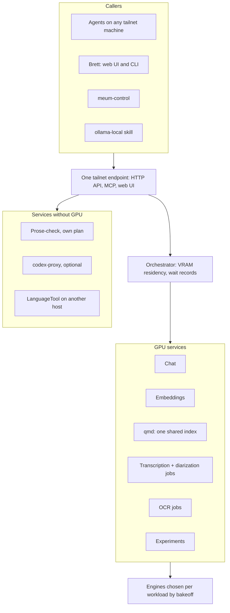

# GPU Host Performance and AI Endpoint - Plan

## Goal Capsule

- **Objective:** Every AI workload on bigdaddy (LLM chat, embeddings, qmd search, transcription, OCR) runs measurably
  faster or cooler than the program baseline R2 records, and every machine and agent on the tailnet reaches every AI
  service on the host through one endpoint that decides what occupies the GPU.
- **Means:** Staged waves on the existing RTX 3090 Ti: config flips on today's stack; one tailnet endpoint backed by a
  residency orchestrator, assembled from existing open-source projects where they fit; per-workload engine bakeoffs;
  test-gated GPU tuning. Software only.
- **Product authority:** Brett. The decisions below were settled in the brainstorm dialogue and carry their provenance.
- **Open blockers:** None. Open items are deferred to planning.

---

## Product Contract

### Summary

A four-wave program for the bigdaddy GPU host, where every change is benchmarked before and after on the box and kept
only if it wins. Wave 1 lands config flips on today's stack: durable persistence, VRAM temperature telemetry, an
upgraded Ollama with its draft model, and KV cache and thinking settings. Wave 2 stands up one tailnet endpoint, backed
by an orchestrator that owns VRAM, and moves today's GPU services and a single shared qmd index behind it; jobs,
prose-check and other services join one at a time. Wave 3 picks each workload's engine by bakeoff, and wave 4 adds
test-gated GPU tuning.

### Problem Frame

bigdaddy's RTX 3090 Ti Founders Edition (24 GB, driver 580.178.04 open modules) is fast hardware running a stale stack
that is coordinated by hand. Ollama is 0.20.4 while upstream is 0.40.10, and the current `gemma4:26b` tag ships a draft
model the local copy lacks. Persistence mode is on only because of a manual `nvidia-smi -pm 1` on 2026-10-05: Ubuntu's
`nvidia-persistenced` unit starts with `--no-persistence-mode`, so the next reboot turns it off, and a driver teardown
already reset a power-limit test that day. Under CUDA the card sits in power state P2 with memory at 10251 MHz, below
its rated 10501 MHz, and token generation is bandwidth-bound.

Each GPU consumer manages VRAM for itself. Ollama pins models forever, qmd-serve loads and drops its models per query in
low-vram mode, and `transcribe-diarize` and bakeoffs unload Ollama models before they run. On the tailnet each service
gets its own URL: `svc:ollama` and `svc:codex-proxy` are live, an implementation-ready plan would add `svc:qmd`, and
every backend answers on its own with no shared view of the GPU. A Mac agent cannot search the brain host's qmd corpus
without a local index.

Nothing is blocked today: Ollama loaded models on 3 days in the last 45. The goal is headroom (every speedup a config
flip, driver patch or software change can buy) plus one front door that decides what is resident so services stop
stepping on each other. The box sits in a hot garage with no case fans, and its CPU has already hit a thermal trip, so
changes that add heat are unwelcome and GDDR6X temperature is currently invisible.

### Key Decisions

- **Software only; hardware is out.** (session-settled: user-directed — chosen over a hardware track such as a second
  GPU or cooling work: "config flips and also driver patches, etc. software mods, no hardware mods".)
- **Everything software lands in one staged plan.** (session-settled: user-directed — chosen over a config-flip-only,
  Ollama-only or GPU-baseline-only scope: the user wants all available performance, engine swaps included.)
- **Staged waves, quick wins first.** (session-settled: user-directed — chosen over building the orchestrator first and
  over one engine for everything: early measured gains, and the upgraded Ollama becomes a real bakeoff incumbent.)
- **Stock-safe now, tuning later behind tests.** Governs R9, R39, R40, R41, R42, R43. (session-settled: user-directed —
  chosen over immediate test-gated tuning and over maximum overclocking: low risk now, grow into tuning once proven.)
- **One endpoint for every AI service on the host, built in stages.** Governs R14, R15, R16, R17, R18. (session-settled:
  user-directed — chosen over a GPU-only front door now, over moving everything in one wave, and over keeping
  per-service URLs with the orchestrator underneath: one maintainable entry point that any downstream product can join.)
- **One orchestrator owns all residency, and every existing caller keeps working.** Governs R20, R31. (session-settled:
  user-directed — chosen over two engines side by side, callers adapting after a switch, or staying on Ollama: one place
  decides loads and unloads.)
- **Every GPU workload is a service.** Governs R21, R27, R30. (session-settled: user-directed — chosen over VRAM leases
  for one-shot jobs and over covering served models only.)
- **Callers state intent; the orchestrator owns state; tailnet callers get full capability.** Governs R19, R22.
  (session-settled: user-directed — chosen over agents-use/you-control tiers and over observe-only remote access: agents
  are first-class.)
- **Pinned small set plus first come, first served now; interactive-first only on measured contention.** Governs R23,
  R24, R25, R26. (session-settled: user-approved — proposed after the user preferred interactive-first but flagged
  coordination risk and noted the pinned set has worked.)
- **One shared qmd index, served by qmd's own node-llama-cpp backend as a managed service.** Governs R13, R32, R33.
  (session-settled: user-approved — keeping the node backend avoids a re-index, and the user wants one index and
  document set for every machine and agent.)
- **Adopt before building.** Governs R35. Existing open-source projects are used or adapted first, a closed or paid
  product's design may be replicated, and new code covers only the gaps.
- **Engines vary per workload; the incumbent wins a close bakeoff.** Governs R36, R37. (session-settled: user-approved —
  a separate orchestrator removes the need to standardize engines, and the tie rule keeps the engine count down.)
- **Prose-check is its own plan, hosted on this endpoint.** Governs R16, R17. (session-settled: user-directed — chosen
  over specifying prose-check inside this plan and over leaving it unlinked.)
- **Nothing kept in the stack falls behind again, and updates stay with the existing upgrade jobs.** Governs R44, R45.
  Ollama sat 20 minor versions behind because its standalone install is outside the repo's scheduled upgrade jobs.
  (session-settled: user-directed — chosen over gating every scheduled upgrade with the benchmark suite and over
  narrowing the schedule to Ollama: engines update through their package managers' existing timers, and the orchestrator
  stays out of the update path.)
- **Experiments run only what this repo defines.** Governs R27, R49. (session-settled: user-directed — chosen over
  letting any tailnet caller launch any engine command or container: no remote code execution on the host that holds the
  secrets.)

### Actors

- A1. Brett, from the terminal on any tailnet machine, a CLI client, or the endpoint's web UI.
- A2. Agents on bigdaddy and on other tailnet machines (Claude Code, Cursor, skills), calling through the API or MCP.
- A3. Existing callers: meum-control's embeddings, the qmd CLI, the ollama-local skill, and clients of the `svc:ollama`
  URL.
- A4. The endpoint and its orchestrator, which route every call and own VRAM residency.

### Requirements

**Measurement and acceptance**

- R1. Every performance change is measured before and after on bigdaddy with one fixed benchmark suite and kept only
  when it improves its target metric without a quality regression. Endpoint and orchestrator changes in wave 2 serve
  coordination rather than speed, so each is kept when every R2 metric measured through the endpoint stays within
  run-to-run noise of the same call made directly to its backend.
- R2. The suite covers every GPU workload (LLM prompt and generation tokens per second and time to first token,
  embedding throughput, qmd query latency, transcription real-time factor, OCR seconds per page) plus GPU power, core
  temperature and, once R7 lands, VRAM temperature. Before any wave 1 change the full suite runs on today's stack, and
  that run is the program baseline, carrying forward the 2026-10-05 gemma4 and `arctic-embed-l-v2` figures.
- R3. A change that touches numerics (KV cache type, quantization, speculative decoding, clocks, engine swaps) also
  passes a quality check against the stock baseline: matching greedy LLM output or perplexity, and embedding vector
  parity or a planned re-index.
- R4. Every change deploys from this repo, reverts cleanly, and survives a reboot and a driver reload.

**Wave 1: GPU baseline (stock-safe)**

- R5. Persistence mode is on from boot and stays on without a manual command.
- R6. Any GPU setting this plan applies re-applies on its own after a reboot or a driver reload.
- R7. GDDR6X memory temperatures are readable headless and recorded with each benchmark run.
- R8. The NVIDIA driver runbook states present truth about persistence mode.
- R9. Wave 1 changes no clocks, voltages or power limits; the card stays at its stock 450 W.

**Wave 1: serving flips on today's stack**

- R10. Ollama runs a current release at least two weeks old, and gemma4 26B uses its bundled draft model at a draft
  depth chosen by measurement.
- R11. The KV cache type is chosen by measurement at the context lengths agents actually use.
- R12. Callers can turn model reasoning off per request, and agent-facing defaults follow the measured token savings.
- R13. qmd-serve's low-vram cost is measured, and qmd runs with a fixed VRAM footprint when that is faster and leaves
  the R23 large slot big enough.

**Wave 2: the endpoint**

- R14. One tailnet endpoint is the only front door for AI services on bigdaddy, and its HTTP API, MCP server, web UI and
  CLI clients reach the same set of services.
- R15. Backends on bigdaddy are reachable only through the endpoint, never directly from the tailnet.
- R16. Services that need no GPU, and services on other tailnet hosts such as the LanguageTool server, can sit behind
  the endpoint without GPU allocation.
- R17. The endpoint goes live with today's GPU services and the shared qmd index; jobs, prose-check and other services
  join one at a time afterward.
- R18. Per-service tailnet URLs retire once their callers move: `svc:ollama` after its callers are repointed, and
  `svc:codex-proxy` if codex-proxy moves behind the endpoint; `svc:qmd` is never published.
- R19. Every tailnet caller, agent or human, can make model calls, run jobs, read status and send pin or drain requests,
  and the tailnet is the trust boundary.

**Wave 2: residency**

- R20. One orchestrator behind the endpoint decides everything resident in VRAM, and no other component loads or unloads
  GPU models by itself.
- R21. Every GPU workload runs as a service behind it: chat, embeddings, qmd's models, transcription with diarization,
  and OCR.
- R22. Callers state intent (a model call, a job, a pin or drain request), and only the orchestrator changes residency.
- R23. qmd's models and the embedder stay pinned, and the rest of the card forms the large slot, which serves one large
  workload at a time, first come, first served. Wave 1 measures the pinned set's footprint with every pinned model
  resident, CUDA contexts included, and wave 2 adopts this layout only if gemma4 26B with its draft model and
  agent-length KV cache fits the large slot; if it does not, Brett chooses the layout before wave 2 starts.
- R24. A model that needs the whole card may evict the pinned set, which reloads when that model is released.
- R25. The orchestrator records how long each request and job waited for the GPU.
- R26. Interactive-first scheduling, where batch services yield between units of work, is built only when R25's data
  shows contention.
- R27. Bakeoffs and experiments run through the orchestrator, either as a temporary service or as an exclusive request
  that clears the GPU.
- R28. The orchestrator replaces every ad-hoc unload step (`ollama stop` loops, `qmd-ollama-unload-all`) once its
  services cover the work those steps made room for.

**Wave 2: services and callers**

- R29. Synchronous model calls are served over the OpenAI-compatible API; the Ollama API is optional, and its current
  callers move under R31.
- R30. Transcription and OCR run as jobs that a caller submits, polls and fetches results from.
- R31. Every existing caller keeps working, repointed to the endpoint in the same change that moves its service:
  meum-control embeddings, `svc:ollama` clients, the ollama-local skill and qmd.
- R32. One qmd index and document set behind the endpoint serves every machine and agent, and no other machine keeps its
  own index.
- R33. qmd keeps its node-llama-cpp backend as one pinned service with a fixed footprint.
- R34. Transcription keeps diarization quality at least equal to today's whisperx and pyannote pipeline.
- R35. The endpoint and orchestrator are assembled from existing open-source projects where they fit, chosen by bakeoff
  against R14 to R34, with new code only for the gaps. The orchestrator must be able to run any engine this repo defines
  as a service, so R36's per-workload engine choice stays open.

**Wave 3: engine bakeoffs**

- R36. Each workload's engine is chosen by its own bakeoff on bigdaddy, following the repo's local bakeoff methodology,
  with the upgraded Ollama as the incumbent for chat and embeddings.
- R37. When a challenger's gain is within run-to-run noise, the incumbent engine stays.
- R38. Wherever llama.cpp or whisper.cpp serves a workload directly, it is a CUDA build rather than the Homebrew Vulkan
  build.

**Wave 4: GPU tuning (test-gated)**

- R39. Tuning starts only after R7's memory temperature telemetry is in place.
- R40. The first tuning step restores the memory clock under CUDA to its rated 10501 MHz.
- R41. Undervolting (a clock lock plus an offset) is adopted only when it holds performance within noise and lowers
  power or temperature, with 450 W kept as the ceiling.
- R42. A memory overclock beyond rated speed is adopted only when a stepwise sweep shows a generation gain and R3's
  quality check passes at that step.
- R43. Each tuning step reverts with one command and is not applied after a failed validation.

**Staying current**

- R44. Every engine and adopted project stays current through the repo's existing scheduled package-manager upgrade
  jobs, and the orchestrator itself never performs or schedules updates.
- R45. If Ollama stays, a package-manager build that keeps its CUDA runners replaces the standalone install, so an
  existing upgrade job keeps it current.

**Safety guards**

- R46. The orchestrator refuses to start or route a GPU workload when the CUDA driver is unusable, such as the
  driver/library mismatch an NVIDIA package upgrade leaves until reboot, or when a model would fit only by offloading
  layers to the CPU; models already resident keep serving.
- R47. Calls to a pinned service that a whole-card model or an exclusive request evicted wait until it reloads, the wait
  is recorded under R25, and no evicted GPU service falls back to the CPU.
- R48. The endpoint accepts a request only when its Host is the endpoint's tailnet name or loopback and its Origin is
  absent or the endpoint's own web UI, and it never allows wildcard origins.
- R49. Temporary services and experiments run only engines and models this repo defines; callers choose among them and
  set allowlisted parameters, and no caller supplies a launch command, binary or container.

### Key Flows

- F1. Synchronous model call
  - **Trigger:** A caller sends a chat or embedding request to the endpoint over the OpenAI-compatible API.
  - **Actors:** A2 or A3, A4
  - **Steps:** The endpoint routes the call; the orchestrator serves it from a resident model or loads the model under
    the R23 and R24 policy; it records the wait; the response returns on the API the caller used.
  - **Covered by:** R14, R20, R23, R24, R25, R29, R31
- F2. Transcription or OCR job
  - **Trigger:** A caller submits audio or a PDF to the endpoint through the API or MCP.
  - **Actors:** A1 or A2, A4
  - **Steps:** The job queues; the orchestrator runs it when the large slot frees, first come, first served; the caller
    polls status and fetches the result.
  - **Covered by:** R14, R21, R23, R25, R30, R34
- F3. Search from another machine
  - **Trigger:** An agent on the Mac searches the qmd corpus.
  - **Actors:** A2, A4
  - **Steps:** The agent calls the endpoint's MCP; the request reaches the pinned qmd service; results come from the one
    shared index, with no index on the Mac.
  - **Covered by:** R14, R15, R32, R33
- F4. Bakeoff or experiment
  - **Trigger:** Brett or an agent wants to try a model or engine this repo defines that is not yet a running service.
  - **Actors:** A1 or A2, A4
  - **Steps:** The caller registers a temporary service or sends an exclusive request; the orchestrator clears the GPU
    once in-flight work ends; the experiment runs; the pinned set reloads afterward.
  - **Covered by:** R19, R22, R27, R49
- F5. Boot or driver reload
  - **Trigger:** The host reboots, or the GPU is torn down and reinitialized.
  - **Actors:** A4
  - **Steps:** Persistence comes up on; applied GPU settings re-apply; the endpoint and orchestrator start and load the
    pinned set.
  - **Covered by:** R5, R6, R23, R46

### Acceptance Examples

- AE1. **Covers R23, R25.** Given gemma4 26B resident and idle in the large slot, when an OCR job arrives, the
  orchestrator unloads gemma4 and runs the job; a chat call that arrives mid-job waits until the job ends, and its wait
  is recorded.
- AE2. **Covers R24.** Given qmd's models pinned, when a caller requests a model that needs all 24 GB, the pinned set
  unloads, the model runs, and the pinned set reloads after the model is released.
- AE3. **Covers R5, R6.** Given the host reboots or the GPU reinitializes, when it comes back, persistence mode reads
  Enabled and every applied GPU setting is back with no manual command.
- AE4. **Covers R31, R3.** Given meum-control repointed to the endpoint's embeddings API for `arctic-embed-l-v2`, it
  gets 1024-dimension vectors that match its pre-switch vectors within the parity threshold.
- AE5. **Covers R15.** Given a backend that serves through the endpoint, when a tailnet machine calls the backend's own
  port directly, the call fails, and the same call through the endpoint succeeds.
- AE6. **Covers R37.** Given a bakeoff where the challenger beats the incumbent by less than run-to-run noise, the
  incumbent engine stays.
- AE7. **Covers R42, R3.** Given a memory offset step that raises generation speed but changes greedy output, the step
  is rejected and the previous step stays.
- AE8. **Covers R46.** Given an NVIDIA package upgrade has left a driver/library mismatch, when a caller requests a
  model that is not resident, the orchestrator returns an error instead of loading it or falling back to the CPU, and
  resident models keep serving until the host reboots.
- AE9. **Covers R48.** Given a page from another origin in a browser on a tailnet machine, when it posts a job, pin or
  drain request to the endpoint, the endpoint returns 403 and residency is unchanged.

### Success Criteria

- Each wave closes with a before/after results table on bigdaddy, comparable to the R2 program baseline, which carries
  forward the 2026-10-05 figures: gemma4 26B at 3,976 prompt and 138.9 generation tokens per second at 450 W, and
  `arctic-embed-l-v2` at 219 texts per second.
- After wave 2, every load and unload shows up in the orchestrator's records, and no script or service clears VRAM by
  itself.
- Once callers have moved, the endpoint is the only tailnet URL that carries AI traffic to bigdaddy, and agents on every
  machine search the one qmd index.
- After a reboot, every GPU setting and service is back with no manual step.

<!-- ce-section: work-relationships -->
### How This Work Fits Together

This plan covers the GPU host performance program and the single AI endpoint. The breakdown below is the current
understanding, not a committed roadmap.

- Prose-check service: Depends on this plan's endpoint (R14, R16, R17). Its rules, LLM recast behavior and output
  contract are still to decide in its own brainstorm.
- qmd MCP HTTP VIP plan (`docs/plans/2026-08-25-1628-feat-qmd-mcp-http-vip-plan.md`): Shares its goal of one corpus with
  thin clients on the Mac (R32). Its separate `svc:qmd` URL gives way to the endpoint under R18. Still to decide: which
  of its units (the MCP HTTP listener, client configs, agent instruction rewrites) carry over.
- codex-proxy behind the endpoint: Depends on R14 and R16. Optional, and still to decide.
- A second GPU: Can proceed independently of this plan. Still to decide, on a shown use case.

### Scope Boundaries

**Deferred for later**

- A second GPU. Research so far: 48 GB fits 70B-class dense models at Q4 (16 to 32 tokens per second against about 5
  offloaded); NVLink is not required for Ollama's layer split and adds the most for vLLM or SGLang tensor-parallel; it
  needs a second 3090 Ti and the 3-slot bridge; the board gives x8/x8 in the two CPU slots, or Gen4 x4 through a
  CPU-wired M.2 slot with an OCuLink adapter (which M.2 slots are CPU-wired is unverified).
- Moving codex-proxy behind the endpoint.
- Parakeet for the ASR stage of transcription. Transcription already runs on CUDA through whisperx.
- A driver branch change (595 and later), CUDA MPS, `iommu=pt` and an HWE kernel, which show little expected gain for
  this workload.
- Pruning Ollama models not loaded in the last 45 days (`qwen3-embed-8b`, `gemma4:e2b`, `qwen3:1.7b`,
  `snowflake-arctic-embed`).

**Outside this plan**

- Prose-check's own behavior, which its separate plan defines.
- Hardware changes: case fans and cooling, thermal pads or repaste, a GPU purchase, VBIOS flashing.
- The `aikitoria/open-gpu-kernel-modules` P2P fork: it does nothing with one GPU, has no 580.178.04 branch, and cannot
  patch Ubuntu's packaged driver, whose patched core ships as a prebuilt binary.
- `keylase/nvidia-patch`: nothing on the box encodes video, `libnvidia-encode` is not installed, and NVENC did not speed
  up Remotion renders.
- Overclocking without R1 and R3 gates.
- qmd's slow collection-scoped vector search, a CPU problem with a measured fix already in the qmd fork.

### Dependencies / Assumptions

- Usage is light: Ollama loaded only `arctic-embed-l-v2` and `gemma4:26b` in the last 45 days, so qmd is assumed to be
  the most-exercised GPU consumer.
- The tailnet stays the trust boundary, reached through loopback binds published by Tailscale Serve; the loopback Caddy
  proxy fronts Ollama today.
- The LanguageTool server runs on another tailnet host (`languagetool:8081`), which R16 lets the endpoint reach.
- No single surveyed project covers the endpoint, so expect to combine projects and write some new code under R35:
  - agentgateway routes plain HTTP, LLM and MCP traffic and wraps OpenAPI services as MCP tools, but has no job API.
  - Bifrost has async jobs (transcription and OCR included) but cannot route plain HTTP.
  - LiteLLM covers most of it but needs Python and Postgres.
  - No gateway accepts the Ollama API from clients, and no hosted job queue is open source.
  - No published setup puts LLM, embeddings, diarized ASR and OCR behind one orchestrator on one GPU.
- New system-level units follow AGENTS.md (`config/systemd/system/` plus a deploy script). The `stow/ollama` package,
  stowed into `/etc` by hand, is an existing exception.
- Wave 1 adds no heat; wave 4 is gated on memory temperatures because the garage runs hot.
- The 2026-10-05 benchmark harness lives at `~/.cache/bigdaddy-diag/bench-v2.sh`, outside the repo.

### Outstanding Questions

**Deferred to Planning**

- Which projects enter the R35 bakeoff: for the endpoint layer agentgateway, Bifrost, LiteLLM and IBM ContextForge; for
  the residency layer llama-swap, LocalAI and llamactl; and whether one project covers both layers.
- Whether the job API copies Replicate's prediction API (create with an optional wait, get, cancel, the states
  `starting`, `processing`, `succeeded`, `failed` and `canceled`, and webhooks), and how jobs carry input files from
  other machines.
- Whether whisperx and the mc-pdf OCR backfill become services directly or through container support in the chosen
  orchestrator.
- Where the benchmark suite lives in the repo and how it grows from `bench-v2.sh`.
- Which telemetry reader satisfies R7 (LACT 0.10 or later headless, or a `gddr6` register reader).
- Whether the endpoint and orchestrator deploy as system units or user units under AGENTS.md's rules.
- The endpoint's tailnet name.
- Whether Homebrew's `ollama-binary` cask, which installs the official Linux release tarball, runs its CUDA runners on
  this host for R45; the Brewfile's note that casks are macOS-only predates it. If it does not, the standalone install
  gets its own scheduled job under R44.
- Whether the brew upgrade job gains a release cooldown like the uv-tools job's before brew-installed engines rely on
  it, since Ollama shipped ten 0.40.x releases in four weeks.
- Whether the endpoint's status shows when an update is available for an engine or project behind it.

### Sources / Research

- Host and Origin guard (R48): KTD2 in `docs/plans/2026-08-25-1628-feat-qmd-mcp-http-vip-plan.md`; driver-mismatch guard
  (R46): the `ExecCondition` in `stow/local/dot-config/systemd/user/qmd-embed.service`.
- Persistence: `docs/runbooks/headless-gpu-server-nvidia-driver.md` (lines 102 to 105); Ubuntu `nvidia-persistenced` man
  page, https://manpages.ubuntu.com/manpages/noble/man1/nvidia-persistenced.1.html
- Prior measurements: `~/obsidian-vault/areas/infrastructure/2026-10-05-bigdaddy-thermal-shutdown.md` (300 W cap
  benchmark) and `~/obsidian-vault/areas/infrastructure/infrastructure-backlog.md` (persistence, airflow).
- Current serving config: `stow/ollama/systemd/system/ollama.service.d/override.conf`,
  `stow/local/dot-config/systemd/user/qmd-serve.service`, `stow/local/dot-local/bin/transcribe-diarize`,
  `scripts/tailscale-serve-setup.sh` (`svc:ollama`, `svc:codex-proxy`), `CONCEPTS.md` (low-vram mode).
- Bakeoff method: `docs/solutions/best-practices/local-model-bakeoff-methodology.md`; prior OCR choice in
  `docs/solutions/integration-issues/pdf-to-markdown-converter-migration-opendataloader.md`; vLLM start-up cost in
  `docs/solutions/performance-issues/vllm-server-startup-is-mostly-cpu-compile-bytecode-and-size-multimodal-profiling.md`.
- Ollama draft model: https://ollama.com/library/gemma4:26b ; Ollama 0.30 runner change,
  https://github.com/ollama/ollama/releases/tag/v0.30.0 ; MoE draft measurements,
  https://carteakey.dev/blog/local-inference/gemma-4-26b-qat-mtp/ and https://github.com/ggml-org/llama.cpp/pull/23398
- KV cache on CUDA: https://github.com/ggml-org/llama.cpp/issues/30790
- Undervolting and memory offsets: 3090 Ti FE results,
  https://forum.level1techs.com/t/some-gpu-5090-4090-3090-a600-idle-power-consumption-headless-on-linux-fedora-42-and-some-undervolt-overclock-info/237064
  ; 3x 3090 clock lock, https://hbfreed.com/2026/03/12/power-limits-undervolting.html ; NVML offsets,
  https://docs.nvidia.com/deploy/nvml-api/structnvmlClockOffset__v1__t.html ; CUDA P2 state,
  https://github.com/NVIDIA/open-gpu-kernel-modules/discussions/261
- Memory temperatures: LACT per-chip GDDR6X readout, https://github.com/ilya-zlobintsev/LACT/pull/1125 ;
  https://github.com/olealgoritme/gddr6
- Endpoint layer: https://github.com/agentgateway/agentgateway ; https://github.com/maximhq/bifrost (async jobs,
  https://docs.getbifrost.ai/features/async-inference) ; https://github.com/BerriAI/litellm ;
  https://github.com/IBM/mcp-context-forge
- Job API designs: Replicate predictions, https://replicate.com/docs/reference/http ; Cog,
  https://github.com/replicate/cog ; fal queue, https://fal.ai/docs/model-endpoints/queue ; whisperx job worker,
  https://github.com/pavelzbornik/whisperX-FastAPI
- Residency orchestrators: https://github.com/mostlygeek/llama-swap (Ollama API declined in issue 87 and PRs 147 and
  666; fork https://github.com/kooshi/llama-swappo), https://github.com/mudler/LocalAI (Ollama routes in
  `core/http/routes/ollama.go`), https://github.com/lordmathis/llamactl
- Upgrade jobs: `scripts/upgrade/brew.sh` (no release cooldown) and `scripts/upgrade/uv-tools.sh` (release cooldown);
  Homebrew's Linux `ollama` formula is CPU-only, while the `ollama-binary` cask declares a Linux build,
  https://github.com/Homebrew/homebrew-cask/blob/HEAD/Casks/o/ollama-binary.rb
- Starred repos: https://github.com/aikitoria/open-gpu-kernel-modules ; https://github.com/keylase/nvidia-patch
- Second GPU: P2P and NVLink numbers, https://github.com/noonghunna/club-3090 ; board layout,
  https://www.asus.com/us/motherboards-components/motherboards/proart/proart-x670e-creator-wifi/
