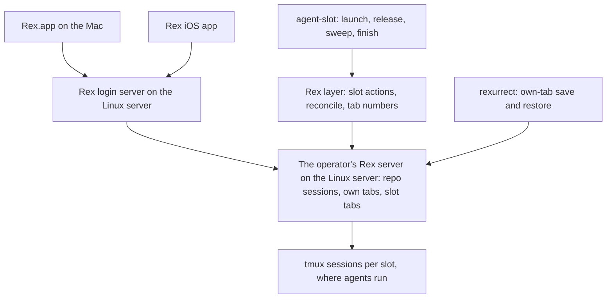
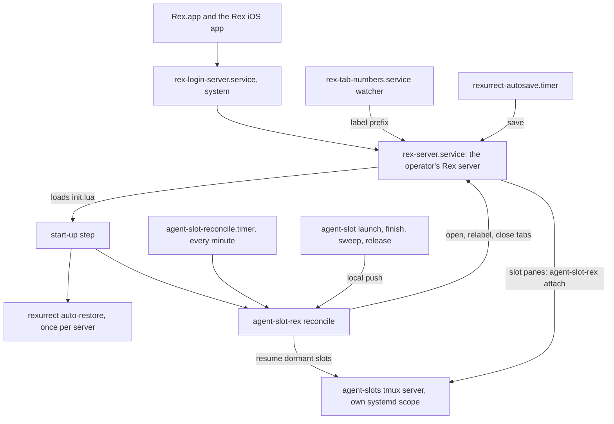
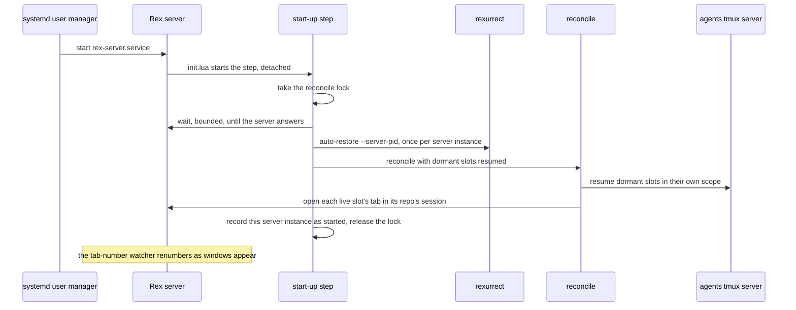
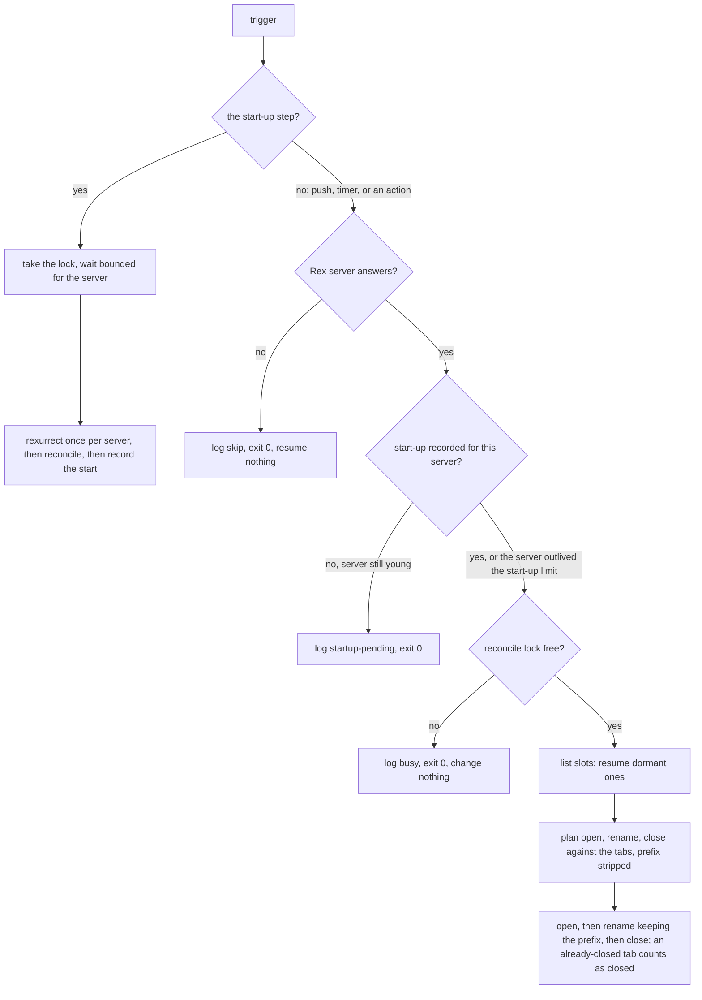

# Rex Agent Slots Hosted on the Linux Server - Plan

## Goal Capsule

- **Objective:** Whenever the Linux server is up, the operator can open Rex on the Mac or on the phone and find every
  repo session and every agent's tab there and current, whether or not the Mac is awake.
- **Means:** The Rex layer of agent slots moves from the Mac's Rex server to the Linux server's, reached through the Rex
  login server, with agents still running in tmux beneath it (Key Decisions).
- **Product authority:** Requirements govern behavior; Key Decisions record why. This plan carries out the Linux-server
  cutover that `docs/plans/2026-10-22-1818-feat-rex-parallel-agent-slots-plan.md` deferred. That plan's slot-command
  requirements still hold. This plan changes the slot command at its hand-off to the Rex layer (R20, KTD6) and where its
  tmux server starts (KTD3); its safety logic, clone layout, trust handling, and teardown check stay unchanged.
- **Execution profile:** Bash CLIs and libraries, systemd user units, Lua Rex config, a LaunchAgent, and docs in
  dotfiles, with bats suites against stubs. CI has no tmux, Rex, or Lua, so the Lua and all live behavior are proven by
  `rex config check` and the hand-run checklist (Verification Contract).
- **Stop conditions:** Stop and bring the finding to the operator when U1 shows the login server starting a second Rex
  server beside the service's, a status report not reaching a Rex tab through a local tmux client, or a tmux server
  dying with the unit that started it; and when any teardown test shows a deletion the check should have blocked.
- **Who finishes:** `ce-work` executes U1 through U9 on a `feat/` branch cut from `dev` in dotfiles and opens the PR. U7
  lands on or after 2026-11-05. The operator runs U10 on both machines and the phone before merge, and a matching PR
  updates the `agent-slot` skill in the agent-skills repo.
- **Open blockers:** None.

---

## Product Contract

### Summary

Each repo's Rex session, with the operator's own tabs and its slot tabs, lives on the Linux server's Rex server, and
Rex.app and the Rex iOS app are windows onto it. The slot reconcile that runs on the Mac today moves next to the server,
so the server opens, relabels, and closes slot tabs on its own. Agents keep running in tmux, rexurrect restores the
operator's own tabs after a Rex restart, and every tab shows its number.

### Problem Frame

Agents already run on the Linux server, each in its own full clone and tmux sessions. Everything that shows them lives
on the Mac: the repo sessions, the slot tabs, and the automation that keeps those tabs in step with the server's slots.
Each slot pane is an SSH loop from the Mac into the slot's tmux session. The server pushes each launch and teardown to
the Mac over SSH, and a Mac-side loop detects wake-ups and restores once a minute.

So when the Mac sleeps, nothing can show an agent. The phone cannot reach one at all, and the Rex iOS app has nothing to
connect to, because the sessions it would show live in a server that sleeps with the Mac. The 2026-10-22 plan built the
SSH attach loops, the push, and the Mac-side restore to last only until a Rex server on Linux existed. That server now
runs: the Rex login server listens on the Linux server's tailnet address (dotfiles #348), and Rex.app already connects
to it as a remote host.

### Actors

- A1. Operator: uses Rex.app on the Mac and the Rex iOS app on the phone.
- A2. Slot agent: a Claude Code agent in a slot, which can launch and brief other slots and releases its own slot when
  its task ends.
- A3. The Linux server's own automation: the sweep timer, the finish a release starts, the slot reconcile, and the
  restores after a Rex restart.
- A4. Rex clients: Rex.app and the Rex iOS app, which display the Linux server's sessions and send input to them.

### Key Decisions

- **The Rex layer lives on the Linux server; clients are windows onto it.** (session-settled: user-directed — chosen
  over a phone that can only watch and answer: the phone and a sleeping Mac must see the same live sessions, with every
  function on the always-on machine.) Governs R1, R2, R8, R9.
- **The server runs the slot lifecycle with no client connected.** (session-settled: user-directed — chosen over clients
  that only send triggers: teardowns, releases, and sweeps happen while nobody is watching, and a client that connects
  later sees the result.) Governs R3, R4, R5, R6, R11.
- **Agents stay in tmux under Rex.** (session-settled: user-approved — chosen over running agents directly in Rex panes
  and restoring them with rexurrect: a Rex restart, crash, or preview upgrade must not stop an agent mid-work.) Governs
  R7, R21.
- **Whole repo sessions move, not only slot tabs.** (session-settled: user-approved — chosen over leaving the operator's
  own tabs on the Mac over SSH: one place holds a repo's work, and the phone sees all of it.) Governs R1, R12.
- **Dev ports stay on the Mac's localhost through a tunnel, for now.** (session-settled: user-approved — chosen over
  browsing the Linux server's tailnet name and over leaving dev-server work in SSH tabs: flows tied to localhost, such
  as OAuth callbacks and secure-origin rules, keep working.) Governs R17.
- **rexurrect restores the operator's own tabs.** (session-settled: user-approved — chosen over a standard tab per repo
  and over reopening tabs by hand: it brings back what was actually open, and v0.2.1 restored layout, ratios, labels,
  directories, and scrollback on the Linux server on 2026-10-29.) Governs R12, R13, R14.
- **Tab numbers are part of this plan, written by us.** (session-settled: user-approved — chosen over a separate
  follow-up: this plan already changes how slot tabs get their labels. The community tab-numbers module is a model, not
  a dependency, by the user's direction.) Governs R15, R16.
- **The existing reconcile moves next to the server.** (session-settled: user-approved — chosen over an event-driven
  reconcile inside Rex and over the slot command opening and closing its own tabs: it reuses the reconcile the
  two-machine checklist already proved, and keeps the teardown safety logic away from a beta UI API.) Governs R3, R4,
  R5, R6, R18, R20.
- **Shareable as a reference, not as a package.** (session-settled: user-approved — chosen over designing the Rex layer
  for drop-in reuse: proving it works on two live machines is the expensive part, and generality multiplies that.)
  Governs R19.
- **Slot status keeps the existing Claude hook path.** Claude inside tmux still reports nothing to Rex on its own, so
  the hook that writes status through tmux stays rather than going away as the 2026-10-22 plan expected. Governs R8.

### Requirements



**Where sessions live**

- R1. Each repo's Rex session, holding the operator's own tabs and its slot tabs, lives on the Linux server's Rex
  server, which Rex.app and the Rex iOS app reach through the Rex login server.
- R2. The Mac's own Rex server holds only Mac-local work, and nothing about slots runs on the Mac or depends on it being
  awake.

**The lifecycle without a client**

- R3. A slot that `agent-slot launch` makes, whether the operator or an agent ran it, gets its tab in its repo's session
  on the Linux server, opened in the background, with no client connected.
- R4. A slot that is torn down, whether by the finish a release starts, by the sweep timer, or by `finish`, loses its
  tab on the Linux server when it is torn down, with no client connected.
- R5. Whenever the Linux server's Rex server starts, after a boot, an upgrade, or a crash, every live slot gets its tab
  back and dormant slots are resumed, with no key press and no client.
- R6. A periodic pass on the Linux server corrects any slot tab a missed trigger left wrong, so tabs match the live slot
  set within a minute.
- R7. Agents run in tmux on the Linux server, so a restart, crash, or upgrade of its Rex server stops no agent, and each
  slot tab reattaches to its running agent when it is rebuilt.

**What clients can do**

- R8. From either client, the operator sees every repo session and slot tab with its agent's status (working, done, or
  waiting on the operator), and can open any of them, read it, and type into it.
- R9. From either client, the operator can start a slot on a repo with an optional first message, restore slot tabs, and
  finish a slot, through slot actions defined on the Linux server.
- R10. Where a client cannot run a named action, running the slot command in a shell tab on the Linux server is the
  supported path, and the slot's tab appears on its own (R3).
- R11. A client that connects, such as the Mac waking or the phone opening, shows the current sessions and tabs with
  nothing to sync or restore on the client.

**Restores and labels**

- R12. After a Rex server restart, the operator's own tabs come back as they were left: tabs and their order, splits and
  ratios, labels, working directories, scrollback, and each pane's last command typed but not run.
- R13. After any restore, each live slot has exactly one tab, and the reconcile owns slot tabs whatever rexurrect
  recreates.
- R14. Before a planned restart, such as applying a new preview, the operator can save the own-tab layout first, so a
  tab opened since the last automatic save is not lost.
- R15. Every tab on the Linux server's Rex server shows its position number in its label, maintained on the server so
  every client sees the same number.
- R16. The tab number, the reconcile's slot label, and rexurrect's restored labels coexist: no pass strips another's
  part of a label, and no restore leaves a doubled number.

**The Mac**

- R17. While the Mac is awake, every port the `bd-dev` host entry in `stow/ssh/dot-ssh/config` forwards today reaches
  the same port on the Linux server at the Mac's localhost, with no SSH tab open.
- R18. The Mac-side machinery the cutover makes unnecessary is retired, not left running beside the server's layer: the
  SSH attach loops, the push to each Mac, the wake detection, and the Mac's minute-by-minute restore.

**Shape and boundaries**

- R19. The Linux server's Rex layer is one module whose machine-specific values are gathered in one place, so it can
  later be published as a reference implementation.
- R20. The slot command keeps working with no Rex server present: its only tie to Rex is handing tab work to the Rex
  layer, and without a Rex server that hand-off does nothing and fails nothing.
- R21. Slots that are live at the cutover move without restarting their agents: their tmux sessions keep running, and
  only their tabs move from the Mac to the Linux server.

### Key Flows

- F1. The phone while the Mac sleeps
  - **Trigger:** The operator opens the Rex iOS app with the Mac asleep.
  - **Actors:** A1, A4
  - **Steps:** The app connects to the Linux server and lists the repo sessions. The operator opens a slot whose agent
    is waiting, answers it, and starts a new slot on the same repo. The new slot's tab appears in the background.
  - **Covered by:** R1, R3, R8, R9, R10, R11
- F2. A teardown nobody watches
  - **Trigger:** A slot agent finishes its task and releases its slot, or the sweep timer fires at night.
  - **Actors:** A2, A3
  - **Steps:** The finish waits for the agent to go idle, tears the slot down if the check passes, and the slot's tab
    closes on the Linux server. When a client connects later, the tab is already gone.
  - **Covered by:** R4, R6, R11
- F3. Applying a new Rex preview
  - **Trigger:** The operator restarts the Linux server's Rex server to pick up a new preview.
  - **Actors:** A1, A3
  - **Steps:** The operator saves the own-tab layout and restarts the server. On start, the reconcile rebuilds every
    slot tab around agents that never stopped, and rexurrect rebuilds the operator's own tabs. Every tab carries one
    number. Clients reconnect and show the rebuilt sessions.
  - **Covered by:** R5, R7, R12, R13, R14, R15, R16
- F4. The cutover
  - **Trigger:** The new Rex layer is deployed on the Linux server.
  - **Actors:** A1, A3
  - **Steps:** Each live slot gets its tab in its repo's session on the Linux server. The Mac's slot tabs and Mac-side
    loops are retired. Agents keep running throughout.
  - **Covered by:** R18, R21

### Acceptance Examples

- AE1. **Covers R4, R11.** Given the Mac asleep and the phone closed, when the sweep timer tears down a released slot at
  03:00, then the phone opened at 07:00 shows that repo's session without the slot's tab.
- AE2. **Covers R5, R7, R13, R16.** Given three working agents and two of the operator's own tabs, all numbered, when
  the Linux server's Rex server restarts for a preview, then all three agents are still on their tasks, each slot has
  one tab, the own tabs are back, and every tab shows a single number.
- AE3. **Covers R10.** Given an iOS app that offers no way to run the new-agent action, when the operator types
  `agent-slot launch <repo>` in a shell tab on the Linux server, then a tab for the new slot appears in that repo's
  session.
- AE4. **Covers R17.** Given the Mac awake and a dev server on the Linux server at port 8787, when the Mac's browser
  opens `http://localhost:8787`, then the page loads with no SSH tab open.
- AE5. **Covers R21.** Given two live slots with tabs on the Mac before the cutover, when the cutover runs, then both
  agents keep their conversations without a restart, and each slot has one tab on the Linux server and none on the Mac.
- AE6. **Covers R12, R13.** Given rexurrect restoring a session in which a slot tab was saved, when the reconcile runs
  after it, then that slot has one tab, attached to its running agent.

### Success Criteria

- AE1 through AE6 pass by hand on the operator's Mac, phone, and the Linux server, because CI has no Rex and cannot
  exercise the reconcile, the actions, or tab numbering.

### Scope Boundaries

**Deferred for later**

- Dropping tmux from under the agents. Revisit once a restore tool reliably continues a turn a Rex stop cut off, which
  rexume documents.
- rexume, including its worker and orchestrator task API.
- A reconcile driven by Rex's event stream instead of triggers and a periodic pass.
- Publishing the Rex layer and the slot command as a community package; R19 keeps the reference path open.
- Port allocation for dev servers in parallel slots, carried from the 2026-10-22 plan.
- Agent dashboards across hosts (rexboard, rex-radar) and tmux-side agent pickers (tmux-agent-panel).

**Outside this work**

- The slot command's safety logic, clone layout, trust handling, and teardown check.
- Running agents on the Mac.
- Making the Rex layer configurable for other people's setups.

**Deferred to Follow-Up Work**

- The `agent-slot` skill's text in the agent-skills repo (`agent-slot/SKILL.md`), which still places slot tabs on the
  Mac; a matching PR there.
- Moving rexurrect's Mac install (binary, zsh recorder, launchd agent) into dotfiles, carried from the 2026-10-22 plan.

**Considered and not built**

- A check that warns when a connected client is older than the server. Client and server builds use different version
  schemes (`0.1.0 (1642)` against `0.1.0~preview.10`), and the blank-tab log signature is documented; revisit if blank
  tabs recur.
- Tab numbers in `agent-slot list`. Slot keys stay the only identifier (KTD14); revisit if the operator's tab numbers
  and agents' slot keys keep crossing in practice.
- A restore verb for agents. The start-up step and the timer cover every case an agent would need it for.

### Dependencies / Assumptions

- The Rex login server runs on the Linux server on tailnet port 7297 and admits the operator's Tailscale login
  (dotfiles #348); the tailnet ACL lets the Mac reach that port, which a probe confirmed on 2026-10-29.
- A Rex client must be at least as new as the server it connects to, or its tabs stay blank
  (`docs/solutions/integration-issues/rex-app-older-than-server-shows-blank-tab-data-stream-closes-after-10s.md`). The
  iOS app needs updating before phone verification, and a server preview can require a client update.
- rexurrect v0.2.1 (MIT) was tested on the Linux server on 2026-10-29 against a throwaway Rex server. Its Claude resume,
  its restore when a server starts, its systemd autosave, and its zsh recorder were not exercised. It enters dotfiles
  only after it clears the 7-day supply-chain gate on 2026-11-05.
- Rex has no documented extension format. The Rex layer is Lua modules loaded from the server's `init.lua`, as the Mac's
  layer is today; the `rex` stow package deploys on macOS only (`scripts/stow-deploy:25`).
- Two Rex.app behaviors still held on build 1642 on 2026-10-29: a split made in the tab the app is showing records 0.5
  whatever ratio was asked, and `rex focus` does not move the tab the app shows
  (`docs/solutions/integration-issues/rex-app-records-even-splits-in-the-tab-it-is-showing.md`,
  `docs/solutions/integration-issues/rex-app-shows-its-own-tab-selection-not-the-servers-active-window.md`).
- Whether the Rex iOS app can run a named action is unknown; R10 covers the case where it cannot.

### Outstanding Questions

**Deferred to Implementation**

- Whether Rex's agent session-renaming fires inside slots on the server, where Claude runs in tmux without Rex's session
  variables; U1 checks, and it is turned off only if it fires.
- Whether rexurrect's Claude resume hook earns a place for the operator's own tabs that run Claude; slot panes do not
  need it.
- The exact transient-scope invocation and unit names, settled in U2 against the host's systemd 255.

<!-- ce-section: work-relationships -->
### How This Work Fits Together

This plan covers the Linux-server cutover of the Rex layer only. The breakdown below is the current understanding, not a
committed roadmap.

- The slot command and its safety model, from `docs/plans/2026-10-22-1818-feat-rex-parallel-agent-slots-plan.md`: this
  plan depends on it and leaves it unchanged except at the hand-off to the Rex layer.
- The Rex login server (dotfiles #348): this plan depends on it as the clients' way in.
  - Keeping clients as new as the server: shares the client-skew risk; still to decide whether anything checks it.
- Dropping tmux under the agents: depends on this plan and on a restore tool that continues interrupted turns.
- A community reference release of the Rex layer and the slot command: enabled by R19, can proceed independently once
  this plan ships.

### Sources / Research

- `docs/plans/2026-10-22-1818-feat-rex-parallel-agent-slots-plan.md`: the deferred cutover (Scope Boundaries, Deferred
  to Follow-Up Work), R22, KTD6 (tmux sessions per slot), KTD7 (the status path), KTD10 (restore, follow, push).
- Current code the cutover replaces or moves: `scripts/agent-slot/lib/push.sh`,
  `scripts/agent-slot-rex/lib/reconcile.sh` (slot keying at lines 4-5, relabeling at line 78),
  `scripts/agent-slot-rex/lib/attach.sh`, `stow/rex/dot-config/rex/init.lua`, `stow/rex/dot-config/rex/agent-slots.lua`,
  `stow/rex/dot-config/rex/layout.lua`.
- Server automation that stays: `stow/local/dot-config/systemd/user/agent-slot-sweep.timer`,
  `scripts/agent-slot/lib/release.sh`, `stow/claude/dot-claude/slot-status.sh`.
- The login server deploy: `scripts/rex-login-server-deploy.sh`,
  `config/systemd/system/rex-login-server.service.d/tailnet-listen.conf`.
- Rex documentation, Linux: Server Modes, Remote Access, and Login Server pages at superlogical.com.
- rexurrect (github.com/cemcatik/rexurrect) and rexume (github.com/Entwining/rexume) for session restore; the
  tab-numbers module in github.com/manishprivet/.dotfiles (`.config/rex/extensions/tab-numbers`) as a model for
  server-side tab labels.

---

## Planning Contract

**Product Contract preservation:** restructured, no scope change. Outstanding Questions keeps only execution-time
questions, because KTD1 through KTD12 answer its planning questions; Scope Boundaries gains plan-local Deferred to
Follow-Up Work and Considered and not built lists.

### Key Technical Decisions

- KTD1. **The helper runs on the Linux server, and its SSH transport becomes a local runner.** Every call
  `agent-slot-rex` makes to the server goes through one seam (`server_ssh` in `scripts/agent-slot-rex/lib/server.sh`); a
  local runner keeps that seam's argv and exit-code contract, so the reconcile, its lock, and its journal stay one
  implementation. (session-settled: user-approved — chosen over a new server-only tool: the reconcile the two-machine
  checklist proved stays as it is.) Governs R3, R4, R5, R6, R18, R20.
- KTD2. **A systemd user service keeps the operator's Rex server running.** It runs `rex server run` without
  `--exit-empty`, modeled on the user service Rex's own home-manager module ships, so a server exists at boot and when
  an agent launches a slot with no client connected. Rex's Login Server docs say the login server uses an account's
  running server instead of starting one; U1 confirms that on this host before anything depends on it. (session-settled:
  user-approved — chosen over the login server's start-on-connect, quit-when-empty server: slots need tabs while nobody
  is connected.) Starting a server on demand came close as an alternative but did not need a bake-off: a server the
  helper starts inherits its caller's environment and cgroup (KTD3, KTD11). Governs R3, R5, R7.
- KTD3. **The slot tmux server runs in its own systemd scope.** When a slot's sessions must start and the `agent-slots`
  server is not running, it starts inside a transient user scope, so a finished timer run or a restarted Rex service
  cannot take the agents with it. (session-settled: user-approved — chosen over leaving tmux in its caller's cgroup,
  where systemd ends it with the unit.) Governs R7.
- KTD4. **One start-up step orders the restores, once per Rex server.** When the Linux server's Rex server loads its
  config, a detached start-up step takes the reconcile lock at once and waits, for a bounded time, until the server
  answers, because Rex's APIs do not work while it is still loading. It then runs rexurrect's foreground once-per-server
  restore (`rexurrect auto-restore --server-pid` with the server's pid), reconciles slot tabs with dormant slots
  resumed, and records the server's instance ID as started. On a config reload the step finds that record, skips
  rexurrect, and only reconciles; rexurrect's own background start-up hook is not installed on the Linux server.
  (session-settled: user-approved — chosen over letting rexurrect restore on its own: a reconcile that runs first
  creates a repo's session, and rexurrect then restores a second one beside it.) Governs R5, R12, R13.
- KTD5. **The periodic pass is a once-a-minute systemd user timer.** It follows
  `stow/local/dot-config/systemd/user/agent-slot-sweep.{service,timer}`. A timer, push, or action pass exits 0 after
  logging why it changed nothing: `skip` when no Rex server answers, `startup-pending` while the running server has no
  start-up record (KTD4) and is younger than the start-up step's time limit, and `busy` when the lock is held. The
  follow loop and its wake detection are removed. (session-settled: user-approved — chosen over the follow loop, which
  exits whenever its Rex server does.) Governs R6, R18.
- KTD6. **The push becomes a local reconcile.** After a launch, sweep, or finish, `scripts/agent-slot/lib/push.sh` runs
  a local reconcile when the helper and a Rex server are present and does nothing otherwise. The client list defaults to
  empty, and a verb that a slot tab's own helper ran still skips the push, because that helper reconciles right after.
  Governs R3, R4, R20.
- KTD7. **Slot panes stay a supervising loop around a local tmux attach, started outside the slot.** The pane's own
  process stays `agent-slot-rex attach <repo>/<N> <kind>`, so the reconcile keeps recognizing slot tabs by command. It
  attaches locally in a loop that ends when the slot is gone, from `$HOME`, so the agent-state scan never counts the
  pane as using the slot. Governs R7, R13.
- KTD8. **Tab numbers come from one watcher that owns only the label's leading `<n>:`.** A `rex do` script subscribed to
  window events runs as a user service bound to the Rex server's service; it renumbers tabs from each session's window
  order and writes a label only when its prefix is wrong. The reconcile and finish match slot keys and compute labels
  with the prefix removed, keep the current prefix when they relabel, and count it inside the 128-character cap. The
  prefix pattern is written once in jq and once in Lua, and a test holds the two to the same text. The watcher connects
  with `--autostart=false`, so a reconnect during a Rex restart can never start a second server (KTD11).
  (session-settled: user-approved — chosen over the reconcile numbering tabs and over the community module as-is: one
  writer per part of a label, and the module needs macOS's `shlock`.) Governs R15, R16.
- KTD9. **The `rex` stow package becomes shared, with the slot pieces Linux-only.** `init.lua` and `layout.lua` deploy
  to both machines; `agent-slots.lua` and the tab-number watcher are skipped on macOS the way `scripts/stow-deploy`
  already skips systemd units there. `init.lua` loads the slot pieces only when they are present, and otherwise keeps
  the Mac's own rexurrect auto-restore line. Governs R2, R19.
- KTD10. **The Mac tunnel is a LaunchAgent around `ssh -N` to its own host entry.** The forwards `bd-dev` carries today
  move to a new tunnel entry in `stow/ssh/dot-ssh/config`, and `bd-dev` keeps none, so an interactive `ssh bd-dev` never
  collides with the tunnel's bound ports. (session-settled: user-approved — chosen over reusing `bd-dev`, whose
  `ExitOnForwardFailure` makes a second forwarding connection fail.) Governs R17.
- KTD11. **The helper never starts a Rex server, and finds the CLI on Linux.** Every `rex` call passes
  `--autostart=false`, and the CLI lookup adds `/usr/bin/rex`. A server started from an agent's environment would carry
  Claude Code's session markers into everything it runs
  (`docs/solutions/runtime-errors/tmux-server-started-inside-claude-code-saves-no-transcripts.md`). Governs R3, R20.
- KTD12. **Machine-specific values live in one settings library.** The helper's defaults that name a host, a path, a
  socket, or a session, spread over about eight files today, move into one library the dispatcher sources first; the Lua
  names only `$HOME`-relative helper paths. Governs R19.
- KTD13. **Live measurement comes before dependent code.** U1 settles the behaviors this plan rests on that Rex does not
  document, each with a stop condition in the Goal Capsule. Governs R5, R7, R8, R9, R13.
- KTD14. **Agents keep the verbs they have.** Agents launch and release slots as today and never run the helper's
  restore verb themselves: the push after their launch or release runs the reconcile for them (KTD6), and the operator's
  actions and the timer run the same reconcile. The slot key `<repo>/<N>` stays the only identifier any verb accepts,
  because tab numbers shift. Governs R9, R10.

### High-Level Technical Design

Where each piece runs on the Linux server, and what drives what:



After a boot or a Rex restart, the start-up step owns the order (KTD4):



Every pass gates this way; only the start-up step waits for the server instead of skipping (KTD4, KTD5):



The label grammar both writers share (directional; KTD8 owns it):

```text
label     := [ number ": " ] rest              number: written only by the tab-number watcher
rest      := slot-rest | free-text             free-text: the operator's own tab labels, never rewritten by the reconcile
slot-rest := key " · " task-or-branch [ " · needs you: " message ]
key       := repo "/" N                        the only slot identifier (KTD14)
total     := at most 128 characters, the prefix included; the reconcile cuts slot-rest, never the prefix
```

### Assumptions

- Linger is on for the operator's account on the Linux server (`loginctl show-user` reported `Linger=yes` on
  2026-10-29), so user services run with nobody logged in.
- The Rex iOS app and Rex.app are updated to builds at least as new as the server before any client-side check.
- rexurrect 0.2.1's save and restore behave on the operator's Rex server as they did on the throwaway server tested on
  2026-10-29.

### Risks & Dependencies

| Risk                                                                                    | Mitigation                                                                                                                                                        |
| --------------------------------------------------------------------------------------- | ----------------------------------------------------------------------------------------------------------------------------------------------------------------- |
| The login server starts its own quit-when-empty server instead of reusing the service's | U1 checks it first, and it is a stop condition                                                                                                                    |
| A Claude status report does not reach a Rex tab through a local tmux client             | U1 measures it; the fallback is the 2026-10-22 plan's: status in the tab label from `agent-slot list`                                                             |
| A Rex preview changes an API the Lua or the helper uses                                 | `scripts/agent-slot/verified-versions` records the tested build, doctor warns on any other, and the checklist reruns after an upgrade                             |
| The tmux server wedges on a blocking write to a dead client                             | the reconcile never captures tmux output through command substitution (learnings research)                                                                        |
| A unit with mount-namespace hardening hides `/proc` entries from the agent-state scan   | no new unit sets `PrivateTmp`, `ProtectHome`, or `PrivateDevices`                                                                                                 |
| rexurrect is days old                                                                   | a pinned version, checksum, and attestation; installed only after 2026-11-05; the reconcile owns slot tabs regardless                                             |
| A client older than the server shows blank tabs                                         | clients update first (U10); the log signature is in `docs/solutions/integration-issues/rex-app-older-than-server-shows-blank-tab-data-stream-closes-after-10s.md` |

### Alternative Approaches Considered

- Letting the helper start a Rex server on demand: rejected by KTD2 and KTD11, because the server would inherit an
  agent's environment and cgroup.
- Keeping the follow loop as the periodic pass on the server: rejected by KTD5, because it exits with its Rex server.
- Slot panes that `exec` tmux: rejected by KTD7, because the reconcile could no longer recognize slot tabs by command.
- The reconcile numbering every tab itself: rejected by KTD8, because numbers would lag up to a minute and two passes
  would share one label part.

### System-Wide Impact

- Every repo's slots and the operator's own sessions move hosts; the Mac's Rex keeps only Mac-local sessions.
- The Linux server gains four user units (the Rex server, the reconcile timer, the tab-number watcher, rexurrect's
  autosave), and `scripts/host-jobs-enable.sh` enables them.
- The `rex` stow package changes sets on both machines, and `stow/ssh/dot-ssh/config` stops forwarding ports for
  `bd-dev`.
- Claude Code hooks and the slot command's safety logic are unchanged; the `agent-slot` skill's text changes in the
  agent-skills repo.
- README.md, BOOTSTRAP.md, AGENTS.md, and CONCEPTS.md change, so the work goes through the feature-branch PR flow.

---

## Implementation Units

| U-ID | Title                                                     | Key files                                                                                    | Depends on     |
| ---- | --------------------------------------------------------- | -------------------------------------------------------------------------------------------- | -------------- |
| U1   | Measure Rex behavior on the Linux server                  | `docs/solutions/integration-issues/`                                                         | none           |
| U2   | Run the Rex server and the slot tmux server under systemd | `rex-server.service`, `scripts/agent-slot/lib/sessions.sh`                                   | U1             |
| U3   | Run the helper on the server                              | `scripts/agent-slot-rex/lib/{server,rex,attach,settings}.sh`                                 | U1             |
| U4   | Trigger the reconcile on the server                       | `scripts/agent-slot/lib/push.sh`, `scripts/agent-slot-rex/lib/reconcile.sh`, reconcile units | U2, U3         |
| U5   | Share the Rex config package                              | `scripts/stow-deploy`, `stow/rex/dot-config/rex/init.lua`                                    | U3, U4         |
| U6   | Number every tab                                          | `stow/rex/dot-config/rex/tab-numbers.lua`, `rex-tab-numbers.service`, `reconcile.sh`         | U2, U5         |
| U7   | Install rexurrect from dotfiles                           | `scripts/rexurrect-deploy.sh`, autosave units                                                | U4             |
| U8   | Keep dev ports on the Mac's localhost                     | `stow/ssh/dot-ssh/config`, `com.user.bd-tunnel.plist`                                        | none           |
| U9   | Retire the Mac half and rewrite the docs                  | `scripts/agent-slot-rex/lib/follow.sh`, README, BOOTSTRAP, CONCEPTS                          | U3, U4, U5, U6 |
| U10  | Cut over and run the two-machine checklist                | none                                                                                         | U1 through U9  |

### U1. Measure Rex behavior on the Linux server

- **Goal:** Settle the behaviors KTD2, KTD3, KTD7, and KTD8 rest on before any code depends on them.
- **Requirements:** R5, R7, R8, R9, R13, R15; KTD13.
- **Dependencies:** None.
- **Files:** `docs/solutions/integration-issues/` (one entry per finding worth keeping).
- **Approach:** On the live server, with the operator's own Rex sessions there closed and throwaway sessions only:
  1. Run a Rex server as a transient user service without `--exit-empty`, connect Rex.app through the login server, and
     confirm the connection lands on that server and no second server starts.
  2. Open a tab whose pane runs a local `tmux -L agent-slots attach` to a scratch slot session, replay a status report
     through `stow/claude/dot-claude/slot-status.sh`, and confirm Rex.app shows it.
  3. Load a scratch action and binding into that server's config, and record whether Rex.app's palette and keys run it
     and what the updated iOS app offers.
  4. Run a `rex do` watcher subscribed to window events and confirm create, close, move, and label-change events, and
     the window order `session.view` reports.
  5. Save a session holding a slot-keyed tab with rexurrect, restart the test server, restore, and run the reconcile;
     confirm one tab per slot. Also record whether `rexurrect auto-restore --server-pid` waits for the server to be
     ready and restores only once per server instance, since KTD4's reload behavior rests on it.
  6. Start a tmux server from inside a oneshot unit through a transient scope, and confirm it outlives the unit.
  7. Run `agent-slot check` on a scratch slot while a slot pane started from `$HOME` is attached, and confirm no
     blocker.
  8. Check whether Rex's agent session-renaming fires for a Claude running in a slot's tmux session.
- **Execution note:** Measurement only; no product code lands in this unit. Record the Rex, Rex.app, and iOS app
  versions with each finding.
- **Test expectation:** none -- live measurement; the findings become `docs/solutions` entries and, where an outcome
  changes a KTD, a plan edit.
- **Verification:** Every step has a recorded outcome, and each stop condition in the Goal Capsule has been checked.

### U2. Run the Rex server and the slot tmux server under systemd

- **Goal:** A Rex server exists at boot with no client connected (KTD2), and the slot tmux server outlives whatever
  started it (KTD3).
- **Requirements:** R3, R5, R7; KTD2, KTD3.
- **Dependencies:** U1.
- **Files:** `stow/local/dot-config/systemd/user/rex-server.service` (new), `scripts/agent-slot/lib/sessions.sh`,
  `scripts/host-jobs-enable.sh`, `tests/host-scheduled-jobs.bats`, `tests/agent-slot-launch.bats`.
- **Approach:**
  1. Add `rex-server.service`, modeled on Rex's home-manager user service: `rex server run` without `--exit-empty`,
     restarted on failure, gated with `ConditionHost=` like the sweep units, and with no mount-namespace hardening.
  2. Enable it from `scripts/host-jobs-enable.sh` beside the sweep timer.
  3. In `sessions_start`, when the `agent-slots` tmux server is not running and the user's systemd manager answers,
     start it inside a transient user scope; otherwise start it as today.
- **Patterns to follow:** `stow/local/dot-config/systemd/user/agent-slot-sweep.service`; the `TIMERS` list and its gates
  in `scripts/host-jobs-enable.sh`; the `env -i -C /` start in `sessions.sh`.
- **Test scenarios:**
  - `rex-server.service` runs `rex server run` with no `--exit-empty`, restarts on failure, and sets none of
    `PrivateTmp`, `ProtectHome`, or `PrivateDevices`.
  - `systemd-analyze --user verify` accepts the unit where it is available, and the test skips where it is not.
  - `host-jobs-enable.sh` lists the service and enables it only on Linux and the named host.
  - `sessions_start` with no slot tmux server running and a user manager that answers runs the tmux start through a
    stubbed transient scope.
  - `sessions_start` with the slot tmux server already running starts the sessions without a scope.
  - `sessions_start` with no user manager starts tmux directly, as today.
- **Verification:** After `systemctl --user restart rex-server.service`, `rex --autostart=false server status` answers
  with no client connected, and stopping the unit that started the slot tmux server leaves the agents running.

### U3. Run the helper on the server

- **Goal:** `agent-slot-rex` works on the Linux server against its own Rex server (KTD1, KTD11, KTD12).
- **Requirements:** R3, R18, R19, R20; KTD1, KTD7, KTD11, KTD12.
- **Dependencies:** U1.
- **Files:** `scripts/agent-slot-rex/agent-slot-rex`, `scripts/agent-slot-rex/lib/server.sh`,
  `scripts/agent-slot-rex/lib/rex.sh`, `scripts/agent-slot-rex/lib/attach.sh`, `scripts/agent-slot-rex/lib/doctor.sh`,
  `scripts/agent-slot-rex/lib/help.sh`, `scripts/agent-slot-rex/lib/settings.sh` (new),
  `scripts/agent-slot/verified-versions`, `tests/agent-slot-rex.bats`, `tests/lib/agent-slot-rex.bash`,
  `tests/agent-slot-doctor.bats`.
- **Approach:**
  1. Replace `server_ssh` with a local runner that keeps its argv and exit codes, and map a missing `agent-slot` to the
     existing `dependency-missing` reason.
  2. Add `/usr/bin/rex` to the CLI lookup, and pass `--autostart=false` on every `rex` call.
  3. Make `attach` loop over a local `tmux -L agent-slots attach -t =<session>` from `$HOME`, keeping resume-on-missing
     and the exit when the slot is gone, and dropping the SSH retry and jitter (KTD7).
  4. Move the host, path, socket, and session defaults into `lib/settings.sh`, sourced first, and list each setting in
     the dispatcher header.
  5. Make doctor report server-side findings (the Rex server service, the login server, the reconcile timer, the
     tab-number service, rexurrect, the verified Rex build) and drop the Mac hints.
  6. Record the server's Rex build in `scripts/agent-slot/verified-versions`.
- **Patterns to follow:** the contract envelopes and closed reason set in `scripts/agent-slot/lib/contract.sh`; the
  stubs in `tests/lib/agent-slot-rex.bash`.
- **Test scenarios:**
  - A server verb through the local runner returns the same JSON and exit code the SSH path did, for success, for a
    timeout, and for a missing `agent-slot`.
  - The CLI lookup picks `/usr/bin/rex` when `REX_BIN_DIR` is unset and no Mac app path exists.
  - Every `rex` call the stub records carries `--autostart=false`.
  - `attach` on a live slot runs a local tmux attach from `$HOME`, and attaches again after the tmux client exits while
    the slot lives.
  - `attach` on a slot that no longer exists exits 0, and on a slot whose tmux sessions are missing, it resumes the slot
    first.
  - doctor on the server names each inactive unit in a finding with a next step.
  - doctor reports `version-unverified` for an unlisted Rex build and nothing for the listed one.
  - Overriding one setting changes only that value, and no library outside `settings.sh` names a host (text check).
- **Verification:** `agent-slot-rex doctor` on the server is clean with every unit active, and the stub suites pass on
  CI.

### U4. Trigger the reconcile on the server

- **Goal:** Launches, teardowns, Rex starts, and a one-minute timer keep tabs matched to slots with no client connected
  (KTD4, KTD5, KTD6).
- **Requirements:** R3, R4, R5, R6, R11, R13, R20; KTD4, KTD5, KTD6.
- **Dependencies:** U2, U3.
- **Files:** `scripts/agent-slot/lib/push.sh`, `scripts/agent-slot/lib/env.sh`, `scripts/agent-slot/agent-slot`,
  `scripts/agent-slot-rex/lib/reconcile.sh`, `scripts/agent-slot-rex/lib/journal.sh`,
  `stow/local/dot-config/systemd/user/agent-slot-reconcile.service` (new),
  `stow/local/dot-config/systemd/user/agent-slot-reconcile.timer` (new), `scripts/host-jobs-enable.sh`,
  `tests/agent-slot-push.bats`, `tests/agent-slot-rex.bats`, `tests/host-scheduled-jobs.bats`.
- **Approach:**
  1. In `push.sh`, run a local `restore --by push` when the helper and a Rex server are present, in the background and
     waited on under `AGENT_SLOT_PUSH_WAIT` as today; default the client list to empty; skip when a slot tab's own
     helper ran the verb.
  2. In `reconcile.sh`, add a start-up entry, in place of the wait for SSH, that takes the lock first, waits for the Rex
     server to answer for a bounded time like today's restore wait, runs `rexurrect auto-restore --server-pid` in the
     foreground when rexurrect is installed and this server instance has no start-up record yet, reconciles with dormant
     slots resumed, and then writes the start-up record for the server's instance ID.
  3. Start every other pass by checking that a Rex server answers and that its instance has a start-up record; log
     `skip` or `startup-pending` and exit 0 without resuming any slot when either is missing, unless the server has
     outlived the start-up step's time limit.
  4. Count a planned close of a tab that is already gone as done.
  5. Add the reconcile service and a one-minute timer shaped like the sweep units, and enable them from
     `scripts/host-jobs-enable.sh`.
  6. In `journal.sh`, add a `start` trigger and drop `reconnect`.
- **Patterns to follow:** `stow/local/dot-config/systemd/user/agent-slot-sweep.{service,timer}`; the push log and its
  result names in `push.sh`; `reconcile_plan`'s pure-jq planning.
- **Test scenarios:**
  - Covers AE1. A sweep that tears down a slot while a Rex server is present runs one local restore whose plan closes
    that slot's tab.
  - A launch with no Rex server present makes the slot, runs no restore, and returns its usual result (R20).
  - A launch run by a slot tab's own helper runs no push.
  - A timer pass with no Rex server answering logs a skip, resumes no slot, and exits 0.
  - A timer pass while another pass holds the lock logs busy and changes nothing.
  - Covers AE6. The start-up step calls rexurrect's restore before its first tab change, under the lock.
  - A start-up step whose server answers only after a delay still runs rexurrect's restore and then reconciles, and a
    timer pass that arrives during that wait logs busy and opens no tab.
  - A timer pass on a server instance with no start-up record logs `startup-pending` and changes no tabs; once the
    record exists, the next pass reconciles.
  - A second start-up step on the same server instance, as a config reload starts, does not call rexurrect and only
    reconciles.
  - The start-up step with rexurrect absent still reconciles and still writes its record.
  - A planned close whose tab is already gone counts as done, and the pass succeeds.
  - The reconcile timer fires every minute and is persistent, and its service sets no `PrivateTmp`.
  - An agent's `agent-slot release`, whose finish tears the slot down while a Rex server is present, runs one local
    restore whose plan closes that slot's tab, and the restore never touches another slot's tmux sessions.
  - `agent-slot list` and `agent-slot check` report the same state for a working slot before and after a reconcile that
    rebuilt its tab.
- **Verification:** With no client connected, a slot launched from a server shell gets its tab within seconds, and
  restarting `rex-server.service` brings every slot tab back once.

### U5. Share the Rex config package

- **Goal:** One Rex config package serves both machines, with the slot actions and the watcher only on the Linux server
  (KTD9).
- **Requirements:** R2, R9, R10, R18, R19; KTD9.
- **Dependencies:** U3, U4.
- **Files:** `scripts/stow-deploy`, `stow/rex/dot-config/rex/init.lua`, `stow/rex/dot-config/rex/agent-slots.lua`,
  `tests/stow-deploy-packages.bats`, `tests/rex-config.bats`.
- **Approach:**
  1. Move `rex` to the shared package set, and skip `agent-slots.lua` and the watcher on macOS the way systemd units are
     skipped there.
  2. Make `init.lua` load the slot module and start the start-up step (U4) when the module is present, and otherwise
     keep the Mac's rexurrect auto-restore line; remove the restore and follow starts.
  3. Keep the three actions and bindings in `agent-slots.lua`, calling the helper by its `$HOME`-relative path, with
     restore and finish still running in the agents control session.
  4. Run `scripts/stow-deploy`'s config-reload step on both platforms, finding `/usr/bin/rex` on Linux and always
     passing `--autostart=false`.
- **Patterns to follow:** the systemd-unit skip on Darwin in `scripts/stow-deploy`;
  `docs/solutions/architecture-patterns/cross-platform-stow-package-gating-2026-05-17.md`; the text contracts in
  `tests/rex-config.bats`.
- **Test scenarios:**
  - On Linux, deploying `rex` links `init.lua`, `layout.lua`, and `agent-slots.lua`; with `uname` stubbed to Darwin, it
    links only `init.lua` and `layout.lua`.
  - `init.lua` loads the slot module only when its file exists, starts no follow loop, and names no `/Users/` path.
  - `init.lua` names the helper's start-up entry exactly once.
  - The reload step runs on Linux with `/usr/bin/rex` and `--autostart=false`, and does nothing when no server answers.
  - Every helper verb the Lua names still exists in `help.sh`.
- **Verification:** `rex --autostart=false config check` passes on both machines, and Rex.app connected to the Linux
  server lists the slot actions in its palette and runs them from their keys.

### U6. Number every tab

- **Goal:** Every tab on the Linux server shows its position number, and numbers, slot labels, and restored labels
  coexist (KTD8).
- **Requirements:** R13, R15, R16; KTD8.
- **Dependencies:** U2, U5.
- **Files:** `stow/rex/dot-config/rex/tab-numbers.lua` (new),
  `stow/local/dot-config/systemd/user/rex-tab-numbers.service` (new), `scripts/agent-slot-rex/lib/reconcile.sh`,
  `scripts/agent-slot-rex/lib/finish.sh`, `scripts/agent-slot-rex/lib/rex.sh`, `scripts/host-jobs-enable.sh`,
  `tests/agent-slot-rex.bats`, `tests/rex-config.bats`, `tests/host-scheduled-jobs.bats`.
- **Approach:**
  1. Write the watcher to subscribe to window create, destroy, move, and label-change events, recompute each session's
     numbers from its window order, and rewrite only labels whose prefix is wrong, stripping any existing prefix first
     so a restored label never doubles.
  2. Run it as a user service bound to `rex-server.service`, restarted on failure, that starts the watcher with
     `--autostart=false`.
  3. Make the reconcile and `finish_key_of` strip the prefix before matching keys and computing labels, keep the current
     prefix on rename, and hold the whole label to 128 characters.
  4. Count characters, not bytes, on both sides, so neither writer cuts what the other wrote.
- **Patterns to follow:** the event-driven watcher and its restore-on-remove mode in the community tab-numbers module
  (as a model only); `rex_label` in `scripts/agent-slot-rex/lib/rex.sh`.
- **Test scenarios:**
  - Covers AE2. A reconcile plan over a tab labeled `2: dotfiles/3 · task` keys it to `dotfiles/3`, plans no rename when
    the rest matches, and opens no duplicate.
  - A rename for a changed task keeps the existing `2:` prefix.
  - The watcher's strip-then-prefix pattern turns a restored `4: 1: dotfiles/3 · task` into a single correct number
    (text-level contract).
  - A prefixed label at the 128-character cap is cut in its rest, never its prefix, and a second pass over the result
    changes nothing.
  - `finish_key_of` resolves the key from a prefixed label.
  - The jq and Lua prefix patterns are identical text.
  - The watcher's service is bound to `rex-server.service`, restarts on failure, passes `--autostart=false`, and sets no
    `PrivateTmp`.
  - On Linux, deploying `rex` also links the watcher script, and with `uname` stubbed to Darwin it does not.
- **Verification:** Opening, closing, and moving tabs in Rex.app renumbers them within a second, and an hour of timer
  passes shows no renames in the reconcile journal.

### U7. Install rexurrect from dotfiles

- **Goal:** rexurrect saves the operator's own tabs on a timer, and the start-up step restores them (R12, R14).
- **Requirements:** R12, R13, R14; KTD4.
- **Dependencies:** U4; lands on or after 2026-11-05, when v0.2.1 clears the 7-day gate.
- **Files:** `scripts/rexurrect-deploy.sh` (new), `stow/local/dot-config/systemd/user/rexurrect-autosave.service` (new),
  `stow/local/dot-config/systemd/user/rexurrect-autosave.timer` (new), `scripts/host-jobs-enable.sh`,
  `tests/rexurrect-deploy.bats` (new), `tests/host-scheduled-jobs.bats`.
- **Approach:**
  1. Write a deploy script that downloads a pinned release into an empty directory, checks its SHA-256 and
     `gh attestation verify --repo cemcatik/rexurrect`, and installs it to `~/.local/bin`.
  2. Stow the autosave service and timer (every 15 minutes, `rexurrect save`) instead of letting
     `rexurrect autosave install` write files dotfiles does not manage.
  3. Keep rexurrect's defaults of an empty `auto_resume` and `no_scrollback = ["claude"]`.
- **Patterns to follow:** the pinned versions in `scripts/playwright-browsers-deploy.sh`; the `--dest` and `--root`
  sandbox flags in `scripts/sysctl-deploy.sh` and `scripts/rex-login-server-deploy.sh`.
- **Test scenarios:**
  - A sandboxed deploy with a matching checksum installs the binary into the target directory.
  - A checksum mismatch installs nothing and exits non-zero, naming the archive.
  - A failed attestation installs nothing.
  - A rerun with that version already installed reports nothing to do.
  - The autosave timer fires every 15 minutes, its service runs `rexurrect save`, and it sets no `PrivateTmp`.
- **Verification:** `rexurrect list` shows snapshots accruing, and AE2 passes in U10.

### U8. Keep dev ports on the Mac's localhost

- **Goal:** With no SSH tab open, the Mac's localhost reaches every port `bd-dev` forwards today (KTD10).
- **Requirements:** R17; KTD10.
- **Dependencies:** None.
- **Files:** `stow/ssh/dot-ssh/config` (git-crypt; a new tunnel host entry, with the forwards moved off `bd-dev`),
  `stow/launchagent/Library/LaunchAgents/com.user.bd-tunnel.plist` (new), `tests/launchagents.bats`.
- **Approach:**
  1. Add a tunnel host entry that carries the forwards, keepalives, and `ExitOnForwardFailure`, and remove the forwards
     from `bd-dev`.
  2. Add a LaunchAgent that runs `ssh -N` to it in the required `/bin/sh -c 'PATH=...; exec ...'` shape, kept alive with
     a throttle so it reconnects after sleep and network changes.
- **Patterns to follow:** `stow/launchagent/Library/LaunchAgents/com.user.qmd-serve.plist`; the shape
  `tests/launchagents.bats` enforces.
- **Test scenarios:**
  - The new plist passes the existing LaunchAgent shape checks.
  - The plist runs `ssh -N` to the tunnel host entry, keeps alive, and sets a throttle interval.
- **Verification:** Covers AE4 by hand: with the Mac awake and no SSH tab open, `http://localhost:8787` reaches a dev
  server on the Linux server, and after a sleep and wake the tunnel comes back on its own.

### U9. Retire the Mac half and rewrite the docs

- **Goal:** Nothing slot-related runs on the Mac, and every doc describes the server-hosted layer (R18).
- **Requirements:** R2, R18; KTD5, KTD14.
- **Dependencies:** U3, U4, U5, U6.
- **Files:** `scripts/agent-slot-rex/lib/follow.sh` (removed), `scripts/agent-slot-rex/lib/launch.sh`,
  `scripts/agent-slot-rex/lib/help.sh`, `tests/agent-slot-rex-follow.bats` (removed), `tests/agent-slot-docs.bats`,
  `tests/rex-config.bats`, `stow/claude/dot-claude/slot-status.sh`, `README.md`, `BOOTSTRAP.md`, `AGENTS.md`,
  `CONCEPTS.md`.
- **Approach:**
  1. Remove the `follow` verb and its suite, and the code paths only the Mac used: the SSH retry, wake detection, Mac
     app paths, `open -a` next steps, and the client naming.
  2. Rewrite README's agent-slot sections and helper table; BOOTSTRAP's Rex config and agent-slot sections (deploying on
     the server, the units, `rexurrect save` before a planned restart, the Mac tunnel); and AGENTS.md wherever it names
     the Mac helper.
  3. Add *slot reconcile* to CONCEPTS.md, and update *agent slot* where it places tabs.
  4. Make `slot-status.sh`'s header describe a tab on the same host.
- **Test scenarios:**
  - The docs suite finds every helper verb in the README and no removed verb.
  - `tests/rex-config.bats`'s verb pin matches the new verb set.
- **Verification:** The helper names no Mac host, Mac app path, or follow loop, and the docs describe only the current
  layout.

### U10. Cut over and run the two-machine checklist

- **Goal:** Live slots move without restarting their agents, and AE1 through AE6 pass by hand (R21, Success Criteria).
- **Requirements:** R1, R8, R9, R10, R11, R21; F1 through F4; AE1 through AE6.
- **Dependencies:** U1 through U9.
- **Files:** none, beyond any `docs/solutions` entries the checklist produces.
- **Approach:** In order:
  1. Update Rex.app and the Rex iOS app to builds at least as new as the server.
  2. Disconnect both clients from the Linux server, close the operator's own sessions there, and confirm with
     `rex --autostart=false server status` that the login server's quit-when-empty server is gone, so the deploy cannot
     reload the new config into it.
  3. Deploy dotfiles on the server and run `scripts/host-jobs-enable.sh`, which starts `rex-server.service`, the
     tab-number watcher, and the reconcile timer together.
  4. Reconnect Rex.app, confirm it lands on the service's server, and watch the start-up step give every live slot its
     tab while the agents keep running in tmux.
  5. Deploy dotfiles on the Mac, then reload its Rex config, stop the running follow loop, and close the Mac's slot
     tabs.
  6. Run AE1 through AE6 and F1 through F4, plus the agent-side checks: an agent launches a slot with the Mac and the
     phone both off, an agent releases its own slot and its tab closes, and the cutover itself runs while one agent is
     mid-turn.
  7. Record versions and outcomes in the PR body.
- **Test expectation:** none -- live verification on two machines and a phone.
- **Verification:** Every AE and F passes, with the Mac lid closed for AE1 and F1.

---

## Verification Contract

| Gate           | Command or check                                                | Applies to                 |
| -------------- | --------------------------------------------------------------- | -------------------------- |
| Shell lint     | `scripts/lint-shell --all`                                      | U2, U3, U4, U5, U6, U7, U9 |
| Bats           | `scripts/run-tests --all` (also run by pre-push)                | U2 through U9              |
| Core env guard | `scripts/core-env-guard.sh` sweep (run by pre-push)             | every new or changed test  |
| Markdown       | `markdownlint-cli2` on the changed docs                         | U9                         |
| Units          | `systemd-analyze --user verify` on each new unit, on the server | U2, U4, U6, U7             |
| Rex config     | `rex --autostart=false config check` on both machines           | U5, U6                     |
| Doctor         | `agent-slot-rex doctor` clean on the server                     | U3 through U7              |
| Live           | AE1 through AE6 and F1 through F4 by hand                       | U10                        |

CI runs ShellCheck and bats on Ubuntu without tmux, Rex, or Lua, so the Lua and every live behavior are verified only by
the Rex config check and the U10 checklist.

---

## Definition of Done

- Every unit's Verification holds, and CI is green on the PR.
- AE1 through AE6 and F1 through F4 pass by hand, with versions recorded in the PR body.
- U1's findings, and any surprise U10 turns up, are recorded under `docs/solutions/`.
- The helper keeps no Mac-only code path, follow loop, or SSH transport, and the diff carries no code from abandoned
  attempts.
- README.md, BOOTSTRAP.md, AGENTS.md, and CONCEPTS.md describe the server-hosted layer, and the agent-skills PR updating
  the `agent-slot` skill is open.
- rexurrect is installed from dotfiles only at a version that has cleared the 7-day gate.
