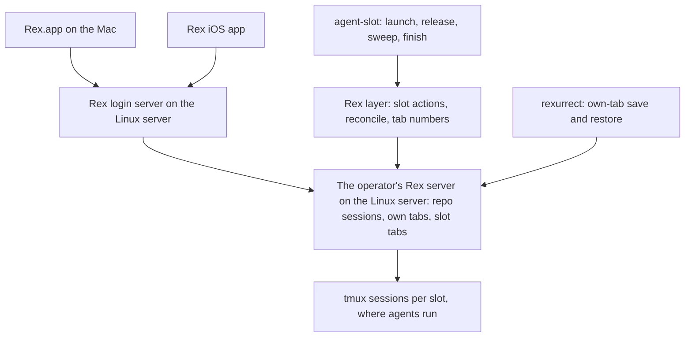

# Rex Agent Slots Hosted on the Linux Server - Plan

## Goal Capsule

- **Objective:** Whenever the Linux server is up, the operator can open Rex on the Mac or on the phone and find every
  repo session and every agent's tab there and current, whether or not the Mac is awake.
- **Means:** The Rex layer of agent slots moves from the Mac's Rex server to the Linux server's, reached through the Rex
  login server, with agents still running in tmux beneath it (Key Decisions).
- **Product authority:** Requirements govern behavior; Key Decisions record why. This plan carries out the Linux-server
  cutover that `docs/plans/2026-10-22-1818-feat-rex-parallel-agent-slots-plan.md` deferred. That plan's slot-command
  requirements still hold, and this plan changes the slot command only where it hands tab work to the Rex layer (R20).
- **Open blockers:** None.

---

## Product Contract

### Summary

Each repo's Rex session, with the operator's own tabs and its slot tabs, lives on the Linux server's Rex server, and
Rex.app and the Rex iOS app are windows onto it. The slot reconcile that runs on the Mac today moves next to the server,
so the server opens, relabels, and closes slot tabs on its own. Agents keep running in tmux, rexurrect restores the
operator's own tabs after a Rex restart, and every tab shows its number.

### Problem Frame

Agents already run on the Linux server, each in its own full clone and tmux sessions. Everything that shows them lives
on the Mac: the repo sessions, the slot tabs, and the automation that keeps those tabs in step with the server's slots.
Each slot pane is an SSH loop from the Mac into the slot's tmux session. The server pushes each launch and teardown to
the Mac over SSH, and a Mac-side loop detects wake-ups and restores once a minute.

So when the Mac sleeps, nothing can show an agent. The phone cannot reach one at all, and the Rex iOS app has nothing to
connect to, because the sessions it would show live in a server that sleeps with the Mac. The 2026-10-22 plan built the
SSH attach loops, the push, and the Mac-side restore to last only until a Rex server on Linux existed. That server now
runs: the Rex login server listens on the Linux server's tailnet address (dotfiles #348), and Rex.app already connects
to it as a remote host.

### Actors

- A1. Operator: uses Rex.app on the Mac and the Rex iOS app on the phone.
- A2. Slot agent: a Claude Code agent in a slot, which can launch and brief other slots and releases its own slot when
  its task ends.
- A3. The Linux server's own automation: the sweep timer, the finish a release starts, the slot reconcile, and the
  restores after a Rex restart.
- A4. Rex clients: Rex.app and the Rex iOS app, which display the Linux server's sessions and send input to them.

### Key Decisions

- **The Rex layer lives on the Linux server; clients are windows onto it.** (session-settled: user-directed — chosen
  over a phone that can only watch and answer: the phone and a sleeping Mac must see the same live sessions, with every
  function on the always-on machine.) Governs R1, R2, R8, R9.
- **The server runs the slot lifecycle with no client connected.** (session-settled: user-directed — chosen over clients
  that only send triggers: teardowns, releases, and sweeps happen while nobody is watching, and a client that connects
  later sees the result.) Governs R3, R4, R5, R6, R11.
- **Agents stay in tmux under Rex.** (session-settled: user-approved — chosen over running agents directly in Rex panes
  and restoring them with rexurrect: a Rex restart, crash, or preview upgrade must not stop an agent mid-work.) Governs
  R7, R21.
- **Whole repo sessions move, not only slot tabs.** (session-settled: user-approved — chosen over leaving the operator's
  own tabs on the Mac over SSH: one place holds a repo's work, and the phone sees all of it.) Governs R1, R12.
- **Dev ports stay on the Mac's localhost through a tunnel, for now.** (session-settled: user-approved — chosen over
  browsing the Linux server's tailnet name and over leaving dev-server work in SSH tabs: flows tied to localhost, such
  as OAuth callbacks and secure-origin rules, keep working.) Governs R17.
- **rexurrect restores the operator's own tabs.** (session-settled: user-approved — chosen over a standard tab per repo
  and over reopening tabs by hand: it brings back what was actually open, and v0.2.1 restored layout, ratios, labels,
  directories, and scrollback on the Linux server on 2026-10-29.) Governs R12, R13, R14.
- **Tab numbers are part of this plan, written by us.** (session-settled: user-approved — chosen over a separate
  follow-up: this plan already changes how slot tabs get their labels. The community tab-numbers module is a model, not
  a dependency, by the user's direction.) Governs R15, R16.
- **The existing reconcile moves next to the server.** (session-settled: user-approved — chosen over an event-driven
  reconcile inside Rex and over the slot command opening and closing its own tabs: it reuses the reconcile the
  two-machine checklist already proved, and keeps the teardown safety logic away from a beta UI API.) Governs R3, R4,
  R5, R6, R18, R20.
- **Shareable as a reference, not as a package.** (session-settled: user-approved — chosen over designing the Rex layer
  for drop-in reuse: proving it works on two live machines is the expensive part, and generality multiplies that.)
  Governs R19.
- **Slot status keeps the existing Claude hook path.** Claude inside tmux still reports nothing to Rex on its own, so
  the hook that writes status through tmux stays rather than going away as the 2026-10-22 plan expected. Governs R8.

### Requirements

**Where sessions live**

- R1. Each repo's Rex session, holding the operator's own tabs and its slot tabs, lives on the Linux server's Rex
  server, which Rex.app and the Rex iOS app reach through the Rex login server.
- R2. The Mac's own Rex server holds only Mac-local work, and nothing about slots runs on the Mac or depends on it being
  awake.

**The lifecycle without a client**

- R3. A slot that `agent-slot launch` makes, whether the operator or an agent ran it, gets its tab in its repo's session
  on the Linux server, opened in the background, with no client connected.
- R4. A slot that is torn down, whether by the finish a release starts, by the sweep timer, or by `finish`, loses its
  tab on the Linux server when it is torn down, with no client connected.
- R5. Whenever the Linux server's Rex server starts, after a boot, an upgrade, or a crash, every live slot gets its tab
  back and dormant slots are resumed, with no key press and no client.
- R6. A periodic pass on the Linux server corrects any slot tab a missed trigger left wrong, so tabs match the live slot
  set within a minute.
- R7. Agents run in tmux on the Linux server, so a restart, crash, or upgrade of its Rex server stops no agent, and each
  slot tab reattaches to its running agent when it is rebuilt.

**What clients can do**

- R8. From either client, the operator sees every repo session and slot tab with its agent's status (working, done, or
  waiting on the operator), and can open any of them, read it, and type into it.
- R9. From either client, the operator can start a slot on a repo with an optional first message, restore slot tabs, and
  finish a slot, through slot actions defined on the Linux server.
- R10. Where a client cannot run a named action, running the slot command in a shell tab on the Linux server is the
  supported path, and the slot's tab appears on its own (R3).
- R11. A client that connects, such as the Mac waking or the phone opening, shows the current sessions and tabs with
  nothing to sync or restore on the client.

**Restores and labels**

- R12. After a Rex server restart, the operator's own tabs come back as they were left: tabs and their order, splits and
  ratios, labels, working directories, scrollback, and each pane's last command typed but not run.
- R13. After any restore, each live slot has exactly one tab, and the reconcile owns slot tabs whatever rexurrect
  recreates.
- R14. Before a planned restart, such as applying a new preview, the operator can save the own-tab layout first, so a
  tab opened since the last automatic save is not lost.
- R15. Every tab on the Linux server's Rex server shows its position number in its label, maintained on the server so
  every client sees the same number.
- R16. The tab number, the reconcile's slot label, and rexurrect's restored labels coexist: no pass strips another's
  part of a label, and no restore leaves a doubled number.

**The Mac**

- R17. While the Mac is awake, every port the `bd-dev` host entry in `stow/ssh/dot-ssh/config` forwards today reaches
  the same port on the Linux server at the Mac's localhost, with no SSH tab open.
- R18. The Mac-side machinery the cutover makes unnecessary is retired, not left running beside the server's layer: the
  SSH attach loops, the push to each Mac, the wake detection, and the Mac's minute-by-minute restore.

**Shape and boundaries**

- R19. The Linux server's Rex layer is one module whose machine-specific values are gathered in one place, so it can
  later be published as a reference implementation.
- R20. The slot command keeps working with no Rex server present: its only tie to Rex is handing tab work to the Rex
  layer, and without a Rex server that hand-off does nothing and fails nothing.
- R21. Slots that are live at the cutover move without restarting their agents: their tmux sessions keep running, and
  only their tabs move from the Mac to the Linux server.

### Key Flows

- F1. The phone while the Mac sleeps
  - **Trigger:** The operator opens the Rex iOS app with the Mac asleep.
  - **Actors:** A1, A4
  - **Steps:** The app connects to the Linux server and lists the repo sessions. The operator opens a slot whose agent
    is waiting, answers it, and starts a new slot on the same repo. The new slot's tab appears in the background.
  - **Covered by:** R1, R3, R8, R9, R10, R11
- F2. A teardown nobody watches
  - **Trigger:** A slot agent finishes its task and releases its slot, or the sweep timer fires at night.
  - **Actors:** A2, A3
  - **Steps:** The finish waits for the agent to go idle, tears the slot down if the check passes, and the slot's tab
    closes on the Linux server. When a client connects later, the tab is already gone.
  - **Covered by:** R4, R6, R11
- F3. Applying a new Rex preview
  - **Trigger:** The operator restarts the Linux server's Rex server to pick up a new preview.
  - **Actors:** A1, A3
  - **Steps:** The operator saves the own-tab layout and restarts the server. On start, the reconcile rebuilds every
    slot tab around agents that never stopped, and rexurrect rebuilds the operator's own tabs. Every tab carries one
    number. Clients reconnect and show the rebuilt sessions.
  - **Covered by:** R5, R7, R12, R13, R14, R15, R16
- F4. The cutover
  - **Trigger:** The new Rex layer is deployed on the Linux server.
  - **Actors:** A1, A3
  - **Steps:** Each live slot gets its tab in its repo's session on the Linux server. The Mac's slot tabs and Mac-side
    loops are retired. Agents keep running throughout.
  - **Covered by:** R18, R21

### Acceptance Examples

- AE1. **Covers R4, R11.** Given the Mac asleep and the phone closed, when the sweep timer tears down a released slot at
  03:00, then the phone opened at 07:00 shows that repo's session without the slot's tab.
- AE2. **Covers R5, R7, R13, R16.** Given three working agents and two of the operator's own tabs, all numbered, when
  the Linux server's Rex server restarts for a preview, then all three agents are still on their tasks, each slot has
  one tab, the own tabs are back, and every tab shows a single number.
- AE3. **Covers R10.** Given an iOS app that offers no way to run the new-agent action, when the operator types
  `agent-slot launch <repo>` in a shell tab on the Linux server, then a tab for the new slot appears in that repo's
  session.
- AE4. **Covers R17.** Given the Mac awake and a dev server on the Linux server at port 8787, when the Mac's browser
  opens `http://localhost:8787`, then the page loads with no SSH tab open.
- AE5. **Covers R21.** Given two live slots with tabs on the Mac before the cutover, when the cutover runs, then both
  agents keep their conversations without a restart, and each slot has one tab on the Linux server and none on the Mac.
- AE6. **Covers R12, R13.** Given rexurrect restoring a session in which a slot tab was saved, when the reconcile runs
  after it, then that slot has one tab, attached to its running agent.

### Success Criteria

- AE1 through AE6 pass by hand on the operator's Mac, phone, and the Linux server, because CI has no Rex and cannot
  exercise the reconcile, the actions, or tab numbering.

### Scope Boundaries

**Deferred for later**

- Dropping tmux from under the agents. Revisit once a restore tool reliably continues a turn a Rex stop cut off, which
  rexume documents.
- rexume, including its worker and orchestrator task API.
- A reconcile driven by Rex's event stream instead of triggers and a periodic pass.
- Publishing the Rex layer and the slot command as a community package; R19 keeps the reference path open.
- Port allocation for dev servers in parallel slots, carried from the 2026-10-22 plan.
- Agent dashboards across hosts (rexboard, rex-radar) and tmux-side agent pickers (tmux-agent-panel).

**Outside this work**

- The slot command's safety logic, clone layout, trust handling, and teardown check.
- Running agents on the Mac.
- Making the Rex layer configurable for other people's setups.

### Dependencies / Assumptions

- The Rex login server runs on the Linux server on tailnet port 7297 and admits the operator's Tailscale login
  (dotfiles #348); the tailnet ACL lets the Mac reach that port, which a probe confirmed on 2026-10-29.
- A Rex client must be at least as new as the server it connects to, or its tabs stay blank
  (`docs/solutions/integration-issues/rex-app-older-than-server-shows-blank-tab-data-stream-closes-after-10s.md`). The
  iOS app needs updating before phone verification, and a server preview can require a client update.
- rexurrect v0.2.1 (MIT) was tested on the Linux server on 2026-10-29 against a throwaway Rex server. Its Claude resume,
  its restore when a server starts, its systemd autosave, and its zsh recorder were not exercised. It enters dotfiles
  only after it clears the 7-day supply-chain gate on 2026-11-05.
- Rex has no documented extension format. The Rex layer is Lua modules loaded from the server's `init.lua`, as the Mac's
  layer is today; the `rex` stow package deploys on macOS only (`scripts/stow-deploy:25`).
- Two Rex.app behaviors still held on build 1642 on 2026-10-29: a split made in the tab the app is showing records 0.5
  whatever ratio was asked, and `rex focus` does not move the tab the app shows
  (`docs/solutions/integration-issues/rex-app-records-even-splits-in-the-tab-it-is-showing.md`,
  `docs/solutions/integration-issues/rex-app-shows-its-own-tab-selection-not-the-servers-active-window.md`).
- Whether the Rex iOS app can run a named action is unknown; R10 covers the case where it cannot.

### Outstanding Questions

**Deferred to Planning**

- How the reconcile is triggered on the server after a launch, sweep, or finish, and where the start-up restore and the
  periodic pass run (from the server's Rex config or as a user service).
- How slot tabs are recognized once their panes attach to tmux locally, given that a tab number now leads each label
  (R16).
- The tab-number label format, and how it composes with the reconcile's slot label and with labels rexurrect restores.
- Whether a Claude status report written through tmux reaches a Rex tab whose tmux client runs on the same host; the
  2026-10-22 measurement covered a Mac tab over SSH.
- What stays in the Mac's Rex config (the dev-layout actions for Mac-local sessions), and how the `rex` stow package
  splits between the Mac and the Linux server.
- The Mac tunnel's mechanism, and how it stays up across sleep and network changes.
- Whether Rex's agent session-renaming must be turned off on the Linux server, as the 2026-10-22 plan expected.
- Whether rexurrect's Claude resume hook is needed, since slot panes run tmux attaches rather than Claude.

<!-- ce-section: work-relationships -->
### How This Work Fits Together

This plan covers the Linux-server cutover of the Rex layer only. The breakdown below is the current understanding, not a
committed roadmap.

- The slot command and its safety model, from `docs/plans/2026-10-22-1818-feat-rex-parallel-agent-slots-plan.md`: this
  plan depends on it and leaves it unchanged except at the hand-off to the Rex layer.
- The Rex login server (dotfiles #348): this plan depends on it as the clients' way in.
  - Keeping clients as new as the server: shares the client-skew risk; still to decide whether anything checks it.
- Dropping tmux under the agents: depends on this plan and on a restore tool that continues interrupted turns.
- A community reference release of the Rex layer and the slot command: enabled by R19, can proceed independently once
  this plan ships.

### Sources / Research

- `docs/plans/2026-10-22-1818-feat-rex-parallel-agent-slots-plan.md`: the deferred cutover (Scope Boundaries, Deferred
  to Follow-Up Work), R22, KTD6 (tmux sessions per slot), KTD7 (the status path), KTD10 (restore, follow, push).
- Current code the cutover replaces or moves: `scripts/agent-slot/lib/push.sh`,
  `scripts/agent-slot-rex/lib/reconcile.sh` (slot keying at lines 4-5, relabeling at line 78),
  `scripts/agent-slot-rex/lib/attach.sh`, `stow/rex/dot-config/rex/init.lua`, `stow/rex/dot-config/rex/agent-slots.lua`,
  `stow/rex/dot-config/rex/layout.lua`.
- Server automation that stays: `stow/local/dot-config/systemd/user/agent-slot-sweep.timer`,
  `scripts/agent-slot/lib/release.sh`, `stow/claude/dot-claude/slot-status.sh`.
- The login server deploy: `scripts/rex-login-server-deploy.sh`,
  `config/systemd/system/rex-login-server.service.d/tailnet-listen.conf`.
- Rex documentation, Linux: Server Modes, Remote Access, and Login Server pages at superlogical.com.
- rexurrect (github.com/cemcatik/rexurrect) and rexume (github.com/Entwining/rexume) for session restore; the
  tab-numbers module in github.com/manishprivet/.dotfiles (`.config/rex/extensions/tab-numbers`) as a model for
  server-side tab labels.
