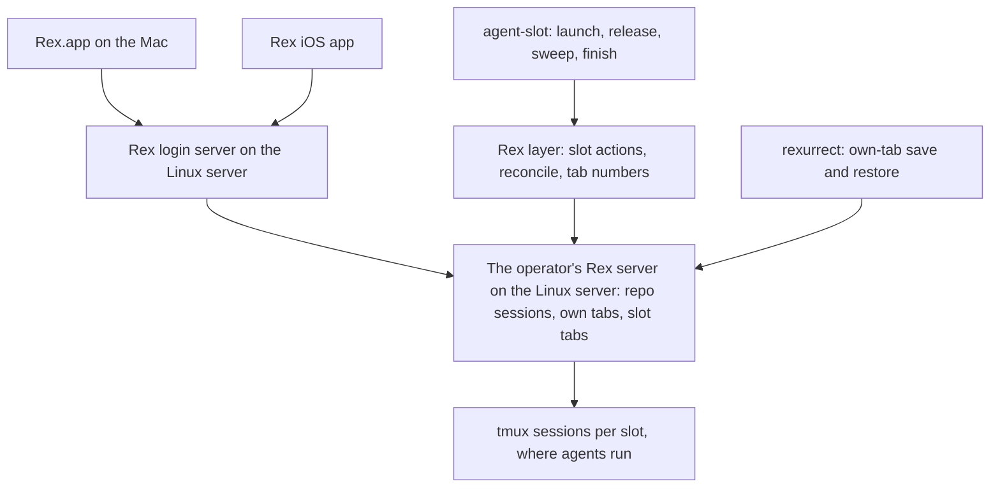
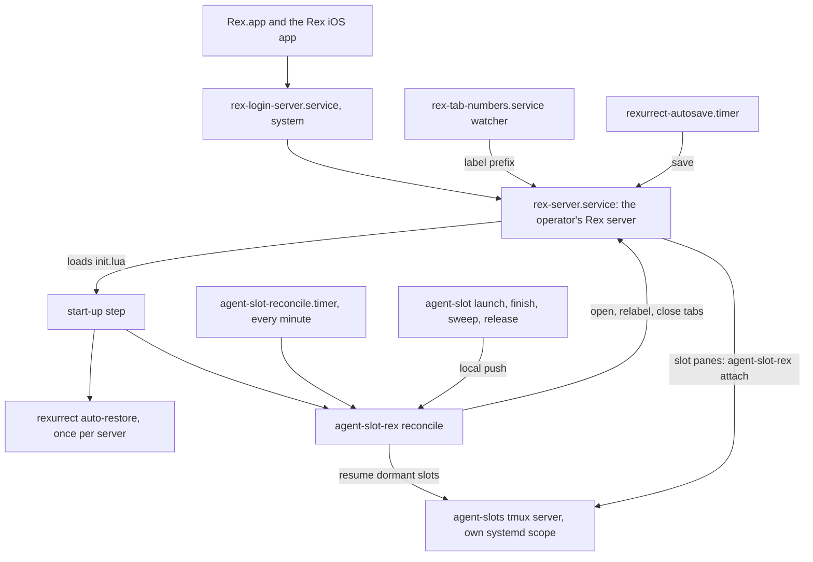
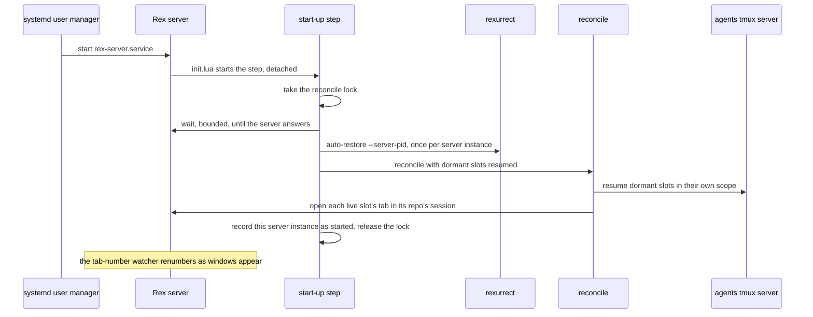
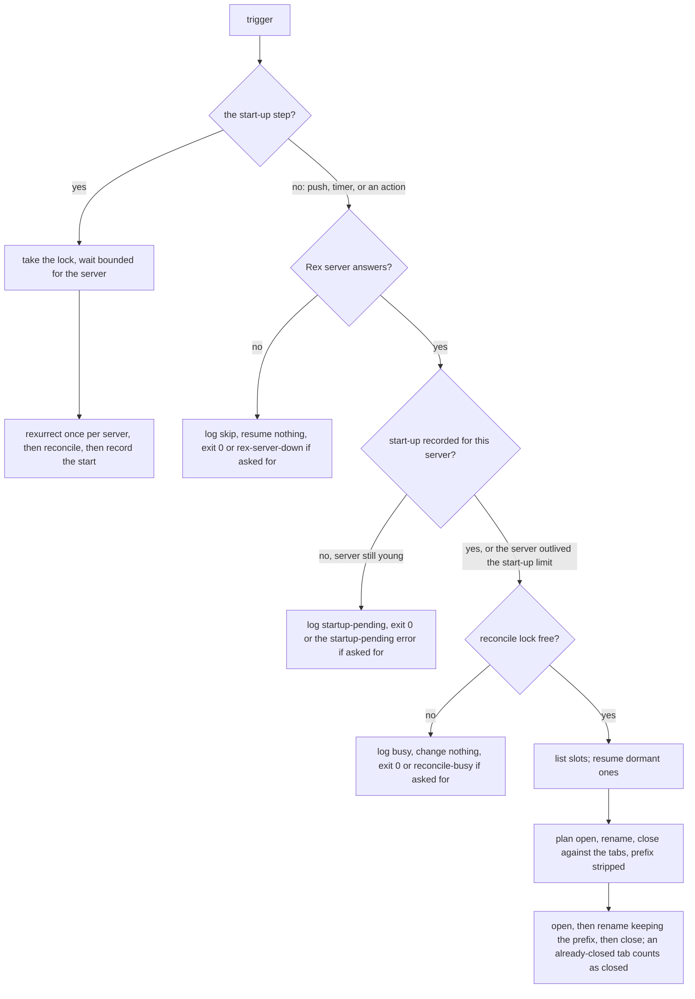

# Rex Agent Slots Hosted on the Linux Server - Plan

## Goal Capsule

- **Objective:** Whenever the Linux server is up, the operator can open Rex on the Mac or on the phone and find every
  repo session and every agent's tab there and current, whether or not the Mac is awake.
- **Means:** The Rex layer of agent slots moves from the Mac's Rex server to the Linux server's, reached through the Rex
  login server, with agents still running in tmux beneath it (Key Decisions).
- **Product authority:** Requirements govern behavior; Key Decisions record why. This plan carries out the Linux-server
  cutover that `docs/plans/2026-10-22-1818-feat-rex-parallel-agent-slots-plan.md` deferred. That plan's slot-command
  requirements still hold. This plan changes the slot command at its hand-off to the Rex layer (R20, KTD6) and where its
  tmux server starts (KTD3); its safety logic, clone layout, trust handling, and teardown check stay unchanged.
- **Execution profile:** Bash CLIs and libraries, systemd user units, Lua Rex config, a LaunchAgent, and docs in
  dotfiles, with bats suites against stubs. CI has no tmux, Rex, or Lua, so the Lua and all live behavior are proven by
  `rex config check` and the hand-run checklist (Verification Contract).
- **Stop conditions:** Stop and bring the finding to the operator when U1 shows the login server starting a second Rex
  server beside the service's, a status report not reaching a Rex tab through a local tmux client, or a tmux server
  dying with the unit that started it; and when any teardown test shows a deletion the check should have blocked.
- **Who finishes:** `ce-work` executes U1 through U9 on a `feat/` branch cut from `dev` in dotfiles and opens the PR. U7
  lands on or after 2026-11-05. The operator runs U10 on both machines and the phone before merge, and a matching PR
  updates the `agent-slot` skill in the agent-skills repo.
- **Open blockers:** None.

---

## Product Contract

### Summary

Each repo's Rex session, with the operator's own tabs and its slot tabs, lives on the Linux server's Rex server, and
Rex.app and the Rex iOS app are windows onto it. The slot reconcile that runs on the Mac today moves next to the server,
so the server opens, relabels, and closes slot tabs on its own. Agents keep running in tmux, rexurrect restores the
operator's own tabs after a Rex restart, and every tab shows its number.

### Problem Frame

Agents already run on the Linux server, each in its own full clone and tmux sessions. Everything that shows them lives
on the Mac: the repo sessions, the slot tabs, and the automation that keeps those tabs in step with the server's slots.
Each slot pane is an SSH loop from the Mac into the slot's tmux session. The server pushes each launch and teardown to
the Mac over SSH, and a Mac-side loop detects wake-ups and restores once a minute.

So when the Mac sleeps, nothing can show an agent. The phone cannot reach one at all, and the Rex iOS app has nothing to
connect to, because the sessions it would show live in a server that sleeps with the Mac. The 2026-10-22 plan built the
SSH attach loops, the push, and the Mac-side restore to last only until a Rex server on Linux existed. That server now
runs: the Rex login server listens on the Linux server's tailnet address (dotfiles #348), and Rex.app already connects
to it as a remote host.

### Actors

- A1. Operator: uses Rex.app on the Mac and the Rex iOS app on the phone.
- A2. Slot agent: a Claude Code agent in a slot, which can launch and brief other slots and releases its own slot when
  its task ends.
- A3. The Linux server's own automation: the sweep timer, the finish a release starts, the slot reconcile, and the
  restores after a Rex restart.
- A4. Rex clients: Rex.app and the Rex iOS app, which display the Linux server's sessions and send input to them.

### Key Decisions

- **The Rex layer lives on the Linux server; clients are windows onto it.** (session-settled: user-directed — chosen
  over a phone that can only watch and answer: the phone and a sleeping Mac must see the same live sessions, with every
  function on the always-on machine.) Governs R1, R2, R8, R9.
- **The server runs the slot lifecycle with no client connected.** (session-settled: user-directed — chosen over clients
  that only send triggers: teardowns, releases, and sweeps happen while nobody is watching, and a client that connects
  later sees the result.) Governs R3, R4, R5, R6, R11.
- **Agents stay in tmux under Rex.** (session-settled: user-approved — chosen over running agents directly in Rex panes
  and restoring them with rexurrect: a Rex restart, crash, or preview upgrade must not stop an agent mid-work.) Governs
  R7, R21.
- **Whole repo sessions move, not only slot tabs.** (session-settled: user-approved — chosen over leaving the operator's
  own tabs on the Mac over SSH: one place holds a repo's work, and the phone sees all of it.) Governs R1, R12.
- **Dev ports stay on the Mac's localhost through a tunnel, for now.** (session-settled: user-approved — chosen over
  browsing the Linux server's tailnet name and over leaving dev-server work in SSH tabs: flows tied to localhost, such
  as OAuth callbacks and secure-origin rules, keep working.) Governs R17.
- **rexurrect restores the operator's own tabs.** (session-settled: user-approved — chosen over a standard tab per repo
  and over reopening tabs by hand: it brings back what was actually open, and v0.2.1 restored layout, ratios, labels,
  directories, and scrollback on the Linux server on 2026-10-29.) Governs R12, R13, R14.
- **Tab numbers are part of this plan, written by us.** (session-settled: user-approved — chosen over a separate
  follow-up: this plan already changes how slot tabs get their labels. The community tab-numbers module is a model, not
  a dependency, by the user's direction.) Governs R15, R16.
- **The existing reconcile moves next to the server.** (session-settled: user-approved — chosen over an event-driven
  reconcile inside Rex and over the slot command opening and closing its own tabs: it reuses the reconcile the
  two-machine checklist already proved, and keeps the teardown safety logic away from a beta UI API.) Governs R3, R4,
  R5, R6, R18, R20.
- **Shareable as a reference, not as a package.** (session-settled: user-approved — chosen over designing the Rex layer
  for drop-in reuse: proving it works on two live machines is the expensive part, and generality multiplies that.)
  Governs R19.
- **Slot status keeps the existing Claude hook path.** Claude inside tmux still reports nothing to Rex on its own, so
  the hook that writes status through tmux stays rather than going away as the 2026-10-22 plan expected. Governs R8.

### Requirements



**Where sessions live**

- R1. Each repo's Rex session, holding the operator's own tabs and its slot tabs, lives on the Linux server's Rex
  server, which Rex.app and the Rex iOS app reach through the Rex login server.
- R2. The Mac's own Rex server holds only Mac-local work, and nothing about slots runs on the Mac or depends on it being
  awake.

**The lifecycle without a client**

- R3. A slot that `agent-slot launch` makes, whether the operator or an agent ran it, gets its tab in its repo's session
  on the Linux server, opened in the background, with no client connected.
- R4. A slot that is torn down, whether by the finish a release starts, by the sweep timer, or by `finish`, loses its
  tab on the Linux server when it is torn down, with no client connected.
- R5. Whenever the Linux server's Rex server starts, after a boot, an upgrade, or a crash, every live slot gets its tab
  back and dormant slots are resumed, with no key press and no client.
- R6. A periodic pass on the Linux server corrects any slot tab a missed trigger left wrong, so tabs match the live slot
  set within a minute.
- R7. Agents run in tmux on the Linux server, so a restart, crash, or upgrade of its Rex server stops no agent, and each
  slot tab reattaches to its running agent when it is rebuilt.

**What clients can do**

- R8. From either client, the operator sees every repo session and slot tab with its agent's status (working, done, or
  waiting on the operator), and can open any of them, read it, and type into it.
- R9. From either client, the operator can start a slot on a repo with an optional first message, restore slot tabs, and
  finish a slot, through slot actions defined on the Linux server.
- R10. Where a client cannot run a named action, running the slot command in a shell tab on the Linux server is the
  supported path, and the slot's tab appears on its own (R3).
- R11. A client that connects, such as the Mac waking or the phone opening, shows the current sessions and tabs with
  nothing to sync or restore on the client.

**Restores and labels**

- R12. After a Rex server restart, the operator's own tabs come back as they were left: tabs and their order, splits and
  ratios, labels, working directories, scrollback, and each pane's last command typed but not run.
- R13. After any restore, each live slot has exactly one tab, and the reconcile owns slot tabs whatever rexurrect
  recreates.
- R14. Before a planned restart, such as applying a new preview, the operator can save the own-tab layout first, so a
  tab opened since the last automatic save is not lost.
- R15. Every tab on the Linux server's Rex server shows its position number in its label, maintained on the server so
  every client sees the same number.
- R16. The tab number, the reconcile's slot label, and rexurrect's restored labels coexist: no pass strips another's
  part of a label, and no restore leaves a doubled number.

**The Mac**

- R17. While the Mac is awake, every port the `bd-dev` host entry in `stow/ssh/dot-ssh/config` forwards today reaches
  the same port on the Linux server at the Mac's localhost, with no SSH tab open.
- R18. The Mac-side machinery the cutover makes unnecessary is retired, not left running beside the server's layer: the
  SSH attach loops, the push to each Mac, the wake detection, and the Mac's minute-by-minute restore.

**Shape and boundaries**

- R19. The Linux server's Rex layer is one module whose machine-specific values are gathered in one place, so it can
  later be published as a reference implementation.
- R20. The slot command keeps working with no Rex server present: its only tie to Rex is handing tab work to the Rex
  layer, and without a Rex server that hand-off does nothing and fails nothing.
- R21. Slots that are live at the cutover move without restarting their agents: their tmux sessions keep running, and
  only their tabs move from the Mac to the Linux server.

### Key Flows

- F1. The phone while the Mac sleeps
  - **Trigger:** The operator opens the Rex iOS app with the Mac asleep.
  - **Actors:** A1, A4
  - **Steps:** The app connects to the Linux server and lists the repo sessions. The operator opens a slot whose agent
    is waiting, answers it, and starts a new slot on the same repo. The new slot's tab appears in the background.
  - **Covered by:** R1, R3, R8, R9, R10, R11
- F2. A teardown nobody watches
  - **Trigger:** A slot agent finishes its task and releases its slot, or the sweep timer fires at night.
  - **Actors:** A2, A3
  - **Steps:** The finish waits for the agent to go idle, tears the slot down if the check passes, and the slot's tab
    closes on the Linux server. When a client connects later, the tab is already gone.
  - **Covered by:** R4, R6, R11
- F3. Applying a new Rex preview
  - **Trigger:** The operator restarts the Linux server's Rex server to pick up a new preview.
  - **Actors:** A1, A3
  - **Steps:** The operator saves the own-tab layout and restarts the server. On start, the reconcile rebuilds every
    slot tab around agents that never stopped, and rexurrect rebuilds the operator's own tabs. Every tab carries one
    number. Clients reconnect and show the rebuilt sessions.
  - **Covered by:** R5, R7, R12, R13, R14, R15, R16
- F4. The cutover
  - **Trigger:** The new Rex layer is deployed on the Linux server.
  - **Actors:** A1, A3
  - **Steps:** Each live slot gets its tab in its repo's session on the Linux server. The Mac's slot tabs and Mac-side
    loops are retired. Agents keep running throughout.
  - **Covered by:** R18, R21

### Acceptance Examples

- AE1. **Covers R4, R11.** Given the Mac asleep and the phone closed, when the sweep timer tears down a released slot at
  03:00, then the phone opened at 07:00 shows that repo's session without the slot's tab.
- AE2. **Covers R5, R7, R13, R16.** Given three working agents and two of the operator's own tabs, all numbered, when
  the Linux server's Rex server restarts for a preview, then all three agents are still on their tasks, each slot has
  one tab, the own tabs are back, and every tab shows a single number.
- AE3. **Covers R10.** Given an iOS app that offers no way to run the new-agent action, when the operator types
  `agent-slot launch <repo>` in a shell tab on the Linux server, then a tab for the new slot appears in that repo's
  session.
- AE4. **Covers R17.** Given the Mac awake and a dev server on the Linux server at port 8787, when the Mac's browser
  opens `http://localhost:8787`, then the page loads with no SSH tab open.
- AE5. **Covers R21.** Given two live slots with tabs on the Mac before the cutover, when the cutover runs, then both
  agents keep their conversations without a restart, and each slot has one tab on the Linux server and none on the Mac.
- AE6. **Covers R12, R13.** Given rexurrect restoring a session in which a slot tab was saved, when the reconcile runs
  after it, then that slot has one tab, attached to its running agent.

### Success Criteria

- AE1 through AE6 pass by hand on the operator's Mac, phone, and the Linux server, because CI has no Rex and cannot
  exercise the reconcile, the actions, or tab numbering.

### Scope Boundaries

**Deferred for later**

- Dropping tmux from under the agents. Revisit once a restore tool reliably continues a turn a Rex stop cut off, which
  rexume documents.
- rexume, including its worker and orchestrator task API.
- A reconcile driven by Rex's event stream instead of triggers and a periodic pass.
- Publishing the Rex layer and the slot command as a community package; R19 keeps the reference path open.
- Port allocation for dev servers in parallel slots, carried from the 2026-10-22 plan.
- Agent dashboards across hosts (rexboard, rex-radar) and tmux-side agent pickers (tmux-agent-panel).

**Outside this work**

- The slot command's safety logic, clone layout, trust handling, and teardown check.
- Running agents on the Mac.
- Making the Rex layer configurable for other people's setups.

**Deferred to Follow-Up Work**

- The `agent-slot` skill's text in the agent-skills repo (`agent-slot/SKILL.md`), which still places slot tabs on the
  Mac; a matching PR there.
- Moving rexurrect's Mac install (binary, zsh recorder, launchd agent) into dotfiles, carried from the 2026-10-22 plan.

**Considered and not built**

- A check that warns when a connected client is older than the server. Client and server builds use different version
  schemes (`0.1.0 (1642)` against `0.1.0~preview.10`), and the blank-tab log signature is documented; revisit if blank
  tabs recur.
- Tab numbers in `agent-slot list`. Slot keys stay the only identifier (KTD14); revisit if the operator's tab numbers
  and agents' slot keys keep crossing in practice.
- A restore verb for agents. The start-up step and the timer cover every case an agent would need it for.

### Dependencies / Assumptions

- The Rex login server runs on the Linux server on tailnet port 7297 and admits the operator's Tailscale login
  (dotfiles #348); the tailnet ACL lets the Mac reach that port, which a probe confirmed on 2026-10-29.
- A Rex client must be at least as new as the server it connects to, or its tabs stay blank
  (`docs/solutions/integration-issues/rex-app-older-than-server-shows-blank-tab-data-stream-closes-after-10s.md`). The
  iOS app needs updating before phone verification, and a server preview can require a client update.
- rexurrect v0.2.1 (MIT) was tested on the Linux server on 2026-10-29 against a throwaway Rex server. Its Claude resume,
  its restore when a server starts, its systemd autosave, and its zsh recorder were not exercised. It enters dotfiles
  only after it clears the 7-day supply-chain gate on 2026-11-05.
- Rex has no documented extension format. The Rex layer is Lua modules loaded from the server's `init.lua`, as the Mac's
  layer is today; the `rex` stow package deploys on macOS only (`scripts/stow-deploy:25`).
- Two Rex.app behaviors still held on build 1642 on 2026-10-29: a split made in the tab the app is showing records 0.5
  whatever ratio was asked, and `rex focus` does not move the tab the app shows
  (`docs/solutions/integration-issues/rex-app-records-even-splits-in-the-tab-it-is-showing.md`,
  `docs/solutions/integration-issues/rex-app-shows-its-own-tab-selection-not-the-servers-active-window.md`).
- Whether the Rex iOS app can run a named action is unknown; R10 covers the case where it cannot.

### Outstanding Questions

**Deferred to Implementation**

- Whether Rex's agent session-renaming fires inside slots on the server, where Claude runs in tmux without Rex's session
  variables; U1 checks, and it is turned off only if it fires.
- Whether rexurrect's Claude resume hook earns a place for the operator's own tabs that run Claude; slot panes do not
  need it.
- The exact transient-scope invocation and unit names, settled in U2 against the host's systemd 255.

<!-- ce-section: work-relationships -->
### How This Work Fits Together

This plan covers the Linux-server cutover of the Rex layer only. The breakdown below is the current understanding, not a
committed roadmap.

- The slot command and its safety model, from `docs/plans/2026-10-22-1818-feat-rex-parallel-agent-slots-plan.md`: this
  plan depends on it and leaves it unchanged except at the hand-off to the Rex layer.
- The Rex login server (dotfiles #348): this plan depends on it as the clients' way in.
  - Keeping clients as new as the server: shares the client-skew risk; still to decide whether anything checks it.
- Dropping tmux under the agents: depends on this plan and on a restore tool that continues interrupted turns.
- A community reference release of the Rex layer and the slot command: enabled by R19, can proceed independently once
  this plan ships.

### Sources / Research

- `docs/plans/2026-10-22-1818-feat-rex-parallel-agent-slots-plan.md`: the deferred cutover (Scope Boundaries, Deferred
  to Follow-Up Work), R22, KTD6 (tmux sessions per slot), KTD7 (the status path), KTD10 (restore, follow, push).
- Current code the cutover replaces or moves: `scripts/agent-slot/lib/push.sh`,
  `scripts/agent-slot-rex/lib/reconcile.sh` (slot keying at lines 4-5, relabeling at line 78),
  `scripts/agent-slot-rex/lib/attach.sh`, `stow/rex/dot-config/rex/init.lua`, `stow/rex/dot-config/rex/agent-slots.lua`,
  `stow/rex/dot-config/rex/layout.lua`.
- Server automation that stays: `stow/local/dot-config/systemd/user/agent-slot-sweep.timer`,
  `scripts/agent-slot/lib/release.sh`, `stow/claude/dot-claude/slot-status.sh`.
- The login server deploy: `scripts/rex-login-server-deploy.sh`,
  `config/systemd/system/rex-login-server.service.d/tailnet-listen.conf`.
- Rex documentation, Linux: Server Modes, Remote Access, and Login Server pages at superlogical.com.
- rexurrect (github.com/cemcatik/rexurrect) and rexume (github.com/Entwining/rexume) for session restore; the
  tab-numbers module in github.com/manishprivet/.dotfiles (`.config/rex/extensions/tab-numbers`) as a model for
  server-side tab labels.

---

## Planning Contract

**Product Contract preservation:** restructured, no scope change. Outstanding Questions keeps only execution-time
questions, because KTD1 through KTD12 answer its planning questions; Scope Boundaries gains plan-local Deferred to
Follow-Up Work and Considered and not built lists.

### Key Technical Decisions

- KTD1. **The helper runs on the Linux server, and its SSH transport becomes a local runner.** Every call
  `agent-slot-rex` makes to the server goes through one seam (`server_ssh` in `scripts/agent-slot-rex/lib/server.sh`); a
  local runner keeps that seam's argv and exit-code contract, so the reconcile, its lock, and its journal stay one
  implementation. (session-settled: user-approved — chosen over a new server-only tool: the reconcile the two-machine
  checklist proved stays as it is.) Governs R3, R4, R5, R6, R18, R20.
- KTD2. **A systemd user service keeps the operator's Rex server running.** It runs `rex server run` without
  `--exit-empty`, modeled on the user service Rex's own home-manager module ships, so a server exists at boot and when
  an agent launches a slot with no client connected. Rex's Login Server docs say the login server uses an account's
  running server instead of starting one; U1 confirms that on this host before anything depends on it. (session-settled:
  user-approved — chosen over the login server's start-on-connect, quit-when-empty server: slots need tabs while nobody
  is connected.) Starting a server on demand came close as an alternative but did not need a bake-off: a server the
  helper starts inherits its caller's environment and cgroup (KTD3, KTD11). The unit is `Type=notify`, since
  `rex server run` reports readiness to systemd, and it restarts always, every 10 s, with no start limit. Whenever it is
  down, a client's connection makes the login server start its own quit-when-empty server; a second `rex server run` on
  the held socket exits 1 (`server endpoint is already in use`), and once the start-up step has opened slot sessions in
  that server it never quits, so the service keeps retrying and doctor names the server it did not start (eng review
  R1). Governs R3, R5, R7.
- KTD3. **The slot tmux server runs in its own systemd scope.** When a slot's sessions must start and the `agent-slots`
  server is not running, it starts inside a transient user scope, so a finished timer run or a restarted Rex service
  cannot take the agents with it. (session-settled: user-approved — chosen over leaving tmux in its caller's cgroup,
  where systemd ends it with the unit.) `systemd-run --user --scope --collect` wraps the empty-environment start rather
  than running inside it, because `env -i` drops the runtime directory and bus address systemd-run needs. When
  systemd-run fails, the start falls back to today's direct start, which joins a server that a concurrent start already
  made. Governs R7.
- KTD4. **One start-up step orders the restores, once per Rex server.** When the Linux server's Rex server loads its
  config, a detached start-up step takes the reconcile lock at once and waits, for a bounded time, until the server
  answers, because Rex's APIs do not work while it is still loading. It then runs rexurrect's foreground once-per-server
  restore (`rexurrect auto-restore --server-pid` with the server's pid) under a time bound, reconciles slot tabs with
  dormant slots resumed, and records the server's instance ID as started. The instance ID is the `instance:` UUID that
  `rex server status` prints, so a pid reused after a reboot never matches an old record. A rexurrect run that outlives
  its bound is stopped and journaled, and the reconcile still runs, so a hung restore never holds the lock. On a config
  reload the step finds that record, skips rexurrect, and only reconciles; rexurrect's own background start-up hook is
  not installed on the Linux server. (session-settled: user-approved — chosen over letting rexurrect restore on its own:
  a reconcile that runs first creates a repo's session, and rexurrect then restores a second one beside it.) Governs R5,
  R12, R13.
- KTD5. **The periodic pass is a once-a-minute systemd user timer.** It follows
  `stow/local/dot-config/systemd/user/agent-slot-sweep.{service,timer}`. A timer or push pass exits 0 after logging why
  it changed nothing: `skip` when no Rex server answers, `startup-pending` while the running server has no start-up
  record (KTD4) and is younger than the start-up step's time limit, and `busy` when the lock is held. A restore the
  operator or an agent asked for, from the CLI or the restore action, reports the same three outcomes as errors instead
  (`rex-server-down`, `startup-pending`, `reconcile-busy`), each with its exit code and next step, and the action's tab
  holds to show it, since a pass someone waits on that changed nothing must not read as success (DX review D9). The
  follow loop and its wake detection are removed. (session-settled: user-approved — chosen over the follow loop, which
  exits whenever its Rex server does.) Governs R6, R18.
- KTD6. **The push becomes a local reconcile.** After a launch, sweep, or finish, `scripts/agent-slot/lib/push.sh` runs
  a local reconcile when the helper and a Rex server are present and does nothing otherwise. The client list defaults to
  empty, and a verb that a slot tab's own helper ran still skips the push, because that helper reconciles right after.
  Governs R3, R4, R20.
- KTD7. **Slot panes stay a supervising loop around a local tmux attach, started outside the slot.** The pane's own
  process stays `agent-slot-rex attach <repo>/<N> <kind>`, so the reconcile keeps recognizing slot tabs by command. It
  attaches locally in a loop that ends when the slot is gone, from `$HOME`, so the agent-state scan never counts the
  pane as using the slot. Governs R7, R13.
- KTD8. **Tab numbers come from one watcher that owns only the label's leading `<n>:`.** A `rex do` script subscribed to
  window events runs as a user service bound to the Rex server's service and started again with it, restarting every 5 s
  with no start limit while the server is slow to answer; it renumbers tabs from each session's window order and writes
  a label only when its prefix is wrong. The reconcile and finish match slot keys and compute labels with the prefix
  removed, keep the current prefix when they relabel, and count it inside the 128-character cap. The prefix pattern is
  written once in jq and once in Lua, and a test holds the two to the same text. The watcher connects with
  `--autostart=false`, so a reconnect during a Rex restart can never start a second server (KTD11). (session-settled:
  user-approved — chosen over the reconcile numbering tabs and over the community module as-is: one writer per part of a
  label, and the module needs macOS's `shlock`.) Governs R15, R16.
- KTD9. **The `rex` stow package becomes shared, with the slot pieces Linux-only.** `init.lua` and `layout.lua` deploy
  to both machines; `agent-slots.lua` and the tab-number watcher are skipped on macOS the way `scripts/stow-deploy`
  already skips systemd units there. `init.lua` loads the slot pieces only when they are present, and otherwise keeps
  the Mac's own rexurrect auto-restore line. Governs R2, R19.
- KTD10. **The Mac tunnel is a LaunchAgent around `ssh -N` to its own host entry.** The forwards `bd-dev` carries today
  move to a new tunnel entry in `stow/ssh/dot-ssh/config`, and `bd-dev` keeps none, so an interactive `ssh bd-dev` never
  collides with the tunnel's bound ports. (session-settled: user-approved — chosen over reusing `bd-dev`, whose
  `ExitOnForwardFailure` makes a second forwarding connection fail.) Governs R17.
- KTD11. **The helper never starts a Rex server, and finds the CLI on Linux.** Every `rex` call passes
  `--autostart=false`, and the CLI lookup adds `/usr/bin/rex`. A server started from an agent's environment would carry
  Claude Code's session markers into everything it runs
  (`docs/solutions/runtime-errors/tmux-server-started-inside-claude-code-saves-no-transcripts.md`). Governs R3, R20.
- KTD12. **Machine-specific values live in one settings library.** The helper's defaults that name a host, a path, a
  socket, or a session, spread over nine files today, move into one library the dispatcher sources first; the Lua names
  only `$HOME`-relative helper paths. The library also puts the Homebrew bin first on the helper's PATH: a Rex server
  started by systemd or by the login server's PAM session hands its children a PATH without Homebrew, where tmux, jq,
  jaq, and flock live on the Linux server (eng review R2). Governs R19.
- KTD13. **Live measurement comes before dependent code.** U1 settles the behaviors this plan rests on that Rex does not
  document, each with a stop condition in the Goal Capsule. Governs R5, R7, R8, R9, R13.
- KTD14. **Agents keep the verbs they have.** Agents launch and release slots as today and never run the helper's
  restore verb themselves: the push after their launch or release runs the reconcile for them (KTD6), and the operator's
  actions and the timer run the same reconcile. The slot key `<repo>/<N>` stays the only identifier any verb accepts,
  because tab numbers shift. Governs R9, R10.

### High-Level Technical Design

Where each piece runs on the Linux server, and what drives what:



After a boot or a Rex restart, the start-up step owns the order (KTD4):



Every pass gates this way; only the start-up step waits for the server instead of skipping (KTD4, KTD5):



The label grammar both writers share (directional; KTD8 owns it):

```text
label     := [ number ": " ] rest              number: written only by the tab-number watcher
rest      := slot-rest | free-text             free-text: the operator's own tab labels, never rewritten by the reconcile
slot-rest := key " · " task-or-branch [ " · needs you: " message ]
key       := repo "/" N                        the only slot identifier (KTD14)
total     := at most 128 characters, the prefix included; the reconcile cuts slot-rest, never the prefix
```

### Assumptions

- Linger is on for the operator's account on the Linux server (`loginctl show-user` reported `Linger=yes` on
  2026-10-29), so user services run with nobody logged in.
- The Rex iOS app and Rex.app are updated to builds at least as new as the server before any client-side check.
- rexurrect 0.2.1's save and restore behave on the operator's Rex server as they did on the throwaway server tested on
  2026-10-29.

### Risks & Dependencies

| Risk                                                                                            | Mitigation                                                                                                                                                        |
| ----------------------------------------------------------------------------------------------- | ----------------------------------------------------------------------------------------------------------------------------------------------------------------- |
| The login server starts its own quit-when-empty server instead of reusing the service's         | U1 checks it first, and it is a stop condition                                                                                                                    |
| While the service is down, a client connects and the login server's own server takes the socket | the service retries every 10 s with no start limit and takes over once that server exits; doctor names a server the unit did not start (KTD2, eng review R1)      |
| A Rex server's children get a PATH without Homebrew                                             | the helper's settings library puts the Homebrew bin first itself (KTD12, eng review R2)                                                                           |
| rexurrect hangs during the start-up step, holding the reconcile lock                            | its run is bounded, journaled, and followed by the reconcile either way (KTD4)                                                                                    |
| A Claude status report does not reach a Rex tab through a local tmux client                     | U1 measures it; the fallback is the 2026-10-22 plan's: status in the tab label from `agent-slot list`                                                             |
| A Rex preview changes an API the Lua or the helper uses                                         | `scripts/agent-slot/verified-versions` records the tested build, doctor warns on any other, and the checklist reruns after an upgrade                             |
| The tmux server wedges on a blocking write to a dead client                                     | the reconcile never captures tmux output through command substitution (learnings research)                                                                        |
| A unit with mount-namespace hardening hides `/proc` entries from the agent-state scan           | no new unit sets `PrivateTmp`, `ProtectHome`, or `PrivateDevices`                                                                                                 |
| rexurrect is days old                                                                           | a pinned version, checksum, and attestation; installed only after 2026-11-05; the reconcile owns slot tabs regardless                                             |
| A client older than the server shows blank tabs                                                 | clients update first (U10); the log signature is in `docs/solutions/integration-issues/rex-app-older-than-server-shows-blank-tab-data-stream-closes-after-10s.md` |

### Alternative Approaches Considered

- Letting the helper start a Rex server on demand: rejected by KTD2 and KTD11, because the server would inherit an
  agent's environment and cgroup.
- Keeping the follow loop as the periodic pass on the server: rejected by KTD5, because it exits with its Rex server.
- Slot panes that `exec` tmux: rejected by KTD7, because the reconcile could no longer recognize slot tabs by command.
- The reconcile numbering every tab itself: rejected by KTD8, because numbers would lag up to a minute and two passes
  would share one label part.

### System-Wide Impact

- Every repo's slots and the operator's own sessions move hosts; the Mac's Rex keeps only Mac-local sessions.
- The Linux server gains four user units (the Rex server, the reconcile timer, the tab-number watcher, rexurrect's
  autosave), and `scripts/host-jobs-enable.sh` enables them, the two services from a `SERVICES` list beside `TIMERS`.
- Slot agents, which run in bypass permissions mode under the operator's own account, can now reach the operator's Rex
  server socket and drive any tab with `rex send` and `rex send-key`, including tabs where the operator holds a `sudo`
  timestamp or a root shell on another host. The same account already gives them the operator's files and keys, so this
  adds reach rather than a new privilege; the docs U9 rewrites state it.
- The `rex` stow package changes sets on both machines, and `stow/ssh/dot-ssh/config` stops forwarding ports for
  `bd-dev`.
- Claude Code hooks and the slot command's safety logic are unchanged; the `agent-slot` skill's text changes in the
  agent-skills repo.
- README.md, BOOTSTRAP.md, AGENTS.md, and CONCEPTS.md change, so the work goes through the feature-branch PR flow.

---

## Implementation Units

| U-ID | Title                                                     | Key files                                                                                    | Depends on     |
| ---- | --------------------------------------------------------- | -------------------------------------------------------------------------------------------- | -------------- |
| U1   | Measure Rex behavior on the Linux server                  | `docs/solutions/integration-issues/`                                                         | none           |
| U2   | Run the Rex server and the slot tmux server under systemd | `rex-server.service`, `scripts/agent-slot/lib/sessions.sh`                                   | U1             |
| U3   | Run the helper on the server                              | `scripts/agent-slot-rex/lib/{server,rex,attach,settings}.sh`                                 | U1             |
| U4   | Trigger the reconcile on the server                       | `scripts/agent-slot/lib/push.sh`, `scripts/agent-slot-rex/lib/reconcile.sh`, reconcile units | U2, U3         |
| U5   | Share the Rex config package                              | `scripts/stow-deploy`, `stow/rex/dot-config/rex/init.lua`                                    | U3, U4         |
| U6   | Number every tab                                          | `stow/rex/dot-config/rex/tab-numbers.lua`, `rex-tab-numbers.service`, `reconcile.sh`         | U2, U5         |
| U7   | Install rexurrect from dotfiles                           | `scripts/rexurrect-deploy.sh`, autosave units                                                | U4             |
| U8   | Keep dev ports on the Mac's localhost                     | `stow/ssh/dot-ssh/config`, `com.user.bd-tunnel.plist`                                        | none           |
| U9   | Retire the Mac half and rewrite the docs                  | `scripts/agent-slot-rex/lib/follow.sh`, README, BOOTSTRAP, CONCEPTS                          | U3, U4, U5, U6 |
| U10  | Cut over and run the two-machine checklist                | none                                                                                         | U1 through U9  |

### U1. Measure Rex behavior on the Linux server

- **Goal:** Settle the behaviors KTD2, KTD3, KTD7, and KTD8 rest on before any code depends on them.
- **Requirements:** R5, R7, R8, R9, R13, R15; KTD13.
- **Dependencies:** None.
- **Files:** `docs/solutions/integration-issues/` (one entry per finding worth keeping).
- **Approach:** On the live server, with the operator's own Rex sessions there closed and throwaway sessions only:
  1. Run a Rex server as a transient user service without `--exit-empty`, connect Rex.app through the login server, and
     confirm the connection lands on that server and no second server starts. Then the reverse: with the login server's
     quit-when-empty server holding the socket, start the service and confirm it retries and takes the socket once that
     server exits. In both cases, record the PATH a block command sees.
  2. Open a tab whose pane runs a local `tmux -L agent-slots attach` to a scratch slot session, replay a status report
     through `stow/claude/dot-claude/slot-status.sh`, and confirm Rex.app shows it.
  3. Load a scratch action and binding into that server's config, and record whether Rex.app's palette and keys run it
     and what the updated iOS app offers.
  4. Run a `rex do` watcher subscribed to window events and confirm create, close, move, and label-change events, and
     the window order `session.view` reports.
  5. Save a session holding a slot-keyed tab with rexurrect, restart the test server, restore, and run the reconcile;
     confirm one tab per slot. Also record whether `rexurrect auto-restore --server-pid` waits for the server to be
     ready and restores only once per server instance, since KTD4's reload behavior rests on it.
  6. Start a tmux server from inside a oneshot unit through a transient scope, and confirm it outlives the unit.
  7. Run `agent-slot check` on a scratch slot while a slot pane started from `$HOME` is attached, and confirm no
     blocker.
  8. Check whether Rex's agent session-renaming fires for a Claude running in a slot's tmux session.
- **Execution note:** Measurement only; no product code lands in this unit. Record the Rex, Rex.app, and iOS app
  versions with each finding.
- **Test expectation:** none -- live measurement; the findings become `docs/solutions` entries and, where an outcome
  changes a KTD, a plan edit.
- **Verification:** Every step has a recorded outcome, and each stop condition in the Goal Capsule has been checked.

### U2. Run the Rex server and the slot tmux server under systemd

- **Goal:** A Rex server exists at boot with no client connected (KTD2), and the slot tmux server outlives whatever
  started it (KTD3).
- **Requirements:** R3, R5, R7; KTD2, KTD3.
- **Dependencies:** U1.
- **Files:** `stow/local/dot-config/systemd/user/rex-server.service` (new), `scripts/agent-slot/lib/sessions.sh`,
  `scripts/host-jobs-enable.sh`, `tests/host-scheduled-jobs.bats`, `tests/agent-slot-launch.bats`.
- **Approach:**
  1. Add `rex-server.service`, modeled on Rex's home-manager user service: `rex server run` without `--exit-empty`,
     `Type=notify`, `Restart=always` with `RestartSec=10s` and `StartLimitIntervalSec=0`, gated with `ConditionHost=`
     like the sweep units, and with no mount-namespace hardening (KTD2).
  2. Enable it from `scripts/host-jobs-enable.sh` in a `SERVICES` list beside `TIMERS`, which the script's header and
     its closing status listing also cover.
  3. In `sessions_start`, when the `agent-slots` tmux server is not running and the user's systemd manager answers,
     start it through `systemd-run --user --scope --collect` placed before the `env -i` start, under a fixed scope name;
     when systemd-run fails, start it directly as today (KTD3).
- **Patterns to follow:** `stow/local/dot-config/systemd/user/agent-slot-sweep.service`; the `TIMERS` list and its gates
  in `scripts/host-jobs-enable.sh`; the `env -i -C /` start in `sessions.sh`.
- **Test scenarios:**
  - `rex-server.service` runs `rex server run` with no `--exit-empty`, is `Type=notify`, restarts always every 10 s with
    `StartLimitIntervalSec=0`, and sets none of `PrivateTmp`, `ProtectHome`, or `PrivateDevices`.
  - `systemd-analyze --user verify` accepts the unit where it is available, and the test skips where it is not.
  - `host-jobs-enable.sh` lists the service under `SERVICES` and enables it only on Linux and the named host.
  - `sessions_start` with no slot tmux server running and a user manager that answers runs the tmux start through a
    stubbed transient scope, with `systemd-run` before `env -i` in the recorded argv.
  - `sessions_start` whose stubbed `systemd-run` fails (a scope of that name already exists) starts tmux directly and
    the launch succeeds.
  - `sessions_start` with the slot tmux server already running starts the sessions without a scope.
  - `sessions_start` with no user manager starts tmux directly, as today.
- **Verification:** After `systemctl --user restart rex-server.service`, `rex --autostart=false server status` answers
  with no client connected, and stopping the unit that started the slot tmux server leaves the agents running. With the
  login server's quit-when-empty server holding the socket, the service retries every 10 s and holds the socket within
  10 s of that server exiting.

### U3. Run the helper on the server

- **Goal:** `agent-slot-rex` works on the Linux server against its own Rex server (KTD1, KTD11, KTD12).
- **Requirements:** R3, R18, R19, R20; KTD1, KTD7, KTD11, KTD12.
- **Dependencies:** U1.
- **Files:** `scripts/agent-slot-rex/agent-slot-rex`, `scripts/agent-slot-rex/lib/server.sh`,
  `scripts/agent-slot-rex/lib/rex.sh`, `scripts/agent-slot-rex/lib/attach.sh`, `scripts/agent-slot-rex/lib/doctor.sh`,
  `scripts/agent-slot-rex/lib/help.sh`, `scripts/agent-slot-rex/lib/settings.sh` (new),
  `scripts/agent-slot/verified-versions`, `tests/agent-slot-rex.bats`, `tests/lib/agent-slot-rex.bash`,
  `tests/agent-slot-doctor.bats`.
- **Approach:**
  1. Replace `server_ssh` with a local runner that keeps its argv and exit codes, and map a missing `agent-slot` to the
     existing `dependency-missing` reason.
  2. Add `/usr/bin/rex` to the CLI lookup, and pass `--autostart=false` on every `rex` call.
  3. Make `attach` loop over a local `tmux -L agent-slots attach -t =<session>` from `$HOME`, keeping resume-on-missing
     and the exit when the slot is gone, and dropping the SSH retry and jitter (KTD7).
  4. Move the host, path, socket, and session defaults into `lib/settings.sh`, sourced first, and list each setting in
     the dispatcher header. The library puts the Homebrew bin first on PATH when it exists and is missing, and holds the
     start-up step's bounds (KTD12).
  5. Make doctor report server-side findings (the Rex server service, the login server, the reconcile timer, the
     tab-number service, rexurrect, the verified Rex build) and drop the Mac hints. One finding names a Rex server that
     `rex-server.service` did not start: the pid `rex server status` prints differs from the unit's `MainPID`, and the
     next step names the commands that hand the socket back to the service.
  6. Record the server's Rex build in `scripts/agent-slot/verified-versions`.
  7. Give every new doctor finding and pass outcome a reason in the closed set in `scripts/agent-slot/lib/contract.sh`,
     with its row in the README's reasons table, which `tests/agent-slot-docs.bats` holds to that set:
     `rex-server-down`, `startup-pending`, `reconcile-timer-inactive`, `tab-numbers-inactive`, `rexurrect-missing`,
     `rex-server-foreign`, `rex-restart-pending`, `reconcile-stale`, and `wrong-host`. `server-unreachable` retires with
     the SSH transport, and `reconcile-busy`'s row stops naming the Mac (DX review).
  8. Doctor also reports two states a deploy or an upgrade leaves behind: `rex-restart-pending` when
     `rex version --json`'s `rex_version` differs from the `version` that `rex server status` prints for the running
     server, with the ordered next step (update Rex.app and the iOS app to at least that build, `rexurrect save`,
     `systemctl --user restart rex-server.service`, then rerun the checklist); and `reconcile-stale` when the reconcile
     timer is active but the newest line in `reconcile.log` is over 3 minutes old, or the last three passes all failed,
     naming the log path and `agent-slot-rex restore` (DX review D10, D11).
  9. On macOS the dispatcher stops before any work with `wrong-host`: the slot layer runs on the Linux server, so the
     error names the Rex host to connect to and `ssh <server> agent-slot-rex doctor` as the next step (DX review D8).
- **Patterns to follow:** the contract envelopes and closed reason set in `scripts/agent-slot/lib/contract.sh`; the
  stubs in `tests/lib/agent-slot-rex.bash`.
- **Test scenarios:**
  - A server verb through the local runner returns the same JSON and exit code the SSH path did, for success, for a
    timeout, and for a missing `agent-slot`.
  - The CLI lookup picks `/usr/bin/rex` when `REX_BIN_DIR` is unset and no Mac app path exists.
  - Every `rex` call the stub records carries `--autostart=false`.
  - `attach` on a live slot runs a local tmux attach from `$HOME`, and attaches again after the tmux client exits while
    the slot lives.
  - `attach` on a slot that no longer exists exits 0, and on a slot whose tmux sessions are missing, it resumes the slot
    first.
  - doctor on the server names each inactive unit in a finding with a next step.
  - doctor names a Rex server whose pid differs from `rex-server.service`'s `MainPID`, with the hand-back commands, and
    reports nothing when they match.
  - With PATH set to the systemd user manager's default (no Homebrew), the helper still finds tmux, jq or jaq, and flock
    from the Homebrew bin, and a missing Homebrew prefix leaves PATH as it was.
  - doctor reports `version-unverified` for an unlisted Rex build and nothing for the listed one.
  - doctor reports `rex-restart-pending` when the stubbed CLI and running-server versions differ, with the four ordered
    steps in `next_step`, and nothing when they match.
  - doctor reports `reconcile-stale` for a journal whose newest line is 4 minutes old with the timer active, and for
    three failed passes in a row, and nothing for a fresh `ok` line.
  - With `uname` stubbed to Darwin, any verb exits with `wrong-host` before calling `rex` or `agent-slot`.
  - Every reason the helper can emit is in `CONTRACT_REASONS` and the README's reasons table, and `server-unreachable`
    is in neither.
  - Overriding one setting changes only that value, and no library outside `settings.sh` names a host (text check).
- **Verification:** `agent-slot-rex doctor` on the server is clean with every unit active, and the stub suites pass on
  CI.

### U4. Trigger the reconcile on the server

- **Goal:** Launches, teardowns, Rex starts, and a one-minute timer keep tabs matched to slots with no client connected
  (KTD4, KTD5, KTD6).
- **Requirements:** R3, R4, R5, R6, R11, R13, R20; KTD4, KTD5, KTD6.
- **Dependencies:** U2, U3.
- **Files:** `scripts/agent-slot/lib/push.sh`, `scripts/agent-slot/lib/env.sh`, `scripts/agent-slot/agent-slot`,
  `scripts/agent-slot/lib/help.sh` (the launch, sweep, and finish text that names the push to each Mac),
  `tests/lib/agent-slot.bash`, `scripts/agent-slot-rex/lib/reconcile.sh`, `scripts/agent-slot-rex/lib/journal.sh`,
  `scripts/agent-slot-rex/lib/help.sh`, `stow/local/dot-config/systemd/user/agent-slot-reconcile.service` (new),
  `stow/local/dot-config/systemd/user/agent-slot-reconcile.timer` (new), `scripts/host-jobs-enable.sh`,
  `tests/agent-slot-push.bats`, `tests/agent-slot-rex.bats`, `tests/host-scheduled-jobs.bats`.
- **Approach:**
  1. In `push.sh`, run a local `restore --by push` when the helper and a Rex server are present, in the background and
     waited on under `AGENT_SLOT_PUSH_WAIT` as today; default the client list to empty; skip when a slot tab's own
     helper ran the verb.
  2. In `reconcile.sh`, add a start-up entry, `restore --at-start` in place of `restore --wait-server` and its wait for
     SSH, that takes the lock first, waits for the Rex server to answer for a bounded time like today's restore wait,
     runs `rexurrect auto-restore --server-pid` in the foreground under `timeout` with the bound from `settings.sh` when
     rexurrect is installed and this server instance has no start-up record yet, journals rexurrect's outcome (done,
     failed, or stopped at the bound), reconciles with dormant slots resumed whatever that outcome, and then writes the
     start-up record for the `instance:` UUID `rex server status` prints.
  3. Start every other pass by checking that a Rex server answers and that its instance has a start-up record; log
     `skip` or `startup-pending` and exit 0 without resuming any slot when either is missing, unless the server has
     outlived the start-up step's time limit.
  4. Count a planned close of a tab that is already gone as done.
  5. Add the reconcile service and a one-minute timer shaped like the sweep units, including the sweep's
     `Environment=PATH=` line, and enable them from `scripts/host-jobs-enable.sh`.
  6. In `journal.sh` and the `--by` values in `help.sh`, journal the start-up step as the existing `restore-at-start`
     and the timer pass as the existing `poll`, and drop `reconnect`.
- **Patterns to follow:** `stow/local/dot-config/systemd/user/agent-slot-sweep.{service,timer}`; the push log and its
  result names in `push.sh`; `reconcile_plan`'s pure-jq planning.
- **Test scenarios:**
  - Covers AE1. A sweep that tears down a slot while a Rex server is present runs one local restore whose plan closes
    that slot's tab.
  - A launch with no Rex server present makes the slot, runs no restore, and returns its usual result (R20).
  - A launch run by a slot tab's own helper runs no push.
  - A timer pass with no Rex server answering logs a skip, resumes no slot, and exits 0.
  - The same conditions on a restore run by hand give errors with their reasons, exit codes, and next steps:
    `rex-server-down` naming `systemctl --user start rex-server.service`, `startup-pending` saying when the start-up
    limit ends, and `reconcile-busy` naming the pid that holds the lock; each also writes its journal line.
  - A timer pass while another pass holds the lock logs busy and changes nothing.
  - Covers AE6. The start-up step calls rexurrect's restore before its first tab change, under the lock.
  - A start-up step whose server answers only after a delay still runs rexurrect's restore and then reconciles, and a
    timer pass that arrives during that wait logs busy and opens no tab.
  - A timer pass on a server instance with no start-up record logs `startup-pending` and changes no tabs; once the
    record exists, the next pass reconciles.
  - A second start-up step on the same server instance, as a config reload starts, does not call rexurrect and only
    reconciles.
  - The start-up step with rexurrect absent still reconciles and still writes its record.
  - A rexurrect stub that never exits is stopped at the bound; the step journals it, still reconciles, and writes its
    record.
  - A start-up step on a new server instance, with a record left by an older instance, runs rexurrect again.
  - A timer pass on a server with no start-up record that has outlived the start-up step's time limit reconciles instead
    of logging `startup-pending`.
  - Regression, carried forward from `push.sh`'s contract that a push never changes the verb's result or exit code: a
    local reconcile that fails or times out leaves the result and exit code of `launch`, `sweep`, and `finish`
    unchanged, and `push.log` records `restore-failed` or `timed-out`.
  - A planned close whose tab is already gone counts as done, and the pass succeeds.
  - The reconcile timer fires every minute and is persistent, and its service sets no `PrivateTmp`.
  - An agent's `agent-slot release`, whose finish tears the slot down while a Rex server is present, runs one local
    restore whose plan closes that slot's tab, and the restore never touches another slot's tmux sessions.
  - `agent-slot list` and `agent-slot check` report the same state for a working slot before and after a reconcile that
    rebuilt its tab.
- **Verification:** With no client connected, a slot launched from a server shell gets its tab within seconds, and
  restarting `rex-server.service` brings every slot tab back once.

### U5. Share the Rex config package

- **Goal:** One Rex config package serves both machines, with the slot actions and the watcher only on the Linux server
  (KTD9).
- **Requirements:** R2, R9, R10, R18, R19; KTD9.
- **Dependencies:** U3, U4.
- **Files:** `scripts/stow-deploy`, `stow/rex/dot-config/rex/init.lua`, `stow/rex/dot-config/rex/agent-slots.lua`,
  `tests/stow-deploy-packages.bats`, `tests/rex-config.bats`.
- **Approach:**
  1. Move `rex` to the shared package set, and skip `agent-slots.lua` and the watcher on macOS the way systemd units are
     skipped there, with a basename `--ignore`. `scripts/stow-deploy` also refuses `rex` on Linux in a second, hand-kept
     list (`ghostty | cursor | launchagent | rex` in its platform guard); derive that guard from `DESKTOP_PACKAGES` so
     the move needs one edit (eng review R4).
  2. Make `init.lua` load the slot module and start the start-up step (U4) when the module is present, and otherwise
     keep the Mac's rexurrect auto-restore line; remove the restore and follow starts.
  3. Keep the three actions and bindings in `agent-slots.lua`, calling the helper by its `$HOME`-relative path, with
     restore and finish still running in the agents control session.
  4. Run `scripts/stow-deploy`'s config-reload step on both platforms, finding `/usr/bin/rex` on Linux and always
     passing `--autostart=false`.
- **Patterns to follow:** the systemd-unit skip on Darwin in `scripts/stow-deploy`;
  `docs/solutions/architecture-patterns/cross-platform-stow-package-gating-2026-05-17.md`; the text contracts in
  `tests/rex-config.bats`.
- **Test scenarios:**
  - On Linux, deploying `rex` links `init.lua`, `layout.lua`, and `agent-slots.lua`; with `uname` stubbed to Darwin, it
    links only `init.lua` and `layout.lua`.
  - `init.lua` loads the slot module only when its file exists, starts no follow loop, and names no `/Users/` path.
  - `init.lua` names the helper's start-up entry exactly once.
  - The reload step runs on Linux with `/usr/bin/rex` and `--autostart=false`, and does nothing when no server answers.
  - Every helper verb the Lua names still exists in `help.sh`.
  - The Linux platform guard in `scripts/stow-deploy` reads `DESKTOP_PACKAGES`, so no package name appears in both, and
    on Linux it no longer skips `rex`.
- **Verification:** `rex --autostart=false config check` passes on both machines, and Rex.app connected to the Linux
  server lists the slot actions in its palette and runs them from their keys.

### U6. Number every tab

- **Goal:** Every tab on the Linux server shows its position number, and numbers, slot labels, and restored labels
  coexist (KTD8).
- **Requirements:** R13, R15, R16; KTD8.
- **Dependencies:** U2, U5.
- **Files:** `stow/rex/dot-config/rex/tab-numbers.lua` (new),
  `stow/local/dot-config/systemd/user/rex-tab-numbers.service` (new), `scripts/agent-slot-rex/lib/reconcile.sh`,
  `scripts/agent-slot-rex/lib/finish.sh`, `scripts/agent-slot-rex/lib/rex.sh`, `scripts/host-jobs-enable.sh`,
  `tests/agent-slot-rex.bats`, `tests/rex-config.bats`, `tests/host-scheduled-jobs.bats`.
- **Approach:**
  1. Write the watcher to subscribe to window create, destroy, move, and label-change events, recompute each session's
     numbers from its window order, and rewrite only labels whose prefix is wrong, stripping any existing prefix first
     so a restored label never doubles.
  2. Run it as a user service with `After=`, `BindsTo=`, and `WantedBy=rex-server.service`, so a server restart stops it
     and starts it again, restarted on failure with `RestartSec=5s` and `StartLimitIntervalSec=0`, that starts the
     watcher with `--autostart=false`. Enable it from the `SERVICES` list in `scripts/host-jobs-enable.sh`, which
     creates its `WantedBy=` link.
  3. Make the reconcile and `finish_key_of` strip the prefix before matching keys and computing labels, keep the current
     prefix on rename, and hold the whole label to 128 characters.
  4. Count characters, not bytes, on both sides, so neither writer cuts what the other wrote.
- **Patterns to follow:** the event-driven watcher and its restore-on-remove mode in the community tab-numbers module
  (as a model only); `rex_label` in `scripts/agent-slot-rex/lib/rex.sh`.
- **Test scenarios:**
  - Covers AE2. A reconcile plan over a tab labeled `2: dotfiles/3 · task` keys it to `dotfiles/3`, plans no rename when
    the rest matches, and opens no duplicate.
  - A rename for a changed task keeps the existing `2:` prefix.
  - The watcher's strip-then-prefix pattern turns a restored `4: 1: dotfiles/3 · task` into a single correct number
    (text-level contract).
  - A prefixed label at the 128-character cap is cut in its rest, never its prefix, and a second pass over the result
    changes nothing.
  - `finish_key_of` resolves the key from a prefixed label.
  - The jq and Lua prefix patterns are identical text.
  - The watcher's service is ordered after, bound to, and wanted by `rex-server.service`, restarts on failure every 5 s
    with `StartLimitIntervalSec=0`, passes `--autostart=false`, and sets no `PrivateTmp`.
  - On Linux, deploying `rex` also links the watcher script, and with `uname` stubbed to Darwin it does not.
- **Verification:** Opening, closing, and moving tabs in Rex.app renumbers them within a second, and an hour of timer
  passes shows no renames in the reconcile journal.

### U7. Install rexurrect from dotfiles

- **Goal:** rexurrect saves the operator's own tabs on a timer, and the start-up step restores them (R12, R14).
- **Requirements:** R12, R13, R14; KTD4.
- **Dependencies:** U4; lands on or after 2026-11-05, when v0.2.1 clears the 7-day gate.
- **Files:** `scripts/rexurrect-deploy.sh` (new), `stow/local/dot-config/systemd/user/rexurrect-autosave.service` (new),
  `stow/local/dot-config/systemd/user/rexurrect-autosave.timer` (new), `scripts/host-jobs-enable.sh`,
  `tests/rexurrect-deploy.bats` (new), `tests/host-scheduled-jobs.bats`.
- **Approach:**
  1. Write a deploy script that downloads a pinned release into an empty directory, checks its SHA-256 and
     `gh attestation verify --repo cemcatik/rexurrect`, and installs it to `~/.local/bin`. Each `FATAL:` line, in the
     style of `scripts/rex-login-server-deploy.sh`, names the archive and pinned version, says nothing was installed,
     and ends with the fix: for a checksum mismatch the expected and actual SHA-256 and the rerun command, for a failed
     attestation the `gh attestation verify` command to rerun by hand.
  2. Stow the autosave service and timer (every 15 minutes, `rexurrect save`) instead of letting
     `rexurrect autosave install` write files dotfiles does not manage.
  3. Keep rexurrect's defaults of an empty `auto_resume` and `no_scrollback = ["claude"]`.
- **Patterns to follow:** the pinned versions in `scripts/playwright-browsers-deploy.sh`; the `--dest` and `--root`
  sandbox flags in `scripts/sysctl-deploy.sh` and `scripts/rex-login-server-deploy.sh`.
- **Test scenarios:**
  - A sandboxed deploy with a matching checksum installs the binary into the target directory.
  - A checksum mismatch installs nothing and exits non-zero, naming the archive.
  - A failed attestation installs nothing.
  - A rerun with that version already installed reports nothing to do.
  - The autosave timer fires every 15 minutes, its service runs `rexurrect save`, and it sets no `PrivateTmp`.
- **Verification:** `rexurrect list` shows snapshots accruing, and AE2 passes in U10.

### U8. Keep dev ports on the Mac's localhost

- **Goal:** With no SSH tab open, the Mac's localhost reaches every port `bd-dev` forwards today (KTD10).
- **Requirements:** R17; KTD10.
- **Dependencies:** None.
- **Files:** `stow/ssh/dot-ssh/config` (git-crypt; a new tunnel host entry, with the forwards moved off `bd-dev`),
  `stow/launchagent/Library/LaunchAgents/com.user.bd-tunnel.plist` (new), `tests/launchagents.bats`.
- **Approach:**
  1. Add a tunnel host entry that carries the forwards and keepalives with `ExitOnForwardFailure no`, and remove the
     forwards from `bd-dev`. The forwards include 3000, 5173, and 8080, which Mac-local dev servers also use; with
     `yes`, one busy laptop port would end the connection and drop all eight forwards on every relaunch (eng review R3).
  2. Add a LaunchAgent that runs `ssh -N` to it in the required `/bin/sh -c 'PATH=...; exec ...'` shape, kept alive with
     a throttle so it reconnects after sleep and network changes, with ssh's standard error in a log file, so a refused
     forward is on record.
- **Patterns to follow:** `stow/launchagent/Library/LaunchAgents/com.user.qmd-serve.plist`; the shape
  `tests/launchagents.bats` enforces.
- **Test scenarios:**
  - The new plist passes the existing LaunchAgent shape checks.
  - The plist runs `ssh -N` to the tunnel host entry, keeps alive, sets a throttle interval, and sets a standard-error
    log path.
- **Verification:** Covers AE4 by hand: with the Mac awake and no SSH tab open, `http://localhost:8787` reaches a dev
  server on the Linux server, and after a sleep and wake the tunnel comes back on its own. With a Mac-local process
  holding 5173, the other forwards still reach the Linux server, and the log names the refused port.

### U9. Retire the Mac half and rewrite the docs

- **Goal:** Nothing slot-related runs on the Mac, and every doc describes the server-hosted layer (R18).
- **Requirements:** R2, R18; KTD5, KTD14.
- **Dependencies:** U3, U4, U5, U6.
- **Files:** `scripts/agent-slot-rex/lib/follow.sh` (removed), `scripts/agent-slot-rex/lib/launch.sh`,
  `scripts/agent-slot-rex/lib/help.sh`, `tests/agent-slot-rex-follow.bats` (removed), `tests/agent-slot-docs.bats`,
  `tests/rex-config.bats`, `stow/claude/dot-claude/slot-status.sh`, `README.md`, `BOOTSTRAP.md`, `AGENTS.md`,
  `CONCEPTS.md`.
- **Approach:**
  1. Remove the `follow` verb and its suite, and the code paths only the Mac used: the SSH retry, wake detection, Mac
     app paths, `open -a` next steps, and the client naming.
  2. Rewrite README's agent-slot sections and helper table; BOOTSTRAP's Rex config and agent-slot sections (deploying on
     the server, the units, `rexurrect save` before a planned restart, the Mac tunnel); and AGENTS.md wherever it names
     the Mac helper.
  3. Add *slot reconcile* to CONCEPTS.md, and update *agent slot* where it places tabs.
  4. Shape the README's Setup as the golden path, with doctor as its checklist. On the Linux server:
     `scripts/stow-deploy --headless --all`, then `bash scripts/host-jobs-enable.sh`, then `agent-slot-rex doctor`,
     which names `scripts/rexurrect-deploy.sh`, the login server deploy, and `agent-slot warm <repo>` with their exact
     commands while any is missing. On the Mac: `scripts/stow-deploy --all`, then
     `launchctl bootstrap "gui/$(id -u)" ~/Library/LaunchAgents/com.user.bd-tunnel.plist` as BOOTSTRAP does for the
     other LaunchAgents, then connect Rex.app to the Linux server's host.
  5. Add a short "a slot's tab is missing" path: `agent-slot-rex doctor` first (it names a stale or failing reconcile),
     then the newest lines of `~/.local/state/agent-slot-rex/reconcile.log`, read by their `by`, `ok`, and `error`
     fields, then `agent-slot-rex restore`. For the phone's shell fallback, document `agent-slot launch <repo>` followed
     by typing the first message into the new tab's Claude, since `launch` takes a first message only as
     `--prompt-file`.
  6. Make `slot-status.sh`'s header describe a tab on the same host.
- **Test scenarios:**
  - The docs suite finds every helper verb in the README and no removed verb.
  - `tests/rex-config.bats`'s verb pin matches the new verb set.
- **Verification:** The helper names no Mac host, Mac app path, or follow loop, and the docs describe only the current
  layout.

### U10. Cut over and run the two-machine checklist

- **Goal:** Live slots move without restarting their agents, and AE1 through AE6 pass by hand (R21, Success Criteria).
- **Requirements:** R1, R8, R9, R10, R11, R21; F1 through F4; AE1 through AE6.
- **Dependencies:** U1 through U9.
- **Files:** none, beyond any `docs/solutions` entries the checklist produces.
- **Approach:** In order:
  1. Update Rex.app and the Rex iOS app to builds at least as new as the server.
  2. From a plain SSH shell on the Linux server, not a Rex tab there, since this step stops that Rex server: disconnect
     both clients, run `rexurrect save`, then `rex server stop`, and confirm with `rex --autostart=false server status`
     that the login server's quit-when-empty server is gone, so the deploy cannot reload the new config into it. The
     saved snapshot is what the start-up step restores the operator's own tabs from in step 4. If a client reconnects
     before step 3 and the login server starts its own server again, repeat this step (DX review D12).
  3. Deploy dotfiles on the server and run `scripts/host-jobs-enable.sh`, which starts `rex-server.service`, the
     tab-number watcher, and the reconcile timer together.
  4. Reconnect Rex.app, confirm it lands on the service's server, and watch the start-up step give every live slot its
     tab while the agents keep running in tmux.
  5. Deploy dotfiles on the Mac, then reload its Rex config, stop the running follow loop, and close the Mac's slot
     tabs.
  6. Run AE1 through AE6 and F1 through F4, plus the agent-side checks: an agent launches a slot with the Mac and the
     phone both off, an agent releases its own slot and its tab closes, and the cutover itself runs while one agent is
     mid-turn.
  7. Record versions and outcomes in the PR body, with the time F1 takes from opening the Rex iOS app with the Mac
     asleep to reading the waiting agent's tab (the DX review's target is under 2 minutes), with the Rex server's
     resident memory at cutover and again after 24 hours, since the always-on server keeps every pane's scrollback and
     Rex documents no cap.
- **Test expectation:** none -- live verification on two machines and a phone.
- **Verification:** Every AE and F passes, with the Mac lid closed for AE1 and F1.

---

## Verification Contract

| Gate           | Command or check                                                | Applies to                 |
| -------------- | --------------------------------------------------------------- | -------------------------- |
| Shell lint     | `scripts/lint-shell --all`                                      | U2, U3, U4, U5, U6, U7, U9 |
| Bats           | `scripts/run-tests --all` (also run by pre-push)                | U2 through U9              |
| Core env guard | `scripts/core-env-guard.sh` sweep (run by pre-push)             | every new or changed test  |
| Markdown       | `markdownlint-cli2` on the changed docs                         | U9                         |
| Units          | `systemd-analyze --user verify` on each new unit, on the server | U2, U4, U6, U7             |
| Rex config     | `rex --autostart=false config check` on both machines           | U5, U6                     |
| Doctor         | `agent-slot-rex doctor` clean on the server                     | U3 through U7              |
| Live           | AE1 through AE6 and F1 through F4 by hand                       | U10                        |

CI runs ShellCheck and bats on Ubuntu without tmux, Rex, or Lua, so the Lua and every live behavior are verified only by
the Rex config check and the U10 checklist.

---

## Definition of Done

- Every unit's Verification holds, and CI is green on the PR.
- AE1 through AE6 and F1 through F4 pass by hand, with versions recorded in the PR body.
- U1's findings, and any surprise U10 turns up, are recorded under `docs/solutions/`.
- The helper keeps no Mac-only code path, follow loop, or SSH transport, and the diff carries no code from abandoned
  attempts.
- README.md, BOOTSTRAP.md, AGENTS.md, and CONCEPTS.md describe the server-hosted layer, and the agent-skills PR updating
  the `agent-slot` skill is open.
- rexurrect is installed from dotfiles only at a version that has cleared the 7-day gate.

---

## Eng Review

Target: this plan, `docs/plans/2026-10-29-2303-feat-rex-agent-slots-on-linux-server-plan.md`, reviewed with
`/plan-eng-review` after the first document review. The operator asked for the review to run unattended, so each choice
below was auto-decided to its recommended option; a choice only the operator could make would be listed under Unresolved
decisions.

### Scope record

Feature answers: no cuts or deferrals proposed. The complexity gate trips: about 45 changed files, and new units for the
Rex server, the reconcile timer, the tab-number watcher, and rexurrect's autosave, plus a LaunchAgent and the settings
library. Structure: A, the original arrangement (eng D1, auto-decided). No smaller arrangement keeps the approved
features, because each unit owns one lifecycle (the server, the minute pass, the label prefix, the autosave, the
tunnel), and folding any two together makes one restart with the other when it has no need to. Accepted scope: the plan
as written, with the corrections below. Pending remedies: none. Scope Challenge result: scope accepted as-is.

Scope Challenge findings:

- Reuse: the plan already reuses the reconcile, its lock and bounded journal, the server runner's argv and exit-code
  contract, the sweep units, the contract envelopes, the stow Darwin skip, and the LaunchAgent shape.
- Search check: the transient tmux scope is standard practice [Layer 1]. tmux issue #428 suggests
  `systemd-run --scope --user tmux`, and a recent fix of the same failure (a tmux server killed with the oneshot unit
  that first started it, awebai/oats#915) uses `systemd-run --user --scope --collect` with a direct-start fallback.
- No `TODOS.md` exists.
- SC1 [INFORMATIONAL] (9/10) KTD12 — the count of helper files that name machine values is nine, not "about eight"
  (`rg -l` over `scripts/agent-slot-rex`). Applied.

### Reality rows

| Premise | Claim                                                                               | Receipt                                                                                                                                  | Verdict                           |
| ------- | ----------------------------------------------------------------------------------- | ---------------------------------------------------------------------------------------------------------------------------------------- | --------------------------------- |
| P1      | every server call goes through `server_ssh`                                         | `scripts/agent-slot-rex/lib/server.sh:19`; callers at `attach.sh:61`, `server.sh:54`, `reconcile.sh:174`, `doctor.sh:59`, `follow.sh:74` | true                              |
| P2      | the `rex` package deploys on macOS only                                             | `scripts/stow-deploy:25`; also the Linux guard at `scripts/stow-deploy:286`                                                              | true, through two lists (Q1)      |
| P3      | the reconcile keys slots at lines 4-5 and relabels near line 78                     | `scripts/agent-slot-rex/lib/reconcile.sh:4-5`, `reconcile.sh:79-80`                                                                      | true                              |
| P4      | the sweep units are the pattern for a timer                                         | `stow/local/dot-config/systemd/user/agent-slot-sweep.service:1-12`, `agent-slot-sweep.timer:1-12`                                        | true                              |
| P5      | `host-jobs-enable.sh` gates on Linux and the host and lists the timers              | `scripts/host-jobs-enable.sh:17-39`                                                                                                      | true; timers only (Q3)            |
| P6      | slot sessions start from an empty environment at `/`                                | `scripts/agent-slot/lib/sessions.sh:76-78`                                                                                               | true                              |
| P7      | a push never changes the verb's result, and a oneshot waits for it                  | `scripts/agent-slot/lib/push.sh:3-4`, `push.sh:19-20`                                                                                    | true                              |
| P8      | the client list defaults to the Mac                                                 | `scripts/agent-slot/lib/env.sh:38`                                                                                                       | true                              |
| P9      | labels are capped at 128 characters                                                 | `scripts/agent-slot-rex/lib/rex.sh:17-20`                                                                                                | true                              |
| P10     | the reconcile journal is bounded                                                    | `scripts/agent-slot-rex/lib/journal.sh:5-6`                                                                                              | true                              |
| P11     | `rex server run` takes `--exit-empty`, and every call takes `--autostart`           | `rex server run --help`; `rex server --help` global options                                                                              | true                              |
| P12     | Rex exposes a server instance ID                                                    | `rex --autostart=false server status` prints `instance: <uuid>`                                                                          | true                              |
| P13     | `rexurrect auto-restore --server-pid` restores in the foreground, once per instance | rexurrect 0.2.1 help: `--server-pid <pid>  Wait for the Rex server with this pid and restore into it, in the foreground`                 | true                              |
| P14     | a second Rex server on a held socket fails                                          | throwaway probe on 2026-10-30: exit 1, `server endpoint is already in use`                                                               | true (new)                        |
| P15     | the login server starts its own server when none runs                               | Login Server docs, How It Works step 3; the live account server runs `rex server run --exit-empty`                                       | true                              |
| P16     | linger is on                                                                        | `loginctl show-user` reports `Linger=yes`                                                                                                | true                              |
| P17     | a Rex server's children find the Homebrew tools                                     | `systemctl --user show-environment` and the live server's environment: no Homebrew on PATH                                               | false (A2)                        |
| P18     | `rex server run` reports readiness to systemd                                       | throwaway `Type=notify` unit reached active/running in 0.04 s                                                                            | true (new)                        |
| P19     | the iOS app can run named actions                                                   | none                                                                                                                                     | unverified; U1 step 3 measures it |
| P20     | Rex's agent session-renaming fires inside slots                                     | none                                                                                                                                     | unverified; U1 step 8 measures it |

unverified=2

REALITY: premise-table finding 20 premises, one false (P17, fixed by R2) and two unverified that U1 measures
scripts/agent-slot-rex/lib/server.sh:19 REALITY: already-done pass origin/dev since 2026-10-29 carries only agent-slot
check fixes and this plan's own commits, and none builds a unit f0ed5d1 REALITY: surface-check finding every rex,
rexurrect, systemd-run, and systemctl flag named exists; the new journal trigger duplicated an existing one (Q2)
scripts/agent-slot-rex/lib/journal.sh:13 REALITY: binding-decisions pass the one branch decision, that the Mac and the
servers run one dotfiles version, agrees with KTD9's shared package
docs/plans/2026-10-29-2303-feat-rex-agent-slots-on-linux-server-plan.md:383 REALITY: numbers finding the file count in
KTD12 re-counted as nine, and the minute pass re-measured with gtime
docs/plans/2026-10-29-2303-feat-rex-agent-slots-on-linux-server-plan.md:395 REALITY: deferred-asks pass no linked issue;
the brainstorm's asks are the Product Contract docs/plans/2026-10-29-2303-feat-rex-agent-slots-on-linux-server-plan.md:7
REALITY: pr-count pass one dotfiles PR under the default policy plus the agent-skills PR the plan names, with U7's gate
holding the dotfiles PR open until 2026-11-05 docs/plans/2026-10-29-2303-feat-rex-agent-slots-on-linux-server-plan.md:30

`PLAN_REALITY: phase=eng rows=7/7 missing=none verdict=complete`

### Section 1: Architecture

Design twice. Shape A is the plan: the reconcile stays a short-lived helper run by triggers (the push, the timer, the
start-up step, the actions), and a separate watcher owns the label prefix. Shape B is one long-running
`agent-slot-rex daemon` user service that subscribes to `rex events` and owns the start-up order, the minute pass, and
the numbering, with no lock, start-up record, or `startup-pending` gate. B hides more behind one unit, but it is the
event-driven reconcile the Product Contract defers, and it puts the teardown path in a long-running bash process on a
beta event stream, which the Key Decision on the reconcile rules out. Pick: A.

Red flags: split ownership (5) does not apply to the start-up record and rexurrect's own per-instance state, which
record different facts (the start-up step finished; rexurrect restored). The label prefix pattern written in jq and in
Lua (2, 8) is held identical by U6's test; accepted. The Linux guard in `scripts/stow-deploy` repeats `DESKTOP_PACKAGES`
(8): Q1. No other flag.

- A1 [CRITICAL] (8/10) KTD2, U2 — While `rex-server.service` is down, a client connection makes the login server start
  its own `--exit-empty` server (Login Server docs, step 3; the live account server runs `rex server run --exit-empty`
  with the PAM environment). A second `rex server run` on the held socket exits 1 (P14). At systemd's defaults
  (`DefaultRestartUSec=100ms`, five starts in 10 s, read from this host's user manager) the unit parks in failed, and
  once the start-up step has opened slot sessions in the other server, `--exit-empty` never fires. Accepted, R1 (eng
  D2).
- A2 [CRITICAL] (9/10) KTD12, U2 — `agent-slot-sweep.service:8` sets
  `Environment=PATH=/home/linuxbrew/.linuxbrew/bin:/usr/local/bin:/usr/bin:/bin`, and the plan's `rex-server.service`
  sets no PATH. The user manager's PATH and the PAM PATH have no Homebrew, where tmux, jq, jaq, and flock live. The
  start-up step (`rex.exec.start` in `init.lua`) and every slot pane inherit the server's PATH, so the helper would stop
  at its jq check (`scripts/agent-slot-rex/agent-slot-rex:69-70`) and attach could not find tmux. Accepted, R2 (eng D3).
- A3 [CRITICAL] (7/10) KTD4, U4 step 2 — the step "runs `rexurrect auto-restore --server-pid` in the foreground" under
  the reconcile lock, and only the wait for the server was bounded. A rexurrect run that hangs holds the lock for good,
  and every later pass logs `busy` with no other sign. Applied as a routine correction: a `timeout` bound from
  `settings.sh`, a journaled outcome, and the reconcile either way.
- A4 [INFORMATIONAL] (8/10) KTD8, U6 — a watcher that is only `BindsTo=` the server stops when the server restarts and
  is never started again, and at the defaults a server slow to answer parks it in failed. Applied: `After=`, `BindsTo=`,
  `WantedBy=`, `RestartSec=5s`, `StartLimitIntervalSec=0`.
- A5 [INFORMATIONAL] (9/10) KTD4 — "the server's instance ID" had no source. Rex prints an `instance:` UUID (P12), which
  a pid reused after a reboot cannot match. Applied.
- A6 [INFORMATIONAL] (7/10) KTD3, U2 — `env -i` (`scripts/agent-slot/lib/sessions.sh:76`) strips `XDG_RUNTIME_DIR` and
  the bus address, so systemd-run has to wrap it, and a fixed scope name fails when two first starts race. Applied:
  systemd-run before `env -i`, and the direct start when systemd-run fails.
- A7 [INFORMATIONAL] (9/10) System-Wide Impact — slot agents run in bypass permissions mode under the operator's uid,
  and the Rex socket is owner-only (`--socket-mode` default 0600), so they can drive any of the operator's tabs with
  `rex send` and `rex send-key`. The account already gives them its files and keys, so this adds reach, not privilege.
  Applied as a System-Wide Impact line for U9's docs; not a deal breaker.

Dispositions: A1 accepted (eng D2); A2 accepted (eng D3); A3 through A7 applied as routine corrections.

### Section 2: Code quality

- Q1 [INFORMATIONAL] (9/10) `scripts/stow-deploy:286` — `ghostty | cursor | launchagent | rex)` skips `rex` on Linux in
  a list kept apart from `DESKTOP_PACKAGES` (line 25), and U5 named only the package-set move. Accepted, R4 (eng D5).
- Q2 [INFORMATIONAL] (9/10) `scripts/agent-slot-rex/lib/journal.sh:13` — the triggers already include `restore-at-start`
  and `poll`, and U4 added a new `start`. Applied: reuse both, drop `reconnect`, and the `--by` values at
  `scripts/agent-slot-rex/lib/help.sh:32` follow.
- Q3 [INFORMATIONAL] (8/10) `scripts/host-jobs-enable.sh:30-39` — the script keeps only a `TIMERS` list and ends with
  `list-timers`, and two services join it. Applied: a `SERVICES` list.
- Q4 [INFORMATIONAL] (8/10) `stow/ssh/dot-ssh/config:96-105` — `ExitOnForwardFailure` there serves interactive `bd-dev`
  ("fail loudly instead of silently dropping into a shell"). On an unattended tunnel that holds 3000, 5173, and 8080,
  one busy laptop port ends the connection, and every relaunch drops all eight forwards. This settles the first document
  review's FYI on the tunnel. Accepted, R3 (eng D4).

Dispositions: Q1 accepted (eng D5); Q2 and Q3 applied; Q4 accepted (eng D4).

### Section 3: Tests

```text
CODE PATHS (planned)                                     USER FLOWS
[+] rex-server.service (U2)                              [+] F1 phone while the Mac sleeps
  ├── [★★  PLANNED] no --exit-empty, no ns hardening       └── [→E2E] U10 checklist, by hand
  ├── [GAP→PLANNED] notify, restart always, no limit     [+] F2 a teardown nobody watches
  └── [→E2E] takes the socket after a foreign server       ├── [★★★ PLANNED] sweep and release close the tab (U4)
[+] sessions_start scope (U2)                              └── [→E2E] AE1 by hand
  ├── [★★★ PLANNED] scope, running, no manager           [+] F3 applying a preview
  ├── [GAP→PLANNED] systemd-run before env -i              ├── [★★★ PLANNED] start-up order, reload, no rexurrect
  └── [GAP→PLANNED] systemd-run fails, direct start        ├── [GAP→PLANNED] a hung rexurrect is bounded
[+] helper on the server (U3)                              ├── [GAP→PLANNED] a new instance runs rexurrect again
  ├── [★★★ PLANNED] runner parity, attach, CLI lookup      └── [→E2E] AE2 by hand
  ├── [GAP→PLANNED] PATH without Homebrew                [+] F4 the cutover
  └── [GAP→PLANNED] doctor names a foreign server          └── [→E2E] AE5 by hand
[+] reconcile triggers (U4)                              [+] Mac tunnel (U8)
  ├── [★★★ PLANNED] skip, busy, startup-pending, R20       ├── [★★  PLANNED] plist shape
  ├── [GAP→PLANNED] start-up limit escape                  ├── [GAP→PLANNED] standard-error log path
  └── [GAP→PLANNED] REGRESSION failed push, same result    └── [→E2E] AE4 and a busy 5173, by hand
[+] tab numbers (U6)
  ├── [★★★ PLANNED] prefix keying, cap, strip, jq = Lua
  └── [GAP→PLANNED] after, bound, wanted, restart
[+] rexurrect deploy (U7)
  └── [★★★ PLANNED] checksum, attestation, rerun, timer

Lua and live Rex: [→E2E] rex config check and the U10 checklist (CI has no Rex, tmux, or Lua)

COVERAGE: every planned path has a planned test or a hand check  |  gaps found: 11, all now planned
QUALITY: ★★★:8 ★★:3  |  by hand: 7
Legend: ★★★ behavior + edge + error | ★★ happy path | [GAP→PLANNED] gap this review added | [→E2E] hand check
```

Regression contract, carried forward without a question: `scripts/agent-slot/lib/push.sh:3-4` states that a push "runs
in the background and never changes the verb's result or exit code". U4 now tests it against a failed or timed-out local
reconcile. The intended differences are the push's target (a local reconcile instead of SSH to each Mac) and the follow
loop's removal, whose suite retires in U9.

LLM and eval scope: none; the plan changes no prompt or model call.

Test plan artifact: `~/.gstack/projects/brettdavies-dotfiles/brett-dev-eng-review-test-plan-20261030-001931.md`.

Dispositions: all 11 gaps applied as planned tests in U2, U3, U4, U6, and U8.

### Section 4: Performance

- The minute pass costs about a second: `agent-slot list --output json` took 0.67 s at 137,764 KB peak over seven slots
  (gtime on 2026-10-30), plus the `rex` inspects. No finding.
- At one pass a minute the reconcile journal gains 1,440 lines a day, and `contract_log_line` bounds it
  (`scripts/agent-slot-rex/lib/journal.sh:5-6`). No finding.
- P1 [INFORMATIONAL] (5/10; medium confidence, verify) U10 — the always-on server keeps every pane's scrollback, three
  panes per slot plus the operator's own tabs, and Rex documents no cap; scale unknown. Applied: U10 records the
  server's resident memory at cutover and after 24 hours.

### Outside voice

Disabled: `codex_reviews` is set to `disabled`, so no outside or native reviewer ran (outside_status: disabled).

### Failure modes

| New path         | Realistic failure                              | Handling                                               | Test                            | Operator sees                       |
| ---------------- | ---------------------------------------------- | ------------------------------------------------------ | ------------------------------- | ----------------------------------- |
| Rex server       | the login server's own server holds the socket | retry every 10 s, take over when it exits (R1)         | U2 unit text, U1 live           | a doctor finding                    |
| start-up step    | the server never answers                       | bounded wait, journaled; the timer reconciles after it | U4 delayed server, limit escape | journal; tabs once the limit passes |
| start-up step    | rexurrect hangs                                | bounded, journaled, reconcile anyway (A3)              | U4 hang stub                    | journal; own tabs missing           |
| start-up step    | killed by a server restart mid-run             | the lock is released; the next instance's step runs    | U4 new instance                 | nothing                             |
| timer pass       | no Rex server                                  | `skip`, exit 0                                         | U4                              | nothing                             |
| watcher          | the server is slow to answer                   | restart every 5 s, no limit                            | U6 unit text                    | briefly unnumbered tabs             |
| slot pane        | a PATH without Homebrew                        | the helper sets PATH (R2)                              | U3                              | nothing                             |
| slot pane        | the slot tmux server is gone                   | resume, then attach                                    | U3                              | the pane redraws                    |
| sessions start   | systemd-run fails                              | the direct start                                       | U2                              | nothing                             |
| push             | the local reconcile fails                      | `push.log`; the verb's result stays                    | U4 regression                   | `push.log`; the timer repairs it    |
| tunnel           | a busy laptop port                             | only that forward is lost (R3)                         | U8 plist, by hand               | the log names the port              |
| rexurrect deploy | a checksum or attestation mismatch             | installs nothing, exits non-zero                       | U7                              | an error naming the archive         |

Critical gaps flagged: 1. The hung rexurrect had no bound, no test, and no sign beyond `busy` lines; A3's correction and
its U4 test close it.

### What already exists

- Reused as they are: the reconcile's plan, apply, and lock (KTD1); the bounded journal, keeping its trigger names (Q2);
  the runner contract in `server.sh`, with its transport swapped; the push log and its results in `push.sh`, with the
  target swapped; the contract envelopes and reasons in `contract.sh`.
- Patterns extended: the sweep units (the timer, and its PATH line); the gates in `host-jobs-enable.sh` (with
  `SERVICES`); the Darwin `--ignore` and the Rex reload step in `stow-deploy` (now on Linux too); the LaunchAgent shape
  in `tests/launchagents.bats`; the sandbox flags in `sysctl-deploy.sh` and `rex-login-server-deploy.sh` (for U7).
- Upstream: Rex's systemd readiness and its `instance:` UUID (R1, A5); rexurrect's own per-instance state and readiness
  timeout, which the start-up step relies on for the restore while bounding the whole run itself.

### NOT in scope

- A long-running reconcile daemon on Rex's event stream (Shape B): the Product Contract defers an event-driven
  reconcile.
- Keeping slot agents off the operator's Rex socket: they share the uid that owns it, and only a second account would
  separate them, which "Agents stay in tmux" does not call for.
- A memory cap for the Rex server: U10 measures first.
- Deriving `host-jobs-enable.sh`'s lists from the stowed units: two short lists and their test suffice.

### Worktree parallelization strategy

| Step                    | Modules touched                                                             | Depends on                 |
| ----------------------- | --------------------------------------------------------------------------- | -------------------------- |
| U1 measure              | the live host, `docs/solutions`                                             | —                          |
| U2 server and scope     | `stow/local` units, `scripts/agent-slot/lib`, `scripts/host-jobs-enable.sh` | U1                         |
| U3 helper on the server | `scripts/agent-slot-rex`                                                    | U1                         |
| U8 Mac tunnel           | `stow/ssh` (git-crypt), `stow/launchagent`                                  | —                          |
| U4 triggers             | `scripts/agent-slot/lib`, `scripts/agent-slot-rex`, `stow/local` units      | U2, U3                     |
| U5 shared package       | `scripts/stow-deploy`, `stow/rex`                                           | U3, U4                     |
| U6 tab numbers          | `stow/rex`, `stow/local` units, `scripts/agent-slot-rex`                    | U2, U5                     |
| U7 rexurrect            | `scripts`, `stow/local` units, `scripts/host-jobs-enable.sh`                | U4; on or after 2026-11-05 |
| U9 retire and docs      | `scripts/agent-slot-rex`, root docs                                         | U3, U4, U5, U6             |

Lane A: U2 → U4 → U5 → U6 → U7 → U9 (shared units and `host-jobs-enable.sh`). Lane B: U3. Lane C: U8. After U1, launch
U2, U3, and U8 together; merge all three; then run lane A in order. Conflict flags: U2, U4, and U7 all edit
`host-jobs-enable.sh` and `stow/local` units; U3, U4, and U6 all edit `scripts/agent-slot-rex/lib`. U8 edits a git-crypt
file, so it runs in the main checkout or a worktree prepared with the git-crypt key link, never the harness's
`isolation: worktree`.

### Implementation Tasks

Synthesized from this review's findings. Effort assumes the default ratios: unit files and tests about 20x to 50x faster
with CC.

- [ ] **T1 (P1, human: ~1h / CC: ~5min)** — rex-server.service — Make the unit `Type=notify` with `Restart=always`,
  `RestartSec=10s`, and `StartLimitIntervalSec=0`
  - Surfaced by: Section 1 — A1, R1
  - Files: `stow/local/dot-config/systemd/user/rex-server.service`, `tests/host-scheduled-jobs.bats`
  - Verify: `scripts/run-tests tests/host-scheduled-jobs.bats`; U2's live takeover check
- [ ] **T2 (P1, human: ~2h / CC: ~10min)** — agent-slot-rex — Put the Homebrew bin first on the helper's PATH from
  `settings.sh`
  - Surfaced by: Section 1 — A2, R2
  - Files: `scripts/agent-slot-rex/lib/settings.sh`, `scripts/agent-slot-rex/agent-slot-rex`,
    `tests/agent-slot-rex.bats`
  - Verify: the U3 PATH test
- [ ] **T3 (P1, human: ~2h / CC: ~10min)** — reconcile — Bound the start-up step's rexurrect run, journal its outcome,
  and reconcile either way
  - Surfaced by: Section 1 — A3
  - Files: `scripts/agent-slot-rex/lib/reconcile.sh`, `scripts/agent-slot-rex/lib/settings.sh`,
    `tests/agent-slot-rex.bats`
  - Verify: the U4 hang-stub test
- [ ] **T4 (P2, human: ~1h / CC: ~5min)** — doctor — Report a Rex server that `rex-server.service` did not start
  - Surfaced by: Section 1 — A1, R1
  - Files: `scripts/agent-slot-rex/lib/doctor.sh`, `tests/agent-slot-doctor.bats`
  - Verify: the U3 doctor test
- [ ] **T5 (P2, human: ~30min / CC: ~5min)** — rex-tab-numbers.service — Order, bind, and want the watcher by the
  server, restarting every 5 s with no start limit
  - Surfaced by: Section 1 — A4
  - Files: `stow/local/dot-config/systemd/user/rex-tab-numbers.service`, `tests/host-scheduled-jobs.bats`
  - Verify: the U6 unit test
- [ ] **T6 (P2, human: ~30min / CC: ~5min)** — reconcile — Key the start-up record on the `instance:` UUID
  - Surfaced by: Section 1 — A5
  - Files: `scripts/agent-slot-rex/lib/reconcile.sh`, `tests/agent-slot-rex.bats`
  - Verify: the U4 new-instance test
- [ ] **T7 (P2, human: ~2h / CC: ~10min)** — sessions — Wrap the empty-environment start in
  `systemd-run --user --scope --collect`, with the direct start as fallback
  - Surfaced by: Section 1 — A6
  - Files: `scripts/agent-slot/lib/sessions.sh`, `tests/agent-slot-launch.bats`
  - Verify: the U2 argv-order and fallback tests
- [ ] **T8 (P3, human: ~30min / CC: ~5min)** — docs — State that slot agents can drive the operator's Rex tabs
  - Surfaced by: Section 1 — A7
  - Files: `README.md`, `BOOTSTRAP.md`
  - Verify: U9's docs suite
- [ ] **T9 (P2, human: ~1h / CC: ~5min)** — stow-deploy — Derive the Linux platform guard from `DESKTOP_PACKAGES`
  - Surfaced by: Section 2 — Q1, R4
  - Files: `scripts/stow-deploy`, `tests/stow-deploy-packages.bats`
  - Verify: the U5 guard test
- [ ] **T10 (P3, human: ~30min / CC: ~5min)** — journal — Journal the start-up step as `restore-at-start` and the timer
  as `poll`, and drop `reconnect`
  - Surfaced by: Section 2 — Q2
  - Files: `scripts/agent-slot-rex/lib/journal.sh`, `scripts/agent-slot-rex/lib/help.sh`
  - Verify: `tests/rex-config.bats`'s verb pin and the U4 journal assertions
- [ ] **T11 (P3, human: ~30min / CC: ~5min)** — host-jobs-enable — Add a `SERVICES` list beside `TIMERS`
  - Surfaced by: Section 2 — Q3
  - Files: `scripts/host-jobs-enable.sh`, `tests/host-scheduled-jobs.bats`
  - Verify: the U2 enable test
- [ ] **T12 (P2, human: ~1h / CC: ~5min)** — Mac tunnel — Set `ExitOnForwardFailure no` on the tunnel entry and log
  ssh's standard error
  - Surfaced by: Section 2 — Q4, R3
  - Files: `stow/ssh/dot-ssh/config`, `stow/launchagent/Library/LaunchAgents/com.user.bd-tunnel.plist`,
    `tests/launchagents.bats`
  - Verify: the U8 plist test and the busy-port hand check
- [ ] **T13 (P2, human: ~2h / CC: ~10min)** — reconcile tests — Add the start-up-limit test and the carried-forward push
  regression test
  - Surfaced by: Section 3 — gaps G7 and G8
  - Files: `tests/agent-slot-rex.bats`, `tests/agent-slot-push.bats`
  - Verify: `scripts/run-tests --all`
- [ ] **T14 (P3, human: ~15min / CC: ~2min)** — cutover — Record the Rex server's resident memory at cutover and after
  24 hours
  - Surfaced by: Section 4 — P1
  - Files: none (the PR body)
  - Verify: U10 step 7

Task artifact: `~/.gstack/projects/brettdavies-dotfiles/tasks-eng-review-20261030-001931.jsonl`.

### Unresolved decisions

None. Every choice was auto-decided to its recommended option at the operator's direction, and none was a consent,
destructive, or operator-only call. No finding is a deal breaker; the two the operator may want to see first are the
tunnel's `ExitOnForwardFailure no` (R3) and the agents' reach into Rex tabs (A7).

### Completion summary

- Step 0: Scope Challenge — scope accepted as-is
- Reality rows: 7/7 applicable rows emitted (`PLAN_REALITY: phase=eng rows=7/7 missing=none verdict=complete`), 2
  unverified premises
- Architecture Review: 7 issues found
- Code Quality Review: 4 issues found
- Test Review: diagram produced, 11 gaps identified
- Performance Review: 1 issue found
- NOT in scope: written
- What already exists: written
- TODOS.md updates: 0 items proposed to user
- Failure modes: 1 critical gap flagged, closed in the plan
- Unresolved decisions: 0 in this review
- Outside voice: codex, disabled (`codex_reviews` disabled)
- Parallelization: 3 lanes, 3 parallel / 6 sequential
- Lake Score: 4/4 = answers picking a 10/10 option / answers scored for Completeness

## Decision ledger

### R1: How the Rex server's unit survives the login server's own server

Finding: A1, CRITICAL, confidence 8/10, KTD2 and U2 approach 1; reviewer: eng review.

Plan baseline: `rex-server.service` runs `rex server run` without `--exit-empty`, "restarted on failure" (U2 approach 1,
as written before this review).

Runtime evidence: a second `rex server run` on a held throwaway socket exited 1 with
`server endpoint is already in use`; a throwaway `Type=notify` unit reached active/running in 0.04 s; this host's user
manager reports `DefaultRestartUSec=100ms`, `DefaultStartLimitIntervalUSec=10s`, `DefaultStartLimitBurst=5`; the live
account server is `rex server run --exit-empty` (probes on 2026-10-30).

Comparison grid:

| Choice                       | Current                                  | A                                                | B                          |
| ---------------------------- | ---------------------------------------- | ------------------------------------------------ | -------------------------- |
| Unit type                    | simple                                   | `Type=notify`                                    | simple                     |
| Restart                      | on failure, default timing               | always, every 10 s, no start limit               | on failure, default timing |
| Foreign server on the socket | unit parks in failed                     | retries until that server exits, then takes over | unit parks in failed       |
| Doctor                       | names an inactive unit                   | also names a server the unit did not start       | names an inactive unit     |
| U1 step 1                    | login server reuses the service's server | plus the reverse case                            | unchanged                  |

Question D2:

```text
D2 — How the Rex server's unit survives the login server's own server
Project/branch/task: dotfiles dev, Rex agent slots on the Linux server plan, eng review.
ELI10: Whenever our always-on Rex server is down for a moment (a restart, a crash), a phone or Mac that connects makes the login server start its own throwaway Rex server. Ours then can't start, because only one server can hold the socket, and systemd gives up after five quick tries. Worse, the throwaway one never quits once it holds slot tabs, and it runs without Homebrew on its PATH.
Stakes if we pick wrong: slot tabs break or vanish until someone notices and restarts things by hand.
Recommendation: A because the unit then retries every 10 s forever and takes over the moment the socket frees, and doctor says why it is waiting.
Completeness: A=10/10, B=5/10
Pros / cons:
A) Notify, retry forever, doctor finding (recommended) (human: ~1h / CC: ~10min)
  ✅ The unit recovers on its own after any window in which the login server started its own server
  ✅ Type=notify makes After= on the watcher mean the server is ready, measured on this host
  ❌ A broken preview restarts every 10 s indefinitely, adding journal lines until fixed
B) Keep "restarted on failure" at systemd's defaults
  ✅ No new unit settings and nothing extra for doctor to check
  ✅ A crash-looping preview stops after five tries instead of retrying
  ❌ One badly timed client connection leaves the unit failed and the slots on a server without Homebrew
Net: A trades some journal noise in a crash loop for a server that always comes back on its own.
```

Header: Rex server

Options:

```text
A) A: notify, retry forever, doctor finding (Recommended)
Type=notify, Restart=always, RestartSec=10s, StartLimitIntervalSec=0; doctor names a server the unit did not start; U1 checks the takeover.
B) B: systemd defaults
Restart on failure with the default timing and start limit.
```

State: approved

Actual answer: A, auto-decided as the recommended option under the operator's instruction that the reviews run
unattended.

Accepted scope: KTD2's unit sentence; U1 step 1's reverse case; U2 approach 1, its unit test, and its verification; U3
approach 5 and its doctor test; the Risks row.

History: none.

### R2: Who sets the PATH a Rex server hands the helper

Finding: A2, CRITICAL, confidence 9/10, KTD12 and U2; reviewer: eng review.

Plan baseline: `rex-server.service` modeled on Rex's home-manager unit, with no PATH; the helper relies on its
launcher's PATH (U2 approach 1, KTD12, as written before this review).

Runtime evidence: `systemctl --user show-environment` and the live account server's environment carry no Homebrew on
PATH; tmux, jq, jaq, and flock resolve under `/home/linuxbrew/.linuxbrew/bin` (probes on 2026-10-30).

Comparison grid:

| Choice                                     | Current       | A                             | B                       |
| ------------------------------------------ | ------------- | ----------------------------- | ----------------------- |
| Helper under `rex-server.service`          | fails, no jq  | works                         | works                   |
| Helper under the login server's own server | fails         | works                         | fails                   |
| Owner of the PATH                          | each launcher | the helper's settings library | each unit               |
| Reconcile service PATH line                | none planned  | copies the sweep's line       | copies the sweep's line |

Question D3:

```text
D3 — Who sets the PATH a Rex server hands the helper
Project/branch/task: dotfiles dev, Rex agent slots on the Linux server plan, eng review.
ELI10: On the Linux server, tmux and jq come from Homebrew, but a Rex server started by systemd or by the login server gets a PATH without Homebrew. Everything the server starts for slots (the start-up step, each slot pane) inherits that PATH, so as planned they could not find tmux or jq.
Stakes if we pick wrong: every slot tab shows an error and no tab comes back after a restart.
Recommendation: A because the helper then works whichever process started the Rex server, including the login server's own.
Completeness: A=10/10, B=7/10
Pros / cons:
A) The helper's settings library puts Homebrew first (recommended) (human: ~2h / CC: ~10min)
  ✅ One owner covers every launcher: the service, the login server's server, the timer, and the push
  ✅ Fits the helper's existing rule that it never trusts a login PATH, as server.sh's header states
  ❌ The helper now knows where Homebrew lives, one more machine value in its settings
B) Set PATH in rex-server.service, as the sweep unit does
  ✅ Matches how every other user unit here sets PATH
  ✅ Leaves the helper unchanged
  ❌ A Rex server the login server starts still hands the helper a PATH without Homebrew
Net: A puts the fix where every launcher reaches it; B fixes only the launcher we control.
```

Header: PATH owner

Options:

```text
A) A: helper settings library (Recommended)
settings.sh prepends the Homebrew bin when it exists and is missing; units that run the helper keep the sweep's PATH line.
B) B: rex-server.service sets PATH
The unit sets Environment=PATH= like the sweep; the helper is unchanged.
```

State: approved

Actual answer: A, auto-decided as the recommended option under the operator's instruction that the reviews run
unattended.

Accepted scope: KTD12's PATH sentence; U3 approach 4 and its PATH test; U4 approach 5's PATH line on the reconcile
service; the Risks row.

History: none.

### R3: Whether the Mac tunnel exits when one forward fails

Finding: Q4, INFORMATIONAL, confidence 8/10, U8 approach 1 and `stow/ssh/dot-ssh/config:96-105`; reviewer: eng review,
settling the first document review's FYI.

Plan baseline: the tunnel entry carries the forwards, keepalives, and `ExitOnForwardFailure` (U8 approach 1, as written
before this review).

Runtime evidence: `bd-dev` forwards eight ports, including 3000, 5173, and 8080; its comment says `ExitOnForwardFailure`
"makes a busy local port fail loudly instead of silently dropping into a shell with no tunnel" and expects "occasional
refusals when a laptop port is in use".

Comparison grid:

| Choice                | Current         | A                                  | B                             |
| --------------------- | --------------- | ---------------------------------- | ----------------------------- |
| One busy laptop port  | n/a (no tunnel) | that forward is lost, seven work   | all eight lost; relaunch loop |
| Record of the refusal | n/a             | ssh's standard error in a log file | launchd's relaunches          |
| `bd-dev`              | eight forwards  | none (KTD10)                       | none (KTD10)                  |

Question D4:

```text
D4 — Whether the Mac tunnel exits when one forward fails
Project/branch/task: dotfiles dev, Rex agent slots on the Linux server plan, eng review.
ELI10: The new always-on tunnel forwards eight ports from the Mac to the Linux server, including 3000, 5173, and 8080, which Mac-local dev servers also like. With "exit on forward failure", one port already in use on the Mac makes the whole tunnel quit, and launchd keeps restarting it into the same failure, so all eight ports stop working.
Stakes if we pick wrong: a Vite server on the Mac quietly takes away every tunneled port.
Recommendation: A because a busy port then costs only its own forward, and the log says which one.
Completeness: A=10/10, B=6/10
Pros / cons:
A) ExitOnForwardFailure no, log ssh's errors (recommended) (human: ~30min / CC: ~5min)
  ✅ Seven forwards keep working while a Mac-local server holds the eighth port
  ✅ The LaunchAgent's log names the refused port, so the failure is on record
  ❌ A refused forward is quiet unless someone reads the log
B) Keep ExitOnForwardFailure yes
  ✅ Matches bd-dev's documented fail-loudly behavior
  ✅ A refused port can never go unnoticed for long
  ❌ Nobody watches a background tunnel, so failing loudly means every forward is gone until the port frees
Net: A keeps most of the tunnel up with a quiet log line; B fails loudly into a loop nobody watches.
```

Header: Tunnel

Options:

```text
A) A: ExitOnForwardFailure no (Recommended)
The tunnel entry sets ExitOnForwardFailure no; the LaunchAgent writes ssh's standard error to a log file.
B) B: ExitOnForwardFailure yes
The tunnel entry keeps bd-dev's setting.
```

State: approved

Actual answer: A, auto-decided as the recommended option under the operator's instruction that the reviews run
unattended.

Accepted scope: U8 approach 1 and 2, its plist test, and its verification.

History: the first document review recorded this as an FYI with no decision.

### R4: How `stow-deploy` stops skipping `rex` on Linux

Finding: Q1, INFORMATIONAL, confidence 9/10, `scripts/stow-deploy:286`; reviewer: eng review.

Plan baseline: U5 approach 1 moves `rex` to the shared package set (as written before this review).

Runtime evidence: `scripts/stow-deploy:25` lists `DESKTOP_PACKAGES=(ghostty cursor launchagent rex)`, and the Linux
guard near line 286 names `ghostty | cursor | launchagent | rex)` again.

Comparison grid:

| Choice               | Current            | A                                     | B                           |
| -------------------- | ------------------ | ------------------------------------- | --------------------------- |
| Lists naming rex     | two                | one; the guard reads DESKTOP_PACKAGES | none, edited in both places |
| Next desktop package | two edits          | one edit                              | two edits                   |
| Test                 | none for the guard | the guard reads the set               | the Linux link test         |

Question D5:

```text
D5 — How stow-deploy stops skipping rex on Linux
Project/branch/task: dotfiles dev, Rex agent slots on the Linux server plan, eng review.
ELI10: The deploy script names its Mac-only packages twice: once in the package list and once in a guard that skips them on Linux. Moving rex to the shared list is not enough; the guard would still skip it. We can delete rex from both lists, or make the guard read the package list so there is only one.
Stakes if we pick wrong: the next package that changes sets breaks the same way.
Recommendation: A because one list can't drift, and the change is a few lines.
Completeness: A=10/10, B=8/10
Pros / cons:
A) The guard reads DESKTOP_PACKAGES (recommended) (human: ~1h / CC: ~5min)
  ✅ Package sets live in one place, as the script's own "single source of truth" comment says
  ✅ A test can hold the guard to the set
  ❌ Touches the guard's case statement, a slightly larger diff than deleting a word
B) Delete rex from both lists
  ✅ The smallest possible edit
  ✅ No change to how the guard works
  ❌ The two lists stay hand-kept and can drift again
Net: A removes the duplicate list for a few more lines; B fixes only this package.
```

Header: Guard

Options:

```text
A) A: derive the guard (Recommended)
The Linux guard skips exactly the packages in DESKTOP_PACKAGES; a test holds it there.
B) B: edit both lists
Remove rex from DESKTOP_PACKAGES and from the guard's case statement.
```

State: approved

Actual answer: A, auto-decided as the recommended option under the operator's instruction that the reviews run
unattended.

Accepted scope: U5 approach 1 and its guard test.

History: none.

Approval readiness: PASS. Checked R1 (eng D2, A), R2 (eng D3, A), R3 (eng D4, A), R4 (eng D5, A), each auto-decided
under the operator's unattended instruction; the scope record (eng D1, A); routine corrections SC1, A3 through A7, Q2,
Q3, P1, and the 11 planned tests, each a correction that makes an approved behavior work; and the push regression
contract, carried forward from `scripts/agent-slot/lib/push.sh:3-4`.

## Developer Experience Review

Mode: DX POLISH, since this enhances the existing agent-slot product. Product type: CLI tool plus platform (the
`agent-slot-rex` helper and its doctor, the systemd user units, and the Rex Lua config). The operator asked for the
review to run unattended, so each question below was auto-decided to its recommended option (Decision Log).

### Developer Persona Card

| Persona                            | Who                                                                                                                                                                        | Wants                                                                                                                   | Reads                                                       |
| ---------------------------------- | -------------------------------------------------------------------------------------------------------------------------------------------------------------------------- | ----------------------------------------------------------------------------------------------------------------------- | ----------------------------------------------------------- |
| Operator at a Rex client (primary) | A1. One person who owns the Linux server, the Mac, and the phone, and runs several agents in parallel slots; checks on them between other work, often with the Mac asleep. | Every agent's tab already there, current, and labeled; daily use with no manual step; a broken piece names its own fix. | Tab labels and status marks, doctor, the reconcile journal. |
| Slot agent (secondary)             | A2. A Claude Code session in a slot, launching and releasing slots with no human present.                                                                                  | `agent-slot`'s verbs and JSON unchanged; errors it can act on literally.                                                | The JSON envelope, `--help`, the `agent-slot` skill.        |

Tolerance: none for a manual step in daily use, by the operator's standing rule that slots run autonomously; a one-time
setup of about 15 minutes per machine is acceptable when doctor names each step.

### Developer Empathy Narrative

Today, from the code and docs:

> Operator: "It's 07:10, the Mac is shut in my bag, and I want to know whether last night's agent is stuck on a
> question. I open the Rex iOS app and it has nothing for me: every repo session and slot tab lives in the Mac's Rex
> server, which sleeps with the Mac. The agents are running on the Linux server in tmux, but from the phone the only
> way in would be an SSH app and `tmux -L agent-slots attach -t =<repo>-<N>`, which nothing on the phone is set up
> for. Back at the Mac an hour later, the follow loop notices the wake and restores, and the tabs reappear. The agent
> has been waiting since 03:00."

After this plan, predicted until U10 times it:

> "I open the Rex iOS app with the Mac asleep. It connects to the Linux server through the login server and lists the
> repo sessions. In dotfiles, the tab `3: dotfiles/2 · feat/rex-cutover` shows its agent waiting. I tap it, read the
> question, answer, and the agent goes back to work. A tab I finished last night is already gone, because the sweep
> closed it at 03:00 with nobody connected."

Setup and upgrade, predicted from the plan as it stood before this review:

> "After the merge I deploy the server, enable the host jobs, and run doctor. Then I hunt for rexurrect's deploy
> script, the login server deploy, and the tunnel's LaunchAgent load in three different places. A week later I `apt
> upgrade` Rex. Nothing tells me the server still runs the old build, and when I restart it, my phone, still on the
> older app, shows blank tabs."

Confirmed as accurate (D4, auto-decided).

### Competitive DX Benchmark

The clock, for the warm daily journey: it starts with the phone unlocked, the Mac asleep, and the Rex iOS app opening;
it ends when the operator reads a waiting agent's question in its own tab. Setup is clocked separately and not compared.

| Tool                                       | Start → result                                                           | Time + evidence type                                                                        | DX choice                                                   | Source                                         |
| ------------------------------------------ | ------------------------------------------------------------------------ | ------------------------------------------------------------------------------------------- | ----------------------------------------------------------- | ---------------------------------------------- |
| This plan, before                          | Mac asleep → nothing the phone can reach                                 | not possible [observed: Problem Frame]                                                      | sessions live on the Mac                                    | this plan's Problem Frame                      |
| This plan, after                           | open the iOS app → read the waiting tab                                  | under 1 min [estimated; U10 times it]                                                       | server-hosted sessions, tabs kept current with no client    | KTD1 through KTD6                              |
| Claude Code Remote Control                 | open the Claude app → a session started with `--rc` on a running machine | seconds once paired [reported]; a sleeping machine is unreachable until it wakes [reported] | one remote-controlled session per agent                     | https://code.claude.com/docs/en/remote-control |
| herdr                                      | a terminal client → a workspace on a remote server (`herdr --remote`)    | unknown                                                                                     | agent-aware workspaces with each agent's state in a sidebar | https://github.com/ogulcancelik/herdr          |
| tmux, mosh, and Blink on an always-on host | open Blink → `mosh host -- tmux a -t <session>`                          | about 1 min warm [reported]                                                                 | a general terminal with no agent states                     | https://docs.blink.sh/basics/tips-and-tricks   |

Limits: the peers' times are reported or unknown and were not measured on the same boundaries, so the comparison is
between DX choices, not numbers. Remote Control and herdr both show agent state; Remote Control cannot reach a sleeping
machine, which is the gap this plan closes by hosting on the always-on server.

Target: Champion, under 2 minutes for the warm journey (D5, auto-decided). It is feasible because every trigger runs on
the server before any client connects (R3 through R6, R11); the open unknown is the iOS app's own connect time.

### Magical Moment Specification

With the Mac asleep, the operator opens the Rex iOS app, and the agent that is waiting is already in its repo's session,
numbered and labeled, with its status mark showing it needs them. Vehicle (D6, auto-decided): the existing Rex iOS app
over the login server, with the server-side reconcile (U4), the tab numbers (U6), and the status hook through a local
tmux client (U1 step 2); no new channel. It holds when U1 step 2's status check passes, U4's timer keeps tabs within a
minute, U6 numbers them, and U10 runs F1 with the Mac lid closed and times it (U10 step 7).

### Developer Journey Map

```text
STAGE           | DEVELOPER DOES                                | FRICTION POINTS                                                       | STATUS
----------------|-----------------------------------------------|-----------------------------------------------------------------------|--------------------------
1. Discover     | reads README's Parallel Agents and BOOTSTRAP  | README places the helper on the Mac                                   | fixed (U9)
2. Install      | deploys both machines                         | steps spread over five scripts; the tunnel's LaunchAgent load unnamed | fixed (U9 step 4)
3. Hello World  | launches a slot from a server shell or palette | none; the tab appears within seconds (U4)                             | ok
4. Real Usage   | answers agents from the phone; restarts Rex   | the phone's shell launch takes a first message only from a file      | fixed in docs (U9 step 5)
5. Debug        | finds why a tab is missing                    | a restore by hand that changed nothing exited 0; no view of the last pass | fixed (D9, D10, U9 step 5)
6. Upgrade      | applies a Rex preview                         | nothing shows the running server's older build or the client-first order | fixed (D11)
+  Cutover      | moves live slots, once                        | own sessions closed by hand, from a Rex tab on the server being stopped | fixed (D12)
```

### First-Time Developer Confusion Report

```text
FIRST-TIME DEVELOPER REPORT
============================
Persona: the operator, the morning after the merge, following the plan as it stood before this review
Attempting: the server-hosted Rex layer, setup through first upgrade

CONFUSION LOG:
T+0:00  Deploys the server and runs host-jobs-enable; rex-server.service starts.
T+2:00  agent-slot-rex doctor: rexurrect is missing. Finds scripts/rexurrect-deploy.sh in the plan's file list,
        not in a next step.                                                → addressed: doctor names it (U3 step 5, U9 step 4)
T+4:00  Deploys the Mac; the tunnel never comes up, because nothing loaded its LaunchAgent.
                                                                           → addressed: U9 step 4 names the launchctl line
T+6:00  Runs agent-slot-rex restore on the Mac out of habit; it finds the Mac's own agent-slot, no slots,
        and exits 0 with nothing to show.                                  → addressed: wrong-host (D8)
T+8:00  Restarts Rex on the server and, a few seconds later, runs agent-slot-rex restore by hand: exit 0,
        no tabs yet, no message, because the start-up step is still restoring. → addressed: startup-pending (D9)
T+9:00  The tabs appear. Success.
T+7d    apt upgrade brings a new preview; doctor says nothing; a restart before the phone's app updates
        gives blank tabs.                                                  → addressed: rex-restart-pending (D11)
```

### Error Path Matrix (agent-ready-v1, after review)

```text
ERROR PATH MATRIX (agent-ready-v1)
Path                            | Class       | what | fix  | recovery | code | context | trace | redaction | channel | Cap
restore by hand, Rex down       | environment | pass | pass | pass     | pass | pass    | N/A   | pass      | pass    | none (was CAP4:channel)
restore by hand, start-up runs  | environment | pass | pass | pass     | pass | pass    | N/A   | pass      | pass    | none (was CAP4:channel)
doctor, a unit inactive         | environment | pass | pass | pass     | pass | pass    | N/A   | pass      | pass    | none (code was unnamed)
rexurrect-deploy, bad checksum  | dependency  | pass | pass | pass     | N/A  | pass    | N/A   | pass      | pass    | none (was CAP6:fix)
the helper on macOS             | usage       | pass | pass | N/A      | pass | N/A     | N/A   | pass      | pass    | none (new path)
start-up step crashes           | unexpected  | pass | pass | pass     | pass | pass    | pass  | pass      | pass    | none
```

Code is N/A for `rexurrect-deploy.sh` because the repo's deploy scripts print `FATAL:` lines without codes (AGENTS.md,
Shell Script Conventions), so the fix rides on the line itself. Trace is N/A on anticipated failures. On a crash, the
start-up step's journal line records `script-error`, "stopped unexpectedly at" the last step, and the log path
(`journal_exit` in `scripts/agent-slot-rex/lib/journal.sh`), and the timer reconciles once the start-up limit passes.

Before this review, both manual-restore paths were CAP4:restore-by-hand:channel, since a pass someone asked for that
changed nothing exited 0, and `rexurrect-deploy.sh` was CAP6:rexurrect-deploy:fix. What an agent saw, then the corrected
shape:

```text
before: (no output; exit 0)
after:  agent-slot-rex: restore: Rex is still starting; its start-up step has not finished (startup-pending)
          nothing was changed (side effects: none); slot tabs return when the step finishes
          next: rerun `agent-slot-rex restore` after the start-up limit, or run `agent-slot-rex doctor`
```

Permission and safety model: unchanged from the slot command, and the helper's only destructive act is closing a tab
whose slot is gone. The eng review's A7 records the agents' reach into Rex tabs. Debug output: the journal holds a line
per pass, and each failed call keeps its output under `~/.local/state/agent-slot-rex/`.

### Decision Log

| D   | Question                                              | Options (completeness)                                                                                 | Auto-decided answer and evidence                                                                                                                                |
| --- | ----------------------------------------------------- | ------------------------------------------------------------------------------------------------------ | --------------------------------------------------------------------------------------------------------------------------------------------------------------- |
| D1  | Product type                                          | CLI tool plus platform; library; skill                                                                 | CLI tool plus platform: the helper's verbs, its doctor, and the units (Execution profile)                                                                       |
| D2  | Persona                                               | operator at a Rex client; agent first; a new host's admin                                              | Operator, with agents secondary (Actors A1, A2; Goal Capsule)                                                                                                   |
| D3  | Run `/office-hours` first                             | run it; skip                                                                                           | Skip: the brainstorm's Product Contract is the design input (`product_contract_source: ce-brainstorm`)                                                          |
| D4  | Empathy narrative                                     | accurate; partly wrong; way off                                                                        | Accurate: the Problem Frame and the README's Parallel Agents section state each "today" fact                                                                    |
| D5  | Target                                                | Champion; Competitive; current                                                                         | Champion, under 2 minutes warm: every trigger runs on the server first                                                                                          |
| D6  | Magical moment vehicle                                | Rex iOS app with server-side tabs (10); add a push notification (10, new channel); keep current (3)    | The iOS app with server-side tabs: the moment needs no new channel, and a notification is outside POLISH                                                        |
| D7  | Mode                                                  | EXPANSION; POLISH; TRIAGE                                                                              | POLISH: an enhancement to an existing product                                                                                                                   |
| D8  | The helper on the Mac after the cutover               | `wrong-host` before any work (10); drop it from the Mac's deploy (7)                                   | `wrong-host`: the shared `local` package ships both `agent-slot` and `agent-slot-rex` to the Mac, and a missing command gives an agent no next step             |
| D9  | A restore someone asked for that changed nothing      | errors with reasons and next steps for CLI and action runs (10); exit 0 for every pass (4)             | Errors for asked-for runs; the push, timer, and start-up step keep exit 0 and the journal line (KTD5; the CLAUDE.md error contract)                             |
| D10 | Seeing the last reconcile pass                        | doctor's `reconcile-stale` (10); documented journal reading only (7)                                   | `reconcile-stale`: the journal already records every pass (`journal.sh`), and doctor is where the operator looks first                                          |
| D11 | A restart left pending after an upgrade               | doctor's `rex-restart-pending` with the client-first order (10); a BOOTSTRAP note only (6)             | `rex-restart-pending`: `rex version --json` prints the CLI's `rex_version` and `rex server status` the running server's `version`, so the check is a comparison |
| D12 | The cutover's step 2                                  | save with rexurrect, then stop the server, from a plain SSH shell (10); close own sessions by hand (6) | Save and stop: rexurrect lands before U10 (U7), the start-up step restores the snapshot, and with eng R1 the service takes over                                 |
| D13 | TODO: an inline first message for `agent-slot launch` | add to a TODO list; skip; build now                                                                    | Skip: launch, then type into the new tab, covers the phone, and the slot command's surface is outside this work; recorded under NOT in Scope                    |

No decision is a consent, destructive, or operator-only call, and none is a deal breaker.

### NOT in Scope

- An inline first-message flag for `agent-slot launch` (D13): the slot command's surface is outside this work, and the
  docs give launch, then type.
- A push notification when an agent needs the operator: a new channel; the Rex iOS app's status marks carry the moment
  (D6).
- A check of client versions: already under Considered and not built; `rex-restart-pending` covers the server side.
- An agent-state sidebar like herdr's: Rex's status marks and the tab label carry state.
- Publishing the Rex layer: deferred by the Product Contract (R19).

### What Already Exists

- Doctor's findings with next steps, and the closed reason set with its README table and docs test
  (`scripts/agent-slot/lib/contract.sh:28-29`, `tests/agent-slot-docs.bats`).
- The reconcile journal, one bounded line per pass (`scripts/agent-slot-rex/lib/journal.sh`), and a kept log for each
  failed call.
- `version-unverified` and `scripts/agent-slot/verified-versions`.
- BOOTSTRAP's `launchctl bootstrap` line for each LaunchAgent, and the deploy scripts' `FATAL:` lines that carry their
  fix (`scripts/rex-login-server-deploy.sh:73-104`).
- The blank-tab learning,
  `docs/solutions/integration-issues/rex-app-older-than-server-shows-blank-tab-data-stream-closes-after-10s.md`, which
  D11's next step puts into practice.

### DX Implementation Checklist

```text
DX IMPLEMENTATION CHECKLIST
============================
[ ] F1, iOS app open to reading the waiting tab, under 2 minutes, timed in U10
[ ] Setup is three commands on the server and three steps on the Mac; doctor names the rest
[ ] A first launch from a server shell shows its tab within seconds
[ ] The magical moment arrives through the Rex iOS app with server-side tabs
[ ] Every new error and doctor finding meets agent-ready-v1 and carries a closed-set reason
[ ] Agents' verbs are unchanged; the start-up entry is named restore --at-start
[ ] Doctor names a pending restart and the client-first order after an upgrade
[ ] The docs carry Setup, the missing-tab path, and the phone's launch
[ ] Stub suites cover every new reason, unit, and the macOS guard on CI
n/a for personal tooling: TypeScript types, a free tier, docs search, a community channel
```

### Implementation Tasks (DX)

Synthesized from this review's findings. Effort assumes CC runs about 20x to 50x faster on scripts and tests.

- [ ] **T1 (P1, human: ~2h / CC: ~10min)** — reconcile — Report an asked-for restore that changed nothing as
  `rex-server-down`, `startup-pending`, or `reconcile-busy`
  - Surfaced by: Pass 3 — CAP4:restore-by-hand:channel, D9
  - Files: `scripts/agent-slot-rex/lib/reconcile.sh`, `scripts/agent-slot/lib/contract.sh`, `README.md`,
    `tests/agent-slot-rex.bats`
  - Verify: the U4 by-hand outcome test
- [ ] **T2 (P2, human: ~1h / CC: ~5min)** — contract — Add every new reason to the closed set and the README table;
  retire `server-unreachable`
  - Surfaced by: Pass 3 — doctor findings without a reason
  - Files: `scripts/agent-slot/lib/contract.sh`, `README.md`, `tests/agent-slot-docs.bats`
  - Verify: `scripts/run-tests tests/agent-slot-docs.bats`
- [ ] **T3 (P2, human: ~1h / CC: ~5min)** — doctor — Report `rex-restart-pending` with the client-first order
  - Surfaced by: Pass 5 — D11
  - Files: `scripts/agent-slot-rex/lib/doctor.sh`, `tests/agent-slot-doctor.bats`
  - Verify: the U3 restart-pending test
- [ ] **T4 (P2, human: ~1h / CC: ~5min)** — doctor — Report `reconcile-stale` from the journal's newest lines
  - Surfaced by: Pass 8 — D10
  - Files: `scripts/agent-slot-rex/lib/doctor.sh`, `tests/agent-slot-doctor.bats`
  - Verify: the U3 stale-journal test
- [ ] **T5 (P2, human: ~30min / CC: ~5min)** — agent-slot-rex — Stop with `wrong-host` on macOS before any work
  - Surfaced by: Pass 6 — D8
  - Files: `scripts/agent-slot-rex/agent-slot-rex`, `tests/agent-slot-rex.bats`
  - Verify: the U3 Darwin-stub test
- [ ] **T6 (P2, human: ~2h / CC: ~15min)** — docs — Write the Setup golden path, the missing-tab path, and the phone's
  launch
  - Surfaced by: Pass 1 and Pass 4 — U9 steps 4 and 5
  - Files: `README.md`, `BOOTSTRAP.md`
  - Verify: `tests/agent-slot-docs.bats`; markdownlint
- [ ] **T7 (P2, human: ~30min / CC: ~5min)** — agent-slot — Drop the Mac push from `agent-slot`'s help text
  - Surfaced by: Pass 2 — `scripts/agent-slot/lib/help.sh` names `AGENT_SLOT_REX_CLIENTS`
  - Files: `scripts/agent-slot/lib/help.sh`, `tests/lib/agent-slot.bash`
  - Verify: `agent-slot launch --help` names the local reconcile
- [ ] **T8 (P3, human: ~30min / CC: ~5min)** — rexurrect-deploy — Put the fix on each `FATAL:` line
  - Surfaced by: Pass 3 — CAP6:rexurrect-deploy:fix
  - Files: `scripts/rexurrect-deploy.sh`, `tests/rexurrect-deploy.bats`
  - Verify: the U7 mismatch test asserts the expected and actual checksums and the rerun command
- [ ] **T9 (P2, human: ~15min / CC: ~2min)** — cutover — Follow the save-and-stop step 2 from a plain SSH shell
  - Surfaced by: 0F Cutover — D12
  - Files: none (U10)
  - Verify: own tabs return after step 4
- [ ] **T10 (P3, human: ~5min / CC: n/a)** — cutover — Time F1 and record it in the PR body
  - Surfaced by: Pass 8 — the Champion target
  - Files: none (the PR body)
  - Verify: U10 step 7

Task artifact: `~/.gstack/projects/brettdavies-dotfiles/tasks-devex-review-20261030-005000.jsonl`.

### Outside Voice (DX)

Disabled: `codex_reviews` is set to `disabled`, so no outside or native reviewer ran.

## DX Review Scorecard

```text
+====================================================================+
|              DX PLAN REVIEW — SCORECARD                             |
+====================================================================+
| Dimension            | Score  | Prior  | Trend                      |
|----------------------|--------|--------|----------------------------|
| Getting Started      |  8/10  |  6/10  | ↑ (this review's start)     |
| API/CLI/SDK          |  8/10  |  7/10  | ↑                           |
| Error Messages       |  8/10  |  4/10  | ↑ (agent-ready-v1)          |
| Documentation        |  8/10  |  6/10  | ↑                           |
| Upgrade Path         |  8/10  |  5/10  | ↑                           |
| Dev Environment      |  8/10  |  7/10  | ↑                           |
| Community            |  5/10  |  5/10  | = (publishing deferred)     |
| DX Measurement       |  8/10  |  6/10  | ↑                           |
+--------------------------------------------------------------------+
| TTHW                 | <1 min est | not possible | ↑ (target <2 min) |
| Competitive Rank     | Champion (target; estimated until U10)       |
| Magical Moment       | designed via the Rex iOS app, server-side tabs |
| Product Type         | CLI tool plus platform                       |
| Mode                 | POLISH                                       |
| Overall DX           |  8/10  |  6/10  | ↑                           |
+====================================================================+
| DX PRINCIPLE COVERAGE                                               |
| Zero Friction      | covered (no step in daily use; doctor-led setup) |
| Learn by Doing     | covered (doctor's next steps are the setup)      |
| Fight Uncertainty  | covered (D9, D10, D11)                           |
| Opinionated + Escape Hatches | covered (settings library overrides)   |
| Code in Context    | covered (real commands in Setup and runbooks)    |
| Magical Moments    | covered (D6)                                     |
| Agents Are Users   | covered (closed-set reasons, wrong-host, JSON)   |
+====================================================================+
```

"Prior" is this review's starting score for the plan as it stood. The branch log's only earlier DX review (2026-09-22)
covered the yazi plan under an older rubric, so the Error Messages, API/CLI/SDK, and Overall rows are not comparable
with it.

Verdict: every pass but Community scores 8. Community stays at 5 because publishing the Rex layer is deferred (R19);
that is not adoption debt for a personal tool. TTHW is under the 10-minute block line, estimated until U10 times it.

Unresolved decisions: none.

## GSTACK REVIEW REPORT

| Review         | Trigger               | Why                             | Runs | Status      | Findings                                        |
| -------------- | --------------------- | ------------------------------- | ---- | ----------- | ----------------------------------------------- |
| CEO Review     | `/plan-ceo-review`    | Scope & strategy                | 0    | —           | —                                               |
| Outside Review | codex (plan review)   | Independent 2nd opinion         | 4    | disabled    | not run: `codex_reviews` is disabled            |
| Eng Review     | `/plan-eng-review`    | Architecture & tests (required) | 2    | issues_open | 23 issues, 1 critical gap (closed in the plan)  |
| Design Review  | `/plan-design-review` | UI/UX gaps                      | 0    | —           | —                                               |
| DX Review      | `/plan-devex-review`  | Developer experience gaps       | 2    | clean       | score: 6/10 → 8/10, TTHW: not possible → <2 min |

- **OUTSIDE COVERAGE:** codex, plan-review phase, disabled by configuration for both the eng and the DX review; no
  outside or native reviewer ran.
- **VERDICT:** DX CLEARED. Eng Review logged issues_open: 23 findings, each auto-decided or applied, 0 unresolved, 1
  critical gap closed in the plan; eng review required by the dashboard rule until a clean run. Earlier runs counted
  here include the branch log's 2026-09-22 entries for the yazi plan.

NO UNRESOLVED DECISIONS
