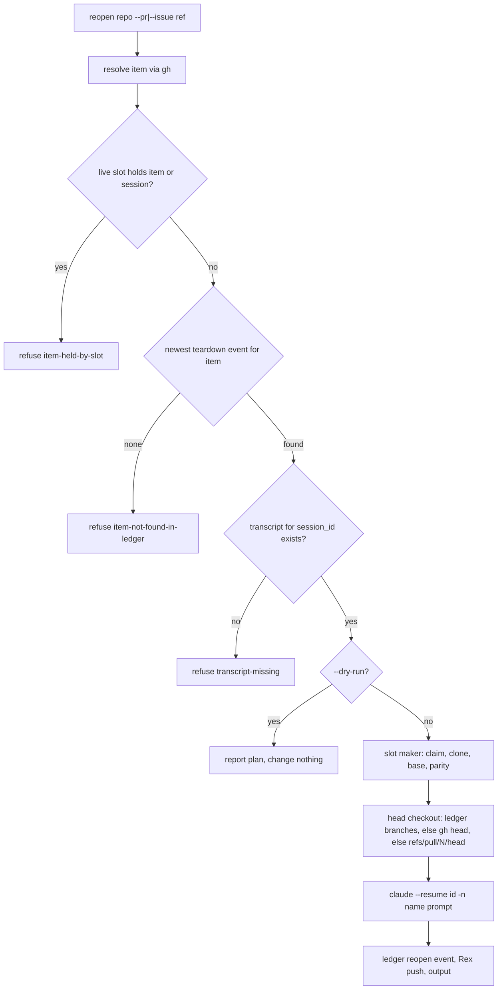
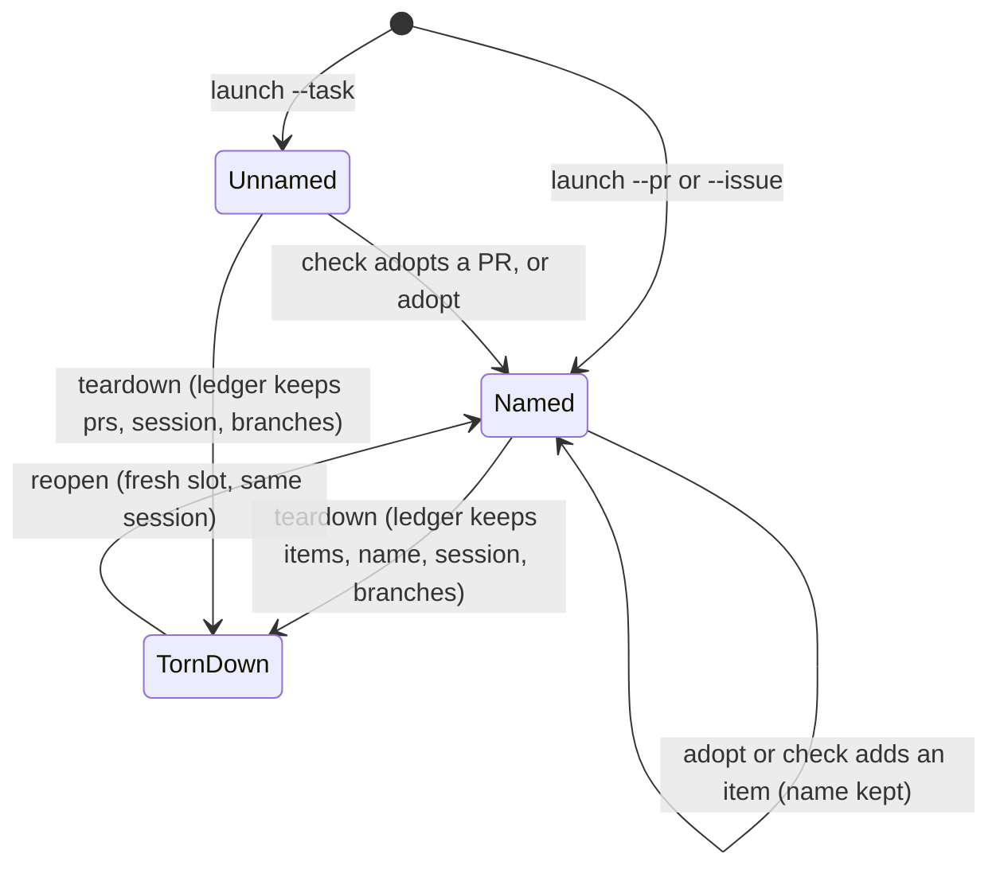

# Agent Slot Work Items and Reopen - Plan

## Goal Capsule

- **Objective:** Work handed to an agent slot stays findable by its GitHub PR or issue number after the slot is gone.
  The dispatcher can pick it up again in a fresh slot on the right branch with the prior conversation, and every live
  slot shows which PR or issue it is working on.
- **Means:** work-item keys on the slot record and the ledger, a slot name derived from them (KTD1, KTD2), and a
  `reopen` verb built on launch's clone path and Claude Code's cross-directory `--resume` (KTD4, KTD5, KTD6).
- **Product authority:** operator decisions relayed by the `rex-linux` session outrank Requirements; Requirements govern
  behavior; KTDs govern mechanism within them; units override neither. Behavior measured on this host's Claude Code
  outranks documentation or memory.
- **Execution profile:** bash libraries under `scripts/agent-slot/lib/`, bats suites with stubbed `gh`, `tmux`, and
  `claude`, one stowed Claude setting, README and CONCEPTS.md, and a second PR to `brettdavies/agent-skills` for the
  `agent-slot` skill text.
- **Stop conditions:** stop and report to `rex-linux` if `claude --resume <id>` stops finding a session from another
  project directory on the installed Claude Code; if an operator answer to Q1-Q5 differs from the recommendation this
  plan uses, update the plan before the unit it affects.
- **Who finishes:** the implementing slot ships U1-U8 on `feat/agent-slot-pr-named-restore` as one PR to `dev`,
  squash-merged once green, then U9 as a PR to `brettdavies/agent-skills`. The operator runs the first real reopen; the
  implementer runs only dry runs against live data.

---

## Product Contract

### Summary

A slot gets one or more work items, each a PR or an issue with its repo, number, and title. Its name comes from the
first item, as `<repo>-pr<N>-<slug>` or `<repo>-issue<N>-<slug>`, and shows in Claude's session name, the Rex tab,
`agent-slot list`, and the record. `launch --pr` or `--issue` names a slot from the start, `check` names one when it
first adopts a PR, and `adopt` attaches an item to a slot that is already running. Teardown keeps the items in the
ledger, so `reopen <repo> --pr|--issue <ref>` can find the newest torn-down slot for that item, clone a fresh one on the
item's head branch from whichever remote holds it, and resume the prior Claude conversation with an optional new first
prompt. `finish --allow-open-pr` lets the operator finish a task whose PR stays open, and Claude Code keeps transcripts
for a year so reopen has something to resume.

### Problem Frame

The operator asked for slots that are "created with or otherwise renamed with a pr number and name etc so the dispatcher
can recreate as needed (clone into slot, checkout correct feature branch, and resume prior session that has the
context)", and said: "I don't want to leave slots open. but to your point, we can and should restore the session and
context when needed. the session names should happen all the time, even if the pr is merged." A later message asked for
this to cover PRs in other repos and issues, so a new slot can pick up work a torn-down one left.

Today a slot is named by a free-form `--task`, and nothing ties it to a PR until `check` adopts one by branch name;
nothing ever ties it to an issue. A torn-down slot leaves a ledger line with its session, transcript, PR numbers, and
branches, but there is no way to look it up by item or to rebuild it. The first real cases are oxipng/oxipng#887, a
review round whose head branch `fix/trns-16-to-8` lives on the `fork` remote, and python-pillow/Pillow#10331 and #10330,
issue work with no PR yet.

### Requirements

**Work items and names**

- R1. A slot record carries its work items, each a PR or an issue with the item's repo (`owner/name`), number, and
  title; a slot can carry several, such as an issue and the PR its work opened.
- R2. A slot's name is derived from its first work item, `<repo>-pr<N>-<slug>` or `<repo>-issue<N>-<slug>`, lowercased
  slug from the title, cut to fit launch's task-name pattern (Q1); a name, once set, does not change when more items
  arrive.
- R3. `agent-slot launch <repo> --pr <ref>` or `--issue <ref>` resolves the item on GitHub, records it, names the slot,
  and for a PR checks out the PR's head branch from the remote that holds it.
- R4. When `check` adopts a PR for a slot that has no work item, that PR becomes the slot's item and names it; a slot
  that has items gains the PR as another item without a rename.
- R5. `agent-slot adopt <repo>/<N> (--pr <ref> | --issue <ref>)` attaches an item to a live slot and names the slot if
  it has no name (Q5).
- R6. The name shows in the slot's Claude session name, its Rex tab, `agent-slot list` and `whoami`, and its record; a
  running Claude session is renamed only while it is idle.
- R7. A slot's items and name outlive it: the launch, adopt, and teardown ledger events carry them.

**Reopen**

- R8. `agent-slot reopen <repo> (--pr <ref> | --issue <ref>) [--prompt-file F] [--request-id ID]` finds the newest
  torn-down slot for the item and makes a fresh slot on the item's head branch, with the prior Claude conversation
  resumed under the slot's name and the optional first message (Q2).
- R9. Reopen refuses, naming the command that helps, when a live slot holds the item or its session, when no torn-down
  slot for the item exists, or when the prior conversation's transcript is gone.
- R10. `agent-slot reopen ... --dry-run` reports what reopen would do and changes nothing: the source ledger event,
  session ID, transcript path and whether it exists, branch, remote and URL, the slot it would take, and the Claude
  command it would type.
- R11. Neither reopen nor teardown moves, copies, or deletes a Claude transcript.
- R12. A reopened slot's release gate counts only the closing skills its own session ran after the slot was made, never
  the ones the resumed conversation ran in an earlier slot.

**Finish and retention**

- R13. `agent-slot finish <key> --yes --allow-open-pr` finishes and tears down a task whose PR is still open when every
  other teardown check passes; `finish --yes` alone keeps refusing with `task-has-open-pr` (Q3).
- R14. Claude Code keeps session transcripts for 365 days on every host the dotfiles deploy to (Q4).

**Documentation**

- R15. README, CONCEPTS.md, `agent-slot --help`, the reasons table, and the `agent-slot` skill describe work items,
  names, `adopt`, `reopen`, and the finish flag in present tense.

### Key Decisions

- **Work items are PRs or issues.** (session-settled: user-directed — chosen over PRs only: the operator picked "PRs and
  issues" so issue work with no PR yet can be named and reopened.) Governs R1, R3, R5, R8.
- **An operator finish ends the task whatever state its PRs are in.** (session-settled: user-directed — chosen over
  keeping the open-PR exception: slots do not stay open, and reopen is the way back.) `check` already computes it this
  way; this plan adds only the deliberate flag. Governs R13.
- **Slots are torn down as today, and reopen brings work back.** The operator does not want slots left open. Governs R8,
  R11.
- **The skill text changes by a PR to `brettdavies/agent-skills`.** (session-settled: user-directed — chosen over a
  patch file in the dotfiles PR: the skill lives in that repo.) Governs R15.

### Acceptance Examples

- AE1. Covers R8, R10. **Given** oxipng/1 was torn down with `prs: [887]`, session
  `4e0a3f33-f697-4dff-a32f-2b0202be99d4`, and a `branches` entry `fix/trns-16-to-8` on `fork`
  (`git@github.com:brettdavies/oxipng.git`), **when** the operator runs
  `agent-slot reopen oxipng --pr 887 --dry-run --output json`, **then** it reports that ledger event, the session, the
  transcript `4e0a3f33-….jsonl` in oxipng/1's Claude project directory as present, branch `fix/trns-16-to-8` from remote
  `fork` at that URL, and the `claude --resume` command, and nothing on disk changes. While oxipng/1 still exists, the
  same dry run names it as the live slot that holds #887 and reports the real reopen as refused.
- AE2. Covers R5, R10. **Given** Pillow/1 was adopted with `--issue 10331` (session
  `a68a31ae-1a50-4f62-afe7-f853e237857f`, no work branch), **when** `agent-slot reopen Pillow --issue 10331 --dry-run`
  runs, **then** it reports Pillow/1 as the live holder, its session and transcript, and that the branch to check out is
  the base, `main`.
- AE3. Covers R4, R2. **Given** a slot launched with `--issue 10331`, **when** its agent opens PR #10400 and `check`
  adopts it, **then** the record's items are the issue and the PR, its name is unchanged, and `reopen Pillow --pr 10400`
  and `reopen Pillow --issue 10331` find the same slot after teardown.
- AE4. Covers R9. **Given** a reopen whose transcript Claude Code has pruned, **when** it runs, **then** it exits 1 with
  `transcript-missing`, creates no slot, and its `next_step` is `agent-slot launch <repo> --pr <ref>`.

### Scope Boundaries

Considered and not built:

- **Copying or archiving transcripts at teardown.** Claude Code finds a session by ID from any directory (verified on
  2.1.314), so the copy buys nothing while retention is long (R14). Revisit if the operator picks Q4's archive option or
  a Claude Code release stops cross-directory resume.
- **Matching an issue by a slot's free-form task name** for slots torn down before this ships. It guesses; `adopt`
  covers the two live issue slots before they go.
- **A reopen that falls back to a fresh conversation** when the transcript is gone. That would hand the dispatcher a
  slot that looks restored but remembers nothing; R9 refuses instead and points at `launch --pr`.
- **Renaming slot paths.** Paths stay `~/slots/<repo>/<N>`; the name is a label on the slot.
- **A Rex push when `check` renames a slot.** Rex's follow loop relabels tabs on its next poll.

### Deferred to Follow-Up Work

- The Rex finish key passing `--allow-open-pr` (Mac-side `scripts/agent-slot-rex/lib/finish.sh`), if the operator wants
  it on a key.

### Outstanding Questions

Operator decisions sent to `rex-linux`; the plan uses each recommendation until an answer arrives, and a different
answer changes only the named units:

- Q1 (R2; U1, U2): name format. Recommended `<repo>-pr<N>-<slug>` / `<repo>-issue<N>-<slug>`; alternatives
  `pr-<N>-<slug>` or `<repo>-<N>-<slug>`.
- Q2 (R8; U5, U6): reopen verb name. Recommended `reopen`; alternatives `revive`, `restore` (collides with
  `agent-slot-rex restore`), or `launch --resume`.
- Q3 (R13; U7): finish flag. Recommended `--allow-open-pr`; alternative `--open-pr-ok`.
- Q4 (R14; U8): transcript retention. Recommended `cleanupPeriodDays: 365`; alternatives an agent-slot transcript
  archive, or the 30-day default.
- Q5 (R5; U3): the verb that attaches an item to a live slot. Recommended `adopt`; alternatives `link`, `tag`.

### Sources

- Brief and operator decisions relayed by `rex-linux` in session `agent-slot-fork-pr-and-restore` (dotfiles/3).
- `docs/plans/2026-10-22-1818-feat-rex-parallel-agent-slots-plan.md` (agent-slot design), CONCEPTS.md `### Agent slot`.
- Verified on this host with Claude Code 2.1.314 in scratch directories: `claude --resume <id>`, print and interactive,
  run from a third directory resumes with full history and appends new turns to the original transcript in its original
  project directory with the new `cwd`; `claude --resume <id> -n <name> '<prompt>'` resumes, renames, and sends the
  prompt; `/rename <name>` typed into an idle session renames it without a model turn and `claude agents --json` reports
  the new name; transcripts carry `pr-link` lines (`prNumber`, `prRepository`).
- `docs/solutions/runtime-errors/tmux-server-started-inside-claude-code-saves-no-transcripts.md` (start sessions from an
  empty environment),
  `docs/solutions/logic-errors/exemption-in-advisory-check-but-not-pre-action-recheck-reports-safe-then-refuses.md` (one
  producer per gate), `docs/solutions/workflow-issues/ask-rule-on-a-cli-verb-also-guards-its-help-and-dry-run.md`
  (permission class), `docs/solutions/best-practices/derive-repo-identity-from-origin-not-checkout-directory.md` (look
  transcripts up by ID),
  `docs/solutions/integration-issues/git-clone-reference-to-partial-clone-fails-with-unresolved-deltas.md` (one clone
  path).

---

## Planning Contract

### Key Technical Decisions

- KTD1. **Record shape: `items` plus `name`; `task` stays as given.** `items` is an array of
  `{kind: "pr"|"issue", repo, number, title}` and `name` a string; both are added fields under `dotfiles.agent-slot/1`,
  which only ever adds fields (`scripts/agent-slot/lib/contract.sh`). `task` stays immutable because
  `launch_find_existing` uses it as the idempotency key, so renaming it would let a repeated `launch --task` make a
  second slot. Display surfaces read `.name // .task // .branch`; launch with `--pr`/`--issue` and no `--task` sets
  `task` to the derived name, so a repeated `launch --pr 887` returns the live slot. Governs R1, R2, R6.
- KTD2. **One naming helper.** A single function builds the name from an item (`<repo>-<kind><N>-<slug>`, slug
  `[a-z0-9-]` from the title, collapsed dashes, cut at a dash so the whole fits `TASK_PATTERN`'s 64 characters) and is
  the only producer, called by launch, adopt, and check's adoption. `<repo>` is the item repo's name half, so an item in
  another repo names its own repo. Governs R2.
- KTD3. **Items resolve by a targeted `gh` call.** A ref is `N`, `owner/name#N`, or a GitHub URL; a bare `N` uses
  origin's `owner/name` (`pr_repo_slug`). `gh pr view` / `gh issue view --repo ... --json` (bounded like `pr_load`)
  supplies title, state, head branch, head repository, and cross-repo flag. `pr_load`'s list is not reused: it covers
  origin's newest 200 PRs and returns no title or head owner. An item gh cannot find fails with a new `item-not-found`
  reason. Governs R3, R5, R8.
- KTD4. **Head checkout source, in order:** the ledger's `branches` entry for the head branch (name, remote, URL);
  otherwise `gh`'s `headRefName` and head repository; otherwise `refs/pull/<N>/head` from origin, checked out as a local
  branch of the head's name with no upstream. A head on another repo gets a remote named after the prime's remote with
  that URL, else `fork`; the fetch and checkout run under `bounded` with the non-interactive ssh environment, as
  launch's base checkout does. An issue with no branch keeps the base checkout. Governs R3, R8.
- KTD5. **Resume by ID, no transcript copy, refuse when it is gone.** Reopen sets the new record's `session_id` to the
  source event's (the SessionStart hook keeps the record's ID current, so a `/clear` is already reflected) and starts
  Claude with `claude --dangerously-skip-permissions --resume <id> -n <name> ["$(cat <prompt>)"]`. The transcript is
  found by ID across every project directory (`_sessions_conversation_saved`); when it is missing, reopen refuses with
  `transcript-missing` before claiming a slot, instead of falling through to `--session-id`. Governs R8, R9, R11.
- KTD6. **Lookup order and exclusivity.** Reopen first scans live slot records: a record whose `items` hold the item, or
  whose `prs` hold a PR number of origin's repo, or whose `session_id` equals the found session, refuses with
  `item-held-by-slot`. Otherwise it takes the newest `teardown` event whose `items` match `{kind, repo, number}`,
  falling back for PRs to `.repo == <local repo> and (.prs | index(N))` so slots torn down before this ships stay
  reachable. No match is an error (`item-not-found-in-ledger`), never an empty success. Governs R8, R9.
- KTD7. **Launch and reopen share one slot maker.** The claim, clone, base checkout, parity, prompt copy, trust, session
  start, ledger, and push block of `cmd_launch` moves into one function both verbs call, with hooks for the session ID,
  the head checkout, and the session mode; reopen lives in a new `scripts/agent-slot/lib/reopen.sh`, items and naming in
  `scripts/agent-slot/lib/items.sh`. `launch.sh` is already 271 lines, so this split keeps each file near one
  responsibility.
- KTD8. **Renaming a running Claude session.** `adopt` and the automatic sweep type `/rename <name>` into the slot's
  Claude session only when its agent is idle (`release_send`), then record `named_as`; the sweep retries each pass until
  `named_as == name`. `check` itself never types, since it also runs inside the slot's own agent. Governs R6.
- KTD9. **Reopen's permission class matches launch.** It clones and starts an agent and deletes nothing, so it gets
  neither an allow nor an ask rule in `stow/claude/dot-claude/settings.json`; `adopt` changes only a record and a
  session name, so it joins the allowed verbs. `finish --allow-open-pr` stays under finish's ask rule. Governs R5, R8,
  R13.
- KTD10. **The open-PR refusal has one producer.** A helper decides whether finish refuses an open PR, read by finish's
  dry run and its `--yes` path alike, and `teardown.log` records the flag; the teardown re-check needs no change because
  it judges only the tree. Governs R13.
- KTD11. **The release gate reads only this slot's turns.** `release_skills_in` counts a skill call only when its
  transcript line's `timestamp` is at or after the slot record's `created_at`, so a resumed conversation's earlier
  closing skills never release a reopened slot. Governs R12.
- KTD12. **Ledger events.** The `launch` event gains `items` and `name`; new `adopt` and `reopen` events record the
  item, name, and (for reopen) the source event's slot and session; the `teardown` event gains `items` and `name`.
  Readers treat every one of these fields as optional. Governs R7.

### High-Level Technical Design

Reopen, from lookup to a resumed agent:

A slot's names and keys across its life:

### Assumptions

- The operator answers Q1-Q5 with the recommended options; each answer that differs changes only the units named in
  Outstanding Questions.
- `gh` on the server can read both python-pillow/Pillow and oxipng/oxipng, as `pr_load` already does for origin repos.
- Rex's tab label keeps coming from `agent-slot list`; the two label expressions in
  `scripts/agent-slot-rex/lib/reconcile.sh` and `scripts/agent-slot-rex/lib/launch.sh` both switch to
  `.name // .task // .branch`.

### Risks

| Risk                                                                    | Mitigation                                                                                                                                                        |
| ----------------------------------------------------------------------- | ----------------------------------------------------------------------------------------------------------------------------------------------------------------- |
| A Claude Code release stops finding sessions across project directories | U5's dry run and `doctor` report the transcript lookup; the Goal Capsule stop condition sends it to `rex-linux`; the archive option (Q4 B) is the fallback design |
| Two reopens of one item race                                            | The slot maker claims under the repo lock; reopen re-scans live records for the session under that lock before cloning                                            |
| Typing `/rename` into a pane that the operator is typing in             | Only an idle agent is typed to, the same rule the closing-steps reminder follows                                                                                  |
| A fork that no longer exists                                            | KTD4 falls back to `refs/pull/<N>/head` on origin, which GitHub keeps for every PR                                                                                |

---

## Implementation Units

### U1. Items, refs, and names

- **Goal:** One module that parses an item ref, resolves it on GitHub, and derives the slot name.
- **Requirements:** R1, R2, R3, R5
- **Dependencies:** none
- **Files:** create `scripts/agent-slot/lib/items.sh`; modify `scripts/agent-slot/agent-slot` (source it),
  `scripts/agent-slot/lib/contract.sh` (reasons `item-not-found`, `item-ref-invalid`); test
  `tests/agent-slot-items.bats`; modify `tests/lib/agent-slot.bash` (a `gh` stub that answers `pr view` and `issue view`
  from fixture files).
- **Approach:**
  1. Ref grammar per KTD3; a ref that matches none of the forms fails with `usage_fail`.
  2. Resolution returns the item object plus, for a PR, head branch, head repo `owner/name`, head clone URL, and state,
     through a global as the other libs do.
  3. The naming helper per KTD2.
- **Patterns to follow:** `pr_load` in `scripts/agent-slot/lib/prstate.sh` for the bounded `gh` call; `TASK_PATTERN` in
  `scripts/agent-slot/lib/launch.sh`.
- **Test scenarios:**
  - `887`, `oxipng/oxipng#887`, and `https://github.com/oxipng/oxipng/pull/887` all resolve to
    `{kind: pr, repo: oxipng/oxipng, number: 887}` for a slot whose origin is oxipng/oxipng.
  - An issue URL passed to `--pr` fails with `item-ref-invalid`.
  - Title "Fix 16-bit to 8-bit reduction with tRNS" names `oxipng-pr887-fix-16-bit-to-8-bit-reduction-with-trns`; a
    200-character title is cut at a dash and the name matches `TASK_PATTERN`.
  - A title of only punctuation names `oxipng-pr887`.
  - `gh` failing or returning nothing fails with `item-not-found` and names the ref.
- **Verification:** the suite passes, and the new reasons appear in `agent-slot schema` and README's reasons table (the
  docs test enforces both).

### U2. Launch with a work item

- **Goal:** `launch --pr|--issue` records the item, names the slot, and checks out a PR's head branch.
- **Requirements:** R3, R6, R7
- **Dependencies:** U1
- **Files:** modify `scripts/agent-slot/lib/launch.sh` (parse flags, extract the slot maker per KTD7),
  `scripts/agent-slot/lib/sessions.sh` (`-n` from `.name // .task`), `scripts/agent-slot/lib/read.sh` (list and whoami
  text from `.name // .task // .branch`), `scripts/agent-slot-rex/lib/reconcile.sh` and
  `scripts/agent-slot-rex/lib/launch.sh` (tab label), `scripts/agent-slot/lib/help.sh`; test
  `tests/agent-slot-launch.bats`, `tests/agent-slot-read.bats`, `tests/agent-slot-rex.bats`.
- **Approach:**
  1. The slot maker takes an optional head-checkout step, run after parity, implementing KTD4.
  2. `--pr` and `--issue` are mutually exclusive; either sets `items`, `name`, and, without `--task`, `task` (KTD1).
  3. The `launch` ledger event gains `items` and `name` (KTD12).
- **Patterns to follow:** the bounded base checkout in `cmd_launch`; `fork_remote` in `tests/lib/agent-slot.bash` for a
  fork fixture.
- **Test scenarios:**
  - `launch repoa --pr 7` for a same-repo PR checks out `feat/x` tracking `origin/feat/x`, and the typed Claude line
    carries `-n repoa-pr7-<slug>`.
  - A cross-repo PR adds remote `fork` at the head repo URL and checks out the head branch tracking it.
  - The prime has a remote with the head's URL under another name; the slot's remote takes that name.
  - A PR whose head branch is gone checks out `refs/pull/7/head` as a local `feat/x` with no upstream.
  - `--issue 12` leaves the base checked out, records the issue, and names the slot `repoa-issue12-<slug>`.
  - `--pr` with `--issue` fails before anything is claimed; a repeated `launch repoa --pr 7` returns the existing slot.
  - `list` and the Rex tab label show the name; a slot with no name still shows its task.
- **Verification:** the launch, read, and Rex suites pass; the launch ledger line holds `items` and `name`.

### U3. Adoption by check, and the adopt verb

- **Goal:** A slot gains items when `check` adopts a PR or when `adopt` runs, and an unnamed slot gets its name; a
  running Claude session is renamed while idle.
- **Requirements:** R4, R5, R6, R7
- **Dependencies:** U1
- **Files:** modify `scripts/agent-slot/lib/check.sh` (`check_record`), `scripts/agent-slot/lib/prstate.sh` (title in
  `pr_load` and `pr_for_slot`), `scripts/agent-slot/lib/autosweep.sh` (rename pass), `scripts/agent-slot/lib/help.sh`,
  `scripts/agent-slot/agent-slot` (adopt arm), `stow/claude/dot-claude/settings.json` (allow `agent-slot adopt`); create
  the adopt verb in `scripts/agent-slot/lib/items.sh` or a small `scripts/agent-slot/lib/adopt.sh`; test
  `tests/agent-slot-check.bats`, `tests/agent-slot-adopt.bats`, `tests/agent-slot-release.bats`,
  `tests/claude-settings.bats`.
- **Approach:**
  1. One helper adds an item to a record and sets `name` only when none is set (R2, R4); `check_record` and `adopt` both
     call it.
  2. `adopt` holds the slot lock, resolves the item (U1), updates the record, appends an `adopt` ledger event, and types
     `/rename` when the agent is idle (KTD8).
  3. The sweep's pass types `/rename` into idle agents whose `named_as` differs from `name`.
- **Patterns to follow:** `release_send` and `release_auto_gate` in `scripts/agent-slot/lib/autosweep.sh`;
  `check_record`'s skip for a check run inside the slot's own agent.
- **Test scenarios:**
  - Covers AE3. An issue-named slot whose PR `check` adopts keeps its name and holds both items.
  - A `--task` slot with no items gets its name from the first PR `check` adopts.
  - `adopt repoa/1 --issue 12` on a busy agent updates the record and types nothing; the next automatic sweep with the
    agent idle types `/rename repoa-issue12-<slug>` once.
  - `adopt` on a slot that does not exist fails with `slot-not-found`.
  - A check run inside the slot's own agent records no item, as it records no PR today.
  - `agent-slot adopt` matches the allow rule in the stowed settings.
- **Verification:** suites pass; the `adopt` ledger line carries the item and name.

### U4. Teardown keeps items and name

- **Goal:** The teardown ledger event carries the slot's items and name.
- **Requirements:** R7
- **Dependencies:** U3
- **Files:** modify `scripts/agent-slot/lib/teardown.sh`; test `tests/agent-slot-teardown.bats`.
- **Approach:** add `items` and `name` to the event's member list (KTD12).
- **Test scenarios:**
  - A swept slot with an issue item and a PR item writes both, its name, and its session to the teardown event.
  - A slot with no items writes `items: []` and `name: null`.
- **Verification:** teardown suite passes.

### U5. Reopen lookup and dry run

- **Goal:** `reopen --dry-run` finds the item's source and reports the whole plan without changing anything.
- **Requirements:** R8, R9, R10, R11
- **Dependencies:** U1, U4
- **Files:** create `scripts/agent-slot/lib/reopen.sh`; modify `scripts/agent-slot/agent-slot`,
  `scripts/agent-slot/lib/help.sh`, `scripts/agent-slot/lib/contract.sh` (reasons `item-held-by-slot`,
  `item-not-found-in-ledger`, `transcript-missing`); test `tests/agent-slot-reopen.bats`.
- **Approach:**
  1. Lookup per KTD6, streaming the ledger as `release_transcripts` does.
  2. Transcript check per KTD5.
  3. The dry run's output: `source` (event or live slot key), `session_id`, `transcript` and `transcript_exists`,
     `branch`, `remote`, `url`, `slot` it would take, `command`, and `would_reopen` with the refusal reason when false.
- **Patterns to follow:** finish's dry run (`{dry_run: true, would_tear_down, verdict}`) in
  `scripts/agent-slot/lib/finish.sh`; `doctor_launch_times` for a bounded ledger read.
- **Test scenarios:**
  - Covers AE1. A ledger with oxipng-shaped teardown lines (fixture) reports the newest event's session, transcript
    present, branch on `fork` with its URL, and the `--resume` command; the fixture ledger and slot root are unchanged
    afterwards.
  - Covers AE2. A live slot adopted with `--issue 12` is reported as the holder with `would_reopen: false` and reason
    `item-held-by-slot`.
  - A legacy teardown line with `prs: [7]` and no `items` is found by `--pr 7`.
  - Two teardown events for the item: the newer wins.
  - Covers AE4. A transcript absent from every project directory gives `transcript_exists: false` and reason
    `transcript-missing`.
  - No matching event fails with `item-not-found-in-ledger`, and an empty ledger is that error too.
  - A live slot whose `session_id` equals the found session refuses even when its items differ.
- **Verification:** suite passes; the dry run against the real ledger for oxipng #887 and against a scratch copy of
  Pillow/1 adopted with `--issue 10331` (U3) reports AE1 and AE2.

### U6. Reopen a slot

- **Goal:** `reopen` without `--dry-run` makes the slot and resumes the conversation.
- **Requirements:** R8, R9, R11, R12
- **Dependencies:** U2, U5
- **Files:** modify `scripts/agent-slot/lib/reopen.sh`, `scripts/agent-slot/lib/sessions.sh` (resume line with `-n` and
  the prompt), `scripts/agent-slot/lib/release.sh` (KTD11); test `tests/agent-slot-reopen.bats`,
  `tests/agent-slot-release.bats`.
- **Approach:**
  1. Run the slot maker (KTD7) with the source session ID, the head checkout from KTD4, and resume mode.
  2. Re-scan live records for the session under the repo lock before cloning (Risks).
  3. Append a `reopen` ledger event and push to Rex as launch does.
  4. Release gate per KTD11.
- **Patterns to follow:** `sessions_command`'s `%q` quoting of every record value; `_launch_rollback_on_exit`.
- **Test scenarios:**
  - A reopened slot's record has the source `session_id`, its items and name, and `reopened_from: {slot, session_id}`;
    the typed line is `claude --dangerously-skip-permissions --resume <id> -n <name> "$(cat <prompt>)"`.
  - The head branch comes from the ledger `branches` entry: remote `fork` is added at the recorded URL and the branch
    tracks it.
  - Without a `branches` entry, the head comes from the stubbed `gh pr view`; with a head repo gh reports gone, from
    `refs/pull/<N>/head`.
  - A clone that fails rolls the slot back and leaves no claim, and the ledger has no `reopen` line.
  - A second reopen of the same item after the first succeeded refuses with `item-held-by-slot`.
  - Release refuses a reopened slot whose transcript holds `ce-compound` and `ce-compound-refresh` calls only before the
    slot's `created_at`, and passes once both run after it.
  - A prompt containing quotes and `$(...)` reaches Claude as written.
- **Verification:** suites pass; no file under the sandboxed Claude projects directory changes during any reopen test.

### U7. Finish with an open PR

- **Goal:** `finish --yes --allow-open-pr` finishes a task whose PR is open.
- **Requirements:** R13
- **Dependencies:** none
- **Files:** modify `scripts/agent-slot/lib/finish.sh`, `scripts/agent-slot/agent-slot` (flag parsing),
  `scripts/agent-slot/lib/help.sh`, `scripts/agent-slot/lib/contract.sh` (`task-has-open-pr` gets a `run` next step
  naming the flag); test `tests/agent-slot-teardown.bats`.
- **Approach:** one helper per KTD10; the flag is accepted only with `--yes` or for a dry run, and `teardown.log`
  records it.
- **Test scenarios:**
  - `finish repoa/1 --yes --allow-open-pr` on a fully pushed task with PR 11 open tears it down, and `teardown.log`
    records `allow_open_pr: true`.
  - The same with an unpushed commit keeps the slot with `unpushed-commits`.
  - `finish repoa/1 --yes` alone still exits 1 with `task-has-open-pr`, now with `next_step.command` naming the flag.
  - `finish repoa/1 --allow-open-pr` without `--yes` reports `would_tear_down: true` and deletes nothing.
- **Verification:** teardown suite passes, observed failing first with the helper stashed.

### U8. Transcript retention

- **Goal:** Claude Code keeps transcripts for 365 days.
- **Requirements:** R14
- **Dependencies:** none
- **Files:** modify `stow/claude/dot-claude/settings.json`; test `tests/claude-settings.bats`.
- **Approach:** set `cleanupPeriodDays` to 365.
- **Test scenarios:** the stowed settings carry `cleanupPeriodDays: 365`.
- **Verification:** settings suite passes.

### U9. Documentation and the agent-slot skill

- **Goal:** Every surface that documents agent-slot describes items, names, `adopt`, `reopen`, and the finish flag.
- **Requirements:** R15
- **Dependencies:** U2-U7
- **Files:** modify `README.md` (agent-slot narrative, Commands, reasons table), `CONCEPTS.md` (`### Agent slot`: work
  item, slot name, reopen), `stow/claude/dot-claude/slot-context.sh` (an agent's slot context names its items); in
  `brettdavies/agent-skills`, `agent-slot/SKILL.md`; test `tests/agent-slot-docs.bats`, `tests/slot-context.bats`.
- **Approach:** present tense, no history; the skill tells a dispatcher to launch with `--pr`/`--issue`, to `adopt`
  items onto running slots, and to `reopen` torn-down work instead of starting fresh. The skill PR is made from a
  standalone clone in this slot's scratch directory, follows that repo's branch and PR conventions, and is opened after
  the dotfiles PR merges.
- **Test expectation:** the docs test's reason and verb coverage; `slot-context.bats` for the context text.
- **Verification:** docs suite passes; the skill PR is merged or its merge command is handed to `rex-linux`.

---

## Verification Contract

| Gate                 | Command                                                                                                                                                                            | Applies to     |
| -------------------- | ---------------------------------------------------------------------------------------------------------------------------------------------------------------------------------- | -------------- |
| Shell lint           | `scripts/lint-shell --all`                                                                                                                                                         | every unit     |
| Bats                 | `scripts/run-tests tests/agent-slot-*.bats tests/slot-*.bats tests/claude-settings.bats`                                                                                           | U1-U9          |
| Full local CI mirror | the `pre-push` hook (`scripts/run-tests --all`, actionlint, core-env guard)                                                                                                        | before push    |
| Markdown             | `markdownlint-cli2 README.md CONCEPTS.md docs/plans/*.md`                                                                                                                          | U9             |
| Real dry runs        | `agent-slot reopen oxipng --pr 887 --dry-run --output json`; `reopen Pillow --issue 10331 --dry-run` against a scratch slot root holding a copy of Pillow/1 adopted with the issue | U5, acceptance |

Every new test is observed failing against the code without its unit's change before it counts.

## Definition of Done

- U1-U8 merged to `dev` in one PR with every check `SUCCESS` on the rollup; U9's skill PR merged in
  `brettdavies/agent-skills`, or its merge command sent to `rex-linux`.
- The oxipng #887 dry run reports session `4e0a3f33-f697-4dff-a32f-2b0202be99d4`, its transcript path, and
  `fix/trns-16-to-8` on `fork`; the Pillow #10331 dry run reports session `a68a31ae-1a50-4f62-afe7-f853e237857f`; both
  outputs are in the PR body.
- No real reopen run by the implementer; no file under `~/.claude/projects` moved, copied, or deleted.
- No abandoned-attempt code left in the diff.
