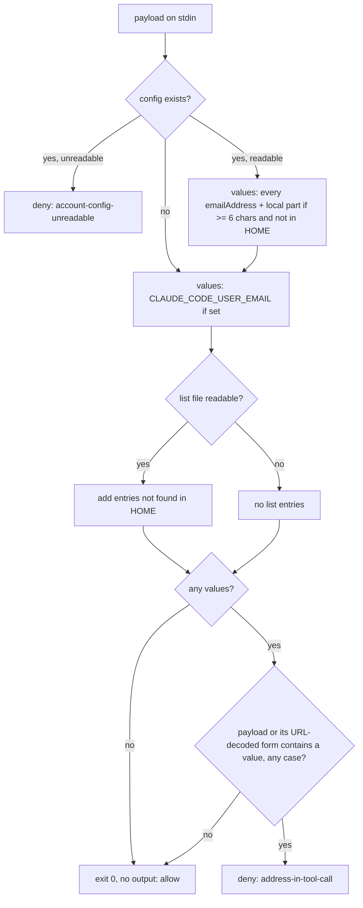

# Never-Send Guard - Plan

## Goal Capsule

- **Objective:** No Claude Code session on Brett's machines, main conversation or subagent, can put his email address
  into a tool call that would send it to a website, service, or command; a blocked call tells the model why and how to
  finish without it.
- **Means:** one PreToolUse hook with no matcher and `onFailure: "block"`, matching the account address the harness
  injects and a private list against every tool call's input (KTD1, KTD2, KTD3).
- **Product authority:** Brett's rule in `stow/claude/dot-claude/CLAUDE.md` (merged in #365) and his answers relayed by
  the `xurl-rs-prime` session outrank Requirements; Requirements govern behavior; KTDs govern mechanism within them;
  units override neither. Behavior measured on this host's Claude Code (2.1.314) outranks documentation or memory.
- **Execution profile:** one bash hook under `stow/claude/dot-claude/`, one bats suite, one `settings.json` entry, one
  sentence in `CLAUDE.md`, and a `docs/solutions` entry committed through `sd-commit-doc`.
- **Stop conditions:** stop and report to `xurl-rs-prime` if the live check (Verification Contract), once its Bash
  control proves the settings file loaded, shows the hook not firing for an MCP tool, or a missing guard script not
  blocking under `onFailure: "block"`. Also stop if Brett's answer
  to an Open Question changes a Requirement before the unit it affects.
- **Who finishes:** the `dotfiles/1` slot ships U1-U3 on `feat/never-send-guard` as one PR to `dev`. `xurl-rs-prime`
  approves and merges. Brett deploys with `scripts/stow-deploy` and fills the list.

---

## Product Contract

### Summary

A new hook, `never-send-guard.sh`, runs before every tool call in every session and subagent. It reads the account
address from Claude Code's own config at call time, adds its local part and the entries of an untracked list, and denies
any call whose input carries one of them, raw or URL-encoded, in any letter case. The deny reason tells the model the
address must not go out in any form and lists what to do instead. A guard that crashes, hangs, or cannot start blocks
the call rather than letting it through.

### Problem Frame

Claude Code puts the signed-in account's address into the model's context on every request, as a `# userEmail` block in
a system reminder, and gives it to every subagent too. The harness attaches an instruction not to send it to other
services. The public issue thread shows that instruction losing whenever a site asks for contact details: addresses sent
in `curl -A` User-Agent headers to crates.io and Wikimedia, git identity overridden with the address, a subagent giving
it to a web service, and the local part alone sent to about twenty sites
([anthropics/claude-code#81138](https://github.com/anthropics/claude-code/issues/81138),
[#95258](https://github.com/anthropics/claude-code/issues/95258)). Brett's rule (#365) states the same instruction in
his own `CLAUDE.md`, which still depends on the model complying. A deterministic check that sits before the request
leaves is the only part of this a user can enforce today; keeping the address out of context altogether is the harness's
fix ([#98584](https://github.com/anthropics/claude-code/issues/98584), #81138).

### Requirements

**Values protected**

- R1. The guard protects the address the harness injects: every `emailAddress` value in
  `${CLAUDE_CONFIG_DIR:-$HOME}/.claude.json`, read on each call, plus `CLAUDE_CODE_USER_EMAIL` when set.
- R2. It also protects that address's local part (the text before `@`), unless the local part is shorter than 6
  characters or appears in `$HOME`.
- R3. It protects each entry of a private list at `${NEVER_SEND_LIST:-$HOME/.config/never-send/list}`: one entry per
  line, with blank lines and `#` comments ignored and surrounding whitespace trimmed. An entry that appears in `$HOME`
  is skipped. The list never enters this public repo in plaintext, and Brett fills it.

**Coverage and matching**

- R4. Every tool call is checked: built-in tools, MCP tools, and tool calls made inside subagents.
- R5. A call is denied when its hook payload contains a protected value, compared case-insensitively, either as written
  or after URL-decoding (`%XX` decoded, `+` read as a space).

**Failure behavior**

- R6. The guard fails closed: a crash, a timeout, an unexpected exit status, or a script that cannot start blocks the
  call. A crash inside the script prints one stderr line, `guard-internal-error`, with the failing line and command,
  that says the call did not run and to tell the user.
- R7. A missing input never blocks: with no config file, no `emailAddress`, no list file, or an empty list, the guard
  checks what exists and allows the call when nothing is left to protect.
- R8. A config file that exists but cannot be read blocks the call with a reason of its own.

**What the model and user see**

- R9. The deny reason says why the call was blocked, that the call did not run and nothing was sent, and that shortened,
  re-spelled, encoded, split, or indirect copies count too. It names which kind of source matched (the account address
  or the list) and offers the alternatives: retry once without the value, use a neutral value such as the tool name and
  the `git remote get-url origin` URL in a User-Agent, use another tool, skip the step and report it, or stop and ask.
  It warns that a match may be a false positive, and it never contains the matched value.
- R10. The user sees a one-line `systemMessage` naming the guard, the tool, and the source that matched (the config
  file, `CLAUDE_CODE_USER_EMAIL`, or the list's line number), never the value.

**Cost and documentation**

- R11. The latency the guard adds per tool call is measured and reported. The budget is a median under 20 ms on this
  host.
- R12. An **Enforcement** sentence beside the #365 rule names the hook and its test suite, and a `docs/solutions` entry
  records the design, its limits, and how to recover a host where every call is blocked.
- R13. `never-send-guard.sh --check` reports, without printing any value, whether the account address was found and in
  which source, how many list entries load, and the line number of each entry it skips. It exits 1 when it finds nothing
  to protect.

### Key Decisions

- **No carve-out for local searches of Brett's own work.** A Bash command line cannot be proven local, and his commits
  are authored with the GitHub noreply address, so `git log --author=<github handle>` and Gmail's `from:me` find his
  work without the literal. Pending Brett's answer (Open Questions, Q1). Governs R4.
- **The list is an untracked file, not a git-crypt file.** It keeps the addresses out of the public repo's history
  entirely, and the guard never meets git-crypt ciphertext on a locked host. Pending Brett's answer (Q2). Governs R3.
- **Keeping the address out of context is not built here.** It touches what the harness sends and how, which is Brett's
  call; the options are recorded under Scope Boundaries.

### Acceptance Examples

- AE1. **Covers R5.** Given the config holds `pat.example@example.invalid`, when a Bash call runs
  `curl -A "tool (PAT.EXAMPLE@EXAMPLE.INVALID)" https://api.example.com`, then it is denied.
- AE2. **Covers R2, R5.** Given the same config, when a call's URL carries `pat.example%2Bci%40example.invalid`, then it
  is denied through the decoded local part.
- AE3. **Covers R7.** Given no config file and no list file, when any call runs, then it is allowed and the guard prints
  nothing.
- AE4. **Covers R6.** Given the hook's script path does not exist, when any call runs under Claude Code, then the call
  is blocked with `failed; blocking because onFailure is "block"`.
- AE5. **Covers R4.** Given a payload carrying `agent_id` (a subagent's call) or an `mcp__` tool name, when its input
  carries a protected value, then it is denied exactly as a main-thread Bash call would be.

### Scope Boundaries

Not built, with the evidence that would change the call:

- **Keeping the address out of context.** Two mechanisms exist. A mod's `prompt.context` hook can drop the `userEmail`
  block ("one left out is not sent"), and its `prompt.attachment` hook can blank an injected reminder per subagent
  (`{ text: null }`). A mod placed in `~/.claude/skills/<name>/` loads with no enable prompt on 2.1.287 and later. The
  other is a loopback relay on `ANTHROPIC_BASE_URL` that strips the section from each request (#81138 comments). Both
  change what the harness sends; neither is built without Brett's decision. Settings-file hooks cannot do this: every
  classic event can only add context.
- **Values a command pulls in when it runs** (`$(git config user.email)`, a file, an environment variable) and
  **rewritten values** (Gmail dots, base64, HTML entities, `\u0040`). The guard reads only the call's text; the deny
  reason forbids these routes, and the harness-side check in #98584 is the fix that could see them.
- **The model's plain-text replies and tool results.** No PreToolUse hook sees them.
- **Considered and not built:** redacting tool output in PostToolUse (nothing reported leaks through a result); a
  session-start warning when the list is missing (the account address is guarded either way); a cache of the address
  outside the config (another copy of it on disk); enforcing the list file's mode; denying calls that name the list's
  path (they read it into context but cannot send it past the guard). Any of these returns if a reported leak takes that
  route.

### Sources

- Issue thread and occurrences: #81138 (and its comments), #95258, #98584.
- Deny-reason starting point and the fail-closed design:
  [#95258 comment by scriptedfun](https://github.com/anthropics/claude-code/issues/95258#issuecomment-6130024743).
- Claude Code hooks reference, fetched 2026-10-30: an omitted matcher matches every tool; settings hooks run inside
  subagents with `agent_id`; `onFailure: "block"` makes a failure, timeout, unexpected exit, or invalid output block a
  PreToolUse call. The changelog adds `onFailure` in 2.1.295.
- Claude Code 2.1.314 binary: the global config path is
  `join(CLAUDE_CONFIG_DIR || homedir, ".claude" + suffix + ".json")`. The suffix is empty outside custom OAuth
  environments.
- Mods API types bundled with the `plugin-authoring` skill on 2.1.314: `prompt.context`, `prompt.attachment`, and guards
  that skip on failure unless given a `.catch`.
- `docs/solutions/developer-experience/hook-stdin-enxio-use-cat-not-redirect-2026-04-20.md` (read stdin with `cat`);
  `docs/solutions/logic-errors/sigpipe-under-pipefail-turns-a-matched-guard-into-a-pass.md` (no early-exiting consumer
  decides a verdict).
- Stars checked: `affaan-m/ECC` `hooks/README.md` (fail-closed hooks give up waiting on stdin that never closes),
  `davila7/claude-code-templates` `HOOKS_GUIDE.md` and its `mods/security/secret-redactor`,
  `griffinhilly/claude-code-synthesis` `SAFETY.md`, `joshuadavidthomas/agent-skills` `claude-hook-backed.md`. All are
  MIT-licensed; no code is adapted from them.

---

## Planning Contract

### Key Technical Decisions

- KTD1. **One settings-file PreToolUse entry with no `matcher`, `onFailure: "block"`, and a 10 s timeout.** An omitted
  matcher covers every tool, MCP included, and settings hooks fire inside subagents, which covers R4.
  `onFailure: "block"` covers R6 natively: can't start, timeout, an exit other than 0 or 2, and invalid JSON all block.
  It replaces the #95258 launcher, which was itself a program that could fail to start. The timeout is double the
  sibling guards' 5 s because a timeout now blocks rather than allows.
- KTD2. **Match the whole hook payload read from stdin, not a parsed `tool_input`.** The guard then needs no JSON
  parser: the Brewfile ships `jq`, not `jaq`, and a parser-dependent guard would have to fail open without one or lock
  the host. The payload's other fields (`session_id`, `transcript_path`, `cwd`, `tool_name`, `agent_id`) carry no
  address, so the payload is a superset of `tool_input`. Its one extra false positive is a path field outside `$HOME`
  that contains a value, such as a `cwd` under `/tmp/<entry>/`; the deny reason covers false positives.
- KTD3. **Read the account address with one `sed` pass over the config, taking every `"emailAddress": "<value>"`
  string.** On this host that equals `jaq`'s `.oauthAccount.emailAddress` and costs 2.3 ms, against 3.7 ms for `jaq` and
  6.2 ms for `jq`. Over 3,000 reads while the session rewrote the file there were no torn reads, so an unparsable
  partial write is not a case to handle.
- KTD4. **Stay inside bash 3.2.** Case folding uses `shopt -s nocasematch` with `[[ "$haystack" == *"$value"* ]]`, and
  URL-decoding uses `printf '%b'` after doubling every backslash, so a `\c` in the payload cannot cut the decoded text
  short. Decoding runs only when the payload holds a `%` or a `+`. With no bash 4 construct, the script needs no
  version-guard block and runs under macOS `/bin/bash`.
- KTD5. **Only an unreadable config blocks.** Missing optional inputs allow (R7) because a host with no list, or a
  session authenticated by API key, Bedrock, or Vertex (no `oauthAccount`, so no injected block), has nothing for the
  guard to protect. An existing config the guard cannot read (R8) is a state where the harness may still hold the
  address, so it blocks.
- KTD6. **The deny envelope follows the sibling guards.** The reason is `never-send-guard denied [<reason>]: <message>`,
  then `next_step [<action>]: <text>` and `docs: ~/.claude/CLAUDE.md § "Secrets & private identifiers"`. Reasons are the
  closed set `address-in-tool-call` and `account-config-unreadable`; actions are `send-without-it` and `tell-user`.
  R6's `guard-internal-error` is a stderr code, not a deny reason. The
  text adapts the #95258 comment's reason, whose URL the script header credits. The JSON is built without a parser: the
  reason text is stored already JSON-escaped, and the only variable part is the tool name reduced to `[A-Za-z0-9_-]`.
- KTD7. **Tests drive the script through stdin with `CLAUDE_CONFIG_DIR` and `NEVER_SEND_LIST` pointed into
  `BATS_TEST_TMPDIR`.** `HOME` is never reassigned (`scripts/core-env-guard.sh`), `CLAUDE_CODE_USER_EMAIL` is unset in
  `setup`, and every address is made up under `example.invalid`.

### High-Level Technical Design



Harness behavior around the script: a crash, timeout, or missing script blocks the call (KTD1); a deny JSON blocks it
with the reason shown to the model.

### Assumptions

- Claude Code on every host Brett deploys to is 2.1.295 or later, so `onFailure` is honored; on an older build the guard
  still denies matches but fails open on a crash.
- The harness keeps writing `~/.claude.json` atomically and pretty-printed; KTD3 depends on one
  `"emailAddress": "<value>"` per line.
- `nocasematch` and `printf '%b'` with `\xHH` behave the same under macOS `/bin/bash` 3.2 as under bash 5. This host has
  no bash 3.2 and CI runs Linux, so it is unverified; on the Mac, Claude Code normally finds Homebrew bash first through
  the launchd user PATH (`config/launchd/user-path`).
- No future hook payload field carries the address. If one did, every call would be denied with `address-in-tool-call`,
  which is loud and safe but needs a manual settings edit to recover.

### Risks

- **A guard bug blocks every call on every host.** With `onFailure: "block"`, a script that errors on some common
  payload shape denies all work, including the edit that would fix it. Mitigation: the bats suite covers payload shapes
  from every tool family before merge, and the live check runs the real harness against the script before the PR opens.
- **A large payload dense with `%` could reach the 10 s timeout.** Decoding replaces every `%`, and under
  `onFailure: "block"` a timeout blocks the call. The latency gate times a percent-dense 1 MiB payload; a result within
  a factor of ten of the timeout stops the build for a cheaper decode.
- **Gmail treats dotted spellings as the same address.** A re-spelled value passes the substring check. The deny reason
  forbids it, and the local-part match (R2) catches plus-tags but not dots.

---

## Implementation Units

### U1. The guard and its suite

- **Goal:** `never-send-guard.sh` exists, meets R1-R10 and R13, and is proven by a bats suite written first.
- **Requirements:** R1-R10, R13.
- **Dependencies:** none.
- **Files:** `stow/claude/dot-claude/never-send-guard.sh` (create), `tests/never-send-guard.bats` (create).
- **Approach:**
  1. Read stdin with `cat`, then collect values per the HTD order, skipping any value or entry that appears in `$HOME`.
  2. Test each value against the raw payload, then against the decoded payload, with `nocasematch`.
  3. On a match, print the deny JSON (KTD6) with the tool name taken from the payload and reduced to `[A-Za-z0-9_-]`; on
     no match, exit 0 silently.
  4. An `ERR` trap prints the R6 `guard-internal-error` line and exits 1, so `onFailure` blocks with a readable reason.
  5. `--check` (R13) runs the same value collection and prints a source summary instead of reading stdin.
  6. The header comment states the protocol, the values, the list path and format, the `--check` flag, the limits from
     Scope Boundaries, and credits the #95258 comment.
- **Execution note:** write the suite first and run it with the script absent; every case should fail with status 127
  before the script exists. Quote that output in the PR.
- **Patterns to follow:** `stow/claude/dot-claude/self-match-guard.sh` (deny envelope, header shape);
  `tests/self-match-guard.bats` (`decide` helper returning ALLOW, DENY, or HOOK_ERROR).
- **Test scenarios:**
  - Covers AE1. Account address in a Bash `curl -A` header, in upper case, is denied with `[address-in-tool-call]`.
  - The address with `%40` for `@` is denied.
  - Covers AE2. The local part with a plus-tag, URL-encoded, is denied.
  - The local part alone in a User-Agent string is denied.
  - A list entry inside an MCP tool's payload (`tool_name` `mcp__example__send`) is denied, and the `systemMessage`
    names that tool.
  - Covers AE5. A list entry in a payload carrying `agent_id` is denied.
  - A list entry in a Write call's `content` is denied.
  - `CLAUDE_CODE_USER_EMAIL` set, with no config file, is denied when the payload carries it.
  - With `CLAUDE_CONFIG_DIR` set, the guard reads that directory's `.claude.json` and not the default.
  - An address at the end of a payload over 128 KiB is denied, so no pipe-buffer boundary drops a match.
  - A payload with `\c` before an encoded address is still denied.
  - An existing but unreadable config denies with `[account-config-unreadable]`; skipped when running as root.
  - No deny output, on either reason, contains any protected value.
  - An unrelated payload is allowed with no output and exit 0.
  - A different address that shares only the domain is allowed.
  - Covers AE3. No config and no list allows every payload.
  - A config with no `emailAddress` and an empty list allows every payload.
  - List comments, blank lines, and padded entries count only as their trimmed entries.
  - A list entry found in `$HOME` is skipped, so a payload naming a path under `$HOME` is allowed.
  - A local part shorter than 6 characters is not derived, so a payload carrying only it is allowed.
  - A list entry that matches `$HOME` only in letter case is still skipped.
  - A list file that exists but cannot be read counts as no list, so an unrelated payload is allowed.
  - A list entry with a space is denied when the payload spells the space as `+`.
  - On a host whose real config holds an `oauthAccount` object, a payload built in memory from that object's
    `emailAddress` is denied, with `CLAUDE_CONFIG_DIR` unset. The test extracts the value with `jaq`, not the guard's
    `sed`, so a format change cannot hide from both. It fails when `oauthAccount` has no string `emailAddress`, and it
    skips only where the config or its `oauthAccount` is absent (CI). It never prints or writes the value. It catches a
    harness change to the config's key or format, which would otherwise disable R1 with no error.
  - Every deny output parses as JSON with `hookSpecificOutput.permissionDecision` `deny` and `hookEventName`
    `PreToolUse`.
  - A list-entry deny's `systemMessage` names the list line number, and an account deny's names the config file; neither
    names the value.
  - A config path that is a directory makes `sed` fail, and the guard exits 1 with `guard-internal-error` and the
    failing line on stderr, and that stderr contains no protected value.
  - `--check` with a config and a two-entry list, one entry inside `$HOME`, reports the account source, one loaded
    entry, and the skipped entry's line number, prints no value, and exits 0.
  - `--check` with no config, no environment value, and no list exits 1.
- **Verification:** the suite passes, `scripts/lint-shell` is clean on both files, and `tests/bash-version-guard.bats`
  still passes with the new script.

### U2. Wire it into settings

- **Goal:** every session and subagent on a deployed host runs the guard on every tool call and blocks when it fails.
- **Requirements:** R4, R6.
- **Dependencies:** U1.
- **Files:** `stow/claude/dot-claude/settings.json` (modify), `tests/claude-settings.bats` (modify).
- **Approach:** add one PreToolUse group with no `matcher` key whose single hook runs `~/.claude/never-send-guard.sh`
  with `timeout` 10 and `onFailure` `block` (KTD1). Leave every other entry untouched.
- **Patterns to follow:** the existing PreToolUse groups and the `slot-status.sh` registration test in
  `tests/claude-settings.bats`.
- **Test scenarios:**
  - Exactly one PreToolUse group runs `never-send-guard.sh`, and it has no `matcher`.
  - That hook sets `onFailure` to `block` and a numeric `timeout`.
  - The existing "hook commands name scripts under ~/.claude by the ~ path" test passes with the new entry.
- **Verification:** `tests/claude-settings.bats` passes and `settings.json` parses with `jq`.

### U3. Document the enforcement

- **Goal:** the rule names its enforcement the way the other rules do, and the design is findable in the solutions
  corpus.
- **Requirements:** R12.
- **Dependencies:** U1, U2.
- **Files:** `stow/claude/dot-claude/CLAUDE.md` (modify);
  `docs/solutions/security-issues/never-send-guard-blocks-account-address-in-tool-calls.md` (create, in the solutions
  repo).
- **Approach:**
  1. Add one **Enforcement** sentence after Brett's paragraph, leaving his wording unchanged: the hook, its no-matcher
     and `onFailure` wiring, what it matches, and `bats tests/never-send-guard.bats`. The list's path stays in the
     script header alone, so the two cannot drift.
  2. Write the solutions entry: the problem, the design (KTD1-KTD5), the measured latency, the limits, and the
     presence-fix options. Add a recovery runbook for a host where every call is blocked: run `--check` and the suite
     from a terminal, and `claude --settings '{"disableAllHooks": true}'` for one run. Say that the escape hatch for a
     wanted send is the user running that step, and how to find denies afterward by searching transcripts for
     `never-send-guard denied`. Commit it with `sd-commit-doc`.
- **Test expectation:** none, documentation only; `markdownlint-cli2` clean on `CLAUDE.md`.
- **Verification:** the sentence reads beside the rule without changing it, and `sd-commit-doc` reports the entry
  pushed.

---

## Verification Contract

| Gate          | Command or method                                                                                                                                                                                                                                                                                                                                                                                                                    | Proves                                                                                                                                                                                                                                              |
| ------------- | ------------------------------------------------------------------------------------------------------------------------------------------------------------------------------------------------------------------------------------------------------------------------------------------------------------------------------------------------------------------------------------------------------------------------------------ | --------------------------------------------------------------------------------------------------------------------------------------------------------------------------------------------------------------------------------------------------- |
| Red first     | `bats tests/never-send-guard.bats` with the script absent                                                                                                                                                                                                                                                                                                                                                                            | every scenario fails before the guard exists                                                                                                                                                                                                        |
| Suites        | `bats tests/never-send-guard.bats tests/claude-settings.bats tests/bash-version-guard.bats`                                                                                                                                                                                                                                                                                                                                          | R1-R10, R4/R6 wiring, bash 3.2 compatibility                                                                                                                                                                                                        |
| Lint          | `scripts/lint-shell --all`, `scripts/lint-workflows --all`, `scripts/core-env-guard.sh`, `markdownlint-cli2` on changed markdown                                                                                                                                                                                                                                                                                                     | the CI jobs' checks                                                                                                                                                                                                                                 |
| Latency (R11) | 200 runs each of a 200-byte Bash payload, a 100 KiB Write payload, and a 1 MiB Write payload dense with `%`, timed against a bare `bash -c 'exit 0'`                                                                                                                                                                                                                                                                                 | the R11 20 ms median for the 200-byte and 100 KiB payloads; the 1 MiB median and p95 reported as the worst case, which must stay under one tenth of the 10 s timeout                                                                                |
| Live harness  | an untracked `.claude/settings.local.json` in this slot with one no-matcher hook whose command exits 0 once a deadline about two minutes out has passed (or if the deadline check itself errors) and otherwise runs the guard, with `NEVER_SEND_LIST` naming a list of one made-up address; first a Bash call carrying that address as the control, then a Read call and an MCP tool call carrying it, and one call carrying nothing | the control's deny proves the file loaded (with no deny, the live check is recorded as not run, not as a failure); then the real harness blocks every tool family and allows the clean call; the deadline means a guard bug cannot lock the session |
| Fail closed   | a second hook in the same file, matched to one read-only MCP tool and pointed at a missing script path with `onFailure: "block"`                                                                                                                                                                                                                                                                                                     | AE4: the harness blocks that tool's call; every other tool stays usable throughout                                                                                                                                                                  |

`scripts/run-tests --all` is never run from a slot, because it stows into the real home directory. The branch is pushed
with `--no-verify` and every other pre-push gate runs by hand, as the PR body states.

## Definition of Done

- U1-U3 are complete and the suites in the Verification Contract pass.
- The red-first failure output, the latency figures, and the live-harness results are quoted in the PR body.
- The PR to `dev` is open with every rollup check `SUCCESS`, and the `docs/solutions` entry is pushed.
- The live-check settings file, test lists, and timing scratch files are deleted; no abandoned code remains in the diff.

---

## Open Questions

For Brett, through `xurl-rs-prime`; neither blocks U1-U3, which build the recommended answer, and the other answer
changes one branch.

- Q1. **Local searches for his own work.** Recommended: block the address in every tool call, with no exception.
  Alternative: exempt the built-in `Grep` and `Glob` tools, which only read local files. Exempting commands like `rg` or
  `gh search --author-email` by name is not offered, because a Bash line can also send.
- Q2. **Where the list lives.** Recommended: the untracked `~/.config/never-send/list`, filled on each host that needs
  entries beyond the account address. Alternative: a git-crypt file stowed to the same path, which reaches every host
  from one edit; the guard would then need to treat git-crypt ciphertext on a locked host as no list.
- Q3. **Keeping the address out of context.** Not blocking. A mod that drops the `userEmail` context block is the
  smaller of the two options under Scope Boundaries; the relay touches auth and transport.

---

## Decision ledger

The eng review ran headless in the `dotfiles/1` slot. Each choice below took the recommended option on the evidence
cited, under the brief's rule that the slot settles what code, docs, and precedent settle and sends only Brett's
decisions to `xurl-rs-prime`. Every accepted change is already applied to the sections above.

| ID  | Severity, confidence | Finding                                                                                                                                                                                                                         | Disposition | Change                                                                                                   |
| --- | -------------------- | ------------------------------------------------------------------------------------------------------------------------------------------------------------------------------------------------------------------------------- | ----------- | -------------------------------------------------------------------------------------------------------- |
| E1  | INFORMATIONAL, 8/10  | Verification Contract, latency row: the largest payload timed was 100 KiB, while a Write call can carry 1 MiB and every value is matched twice against it                                                                       | accepted    | 1 MiB payload added to the gate; decoding skipped when the payload has no `%` or `+` (KTD4)              |
| E2  | CRITICAL, 9/10       | Verification Contract, fail-closed row: a no-matcher hook on a missing script blocks every tool call in the checking session, including the edit that would remove it                                                           | accepted    | the AE4 check is matched to one read-only MCP tool; the live hook's deadline check allows when it errors |
| E3  | INFORMATIONAL, 7/10  | KTD6: the static reason text holds quotes and newlines, so "no parser" needs pre-escaped text                                                                                                                                   | accepted    | KTD6 states the text is stored JSON-escaped; the JSON-parse scenario covers it                           |
| E4  | INFORMATIONAL, 7/10  | U1 scenarios: the `$HOME` skip was not tested across letter case                                                                                                                                                                | accepted    | scenario added                                                                                           |
| E5  | INFORMATIONAL, 6/10  | KTD4: bash 3.2 behavior of `nocasematch` and `printf '%b'` with `\xHH` is unverified here                                                                                                                                       | accepted    | recorded under Assumptions                                                                               |
| E6  | INFORMATIONAL, 6/10  | KTD2 claimed no false positives; a `cwd` outside `$HOME` that contains a value would deny                                                                                                                                       | accepted    | KTD2 names the case                                                                                      |
| E7  | INFORMATIONAL, 7/10  | U3: the list's path in both `CLAUDE.md` and the script is a hand-synced value                                                                                                                                                   | accepted    | the path stays in the script header alone                                                                |
| E8  | INFORMATIONAL, 7/10  | U1 scenarios: an existing but unreadable list file had no test                                                                                                                                                                  | accepted    | scenario added                                                                                           |
| E9  | INFORMATIONAL, 6/10  | U1 scenarios: `+` read as a space had no test                                                                                                                                                                                   | accepted    | scenario added                                                                                           |
| E10 | CRITICAL, 8/10       | Failure modes: a harness change to the config's key or format leaves the guard with no account value, and it allows every call with no error                                                                                    | accepted    | canary scenario against the real config, skipped where none exists                                       |
| E11 | INFORMATIONAL, 8/10  | Outside this plan: every sibling guard runs `command -v jaq >/dev/null 2>&1 \|\| exit 0` (`stow/claude/dot-claude/self-match-guard.sh:35`) while `stow/brew/Brewfile:48` ships `jq`, so a host without `jaq` runs them all open | deferred    | reported to `xurl-rs-prime` as a follow-up                                                               |

Approval readiness: PASS. E1-E10 are authorized auto-decisions under the brief's headless rule; E11 is deferred to
`xurl-rs-prime`.

---

## Eng Review

### Scope Challenge

- **What already exists:** six sibling PreToolUse guards supply the deny envelope
  (`stow/claude/dot-claude/self-match-guard.sh`) and the test harness (`tests/self-match-guard.bats`, its `decide`
  helper). Fail-closed behavior is a harness built-in, `onFailure: "block"` [Layer 1]. `sd-commit-doc` commits the
  solutions entry.
- **Minimum change:** five repo files, two of them new, plus one solutions entry; one new module. That is under the
  complexity gate (8 files or 2 new services), so the complexity questions were skipped.
- **Search check:** the only new pattern, a hook that fails closed, is documented in the hooks reference fetched this
  session; no web search was needed beyond it.
- **TODOS:** the repo has no TODOS file.
- **Distribution:** the `claude` stow package; Brett deploys with `scripts/stow-deploy`.
- **Result:** scope accepted as-is.

```text
PREMISES (unverified=2)
onFailure "block" exists since 2.1.295 | Claude Code CHANGELOG.md, 2.1.295 entry | true
an omitted matcher matches every tool | hooks reference, matcher table | true
settings hooks run inside subagents with agent_id | hooks reference, "Hooks from settings files ... also run inside subagents" | true
the Brewfile ships jq, not jaq | stow/brew/Brewfile:48 | true
sibling guards exit 0 without jaq | stow/claude/dot-claude/self-match-guard.sh:35 | true
config path is (CLAUDE_CONFIG_DIR or home)/.claude.json | claude 2.1.314 binary, function Obr | true
sed extraction equals jaq, 2.3 ms against 3.7 ms | measured this session, 100 runs each | true
classic hook events can only add context | plugin-authoring types, ClassicResultFields | true
a prompt.context hook can drop a block | plugin-authoring types, PromptContextResult | true
mods auto-load from ~/.claude/skills on 2.1.287+ | davila7 secret-redactor README only | unverified
bash 3.2 nocasematch and printf %b \xHH | no bash 3.2 on this host | unverified

REALITY: premise-table finding 2 unverified premises, both recorded under Assumptions or Scope Boundaries docs/plans/2026-10-30-1528-feat-never-send-guard-plan.md:235
REALITY: already-done pass no commit on origin/dev touches the guard; only #365 touched the rule stow/claude/dot-claude/CLAUDE.md:123
REALITY: surface-check pass onFailure, timeout, matcher, CLAUDE_CONFIG_DIR, and CLAUDE_CODE_USER_EMAIL found in the hooks reference and the 2.1.314 binary; sd-commit-doc is on PATH ~/.local/bin/sd-commit-doc:1
REALITY: binding-decisions pass the brief's limits (no subagents, no stow, push with --no-verify) are in the Verification Contract docs/plans/2026-10-30-1528-feat-never-send-guard-plan.md:368
REALITY: numbers pass measured figures carry their source in KTD3 docs/plans/2026-10-30-1528-feat-never-send-guard-plan.md:184; the chosen bounds are the 20 ms budget docs/plans/2026-10-30-1528-feat-never-send-guard-plan.md:96, the 6-character floor docs/plans/2026-10-30-1528-feat-never-send-guard-plan.md:63, and the 10 s timeout docs/plans/2026-10-30-1528-feat-never-send-guard-plan.md:174
REALITY: deferred-asks pass every ask in the brief maps to R1-R12 or Open Questions; the presence fix is reported, not built, as the brief directs docs/plans/2026-10-30-1528-feat-never-send-guard-plan.md:131
REALITY: pr-count pass one PR carries U1-U3 to dev; the repo has no ship policy file docs/plans/2026-10-30-1528-feat-never-send-guard-plan.md:29
```

### 1. Architecture

```text
tool call (main or subagent, any tool)
  -> PreToolUse, no matcher, onFailure block
       -> never-send-guard.sh  <- stdin payload
            values: config emailAddress (+ local part) | CLAUDE_CODE_USER_EMAIL | list entries
            match:  payload, then URL-decoded payload, case-insensitive
            -> no match: exit 0, silent  -> call runs
            -> match:    deny JSON       -> call blocked, reason to model, systemMessage to user
       -> crash / timeout / missing script -> harness blocks (onFailure)
```

- **Two shapes.** Shape A, the plan's: a settings-file bash hook. Shape B: a mod's `tool.call` guard in TypeScript with
  a `.catch` that denies. B is the deeper module, in-process with no fork, and could also drop the context block. A wins
  because it is the pattern the repo already tests six times with bats, deploys through stow today, and needs no
  decision on mods, which is Brett's (Q3).
- **Red flags:** one hand-synced value, the list path (E7, fixed). No other flag applies to a single-file hook.
- **Security:** the guard reads `~/.claude.json`, which holds other account metadata; `sed` extracts only
  `emailAddress`, and no path prints a value.
- **Production failure:** a config format change (E10). Findings: E2, E6, E10.

### 2. Code quality

E3 and E7. Shared code: each guard's bats file defines its own `decide`, but their payload shapes differ (Bash `command`
against whole payloads), so no shared helper is proposed.

### 3. Tests

```text
CODE PATHS (planned)                                   SCENARIOS (U1)
never-send-guard.sh
  values
    config emailAddress ............................... AE1, %40, CLAUDE_CONFIG_DIR
    local part >= 6, not in HOME ...................... AE2, local part alone, < 6 allowed
    CLAUDE_CODE_USER_EMAIL ............................ env with no config
    list entries, trimmed, HOME skipped (any case) .... comments/padding, HOME skip, case (E4)
    list unreadable -> no list ........................ E8
    config unreadable -> deny ......................... account-config-unreadable
    real config key/format ............................ canary (E10)
  match
    raw, any case ..................................... AE1
    decoded %XX ....................................... %40, AE2
    decoded + as space ................................ E9
    \c before encoded value ........................... \c scenario
    > 128 KiB payload ................................. large payload
    every tool family ................................. MCP, Write, agent_id (AE5)
  output
    deny JSON shape ................................... JSON-parse scenario
    no value in any output ............................ no-value scenario
    allow is silent exit 0 ............................ unrelated payload, other address
harness
  onFailure blocks a missing script ................... live check, AE4 [-> E2E]
  real harness denies Bash, Read, MCP ................. live check [-> E2E]
COVERAGE: every planned path has a scenario; the two harness paths are live checks
```

The suite tests the script at its real boundary (stdin to stdout) with no seam. No existing test becomes obsolete.
Findings: E4, E5, E8, E9; the canary scenario belongs to E10 under Architecture.

### 4. Performance

E1. One `cat`, one `sed` over the config (2.3 ms measured), and up to two string matches per value; no cache, because a
cache would be another copy of the address on disk.

### NOT in scope

- Keeping the address out of context: Brett's call (Q3).
- The sibling guards' `jaq` dependency (E11): its own change.
- Redacting tool output, a missing-list warning, and enforcing the list's file mode: listed under Scope Boundaries with
  the evidence that would bring each back.

### What already exists

The deny envelope and the bats harness are reused from `self-match-guard.sh` and its suite; nothing is rebuilt. The
fail-closed launcher from #95258 is replaced by the harness's `onFailure`.

### Failure modes

| Path                | Realistic failure                           | Covered by                                    | User sees                                               |
| ------------------- | ------------------------------------------- | --------------------------------------------- | ------------------------------------------------------- |
| guard on every call | script bug on a common payload shape        | U1 scenarios across tool families; live check | every call blocked with the harness's hook error (loud) |
| account value       | harness renames the key or moves the config | canary scenario (E10)                         | a failing suite at the next pre-push on Brett's hosts   |
| list                | Brett never creates it                      | R7                                            | nothing; the account address is still guarded           |
| config              | unreadable                                  | R8 scenario                                   | every call denied with `account-config-unreadable`      |
| live check          | guard bug during the check                  | deadline wrapper (E2)                         | blocked calls for at most two minutes                   |

No failure mode is untested, unhandled, and silent at once.

### Worktree parallelization

Sequential implementation, no parallelization opportunity.

### Implementation Tasks

- [ ] **T1 (P1, human: ~3h / CC: ~30min)** — guard — write the suite red, then the guard to green
  - Surfaced by: Tests — U1 scenarios including E4, E8, E9, E10
  - Files: `tests/never-send-guard.bats`, `stow/claude/dot-claude/never-send-guard.sh`
  - Verify: `bats tests/never-send-guard.bats`
- [ ] **T2 (P1, human: ~30min / CC: ~5min)** — settings — wire the no-matcher hook with `onFailure: "block"`
  - Surfaced by: Architecture — KTD1
  - Files: `stow/claude/dot-claude/settings.json`, `tests/claude-settings.bats`
  - Verify: `bats tests/claude-settings.bats`
- [ ] **T3 (P1, human: ~1h / CC: ~10min)** — verification — time the three payload sizes and run the scoped live checks
  - Surfaced by: Performance — E1; Architecture — E2
  - Files: none committed
  - Verify: figures and results quoted in the PR body
- [ ] **T4 (P2, human: ~1h / CC: ~10min)** — docs — the Enforcement sentence and the solutions entry
  - Surfaced by: Code quality — E7
  - Files: `stow/claude/dot-claude/CLAUDE.md`, the solutions entry
  - Verify: `markdownlint-cli2`, `sd-commit-doc` output

### Unresolved decisions

None from this review. The plan's Q1 and Q2 wait on Brett through `xurl-rs-prime`; U1-U3 build their recommended
answers.

### Completion summary

- Step 0: Scope Challenge — scope accepted as-is
- Reality rows: 7/7 applicable rows emitted, 2 unverified premises
- Architecture Review: 3 issues found
- Code Quality Review: 2 issues found
- Test Review: diagram produced, 4 gaps identified
- Performance Review: 1 issue found
- NOT in scope: written
- What already exists: written
- TODOS.md updates: 0 items proposed (no TODOS file; E11 goes to `xurl-rs-prime`)
- Failure modes: 0 critical gaps flagged after E10
- Unresolved decisions: 0 in this review
- Outside voice: codex, disabled (`codex_reviews` is `disabled`)
- Parallelization: 1 lane, 0 parallel / 1 sequential
- Lake Score: N/A (no Completeness-scored questions)

---

## DX Review

The DX review ran headless in the `dotfiles/1` slot, with every choice settled on the evidence cited and recorded in the
DX ledger below. Product type: Claude Code hook (an agent tool), reviewed in DX POLISH mode because the plan's scope is
right and the review sharpens its touchpoints.

### Developer Persona Card

```text
TARGET DEVELOPER PERSONA
========================
Who:       an AI coding agent, main session or subagent, that just had a tool call denied
Context:   mid-task, often unattended (agent slots), retrying a request a site refused for lack of contact details
Tolerance: none for ambiguity; it reads the reason literally, cannot ask, and retries or works around blindly
Expects:   a reason that says what to send instead, whether the call ran, and when to stop

Secondary: Brett, who deploys with scripts/stow-deploy, fills the list, and debugs a false positive or a blocked host
```

### Developer Empathy Narrative

I'm a subagent checking a figure on Wikimedia Commons. My first `curl` came back 403 with a note asking for contact
details in the User-Agent, and the account address is right there in my context, so I put it in. The call comes back
denied by `never-send-guard`. The reason says the call contained the account address, that it did not run, and that
nothing was sent. It tells me not to retry with the address shortened or encoded and not to pull it from git config, and
it hands me the form to use: my tool name and the repo URL from `git remote get-url origin`. I retry once with that. If
the site still refuses, the reason tells me to skip the step and say so in my report rather than hunt for another
identifier. Without the "did not run" line I would not know whether the address already went out; without the
replacement form I would reach for the next identifier in my context, as one #95258 commenter's model did with a GitHub
handle.

Brett's side: after `scripts/stow-deploy`, he runs `~/.claude/never-send-guard.sh --check` and sees the account address
found in `~/.claude.json`, his list's entries loaded, and the line number of any entry the guard skipped because it
appears in `$HOME`. Before R13, a skipped entry gave no signal at all.

### Competitive DX Benchmark

| Tool                    | Start to result                                   | Time and evidence type                                                       | DX choice                                                            | Source                           |
| ----------------------- | ------------------------------------------------- | ---------------------------------------------------------------------------- | -------------------------------------------------------------------- | -------------------------------- |
| #95258 PowerShell guard | install hook and list, then the first denied call | unknown setup; 0.6 s added per call (reported)                               | fail-closed launcher, plain-text list, deny reason with alternatives | #95258 comment by scriptedfun    |
| ECC hooks               | install the plugin's hooks                        | unknown                                                                      | stdin idle timeout and size cap so fail-closed hooks never hang      | `affaan-m/ECC` `hooks/README.md` |
| Claude Code itself      | none                                              | n/a                                                                          | an instruction in the injected block, no enforcement                 | #81138                           |
| This plan               | `scripts/stow-deploy`, then `--check`             | under 2 min estimated; a few ms added per call (measured per KTD3, R11 gate) | harness `onFailure`, no parser, source-aware deny, `--check`         | this plan                        |

The times are not comparable boundaries: only this plan's per-call figure is measured on this host. Target: Champion
(under 2 minutes from deploy to a confirmed active guard), because `--check` reaches the useful result without waiting
for a model to attempt a leak.

### Magical Moment Specification

Brett runs `~/.claude/never-send-guard.sh --check` once after deploying and sees which sources are live, with no value
printed (R13). For the agent, the moment is a deny that already contains the replacement User-Agent form, so the retry
works on the first attempt (R9).

### Developer Journey Map

```text
STAGE           | DEVELOPER DOES                                  | FRICTION POINT                         | STATUS
----------------|-------------------------------------------------|----------------------------------------|--------
1. Discover     | Brett reads the Enforcement sentence (U3)       | none                                   | ok
2. Install      | scripts/stow-deploy                             | none: settings and script ship together | ok
3. Hello World  | --check shows active sources                    | no way to confirm before R13           | fixed (R13)
4. Real Usage   | agent hits a deny and retries without the value | unclear whether the call ran           | fixed (R9)
5. Debug        | Brett traces a false positive                   | which entry matched was unknowable     | fixed (R10 line number)
6. Upgrade      | Claude Code changes its config                  | silent loss of the account match       | fixed (E10 canary)
```

### First-Time Developer Confusion Report

```text
FIRST-TIME DEVELOPER REPORT
============================
Persona: AI coding agent in a subagent
Attempting: an outbound request after a 403 asking for contact details

CONFUSION LOG:
T+0:00  Sends curl -A with the address. Denied. (addressed: R9 says the call did not run)
T+0:10  Unsure what identifier is acceptable. (addressed: R9 names the tool name + origin URL form)
T+0:20  Retries with the form; site refuses again. (addressed: R9 says skip the step and report it)
T+0:30  A later, unrelated call is denied by a crash. (addressed: R6 guard-internal-error tells it to stop and tell the user)
```

### DX ledger

| ID  | Finding                                                                                                                                       | Disposition      | Change                                                                                       |
| --- | --------------------------------------------------------------------------------------------------------------------------------------------- | ---------------- | -------------------------------------------------------------------------------------------- |
| DX1 | CAP6:crash:fix,trace. A crash under `set -e` reaches the model as a bare bash error, which names no fix and does not say the call was blocked | accepted         | R6 `guard-internal-error` line from an `ERR` trap; U1 scenario                               |
| DX2 | CAP6:address-in-tool-call:recovery. The deny never said whether the call ran or how many retries are allowed                                  | accepted         | R9 states the call did not run, nothing was sent, retry once                                 |
| DX3 | Debugging a false positive: nothing named which source or list entry matched                                                                  | accepted         | R9 names the source kind for the model; R10 names the list line number for the user          |
| DX4 | No recovery path documented for a host where every call is blocked, and no stated escape hatch                                                | accepted         | U3 runbook: `--check`, the suite, a one-run `disableAllHooks`, and the user running the step |
| DX5 | A list entry skipped because it appears in `$HOME` gives no signal, so Brett would believe it is protected                                    | accepted         | R13 `--check`                                                                                |
| DX6 | No way to see how often the guard fires                                                                                                       | accepted as docs | U3 names the transcript search; no deny log, which would be a new store                      |

### Error path matrix (agent-ready-v1)

```text
Path                         | Class       | what | fix  | recovery | code | context | trace | redaction | channel | Cap
address-in-tool-call         | usage       | pass | pass | pass     | pass | N/A     | N/A   | pass      | pass    | none (after DX2)
account-config-unreadable    | environment | pass | pass | pass     | pass | pass    | N/A   | pass      | pass    | none
guard-internal-error         | unexpected  | pass | pass | pass     | pass | pass    | pass  | pass      | pass    | none (after DX1)
timeout or missing script    | harness     | harness message names hook and "blocking"; fix lives in the U3 runbook   | outside the script
```

Context for the usage path is N/A because the call was rejected before any work. The deny goes through the hook
protocol's native channel, `permissionDecision: "deny"`, never an exit 0 that allows.

### NOT in scope (DX)

- A deny log or counter: a new store; the transcripts already hold every deny.
- Posting the design back to #95258 or #81138: outward-facing, Brett's call.
- An override flag for the model: the brief's design and #95258 both keep the user as the only override.

### What already exists (DX)

The sibling guards' `denied [reason]` / `next_step [action]` / `docs:` layout, which agents in these sessions already
read; the #95258 deny text, adapted rather than rewritten.

### Claude Code Skill DX Checklist

- AskUserQuestion design: n/a, the hook asks nothing.
- State storage: the list under `~/.config/never-send/`; no other state.
- Progressive consent: n/a.
- Auto-upgrade: n/a; the canary catches a harness change.
- Error recovery: R6, R9, and the U3 runbook.
- Agent-readable errors: the matrix above.
- Bounded autonomy: the guard has no override; the user is the escalation.

## DX Review Scorecard

```text
+====================================================================+
|              DX PLAN REVIEW — SCORECARD                             |
+====================================================================+
| Dimension            | Score  | Prior  | Trend                      |
|----------------------|--------|--------|----------------------------|
| Getting Started      |  8/10  |  6/10  | ↑ (R13 --check)            |
| API/CLI/SDK          |  8/10  |  7/10  | ↑                          |
| Error Messages       |  8/10  |  6/10  | ↑ (DX1, DX2 cleared CAP6)  |
| Documentation        |  8/10  |  6/10  | ↑ (U3 runbook)             |
| Upgrade Path         |  7/10  |  7/10  | =                          |
| Dev Environment      |  8/10  |  8/10  | =                          |
| Community            |  5/10  |  5/10  | =                          |
| DX Measurement       |  6/10  |  4/10  | ↑ (transcript search)      |
+--------------------------------------------------------------------+
| TTHW                 | <2 min est. | unknown | ↑                    |
| Competitive Rank     | Champion (estimated, measure at build)       |
| Magical Moment       | designed via --check and the deny's form     |
| Product Type         | Claude Code hook                            |
| Mode                 | POLISH                                      |
| Overall DX           |  7/10  |  6/10  | ↑                          |
+====================================================================+
| DX PRINCIPLE COVERAGE                                               |
| Zero Friction      | covered (ships with stow; --check)             |
| Learn by Doing     | covered (--check)                              |
| Fight Uncertainty  | covered (R6, R9, R10)                          |
| Opinionated + Escape Hatches | covered (user runs the step; one-run disableAllHooks) |
| Code in Context    | covered (replacement User-Agent form)          |
| Magical Moments    | covered                                        |
| Agents Are Users   | covered (agent-ready matrix)                   |
+====================================================================+
```

Prior scores are this review's starting assessment of the plan; the three earlier `plan-devex-review` rows in the log
are for other plans and are not comparable. No dimension is below 6 except Community, which is a single-owner dotfiles
repo with nothing to build there.

Unresolved decisions: none from this review.

## GSTACK REVIEW REPORT

| Review         | Trigger                                            | Why                             | Runs | Status      | Findings                                   |
| -------------- | -------------------------------------------------- | ------------------------------- | ---- | ----------- | ------------------------------------------ |
| CEO Review     | `/plan-ceo-review`                                 | Scope & strategy                | 0    | —           | —                                          |
| Outside Review | codex via `/plan-eng-review`, `/plan-devex-review` | Independent 2nd opinion         | 2    | disabled    | —                                          |
| Eng Review     | `/plan-eng-review`                                 | Architecture & tests (required) | 1    | ISSUES OPEN | 10 issues, 0 critical gaps, all applied    |
| Design Review  | `/plan-design-review`                              | UI/UX gaps                      | 0    | —           | —                                          |
| DX Review      | `/plan-devex-review`                               | Developer experience gaps       | 1    | ISSUES OPEN | score: 6/10 → 7/10, TTHW: unknown → <2 min |

- **OUTSIDE COVERAGE:** codex, plan-review phase, disabled by `codex_reviews` for both reviews; no outside findings.
- **VERDICT:** Eng and DX reviews complete with every finding applied to the plan; both stay ISSUES OPEN by the log's
  rule. The document review then applied six corrections.

NO UNRESOLVED DECISIONS
