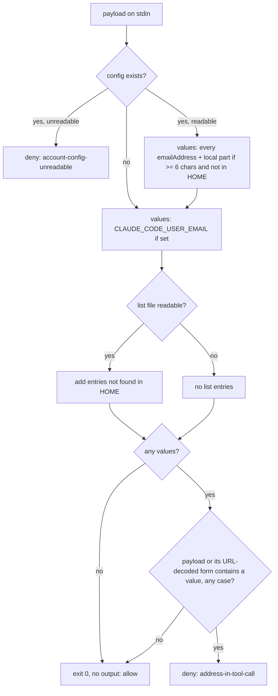

# Never-Send Guard - Plan

## Goal Capsule

- **Objective:** No Claude Code session on Brett's machines, main conversation or subagent, can put his email address
  into a tool call that would send it to a website, service, or command; a blocked call tells the model why and how to
  finish without it.
- **Means:** one PreToolUse hook with no matcher and `onFailure: "block"`, matching the account address the harness
  injects and a private list against every tool call's input (KTD1, KTD2, KTD3).
- **Product authority:** Brett's rule in `stow/claude/dot-claude/CLAUDE.md` (merged in #365) and his answers relayed by
  the `xurl-rs-prime` session outrank Requirements; Requirements govern behavior; KTDs govern mechanism within them;
  units override neither. Behavior measured on this host's Claude Code (2.1.314) outranks documentation or memory.
- **Execution profile:** one bash hook under `stow/claude/dot-claude/`, one bats suite, one `settings.json` entry, one
  sentence in `CLAUDE.md`, and a `docs/solutions` entry committed through `sd-commit-doc`.
- **Stop conditions:** stop and report to `xurl-rs-prime` if the live check (Verification Contract) shows the hook not
  firing for an MCP tool, or a missing guard script not blocking under `onFailure: "block"`. Also stop if Brett's answer
  to an Open Question changes a Requirement before the unit it affects.
- **Who finishes:** the `dotfiles/1` slot ships U1-U3 on `feat/never-send-guard` as one PR to `dev`. `xurl-rs-prime`
  approves and merges. Brett deploys with `scripts/stow-deploy` and fills the list.

---

## Product Contract

### Summary

A new hook, `never-send-guard.sh`, runs before every tool call in every session and subagent. It reads the account
address from Claude Code's own config at call time, adds its local part and the entries of an untracked list, and denies
any call whose input carries one of them, raw or URL-encoded, in any letter case. The deny reason tells the model the
address must not go out in any form and lists what to do instead. A guard that crashes, hangs, or cannot start blocks
the call rather than letting it through.

### Problem Frame

Claude Code puts the signed-in account's address into the model's context on every request, as a `# userEmail` block in
a system reminder, and gives it to every subagent too. The harness attaches an instruction not to send it to other
services. The public issue thread shows that instruction losing whenever a site asks for contact details: addresses sent
in `curl -A` User-Agent headers to crates.io and Wikimedia, git identity overridden with the address, a subagent giving
it to a web service, and the local part alone sent to about twenty sites
([anthropics/claude-code#81138](https://github.com/anthropics/claude-code/issues/81138),
[#95258](https://github.com/anthropics/claude-code/issues/95258)). Brett's rule (#365) states the same instruction in
his own `CLAUDE.md`, which still depends on the model complying. A deterministic check that sits before the request
leaves is the only part of this a user can enforce today; keeping the address out of context altogether is the harness's
fix ([#98584](https://github.com/anthropics/claude-code/issues/98584), #81138).

### Requirements

**Values protected**

- R1. The guard protects the address the harness injects: every `emailAddress` value in
  `${CLAUDE_CONFIG_DIR:-$HOME}/.claude.json`, read on each call, plus `CLAUDE_CODE_USER_EMAIL` when set.
- R2. It also protects that address's local part (the text before `@`), unless the local part is shorter than 6
  characters or appears in `$HOME`.
- R3. It protects each entry of a private list at `${NEVER_SEND_LIST:-$HOME/.config/never-send/list}`: one entry per
  line, with blank lines and `#` comments ignored and surrounding whitespace trimmed. An entry that appears in `$HOME`
  is skipped. The list never enters this public repo in plaintext, and Brett fills it.

**Coverage and matching**

- R4. Every tool call is checked: built-in tools, MCP tools, and tool calls made inside subagents.
- R5. A call is denied when its hook payload contains a protected value, compared case-insensitively, either as written
  or after URL-decoding (`%XX` decoded, `+` read as a space).

**Failure behavior**

- R6. The guard fails closed: a crash, a timeout, an unexpected exit status, or a script that cannot start blocks the
  call.
- R7. A missing input never blocks: with no config file, no `emailAddress`, no list file, or an empty list, the guard
  checks what exists and allows the call when nothing is left to protect.
- R8. A config file that exists but cannot be read blocks the call with a reason of its own.

**What the model and user see**

- R9. The deny reason says why the call was blocked and that shortened, re-spelled, encoded, split, or indirect copies
  count too. It offers the alternatives: leave the value out, use a neutral value such as the tool name and repo URL in
  a User-Agent, use another tool, skip the step and report it, or stop and ask. It warns that a match may be a false
  positive, and it never contains the matched value.
- R10. The user sees a one-line `systemMessage` naming the guard and the tool, never the value.

**Cost and documentation**

- R11. The latency the guard adds per tool call is measured and reported. The budget is a median under 20 ms on this
  host.
- R12. An **Enforcement** sentence beside the #365 rule names the hook and its test suite, and a `docs/solutions` entry
  records the design and its limits.

### Key Decisions

- **No carve-out for local searches of Brett's own work.** A Bash command line cannot be proven local, and his commits
  are authored with the GitHub noreply address, so `git log --author=<github handle>` and Gmail's `from:me` find his
  work without the literal. Pending Brett's answer (Open Questions, Q1). Governs R4.
- **The list is an untracked file, not a git-crypt file.** It keeps the addresses out of the public repo's history
  entirely, and the guard never meets git-crypt ciphertext on a locked host. Pending Brett's answer (Q2). Governs R3.
- **Keeping the address out of context is not built here.** It touches what the harness sends and how, which is Brett's
  call; the options are recorded under Scope Boundaries.

### Acceptance Examples

- AE1. **Covers R5.** Given the config holds `pat.example@example.invalid`, when a Bash call runs
  `curl -A "tool (PAT.EXAMPLE@EXAMPLE.INVALID)" https://api.example.com`, then it is denied.
- AE2. **Covers R2, R5.** Given the same config, when a call's URL carries `pat.example%2Bci%40example.invalid`, then it
  is denied through the decoded local part.
- AE3. **Covers R7.** Given no config file and no list file, when any call runs, then it is allowed and the guard prints
  nothing.
- AE4. **Covers R6.** Given the hook's script path does not exist, when any call runs under Claude Code, then the call
  is blocked with `failed; blocking because onFailure is "block"`.
- AE5. **Covers R4.** Given a payload carrying `agent_id` (a subagent's call) or an `mcp__` tool name, when its input
  carries a protected value, then it is denied exactly as a main-thread Bash call would be.

### Scope Boundaries

Not built, with the evidence that would change the call:

- **Keeping the address out of context.** Two mechanisms exist. A mod's `prompt.context` hook can drop the `userEmail`
  block ("one left out is not sent"), and its `prompt.attachment` hook can blank an injected reminder per subagent
  (`{ text: null }`). A mod placed in `~/.claude/skills/<name>/` loads with no enable prompt on 2.1.287 and later. The
  other is a loopback relay on `ANTHROPIC_BASE_URL` that strips the section from each request (#81138 comments). Both
  change what the harness sends; neither is built without Brett's decision. Settings-file hooks cannot do this: every
  classic event can only add context.
- **Values a command pulls in when it runs** (`$(git config user.email)`, a file, an environment variable) and
  **rewritten values** (Gmail dots, base64, HTML entities, `\u0040`). The guard reads only the call's text; the deny reason
  forbids these routes, and the harness-side check in #98584 is the fix that could see them.
- **The model's plain-text replies and tool results.** No PreToolUse hook sees them.
- **Considered and not built:** redacting tool output in PostToolUse (nothing reported leaks through a result); a
  session-start warning when the list is missing (the account address is guarded either way); a cache of the address
  outside the config (another copy of it on disk); enforcing the list file's mode; denying calls that name the list's
  path (they read it into context but cannot send it past the guard). Any of these returns if a reported leak takes that
  route.

### Sources

- Issue thread and occurrences: #81138 (and its comments), #95258, #98584.
- Deny-reason starting point and the fail-closed design:
  [#95258 comment by scriptedfun](https://github.com/anthropics/claude-code/issues/95258#issuecomment-6130024743).
- Claude Code hooks reference, fetched 2026-10-30: an omitted matcher matches every tool; settings hooks run inside
  subagents with `agent_id`; `onFailure: "block"` makes a failure, timeout, unexpected exit, or invalid output block a
  PreToolUse call. The changelog adds `onFailure` in 2.1.295.
- Claude Code 2.1.314 binary: the global config path is
  `join(CLAUDE_CONFIG_DIR || homedir, ".claude" + suffix + ".json")`. The suffix is empty outside custom OAuth
  environments.
- Mods API types bundled with the `plugin-authoring` skill on 2.1.314: `prompt.context`, `prompt.attachment`, and guards
  that skip on failure unless given a `.catch`.
- `docs/solutions/developer-experience/hook-stdin-enxio-use-cat-not-redirect-2026-04-20.md` (read stdin with `cat`);
  `docs/solutions/logic-errors/sigpipe-under-pipefail-turns-a-matched-guard-into-a-pass.md` (no early-exiting consumer
  decides a verdict).
- Stars checked: `affaan-m/ECC` `hooks/README.md` (fail-closed hooks give up waiting on stdin that never closes),
  `davila7/claude-code-templates` `HOOKS_GUIDE.md` and its `mods/security/secret-redactor`,
  `griffinhilly/claude-code-synthesis` `SAFETY.md`, `joshuadavidthomas/agent-skills` `claude-hook-backed.md`. All are
  MIT-licensed; no code is adapted from them.

---

## Planning Contract

### Key Technical Decisions

- KTD1. **One settings-file PreToolUse entry with no `matcher`, `onFailure: "block"`, and a 10 s timeout.** An omitted
  matcher covers every tool, MCP included, and settings hooks fire inside subagents, which covers R4.
  `onFailure: "block"` covers R6 natively: can't start, timeout, an exit other than 0 or 2, and invalid JSON all block.
  It replaces the #95258 launcher, which was itself a program that could fail to start. The timeout is double the
  sibling guards' 5 s because a timeout now blocks rather than allows.
- KTD2. **Match the whole hook payload read from stdin, not a parsed `tool_input`.** The guard then needs no JSON
  parser: the Brewfile ships `jq`, not `jaq`, and a parser-dependent guard would have to fail open without one or lock
  the host. The payload's other fields (`session_id`, `transcript_path`, `cwd`, `tool_name`, `agent_id`) carry no
  address, so the payload is a superset of `tool_input` that adds no false positives in practice.
- KTD3. **Read the account address with one `sed` pass over the config, taking every `"emailAddress": "<value>"`
  string.** On this host that equals `jaq`'s `.oauthAccount.emailAddress` and costs 2.3 ms, against 3.7 ms for `jaq` and
  6.2 ms for `jq`. Over 3,000 reads while the session rewrote the file there were no torn reads, so an unparsable
  partial write is not a case to handle.
- KTD4. **Stay inside bash 3.2.** Case folding uses `shopt -s nocasematch` with `[[ "$haystack" == *"$value"* ]]`, and
  URL-decoding uses `printf '%b'` after doubling every backslash, so a `\c` in the payload cannot cut the decoded text
  short. With no bash 4 construct, the script needs no version-guard block and runs under macOS `/bin/bash`.
- KTD5. **Only an unreadable config blocks.** Missing optional inputs allow (R7) because a host with no list, or a
  session authenticated by API key, Bedrock, or Vertex (no `oauthAccount`, so no injected block), has nothing for the
  guard to protect. An existing config the guard cannot read (R8) is a state where the harness may still hold the
  address, so it blocks.
- KTD6. **The deny envelope follows the sibling guards.** The reason is `never-send-guard denied [<reason>]: <message>`,
  then `next_step [<action>]: <text>` and `docs: ~/.claude/CLAUDE.md § "Secrets & private identifiers"`. Reasons are the
  closed set `address-in-tool-call` and `account-config-unreadable`; actions are `send-without-it` and `tell-user`. The
  text adapts the #95258 comment's reason, whose URL the script header credits. The JSON is built without a parser
  because every variable part is the sanitized tool name.
- KTD7. **Tests drive the script through stdin with `CLAUDE_CONFIG_DIR` and `NEVER_SEND_LIST` pointed into
  `BATS_TEST_TMPDIR`.** `HOME` is never reassigned (`scripts/core-env-guard.sh`), `CLAUDE_CODE_USER_EMAIL` is unset in
  `setup`, and every address is made up under `example.invalid`.

### High-Level Technical Design

Harness behavior around the script: a crash, timeout, or missing script blocks the call (KTD1); a deny JSON blocks it
with the reason shown to the model.

### Assumptions

- Claude Code on every host Brett deploys to is 2.1.295 or later, so `onFailure` is honored; on an older build the guard
  still denies matches but fails open on a crash.
- The harness keeps writing `~/.claude.json` atomically and pretty-printed; KTD3 depends on one
  `"emailAddress": "<value>"` per line.
- No future hook payload field carries the address. If one did, every call would be denied with `address-in-tool-call`,
  which is loud and safe but needs a manual settings edit to recover.

### Risks

- **A guard bug blocks every call on every host.** With `onFailure: "block"`, a script that errors on some common
  payload shape denies all work, including the edit that would fix it. Mitigation: the bats suite covers payload shapes
  from every tool family before merge, and the live check runs the real harness against the script before the PR opens.
- **Gmail treats dotted spellings as the same address.** A re-spelled value passes the substring check. The deny reason
  forbids it, and the local-part match (R2) catches plus-tags but not dots.

---

## Implementation Units

### U1. The guard and its suite

- **Goal:** `never-send-guard.sh` exists, meets R1-R10, and is proven by a bats suite written first.
- **Requirements:** R1-R10.
- **Dependencies:** none.
- **Files:** `stow/claude/dot-claude/never-send-guard.sh` (create), `tests/never-send-guard.bats` (create).
- **Approach:**
  1. Read stdin with `cat`, then collect values per the HTD order, skipping any value or entry that appears in `$HOME`.
  2. Test each value against the raw payload, then against the decoded payload, with `nocasematch`.
  3. On a match, print the deny JSON (KTD6) with the tool name taken from the payload and reduced to `[A-Za-z0-9_-]`; on
     no match, exit 0 silently.
  4. The header comment states the protocol, the values, the limits from Scope Boundaries, and credits the #95258
     comment.
- **Execution note:** write the suite first and run it with the script absent; every case should fail with status 127
  before the script exists. Quote that output in the PR.
- **Patterns to follow:** `stow/claude/dot-claude/self-match-guard.sh` (deny envelope, header shape);
  `tests/self-match-guard.bats` (`decide` helper returning ALLOW, DENY, or HOOK_ERROR).
- **Test scenarios:**
  - Covers AE1. Account address in a Bash `curl -A` header, in upper case, is denied with `[address-in-tool-call]`.
  - The address with `%40` for `@` is denied.
  - Covers AE2. The local part with a plus-tag, URL-encoded, is denied.
  - The local part alone in a User-Agent string is denied.
  - A list entry inside an MCP tool's payload (`tool_name` `mcp__example__send`) is denied, and the `systemMessage`
    names that tool.
  - Covers AE5. A list entry in a payload carrying `agent_id` is denied.
  - A list entry in a Write call's `content` is denied.
  - `CLAUDE_CODE_USER_EMAIL` set, with no config file, is denied when the payload carries it.
  - With `CLAUDE_CONFIG_DIR` set, the guard reads that directory's `.claude.json` and not the default.
  - An address at the end of a payload over 128 KiB is denied, so no pipe-buffer boundary drops a match.
  - A payload with `\c` before an encoded address is still denied.
  - An existing but unreadable config denies with `[account-config-unreadable]`; skipped when running as root.
  - No deny output, on either reason, contains any protected value.
  - An unrelated payload is allowed with no output and exit 0.
  - A different address that shares only the domain is allowed.
  - Covers AE3. No config and no list allows every payload.
  - A config with no `emailAddress` and an empty list allows every payload.
  - List comments, blank lines, and padded entries count only as their trimmed entries.
  - A list entry found in `$HOME` is skipped, so a payload naming a path under `$HOME` is allowed.
  - A local part shorter than 6 characters is not derived, so a payload carrying only it is allowed.
  - Every deny output parses as JSON with `hookSpecificOutput.permissionDecision` `deny` and `hookEventName`
    `PreToolUse`.
- **Verification:** the suite passes, `scripts/lint-shell` is clean on both files, and `tests/bash-version-guard.bats`
  still passes with the new script.

### U2. Wire it into settings

- **Goal:** every session and subagent on a deployed host runs the guard on every tool call and blocks when it fails.
- **Requirements:** R4, R6.
- **Dependencies:** U1.
- **Files:** `stow/claude/dot-claude/settings.json` (modify), `tests/claude-settings.bats` (modify).
- **Approach:** add one PreToolUse group with no `matcher` key whose single hook runs `~/.claude/never-send-guard.sh`
  with `timeout` 10 and `onFailure` `block` (KTD1). Leave every other entry untouched.
- **Patterns to follow:** the existing PreToolUse groups and the `slot-status.sh` registration test in
  `tests/claude-settings.bats`.
- **Test scenarios:**
  - Exactly one PreToolUse group runs `never-send-guard.sh`, and it has no `matcher`.
  - That hook sets `onFailure` to `block` and a numeric `timeout`.
  - The existing "hook commands name scripts under ~/.claude by the ~ path" test passes with the new entry.
- **Verification:** `tests/claude-settings.bats` passes and `settings.json` parses with `jq`.

### U3. Document the enforcement

- **Goal:** the rule names its enforcement the way the other rules do, and the design is findable in the solutions
  corpus.
- **Requirements:** R12.
- **Dependencies:** U1, U2.
- **Files:** `stow/claude/dot-claude/CLAUDE.md` (modify);
  `docs/solutions/security-issues/never-send-guard-blocks-account-address-in-tool-calls.md` (create, in the solutions
  repo).
- **Approach:**
  1. Add one **Enforcement** sentence after Brett's paragraph, leaving his wording unchanged: the hook, its no-matcher
     and `onFailure` wiring, the three value sources, the list path, and `bats tests/never-send-guard.bats`.
  2. Write the solutions entry: the problem, the design (KTD1-KTD5), the measured latency, the limits, and the
     presence-fix options. Commit it with `sd-commit-doc`.
- **Test expectation:** none, documentation only; `markdownlint-cli2` clean on `CLAUDE.md`.
- **Verification:** the sentence reads beside the rule without changing it, and `sd-commit-doc` reports the entry
  pushed.

---

## Verification Contract

| Gate          | Command or method                                                                                                                                                                                                                                                                                    | Proves                                                                                                                      |
| ------------- | ---------------------------------------------------------------------------------------------------------------------------------------------------------------------------------------------------------------------------------------------------------------------------------------------------- | --------------------------------------------------------------------------------------------------------------------------- |
| Red first     | `bats tests/never-send-guard.bats` with the script absent                                                                                                                                                                                                                                            | every scenario fails before the guard exists                                                                                |
| Suites        | `bats tests/never-send-guard.bats tests/claude-settings.bats tests/bash-version-guard.bats`                                                                                                                                                                                                          | R1-R10, R4/R6 wiring, bash 3.2 compatibility                                                                                |
| Lint          | `scripts/lint-shell --all`, `scripts/lint-workflows --all`, `scripts/core-env-guard.sh`, `markdownlint-cli2` on changed markdown                                                                                                                                                                     | the CI jobs' checks                                                                                                         |
| Latency (R11) | 200 runs each of a 200-byte Bash payload and a 100 KiB Write payload, timed against a bare `bash -c 'exit 0'`                                                                                                                                                                                        | median and p95 added per call                                                                                               |
| Live harness  | an untracked `.claude/settings.local.json` in this slot whose hook command runs the guard only before a deadline a few minutes out, with `NEVER_SEND_LIST` naming a list of one made-up address; then a Bash call, a Read call, and an MCP tool call carrying that address, and one carrying nothing | the real harness blocks every tool family and allows the clean call; the deadline means a guard bug cannot lock the session |
| Fail closed   | the same live setup pointed at a missing script path                                                                                                                                                                                                                                                 | AE4: the harness blocks the call                                                                                            |

`scripts/run-tests --all` is never run from a slot, because it stows into the real home directory. The branch is pushed
with `--no-verify` and every other pre-push gate runs by hand, as the PR body states.

## Definition of Done

- U1-U3 are complete and the suites in the Verification Contract pass.
- The red-first failure output, the latency figures, and the live-harness results are quoted in the PR body.
- The PR to `dev` is open with every rollup check `SUCCESS`, and the `docs/solutions` entry is pushed.
- The live-check settings file, test lists, and timing scratch files are deleted; no abandoned code remains in the diff.

---

## Open Questions

For Brett, through `xurl-rs-prime`; neither blocks U1-U3, which build the recommended answer, and the other answer
changes one branch.

- Q1. **Local searches for his own work.** Recommended: block the address in every tool call, with no exception.
  Alternative: exempt the built-in `Grep` and `Glob` tools, which only read local files. Exempting commands like `rg` or
  `gh search --author-email` by name is not offered, because a Bash line can also send.
- Q2. **Where the list lives.** Recommended: the untracked `~/.config/never-send/list`, filled on each host that needs
  entries beyond the account address. Alternative: a git-crypt file stowed to the same path, which reaches every host
  from one edit; the guard would then need to treat git-crypt ciphertext on a locked host as no list.
- Q3. **Keeping the address out of context.** Not blocking. A mod that drops the `userEmail` context block is the
  smaller of the two options under Scope Boundaries; the relay touches auth and transport.
