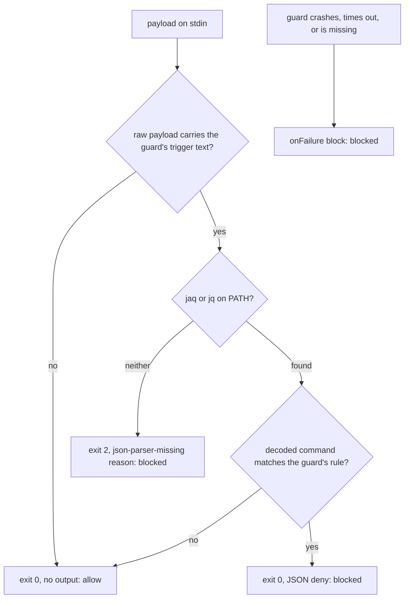

# Fail-Closed Claude Guards - Plan

## Goal Capsule

- **Objective:** On every host this repo deploys to, a call that one of the dotfiles Claude Code guards exists to refuse
  is never let through because the guard could not run; the refusal tells the model which guard could not check the call
  and how to restore it.
- **Means:** each guard parses its payload with jaq, else jq, and exits 2 when it finds neither (KTD1, KTD2), checks its
  trigger text before it looks for a parser (KTD3), and runs under `onFailure: "block"` (KTD4); the Brewfile installs
  jaq (KTD6).
- **Product authority:** Brett's decision, relayed by the `xurl-rs-prime` session, outranks Requirements; Requirements
  govern behavior; KTDs govern mechanism within them; units override neither. Behavior measured on this host's Claude
  Code (2.1.314) outranks documentation or memory.
- **Execution profile:** seven guard scripts edited in place under `stow/claude/dot-claude/`, their settings entries,
  one Brewfile line, one shared bats helper, two new suites, five extended suites, one core-env allowlist entry.
- **Stop conditions:** stop and report to `xurl-rs-prime` if a guard's suite fails under jq alone with a filter error
  (that invalidates KTD1), if the live check shows a guard's exit 2 not blocking the call, or if #368 merges first with
  a `settings.json` shape that cannot keep both changes by adding lines.
- **Who finishes:** the `dotfiles/4` slot ships U1-U6 on `fix/fail-closed-claude-guards` as one PR into `dev`.
  `xurl-rs-prime` approves and merges. Brett deploys: a `git pull` in `~/dotfiles` makes the scripts and `settings.json`
  live, and `brew bundle` installs jaq.

---

## Product Contract

### Summary

Seven PreToolUse guards stop allowing every call when jaq is missing. Each one looks for jaq, then jq; with neither it
blocks the call with exit 2 and a reason naming the guard, the missing tool, and `brew install jaq`. A call that carries
none of a guard's trigger text still runs, so a host with no parser keeps a usable Bash tool. Every guard's settings
entry gains `onFailure: "block"`, so a guard that crashes, hangs, or is missing blocks the call instead of waving it
through. The Brewfile installs jaq on macOS and Linux.

### Problem Frame

The guards are how the rules in `~/.claude/CLAUDE.md` hold when the model would otherwise break them: no heredoc into a
PR body, no AI trailer, no piped commit, no long foreground sleep, no self-matching `pgrep -f`, no mis-tiered dispatch,
no raw WebFetch. Six of them open with `command -v jaq >/dev/null 2>&1 || exit 0`, and `model-tier-guard.sh` calls `jq`
with no check. `stow/brew/Brewfile` installs `jq` but not `jaq`, so on any host where jaq was never installed by hand,
every one of those six guards allows everything, silently. A guard that crashes is no better: Claude Code treats a
failed hook as a non-blocking error and runs the call. Claude Code 2.1.295 added `onFailure: "block"` to make a failed
hook block the call; this host runs 2.1.314.

### Requirements

**Failing closed**

- R1. A guard that finds no JSON parser blocks every call it would have checked: exit 2, with a reason naming the guard,
  the missing tools, and the install command. No guard exits 0 because a tool is missing.
- R2. When one of the seven guards crashes, outlives its timeout, or is missing, the call it would have checked is
  blocked.
- R3. A guard with jq but no jaq makes the same decision it makes with jaq, for every input its suite covers.

**Blast radius**

- R4. With no parser on the host, a call that carries none of a guard's trigger text still runs, `brew install jaq`
  included.
- R5. Hooks that never deny keep failing open: `op-skill-nudge.sh`, `slot-status.sh`, and every non-PreToolUse hook.
- R6. Every hook entry that blocks on failure names a script this repo ships as an executable file, so renaming or
  deleting a guard fails a test before it can block every Bash call on a host.

**Install**

- R7. `brew bundle` from `stow/brew/Brewfile` installs jaq on macOS and on Linux.

**Accuracy**

- R8. `defuddle-webfetch.sh`'s header describes its deny as it behaves on 2.1.314: it holds for a URL that
  `permissions.allow` approves.

### Key Decisions

- **One PR, separate from #368: jaq goes in the Brewfile, and every guard fails closed with `onFailure: "block"` and no
  silent exit 0.** (session-settled: user-directed — chosen over leaving the guards fail-open or folding the fix
  into #368: Brett's answer, relayed by `xurl-rs-prime`, was "Yes, separate PR") Governs R1, R2, R7.

### Acceptance Examples

- AE1. Covers R1, R4.
  - **Given:** a host with neither jaq nor jq on PATH.
  - **When:** the agent runs `sleep 60`, then `brew install jaq`.
  - **Then:** the first is blocked with `sleep-guard blocked [json-parser-missing]` and the next step
    `brew install jaq`; the second passes every Bash guard and runs.
- AE2. Covers R3.
  - **Given:** jq on PATH and no jaq.
  - **When:** the agent runs `gh pr create --body "$(cat <<EOF ...)"`.
  - **Then:** heredoc-pr-guard denies it with the same reason it gives with jaq.
- AE3. Covers R2.
  - **Given:** `~/.claude/sleep-guard.sh` is missing on a host.
  - **When:** the agent makes any Bash call.
  - **Then:** Claude Code blocks it (`failed; blocking because onFailure is "block"`) until the script is restored from
    a terminal.

### Scope Boundaries

- **Not in scope: `op-skill-nudge.sh`.** It lives in the 1password skill, not this repo, and only advises; a nudge that
  fails should not stop an `op` call (R5).
- **Not in scope: `ci-watch-prompt.sh` and `claude-code-archive.sh`.** They also skip their work without jaq, but they
  run after a call or at session end and gate nothing. The Brewfile line restores them on any host that runs
  `brew bundle`.
- **Not in scope: `never-send-guard.sh` (#368).** It needs no parser by design and already sets `onFailure: "block"`.
- **Not in scope: CI's jq-as-jaq link in `bats.yml`.** It keeps working; the new jq-only tests exercise the fallback on
  every host anyway.
- **Considered, not built: a sourced helper for the parser lookup.** Rejected by KTD5. Evidence that would change it: a
  way to ship a new file under `~/.claude` that goes live on `git pull` without a restow.
- **Considered, not built: a test that holds the seven lookup blocks textually identical.** The per-guard behavior tests
  catch every drift that changes a decision; one would earn its place if the blocks start diverging in wording.
- **Considered, not built: longer timeouts.** The corpus run (KTD4) puts the slowest observed guard call at 1.55 s,
  under a third of the 5 s limit. A timeout block seen in practice would change this.
- **Considered, not built: turning off glob expansion in `ai-attribution-guard.sh`'s token split.** That split is the
  1.55 s call: a command carrying `gh pr` and `du -sh /tmp/* /tmp/.[!.]*` makes the guard expand both globs. Turning
  globbing off would also stop the guard reading a `-F` file named by a glob, which is a deny it makes today. A timeout
  blocks visibly with a hook-error reason the model can act on, so nothing lands unnoticed; a timeout block seen in
  practice would change this.

#### Deferred to Follow-Up Work

- `docs/solutions` entries that teach the fail-open `command -v ... || exit 0` idiom for hooks, and the defuddle
  integration doc's claim that a deny needs WebFetch kept out of `permissions.allow`, get refreshed by
  `ce-compound-refresh` after merge.

### Sources

- `docs/solutions/best-practices/claude-code-hook-exit-codes-and-stdout-semantics-2026-04-20.md`: exit 2 blocks on
  PreToolUse regardless of stdout; exit 1 and malformed JSON are non-blocking errors.
- `docs/solutions/security-issues/never-send-guard-blocks-account-address-in-tool-calls.md`: `onFailure: "block"`
  observed blocking a missing script on 2.1.314, and the recovery steps for a host where every call is blocked.
- `docs/solutions/developer-experience/live-verify-a-pretooluse-hook-in-the-running-session-without-locking-it.md`: the
  live-check hazards KTD8 avoids.
- `docs/solutions/best-practices/claude-code-pretooluse-hook-deny-holds-over-permissions-allow.md`: the 2.1.314
  observation behind R8.
- `stow/local/dot-local/bin/mac-open` and `scripts/agent-slot/lib/env.sh`: the repo's jaq-else-jq lookup.
  `tests/mac-open.bats` (the "neither jaq nor jq" test) is the precedent for a PATH built without either.
- Corpus run, 2026-10-30: every distinct Bash, Agent, and WebFetch tool input in this host's transcripts from the last
  14 days (63,219 Bash, 1,106 Agent, 52 WebFetch), deduplicated. Each Bash guard ran over the 19,150 Bash inputs that
  carry any guard's trigger text plus 2,000 others; model-tier-guard over every Agent input. Results: exit 0 every time;
  denies from piped-commit-guard 442, sleep-guard 219, self-match-guard 91, heredoc-pr-guard 4; p50 4-7 ms, p99 at most
  20 ms, slowest 1.55 s. defuddle-webfetch was left out because its deny path writes markers live sessions read.

---

## Planning Contract

### Key Technical Decisions

- KTD1. **Parser lookup: jaq, else jq.** It is the repo's idiom (`mac-open`, `agent-slot/lib/env.sh`), and
  `.github/workflows/bats.yml` already runs every guard suite with apt's jq linked as `jaq`, so the guards' filters pass
  under jq today. A host that has pulled this change but not yet run `brew bundle` still has jq from the Brewfile, and
  keeps every guard working. Rejected: jaq alone, which would block every trigger-carrying call on such a host though a
  working parser is installed.
- KTD2. **No parser: exit 2 with the reason on stderr.** Exit 2 blocks a PreToolUse call whatever stdout holds and
  whatever `onFailure` says, so no Claude Code version or settings state can read it as an allow. The reason follows
  sleep-guard's text shape:
  `<guard> blocked [json-parser-missing]: neither jaq nor jq is on PATH, so this call could not be checked`, then
  `next_step [install-jaq]:` and the command `brew install jaq` on its own line. Rejected: a JSON deny on exit 0, which
  needs JSON built without a parser and fails open if malformed; exit 1, which allows unless `onFailure: "block"` is set
  and honored.
- KTD3. **Trigger text is checked on the raw payload before the parser lookup.** Claude Code writes the payload with
  `JSON.stringify`, which leaves letters, spaces, `<`, `|`, and `:` unescaped, so a command containing a trigger means
  the payload contains it. Three guards already do this; the decoded check after parsing stays as the precise filter.
  Patterns per guard are in the High-Level Technical Design table.
- KTD4. **`onFailure: "block"` on the seven guard entries; timeouts unchanged.** The five Bash guards,
  `defuddle-webfetch.sh` (WebFetch), and `model-tier-guard.sh` (Agent); not `op-skill-nudge.sh` or the async
  `slot-status.sh` (R5). A failing Bash guard then blocks every Bash call, so the evidence is the corpus run (Sources):
  every current guard exited 0 on all 21,150 Bash calls and 1,106 Agent calls, p99 was at most 20 ms per guard, and the
  slowest single call took 1.55 s. Timeouts stay 5 s (Bash, Agent) and 10 s (WebFetch).
- KTD5. **The lookup stays inline in each guard.** A sourced helper would be a new file under `~/.claude`, which only a
  restow links, while `settings.json` and the existing scripts are symlinks into the checkout that a `git pull` switches
  at once. Under `onFailure: "block"`, a missing helper would block every Bash call on every host that pulled before
  restowing. The duplicated block is a few lines.
- KTD6. **`brew "jaq"` sits beside `brew "jq"` with no OS gate.** One `stow/brew/Brewfile` serves both platforms, gating
  per entry (`if OS.linux?`, `if OS.mac?`), and BOOTSTRAP.md applies it with
  `brew bundle --file=~/dotfiles/stow/brew/Brewfile` on both. jaq is a homebrew/core formula (3.1.2). Its comment names
  the guards that need it, following the `shfmt` entry.
- KTD7. **Tests hide the parsers by building PATH, not by stubbing.** A shared helper in `tests/lib/` runs a hook under
  a PATH of symlink directories made from `/usr/bin` and `/bin` with `jq` and `jaq` left out, ahead of a directory
  holding the test's own bash and, in the jq case, the host's jq. The bash link keeps macOS from running the guard under
  `/bin/bash` 3.2. Links are built once per suite under `BATS_FILE_TMPDIR`. The helper's PATH assignment takes one entry
  in `scripts/core-env-allowlist.tsv`, as `tests/mac-open.bats` does.
- KTD8. **Live check through a headless session, not the slot's settings.** `claude -p` from a scratch directory with
  `--setting-sources project` and `--settings` registering one guard under a parser-free PATH proves the harness blocks
  on the guard's exit 2, without touching this slot's `.claude/settings.local.json` or the deployed hooks.
  `onFailure: "block"` on a missing script was already observed on 2.1.314 (Sources).
- KTD9. **`defuddle-webfetch.sh` gains a `DEFUDDLE_MARKER_DIR` override.** Its deny path writes a marker into
  `/tmp/.defuddle-markers`, which live sessions read; tests point it at their own directory so a test never changes
  whether a real WebFetch is redirected.

### High-Level Technical Design

Each guard, after this change:

| Guard                     | Matcher  | Raw trigger checked before the parser                       |
| ------------------------- | -------- | ----------------------------------------------------------- |
| `heredoc-pr-guard.sh`     | Bash     | `<<`                                                        |
| `ai-attribution-guard.sh` | Bash     | `git commit`; `gh pr`, `gh issue`, `gh release` and a space |
| `piped-commit-guard.sh`   | Bash     | `commit` and `\|` (exists)                                  |
| `sleep-guard.sh`          | Bash     | `sleep` (exists)                                            |
| `self-match-guard.sh`     | Bash     | `pgrep` or `pkill` (exists)                                 |
| `model-tier-guard.sh`     | Agent    | `TIER:`, any letter case                                    |
| `defuddle-webfetch.sh`    | WebFetch | none: every WebFetch needs its URL parsed                   |

### Assumptions

- The payload is `JSON.stringify` output, with no `\u` escapes for ASCII. Claude Code is a JavaScript program, and the
  three guards that already filter the raw payload depend on the same property.
- Every host runs Claude Code 2.1.295 or later, where `onFailure` exists; #368 rests on the same. How an older version
  treats the unknown key is unverified. The no-parser path blocks either way, since it exits 2.
- An agent that reads the `install-jaq` next step may run `brew install jaq` itself. That installs a formula the
  Brewfile declares, so it is an acceptable outcome.

### Risks

- **A guard that crashes on an unusual command now blocks it.** Before, the call ran behind a hook-error notice. The
  corpus run found no such command among 21,150 real Bash calls (KTD4). When one appears, the reason names the hook, the
  user can run the command from a terminal, and `claude --settings '{"disableAllHooks": true}'` gives one session with
  every hook off.
- **A guard script missing from `~/.claude` blocks every call on its matcher.** R6's test catches a rename or deletion
  in this repo. A host whose `claude` package was never stowed has no `settings.json` from this repo either, so it is
  unaffected.
- **Conflict with #368.** Both PRs edit `PreToolUse` in `settings.json`: #368 inserts a group before the WebFetch group,
  and this PR adds a line inside it, so whichever merges second gets a textual conflict there. The resolution keeps
  both. The new `claude-settings.bats` tests go at the end of the file, away from #368's insertion.

---

## Implementation Units

### U1. Parser-free PATH helper for the suites

- **Goal:** one helper every guard suite uses to run its hook with no JSON parser on PATH, or with jq alone.
- **Requirements:** R1, R3 (test support).
- **Dependencies:** none.
- **Files:** `tests/lib/json-parser.bash` (new), `scripts/core-env-allowlist.tsv`.
- **Approach:** per KTD7. One function takes the mode (none or jq), the hook path, and the payload, and leaves bats'
  `status`, `output`, and `stderr` set; the link directories are built on first use. The helper skips the test when jq
  mode is asked for and the host has no jq.
- **Patterns to follow:** the "neither jaq nor jq" test in `tests/mac-open.bats`; `tests/lib/platform.bash` for helper
  shape.
- **Test expectation:** none: it is exercised by every test in U2-U4.
- **Verification:** `scripts/core-env-guard.sh` passes its sweep with the new entry, and the entry matches a finding.

### U2. The five Bash guards fail closed

- **Goal:** heredoc-pr-guard, ai-attribution-guard, piped-commit-guard, sleep-guard, and self-match-guard each block
  without a parser and keep working with jq alone.
- **Requirements:** R1, R3, R4.
- **Dependencies:** U1.
- **Files:**
  `stow/claude/dot-claude/{heredoc-pr-guard,ai-attribution-guard,piped-commit-guard,sleep-guard,self-match-guard}.sh`;
  `tests/{heredoc-pr-guard,ai-attribution-guard,piped-commit-guard,sleep-guard,self-match-guard}.bats`.
- **Approach:**
  1. heredoc-pr-guard and ai-attribution-guard move their trigger check onto the raw payload, ahead of the parser lookup
     (KTD3).
  2. Each guard replaces its `command -v jaq || exit 0` with the KTD1 lookup and the KTD2 exit, and calls the parser it
     found everywhere it called `jaq`.
- **Execution note:** write the three tests per guard first and watch the no-parser and jq-only tests fail against the
  unchanged script; quote that output in the PR.
- **Patterns to follow:** sleep-guard's raw-payload `case` and its deny text shape.
- **Test scenarios, per guard:**
  - No parser, a call the guard denies today (for sleep-guard, `sleep 60`): exit 2, stderr names the guard and
    `[json-parser-missing]`, stdout empty.
  - No parser, a call without the guard's trigger text (`ls -la`): exit 0, no output.
  - jq only, the same denied call: exit 0 and a JSON deny whose reason matches the jaq run's.
  - heredoc-pr-guard and ai-attribution-guard, with jaq: a `description` field carrying the trigger text while the
    command does not still allows (the decoded check still governs).
- **Verification:** each suite passes; each no-parser and jq-only test failed against `origin/dev`'s script.

### U3. model-tier-guard fails closed

- **Goal:** the Agent guard looks for jaq, then jq, and blocks a TIER dispatch it cannot check.
- **Requirements:** R1, R3, R4.
- **Dependencies:** U1.
- **Files:** `stow/claude/dot-claude/model-tier-guard.sh`, `tests/model-tier-guard.bats` (new).
- **Approach:** a case-insensitive raw check for `TIER:` before the lookup (KTD3), then KTD1 and KTD2. Its `sed` filter
  stays as the precise check.
- **Execution note:** test-first, as in U2.
- **Test scenarios:**
  - With a parser, `TIER: build` and `model: opus`: allowed.
  - With a parser, `TIER: build` and `model: sonnet`: denied, reason names `opus`.
  - With a parser, `TIER: build` and `subagent_type: fork`: denied for the fork rule.
  - A prompt with no TIER line: allowed.
  - No parser, a `tier: Ceiling` dispatch (mixed case): exit 2 with `[json-parser-missing]`.
  - No parser, a dispatch with no TIER line: exit 0, no output.
  - jaq only, no jq: the mis-tiered dispatch is denied.
- **Verification:** the suite passes; the no-parser and jaq-only tests failed against `origin/dev`'s script.

### U4. defuddle-webfetch fails closed, with its header corrected

- **Goal:** WebFetch is blocked when the guard cannot parse the call, and the header states the deny-over-allow
  behavior.
- **Requirements:** R1, R3, R8.
- **Dependencies:** U1.
- **Files:** `stow/claude/dot-claude/defuddle-webfetch.sh`, `tests/defuddle-webfetch.bats` (new).
- **Approach:**
  1. KTD1 and KTD2; there is no raw trigger to check first (KTD3 table).
  2. KTD9's marker-directory override.
  3. Line 6's comment becomes a present-tense statement that the deny holds for a URL `permissions.allow` approves.
- **Execution note:** test-first, as in U2.
- **Test scenarios:**
  - With a parser, an `https://` HTML page: denied with the defuddle instruction, and a marker appears in the test's
    directory.
  - The same URL again: allowed.
  - A `.pdf` URL, a `localhost` URL, a `192.168.` URL: allowed.
  - No parser, any URL: exit 2 with `[json-parser-missing]`, and no marker written.
  - jq only, an HTML page: denied.
- **Verification:** the suite passes and never writes under `/tmp/.defuddle-markers`; the no-parser and jq-only tests
  failed against `origin/dev`'s script.

### U5. Settings entries block on failure

- **Goal:** the seven guards run under `onFailure: "block"`, and tests hold that true along with the scripts they name.
- **Requirements:** R2, R5, R6.
- **Dependencies:** U2, U3, U4.
- **Files:** `stow/claude/dot-claude/settings.json`, `tests/claude-settings.bats`.
- **Approach:** add the key to the seven entries (KTD4). Two tests at the end of the suite cover the invariant and the
  shipped scripts.
- **Execution note:** write both tests first and watch the first fail on today's `settings.json`.
- **Test scenarios:**
  - Every PreToolUse command hook except `slot-status.sh` and `op-skill-nudge.sh` sets `onFailure` to `"block"`; the
    failure output lists any that do not.
  - Every hook with `onFailure: "block"` names `~/.claude/<path>`, and `stow/claude/dot-claude/<path>` exists and is
    executable.
  - `op-skill-nudge.sh` and `slot-status.sh` carry no `onFailure`.
- **Verification:** `tests/claude-settings.bats` passes, and still passes once #368's never-send entry is in the file.

### U6. Brewfile installs jaq

- **Goal:** `brew bundle` installs jaq on both platforms.
- **Requirements:** R7.
- **Dependencies:** none.
- **Files:** `stow/brew/Brewfile`.
- **Approach:** KTD6.
- **Test expectation:** none: a declaration; verification is `brew bundle check` reading it.
- **Verification:** `brew bundle check --file=stow/brew/Brewfile --verbose` lists no missing jaq on this host, and
  `brew bundle list --file=stow/brew/Brewfile` includes it.

---

## Verification Contract

| Gate           | Command                                                                                                                                                                                                                                              | Proves                                                        |
| -------------- | ---------------------------------------------------------------------------------------------------------------------------------------------------------------------------------------------------------------------------------------------------- | ------------------------------------------------------------- |
| Touched suites | `scripts/run-tests tests/heredoc-pr-guard.bats tests/ai-attribution-guard.bats tests/piped-commit-guard.bats tests/sleep-guard.bats tests/self-match-guard.bats tests/model-tier-guard.bats tests/defuddle-webfetch.bats tests/claude-settings.bats` | U1-U5                                                         |
| Fail-first     | each new no-parser, jq-only, and settings test run against `origin/dev`'s version of its script or `settings.json`                                                                                                                                   | the tests detect the defect; output quoted in the PR          |
| ShellCheck     | `scripts/lint-shell --all`                                                                                                                                                                                                                           | shellcheck job                                                |
| actionlint     | `scripts/lint-workflows --all`                                                                                                                                                                                                                       | shellcheck job                                                |
| Core env       | `scripts/core-env-guard.sh`                                                                                                                                                                                                                          | shellcheck job; U1's allowlist entry matches                  |
| Bash version   | `scripts/run-tests tests/bash-version-guard.bats tests/lint-shell.bats`                                                                                                                                                                              | no guard picked up a bash 4 construct without the guard block |
| Perf           | `scripts/run-tests --perf-only`                                                                                                                                                                                                                      | the pre-push perf phase                                       |
| Markdown       | `markdownlint-cli2` on changed `.md` files                                                                                                                                                                                                           | plan and docs lint                                            |
| Live           | KTD8's headless check with sleep-guard: `sleep 30` blocked with `[json-parser-missing]` in the tool result; `echo ok` runs                                                                                                                           | the harness blocks on the no-parser exit                      |

`scripts/run-tests --all` is not run from the slot: its stow suites deploy into the real home directory. The push uses
`--no-verify` after the gates above pass by hand, and the PR body says so.

---

## Definition of Done

- R1-R8 each hold, through the unit that cites them.
- Every new no-parser, jq-only, and settings test was observed failing against the unfixed code, and the PR quotes that
  output beside the passing run.
- Every gate in the Verification Contract passes, including the live check.
- The PR from `fix/fail-closed-claude-guards` into `dev` is open with every check `SUCCESS` by rollup.
- No scratch files, corpus output, or abandoned attempts remain in the diff or the slot.
