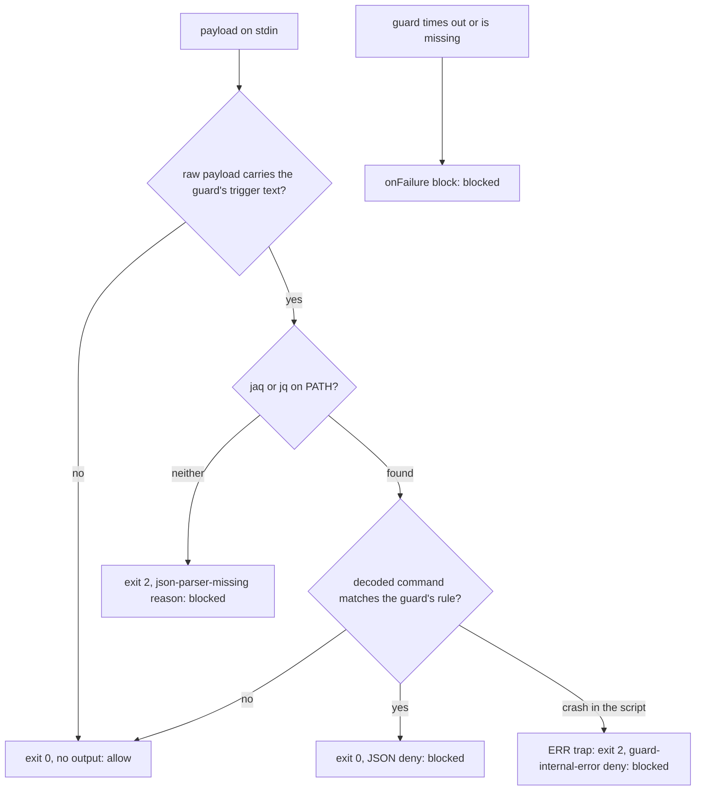

# Fail-Closed Claude Guards - Plan

## Goal Capsule

- **Objective:** On every host this repo deploys to, a call that one of the dotfiles Claude Code guards exists to refuse
  is never let through because the guard could not run; the refusal tells the model which guard could not check the call
  and how to restore it.
- **Means:** each guard parses its payload with jaq, else jq, and exits 2 when it finds neither (KTD1, KTD2), checks its
  trigger text before it looks for a parser (KTD3), and runs under `onFailure: "block"` (KTD4); the Brewfile installs
  jaq (KTD6).
- **Product authority:** Brett's decision, relayed by the `xurl-rs-prime` session, outranks Requirements; Requirements
  govern behavior; KTDs govern mechanism within them; units override neither. Behavior measured on this host's Claude
  Code (2.1.314) outranks documentation or memory.
- **Execution profile:** seven guard scripts edited in place under `stow/claude/dot-claude/`, their settings entries,
  one Brewfile line, one shared bats helper, two new suites, five extended suites, one core-env allowlist entry.
- **Stop conditions:** stop and report to `xurl-rs-prime` if a guard's suite fails under jq alone with a filter error
  (that invalidates KTD1), or if the live check shows a guard's exit 2 not blocking the call.
- **Who finishes:** the `dotfiles/4` slot ships U1-U6 on `fix/fail-closed-claude-guards` as one PR into `dev`.
  `xurl-rs-prime` approves and merges. Brett deploys: a `git pull` in `~/dotfiles` makes the scripts and `settings.json`
  live, and `brew bundle` installs jaq.

---

## Product Contract

### Summary

Seven PreToolUse guards stop allowing every call when jaq is missing. Each one looks for jaq, then jq; with neither it
blocks the call with exit 2 and a reason naming the guard, the missing tool, and `brew install jaq`. A call that carries
none of a guard's trigger text still runs, so a host with no parser keeps a usable Bash tool. Every guard's settings
entry gains `onFailure: "block"`, so a guard that crashes, hangs, or is missing blocks the call instead of waving it
through. The Brewfile installs jaq on macOS and Linux.

### Problem Frame

The guards are how the rules in `~/.claude/CLAUDE.md` hold when the model would otherwise break them: no heredoc into a
PR body, no AI trailer, no piped commit, no long foreground sleep, no self-matching `pgrep -f`, no mis-tiered dispatch,
no raw WebFetch. Six of them open with `command -v jaq >/dev/null 2>&1 || exit 0`, and `model-tier-guard.sh` calls `jq`
with no check. `stow/brew/Brewfile` installs `jq` but not `jaq`, so on any host where jaq was never installed by hand,
every one of those six guards allows everything, silently. A guard that crashes is no better: Claude Code treats a
failed hook as a non-blocking error and runs the call. Claude Code 2.1.295 added `onFailure: "block"` to make a failed
hook block the call; this host runs 2.1.314.

### Requirements

**Failing closed**

- R1. A guard that finds no JSON parser blocks every call it would have checked, in the main session and in subagents,
  with a reason naming the guard, the missing tools, and the install command. No guard exits 0 because a tool is
  missing.
- R2. When one of the seven guards crashes, outlives its timeout, or is missing, the call it would have checked is
  blocked; a crash inside the script says which guard failed, that the call did not run, and what to do next.
- R3. A guard with jq but no jaq makes the same decision it makes with jaq, for every input its suite covers.

**Blast radius**

- R4. With no parser on the host, a call whose payload carries none of a guard's trigger text, in the command or in any
  other field such as `cwd` or `description`, still runs, `brew install jaq` included.
- R5. Hooks that never deny keep failing open: `op-skill-nudge.sh`, `slot-status.sh`, and every non-PreToolUse hook.
- R6. Every hook entry that blocks on failure names a script this repo ships as an executable file, so renaming or
  deleting a guard fails a test before it can block every Bash call on a host.

**Install**

- R7. `brew bundle` from `stow/brew/Brewfile` installs jaq on macOS and on Linux.

**Accuracy**

- R8. `defuddle-webfetch.sh`'s header describes its deny as it behaves on 2.1.314: it holds for a URL that
  `permissions.allow` approves.

### Key Decisions

- **One PR, separate from #368: jaq goes in the Brewfile, and every guard fails closed with `onFailure: "block"` and no
  silent exit 0.** (session-settled: user-directed — chosen over leaving the guards fail-open or folding the fix
  into #368: Brett's answer, relayed by `xurl-rs-prime`, was "Yes, separate PR") Governs R1, R2, R7.

### Acceptance Examples

- AE1. Covers R1, R4.
  - **Given:** a host with neither jaq nor jq on PATH.
  - **When:** the agent runs `sleep 60`, then `brew install jaq`.
  - **Then:** the first is blocked with `sleep-guard blocked [json-parser-missing]` and the next step
    `brew install jaq`; the second passes every Bash guard and runs.
- AE2. Covers R3.
  - **Given:** jq on PATH and no jaq.
  - **When:** the agent runs `gh pr create --body "$(cat <<EOF ...)"`.
  - **Then:** heredoc-pr-guard denies it with the same reason it gives with jaq.
- AE3. Covers R2.
  - **Given:** `~/.claude/sleep-guard.sh` is missing on a host.
  - **When:** the agent makes any Bash call.
  - **Then:** Claude Code blocks it (`failed; blocking because onFailure is "block"`) until the script is restored from
    a terminal.

### Scope Boundaries

- **Not in scope: `op-skill-nudge.sh`.** It lives in the 1password skill, not this repo, and only advises; a nudge that
  fails should not stop an `op` call (R5).
- **Not in scope: `ci-watch-prompt.sh` and `claude-code-archive.sh`.** They also skip their work without jaq, but they
  run after a call or at session end and gate nothing. The Brewfile line restores them on any host that runs
  `brew bundle`.
- **Not in scope: `never-send-guard.sh` (#368).** It needs no parser by design and already sets `onFailure: "block"`.
- **Not in scope: CI's jq-as-jaq link in `bats.yml`.** It keeps working; the new jq-only tests exercise the fallback on
  every host anyway.
- **Considered, not built: a sourced helper for the parser lookup.** Rejected by KTD5. Evidence that would change it: a
  way to ship a new file under `~/.claude` that goes live on `git pull` without a restow.
- **Considered, not built: a test that holds the seven lookup blocks textually identical.** The per-guard behavior tests
  catch every drift that changes a decision; one would earn its place if the blocks start diverging in wording.
- **Considered, not built: longer timeouts.** The corpus run (KTD4) puts the slowest observed guard call at 1.55 s,
  under a third of the 5 s limit. A timeout block seen in practice would change this.
- **Considered, not built: turning off glob expansion in `ai-attribution-guard.sh`'s token split.** That split is the
  1.55 s call: a command carrying `gh pr` and `du -sh /tmp/* /tmp/.[!.]*` makes the guard expand both globs. Turning
  globbing off would also stop the guard reading a `-F` file named by a glob, which is a deny it makes today. A timeout
  blocks visibly with a hook-error reason the model can act on, so nothing lands unnoticed; a timeout block seen in
  practice would change this.

#### Deferred to Follow-Up Work

- `docs/solutions` entries that teach the fail-open `command -v ... || exit 0` idiom for hooks, and the defuddle
  integration doc's claim that a deny needs WebFetch kept out of `permissions.allow`, get refreshed by
  `ce-compound-refresh` after merge.

### Sources

- `docs/solutions/best-practices/claude-code-hook-exit-codes-and-stdout-semantics-2026-04-20.md`: exit 2 blocks on
  PreToolUse regardless of stdout; exit 1 and malformed JSON are non-blocking errors.
- `docs/solutions/security-issues/never-send-guard-blocks-account-address-in-tool-calls.md`: `onFailure: "block"`
  observed blocking a missing script on 2.1.314, and the recovery steps for a host where every call is blocked.
- `docs/solutions/developer-experience/live-verify-a-pretooluse-hook-in-the-running-session-without-locking-it.md`: the
  live-check hazards KTD8 avoids.
- `docs/solutions/best-practices/claude-code-pretooluse-hook-deny-holds-over-permissions-allow.md`: the 2.1.314
  observation behind R8.
- `stow/local/dot-local/bin/mac-open` and `scripts/agent-slot/lib/env.sh`: the repo's jaq-else-jq lookup.
  `tests/mac-open.bats` (the "neither jaq nor jq" test) is the precedent for a PATH built without either.
- Corpus run, 2026-10-30: every distinct Bash, Agent, and WebFetch tool input in this host's transcripts from the last
  14 days (63,219 Bash, 1,106 Agent, 52 WebFetch), deduplicated. Each Bash guard ran over the 19,150 Bash inputs that
  carry any guard's trigger text plus 2,000 others; model-tier-guard over every Agent input. Results: exit 0 every time;
  denies from piped-commit-guard 442, sleep-guard 219, self-match-guard 91, heredoc-pr-guard 4; p50 4-7 ms, p99 at most
  20 ms, slowest 1.55 s. defuddle-webfetch was left out because its deny path writes markers live sessions read.

---

## Planning Contract

### Key Technical Decisions

- KTD1. **Parser lookup: jaq, else jq.** It is the repo's idiom (`mac-open`, `agent-slot/lib/env.sh`), and
  `.github/workflows/bats.yml` already runs every guard suite with apt's jq linked as `jaq`, so the guards' filters pass
  under jq today. A host that has pulled this change but not yet run `brew bundle` still has jq from the Brewfile, and
  keeps every guard working. Rejected: jaq alone, which would block every trigger-carrying call on such a host though a
  working parser is installed.
- KTD2. **No parser: a fixed-text JSON deny on stdout, then exit 2.** Exit 2 blocks a PreToolUse call in the main
  session whatever stdout holds and whatever `onFailure` says. The JSON deny covers what exit codes may not:
  [anthropics/claude-code#40580](https://github.com/anthropics/claude-code/issues/40580) reports exit 2 ignored for
  subagent tool calls (closed as not planned), while a JSON decision is read there, and the existing guards already deny
  through JSON. With no parser, the JSON is printed from fixed, pre-escaped text, which
  `docs/solutions/architecture-patterns/claude-code-hooks-authoring-pattern-2026-04-20.md` allows when a test parses the
  output. The reason's lines, in order: `<guard> blocked [json-parser-missing]: neither jaq nor jq is on PATH, so this
  call could not be checked. It did not run; install jaq, then rerun it.`;
  `docs: ~/dotfiles/BOOTSTRAP.md § "Install Packages from Brewfile"`; `next_step [install-jaq]:`; and `brew install jaq`
  last, where an agent looks for the fix. `systemMessage` gives the user the first line. Rejected: stderr with exit 2
  alone, which a subagent call may ignore; exit 1, which allows unless `onFailure: "block"` is set and honored.
- KTD3. **Trigger text is checked on the raw payload before the parser lookup.** Claude Code writes the payload with
  `JSON.stringify`, which leaves letters, spaces, `<`, `|`, and `:` unescaped, so a command containing a trigger means
  the payload contains it. Three guards already do this; the decoded check after parsing stays as the precise filter.
  The check reads the whole payload, so a trigger in `cwd`, `transcript_path`, or `description` passes it too (Risks).
  Patterns per guard are in the High-Level Technical Design table.
- KTD4. **`onFailure: "block"` on the seven guard entries; timeouts unchanged.** The five Bash guards,
  `defuddle-webfetch.sh` (WebFetch), and `model-tier-guard.sh` (Agent); not `op-skill-nudge.sh` or the async
  `slot-status.sh` (R5). A failing Bash guard then blocks every Bash call, so the evidence is the corpus run (Sources):
  every current guard exited 0 on all 21,150 Bash calls and 1,106 Agent calls, p99 was at most 20 ms per guard, and the
  slowest single call took 1.55 s. Timeouts stay 5 s (Bash, Agent) and 10 s (WebFetch).
- KTD5. **The lookup stays inline in each guard.** A sourced helper would be a new file under `~/.claude`, which only a
  restow links, while `settings.json` and the existing scripts are symlinks into the checkout that a `git pull` switches
  at once. Under `onFailure: "block"`, a missing helper would block every Bash call on every host that pulled before
  restowing. The duplicated block is a few lines.
- KTD6. **`brew "jaq"` sits beside `brew "jq"` with no OS gate.** One `stow/brew/Brewfile` serves both platforms, gating
  per entry (`if OS.linux?`, `if OS.mac?`), and BOOTSTRAP.md applies it with
  `brew bundle --file=~/dotfiles/stow/brew/Brewfile` on both. jaq is a homebrew/core formula (3.1.2). Its comment names
  the guards that need it, following the `shfmt` entry.
- KTD7. **Tests hide the parsers by building PATH, not by stubbing.** A shared helper in `tests/lib/` runs a hook under
  a PATH of symlink directories made from `/usr/bin` and `/bin` with `jq` and `jaq` left out, ahead of a directory
  holding the test's own bash and, in the jq case, the host's jq. The bash link keeps macOS from running the guard under
  `/bin/bash` 3.2. Links are built once per suite under `BATS_FILE_TMPDIR`. The helper's PATH assignment takes one entry
  in `scripts/core-env-allowlist.tsv`, as `tests/mac-open.bats` does.
- KTD8. **Live check through a headless session, not the slot's settings.** `claude -p` from a scratch directory with
  `--setting-sources project` and `--settings` registering one guard under a parser-free PATH proves the harness blocks
  on the guard's exit 2, without touching this slot's `.claude/settings.local.json` or the deployed hooks.
  `onFailure: "block"` on a missing script was already observed on 2.1.314 (Sources).
- KTD10. **An ERR trap turns a crash inside a guard into the same kind of fixed-text deny.** The reason names the guard,
  `[guard-internal-error]`, and `$LINENO`, says the call did not run, and ends with `next_step [ask-user]:` naming
  `bats tests/<guard>.bats`; the trap then exits 2. A broken parser is the realistic crash: a Homebrew upgrade that
  strands jaq's or jq's libraries makes every guard fail on its first parse, and under `onFailure: "block"` alone the
  agent reads only `failed; blocking because onFailure is "block"`. The trap fires only where `set -e` would exit, so it
  changes no decision; failures inside functions and subshells, which do not inherit it, still end in a block through
  `onFailure`, as do timeouts and a missing script. `never-send-guard.sh` uses the same `guard-internal-error` token.
- KTD9. **`defuddle-webfetch.sh` gains a `DEFUDDLE_MARKER_DIR` override.** Its deny path writes a marker into
  `/tmp/.defuddle-markers`, which live sessions read; tests point it at their own directory so a test never changes
  whether a real WebFetch is redirected.

### High-Level Technical Design

Each guard, after this change:



| Guard                     | Matcher  | Raw trigger checked before the parser                       |
| ------------------------- | -------- | ----------------------------------------------------------- |
| `heredoc-pr-guard.sh`     | Bash     | `<<`                                                        |
| `ai-attribution-guard.sh` | Bash     | `git commit`; `gh pr`, `gh issue`, `gh release` and a space |
| `piped-commit-guard.sh`   | Bash     | `commit` and `\|` (exists)                                  |
| `sleep-guard.sh`          | Bash     | `sleep` (exists)                                            |
| `self-match-guard.sh`     | Bash     | `pgrep` or `pkill` (exists)                                 |
| `model-tier-guard.sh`     | Agent    | `TIER:`, any letter case                                    |
| `defuddle-webfetch.sh`    | WebFetch | none: every WebFetch needs its URL parsed                   |

### Assumptions

- The payload is `JSON.stringify` output, with no `\u` escapes for ASCII. Claude Code is a JavaScript program, and the
  three guards that already filter the raw payload depend on the same property. The live check (Verification Contract)
  captures one real payload and confirms it.
- Every host runs Claude Code 2.1.295 or later, where `onFailure` exists; #368 rests on the same. How an older version
  treats the unknown key is unverified. The no-parser path blocks either way, since it exits 2.
- An agent that reads the `install-jaq` next step may run `brew install jaq` itself. That installs a formula the
  Brewfile declares, so it is an acceptable outcome.

### Risks

- **A guard that crashes on an unusual command now blocks it.** Before, the call ran behind a hook-error notice. The
  corpus run found no such command among 21,150 real Bash calls (KTD4). When one appears, the reason names the hook, the
  user can run the command from a terminal, and `claude --settings '{"disableAllHooks": true}'` gives one session with
  every hook off.
- **A guard script missing from `~/.claude` blocks every call on its matcher.** R6's test catches a rename or deletion
  in this repo. A host whose `claude` package was never stowed has no `settings.json` from this repo either, so it is
  unaffected.
- **On a host with no parser, a trigger word outside the command still blocks.** The raw check (KTD3) reads every field,
  so a `cwd` such as `~/dev/sleep-tracker` makes sleep-guard block every Bash call there until jaq or jq is installed.
  The reason says so and names the fix, and only a host missing both parsers is affected.
- **A defuddle marker that cannot be written now blocks the retry.** `touch` failing under `set -e` (a full `/tmp`, or a
  marker directory another user created) used to fail open; under `onFailure: "block"` it blocks the WebFetch retry the
  marker exists to allow. These hosts each have one user, and the hook-error reason names the script.
- **#368's wiring must survive.** #368 (merged as `9edb373`) put a no-matcher `never-send-guard.sh` group, with
  `onFailure: "block"` and a 10 s timeout, at the head of `PreToolUse`, and a `claude-settings.bats` case pins it. The
  branch is cut from `dev` after that commit, U5 adds keys only inside the other groups, and its new tests go at the end
  of the suite.

### Operational Notes

- The PR's `## Changelog` says, for users: the Claude Code guards block a call they cannot check instead of allowing it,
  a guard that crashes blocks with a reason, and the Brewfile installs jaq, so run `brew bundle` after pulling.
- On a host, the change goes live on `git pull` in `~/dotfiles`; until `brew bundle` runs, jq stands in for jaq.

---

## Implementation Units

### U1. Parser-free PATH helper for the suites

- **Goal:** one helper every guard suite uses to run its hook with no JSON parser on PATH, with jq alone, or with a jaq
  that fails when run.
- **Requirements:** R1, R3 (test support).
- **Dependencies:** none.
- **Files:** `tests/lib/json-parser.bash` (new), `scripts/core-env-allowlist.tsv`.
- **Approach:** per KTD7. One function takes the mode (none, jq, or broken: a `jaq` that exits 5), the hook path, and
  the payload, and leaves bats' `status`, `output`, and `stderr` set; the link directories are built on first use. The
  helper skips the test when jq mode is asked for and the host has no jq.
- **Patterns to follow:** the "neither jaq nor jq" test in `tests/mac-open.bats`; `tests/lib/platform.bash` for helper
  shape.
- **Test expectation:** none: it is exercised by every test in U2-U4.
- **Verification:** `scripts/core-env-guard.sh` passes its sweep with the new entry, and the entry matches a finding.

### U2. The five Bash guards fail closed

- **Goal:** heredoc-pr-guard, ai-attribution-guard, piped-commit-guard, sleep-guard, and self-match-guard each block
  without a parser and keep working with jq alone.
- **Requirements:** R1, R3, R4.
- **Dependencies:** U1.
- **Files:**
  `stow/claude/dot-claude/{heredoc-pr-guard,ai-attribution-guard,piped-commit-guard,sleep-guard,self-match-guard}.sh`;
  `tests/{heredoc-pr-guard,ai-attribution-guard,piped-commit-guard,sleep-guard,self-match-guard}.bats`.
- **Approach:**
  1. heredoc-pr-guard and ai-attribution-guard move their trigger check onto the raw payload, ahead of the parser lookup
     (KTD3).
  2. Each guard replaces its `command -v jaq || exit 0` with the KTD1 lookup and the KTD2 exit, and calls the parser it
     found everywhere it called `jaq`.
  3. Each guard sets the KTD10 trap before its first command that can fail.
  4. Each header's `Protocol:` line adds the exit-2 block, so the comment matches what the script does.
- **Execution note:** write the three tests per guard first and watch the no-parser and jq-only tests fail against the
  unchanged script; quote that output in the PR.
- **Patterns to follow:** sleep-guard's raw-payload `case` and its deny text shape.
- **Test scenarios, per guard:**
  - No parser, a call the guard denies today (for sleep-guard, `sleep 60`): exit 2, and stdout parses as a deny whose
    reason names the guard and `[json-parser-missing]` and ends with `brew install jaq`.
  - No parser, a call without the guard's trigger text (`ls -la`): exit 0, no output.
  - jq only, the same denied call: exit 0 and a JSON deny whose reason matches the jaq run's.
  - Broken parser, the same denied call: exit 2, and stdout parses as a deny naming the guard and
    `[guard-internal-error]`.
  - heredoc-pr-guard and ai-attribution-guard, with jaq: a `description` field carrying the trigger text while the
    command does not still allows (the decoded check still governs).
- **Verification:** each suite passes; each no-parser and jq-only test failed against `origin/dev`'s script. R3 across
  every existing input comes from CI, where `bats.yml` links apt's jq as `jaq`, so each suite's full run there exercises
  jq; the jq-only test proves the guard reaches jq when jaq is absent.

### U3. model-tier-guard fails closed

- **Goal:** the Agent guard looks for jaq, then jq, and blocks a TIER dispatch it cannot check.
- **Requirements:** R1, R3, R4.
- **Dependencies:** U1.
- **Files:** `stow/claude/dot-claude/model-tier-guard.sh`, `tests/model-tier-guard.bats` (new).
- **Approach:** a case-insensitive raw check for `TIER:` before the lookup (KTD3), then KTD1, KTD2, and KTD10. Its `sed`
  filter stays as the precise check.
- **Execution note:** test-first, as in U2.
- **Test scenarios:**
  - With a parser, `TIER: build` and `model: opus`: allowed.
  - With a parser, `TIER: build` and `model: sonnet`: denied, reason names `opus`.
  - With a parser, `TIER: build` and `subagent_type: fork`: denied for the fork rule.
  - A prompt with no TIER line: allowed.
  - No parser, a `tier: Ceiling` dispatch (mixed case): exit 2 with a `[json-parser-missing]` deny.
  - Broken parser, a TIER dispatch: exit 2 with a `[guard-internal-error]` deny.
  - No parser, a dispatch with no TIER line: exit 0, no output.
  - jaq only, no jq: the mis-tiered dispatch is denied.
- **Verification:** the suite passes; the no-parser and jaq-only tests failed against `origin/dev`'s script.

### U4. defuddle-webfetch fails closed, with its header corrected

- **Goal:** WebFetch is blocked when the guard cannot parse the call, and the header states the deny-over-allow
  behavior.
- **Requirements:** R1, R3, R8.
- **Dependencies:** U1.
- **Files:** `stow/claude/dot-claude/defuddle-webfetch.sh`, `tests/defuddle-webfetch.bats` (new).
- **Approach:**
  1. KTD1, KTD2, and KTD10; there is no raw trigger to check first (KTD3 table).
  2. KTD9's marker-directory override.
  3. Line 6's comment becomes a present-tense statement that the deny holds for a URL `permissions.allow` approves.
- **Execution note:** test-first, as in U2.
- **Test scenarios:**
  - With a parser, an `https://` HTML page: denied with the defuddle instruction, and a marker appears in the test's
    directory.
  - The same URL again: allowed.
  - A `.pdf` URL, a `localhost` URL, a `192.168.` URL: allowed.
  - No parser, any URL: exit 2 with a `[json-parser-missing]` deny, and no marker written.
  - Broken parser, an HTML page: exit 2 with a `[guard-internal-error]` deny, and no marker written.
  - jq only, an HTML page: denied.
- **Verification:** the suite passes and never writes under `/tmp/.defuddle-markers`; the no-parser and jq-only tests
  failed against `origin/dev`'s script.

### U5. Settings entries block on failure

- **Goal:** the seven guards run under `onFailure: "block"`, and tests hold that true along with the scripts they name.
- **Requirements:** R2, R5, R6.
- **Dependencies:** U2, U3, U4.
- **Files:** `stow/claude/dot-claude/settings.json`, `tests/claude-settings.bats`.
- **Approach:** add the key to the seven entries (KTD4). Two tests at the end of the suite cover the invariant and the
  shipped scripts.
- **Execution note:** write both tests first and watch the first fail on today's `settings.json`. The second passes on
  today's file, so show it failing through `CLAUDE_SETTINGS_FILE` pointed at a copy whose block-on-failure entry names a
  script that does not exist.
- **Test scenarios:**
  - Every PreToolUse command hook except `slot-status.sh` and `op-skill-nudge.sh` sets `onFailure` to `"block"`; the
    failure output lists any that do not and says to add the key, or to add the hook to the test's exemptions if it
    never denies.
  - Every hook with `onFailure: "block"` names `~/.claude/<path>`, and `stow/claude/dot-claude/<path>` exists and is
    executable.
  - `op-skill-nudge.sh` and `slot-status.sh` carry no `onFailure`.
- **Verification:** `tests/claude-settings.bats` passes, #368's never-send case included, and `never-send-guard.sh`
  satisfies both new tests unchanged.

### U6. Brewfile installs jaq

- **Goal:** `brew bundle` installs jaq on both platforms.
- **Requirements:** R7.
- **Dependencies:** none.
- **Files:** `stow/brew/Brewfile`.
- **Approach:** KTD6.
- **Test expectation:** none: a declaration; verification is `brew bundle check` reading it.
- **Verification:** `brew bundle check --file=stow/brew/Brewfile --verbose` lists no missing jaq on this host, and
  `brew bundle list --file=stow/brew/Brewfile` includes it.

---

## Verification Contract

| Gate           | Command                                                                                                                                                                                                                                              | Proves                                                                                |
| -------------- | ---------------------------------------------------------------------------------------------------------------------------------------------------------------------------------------------------------------------------------------------------- | ------------------------------------------------------------------------------------- |
| Touched suites | `scripts/run-tests tests/heredoc-pr-guard.bats tests/ai-attribution-guard.bats tests/piped-commit-guard.bats tests/sleep-guard.bats tests/self-match-guard.bats tests/model-tier-guard.bats tests/defuddle-webfetch.bats tests/claude-settings.bats` | U1-U5                                                                                 |
| Fail-first     | each new no-parser, jq-only, and settings test run against `origin/dev`'s version of its script or `settings.json`                                                                                                                                   | the tests detect the defect; output quoted in the PR                                  |
| ShellCheck     | `scripts/lint-shell --all`                                                                                                                                                                                                                           | shellcheck job                                                                        |
| actionlint     | `scripts/lint-workflows --all`                                                                                                                                                                                                                       | shellcheck job                                                                        |
| Core env       | `scripts/core-env-guard.sh`                                                                                                                                                                                                                          | shellcheck job; U1's allowlist entry matches                                          |
| Bash version   | `scripts/run-tests tests/bash-version-guard.bats tests/lint-shell.bats`                                                                                                                                                                              | no guard picked up a bash 4 construct without the guard block                         |
| Perf           | `scripts/run-tests --perf-only`                                                                                                                                                                                                                      | the pre-push perf phase                                                               |
| Markdown       | `markdownlint-cli2` on changed `.md` files                                                                                                                                                                                                           | plan and docs lint                                                                    |
| Live           | KTD8's headless check with sleep-guard: `sleep 30` blocked with `[json-parser-missing]` in the tool result; `echo ok` runs; a second hook in the same run saves one Bash payload carrying `<<`, `\|`, and `TIER:`, read for those three literally    | the harness blocks on the no-parser exit, and the payload is written unescaped (KTD3) |

`scripts/run-tests --all` is not run from the slot: its stow suites deploy into the real home directory. The push uses
`--no-verify` after the gates above pass by hand, and the PR body says so.

---

## Definition of Done

- R1-R8 each hold, through the unit that cites them.
- Every new no-parser, jq-only, and settings test was observed failing against the unfixed code, and the PR quotes that
  output beside the passing run.
- Every gate in the Verification Contract passes, including the live check.
- The PR from `fix/fail-closed-claude-guards` into `dev` is open with every check `SUCCESS` by rollup.
- No scratch files, corpus output, or abandoned attempts remain in the diff or the slot.

---

## Decision ledger

The eng review ran in the unattended `dotfiles/4` slot. Each choice below took the recommended option on the evidence
cited, under the brief's rule that the slot settles what code, docs, and precedent settle and sends only Brett's
decisions to `xurl-rs-prime`. None needed Brett. Every accepted change is applied in the sections above.

| ID  | Severity, confidence | Finding                                                                                                                                                | Disposition          | Change                                                                                                |
| --- | -------------------- | ------------------------------------------------------------------------------------------------------------------------------------------------------ | -------------------- | ----------------------------------------------------------------------------------------------------- |
| E1  | INFORMATIONAL, 7/10  | Assumptions: "the payload is `JSON.stringify` output" had no receipt, and KTD3's raw check depends on it                                               | accepted             | the live check saves one real payload and reads `<<`, `\|`, `TIER:` in it literally                   |
| E2  | INFORMATIONAL, 8/10  | KTD3: the raw check reads the whole payload, so on a host with no parser a trigger word in `cwd` or `description` blocks a call whose command is clean | accepted             | R4 says "payload"; KTD3 and Risks name the case                                                       |
| E3  | INFORMATIONAL, 8/10  | R3 ("every input its suite covers") rests on one jq-only test per guard                                                                                | accepted             | U2 Verification names CI's jq-as-`jaq` link (`.github/workflows/bats.yml`) as the full-input coverage |
| E4  | INFORMATIONAL, 6/10  | KTD2: the reason text had no `docs:` line, which sleep-guard's shape and the error contract carry                                                      | accepted             | KTD2 adds the BOOTSTRAP.md section                                                                    |
| E5  | INFORMATIONAL, 6/10  | `defuddle-webfetch.sh:52` `touch "$MARKER"` failing under `set -e` turns from an allow into a block                                                    | accepted             | recorded under Risks; no code change on single-user hosts                                             |
| E6  | INFORMATIONAL, 7/10  | U5: R6's test passes on today's file, so its fail-first proof needs a broken input                                                                     | accepted             | U5's execution note uses `CLAUDE_SETTINGS_FILE` with a missing script                                 |
| E7  | INFORMATIONAL, 7/10  | Red flag 8 (hand-synced list): the KTD2 lookup and reason are copied into seven scripts                                                                | accepted as designed | KTD5 keeps the copies; each guard's test asserts `[json-parser-missing]`, so a drifted token fails    |

Approval readiness: PASS. E1-E7 are authorized auto-decisions under the brief's rule for this unattended slot.

---

## Eng Review

### Scope Challenge

- **What already exists:** the jaq-else-jq lookup (`stow/local/dot-local/bin/mac-open:128`,
  `scripts/agent-slot/lib/env.sh:17`); the raw-payload check (`stow/claude/dot-claude/sleep-guard.sh:31-35`); the
  parser-free PATH test (`tests/mac-open.bats:287`); a fail-closed launcher built into the harness, `onFailure: "block"`
  [Layer 1]; the `CLAUDE_SETTINGS_FILE` override in `tests/claude-settings.bats`.
- **Minimum change:** every unit is needed by a requirement or the brief; nothing deferrable blocks the goal.
- **Complexity:** 16 files touched (7 scripts, 7 suites of which 2 are new, `settings.json`, the Brewfile, one new test
  helper, the allowlist) and no new class or service. The file count trips the 8-file gate. The structure question
  resolves to the original arrangement: each script and each suite has to change on its own, and the one shared piece,
  the test helper, is already a single file. No feature cut was proposed; scope accepted as-is.
- **Search check:** no new architectural pattern; `onFailure` is documented and was observed live on 2.1.314.
- **TODOS:** the repo has no TODOS file.
- **Distribution:** the `claude` stow package and the Brewfile; no new artifact.

```text
PREMISES (unverified=1)
six guards exit 0 without jaq | heredoc-pr-guard.sh:27, ai-attribution-guard.sh:25, piped-commit-guard.sh:36, sleep-guard.sh:35, self-match-guard.sh:35, defuddle-webfetch.sh:19 | true
model-tier-guard calls jq with no check | model-tier-guard.sh:22,37,38,41 | true
the Brewfile ships jq, not jaq | stow/brew/Brewfile:48 | true
CI links jq as jaq | .github/workflows/bats.yml, "Install zsh + stow + jq + trash-cli" step | true
three guards check the raw payload first | sleep-guard.sh:31-35, self-match-guard.sh:31-35, piped-commit-guard.sh:34-36 | true
exit 2 blocks PreToolUse whatever stdout holds | docs/solutions/best-practices/claude-code-hook-exit-codes-and-stdout-semantics-2026-04-20.md, outcome table | true
onFailure "block" blocks a missing script on 2.1.314 | docs/solutions/developer-experience/live-verify-a-pretooluse-hook-in-the-running-session-without-locking-it.md, Examples | true
settings.json and the scripts are symlinks into ~/dotfiles | ls -la ~/.claude/settings.json ~/.claude/heredoc-pr-guard.sh | true
one Brewfile serves both platforms | stow/brew/Brewfile:100 (if OS.linux?), :123 (if OS.mac?) | true
jaq is in homebrew/core | brew info --json=v2 jaq: homebrew/core 3.1.2 | true
op-skill-nudge never denies | ~/.claude/skills/1password/hooks/op-skill-nudge.sh:12-13 | true
the core-env guard flags a PATH reset | scripts/core-env-guard.sh header, PATH rule | true
the payload is JSON.stringify output | none yet; the live check reads one | unverified
```

```text
REALITY: premise-table finding 13 premises, unverified=1 (payload serialization), routed to the live check (E1) docs/plans/2026-10-30-1753-fix-fail-closed-claude-guards-plan.md:240
REALITY: already-done pass origin/dev since 2026-10-29 touches the named files only in 9edb373 (#368, never-send) and 1f88950 (#356, piped-commit), neither adds a parser fallback stow/claude/dot-claude/piped-commit-guard.sh:36
REALITY: surface-check pass brew bundle check/list --file --verbose, claude --setting-sources/--settings/--allowedTools, scripts/run-tests FILE, scripts/lint-shell --all all confirmed by --help scripts/run-tests:13
REALITY: binding-decisions pass Key Decisions entry (separate PR, onFailure block, jaq in Brewfile) honored; no recent branch decision contradicts it docs/plans/2026-10-30-1753-fix-fail-closed-claude-guards-plan.md:86
REALITY: numbers pass corpus figures re-derived from the per-guard result files [measured: corpus run 2026-10-30] docs/plans/2026-10-30-1753-fix-fail-closed-claude-guards-plan.md:145; "a few lines" per lookup [estimated] docs/plans/2026-10-30-1753-fix-fail-closed-claude-guards-plan.md:186
REALITY: deferred-asks pass no linked issue; the brief's six asks each map to a unit (parser handling U2-U4, onFailure U5, Brewfile U6, per-guard tests U2-U4, defuddle comment U4, fix/ branch Goal Capsule) docs/plans/2026-10-30-1753-fix-fail-closed-claude-guards-plan.md:28
REALITY: pr-count pass one PR, as the brief asks; no ship-policy file docs/plans/2026-10-30-1753-fix-fail-closed-claude-guards-plan.md:28
```

### 1. Architecture

- `[INFORMATIONAL] (confidence: 8/10) stow/claude/dot-claude/sleep-guard.sh:31` — `case "$INPUT" in *sleep*) ;;` reads
  the whole payload, including `cwd`; with no parser, a trigger word there blocks every call (E2).
- `[INFORMATIONAL] (confidence: 7/10) docs/plans/...plan.md` Assumptions — the payload's serialization has no receipt
  (E1).
- `[INFORMATIONAL] (confidence: 6/10) stow/claude/dot-claude/defuddle-webfetch.sh:52` — `touch "$MARKER"` becomes a
  block when it fails (E5).

Production failure per new path: a host that pulled the change but has not run `brew bundle` keeps working through jq
(KTD1); a host with neither parser blocks only trigger-carrying calls, and the reason names `brew install jaq`; a
missing guard script blocks its matcher's calls, which R6's test keeps out of the repo. Two shapes: a sourced helper
shared by the seven guards was the alternative; the inline lookup wins on deployment (KTD5), since only it adds no file
a host must restow. Red flags: flag 8 applies to the seven copies (E7); none of the other seven apply. Dispositions: E1,
E2, E5 accepted.

### 2. Code quality

- `[INFORMATIONAL] (confidence: 6/10) stow/claude/dot-claude/sleep-guard.sh:155-158` — the deny text carries a `docs:`
  line; KTD2's reason did not (E4).
- `[INFORMATIONAL] (confidence: 7/10)` seven copies of the lookup block (E7).

Shared-code rubric: the seven guards are verified callers of one behavior, but the shared destination would be a new
stowed file, and its failure would block every Bash call on a host that had not restowed. Rejected, per KTD5.
Dispositions: E4 accepted, E7 accepted as designed.

### 3. Tests

```text
CODE PATHS (each guard, after the change)              FLOWS
[+] five Bash guards                                    [+] host with jaq
  ├── raw trigger absent → exit 0                         └── [★★★ TESTED] existing suites, unchanged
  │     [★★ TESTED] existing allow cases               [+] host with jq only
  │     [GAP→U2] no-parser unrelated call                └── [GAP→U2] jq-only deny; CI full suites under jq
  ├── no parser → exit 2 [json-parser-missing]          [+] host with neither
  │     [GAP→U2] per guard                               └── [GAP→U2, live] blocked with reason; brew install runs
  ├── jq only → same decision                          [+] guard script missing
  │     [GAP→U2] per guard; [★★★] CI via jq-as-jaq      └── [GAP→U5] R6 settings test; harness block observed on 2.1.314
  └── decoded rule → JSON deny or allow
        [★★★ TESTED] existing suites
[+] model-tier-guard: every branch [GAP→U3], no suite today
[+] defuddle-webfetch: every branch [GAP→U4], no suite today
[+] settings.json: onFailure on seven entries [GAP→U5]; never-send wiring [★★★ TESTED] (#368)
[+] Brewfile: jaq entry [verify→U6]

COVERAGE: 4/13 paths tested today | every gap has a planned test in U2-U5
```

- `[INFORMATIONAL] (confidence: 8/10)` R3's full-input claim rests on CI (E3).
- `[INFORMATIONAL] (confidence: 7/10)` R6's fail-first proof needs a broken input (E6).

Regression contract: every existing test in the five Bash-guard suites passes unchanged, since the raw check moves ahead
of the parser lookup in two of them. Test plan artifact:
`~/.gstack/projects/brettdavies-dotfiles/brett-dev-eng-review-test-plan-20261030-180139.md`. Dispositions: E3, E6
accepted.

### 4. Performance

No issues found. Measured over the corpus (Sources): p99 at most 20 ms per guard. Moving the raw check first spares
heredoc-pr-guard and ai-attribution-guard a parser start on most Bash calls. The 1.55 s outlier is
ai-attribution-guard's glob expansion, recorded as considered and not built in Scope Boundaries.

### Outside voice

Disabled by `codex_reviews`; recorded as `outside_status: disabled`. The native fallback was not dispatched: the setting
turns it off, and the brief forbids subagents.

### NOT in scope

The items under Scope Boundaries, unchanged: `op-skill-nudge.sh`, `ci-watch-prompt.sh`, `claude-code-archive.sh`,
`never-send-guard.sh`, CI's jq link, the sourced helper, a text-identity test, longer timeouts, and glob handling in
ai-attribution-guard.

### Failure modes

| New path        | Realistic failure               | Test or handling              | User sees                             |
| --------------- | ------------------------------- | ----------------------------- | ------------------------------------- |
| no-parser exit  | host lacks both parsers         | U2-U4 tests                   | a reason naming `brew install jaq`    |
| jq fallback     | jq decides differently from jaq | CI full suites under jq       | a wrong decision, caught in CI        |
| raw check       | payload escapes a trigger       | live payload capture (E1)     | a guard skipped; checked before merge |
| onFailure block | guard crashes or times out      | corpus run; hook-error reason | a blocked call naming the hook        |
| missing script  | rename without a settings edit  | R6 test (U5)                  | caught before merge                   |
| defuddle marker | `touch` fails                   | none (E5)                     | a blocked retry naming the hook       |

No critical gaps: every failure is either tested or visible.

### Worktree parallelization

Sequential implementation, no parallelization opportunity: the brief allows no subagents or worktrees, and U2-U5 share
the test helper from U1.

### Implementation Tasks

- [ ] **T1 (P1, human: ~20min / CC: ~5min)** — live check — capture one real Bash payload in the headless run and read
  `<<`, `|`, `TIER:` in it
  - Surfaced by: Architecture, E1
  - Files: none committed
  - Verify: the saved payload holds the three literally
- [ ] **T2 (P2, human: ~10min / CC: ~2min)** — guards — add the `docs:` line to the KTD2 reason
  - Surfaced by: Code quality, E4
  - Files: the seven guard scripts
  - Verify: the no-parser tests match the line
- [ ] **T3 (P1, human: ~15min / CC: ~3min)** — settings test — show R6's test failing on a settings copy that names a
  missing script
  - Surfaced by: Tests, E6
  - Files: `tests/claude-settings.bats`
  - Verify: the failure output is quoted in the PR

_No new tasks from Performance._

### Unresolved decisions

None.

### Completion summary

- Step 0: Scope Challenge — scope accepted as-is
- Reality rows: 7/7 applicable rows emitted, 1 unverified premise
- Architecture Review: 3 issues found
- Code Quality Review: 2 issues found
- Test Review: diagram produced, 9 gaps identified, each with a planned test
- Performance Review: 0 issues found
- NOT in scope: written
- What already exists: written
- TODOS.md updates: 0 items proposed (no TODOS file)
- Failure modes: 0 critical gaps flagged
- Unresolved decisions: 0 in this review
- Outside voice: codex, disabled (`codex_reviews`)
- Parallelization: 1 lane, 0 parallel / 1 sequential
- Lake Score: N/A (no answer scored for completeness)

## DX Review

The DX review ran in the same unattended slot, in DX POLISH mode: the plan's scope is right, and the review hardens the
touchpoints an agent or operator meets. Each choice took the recommended option on the evidence cited; none needed
Brett.

### Developer Persona Card

```text
TARGET DEVELOPER PERSONA
========================
Who:       an AI coding agent in a Claude Code session or agent slot on one of Brett's hosts; secondary, Brett as the
           operator who deploys the dotfiles and recovers a host
Context:   meets a guard only when a tool call is refused, mid-task, often with no human watching
Tolerance: one blocked call; it reads the reason literally, cannot ask what was meant, and retries or stalls otherwise
Expects:   the reason says whether the call ran, what is wrong, and the one command or person that fixes it
```

### Developer Empathy Narrative

I'm an agent in a slot on a Linux server that was set up from the dotfiles but never got jaq. I want to wait for a
build, so I run `sleep 60`. Today sleep-guard looks for jaq, finds nothing, and exits 0 (`sleep-guard.sh:35`): my sleep
runs, the session sits for a minute, and nothing told me a guard was meant to stop it. The same silence covers a heredoc
into `gh pr create --body` and a piped `git commit` before the message file is trashed. I learn the rules only when
Brett finds the damage. After this change, the same `sleep 60` comes back as a hook error that starts
`sleep-guard blocked [json-parser-missing]` and ends with `brew install jaq`. I know the call did not run, what is
missing, and the one command that fixes it. I run it, rerun the sleep, and get sleep-guard's real answer: move the wait
to the background. If the guard itself breaks, say a Homebrew upgrade stranded jaq's libraries, I get
`[guard-internal-error]` with a line number and an instruction to tell the user, instead of a bare
`failed; blocking because onFailure is "block"`.

Evidence: today's silent allow is read from source; the post-change wording is KTD2 and KTD10 as planned, not captured
output.

### Competitive DX Benchmark

Clock: the agent's first blocked call on a host with neither parser, to the same call running under a working guard.

| Tool                  | Start to result                                     | Time and evidence                 | DX choice                                   | Source                                                                                                                |
| --------------------- | --------------------------------------------------- | --------------------------------- | ------------------------------------------- | --------------------------------------------------------------------------------------------------------------------- |
| These guards today    | never: the call runs unchecked                      | none; silent [observed in source] | exit 0 without jaq                          | `stow/claude/dot-claude/sleep-guard.sh:35`                                                                            |
| These guards, planned | blocked call, `brew install jaq`, rerun             | about 1 min [estimated]           | JSON deny plus exit 2, fix on the last line | KTD2                                                                                                                  |
| `never-send-guard.sh` | needs no parser; a crash blocks through `onFailure` | n/a [observed in source]          | stderr reason, exit 1                       | `stow/claude/dot-claude/never-send-guard.sh:45-48`                                                                    |
| `mac-open`            | fails closed naming the missing tool                | n/a [observed in test]            | jaq-else-jq lookup                          | `tests/mac-open.bats:287`                                                                                             |
| Public hook guidance  | check for jq, exit 2 for security hooks             | reported                          | exit 2                                      | [dev.to: hook mistakes](https://dev.to/yurukusa/5-claude-code-hook-mistakes-that-silently-break-your-safety-net-58l3) |

Target: Champion (under 2 minutes), chosen because the fix is one Homebrew bottle and the reason carries it.

### Magical Moment Specification

The first blocked call already names the command that restores the guard, and the rerun gets the guard's real answer.
Vehicle: the deny reason itself (KTD2), an existing capability. Requirement: `brew install jaq` is the reason's last
line, and nothing else in the reason asks the agent to read a file first.

### Developer Journey Map

```text
STAGE           | DEVELOPER DOES                               | FRICTION POINTS                         | STATUS
----------------|----------------------------------------------|-----------------------------------------|---------
1. Discover     | meets a guard only through a deny            | none                                    | ok
2. Install      | Brett pulls, runs brew bundle                | jaq absent until brew bundle            | fixed (jq fallback, Operational Notes)
3. Hello World  | first blocked call on a host with no parser  | fix buried mid-reason, no recovery line | fixed (X1)
4. Real Usage   | parser present                               | none; decisions unchanged               | ok
5. Debug        | a guard crashes or is missing                | crash gave a bare harness line          | fixed for crashes (X3); missing script residual (X4)
6. Upgrade      | git pull switches settings and scripts       | none; no restow                         | ok
```

### First-Time Developer Confusion Report

```text
FIRST-TIME DEVELOPER REPORT
============================
Persona: AI coding agent on a host with neither jaq nor jq
Attempting: a normal Bash call that a guard checks

CONFUSION LOG:
T+0:00  Runs `sleep 60`. Gets "sleep-guard blocked [json-parser-missing] ... It did not run; install jaq, then rerun it."
T+0:05  Reads the last line, runs `brew install jaq`; it carries no trigger word, so every guard lets it through.
T+0:40  [estimated] Install done. Reruns `sleep 60`; sleep-guard now denies it with a background next_step.
T+1:00  Follows that next_step. Succeeded.
```

Addressed: the fix's position and the recovery line (X1). Residual: in a `cwd` that contains `sleep`, every Bash call is
blocked until jaq is installed; the same reason and fix apply (Risks).

### Error path matrix (agent-ready-v1)

```text
Path                   | Class       | what | fix  | recovery | code | context | trace | redaction | channel | Cap
no parser (before)     | dependency  | pass | fail | fail     | pass | pass    | N/A   | pass      | fail    | CAP6:fix,recovery
no parser (after)      | dependency  | pass | pass | pass     | pass | pass    | N/A   | pass      | pass    | none
guard crash (before)   | unexpected  | fail | fail | fail     | fail | fail    | fail  | pass      | pass    | CAP6:fix
guard crash (after)    | unexpected  | pass | pass | pass     | pass | pass    | pass  | pass      | pass    | none
missing script         | environment | pass | fail | fail     | N/A  | pass    | N/A   | pass      | pass    | CAP6:fix (harness text)
timeout                | unexpected  | pass | fail | fail     | N/A  | fail    | fail  | pass      | pass    | CAP6:fix (harness text)
```

What an agent sees today on a missing script:
`[~/.claude/sleep-guard.sh]: failed; blocking because onFailure is "block"` and
`/bin/sh: 1: ~/.claude/sleep-guard.sh: not found`. That text is the harness's; R6's test keeps the case out of the repo,
and the recovery steps go into the `docs/solutions` entry written after merge. Channel for the guards: a JSON deny on
stdout plus exit 2, so a subagent call that ignores exit codes still reads the deny. No secret reaches any reason: every
no-parser and crash reason is fixed text plus a line number. No verbose mode exists or is needed.

### DX ledger

| ID  | Pass | Finding                                                                                                                                   | Disposition                                      | Change                                                                              |
| --- | ---- | ----------------------------------------------------------------------------------------------------------------------------------------- | ------------------------------------------------ | ----------------------------------------------------------------------------------- |
| X1  | 3    | `CAP6:no-parser:fix,recovery`: the install command sat mid-reason and nothing said the call had not run                                   | accepted (restores the CLAUDE.md error contract) | KTD2 line order, fix last, recovery sentence                                        |
| X2  | 3    | Channel: [anthropics/claude-code#40580](https://github.com/anthropics/claude-code/issues/40580) reports exit 2 ignored for subagent calls | accepted                                         | KTD2 prints a fixed-text JSON deny and exits 2; R1 names subagents                  |
| X3  | 3    | `CAP6:crash:fix`: a crash under `onFailure` alone gives a bare harness line, and a broken parser makes every guard crash                  | accepted                                         | KTD10 ERR trap; U1 broken mode; one crash test per guard                            |
| X4  | 3    | `CAP6:missing-script:fix` and timeout: the harness owns that text                                                                         | residual                                         | R6 test; recovery steps in the post-merge solutions entry                           |
| X5  | 4    | Each guard's `Protocol:` header line would go stale                                                                                       | accepted                                         | U2 step 4, and the same in U3 and U4                                                |
| X6  | 5    | No upgrade note for operators                                                                                                             | accepted                                         | Operational Notes: the Changelog entry and `brew bundle`                            |
| X7  | 6    | The settings invariant's failure output did not say how to fix it                                                                         | accepted                                         | U5 scenario names the two fixes                                                     |
| X8  | 8    | The live check runs in the main session only                                                                                              | residual                                         | the JSON deny is the mechanism the main-session guards already rely on in subagents |

Approval readiness: PASS. X1, X5, X6, X7 restore declared contracts or docs; X2 and X3 are authorized auto-decisions
under the brief's rule for this unattended slot; X4 and X8 are recorded residuals.

### NOT in scope (DX)

- Changing the harness's own failure text for a missing script or a timeout: Claude Code owns it.
- A subagent case in the live check: it needs a dispatched subagent inside the headless run, and the deny path it would
  test is the one every existing guard already uses.
- A `--check` mode for the guards, as `never-send-guard.sh` has: the no-parser reason names the fix, and no operator
  task needs it.

### What already exists (DX)

- The deny text shape with `[reason]`, `next_step [action]`, and the rebuilt command (`sleep-guard.sh`, the deny block
  at the end of the script).
- The `guard-internal-error` token (`never-send-guard.sh:45`).
- The exit-code and audience tables in
  `docs/solutions/best-practices/claude-code-hook-exit-codes-and-stdout-semantics-2026-04-20.md`.

### DX Implementation Checklist

```text
DX IMPLEMENTATION CHECKLIST
============================
[ ] A blocked call on a host with no parser is fixable in under 2 minutes with the reason's last line
[ ] The fix is one command: brew install jaq
[ ] Every no-parser and crash reason meets the agent-ready error contract (Pass 3)
[ ] Reason tokens follow the existing [reason] / next_step [action] shape
[ ] Each no-parser and crash output parses as JSON in its test
[ ] Each guard's Protocol: header matches its exits
[ ] The PR's Changelog tells operators to run brew bundle
[ ] Works in CI without special configuration (bats.yml unchanged)
```

### Implementation Tasks (DX)

- [ ] **T4 (P1, human: ~1h / CC: ~10min)** — guards — print the KTD2 fixed-text JSON deny and exit 2, fix on the last
  line
  - Surfaced by: Pass 3, X1 and X2
  - Files: the seven guard scripts
  - Verify: the no-parser tests parse stdout as a deny ending in `brew install jaq`
- [ ] **T5 (P1, human: ~1h / CC: ~10min)** — guards and helper — add the KTD10 trap and the helper's broken mode
  - Surfaced by: Pass 3, X3
  - Files: the seven guard scripts, `tests/lib/json-parser.bash`, the seven suites
  - Verify: each broken-parser test shows exit 2 and `[guard-internal-error]`
- [ ] **T6 (P2, human: ~10min / CC: ~2min)** — guards — update each `Protocol:` header line
  - Surfaced by: Pass 4, X5
  - Files: the seven guard scripts
  - Verify: read each header against its exits
- [ ] **T7 (P2, human: ~10min / CC: ~2min)** — settings test — name both fixes in the invariant's failure output
  - Surfaced by: Pass 6, X7
  - Files: `tests/claude-settings.bats`
  - Verify: the fail-first run's output shows them
- [ ] **T8 (P2, human: ~5min / CC: ~1min)** — PR body — the Changelog entry from Operational Notes
  - Surfaced by: Pass 5, X6
  - Files: the PR body
  - Verify: the entry names `brew bundle`

### Pass scores

| Pass              | Before | After | Gap to 10                                                        |
| ----------------- | ------ | ----- | ---------------------------------------------------------------- |
| 1 Getting Started | 7      | 8     | a measured install time on a clean host                          |
| 2 API/CLI design  | 7      | 8     | reason tokens are not yet listed in one place                    |
| 3 Error Messages  | 6      | 6     | capped by X4: the harness's missing-script and timeout text      |
| 4 Documentation   | 6      | 7     | the recovery steps land only after merge, in the solutions entry |
| 5 Upgrade Path    | 7      | 8     | no Claude Code version floor is checked on a host                |
| 6 Dev Environment | 7      | 8     | the Mac path of the helper is exercised only by pre-push         |
| 7 Community       | 5      | 5     | a private repo; no change in scope                               |
| 8 DX Measurement  | 5      | 6     | the corpus replay is a one-off, not a repeatable script          |

## DX Review Scorecard

```text
+====================================================================+
|              DX PLAN REVIEW — SCORECARD                             |
+====================================================================+
| Dimension            | Score  | Prior  | Trend  |
|----------------------|--------|--------|--------|
| Getting Started      |  8/10  |  8/10  |   =    |
| API/CLI/SDK          |  8/10  |  8/10  |   =    |
| Error Messages       |  6/10  |  8/10  |   ↓    |
| Documentation        |  7/10  |  8/10  |   ↓    |
| Upgrade Path         |  8/10  |  7/10  |   ↑    |
| Dev Environment      |  8/10  |  8/10  |   =    |
| Community            |  5/10  |  5/10  |   =    |
| DX Measurement       |  6/10  |  6/10  |   =    |
+--------------------------------------------------------------------+
| TTHW                 | ~1 min | never (silent allow)                 |
| Competitive Rank     | Champion                                     |
| Magical Moment       | designed via the deny reason's last line     |
| Product Type         | Claude Code hook                             |
| Mode                 | POLISH                                       |
| Overall DX           |  7/10  |  7/10  |   =    |
+====================================================================+
| DX PRINCIPLE COVERAGE                                               |
| Zero Friction      | covered                                        |
| Learn by Doing     | covered                                        |
| Fight Uncertainty  | covered, except the harness-owned paths (X4)   |
| Opinionated + Escape Hatches | covered (disableAllHooks recovery)   |
| Code in Context    | covered                                        |
| Magical Moments    | covered                                        |
| Agents Are Users   | covered                                        |
+====================================================================+
```

Prior scores are the latest DX review in this project, the never-send guard plan, a different plan under the same
rubric. Error Messages stays at 6 because of X4, harness-owned text this plan cannot change; no pass is below 5, and the
TTHW is under the target.

Unresolved Decisions: none.

## GSTACK REVIEW REPORT

| Review         | Trigger               | Why                             | Runs | Status      | Findings                                 |
| -------------- | --------------------- | ------------------------------- | ---- | ----------- | ---------------------------------------- |
| CEO Review     | `/plan-ceo-review`    | Scope & strategy                | 0    | —           | —                                        |
| Outside Review | codex, eng and DX     | Independent 2nd opinion         | 2    | disabled    | —                                        |
| Eng Review     | `/plan-eng-review`    | Architecture & tests (required) | 1    | ISSUES OPEN | 7 issues, 0 critical gaps                |
| Design Review  | `/plan-design-review` | UI/UX gaps                      | 0    | —           | —                                        |
| DX Review      | `/plan-devex-review`  | Developer experience gaps       | 1    | ISSUES OPEN | score: 6/10 → 7/10, TTHW: never → ~1 min |

- **OUTSIDE COVERAGE:** codex, plan-review phase, disabled by `codex_reviews` for both the eng and DX reviews; no
  findings.
- **VERDICT:** no review CLEAR; the eng and DX reviews ran, every finding is accepted and applied or recorded as a
  residual, and none is unresolved. eng review required

NO UNRESOLVED DECISIONS
