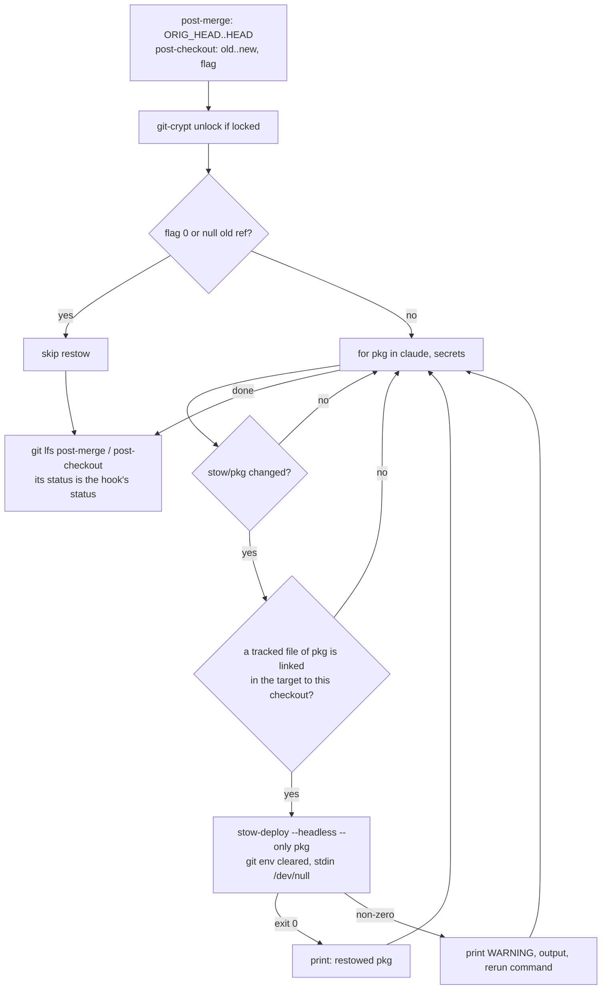

# Restow on Pull - Plan

## Goal Capsule

- **Objective:** a `git pull` in a host's canonical dotfiles checkout never leaves that host's Claude Code sessions
  blocked by a hook script the new `settings.json` names but `~/.claude` does not link yet; when the link cannot be
  made, the pull says so and prints the command that makes it.
- **Means:** `post-merge` and `post-checkout` restow the `claude` and `secrets` packages through
  `stow-deploy --headless --only` whenever the update changed them (KTD1, KTD3, KTD7).
- **Product authority:** Brett's decision, relayed by the `xurl-rs-prime` session, outranks Requirements; Requirements
  govern behavior; KTDs govern mechanism within them; units override neither. Behavior measured on this host (git 2.5x,
  GNU Stow 2.4) outranks documentation or memory.
- **Execution profile:** one new hook library, two hooks edited, `scripts/stow-deploy` gains a flag and a narrower
  dirty-tree refusal, `scripts/lint-shell` follows the hooks' new sources, one shared test fixture helper, one new
  suite, two extended suites, three docs.
- **Stop conditions:** report to `xurl-rs-prime` and stop if the restow cannot run on a checkout whose `stow/claude/`
  carries uncommitted edits without risking them, if the measured window with the shipped hook exceeds 1 s, or if the
  work needs a change to `settings.json` or a guard script (#371 changed both; this work only reads them).
- **Who finishes:** slot dotfiles/3 ships U1-U4 on `fix/restow-on-pull` as one PR into `dev`. `xurl-rs-prime` approves
  and merges. Brett deploys with an ordinary `git pull` in `~/dotfiles`: the merged `post-merge` runs from the updated
  tree, so the pull that delivers this change restows on its own.

---

## Product Contract

### Summary

`post-merge` and `post-checkout` learn to restow. When an update in the checkout that owns the host's links changes
anything under `stow/claude/` or `stow/secrets/`, the hook runs `scripts/stow-deploy --headless --only <package>` for
each changed package, after the git-crypt unlock and before Git LFS. Every other clone, update, and package is left
alone. A failed restow prints a warning with the command to rerun and never fails the git command. `stow-deploy` gains
`--only`, and its headless mode stops refusing to run because some unrelated file under `stow/` has uncommitted changes.
A new settings test fails when `settings.json` names a `~/.claude/` script the `claude` package does not ship
executable.

### Problem Frame

`~/.claude/settings.json` and every hook script are separate symlinks into `~/dotfiles/stow/claude/dot-claude/`. A pull
switches the settings at once, while a script added in the same pull gets its link only when someone runs
`scripts/stow-deploy`. dotfiles #368 added `~/.claude/never-send-guard.sh` as a no-matcher PreToolUse hook with
`onFailure: "block"`, so between a pull and the next stow every tool call in every Claude session on the host is
blocked.

That happened on this host at about 18:30 on 2026-10-30: `~/dotfiles` was pulled from `bb85317` to `ddd3878`, and every
tool call failed with
`/bin/sh: 1: /home/brett/.claude/never-send-guard.sh: not found ... blocking because onFailure is "block"` until a
manual restow at 18:32. Bash, ToolSearch, and SendMessage were all blocked, so a blocked agent could not even report it.
The Mac has the same shape and will hit it on its next pull of a change that adds a script.

### Key Decisions

- **Restow on pull.** The hooks deploy the `claude` package themselves when a pull changes it, plus a test that every
  hook script `settings.json` names ships in that package. (session-settled: user-directed — chosen over leaving the
  restow a manual `stow-deploy` step after each pull: a new hook script and the settings that name it must arrive
  together on every host.) Governs R1, R3, R4, R10.

### Requirements

**Trigger**

- R1. A merge or a branch checkout that changes any path under `stow/claude/` restows the `claude` package into the
  deploy target before the git command returns.
- R2. A merge or a branch checkout that changes any path under `stow/secrets/` restows the `secrets` package the same
  way.
- R3. An update that changes neither package touches nothing and prints nothing beyond what the hooks print today.
- R4. A file checkout (`git checkout -- <path>`), a clone, and `git worktree add` never restow.

**Safety**

- R5. Only the checkout that owns the package's stow-managed links in the target restows it; any other clone (agent
  slot, scratch clone, linked worktree) leaves the target untouched, and a package the host never deployed stays
  undeployed.
- R6. A hook-time restow never prompts, never adopts over uncommitted edits, and starts `stow-deploy` without git's hook
  environment.

**Failure**

- R7. A failed restow never changes the git command's exit status or undoes the update. It prints a `WARNING:` line
  carrying the reason `restow-failed`, the package, and `stow-deploy`'s exit status, and saying the update itself
  completed and Claude Code tool calls may be blocked until the rerun succeeds; then `stow-deploy`'s output; then, as
  its last line, the exact command to rerun by hand. A failure inside the restow code itself reports the same way with
  the reason `restow-internal-error` and the failing line.

**Deploy tool**

- R8. `scripts/stow-deploy --only <package>...` deploys exactly the named packages, without the shared defaults.
- R9. `scripts/stow-deploy --headless` refuses a package only when that package needs `--adopt` and its own
  `stow/<package>/` has uncommitted changes; uncommitted changes anywhere else no longer stop the run.

**Settings check**

- R10. A test fails when a `command` in `settings.json` names a `~/.claude/` path that `stow/claude/dot-claude/` does
  not ship as an executable file, unless the path belongs to an install the test names with its reason.

### Success Criteria

- Replaying the `bb85317` → `ddd3878` pull against a sandbox target, `~/.claude/never-send-guard.sh` is linked within 1
  s of git writing the new `settings.json`, and the measured gap is reported in the PR.
- A pull that merges this PR into a checkout still on the old hooks restows on that same pull.

### Scope Boundaries

Considered and not built:

- **Restowing every package a pull changes.** It would extend the decision to packages whose deploy has side effects,
  such as `stow-deploy` restarting enabled systemd timers for `local`, `rclone`, and `qmd`. A blocked or silently broken
  workflow traced to a missing link outside `claude` and `secrets` would change this.
- **A `post-rewrite` hook.** `pull.rebase` is unset in this repo, in `~/dotfiles`, and globally, and an explicit
  `git pull --rebase` already fires `post-checkout` from the old HEAD to the upstream tip (measured), which restows the
  upstream changes. A host that rebases on pull and authors new stow files in local commits would change this.
- **A `post-commit` restow after a conflicted merge.** Git skips `post-merge` when a merge stops on conflicts, and
  resolving them ends in `git commit`. Conflicted pulls into a deploy checkout are rare; the fix is the manual command
  R7 prints elsewhere. One observed would change this.
- **A timeout around `stow-deploy`.** Headless mode reads no input and the measured hook run is about 0.1 s; macOS ships
  no `timeout`. A hung restow observed in practice would change this.
- **Linking new scripts before `settings.json` changes.** See KTD9.
- **`git reset --hard` and other updates that run no hook.** They fire neither hook. This repo's documented update is
  `git pull`.

---

## Planning Contract

### Key Technical Decisions

- KTD1. **Restow through `stow-deploy` with a new `--only` flag.** Positional packages extend `SHARED_PACKAGES`, so
  `scripts/stow-deploy claude` deploys all 28 shared packages, and on a git-crypt-locked host its `secrets` check exits
  4 before linking anything. Calling `stow` directly would skip `stow-deploy`'s conflict handling and the tree-fold
  refusal. `--only` requires at least one package and rejects `--all`. Instantiates the restow-on-pull Key Decision (R1,
  R3, R4, R10).
- KTD2. **Ownership guard: restow a package only when one of its tracked files is already linked in the target to this
  checkout's copy.** The test is `[ "$target/<path>" -ef "$checkout/stow/<pkg>/<file>" ]` over
  `git ls-files stow/<pkg>`, with each `dot-` path component mapped to `.` as `--dotfiles` does, stopping at the first
  match. Agent slots are clones with `core.hooksPath=.githooks`, and an unguarded restow from one re-points `$HOME` into
  it (`docs/solutions/workflow-issues/dotfiles-stow-bats-tests-mutate-live-home-symlinks-2026-07-16.md`). This is the
  *Canonical checkout* rule from `CONCEPTS.md`, read through its *Stow-managed link* definition. Checking every tracked
  file rather than one anchor keeps the guard working on a host where gstack's settings hook has replaced the
  `settings.json` link with a plain file. Rejected: comparing the checkout path to `$HOME/dotfiles`, which would deploy
  a package the host never stowed and gives tests no sandbox seam.
- KTD3. **Change detection uses the refs git hands each hook.** `post-merge` diffs `ORIG_HEAD HEAD`; `post-checkout`
  diffs its two refs and skips flag `0` and a null old ref; the plumbing
  `git diff-tree --quiet <old> <new> -- stow/<pkg>` decides per package, because porcelain `git diff` honors diff
  drivers and `.gitattributes` gives the encrypted `secrets` files `diff=git-crypt`. Measured on this host:
  - `post-merge` fires after a fast-forward or merge pull with `ORIG_HEAD` at the pre-pull HEAD, and not at all when the
    pull finds nothing new.
  - `post-checkout` gets `<old> <new> <flag>`; a file checkout passes flag `0` with equal refs; a clone or
    `git worktree add` passes the null OID as `<old>`.
  - `git pull --rebase` fires `post-checkout` from the old HEAD to the upstream tip, then `post-rewrite`.
- KTD4. **Order: git-crypt unlock, then restow, then Git LFS, and the hook still exits with LFS's status.** Unlocking
  first lets `stow-deploy`'s lock check pass for `secrets`. Restowing before LFS keeps the window short, and no file
  under `stow/` is LFS-tracked. A failing `post-checkout` becomes the exit status of `git checkout` and `git clone`
  (measured: `checkout` exited 1, `clone` exited 7 with a hook exiting 7), so the restow step never contributes a
  non-zero status. A failing `post-merge` leaves `git pull` at 0.
- KTD5. **One `stow-deploy` run per changed package, with stdin from `/dev/null` and its output captured by command
  substitution, so an interrupted hook leaves no file behind.** A refused `secrets` restow on a relocked host then
  cannot stop the `claude` restow. Success prints one line naming the package; failure prints per R7. The rerun command
  is `cd <checkout> && scripts/stow-deploy --headless --only <pkg>`, with `STOW_DEPLOY_TARGET=<target>` prefixed only
  when the target is not `$HOME`.
- KTD6. **Headless mode refuses dirty packages at the adopt step, per package.** `~/dotfiles` routinely carries
  uncommitted changes under `stow/`: Claude Code writes `modelSettings` into `stow/claude/dot-claude/settings.json`, and
  `gh` rewrites `stow/gh/dot-config/gh/hosts.yml`, both present at planning time. Today any of that makes `--headless`
  exit 4 before linking anything, so the hook would fail on every pull on this host. `stow -R` never writes file
  contents; only `--adopt` followed by `git checkout -- stow/<pkg>/` can overwrite an edit. So the up-front refusal
  moves to just before the adopt and asks only about `stow/<pkg>/`. A refused package is listed under the existing
  `FAILURES` summary and the run exits 5. Interactive mode keeps its up-front warning.
- KTD7. **The packages are `claude` and `secrets`.** `claude` is Brett's decision. `secrets` passes the "harm nobody
  would catch" test: the same `bb85317` → `ddd3878` pull added `stow/secrets/dot-config/never-send/list`, which
  `never-send-guard.sh` reads, and the guard allows when the list is missing, so an unlinked list silently drops that
  protection. On a locked host `secrets` was never deployed, so KTD2 skips it quietly; on a host that deployed it and is
  now locked, `stow-deploy` exits 4 and R7's warning fires. The list lives in one array in the hook library.
- KTD8. **The logic lives in `.githooks/lib/restow.sh`, sourced by both hooks after `.githooks/lib/git-env.sh`.**
  `stow-deploy` starts through `git_env_isolated`: a linked worktree's hooks and a clone's `post-checkout` export
  `GIT_DIR` (measured), which would outrank the `git -C` calls `stow-deploy` makes. The library stays bash
  3.2-compatible, because a GUI git client on macOS can run the hook under `/bin/bash`, and the target is read from
  `STOW_DEPLOY_TARGET` with `$HOME` as the default, matching `stow-deploy`.
- KTD9. **The remaining window is accepted, not closed.** `stow -R` cancels its own unlink for every link that already
  points at the same file (`LINK: … (reverts previous action)`; strace shows zero unlink or symlink calls), so existing
  scripts never blink. The only gap is a brand-new link, from git writing the tree to the hook linking it. A prototype
  hook measured 76-84 ms over 8 replays of `bb85317` → `ddd3878` under load average 5. Closing it would need the link to
  exist before git writes `settings.json`, and git has no hook that runs before a merge updates the tree. The remaining
  levers are a directory-level link for hook scripts, which reverses the repo's `--no-folding` policy, or shipping a
  script one release before the settings entry that names it. A tool call landing in the gap is blocked once and the
  next one runs. A blocked call observed inside the window would change this.
- KTD10. **Widen #371's "every hook that blocks on failure names an executable script the claude package ships" test in
  place rather than add a second one.** That test covers only `onFailure: "block"` hooks. The widened test reads every
  `command` anywhere in `settings.json` (hooks of every kind and `statusLine`), extracts each `~/.claude/<path>`, and
  requires `stow/claude/dot-claude/<path>` to exist and be executable; it keeps #371's assertion that every
  block-on-failure command is such a path. It exempts `~/.claude/skills/`, a single symlink to the separate agent-skills
  clone that carries `op-skill-nudge.sh`. One test keeps one owner for the "shipped and executable" rule. It honors the
  suite's `CLAUDE_SETTINGS_FILE` override, which is how its first failure is shown.

### High-Level Technical Design



### Assumptions

- Every deployed host keeps `core.hooksPath=.githooks`; `stow-deploy` sets it on each run.
- Claude Code reloads `settings.json` on change and treats a missing script as one blocked call; a blocked call does not
  end the session.
- The Mac behaves like this host: same hook semantics and a similar sub-second restow. Nothing was measured on the Mac.

### Sequencing

U1 first, because U2 calls `--only` and relies on the narrower dirty check. U3 is independent of U1 and U2. U4 documents
the shipped behavior and goes last.

---

## Implementation Units

### U1. `stow-deploy --only` and the per-package headless dirty check

- **Goal:** `stow-deploy` can deploy exactly the packages it is given, and headless mode no longer refuses a whole run
  over unrelated uncommitted changes.
- **Requirements:** R6, R8, R9; KTD1, KTD6.
- **Dependencies:** none.
- **Files:** `scripts/stow-deploy`, `tests/lib/dotfiles-fixture.bash` (new), `tests/stow-deploy-args.bats`.
- **Approach:**
  1. Parse `--only` beside `--headless` and `--all`; reject it with no packages and with `--all` (exit 2), each `ERROR:`
     naming a working form such as `scripts/stow-deploy --only claude`; skip the shared-defaults expansion when set.
     Update the usage comment.
  2. Remove the headless up-front dirty-tree exit; keep the interactive warning.
  3. Before the adopt step, in headless mode, check `git status --porcelain -- stow/<pkg>/`; when non-empty, print an
     `ERROR:` saying the adopt would overwrite those changes, list the changed paths, and end with the fix: commit or
     stash them, then rerun `scripts/stow-deploy --headless --only <pkg>`. Record the package as failed and continue.
- **Patterns to follow:** the existing flag loop and `EXIT_*` codes; `tests/hook-git-env.bats` for a throwaway repo that
  holds a copy of a real script; the `STOW_DEPLOY_TARGET` sandbox in `tests/stow-deploy-args.bats`. The fixture helper
  builds a small repo with copies of `scripts/stow-deploy` and `.githooks/`, a `claude` and a `secrets` package, and a
  plain-text `stow/secrets/dot-secrets`, so tests can dirty its tree without touching the slot. CI installs Stow from
  apt (`.github/workflows/bats.yml`), and `AGENTS.md` records that Stow 2.3.x mishandles nested `dot-` directories under
  `--dotfiles`, so U1's fixture packages hold top-level `dot-` files only.
- **Execution note:** write the tests first and run them against `origin/dev`'s `stow-deploy`, quoting each failure.
- **Test scenarios:**
  - `--only claude` against a sandbox target links the `claude` package and creates no link for any other package.
  - `--only` with no package exits 2 with a usage message.
  - `--only claude --all` and `--all --only claude` exit 2.
  - In the fixture, `--headless --only claude` with an uncommitted edit to `stow/claude/dot-claude/settings.json` and
    nothing to adopt links a new script and exits 0.
  - In the fixture, `--headless --only claude` with an uncommitted edit under another package exits 0 (fails today with
    exit 4).
  - In the fixture, a plain file at the target's `.claude/settings.json` plus an uncommitted edit to the package's
    `settings.json` makes `--headless` refuse `claude` with the adopt message and exit 5, and the edited file in the
    repo is unchanged.
  - In the fixture, the same plain-file conflict with a clean `stow/claude/` still adopts and restores the repo version,
    as today.
  - In the fixture, an interactive run (no `--headless`, stdin from `/dev/null`) with an uncommitted edit under `stow/`
    still prints the `WARNING: stow/ has uncommitted changes` line and deploys, as today.
- **Verification:** the touched suites pass, and the existing `stow-deploy` suites pass unchanged.

### U2. Restow from `post-merge` and `post-checkout`

- **Goal:** an update that changes `stow/claude/` or `stow/secrets/` in the owning checkout relinks those packages
  before git returns, and a failure is loud and harmless.
- **Requirements:** R1-R7; KTD2-KTD5, KTD7, KTD8.
- **Dependencies:** U1.
- **Files:** `.githooks/lib/restow.sh` (new), `.githooks/post-merge`, `.githooks/post-checkout`, `scripts/lint-shell`,
  `tests/restow-on-pull.bats` (new).
- **Approach:**
  1. The library defines one entry point that takes the old and new refs and the deploy target and holds the package
     list. The hooks run it in a subshell with an `ERR` trap, so a bug inside it prints the `restow-internal-error`
     report (R7) with the line and command and still returns 0, and the LFS line still runs.
  2. `post-merge` passes `ORIG_HEAD HEAD`; `post-checkout` passes `$1 $2` only when `$3` is `1` and `$1` is not the null
     OID.
  3. Both hooks call it between the existing unlock block and the LFS line, and the LFS line stays last.
  4. `scripts/lint-shell` gives `post-merge` and `post-checkout` the `-x` it gives `pre-commit` and `pre-push`, so
     ShellCheck follows their new `source` lines; `.githooks/lib/*.sh` is already a lint target of its own.
- **Patterns to follow:** `.githooks/pre-push` sourcing `lib/git-env.sh` by `$(dirname "$0")`; `git_env_isolated` from
  `.githooks/lib/git-env.sh`; `ERROR:`/`WARNING:`/`NOTE:` prefixes to stderr per `AGENTS.md`; `tests/lib/processes.bash`
  if a test starts anything in the background.
- **Execution note:** start with a failing integration test that pulls a new script under `stow/claude/` into a fixture
  clone deployed to a sandbox target, and watch it fail against `origin/dev`'s hooks.
- **Test scenarios** (fixture origin plus clones from U1's helper, hooks enabled, `STOW_DEPLOY_TARGET` at a per-test
  sandbox, Git LFS stubbed on `PATH`; scenarios that only need ownership create the target links with `ln -s` and a
  probe `stow-deploy`, so they run under any Stow; scenarios that link through real Stow skip below Stow 2.4, with that
  reason, when their package nests `dot-claude/`):
  - A pull that adds `stow/claude/dot-claude/new-guard.sh` and names it in `settings.json` leaves
    `<target>/.claude/new-guard.sh` linked to the clone's copy, and `git pull` exits 0.
  - A pull that changes only files outside `stow/claude/` and `stow/secrets/` prints no restow line, and `stow-deploy`
    never runs (probe `stow-deploy` records calls).
  - A pull into a second clone whose links the target does not hold never calls `stow-deploy`, and the target's links
    still resolve into the first clone. Covers R5.
  - The same second clone with `STOW_DEPLOY_TARGET` unset never calls `stow-deploy`, because the real home's links
    resolve elsewhere.
  - A pull that changes `stow/secrets/` restows `secrets` when the target holds its links, and skips it silently when
    the target holds none.
  - With `stow/claude/dot-claude/settings.json` edited and uncommitted, a pull that adds a script still links it. This
    is the shape `~/dotfiles` has today.
  - `git checkout -b side <older commit>` then `git checkout dev` restows on each switch that changes `stow/claude/`.
  - `git checkout -- stow/claude/dot-claude/settings.json` calls nothing.
  - `git pull --rebase` with a local commit links the upstream's new script.
  - A probe `stow-deploy` that exits 5 leaves `git pull` and `git checkout <branch>` at exit 0, and the output carries
    `WARNING:`, `restow-failed`, the package, `exit 5`, the probe's output, and, as the last line,
    `cd <clone> && scripts/stow-deploy --headless --only claude`.
  - With the fixture's `git` broken for `ls-files` only (a `PATH` wrapper), a pull that changes `stow/claude/` still
    exits 0, prints `restow-internal-error` with the failing line, and the stubbed `git lfs post-merge` still runs.
  - A pull from a linked worktree whose links the target holds runs the probe with no `GIT_DIR`, `GIT_WORK_TREE`, or
    `GIT_INDEX_FILE` in its environment.
  - A pull that brings the new hook itself restows in that same pull: the fixture's base commit carries a `post-merge`
    that only exits 0, and the pulled commit carries the real hooks, the library, and a new `claude` script. The fixture
    never reads `origin/dev`, which a CI checkout may lack.
- **Verification:** `tests/restow-on-pull.bats`, `tests/git-hooks.bats`, `tests/hook-git-env.bats`,
  `tests/lint-shell.bats`, and `tests/bash-version-guard.bats` pass; `scripts/lint-shell --all` is clean; the window
  measurement in the Verification Contract is under 1 s.

### U3. Every `~/.claude` script `settings.json` names ships in the package

- **Goal:** a settings change that names a script the `claude` package does not ship fails in CI instead of on a host.
- **Requirements:** R10; KTD10.
- **Dependencies:** none.
- **Files:** `tests/claude-settings.bats`.
- **Approach:** rewrite #371's block-on-failure test in place with the wider scope and a title that says so; keep the
  exemption list in the test with one comment line saying who owns `~/.claude/skills/`.
- **Patterns to follow:** the neighboring jaq-based tests and their `command -v jaq || skip`; the `NOT_DEPLOYED`
  exemption style in `tests/stow-deploy-packages.bats`.
- **Execution note:** show the first failure through `CLAUDE_SETTINGS_FILE` pointed at a copy of `settings.json` whose
  non-blocking hook names `~/.claude/not-shipped.sh`; #371's version of the test passes that copy, the widened one must
  fail it.
- **Test scenarios:**
  - The current `settings.json` passes, `statusline.sh` included.
  - A copy whose non-blocking PostToolUse hook names `~/.claude/not-shipped.sh` fails, and the output lists that path
    and ends with the fix: ship the script under `stow/claude/dot-claude/` with mode 755, or add the owning install to
    the test's exemptions.
  - A copy whose `statusLine` command names `~/.claude/not-shipped.sh` fails.
  - A copy whose block-on-failure hook names `~/dotfiles/scripts/x.sh` still fails, as under #371.
  - A copy naming `~/.claude/md_wrap_fill.py` (shipped, mode 644) fails as not executable.
  - A copy naming `~/.claude/skills/1password/hooks/op-skill-nudge.sh` passes.
- **Verification:** `tests/claude-settings.bats` passes on this branch, and the fail-first output is quoted in the PR.

### U4. Document restow on pull

- **Goal:** a reader of the repo docs knows a pull restows `claude` and `secrets`, when it does not, and what to run
  when it fails.
- **Requirements:** R1-R9.
- **Dependencies:** U1, U2.
- **Files:** `AGENTS.md`, `README.md`, `CONCEPTS.md`.
- **Approach:**
  1. In `AGENTS.md`, update the Git Hooks table rows for `post-checkout` and `post-merge`, and add `--only` to the
     `stow-deploy` flags line.
  2. In `README.md`, update the same two rows in its Git Hooks table and drop the duplicated header row there.
  3. In `CONCEPTS.md`, add a *Restow on pull* entry under Packages: the process, the ownership rule, the two packages,
     and the gaps (conflicted merges, `git reset`).
  4. In `AGENTS.md`, state the manual recovery (`cd ~/dotfiles && scripts/stow-deploy --headless --only claude`) beside
     the hooks table, and that `git fetch` followed by `git diff HEAD..@{u} -- stow/` reviews a deploy before
     `git merge` applies it.
- **Test expectation:** none -- documentation only; markdownlint and `tests/release-docs-consistency.bats` cover the
  files.
- **Verification:** markdownlint passes on the three files.

---

## Verification Contract

| Gate           | Command or procedure                                                                                                                                                                                                                  | Proves                                     |
| -------------- | ------------------------------------------------------------------------------------------------------------------------------------------------------------------------------------------------------------------------------------- | ------------------------------------------ |
| Touched suites | `scripts/run-tests tests/restow-on-pull.bats tests/stow-deploy-args.bats tests/stow-deploy-packages.bats tests/claude-settings.bats tests/git-hooks.bats tests/hook-git-env.bats tests/lint-shell.bats tests/bash-version-guard.bats` | U1-U3                                      |
| Fail-first     | each new test run against `origin/dev`'s `stow-deploy`, hooks, or `settings.json`, output quoted in the PR                                                                                                                            | the tests detect the defect                |
| ShellCheck     | `scripts/lint-shell --all`                                                                                                                                                                                                            | hooks, library, scripts                    |
| actionlint     | `scripts/lint-workflows --all`                                                                                                                                                                                                        | no workflow regressions                    |
| Core env       | `scripts/core-env-guard.sh`                                                                                                                                                                                                           | no test resets `HOME`, `TMPDIR`, or `PATH` |
| Markdown       | `markdownlint-cli2` on the changed markdown files                                                                                                                                                                                     | U4 and this plan                           |
| Window         | replay `bb85317` → `ddd3878` in a scratch clone deployed to a sandbox target with the shipped hooks; compare the new `settings.json` mtime with the `never-send-guard.sh` link's ctime over at least 5 runs                           | KTD9, Success Criteria                     |

Never run `scripts/run-tests --all` from the slot: other suites stow into the real home. The push uses `--no-verify`,
because `pre-push` runs the full suite; every other gate above runs by hand and the PR body says so.

---

## Definition of Done

- U1-U4 are committed on `fix/restow-on-pull`, cut from `origin/dev`, in one PR into `dev`.
- Every row of the Verification Contract passed, and the PR quotes each fail-first output and the measured window.
- No test or manual step stowed into the real home; `readlink -f ~/.claude/settings.json` still resolves into
  `~/dotfiles` after the work.
- No change to `stow/claude/dot-claude/settings.json` or any guard script.
- Scratch clones, sandbox targets, and probe files from the work are deleted; no abandoned-attempt code remains in the
  diff.

---

## Decision ledger

Every choice below was decided by the reviewing agent from repository evidence, because this slot runs headless and its
instructions say to answer review questions from the code, docs, and measurements. None needed Brett.

- E1. Structure: smaller arrangement (12 files instead of 13). `tests/git-hooks.bats` is dropped because
  `scripts/lint-shell` already lints `.githooks/lib/*.sh` (`scripts/lint-shell:98`, `:116`); U1's tests move into
  `tests/stow-deploy-args.bats` alone; `scripts/lint-shell` joins U2. Same features, contracts, and tests.
- E2. KTD3 uses `git diff-tree --quiet`, not porcelain `git diff`, so the hook ignores diff drivers
  (`.gitattributes:34-37` sets `diff=git-crypt`).
- E3. `scripts/lint-shell:84` gives `-x` to `post-merge` and `post-checkout` once they source libraries.
- E4. U1's fixtures use top-level `dot-` files and U2's real-Stow scenarios with nested `dot-claude/` skip below Stow
  2.4, because CI installs apt Stow (`.github/workflows/bats.yml:70`).
- E5. KTD5 captures output by command substitution.
- E6. U2's "pull that brings the hook" test builds its old side from a stub hook in the fixture, not from `origin/dev`.
- E7. U1 adds a regression test that the interactive dirty-tree warning still prints.
- E8. KTD1's package count corrected from 30 to 28 (`scripts/stow-deploy:23`).

Approval readiness: PASS (E1-E8, each auto-decided per the slot's headless instructions).

---

## Eng Review

### Scope Challenge

- **What already exists:** `scripts/stow-deploy` owns deploys, conflict handling, the `STOW_DEPLOY_TARGET` seam, and the
  lock check; `.githooks/lib/git-env.sh` owns `git_env_isolated`; `tests/hook-git-env.bats` shows how to drive real
  hooks in a throwaway repo; the `CLAUDE_SETTINGS_FILE` seam replays settings regressions. The plan reuses all four and
  builds only the change detection, the ownership check, and `--only`.
- **Minimum change:** a restow from the hooks needs `--only` (KTD1) and the narrower dirty check (KTD6); without either,
  the hook fails on this host. Nothing in the plan is deferrable without reopening the incident.
- **Complexity:** 13 proposed files and two new modules (the hook library, the test fixture helper) tripped the gate; E1
  resolved it to 12 files with the same scope.
- **Search check:** no new infrastructure pattern; git hooks and GNU Stow are [Layer 1]. The hook semantics the plan
  rests on were measured on this host, not searched.
- **Result:** scope accepted as-is.

```text
REALITY: premise-table pass 17 claims checked, unverified=2 (macOS GUI git bash, macOS timeout) docs/plans/2026-10-30-1839-fix-restow-claude-on-pull-plan.md:185
REALITY: already-done pass no restow work on origin/dev since 2026-10-29; 039f0f9 (#371) only adds the settings test U3 widens tests/claude-settings.bats:214
REALITY: surface-check pass run-tests takes FILE..., lint-shell --all, git diff-tree --quiet, test -ef, git lfs post-merge all verified; --only is proposed scripts/run-tests:13
REALITY: binding-decisions pass consistent with the fail-closed review's inline-lookup decision; no default reintroduced docs/plans/2026-10-30-1753-fix-fail-closed-claude-guards-plan.md:190
REALITY: numbers finding 30 shared packages corrected to 28 (E8); 76-84 ms measured over 8 runs scripts/stow-deploy:23
REALITY: deferred-asks pass no linked issue; every brief item (trigger, order, failure, environment, test, window) maps to an R or KTD docs/plans/2026-10-30-1839-fix-restow-claude-on-pull-plan.md:68
REALITY: pr-count pass one PR into dev, no ship-policy file overrides the default docs/plans/2026-10-30-1839-fix-restow-claude-on-pull-plan.md:29
```

### 1. Architecture

- [INFORMATIONAL] (confidence: 7/10) KTD3 — porcelain `git diff --quiet` in a hook honors diff drivers;
  `.gitattributes:34` `stow/secrets/dot-secrets filter=git-crypt diff=git-crypt`. Fixed by E2.
- Design twice. Shape A (chosen): `.githooks/lib/restow.sh` with one entry point taking the old and new refs;
  `stow-deploy` stays the deploy tool. Shape B: a `stow-deploy --since <old> <new>` mode that computes changed packages
  and ownership itself, with one-line hooks. B concentrates package knowledge in one module, but `stow-deploy` is
  already 589 lines, deliberately one file, and would gain a git-event concept it does not otherwise need. A hides
  change detection, ownership, invocation, and reporting behind one call. A wins.
- Red flags: #2 information leakage, minor: the hook library restates the `dot-` to `.` rule and the `$HOME` target
  default from `stow-deploy`; U2's tests pin both (the unset-target scenario and the nested-path ownership scenario), so
  a drift fails a test. No other flag applies.
- Production failure per new path: a Mac GUI git client starting the hook with a `PATH` that lacks Stow makes
  `stow-deploy` exit 3, and R7's warning names the rerun command. Covered.
- Dispositions: E2 accepted.

### 2. Code quality

- [INFORMATIONAL] (confidence: 8/10) `scripts/lint-shell:84` —
  `.githooks/pre-commit | .githooks/pre-push | scripts/run-tests) echo "-x" ;;` omits the two hooks that will now source
  libraries. Fixed by E3.
- [INFORMATIONAL] (confidence: 6/10) KTD5 — a temp file for captured output needs cleanup on interruption; command
  substitution does not. Fixed by E5.
- `scripts/stow-deploy` is past the 200-line refactor trigger before this change; the plan adds about 15 lines and
  leaves the split out of scope (see NOT in scope).
- Dispositions: E3, E5 accepted.

### 3. Tests

```text
CODE PATHS                                              USER FLOWS
[+] .githooks/lib/restow.sh (U2)                        [+] Brett pulls ~/dotfiles
  ├── skip: flag 0 / null old ref     [★★★ planned]       ├── [★★★ planned] pull adds a claude script -> linked
  ├── per pkg: diff-tree unchanged    [★★  planned]       ├── [★★★ planned] pull with dirty settings.json -> linked
  ├── per pkg: not owned here         [★★★ planned]       ├── [★★  planned] pull --rebase -> linked
  ├── stow-deploy exit 0              [★★★ planned]       └── [★★  planned] branch switch -> linked
  └── stow-deploy non-zero -> WARNING [★★★ planned]     [+] Agent slot pulls or switches
[+] scripts/stow-deploy (U1)                              └── [★★★ planned] nothing called, target untouched
  ├── --only parse + errors           [★★★ planned]     [+] Failure the operator sees
  ├── headless dirty, no adopt        [★★★ planned]       ├── [★★★ planned] WARNING + rerun command, git exit 0
  ├── headless dirty, adopt needed    [★★★ planned]       └── [★★  planned] secrets locked -> skipped quietly
  └── interactive dirty warning       [★★  planned, E7]
[+] tests/claude-settings.bats (U3)
  └── every ~/.claude command shipped [★★★ planned]
COVERAGE: 16/16 planned paths have a planned test  |  GAPS: 0
```

- [INFORMATIONAL] (confidence: 8/10) `.github/workflows/bats.yml:70` — `sudo apt-get install -y zsh stow jq trash-cli`
  gives CI Stow 2.3.x; fixtures with nested `dot-` directories could fail there for reasons unrelated to the change.
  Fixed by E4.
- [INFORMATIONAL] (confidence: 7/10) U2's "brings the hook itself" scenario named `origin/dev`, which a CI checkout may
  lack. Fixed by E6.
- [CRITICAL] (confidence: 8/10) `scripts/stow-deploy:136` —
  `echo "WARNING: stow/ has uncommitted changes. If --adopt runs, git diff will"`: U1 rewrites the block around this
  interactive warning with no test holding it. Fixed by E7 (regression contract: the warning prints and the run
  deploys).
- Test value cards: each planned scenario names a behavior and the regression that breaks it in U1-U3; no planned test
  needs a production seam beyond the existing `STOW_DEPLOY_TARGET` and `CLAUDE_SETTINGS_FILE`.
- Tests made obsolete: #371's block-on-failure test, replaced by the widened U3 test.
- Dispositions: E4, E6, E7 accepted.

### 4. Performance

No issues found. A pull that changes neither package costs two `git diff-tree` calls. A changed, owned package costs one
`stow-deploy` run, about 0.1 s [measured: prototype, 8 runs]. The ownership loop stats at most the package's tracked
files (about 50 for `claude`).

### Outside voice

Not run: outside reviews are disabled in gstack config (`codex_reviews: disabled`), and the slot's brief forbids
subagents.

### NOT in scope

- Splitting `scripts/stow-deploy` under the 200-line trigger: unrelated to the incident, and the file documents why it
  stays one file.
- Moving the duplicated git-crypt unlock block out of the two hooks: it predates this work and changes no behavior here.
- Revisiting the fail-closed plan's KTD5 (guards inline their parser lookup because a new stowed helper needed a
  restow): once this ships, a new helper file reaches a host with the pull, so that trade-off can be reopened by whoever
  next touches the guards.

### Failure modes

| New path           | Realistic failure                 | Test                      | User sees                                             |
| ------------------ | --------------------------------- | ------------------------- | ----------------------------------------------------- |
| Hook restow        | `stow-deploy` conflict or error   | U2 failing-probe scenario | `WARNING:` with the rerun command; git exits 0        |
| Ownership check    | slot or scratch clone pulls       | U2 second-clone scenarios | nothing; target untouched                             |
| Dirty-tree refusal | adopt needed on a dirty package   | U1 adopt scenario         | `ERROR:` for that package, `FAILURES` summary, exit 5 |
| Window             | tool call lands in the ~0.1 s gap | none (KTD9)               | one blocked call naming the missing script            |

No critical gap: every silent path is either tested or harmless.

### Worktree parallelization

Sequential implementation, no parallelization opportunity: U2 depends on U1, and the slot forbids worktrees.

### Implementation Tasks

- [ ] T1 (P1, human: ~2h / CC: ~20min) — `scripts/stow-deploy` — add `--only` and the per-package headless dirty refusal
  with fixture tests (E7 regression included). Verify:
  `scripts/run-tests tests/stow-deploy-args.bats tests/stow-deploy-packages.bats`.
- [ ] T2 (P1, human: ~3h / CC: ~30min) — `.githooks` — restow library, both hooks, `scripts/lint-shell` `-x`, and
  `tests/restow-on-pull.bats`. Verify:
  `scripts/run-tests tests/restow-on-pull.bats tests/git-hooks.bats tests/hook-git-env.bats tests/lint-shell.bats`.
- [ ] T3 (P1, human: ~30min / CC: ~5min) — `tests/claude-settings.bats` — widen #371's test. Verify: fail-first through
  `CLAUDE_SETTINGS_FILE`.
- [ ] T4 (P2, human: ~30min / CC: ~10min) — docs — `AGENTS.md`, `README.md`, `CONCEPTS.md`. Verify: markdownlint.

### Unresolved decisions

None.

### Completion summary

- Step 0: Scope Challenge — scope accepted as-is
- Reality rows: 7/7 applicable rows emitted, 2 unverified premises
- Architecture Review: 1 issue found
- Code Quality Review: 2 issues found
- Test Review: diagram produced, 3 gaps identified
- Performance Review: 0 issues found
- NOT in scope: written
- What already exists: written
- TODOS.md updates: 0 items proposed
- Failure modes: 0 critical gaps flagged
- Unresolved decisions: 0 in this review
- Outside voice: disabled (`codex_reviews: disabled`)
- Parallelization: 0 lanes, 0 parallel / 4 sequential
- Lake Score: N/A (no completeness-scored answers)

---

## DX Review

Mode: DX POLISH, because the plan fixes an existing deploy path and adds no product surface. Product type: platform
(deploy tooling) with a Claude Code hook consumer. Every choice below was decided by the reviewing agent from repository
evidence under the slot's headless instructions; none needed Brett.

### Developer Persona Card

```text
TARGET DEVELOPER PERSONA
========================
Who:       An AI coding agent (or Brett) running `git pull` in ~/dotfiles on a deployed host
Context:   Told to update dotfiles, often unattended; its own Claude session reads the hooks being deployed
Tolerance: Zero blocked tool calls; it cannot recover once every tool call is denied
Expects:   A pull leaves the host working; anything else says so on the pull's own output, with the command
```

### Developer Empathy Narrative

Observed today, from the 18:30 incident: I run `git pull` in `~/dotfiles`. It prints the merge summary and exits 0. My
next tool call fails with
`PreToolUse:Bash hook error: [~/.claude/never-send-guard.sh]: failed; blocking because onFailure is "block"` and
`/bin/sh: 1: /home/brett/.claude/never-send-guard.sh: not found`. So does every call after it, Read, ToolSearch, and
SendMessage included. Nothing on the pull told me a deploy step was owed, and the harness error does not name
`stow-deploy`. I cannot run the fix myself, because running it needs a tool call. I stay stuck until a human restows
from another terminal.

Predicted after the plan: the same pull prints one extra line naming the relinked package, and my next call runs. If the
restow fails, the pull's output ends with a `WARNING:` and the exact rerun command, while my tool calls still work for
the existing scripts.

### Competitive DX Benchmark

Clock: from typing the update command on a deployed host to a new hook script being live, with no further command.

| Tool             | Start → result                        | Time + evidence type                                             | DX choice                                            | Source                                                                                                               |
| ---------------- | ------------------------------------- | ---------------------------------------------------------------- | ---------------------------------------------------- | -------------------------------------------------------------------------------------------------------------------- |
| chezmoi          | `chezmoi update` → pulled and applied | one command, timing not measured [reported]                      | pull and apply in one step; `--apply=false` opts out | [update](https://www.chezmoi.io/reference/commands/update/), [#3539](https://github.com/twpayne/chezmoi/issues/3539) |
| GNU Stow by hand | `git pull`, then a restow             | unbounded; 2 min in the incident with a human present [observed] | deploy is a separate manual step                     | this repo today                                                                                                      |
| This plan        | `git pull` → new link present         | 76-84 ms after the tree is written [measured: prototype]         | the pull's own hook restows changed packages         | KTD9                                                                                                                 |

Target: Champion (under 2 minutes), met by about three orders of magnitude.

### Magical Moment Specification

The pull's output ends with one line naming the relinked package, and the next tool call simply runs. Vehicle: the
success line KTD5 already prints. No new surface.

### Developer Journey Map

```text
STAGE           | DEVELOPER DOES                         | FRICTION POINTS                          | STATUS
----------------|----------------------------------------|------------------------------------------|--------
1. Discover     | reads AGENTS.md hooks table            | restow undocumented                      | fixed (U4)
2. Install      | git pull delivers the hook itself      | none; tested in U2                       | ok
3. Hello World  | pull that adds a script                | link missing until manual stow           | fixed (U2)
4. Real Usage   | pulls with a dirty settings.json       | headless refused the whole run           | fixed (KTD6)
5. Debug        | restow or library fails                | no reason token, no recovery line        | fixed (D1, D4)
6. Upgrade      | stow-deploy headless semantics change  | behavior change needs a changelog line   | fixed (PR changelog)
```

### First-Time Developer Confusion Report

```text
FIRST-TIME DEVELOPER REPORT
============================
Persona: AI coding agent on the deployed host
Attempting: pull a dotfiles change that adds a hook script

CONFUSION LOG:
T+0:00  Runs `git pull`; sees the merge summary and "restow: claude relinked". Proceeds.
T+0:05  Next tool call runs; the new guard is live.
T+0:10  (Failure branch) Sees "WARNING: restow-failed ... claude ... exit 5", stow-deploy's output, and the rerun
        command as the last line. Runs it; the new script links.
T+0:20  (Dirty-tree branch) The rerun prints "ERROR: ... --adopt would overwrite uncommitted changes in stow/claude/",
        lists settings.json, and ends with "commit or stash them, then rerun ...". Asks the human before stashing.
```

Every confusion point above maps to D1-D4.

### Error path matrix (agent-ready-v1)

```text
Path                       | Class      | what | fix  | recovery | code | context | trace | redaction | channel | Cap
hook restow fails          | dependency | pass | pass | pass(D1) | pass | pass    | pass  | pass      | stderr* | none
--only usage errors        | usage      | pass | D2   | N/A      | pass | N/A     | N/A   | pass      | pass    | none
headless dirty adopt       | precond.   | pass | D3   | pass     | pass | pass    | N/A   | pass      | pass    | none
restow library crashes     | unexpected | D4   | D4   | D4       | D4   | D4      | D4    | pass      | stderr* | none
settings test failure      | validation | pass | D5   | N/A      | pass | N/A     | N/A   | pass      | pass    | none
```

`stderr*`: the hook reports on stderr and keeps git's exit status at 0. That is the brief's requirement ("must not fail
the pull"), and a non-zero `post-checkout` would turn a completed checkout into a failed command (KTD4). The report
names the reason token, so the failure is never presented as a successful restow. Before D1-D5 the restow path lacked
recovery (CAP6:hook-restow:recovery), `--only` and the dirty refusal lacked a fix line (CAP6:only-usage:fix,
CAP6:dirty-adopt:fix), and a crash inside the library would have stopped the hook before Git LFS and failed
`git checkout` (CAP6:library-crash:trace).

### DX ledger

- D1. R7 gains the `restow-failed` reason, a recovery sentence (the update completed; tool calls may be blocked until
  the rerun succeeds), and the rerun command as the last line.
- D2. `--only` usage errors name a working form (U1 step 1).
- D3. The headless dirty refusal lists the changed paths and ends with the fix (U1 step 3).
- D4. The hooks run the library in a subshell with an `ERR` trap; a bug prints `restow-internal-error` with the line,
  returns 0, and LFS still runs (U2 step 1, new U2 scenario).
- D5. U3's failure output ends with the fix.
- D6. `AGENTS.md` gains the manual recovery command and the fetch-then-diff review path (U4 step 4).

### NOT in scope (DX)

- An opt-out switch for the restow (chezmoi's `--apply=false` equivalent): `git fetch` plus
  `git diff HEAD..@{u} -- stow/` already reviews a deploy before `git merge` applies it, and nobody has asked to pull
  without deploying. A request to would change this.
- `scripts/stow-deploy --help`: an unknown flag exits 2 without usage today; that predates this work.
- A Claude-side notice when a restow failed (for example a SessionStart hook reading a marker): the failure prints on
  the pull the agent itself ran. An agent observed missing that output would change this.

### What already exists (DX)

- `never-send-guard.sh`'s `(guard-internal-error)` report, the model for `restow-internal-error`.
- `stow-deploy`'s `FAILURES` summary and exit codes, reused for the dirty refusal.
- The `ERROR:`/`WARNING:`/`NOTE:` prefix convention in `AGENTS.md`.

### DX Implementation Checklist

```text
DX IMPLEMENTATION CHECKLIST
============================
[ ] A pull that adds a claude script links it in under 1 s (Verification Contract, Window)
[ ] The pull that delivers this change restows on its own (U2 scenario)
[ ] Success prints one line naming the package
[ ] restow-failed and restow-internal-error reports end with the rerun command
[ ] --only usage errors and the dirty refusal name their fix
[ ] AGENTS.md names the manual recovery command
[ ] The PR changelog states the headless dirty-tree behavior change
```

### Implementation Tasks (DX)

- [ ] T5 (P1, human: ~1h / CC: ~10min) — `.githooks/lib/restow.sh` — report text per D1, subshell and `ERR` trap per D4,
  with the internal-error scenario. Verify: `scripts/run-tests tests/restow-on-pull.bats`.
- [ ] T6 (P2, human: ~30min / CC: ~5min) — `scripts/stow-deploy` — fix lines per D2 and D3. Verify:
  `scripts/run-tests tests/stow-deploy-args.bats`.
- [ ] T7 (P2, human: ~15min / CC: ~3min) — `tests/claude-settings.bats`, `AGENTS.md` — D5 and D6. Verify: the suite and
  markdownlint.

### Unresolved Decisions (DX)

None.

---

## DX Review Scorecard

```text
+====================================================================+
|              DX PLAN REVIEW — SCORECARD                             |
+====================================================================+
| Dimension            | Score  | Prior  | Trend  |
|----------------------|--------|--------|--------|
| Getting Started      |  9/10  |  —     |  new   |
| API/CLI/SDK          |  7/10  |  —     |  new   |
| Error Messages       |  8/10  |  —     |  new   |
| Documentation        |  8/10  |  —     |  new   |
| Upgrade Path         |  8/10  |  —     |  new   |
| Dev Environment      |  7/10  |  —     |  new   |
| Community            |  5/10  |  —     |  new   |
| DX Measurement       |  7/10  |  —     |  new   |
+--------------------------------------------------------------------+
| TTHW                 | <1 s   | manual | ↑      |
| Competitive Rank     | Champion                                     |
| Magical Moment       | designed via the pull's restow line          |
| Product Type         | platform (deploy tooling)                    |
| Mode                 | POLISH                                       |
| Overall DX           |  8/10  | 6/10 before this review              |
+====================================================================+
| DX PRINCIPLE COVERAGE                                               |
| Zero Friction      | covered (deploy is the pull)                   |
| Learn by Doing     | covered (rerun command printed)                |
| Fight Uncertainty  | covered (D1-D5)                                |
| Opinionated + Escape Hatches | covered (fetch-then-diff path, D6)   |
| Code in Context    | covered (AGENTS.md recovery command)           |
| Magical Moments    | covered                                        |
| Agents Are Users   | covered (reason tokens, last-line fix)         |
+====================================================================+
```

Community is 5/10 because this is a single-owner dotfiles repo; nothing in scope changes that. API/CLI stays at 7
because `stow-deploy` has no `--help`, which predates this work.

## GSTACK REVIEW REPORT

| Review         | Trigger               | Why                             | Runs | Status                    | Findings                                |
| -------------- | --------------------- | ------------------------------- | ---- | ------------------------- | --------------------------------------- |
| CEO Review     | `/plan-ceo-review`    | Scope & strategy                | 0    | not run                   | —                                       |
| Outside Review | codex plan review     | Independent 2nd opinion         | 0    | disabled                  | —                                       |
| Eng Review     | `/plan-eng-review`    | Architecture & tests (required) | 1    | ISSUES OPEN (all applied) | 6 issues, 0 critical gaps               |
| Design Review  | `/plan-design-review` | UI/UX gaps                      | 0    | not run (no UI)           | —                                       |
| DX Review      | `/plan-devex-review`  | Developer experience gaps       | 1    | ISSUES OPEN (all applied) | score: 6/10 → 8/10, TTHW: manual → <1 s |

- **OUTSIDE COVERAGE:** codex, plan-review phase, disabled in gstack config (`codex_reviews: disabled`); no findings.
- **VERDICT:** DX CLEARED; ENG reviewed with every finding applied to the plan (eng review required); document review next.

NO UNRESOLVED DECISIONS
