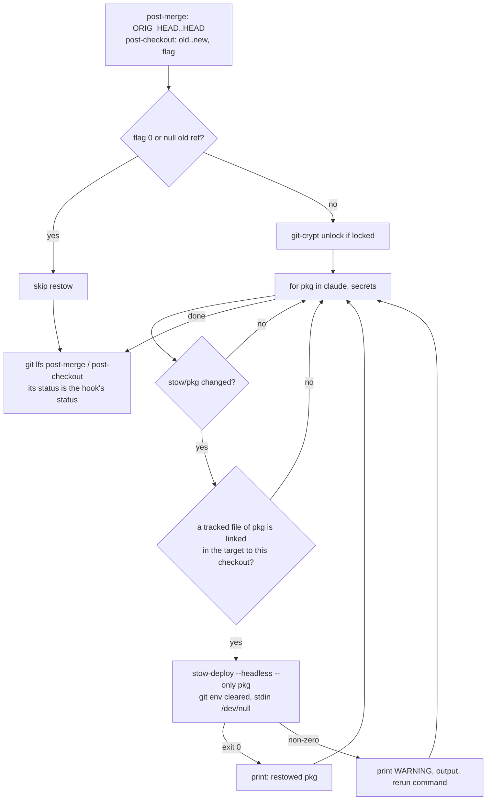

# Restow on Pull - Plan

## Goal Capsule

- **Objective:** a `git pull` in a host's canonical dotfiles checkout never leaves that host's Claude Code sessions
  blocked by a hook script the new `settings.json` names but `~/.claude` does not link yet; when the link cannot be
  made, the pull says so and prints the command that makes it.
- **Means:** `post-merge` and `post-checkout` restow the `claude` and `secrets` packages through
  `stow-deploy --headless --only` whenever the update changed them (KTD1, KTD3, KTD7).
- **Product authority:** Brett's decision, relayed by the `xurl-rs-prime` session, outranks Requirements; Requirements
  govern behavior; KTDs govern mechanism within them; units override neither. Behavior measured on this host (git 2.5x,
  GNU Stow 2.4) outranks documentation or memory.
- **Execution profile:** one new hook library, two hooks edited, `scripts/stow-deploy` gains a flag and a narrower
  dirty-tree refusal, one shared test fixture helper, one new suite, three extended suites, three docs.
- **Stop conditions:** report to `xurl-rs-prime` and stop if the restow cannot run on a checkout whose `stow/claude/`
  carries uncommitted edits without risking them, if the measured window with the shipped hook exceeds 1 s, or if the
  work needs a change to `settings.json` or a guard script (slot dotfiles/4 owns those).
- **Who finishes:** slot dotfiles/3 ships U1-U4 on `fix/restow-on-pull` as one PR into `dev`. `xurl-rs-prime` approves
  and merges. Brett deploys with an ordinary `git pull` in `~/dotfiles`: the merged `post-merge` runs from the updated
  tree, so the pull that delivers this change restows on its own.

---

## Product Contract

### Summary

`post-merge` and `post-checkout` learn to restow. When an update in the checkout that owns the host's links changes
anything under `stow/claude/` or `stow/secrets/`, the hook runs `scripts/stow-deploy --headless --only <package>` for
each changed package, after the git-crypt unlock and before Git LFS. Every other clone, update, and package is left
alone. A failed restow prints a warning with the command to rerun and never fails the git command. `stow-deploy` gains
`--only`, and its headless mode stops refusing to run because some unrelated file under `stow/` has uncommitted changes.
A new settings test fails when `settings.json` names a `~/.claude/` script the `claude` package does not ship
executable.

### Problem Frame

`~/.claude/settings.json` and every hook script are separate symlinks into `~/dotfiles/stow/claude/dot-claude/`. A pull
switches the settings at once, while a script added in the same pull gets its link only when someone runs
`scripts/stow-deploy`. dotfiles #368 added `~/.claude/never-send-guard.sh` as a no-matcher PreToolUse hook with
`onFailure: "block"`, so between a pull and the next stow every tool call in every Claude session on the host is
blocked.

That happened on this host at about 18:30 on 2026-10-30: `~/dotfiles` was pulled from `bb85317` to `ddd3878`, and every
tool call failed with
`/bin/sh: 1: /home/brett/.claude/never-send-guard.sh: not found ... blocking because onFailure is "block"` until a
manual restow at 18:32. Bash, ToolSearch, and SendMessage were all blocked, so a blocked agent could not even report it.
The Mac has the same shape and will hit it on its next pull of a change that adds a script.

### Key Decisions

- **Restow on pull.** The hooks deploy the `claude` package themselves when a pull changes it, plus a test that every
  hook script `settings.json` names ships in that package. (session-settled: user-directed — chosen over leaving the
  restow a manual `stow-deploy` step after each pull: a new hook script and the settings that name it must arrive
  together on every host.) Governs R1, R3, R4, R10.

### Requirements

**Trigger**

- R1. A merge or a branch checkout that changes any path under `stow/claude/` restows the `claude` package into the
  deploy target before the git command returns.
- R2. A merge or a branch checkout that changes any path under `stow/secrets/` restows the `secrets` package the same
  way.
- R3. An update that changes neither package touches nothing and prints nothing beyond what the hooks print today.
- R4. A file checkout (`git checkout -- <path>`), a clone, and `git worktree add` never restow.

**Safety**

- R5. Only the checkout that owns the package's stow-managed links in the target restows it; any other clone (agent
  slot, scratch clone, linked worktree) leaves the target untouched, and a package the host never deployed stays
  undeployed.
- R6. A hook-time restow never prompts, never adopts over uncommitted edits, and starts `stow-deploy` without git's hook
  environment.

**Failure**

- R7. A failed restow never changes the git command's exit status or undoes the update; it prints a `WARNING:` naming
  the package and `stow-deploy`'s exit status, then `stow-deploy`'s output, then the exact command to rerun by hand.

**Deploy tool**

- R8. `scripts/stow-deploy --only <package>...` deploys exactly the named packages, without the shared defaults.
- R9. `scripts/stow-deploy --headless` refuses a package only when that package needs `--adopt` and its own
  `stow/<package>/` has uncommitted changes; uncommitted changes anywhere else no longer stop the run.

**Settings check**

- R10. A test fails when a `command` in `settings.json` names a `~/.claude/` path that `stow/claude/dot-claude/` does
  not ship as an executable file, unless the path belongs to an install the test names with its reason.

### Success Criteria

- Replaying the `bb85317` → `ddd3878` pull against a sandbox target, `~/.claude/never-send-guard.sh` is linked within 1
  s of git writing the new `settings.json`, and the measured gap is reported in the PR.
- A pull that merges this PR into a checkout still on the old hooks restows on that same pull.

### Scope Boundaries

Considered and not built:

- **Restowing every package a pull changes.** It would extend the decision to packages whose deploy has side effects,
  such as `stow-deploy` restarting enabled systemd timers for `local`, `rclone`, and `qmd`. A blocked or silently broken
  workflow traced to a missing link outside `claude` and `secrets` would change this.
- **A `post-rewrite` hook.** `pull.rebase` is unset in this repo, in `~/dotfiles`, and globally, and an explicit
  `git pull --rebase` already fires `post-checkout` from the old HEAD to the upstream tip (measured), which restows the
  upstream changes. A host that rebases on pull and authors new stow files in local commits would change this.
- **A `post-commit` restow after a conflicted merge.** Git skips `post-merge` when a merge stops on conflicts, and
  resolving them ends in `git commit`. Conflicted pulls into a deploy checkout are rare; the fix is the manual command
  R7 prints elsewhere. One observed would change this.
- **A timeout around `stow-deploy`.** Headless mode reads no input and the measured hook run is about 0.1 s; macOS ships
  no `timeout`. A hung restow observed in practice would change this.
- **Linking new scripts before `settings.json` changes.** See KTD9.
- **`git reset --hard` and other updates that run no hook.** They fire neither hook. This repo's documented update is
  `git pull`.

---

## Planning Contract

### Key Technical Decisions

- KTD1. **Restow through `stow-deploy` with a new `--only` flag.** Positional packages extend `SHARED_PACKAGES`, so
  `scripts/stow-deploy claude` deploys all 30 shared packages, and on a git-crypt-locked host its `secrets` check exits
  4 before linking anything. Calling `stow` directly would skip `stow-deploy`'s conflict handling and the tree-fold
  refusal. `--only` requires at least one package and rejects `--all`. Instantiates the restow-on-pull Key Decision (R1,
  R3, R4, R10).
- KTD2. **Ownership guard: restow a package only when one of its tracked files is already linked in the target to this
  checkout's copy.** The test is `[ "$target/<path>" -ef "$checkout/stow/<pkg>/<file>" ]` over
  `git ls-files stow/<pkg>`, with each `dot-` path component mapped to `.` as `--dotfiles` does, stopping at the first
  match. Agent slots are clones with `core.hooksPath=.githooks`, and an unguarded restow from one re-points `$HOME` into
  it (`docs/solutions/workflow-issues/dotfiles-stow-bats-tests-mutate-live-home-symlinks-2026-07-16.md`). This is the
  *Canonical checkout* rule from `CONCEPTS.md`, read through its *Stow-managed link* definition. Checking every tracked
  file rather than one anchor keeps the guard working on a host where gstack's settings hook has replaced the
  `settings.json` link with a plain file. Rejected: comparing the checkout path to `$HOME/dotfiles`, which would deploy
  a package the host never stowed and gives tests no sandbox seam.
- KTD3. **Change detection uses the refs git hands each hook.** `post-merge` diffs `ORIG_HEAD HEAD`; `post-checkout`
  diffs its two refs and skips flag `0` and a null old ref; `git diff --quiet <old> <new> -- stow/<pkg>` decides per
  package. Measured on this host:
  - `post-merge` fires after a fast-forward or merge pull with `ORIG_HEAD` at the pre-pull HEAD, and not at all when the
    pull finds nothing new.
  - `post-checkout` gets `<old> <new> <flag>`; a file checkout passes flag `0` with equal refs; a clone or
    `git worktree add` passes the null OID as `<old>`.
  - `git pull --rebase` fires `post-checkout` from the old HEAD to the upstream tip, then `post-rewrite`.
- KTD4. **Order: git-crypt unlock, then restow, then Git LFS, and the hook still exits with LFS's status.** Unlocking
  first lets `stow-deploy`'s lock check pass for `secrets`. Restowing before LFS keeps the window short, and no file
  under `stow/` is LFS-tracked. A failing `post-checkout` becomes the exit status of `git checkout` and `git clone`
  (measured: `checkout` exited 1, `clone` exited 7 with a hook exiting 7), so the restow step never contributes a
  non-zero status. A failing `post-merge` leaves `git pull` at 0.
- KTD5. **One `stow-deploy` run per changed package, with stdin from `/dev/null` and its output captured.** A refused
  `secrets` restow on a relocked host then cannot stop the `claude` restow. Success prints one line naming the package;
  failure prints per R7. The rerun command is `cd <checkout> && scripts/stow-deploy --headless --only <pkg>`, with
  `STOW_DEPLOY_TARGET=<target>` prefixed only when the target is not `$HOME`.
- KTD6. **Headless mode refuses dirty packages at the adopt step, per package.** `~/dotfiles` routinely carries
  uncommitted changes under `stow/`: Claude Code writes `modelSettings` into `stow/claude/dot-claude/settings.json`, and
  `gh` rewrites `stow/gh/dot-config/gh/hosts.yml`, both present at planning time. Today any of that makes `--headless`
  exit 4 before linking anything, so the hook would fail on every pull on this host. `stow -R` never writes file
  contents; only `--adopt` followed by `git checkout -- stow/<pkg>/` can overwrite an edit. So the up-front refusal
  moves to just before the adopt and asks only about `stow/<pkg>/`. A refused package is listed under the existing
  `FAILURES` summary and the run exits 5. Interactive mode keeps its up-front warning.
- KTD7. **The packages are `claude` and `secrets`.** `claude` is Brett's decision. `secrets` passes the "harm nobody
  would catch" test: the same `bb85317` → `ddd3878` pull added `stow/secrets/dot-config/never-send/list`, which
  `never-send-guard.sh` reads, and the guard allows when the list is missing, so an unlinked list silently drops that
  protection. On a locked host `secrets` was never deployed, so KTD2 skips it quietly; on a host that deployed it and is
  now locked, `stow-deploy` exits 4 and R7's warning fires. The list lives in one array in the hook library.
- KTD8. **The logic lives in `.githooks/lib/restow.sh`, sourced by both hooks after `.githooks/lib/git-env.sh`.**
  `stow-deploy` starts through `git_env_isolated`: a linked worktree's hooks and a clone's `post-checkout` export
  `GIT_DIR` (measured), which would outrank the `git -C` calls `stow-deploy` makes. The library stays bash
  3.2-compatible, because a GUI git client on macOS can run the hook under `/bin/bash`, and the target is read from
  `STOW_DEPLOY_TARGET` with `$HOME` as the default, matching `stow-deploy`.
- KTD9. **The remaining window is accepted, not closed.** `stow -R` cancels its own unlink for every link that already
  points at the same file (`LINK: … (reverts previous action)`; strace shows zero unlink or symlink calls), so existing
  scripts never blink. The only gap is a brand-new link, from git writing the tree to the hook linking it. A prototype
  hook measured 76-84 ms over 8 replays of `bb85317` → `ddd3878` under load average 5. Closing it would need the link to
  exist before git writes `settings.json`, and git has no hook that runs before a merge updates the tree. The remaining
  levers are a directory-level link for hook scripts, which reverses the repo's `--no-folding` policy, or shipping a
  script one release before the settings entry that names it. A tool call landing in the gap is blocked once and the
  next one runs. A blocked call observed inside the window would change this.
- KTD10. **The settings test sits mid-file in `tests/claude-settings.bats`, after "hook commands name scripts under
  ~/.claude by the ~ path".** It reads every `command` anywhere in `settings.json` (hooks and `statusLine`), extracts
  each `~/.claude/<path>`, and requires `stow/claude/dot-claude/<path>` to exist and be executable. It exempts
  `~/.claude/skills/`, which is a single symlink to the separate agent-skills clone and carries `op-skill-nudge.sh`. It
  honors the suite's existing `CLAUDE_SETTINGS_FILE` override, which is how its first failure is shown. Placing it
  mid-file avoids a textual conflict with slot dotfiles/4, which appends tests to the same file; its U5
  "block-on-failure scripts exist and are executable" test checks a subset of this one.

### High-Level Technical Design

### Assumptions

- Every deployed host keeps `core.hooksPath=.githooks`; `stow-deploy` sets it on each run.
- Claude Code reloads `settings.json` on change and treats a missing script as one blocked call; a blocked call does not
  end the session.
- The Mac behaves like this host: same hook semantics and a similar sub-second restow. Nothing was measured on the Mac.

### Sequencing

U1 first, because U2 calls `--only` and relies on the narrower dirty check. U3 is independent of U1 and U2. U4 documents
the shipped behavior and goes last.

---

## Implementation Units

### U1. `stow-deploy --only` and the per-package headless dirty check

- **Goal:** `stow-deploy` can deploy exactly the packages it is given, and headless mode no longer refuses a whole run
  over unrelated uncommitted changes.
- **Requirements:** R6, R8, R9; KTD1, KTD6.
- **Dependencies:** none.
- **Files:** `scripts/stow-deploy`, `tests/lib/dotfiles-fixture.bash` (new), `tests/stow-deploy-args.bats`,
  `tests/stow-deploy-packages.bats`.
- **Approach:**
  1. Parse `--only` beside `--headless` and `--all`; reject it with no packages and with `--all` (exit 2); skip the
     shared-defaults expansion when set. Update the usage comment.
  2. Remove the headless up-front dirty-tree exit; keep the interactive warning.
  3. Before the adopt step, in headless mode, check `git status --porcelain -- stow/<pkg>/`; when non-empty, print an
     `ERROR:` saying the adopt would overwrite those changes, record the package as failed, and continue.
- **Patterns to follow:** the existing flag loop and `EXIT_*` codes; `tests/hook-git-env.bats` for a throwaway repo that
  holds a copy of a real script; the `STOW_DEPLOY_TARGET` sandbox in `tests/stow-deploy-args.bats`. The fixture helper
  builds a small repo with copies of `scripts/stow-deploy` and `.githooks/`, a `stow/claude/dot-claude/` holding
  `settings.json` and one script, and a plain-text `stow/secrets/dot-secrets`, so tests can dirty its tree without
  touching the slot.
- **Execution note:** write the tests first and run them against `origin/dev`'s `stow-deploy`, quoting each failure.
- **Test scenarios:**
  - `--only claude` against a sandbox target links the `claude` package and creates no link for any other package.
  - `--only` with no package exits 2 with a usage message.
  - `--only claude --all` and `--all --only claude` exit 2.
  - In the fixture, `--headless --only claude` with an uncommitted edit to `stow/claude/dot-claude/settings.json` and
    nothing to adopt links a new script and exits 0.
  - In the fixture, `--headless --only claude` with an uncommitted edit under another package exits 0 (fails today with
    exit 4).
  - In the fixture, a plain file at the target's `.claude/settings.json` plus an uncommitted edit to the package's
    `settings.json` makes `--headless` refuse `claude` with the adopt message and exit 5, and the edited file in the
    repo is unchanged.
  - In the fixture, the same plain-file conflict with a clean `stow/claude/` still adopts and restores the repo version,
    as today.
- **Verification:** the touched suites pass, and the existing `stow-deploy` suites pass unchanged.

### U2. Restow from `post-merge` and `post-checkout`

- **Goal:** an update that changes `stow/claude/` or `stow/secrets/` in the owning checkout relinks those packages
  before git returns, and a failure is loud and harmless.
- **Requirements:** R1-R7; KTD2-KTD5, KTD7, KTD8.
- **Dependencies:** U1.
- **Files:** `.githooks/lib/restow.sh` (new), `.githooks/post-merge`, `.githooks/post-checkout`,
  `tests/restow-on-pull.bats` (new), `tests/git-hooks.bats`.
- **Approach:**
  1. The library defines one entry point that takes the old and new refs and the deploy target, holds the package list,
     and returns 0 whatever happens.
  2. `post-merge` passes `ORIG_HEAD HEAD`; `post-checkout` passes `$1 $2` only when `$3` is `1` and `$1` is not the null
     OID.
  3. Both hooks call it between the existing unlock block and the LFS line, and the LFS line stays last.
- **Patterns to follow:** `.githooks/pre-push` sourcing `lib/git-env.sh` by `$(dirname "$0")`; `git_env_isolated` from
  `.githooks/lib/git-env.sh`; `ERROR:`/`WARNING:`/`NOTE:` prefixes to stderr per `AGENTS.md`; `tests/lib/processes.bash`
  if a test starts anything in the background.
- **Execution note:** start with a failing integration test that pulls a new script under `stow/claude/` into a fixture
  clone deployed to a sandbox target, and watch it fail against `origin/dev`'s hooks.
- **Test scenarios** (fixture origin plus clones from U1's helper, hooks enabled, `STOW_DEPLOY_TARGET` at a per-test
  sandbox, Git LFS stubbed on `PATH`):
  - A pull that adds `stow/claude/dot-claude/new-guard.sh` and names it in `settings.json` leaves
    `<target>/.claude/new-guard.sh` linked to the clone's copy, and `git pull` exits 0.
  - A pull that changes only files outside `stow/claude/` and `stow/secrets/` prints no restow line, and `stow-deploy`
    never runs (probe `stow-deploy` records calls).
  - A pull into a second clone whose links the target does not hold never calls `stow-deploy`, and the target's links
    still resolve into the first clone. Covers R5.
  - The same second clone with `STOW_DEPLOY_TARGET` unset never calls `stow-deploy`, because the real home's links
    resolve elsewhere.
  - A pull that changes `stow/secrets/` restows `secrets` when the target holds its links, and skips it silently when
    the target holds none.
  - With `stow/claude/dot-claude/settings.json` edited and uncommitted, a pull that adds a script still links it. This
    is the shape `~/dotfiles` has today.
  - `git checkout -b side <older commit>` then `git checkout dev` restows on each switch that changes `stow/claude/`.
  - `git checkout -- stow/claude/dot-claude/settings.json` calls nothing.
  - `git pull --rebase` with a local commit links the upstream's new script.
  - A probe `stow-deploy` that exits 5 leaves `git pull` and `git checkout <branch>` at exit 0, and the output carries
    `WARNING:`, the package, `exit 5`, the probe's output, and `scripts/stow-deploy --headless --only claude`.
  - A pull from a linked worktree whose links the target holds runs the probe with no `GIT_DIR`, `GIT_WORK_TREE`, or
    `GIT_INDEX_FILE` in its environment.
  - A pull that brings the new hook itself into a clone still on `origin/dev`'s hooks restows in that same pull.
  - `.githooks/lib/restow.sh` passes ShellCheck through `scripts/lint-shell`, and `tests/bash-version-guard.bats` finds
    no bash 4 construct in it.
- **Verification:** `tests/restow-on-pull.bats`, `tests/git-hooks.bats`, `tests/hook-git-env.bats`, and
  `tests/bash-version-guard.bats` pass; the window measurement in the Verification Contract is under 1 s.

### U3. Every `~/.claude` script `settings.json` names ships in the package

- **Goal:** a settings change that names a script the `claude` package does not ship fails in CI instead of on a host.
- **Requirements:** R10; KTD10.
- **Dependencies:** none.
- **Files:** `tests/claude-settings.bats`.
- **Approach:** add one test after "hook commands name scripts under ~/.claude by the ~ path"; keep the exemption list
  in the test with one comment line saying who owns `~/.claude/skills/`.
- **Patterns to follow:** the neighboring jaq-based tests and their `command -v jaq || skip`; the `NOT_DEPLOYED`
  exemption style in `tests/stow-deploy-packages.bats`.
- **Execution note:** show the first failure through `CLAUDE_SETTINGS_FILE` pointed at a copy of `settings.json` that
  names `~/.claude/not-shipped.sh`, and a second through a copy naming a shipped but non-executable file.
- **Test scenarios:**
  - The current `settings.json` passes, `statusline.sh` included.
  - A copy naming `~/.claude/not-shipped.sh` fails, and the output lists that path.
  - A copy naming `~/.claude/md_wrap_fill.py` (shipped, mode 644) fails as not executable.
  - A copy naming `~/.claude/skills/1password/hooks/op-skill-nudge.sh` passes.
- **Verification:** `tests/claude-settings.bats` passes on this branch, and both failures are quoted in the PR.

### U4. Document restow on pull

- **Goal:** a reader of the repo docs knows a pull restows `claude` and `secrets`, when it does not, and what to run
  when it fails.
- **Requirements:** R1-R9.
- **Dependencies:** U1, U2.
- **Files:** `AGENTS.md`, `README.md`, `CONCEPTS.md`.
- **Approach:**
  1. In `AGENTS.md`, update the Git Hooks table rows for `post-checkout` and `post-merge`, and add `--only` to the
     `stow-deploy` flags line.
  2. In `README.md`, update the same two rows in its Git Hooks table and drop the duplicated header row there.
  3. In `CONCEPTS.md`, add a *Restow on pull* entry under Packages: the process, the ownership rule, the two packages,
     and the gaps (conflicted merges, `git reset`).
- **Test expectation:** none -- documentation only; markdownlint and `tests/release-docs-consistency.bats` cover the
  files.
- **Verification:** markdownlint passes on the three files.

---

## Verification Contract

| Gate           | Command or procedure                                                                                                                                                                                            | Proves                                     |
| -------------- | --------------------------------------------------------------------------------------------------------------------------------------------------------------------------------------------------------------- | ------------------------------------------ |
| Touched suites | `scripts/run-tests tests/restow-on-pull.bats tests/stow-deploy-args.bats tests/stow-deploy-packages.bats tests/claude-settings.bats tests/git-hooks.bats tests/hook-git-env.bats tests/bash-version-guard.bats` | U1-U3                                      |
| Fail-first     | each new test run against `origin/dev`'s `stow-deploy`, hooks, or `settings.json`, output quoted in the PR                                                                                                      | the tests detect the defect                |
| ShellCheck     | `scripts/lint-shell --all`                                                                                                                                                                                      | hooks, library, scripts                    |
| actionlint     | `scripts/lint-workflows --all`                                                                                                                                                                                  | no workflow regressions                    |
| Core env       | `scripts/core-env-guard.sh`                                                                                                                                                                                     | no test resets `HOME`, `TMPDIR`, or `PATH` |
| Markdown       | `markdownlint-cli2` on the changed markdown files                                                                                                                                                               | U4 and this plan                           |
| Window         | replay `bb85317` → `ddd3878` in a scratch clone deployed to a sandbox target with the shipped hooks; compare the new `settings.json` mtime with the `never-send-guard.sh` link's ctime over at least 5 runs     | KTD9, Success Criteria                     |

Never run `scripts/run-tests --all` from the slot: other suites stow into the real home. The push uses `--no-verify`,
because `pre-push` runs the full suite; every other gate above runs by hand and the PR body says so.

---

## Definition of Done

- U1-U4 are committed on `fix/restow-on-pull`, cut from `origin/dev`, in one PR into `dev`.
- Every row of the Verification Contract passed, and the PR quotes each fail-first output and the measured window.
- No test or manual step stowed into the real home; `readlink -f ~/.claude/settings.json` still resolves into
  `~/dotfiles` after the work.
- No change to `stow/claude/dot-claude/settings.json` or any guard script.
- Scratch clones, sandbox targets, and probe files from the work are deleted; no abandoned-attempt code remains in the
  diff.
