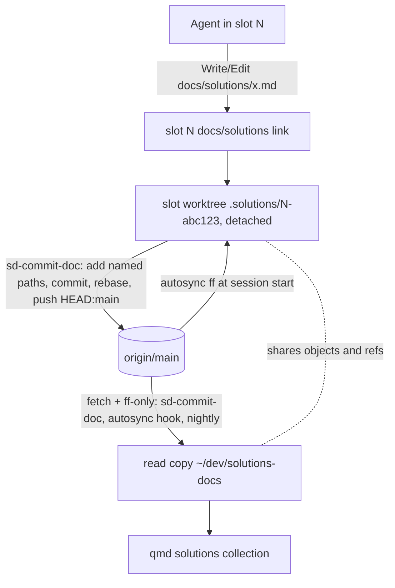
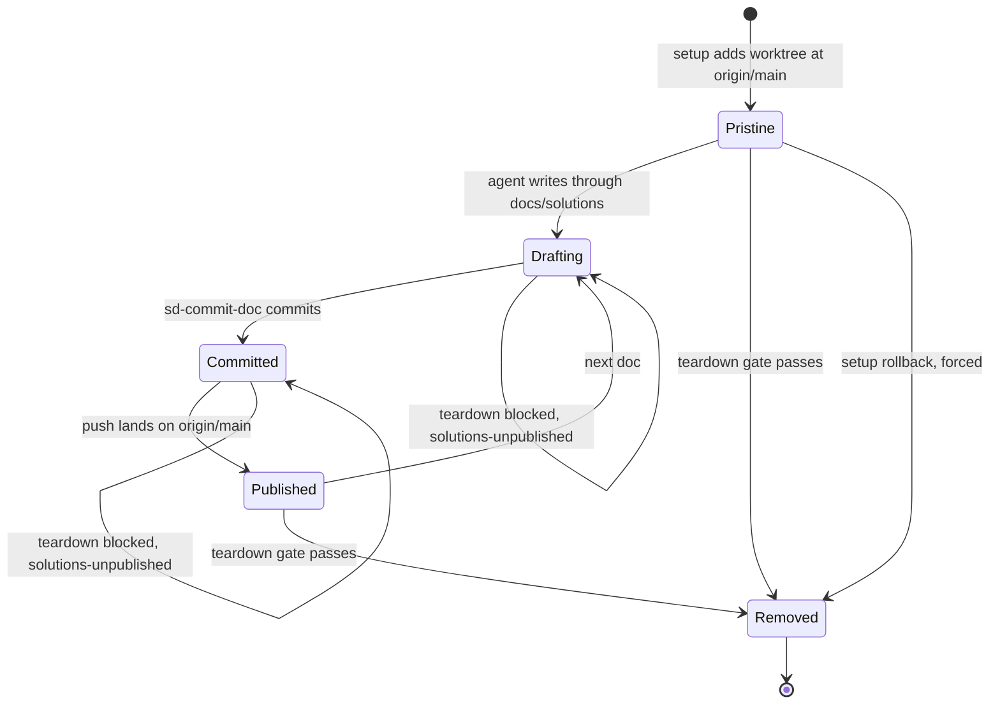
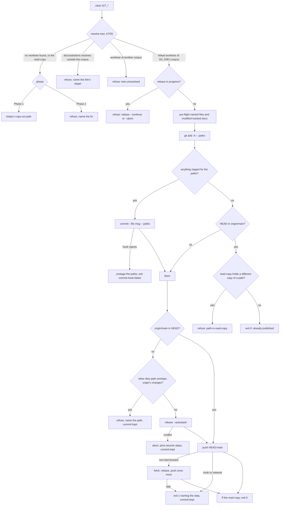

# Solutions Per-Writer Worktrees - Plan

## Goal Capsule

- **Objective:** no agent drafts a solutions doc in a working tree that agents in other checkouts write in, no
  unpublished doc is lost when its slot is deleted, and the clone qmd indexes changes only by fast-forward, with
  anything in it that origin lacks reported to a person rather than committed.
- **Means:** each writer's checkout links `docs/solutions` to a detached worktree of brettdavies/solutions-docs that
  belongs to that checkout, and `sd-commit-doc` publishes from it in place (KTD1, KTD3). Slots come first (Phase 1).
  Prime checkouts come second, in the shape rex-linux picks (Q1, KTD10).
- **Product authority:** Brett's words in the brief and rex-linux's answer to Q1 outrank Requirements. Requirements
  govern behavior, KTDs govern mechanism within them, and units override neither. Git behavior measured on this host
  (git 2.56.0, Claude Code 2.1.314) outranks documentation or memory.
- **Execution profile:** Phase 1 changes `sd-commit-doc`, eight agent-slot libraries, their suites, and the docs. Phase
  2 changes the SessionStart autosync hook, `scripts/nightly-autocommit.sh`, `sd-commit-doc`'s shared-clone path, one
  permission rule, and the docs. No change to compound-engineering, qmd, or the solutions repo's hooks.
- **Stop conditions:** report to rex-linux and stop if a bypass-mode Write through a slot's `docs/solutions` into its
  worktree prompts, if publishing in place turns out to need a change to the solutions repo's own hooks, or if the work
  needs a compound-engineering change.
- **Who finishes:** implementation starts only on rex-linux's go-ahead. A slot ships Phase 1 (U1-U4, U6) as one PR into
  `dev`. Phase 2 (U5, U7-U9) is a second PR once Q1 and Q3 are answered, and is dropped if Q1's answer is option B.
  rex-linux approves and merges. Brett deploys with a `git pull` in `~/dotfiles`; slots made after the pull get
  worktrees, and slots made before it finish on the current flow.

---

## Product Contract

### Summary

Every agent slot gets its own detached worktree of the solutions repo at setup, and the slot's `docs/solutions` links to
it. ce-compound and ce-compound-refresh write there unchanged. `sd-commit-doc` commits the named paths in place,
deletions and renames included, rebases onto origin/main, and pushes. Teardown keeps the slot until the worktree holds
nothing origin lacks, then removes it. Phase 2 gives prime checkouts the same arrangement and makes
`~/dev/solutions-docs` a read copy: nothing links to it, nothing commits in it, and a stray edit there is reported to
the user instead of committed.

### Problem Frame

`~/dev/solutions-docs` is one clone shared by every agent. Each repo reaches it through a `docs/solutions` symlink,
agent-slot points each slot's link at it (`parity_solutions` in `scripts/agent-slot/lib/parity.sh`), and qmd indexes it
as the `solutions` collection. An agent, usually ce-compound at slot close-out, writes
`docs/solutions/<category>/<slug>.md` into that shared tree, then `sd-commit-doc` copies the named files into a
throwaway worktree, commits, pushes, and reverts the shared tree's copies. Only the commit is isolated.

Writing in the shared tree is where agents collide. On 2026-10-30, ingest-lab-prime found the clone holding one agent's
in-place edit of a doc another agent was editing, and an untracked doc nobody owned. That doc was published later, but
an in-flight doc and an orphan look the same in the shared tree: at 20:38 the same evening an untracked
`best-practices/` doc appeared there, and until its writer published it at 20:44 nothing could tell it from an orphan.
`nightly-autocommit.service` commits whatever it finds in the clone, so one writer's draft can ship under the nightly
job's message. Brett's view: "The shared solutions clone shouldn't really exist, everyone should be using their own
detached worktree, right?"

### Requirements

**Writing and publishing**

- R1. An agent drafts, edits, renames, and deletes solutions docs through its checkout's `docs/solutions`, in a worktree
  that belongs to that checkout. A slot's worktree belongs to that slot alone.
- R2. `sd-commit-doc <msg-file> <path>...` publishes exactly the named paths, deletions and renames included, from the
  caller's worktree to origin/main.
- R3. When publishing fails at any step, the change stays in the caller's worktree, the command exits non-zero naming
  the step and the command that resumes it, and once that command has run, the same `sd-commit-doc` call finishes the
  publish.

**Slot lifecycle**

- R4. Every slot made after Phase 1 ships gets its own worktree at origin/main during setup, linked from its
  `docs/solutions`.
- R5. A slot is never deleted while its worktree holds a file or commit that origin/main lacks, and the teardown that
  deletes the slot removes its worktree.
- R6. A reopened slot gets a fresh worktree. A slot made before Phase 1 ships keeps today's flow until it is torn down.

**The read copy**

- R7. `~/dev/solutions-docs` stays the clone qmd indexes and the object store every worktree shares, and its working
  tree changes only by fast-forward to origin/main or by reverting a copy whose content origin already holds.
- R8. After Phase 2, every checkout where a trusted session has started links `docs/solutions` to its own worktree,
  nothing commits in the read copy, and `sd-commit-doc` refuses a tree that resolves to it and names the command that
  gives the checkout its worktree.
- R9. After Phase 2, a change in the read copy that origin lacks (a stray) is reported at session start and in the
  nightly log, and automation never commits or deletes it. A session in a prime checkout is also told what its own
  worktree holds that origin lacks.
- R10. A worktree whose owner is gone is reported with what it holds: `agent-slot doctor` reports one under the slot
  root whose slot is gone, and after Phase 2 the session-start report names one under the prime worktree root that no
  checkout links to.

**Docs**

- R11. When each phase merges, the "Solutions repo" rule in `stow/claude/dot-claude/CLAUDE.md`, the "Shared solutions
  repo" section of `stow/claude/dot-claude/guides/workflows-and-skills.md`, `sd-commit-doc`'s usage text, and the
  solutions repo's `AGENTS.md` describe the live flow in present tense.

### Key Decisions

- **Slots first, prime checkouts by rex-linux's decision.** Slots run the close-out compound in every task, so they
  write most docs, and agent-slot already owns their setup and teardown. Prime checkouts share one link per checkout,
  which raises a scope and behavior question only the operator can settle (Q1). Governs R4, R5, R6, R8.
- **Strays are reported, never committed or deleted by automation.** A stray can be the only copy of someone's work, and
  the nightly job's commit is itself a write into the read copy. Governs R7, R9, R10.
- **Removing the `docs/solutions` symlink is out of scope.** Brett called it "kindof a different question all together";
  it is a follow-up.
- **Agent-facing docs drop the solo-writer exception.** The current docs let an agent commit straight in the shared
  clone when it is sure no other writer is active. No agent can be sure of that while slots run, and Brett wants every
  writer in its own worktree. Phase 1 leaves Brett's manual use of the clone, such as the "Compounded Solutions"
  tmuxinator session, as it is. Under Phase 2 his uncommitted edits there would be reported as strays and no longer
  committed by the nightly job, which is Q3. Governs R11.

### Scope Boundaries

Considered and not built:

- **A PreToolUse guard that denies writes into the read copy.** After Phase 2 the remaining way in is an agent using
  `~/dev/solutions-docs/<path>` as an absolute path, and a Bash `cd` there gets past any Write/Edit guard anyway
  (`docs/solutions/workflow-issues/worktree-agent-bash-cd-to-shared-checkout-escapes-isolation.md`). The session-start
  stray report (R9) catches the result. Strays that keep appearing in that report after Phase 2 would change the call.
- **A JSON output mode for `sd-commit-doc`.** Its callers act on the exit status and the `FAILED during <step>` line,
  and nothing parses its output.
- **More than one push retry.** A second rejection exits non-zero, and rerunning (R3) completes the publish.
- **Automatic removal of an orphaned worktree.** It may hold the only copy of a doc. R10 reports it instead.
- **Fast-forwarding a worktree that holds unpublished commits.** The teardown gate already reports them, and a merge
  there could conflict.
- **Counting ignored files as unpublished.** `git worktree remove` deletes ignored files silently, but CE writes
  `<category>/<slug>.md`, which no ignore rule matches. A draft lost under an ignored name would change the call.
- **A hint when a rename names only its new path.** The old path's deletion stays in the worktree, and the teardown
  blocker names it, so the slot cannot go without it.
- **Changing compound-engineering.** Its `docs_root` cannot point outside the repo (KTD1), so the link is the lever.

#### Deferred to Follow-Up Work

- Whether `docs/solutions` should be a symlink at all, given that agents mostly read the corpus through qmd.
- A `ce-compound-refresh` pass over
  `workflow-issues/shared-working-tree-git-add-commit-race-across-concurrent-agents.md`, whose rule 1 says to tear a
  worktree down in the flow that made it; a slot's worktree lives as long as the slot on purpose. This belongs to the
  implementing slot's close-out.

### Success Criteria

- During the first day of slot close-outs after Phase 1 deploys, `git -C ~/dev/solutions-docs status --porcelain` never
  lists a doc written by a slot made after the deploy, and `git -C ~/dev/solutions-docs worktree list` shows one
  worktree per live post-deploy slot and none for a torn-down one.
- On that first day, every slot held by `solutions-unpublished` traces to a draft its own agent wrote and left
  unpublished, and none to formatter churn or setup.
- After Phase 2, that `status --porcelain` stays empty apart from strays the session-start report names.

### Open Questions

- Q1. **How does a prime checkout get its worktree?** This blocks Phase 2 only and was sent to rex-linux. Options: (A) a
  per-checkout worktree the SessionStart hook makes and keeps current, shared by every session in that checkout; (B)
  primes stay linked to the shared clone with today's copy-out commit; (C) primes stay linked for reads, a guard refuses
  writes into the clone, and `sd-commit-doc open` hands out a worktree per write. Recommended: A, the only option that
  leaves no writer in the read copy without breaking ce-compound's write path. U5 and U7-U9 assume A. Under B they are
  dropped; under C, U7 is replaced (Alternatives). Consequences to weigh: under A, sessions sharing one prime checkout
  share its worktree, so one session's half-written tracked doc fails another session's publish pre-flight (and the
  repo's own pre-commit), its untracked draft at a path origin just added makes another's publish refuse before
  rebasing, and a rebase carries the other sessions' live edits through `--autostash`. Under B, the nightly job keeps
  committing whatever the read copy holds, so the strays decision and the Objective's last clause hold only under A.
- Q3. **Where does Brett edit the corpus by hand once Phase 2 ships?** This blocks Phase 2 only. The "Compounded
  Solutions" tmuxinator session (`stow/tmuxinator/dot-config/tmuxinator/solutions.yml`) runs yazi, a shell, and lazygit
  in the read copy. Under Phase 2, an edit left there is reported as a stray at every prime session's start and is no
  longer committed by the nightly job, and a commit there is the write R8 forbids. Options: (A) root that session at a
  worktree of its own, provisioned by `--provision` (recommended: his edits then publish like everyone else's); (B) keep
  editing the read copy, with R8 and R9 carrying an exemption for his commits, which the stray report cannot tell apart
  from an agent's; (C) keep editing there and accept the stray reports, committing and pushing by hand.
- Q2. **Names (non-blocking).** The defaults used unless rex-linux renames them: the slot worktree path
  `<slot root>/<repo>/.solutions/<n>-<random>`, the record field `solutions_worktree`, the teardown blocker
  `solutions-unpublished`, the doctor warning `solutions-worktree-orphaned`, the nightly mode `sync`, and the prime
  worktree root `~/.local/state/solutions-worktrees/`.

### Sources

- Brett, relayed in the brief: "The shared solutions clone shouldn't really exist, everyone should be using their own
  detached worktree, right?"; "I thought all writing was done via `sd-commit-doc`? ... I guess we could reconsider the
  symlink at all given it is only accessed via qmd, but that's kindof a different question all together"; "I wonder if
  there is a config in ce that would help us."
- rex-linux, 2026-10-30: the untracked `performance-issues/` doc was published through `sd-commit-doc` (3efbb76); plan
  for orphans as a class.
- compound-engineering 3.33.2: `skills/ce-compound/SKILL.md` and `skills/ce-compound-refresh/SKILL.md` ("Artifact
  Root"), `skills/ce-setup/scripts/check-health` (`resolve_docs_root`), `skills/ce-setup/references/repo-fixes.md` (Step
  6b).
- The solutions repo's hooks: `.githooks/pre-commit` validates staged docs and modified tracked docs
  (`validate_changed_since HEAD` in `.githooks/lib-validate.sh`); `.githooks/pre-push` validates the pushed range.
  Neither starts a tool that runs git in another repo.
- Learnings: `docs/solutions/workflow-issues/shared-working-tree-git-add-commit-race-across-concurrent-agents.md`,
  `docs/solutions/workflow-issues/unattended-autocommit-on-shared-clone-must-sync-then-rebase.md`,
  `docs/solutions/logic-errors/phantom-revert-list-from-git-diff-against-origin-holds-in-flight-work.md`,
  `docs/solutions/best-practices/claude-code-sessionstart-plain-stdout-reaches-only-claude.md`,
  `docs/solutions/best-practices/disposable-clone-per-worker-for-parallel-multi-repo-dispatch.md`,
  `docs/solutions/logic-errors/exemption-in-advisory-check-but-not-pre-action-recheck-reports-safe-then-refuses.md`,
  `docs/solutions/workflow-issues/chained-worktree-integration-teardown-outruns-a-rejected-commit.md`,
  `docs/solutions/test-failures/linked-worktree-push-exports-git-dir-into-prepush-test-suite.md`,
  `docs/solutions/integration-issues/claude-code-workspace-trust-at-stable-paths.md`.

---

## Planning Contract

### Key Technical Decisions

- KTD1. **A checkout's `docs/solutions` link is the only lever on where CE writes.** CE reads `docs_root` from the
  tracked `.compound-engineering/config.yaml` only, rejects a value whose resolved path leaves the repo, and uses that
  one root for plans, brainstorms, and solutions alike. The default `docs` is never validated, which is why today's link
  out of the repo works (`ce-setup/scripts/check-health` `resolve_docs_root`). Re-pointing the link moves ce-compound's
  and ce-compound-refresh's writes with no CE change.
- KTD2. **A slot's worktree lives at `<slot root>/<repo>/.solutions/<n>-<random>`, recorded as `solutions_worktree` in
  the slot record.** It sits outside the clone because Claude Code asks before writing under `.git/` even with
  `--dangerously-skip-permissions` (README "Parallel Agents": "the few actions Claude never auto-approves"; Claude Code
  2.1.314 lists `.git`, `.vscode`, `.idea`, `.claude`, `.husky`, `.cargo`, `.devcontainer`, `.yarn`, and `.mvn` as
  protected directories), and a prompt in a slot waits forever; any other path inside the clone is an untracked file
  every check flags. The random suffix keeps a leftover worktree from colliding with a later slot of the same number, so
  a leftover never blocks a launch and only this setup's rollback can remove what this setup made. The dot directory
  stays out of the `slot_numbers` and `slot_repos` globs (`scripts/agent-slot/lib/record.sh:42-68`), and no qmd
  collection covers the slot root. One function next to `slot_path` in `record.sh` owns the layout, and both setup and
  the doctor call it.
- KTD3. **`sd-commit-doc` commits in place in a worktree, by pathspec.** One agent can start two publishes in parallel,
  and two sessions can share a prime checkout's worktree, so a commit must never pick up a path another publish staged.
  A pathspec commit gives that without a lock of its own: git's index lock serializes the two calls, and each commit
  holds only its named paths (measured on git 2.56.0: an add, a delete, and an `R100` rename committed by pathspec, with
  another staged path left staged). Then:
  1. It pre-flights with the worktree's own `.githooks/lib-validate.sh`: `validate_files` over the named files that
     exist, and `validate_changed_since HEAD`, the function the repo's pre-commit itself runs, which covers every
     modified tracked doc. A failing draft is named before anything is staged, and the set is never derived twice. The
     repo's pre-commit also runs the unslop prose gate, which the pre-flight does not cover.
  2. It stages the named paths with `git add -A --`, which stages an add, a rename's two sides, and a delete.
  3. It commits with `git commit --file <msg> -- <named paths>`. When the commit fails, for example on the pre-commit
     prose gate, it unstages the named paths (`git reset -q -- <paths>`), prints the hook's output, and exits with
     `commit-hook-failed`, so nothing is left staged.
  4. It fetches. When origin/main is not already in HEAD, it refuses before rebasing if any other dirty or untracked
     path is one that origin changed or added since HEAD, naming the path. Otherwise it runs
     `rebase --autostash origin/main`, whose stash can no longer conflict on re-apply, so nothing reaches the corpus's
     shared `refs/stash`.
  5. It pushes `HEAD:main`, capturing git's stderr rather than discarding it, so the rejection can be classified. Only a
     non-fast-forward rejection gets one more fetch, rebase, and push; a pre-push hook failure or a network failure
     exits with its own reason, and git's own lines are printed under it.
  6. It fast-forwards the read copy with `merge --ff-only`, since qmd indexes only the read copy. On this path it never
     reverts or cleans anything in the read copy: a file there at a published path can be a prime session's in-flight
     edit, so a refused fast-forward is reported and left for the autosync hook, which reverts only content-equal
     phantoms.
- KTD4. **A failed publish always has one resuming command, and rerunning never stacks a commit.** A rebase conflict on
  a named path is aborted when, and only when, a rebase is in progress. That leaves the commit local and the tree clean
  (measured), and the command prints `git -C <worktree> rebase --autostash origin/main`, the same form KTD3 step 4 runs,
  so another tracked edit in the worktree does not stop it, then resolve, `git -C <worktree> add <path>`, and
  `git -C <worktree> rebase --continue`, before rerunning the same `sd-commit-doc`. A rerun while a rebase is in
  progress (the agent's own, or one a timeout killed) refuses and names `rebase --continue` or `rebase --abort`. A rerun
  with nothing to stage pushes the local commit. A rerun with nothing to stage or push exits 0 saying the paths are on
  origin/main, unless the read copy holds a copy of a named path that differs from the worktree's. That is the mark of
  an edit made at `~/dev/solutions-docs/<path>` instead of through `docs/solutions`, so the call exits with
  `path-in-read-copy`, names both paths, and its `next:` line copies the edit into the worktree when it is the caller's
  own. Success names the tree and the path it took (`committed and pushed N file(s) from <tree> (worktree)` or
  `(copy-out)`). Every failure ends, after the existing `FAILED during <step>` marker, with three stderr lines an agent
  finds in a fixed place: `sd-commit-doc: reason: <code>`,
  `sd-commit-doc: state: <nothing staged | committed in <tree>, not pushed | pushed>`, and
  `sd-commit-doc: next: <command>`. The codes are a closed set the usage text lists: `usage`, `path-invalid`,
  `tree-unresolved`, `validation-failed`, `commit-hook-failed`, `path-in-read-copy`, `rebase-in-progress`,
  `overlap-with-origin`, `rebase-conflict`, `push-rejected`, `push-hook-failed`, `push-failed`, `git-failed` (any other
  git step, such as an index lock another call holds, with git's own error printed), and, in Phase 2,
  `read-copy-refused`.
- KTD5. **`sd-commit-doc` finds the caller's worktree from the caller's checkout.** Resolution order: `SD_TREE`, then
  the current directory when it is inside a linked worktree of the corpus (true from inside `docs/solutions`, since git
  reads the physical path), then the resolved `docs/solutions` of `git rev-parse --show-toplevel`. `SD_DIR` keeps naming
  the read copy. In Phase 1, when none of these finds a worktree (no checkout, a checkout with no `docs/solutions`, or a
  link to the read copy), the tree is the read copy and today's copy-out path runs, so every caller that works today
  keeps working; only a `docs/solutions` that resolves outside the corpus is refused. A worktree found by any step whose
  common git dir is not `SD_DIR`'s is refused with `tree-unresolved` and is never committed in or pushed from, so a test
  fixture can never reach a real corpus through the host's link. A named file missing from the read copy on the copy-out
  path fails with a message naming `SD_TREE` and the caller's checkout. Phase 2 refuses the read copy (U8). The script
  clears the `GIT_*` variables first, because a caller inside a git hook would otherwise steer every `git -C`
  (`docs/solutions/test-failures/linked-worktree-push-exports-git-dir-into-prepush-test-suite.md`).
- KTD6. **One helper judges a slot's worktree, from the recorded path and local state only, and both `check` and the
  teardown re-check call it.** It judges the worktree the record names whatever the link points at, so an agent
  re-pointing its link cannot hide a draft. It reads only that worktree's own state: status with untracked files, a
  rebase in progress in its git dir, and HEAD's containment in the local `refs/remotes/origin/main`. It never reads the
  corpus's shared stash or branches. Containment needs no fetch: a push from any worktree updates that shared ref, and a
  commit it does not contain counts as unpublished, the fail-closed side. A state it cannot read is `git-state-unknown`,
  never a pass. Sharing the helper follows
  `docs/solutions/logic-errors/exemption-in-advisory-check-but-not-pre-action-recheck-reports-safe-then-refuses.md`.
- KTD7. **Teardown removes the worktree before it trashes the clone, and never forces the removal.** After the re-check
  passes, `git worktree remove` without `--force` refuses a dirty tree on its own (measured), which keeps the slot, and
  `git worktree prune` follows. A setup rollback, which runs before the agent starts, removes the pristine worktree it
  recorded with `--force`. Reopen makes a new slot and so a new worktree, with nothing to carry over, because the old
  one was published before its slot went
  (`docs/solutions/workflow-issues/chained-worktree-integration-teardown-outruns-a-rejected-commit.md`).
- KTD8. **`agent-slot doctor` reports a worktree whose slot is gone.** `git worktree list --porcelain` on the read copy,
  filtered to paths under `<slot root>/*/.solutions/` that no live slot record names, gives each orphan with its dirty
  and unpublished counts. It is a warning, the doctor stays read-only, and the next step is `git -C <path> status`.
- KTD9. **In Phase 2, the SessionStart autosync hook keeps the session's worktree current.** It belongs with the prime
  worktrees, which live as long as their checkouts; a slot's worktree is made at origin/main and a slot session starts
  only at launch, after a `/clear`, or on a resume, so in Phase 1 the publish's own rebase covers it. After it
  fast-forwards the read copy, it runs `merge --ff-only` without `--autostash` in the worktree the session's checkout
  links to, when that worktree is behind origin/main and holds no unpublished commit. Git itself refuses when an
  incoming change would overwrite a local edit or an untracked file, and the hook then leaves the worktree alone with a
  line naming the path. ce-compound's overlap search and an agent's edits then start from the current corpus, and fewer
  pushes need a rebase.
- KTD10. **Under Q1 option A, a prime checkout's worktree lives at `~/.local/state/solutions-worktrees/<checkout key>`
  and is made by the SessionStart autosync hook.** The hook makes it the first time a trusted session starts in a
  checkout outside the slot root whose `docs/solutions` symlink resolves to the read copy, then re-points the link
  (KTD11 covers a tracked one). Sessions in one checkout share that worktree the same way they already share the
  checkout. KTD3's pathspec commit keeps each publish to its own paths, but one session's in-flight work still reaches
  another's publish: a half-written tracked doc fails the pre-flight, and an untracked draft at a path origin just added
  makes the publish refuse before rebasing (Q1 lists these consequences). `~/.local/state` is outside every qmd
  collection, including `meum`, which is rooted at `~/dev` with `meum*/**/*.md`. Prime sessions run in `auto` mode, so
  the permission rule that lets them read `~/dev/solutions-docs/**` gains a sibling for the new root.
- KTD11. **A tracked `docs/solutions` link is re-pointed and marked `skip-worktree`.** dotfiles tracks its link as
  `../../dev/solutions-docs`. Marked `skip-worktree`, the re-pointed link stays out of `git status` and out of any
  `git add -A`, so no PR can commit a link to a slot's temporary path, and the clone keeps the path tracked for hosts
  that never run Claude (measured on git 2.56.0: status stays clean, `git add -A` and `git add -f` both leave it
  unstaged, and a branch switch keeps the link). The check's existing exemption for an unstaged change to
  `docs/solutions` stays as a fallback and accepts either target. Untracking the link instead was rejected, because a
  pull would delete every existing checkout's link.
- KTD12. **After Phase 2 the read copy is enforced by detection, not prevention.** `sd-commit-doc` refuses a tree that
  resolves to the read copy. The nightly job's solutions entry runs in a `sync` mode that fast-forwards and logs strays
  without committing. The autosync hook keeps reverting phantoms whose content equals origin's
  (`docs/solutions/logic-errors/phantom-revert-list-from-git-diff-against-origin-holds-in-flight-work.md`) and reports
  every other dirty path as a stray. Sessions outside the slot root get the report as a JSON `systemMessage` plus
  `additionalContext`, the channel
  `docs/solutions/best-practices/claude-code-sessionstart-plain-stdout-reaches-only-claude.md` names for a warning a
  person must act on. Slot agents get only `additionalContext`, saying the stray is not theirs to change.

### High-Level Technical Design

Where a doc goes, from draft to the read copy:



A slot worktree's lifecycle:



`sd-commit-doc`'s path through a worktree:



### Assumptions

- Claude Code writes through a slot's `docs/solutions` into `<slot root>/<repo>/.solutions/...` without a prompt in
  bypass mode, as it writes into `~/dev/solutions-docs` today. U2 verifies this in a real slot before it lands.
- Slots made before Phase 1 deploys are short-lived enough that a transitional period, in which they still write into
  the shared clone, needs no migration step. Phase 2 waits for them.
- Prime checkouts where agents compound are trusted in Claude Code, so the SessionStart hook runs there (KTD10). A first
  session in an untrusted checkout runs no hook, and its link keeps resolving to the read copy until a trusted session
  starts there (`docs/solutions/integration-issues/claude-code-workspace-trust-at-stable-paths.md`).
- No force-push rewrites origin/main, so a commit the local `refs/remotes/origin/main` contains is on origin (KTD6).
  Nothing on the server enforces this: the repo is private on the free plan, where the rulesets and branch-protection
  APIs answer 403. The repo's `AGENTS.md` forbids force-pushes, and Risks covers the window a force-push would open.
- rex-linux answers Q1 with A. Phase 1 holds under any answer.

### Sequencing

Phase 1 (U1-U4, U6) ships as one PR. U1 lands first, because U2 makes the worktrees U1 publishes from, and U3 and U4
build on U2's record field. U6 comes last. Phase 2 (U5, U7-U9) is a second PR after Q1 and Q3, merged once no live slot
record lacks `solutions_worktree`. In Phase 1 a slot's worktree stays at its setup commit until the slot publishes, so
ce-compound's overlap search there misses docs published since setup; qmd, which reads the read copy, still finds them,
and the publish rebases (KTD3).

### System-Wide Impact

- **Every slot's close-out.** The closing steps already say to run ce-compound and publish through `sd-commit-doc`. That
  still holds, but the files land in the slot's worktree, and a slot with an unpublished doc stays alive until its agent
  publishes or discards it. The automatic sweep's cleanup reminder covers the new blocker (U3).
- **qmd.** Nothing about indexing changes. A doc becomes searchable once the read copy fast-forwards, as it does today
  after `sd-commit-doc`.
- **Other agents' instructions.** Every instruction that names `~/dev/solutions-docs` as a place to write, or tells an
  agent to recreate `docs/solutions` pointing there, changes in the PR for the same phase (U6, U9): the global CLAUDE.md
  rule, the guide, the solutions repo's `AGENTS.md`, `slot-context.sh`, and the `qmd-learnings-researcher` description.
- **The Mac.** `sd-commit-doc` and the autosync hook run there too. Phase 1 changes nothing there unless a checkout's
  link resolves to a worktree. Phase 2's prime provisioning runs wherever a solutions clone exists.

### Risks

| Risk                                                                                                                | Mitigation                                                                                                                                                                                                 |
| ------------------------------------------------------------------------------------------------------------------- | ---------------------------------------------------------------------------------------------------------------------------------------------------------------------------------------------------------- |
| A Write through the link prompts in bypass mode and stops the slot                                                  | Real-slot check in U2's verification, and a stop condition in the Goal Capsule                                                                                                                             |
| Formatter churn through the link dirties a worktree and holds a teardown                                            | The blocker names the files, and the cleanup reminder asks the agent to publish or discard them (U3)                                                                                                       |
| Concurrent fetches into the shared ref store fail with `cannot lock ref`                                            | The check never fetches (KTD6); setup and the hook fall back to the local ref; `sd-commit-doc` exits non-zero and its rerun completes                                                                      |
| A slot made before the deploy and one made after edit the same doc                                                  | The second push hits a rebase conflict, keeps its commit, and prints the resume steps (KTD4)                                                                                                               |
| A prime session drafting through the old link when another session's start re-points it                             | The draft stays in the read copy as a stray, the report names it, and the stray recipe recovers it (Rollout Notes)                                                                                         |
| md-wrap or ce-compound's `validate-doc-claims.py` resolve the edited file's tree differently through the new target | U6's verification makes one real edit through the link and checks both                                                                                                                                     |
| A force-push drops a published commit from origin before the read copy fetches again                                | The check reads the stale ref as published and teardown removes the worktree; the commit stays in the shared object store until `git gc` prunes it, and the next fetch makes every later check fail closed |

### Alternatives Considered

- **One fresh worktree per publish, made by `sd-commit-doc`.** The brief offered this shape. It keeps every commit
  isolated, but ce-compound writes to `docs/solutions/` before `sd-commit-doc` runs, so the draft would still land
  wherever the link points. It is option C's write path for prime checkouts.
- **A full clone per slot instead of a worktree.** It isolates refs as well, but it duplicates the corpus per slot, and
  the read copy would no longer see a slot's pushes in its own remote-tracking ref, which KTD6 depends on.
- **The worktree inside the slot's `.git/`.** It would vanish with the clone and stay out of git status, but Claude
  Code's protected-path prompt rules it out (KTD2).

### Documentation Plan

- Phase 1 (U6): the global CLAUDE.md rule and the guide say that a slot's `docs/solutions` is the slot's own worktree
  and that a repo's own checkout links to the shared clone, and that a doc found through qmd at `qmd://solutions/<path>`
  is edited at `docs/solutions/<path>` in the caller's checkout, never at `~/dev/solutions-docs/<path>`.
  `sd-commit-doc`'s usage text describes both trees and the resume steps. The solutions repo's `AGENTS.md` describes the
  worktree flow and drops the solo-writer exception. `README.md` covers the new teardown blocker, the doctor warning,
  and the slot layout. `CONCEPTS.md` gains "writer worktree" and "read copy".
- Phase 2 (U9): the same docs say that every checkout's `docs/solutions` is its own worktree, that the clone is a read
  copy that only fast-forwards, and how a stray is resolved.

### Operational / Rollout Notes

- Phase 1 needs no deploy step beyond the pull: setup, check, and teardown run from `~/dotfiles`, and `sd-commit-doc` is
  a stowed link that changes in place. It adds no hook script, so the pull-before-restow lock
  (`docs/solutions/deployment-issues/pull-before-restow-blocks-every-claude-tool-call.md`) does not apply.
- Phase 2 merges once `agent-slot list --output json` shows no live slot whose record lacks `solutions_worktree`, and
  the read copy is clean.
- Resolving a stray, as the Phase 2 docs describe: when it is work worth keeping, copy it to the same path under a
  checkout's `docs/solutions` and publish it with `sd-commit-doc`. Its copy in the read copy then matches origin, and
  the next session start reverts it as a phantom. Otherwise Brett discards it. A person decides either way, because the
  file can be the only copy.
- An orphaned worktree that `agent-slot doctor` reports is handled the same way: publish its files with
  `SD_TREE=<path> sd-commit-doc ...`, then `git -C ~/dev/solutions-docs worktree remove <path>`.

---

## Implementation Units

### U1. Publish in place from a worktree

- **Goal:** `sd-commit-doc` publishes the named paths from the caller's worktree, deletions and renames included, and
  keeps today's copy-out path for a tree that resolves to the shared clone.
- **Requirements:** R1, R2, R3, R7
- **Dependencies:** none
- **Files:** `stow/local/dot-local/bin/sd-commit-doc`, `tests/sd-commit-doc.bats`
- **Approach:**
  1. Clear the `GIT_*` set and resolve the tree (KTD5), falling back to the read copy when no worktree is found. A
     `docs/solutions` that resolves outside the corpus, or a worktree of another corpus, fails, naming the checkout and
     the link's target.
  2. On the worktree path, accept each named path that is a file in the tree, or a path HEAD tracks that the tree no
     longer has (a deletion), and refuse a directory.
  3. Pre-flight, stage, commit by pathspec, rebase, push, and fast-forward the read copy (KTD3), with the resume
     behavior and read-copy check of KTD4. Each step sets `step`, so the existing EXIT marker names it.
  4. Leave the copy-out path as it is for a tree that resolves to the read copy.
  5. The suite's `setup` changes into `$TMP`, outside any checkout, so no scenario resolves the host checkout's own
     `docs/solutions`. Each scenario that exercises checkout resolution builds its own fixture checkout whose link
     points into the `SD_DIR` fixture.
- **Patterns to follow:** the script's own `step` and EXIT-marker shape; its push-retry block;
  `.githooks/lib/git-env.sh` for the variable set to clear.
- **Test scenarios:**
  - A new doc in a worktree is committed and pushed, origin has it, the worktree is clean at origin/main, and the read
    copy fast-forwarded without the doc ever being written into the read copy's tree.
  - An edit to a tracked doc, a deletion of a tracked doc, and a rename passed as old and new paths land on origin as M,
    D, and R.
  - A path another publish has already staged in the worktree stays staged and out of this commit, which holds only the
    named paths.
  - A named doc the pre-commit prose gate rejects leaves nothing committed and nothing staged, and the call exits with
    `commit-hook-failed` and the hook's output.
  - An invalid modified tracked doc beside a valid named one fails the pre-flight naming the invalid one, with nothing
    staged.
  - With origin advanced by another writer's unrelated doc, and an unrelated tracked edit in the worktree, the commit is
    rebased and pushed, the edit survives, and the corpus's `refs/stash` is unchanged.
  - With origin having changed a doc the worktree also edits without naming it, it refuses before rebasing, names that
    doc, and keeps the commit local.
  - With an untracked draft at a path origin has since added, it refuses before rebasing and names the path.
  - With origin having changed a named doc and an unrelated tracked edit in the worktree, it aborts the rebase, exits
    non-zero with the resume commands, and leaves no rebase in progress; the printed commands complete with the edit
    present, the same call then pushes, the edit survives, and `refs/stash` is unchanged.
  - A rerun while a rebase is in progress refuses and names `rebase --continue` and `rebase --abort`.
  - With origin unreachable, it exits non-zero, and once origin is reachable the same call pushes the existing commit
    without making a second one.
  - A pre-push hook rejection exits naming the push step, with no rebase attempted.
  - With nothing to stage or push, it exits 0 and says the paths are on origin/main.
  - With the worktree's copy unchanged and the read copy holding an edit to the same path, it exits with
    `path-in-read-copy`, names both paths, and publishes nothing.
  - Called with a fixture checkout whose link resolves to a worktree of a different corpus, it exits with
    `tree-unresolved` and neither commits nor pushes there.
  - With the read copy holding an edit at the published path that differs from origin, a successful publish leaves that
    edit in place.
  - Called from a consuming checkout whose `docs/solutions` links to the worktree, from inside the worktree, and with
    `SD_TREE` set, it resolves the same tree.
  - A directory path is refused.
  - Every existing copy-out test passes unchanged, whether the caller's link resolves to the read copy or the caller
    runs from a directory with no checkout at all (regression contract: today's callers keep today's behavior).
  - Called from outside its checkout for a doc that exists only in its worktree, it fails naming `SD_TREE`.
  - Every failure ends with the `reason:`, `state:`, and `next:` lines, its reason is in the closed set, and a success
    line names the tree and the path taken.
  - `sd-commit-doc --help` prints the usage text, including the resolution order, `SD_TREE`, `SD_DIR`, and the reason
    codes, and exits 0.
  - With `GIT_DIR` and `GIT_INDEX_FILE` exported by the caller, it still commits in the worktree.
- **Verification:** every scenario passes in `tests/sd-commit-doc.bats`, and each new one fails against the current
  script.

### U2. Give each new slot its own worktree

- **Goal:** slot setup makes the slot's worktree at origin/main, records it, and links `docs/solutions` to it; a failed
  setup removes it.
- **Requirements:** R1, R4, R6
- **Dependencies:** U1
- **Files:** `scripts/agent-slot/lib/record.sh`, `scripts/agent-slot/lib/parity.sh`,
  `scripts/agent-slot/lib/slotmake.sh`, `scripts/agent-slot/agent-slot` (header layout note),
  `tests/lib/agent-slot.bash`, `tests/agent-slot-launch.bats`, `tests/agent-slot-reopen.bats`
- **Approach:**
  1. `parity_solutions` prunes stale worktree registrations, makes a bounded best-effort fetch of the corpus, and adds a
     detached worktree at the local `refs/remotes/origin/main` under the directory the new `record.sh` layout function
     names, with a random suffix (KTD2). It writes `solutions_worktree` to the record and links `docs/solutions` to the
     worktree, marking a tracked link `skip-worktree` (KTD11). A corpus with no `refs/remotes/origin/main`, or a failed
     `worktree add`, fails setup with the existing `solutions-symlink-missing` reason and a message naming the step.
  2. `slot_rollback` force-removes the worktree the record names and prunes before it trashes the clone (KTD7).
  3. The test library makes `$AGENT_SLOT_SOLUTIONS` a clone of a bare origin with one seeded commit on `main`, the shape
     `prime()` already builds.
- **Patterns to follow:** `parity_repo_recon` for a setup-placed link; `bounded` for the fetch; `record_update` for the
  field.
- **Test scenarios:**
  - A launched slot's `docs/solutions` resolves to a linked worktree of the corpus at origin/main, the record names it,
    and the corpus's own working tree is unchanged.
  - Two launches of one repo get two different worktrees.
  - A repo that tracks `docs/solutions` as a relative link gets it re-pointed at the worktree, and `git status` in the
    slot is clean.
  - With the corpus's origin unreachable, the worktree is still made at the local origin/main.
  - A corpus with no origin/main refuses with `solutions-symlink-missing`, leaving no slot, no worktree directory, and
    no registration.
  - A setup that fails after the worktree step, through a failing `sessions_start` (a tmux stub that exits non-zero),
    leaves no worktree directory and no registration. A git-crypt failure cannot prove this, because `parity_git_crypt`
    runs before `parity_solutions` (`scripts/agent-slot/lib/slotmake.sh`).
  - A reopened slot gets a new worktree whose path differs from the source slot's.
- **Verification:** the suites pass, and in a real slot launched from the branch, a Write through `docs/solutions` lands
  in the worktree with no prompt.

### U3. Hold teardown until the worktree is published

- **Goal:** `check`, the teardown re-check, and the automatic sweep treat an unpublished worktree as a blocker, and
  teardown removes a published worktree before it trashes the clone.
- **Requirements:** R5, R6
- **Dependencies:** U2
- **Files:** `scripts/agent-slot/lib/check.sh`, `scripts/agent-slot/lib/teardown.sh`,
  `scripts/agent-slot/lib/autosweep.sh`, `README.md` (teardown blockers table), `tests/agent-slot-check.bats`,
  `tests/agent-slot-teardown.bats`, `tests/agent-slot-release.bats`
- **Approach:**
  1. Add `solutions-unpublished` to `CHECK_CODES`, and the KTD6 helper that `check_slot` and `_teardown_recheck` both
     call. It skips a record with no `solutions_worktree` (a slot made before Phase 1) and a recorded worktree whose
     directory is gone, which leaves nothing to protect, and prunes that registration at teardown. Its `values` are
     `docs/solutions/<path>` for each dirty path, so the agent sees them through its own link, plus
     `<n> unpublished commit(s)` and `rebase in progress` when they apply.
  2. `_check_uncommitted` exempts the unstaged change to `docs/solutions` when the link names the recorded worktree or
     the shared clone, as a fallback for a tracked link that lost its `skip-worktree` bit.
  3. `slot_teardown` removes the worktree without `--force` after the re-check and before `purge_before`, keeps the slot
     with `solutions-unpublished` through `_teardown_keep` when git refuses, then prunes (KTD7).
  4. Add `solutions-unpublished` to `RELEASE_FILE_CODES`, and have the cleanup reminder say that a `docs/solutions` path
     is published with `sd-commit-doc` or discarded. The blocker carries a `next_step` in the error object's shape, as
     `checked-by-own-agent` does: action `run`, command `git -C <worktree> status --short`, and the README
     teardown-blockers anchor.
- **Patterns to follow:** `_check_stash` and `_check_commits` for blocker shape and fail-closed reads; the exemption
  test in `tests/agent-slot-check.bats`, "a tracked docs/solutions link that setup points at the solutions repo".
- **Test scenarios:**
  - A finished slot whose worktree is clean and on origin/main tears down; the directory is gone and the corpus no
    longer lists it.
  - An untracked doc in the worktree blocks with `solutions-unpublished` and `docs/solutions/<path>` in `values`, and
    teardown keeps the slot.
  - A modified tracked doc blocks the same way.
  - A local commit origin/main lacks blocks with its count.
  - A rebase left in progress blocks.
  - Once `sd-commit-doc` publishes, the next check passes without any fetch.
  - A slot whose agent re-pointed its link at the shared clone is still judged by its recorded worktree.
  - A stash entry in the corpus does not block any slot.
  - A doc written after the verdict and before the re-check keeps the slot active, with the blocker recorded.
  - A slot with no `solutions_worktree` and a link to the shared clone is judged exactly as today.
  - A finished slot held only by `solutions-unpublished` gets the cleanup reminder once, and the reminder names
    `sd-commit-doc`.
  - `agent-slot check --output json` gives the `solutions-unpublished` blocker a `next_step` whose command is
    `git -C <worktree> status --short`.
- **Verification:** the suites pass, and `tests/agent-slot-docs.bats` holds the README table equal to `CHECK_CODES`.

### U4. Report orphaned worktrees

- **Goal:** `agent-slot doctor` names every worktree under the slot root that no live slot record names, with what it
  holds.
- **Requirements:** R10
- **Dependencies:** U2
- **Files:** `scripts/agent-slot/lib/doctor.sh`, `scripts/agent-slot/lib/contract.sh`, `README.md` (reasons table),
  `tests/agent-slot-doctor.bats`
- **Approach:**
  1. Extend the `solutions-corpus-missing` check to a corpus that is not a git repo with `refs/remotes/origin/main`.
  2. Add the warning reason `solutions-worktree-orphaned` (KTD8) to the closed table, with `values` of
     `<path> <dirty count> <unpublished count>` and the next step `git -C <path> status`. The scan's root comes from the
     same `record.sh` layout function U2 uses, never a second copy of the path.
- **Patterns to follow:** the existing `doctor_finding warning slot-path-untrusted` entries.
- **Test scenarios:**
  - A worktree under the slot root whose slot was deleted by hand is reported with its counts.
  - A live slot's worktree is not reported.
  - A worktree elsewhere, such as a scratch one under `/tmp`, is not reported.
  - A corpus that is a plain directory reports `solutions-corpus-missing`.
- **Verification:** the suite passes, and `tests/agent-slot-docs.bats` holds the README reasons table equal to the
  contract table.

### U5. Keep the session's worktree current (Phase 2)

- **Goal:** at session start, the autosync hook fast-forwards the worktree the session's checkout links to, as well as
  the read copy.
- **Requirements:** R1, R7
- **Dependencies:** U2, Q1
- **Files:** `stow/claude/dot-claude/solutions-clone-autosync.sh`, `tests/solutions-clone-autosync.bats`
- **Approach:**
  1. Read the session's directory from the payload's `cwd`, falling back to the working directory, and resolve its
     checkout's `docs/solutions`.
  2. Fetch once. The early exit for a current read copy moves after the worktree step, so a current read copy no longer
     skips a worktree that is behind.
  3. Fast-forward the linked worktree when it qualifies (KTD9), capturing git's output. A worktree with unpublished
     commits is left alone, with a line naming the count and `sd-commit-doc`.
  4. The suite runs from a directory outside any checkout, and each scenario builds its own fixture checkout, so the
     working-directory fallback never reaches the host's own `docs/solutions`.
- **Patterns to follow:** the hook's own phantom-revert flow and its `revert` error shape.
- **Test scenarios:**
  - A session in a checkout whose worktree is behind origin/main fast-forwards both the worktree and the read copy.
  - An in-flight edit to a tracked doc origin did not change survives the fast-forward.
  - An in-flight edit to a doc origin did change leaves the worktree untouched, with a line naming the doc.
  - An untracked draft at a path origin just added leaves the worktree untouched, with a line naming it.
  - A worktree with an unpublished commit is left untouched, with a line naming the count.
  - A session outside any checkout, and one whose link resolves to the read copy, behave as today.
- **Verification:** the suite passes, and the hook still finishes within its SessionStart timeout on this host.

### U6. Describe the Phase 1 flow

- **Goal:** every doc that tells an agent where solutions docs are written and how they are published describes Phase 1
  in present tense.
- **Requirements:** R11
- **Dependencies:** U1, U2, U3, U4
- **Files:** `stow/claude/dot-claude/CLAUDE.md`, `stow/claude/dot-claude/guides/workflows-and-skills.md`,
  `stow/local/dot-local/bin/sd-commit-doc` (header and usage), `stow/claude/dot-claude/slot-context.sh`,
  `stow/claude/dot-claude/agents/qmd-learnings-researcher.md`, `stow/git/dot-config/git/ignore` (comment), `README.md`,
  `CONCEPTS.md`, `tests/slot-context.bats`; in brettdavies/solutions-docs, `AGENTS.md`, published through a worktree
  with `sd-commit-doc`
- **Approach:**
  1. Rewrite the CLAUDE.md "Solutions repo" rule and the guide section around the two trees: a slot's own worktree,
     which the agent writes in and publishes from, and a repo's own checkout, which still links to the shared clone.
     Drop the solo-writer exception (Key Decisions). Limit the instruction to recreate a missing link to repos' own
     checkouts, since in a slot that would orphan the slot's worktree. Say that a doc found through qmd is edited at
     `docs/solutions/<path>`, never at `~/dev/solutions-docs/<path>`, in the guide and in the `qmd-learnings-researcher`
     description, which today names `~/dev/solutions-docs/` as its backing corpus.
  2. Change `slot-context.sh`'s line to say that `docs/solutions` is the slot's own worktree of the solutions repo,
     published only through `sd-commit-doc`, when the record names `solutions_worktree`; a slot made before Phase 1
     keeps today's line.
  3. Add "writer worktree" and "read copy" to `CONCEPTS.md`.
- **Patterns to follow:** the present-tense rule for in-repo docs in `~/.claude/guides/code-comments.md`; the existing
  README table formats.
- **Test scenarios:**
  - `tests/slot-context.bats` still finds `sd-commit-doc` in the context, finds the wording about the slot's own
    worktree for a record with `solutions_worktree`, and finds today's wording for one without it.
- **Verification:** one real edit through a post-deploy slot's `docs/solutions` keeps md-wrap's width for the solutions
  repo and passes ce-compound's `validate-doc-claims.py`; `/unslop` and the solutions repo's hooks pass on its
  `AGENTS.md`.

### U7. Give prime checkouts their own worktree (Q1 option A)

- **Goal:** the first trusted session in a prime checkout gets that checkout its own worktree, and its link points
  there.
- **Requirements:** R1, R8
- **Dependencies:** U5, Q1
- **Files:** `stow/claude/dot-claude/solutions-clone-autosync.sh`, `stow/claude/dot-claude/settings.json` (one Read
  rule), `tests/solutions-clone-autosync.bats`, `tests/claude-settings.bats`
- **Approach:**
  1. For a session in a checkout outside the slot root whose `docs/solutions` symlink resolves to the read copy, add a
     detached worktree at `~/.local/state/solutions-worktrees/<checkout key>` when none exists, re-point the link, and
     mark a tracked link `skip-worktree` (KTD10, KTD11). An existing worktree at that path counts as success, so two
     sessions starting at once need no lock.
  2. A non-symlink path or a failed `worktree add` leaves the link alone and reports through the hook's `systemMessage`.
  3. The same step runs on demand as `~/.claude/solutions-clone-autosync.sh --provision <checkout>`, which is the
     command U8's refusal names, because an agent cannot start a new session to get its worktree.
  4. Add `Read(~/.local/state/solutions-worktrees/**)` beside `Read(~/dev/solutions-docs/**)`.
  5. Carry out Q3's answer for Brett's "Compounded Solutions" session; under its recommended option, `solutions.yml` is
     rooted at a worktree `--provision` makes for it.
- **Patterns to follow:** U2's worktree step; the hook's fail-open shape.
- **Test scenarios:**
  - A first session in a prime checkout gets a worktree and a re-pointed link, and a second session reuses both.
  - `solutions-clone-autosync.sh --provision <checkout>` run by hand gives that checkout the same worktree and link, and
    exits 0 when they already exist.
  - Two sessions starting at once end with one worktree and the link pointing at it.
  - A tracked link is re-pointed and `git status` in that checkout stays clean.
  - A checkout under the slot root, and one with no `docs/solutions`, are left alone.
  - `tests/claude-settings.bats` finds the new Read rule written with `~/`, which its "no machine-absolute home paths"
    test already requires.
- **Verification:** the suite passes, and a session started in `~/dotfiles` after deploy links to its own worktree with
  `git status` clean.

### U8. Keep the read copy read-only (Q1 option A)

- **Goal:** nothing commits in the read copy, and a stray there reaches a person.
- **Requirements:** R7, R8, R9
- **Dependencies:** U1, U7
- **Files:** `stow/local/dot-local/bin/sd-commit-doc`, `stow/claude/dot-claude/solutions-clone-autosync.sh`,
  `scripts/nightly-autocommit.sh`, `stow/local/dot-config/systemd/user/nightly-autocommit.service` (description),
  `tests/sd-commit-doc.bats`, `tests/solutions-clone-autosync.bats`, `tests/nightly-autocommit.bats` (new)
- **Approach:**
  1. `sd-commit-doc` refuses a tree that resolves to the read copy with reason `read-copy-refused`, and its `next:` line
     is `~/.claude/solutions-clone-autosync.sh --provision <checkout>` (U7). The copy-out path and its revert step go.
  2. The autosync hook prints one JSON object built with `jaq` (KTD12): `additionalContext` for its fast-forward lines,
     and a `systemMessage` naming each stray in sessions outside the slot root. In a prime session the same report also
     names what the checkout's own worktree holds that origin lacks, and every worktree under the prime worktree root
     that no checkout links to any longer, with its dirty and unpublished counts (R9, R10).
  3. `nightly-autocommit.sh` gains a per-repo mode. The solutions entry uses `sync`, which fast-forwards with the
     existing guard and logs each stray as a `WARNING:` line instead of committing.
- **Patterns to follow:** `scripts/fseventsd-check.sh --claude-hook` for the JSON shape.
- **Test scenarios:**
  - `sd-commit-doc` called from a checkout whose link resolves to the read copy exits non-zero with the fix named, and
    the read copy is unchanged.
  - A stray untracked doc in the read copy produces a `systemMessage` naming it in a prime session, only
    `additionalContext` in a slot session, and is neither committed nor deleted.
  - A phantom copy is still reverted and produces no stray report.
  - A prime session whose own worktree holds an unpublished draft is told its path, and a prime worktree whose checkout
    was deleted is named with its counts; neither is removed.
  - The hook's output parses as one JSON object in every case that prints anything.
  - The nightly job in `sync` mode fast-forwards a behind read copy and logs a stray without making a commit.
  - The nightly job's other repos still commit as today.
- **Verification:** the suites pass, and a session started after a stray is planted in a scratch read copy shows
  `SessionStart:startup says:` with the stray's path.

### U9. Describe the Phase 2 flow (Q1 option A)

- **Goal:** the docs describe every checkout's own worktree and the read copy.
- **Requirements:** R11
- **Dependencies:** U7, U8
- **Files:** `stow/claude/dot-claude/CLAUDE.md`, `stow/claude/dot-claude/guides/workflows-and-skills.md`,
  `stow/local/dot-local/bin/sd-commit-doc`, `stow/claude/dot-claude/agents/qmd-learnings-researcher.md`, `README.md`,
  `CONCEPTS.md`; in brettdavies/solutions-docs, `AGENTS.md`
- **Approach:** state that every checkout's `docs/solutions` is that checkout's own worktree, that
  `~/dev/solutions-docs` is the read copy, which only fast-forwards and is never a write target, and how a stray is
  resolved (Operational / Rollout Notes).
- **Test expectation:** none -- prose only; the docs-table suites from U3 and U4 still hold.
- **Verification:** no doc in either repo names `~/dev/solutions-docs` as a place to write.

---

## Verification Contract

| Gate           | Command or check                                                                                                                                                                                                                                                                | Applies to    |
| -------------- | ------------------------------------------------------------------------------------------------------------------------------------------------------------------------------------------------------------------------------------------------------------------------------- | ------------- |
| Unit suites    | `scripts/run-tests tests/sd-commit-doc.bats tests/agent-slot-launch.bats tests/agent-slot-check.bats tests/agent-slot-teardown.bats tests/agent-slot-release.bats tests/agent-slot-reopen.bats tests/agent-slot-doctor.bats tests/agent-slot-docs.bats tests/slot-context.bats` | U1-U4, U6     |
| Phase 2 suites | the above plus `tests/solutions-clone-autosync.bats`, `tests/nightly-autocommit.bats`, and `tests/claude-settings.bats`                                                                                                                                                         | U5, U7-U9     |
| Full mirror    | `.githooks/pre-push` (ShellCheck, actionlint, Bats, core-env guard)                                                                                                                                                                                                             | each PR       |
| Red first      | each new scenario observed failing against the unchanged code, with the failure quoted in the PR                                                                                                                                                                                | U1-U5, U7, U8 |
| Real slot      | after deploy, one new slot: its `docs/solutions` resolves to its worktree, a Write there lands with no prompt, `sd-commit-doc` publishes, `git -C ~/dev/solutions-docs status --porcelain` stays empty, and teardown removes the worktree                                       | Phase 1       |
| Real session   | a session started in `~/dotfiles` links to its own worktree with `git status` clean, and a planted stray shows in `SessionStart:startup says:`                                                                                                                                  | Phase 2       |

## Definition of Done

- Phase 1: U1-U4 and U6 merged into `dev` in one PR with every gate above green, the real-slot check recorded in the PR,
  and no abandoned code left in the diff.
- Phase 2: U5 and U7-U9 merged in a second PR after Q1 resolves to A and Q3 is answered, with the real-session check
  recorded; under B, the plan closes after Phase 1.
- Each PR's `## Changelog` states its user-visible changes: Phase 1, that slots publish solutions docs from their own
  worktree, that `sd-commit-doc` handles deletions and renames, and that a slot with an unpublished doc is not torn
  down; Phase 2, that every checkout gets its own worktree and that the shared clone takes no writes.
- Each unit is done when its Verification line holds.
- The implementing slot's close-out refreshes
  `workflow-issues/shared-working-tree-git-add-commit-race-across-concurrent-agents.md` rule 1 through
  `ce-compound-refresh`.

---

## Decision ledger

Every choice below was decided by the reviewing agent from repository evidence and measurements, because this slot runs
headless and its instructions say to answer review questions from the code, docs, and precedent. The one decision only
Brett's side can make, Q1, went to rex-linux and is not decided here.

- E1. In worktree mode, `sd-commit-doc`'s last step fast-forwards the read copy and never reverts or cleans anything
  there (KTD3 step 6). Evidence: today's revert branch (`stow/local/dot-local/bin/sd-commit-doc`, "reverting the shared
  clone's copies") checks out or cleans each named path in the shared clone, and in Phase 1 a prime session can hold an
  in-flight edit at that same path.
- E2. The pre-flight calls the solutions repo's own `validate_files` and `validate_changed_since HEAD` rather than
  deriving the modified-doc set itself (KTD3 step 1). Evidence: `.githooks/lib-validate.sh:89-97` already computes the
  staged plus modified tracked set for pre-commit.
- E3. Every `sd-commit-doc` failure ends with one `sd-commit-doc: next: <command>` line (KTD4).
- E4. In Phase 1, tree resolution falls back to the read copy whenever no worktree is found, and refuses only a link
  that resolves outside the corpus (KTD5). U1 carries this as a regression contract. Evidence: the current script needs
  no checkout (`SD=${SD_DIR:-$HOME/dev/solutions-docs}`), so the draft's "neither" refusal would have broken every
  caller outside a checkout.
- E5. One `record.sh` function owns the slot worktree layout, and setup and the doctor both call it (KTD2, U2, U4).
- E6. `slot-context.sh` chooses its `docs/solutions` line from the record's `solutions_worktree`, so a slot made before
  Phase 1 keeps the line that is true for it (U6).
- E7. U1's racy two-calls-at-once scenario becomes a deterministic one, plus a scenario that a publish leaves a
  read-copy edit at the same path alone (E1). The document review then replaced the lock this scenario first tested with
  a pathspec commit, and the scenario now checks that a path another publish staged stays out of the commit.
- E8. U3's skip case for a missing worktree directory states what is true: nothing is left to protect, and teardown
  prunes the registration.
- E9. The assumption that the solutions repo forbids force-pushes on the server is corrected. Its rulesets and
  branch-protection APIs answer 403 (private repo, free plan), so the plan relies on its `AGENTS.md` rule, and Risks
  records the window.

Approval readiness: PASS (E1-E9, each auto-decided under the slot's headless instructions; no prior approval reopened).

---

## Eng Review

### Scope Challenge

- **What already exists:** `sd-commit-doc` already commits from a detached worktree and owns the push retry and the
  failure marker. `solutions-clone-autosync.sh` owns the content-equal phantom revert. agent-slot's `parity_*` steps,
  `_check_*` blockers, `_teardown_recheck`, `RELEASE_FILE_CODES`, and the doctor's findings give every hook point the
  plan needs. The plan reuses all of them and builds only the slot worktree lifecycle, the in-place commit path, and the
  Phase 2 enforcement.
- **Minimum change:** Phase 1 alone, slots plus `sd-commit-doc`, removes the bulk of the shared-tree writes, since every
  slot compounds at close-out. Phase 2 is already gated on Q1 and can be dropped.
- **Complexity:** Phase 1 touches about 28 files, mostly tests and docs, and adds no new module, only functions in
  existing libraries. That trips the 8-file gate, so the structure question was asked, and resolved to the original
  arrangement: no smaller arrangement keeps R1-R11, the blockers, and the doc updates. Splitting `sd-commit-doc` into a
  library was considered and left out (NOT in scope).
- **Search check:** git worktrees, `skip-worktree`, and `rebase --autostash` are [Layer 1] built-ins, and their behavior
  was measured on this host instead of searched for.
- **Result:** scope accepted as-is.

```text
REALITY: premise-table pass 16 claims checked, unverified=1 (that a bypass-mode Write under .git prompts; the protected list was read from the 2.1.314 binary, not observed live) docs/plans/2026-10-30-2040-feat-solutions-per-writer-worktrees-plan.md:216
REALITY: already-done pass no per-writer worktree work on origin/dev since 2026-10-29 across the six named scripts stow/local/dot-local/bin/sd-commit-doc:1
REALITY: surface-check pass worktree add/remove/prune/list --porcelain, rebase --autostash, merge --ff-only, update-index --skip-worktree, rev-parse --git-path, agent-slot list --output json, scripts/run-tests FILE... verified scripts/run-tests:13
REALITY: binding-decisions pass consistent with the restow plan's no-new-hook-script rollout and the fail-closed guard decisions; no overruled default returns docs/plans/2026-10-30-1839-fix-restow-claude-on-pull-plan.md:61
REALITY: numbers finding force-push assumption corrected (E9) docs/plans/2026-10-30-2040-feat-solutions-per-writer-worktrees-plan.md:408; worktree add 0.05 s [measured: 3 runs, gtime git worktree add on a corpus copy] docs/plans/2026-10-30-2040-feat-solutions-per-writer-worktrees-plan.md:962; status 0.06 s [measured: gtime git status, same copy] docs/plans/2026-10-30-2040-feat-solutions-per-writer-worktrees-plan.md:963; dotfiles is the one prime that tracks its link [measured: readlink and ls-files survey of ~/dotfiles and ~/dev/*] docs/plans/2026-10-30-2040-feat-solutions-per-writer-worktrees-plan.md:313
REALITY: deferred-asks pass no linked issue; every brief item maps to an R, KTD, Q, or Scope entry, and symlink removal is a recorded follow-up docs/plans/2026-10-30-2040-feat-solutions-per-writer-worktrees-plan.md:64
REALITY: pr-count pass two PRs, Phase 2 gated on Q1 and droppable; no ship-policy file docs/plans/2026-10-30-2040-feat-solutions-per-writer-worktrees-plan.md:31
```

### 1. Architecture

- [CRITICAL] (confidence: 9/10) `stow/local/dot-local/bin/sd-commit-doc` —
  `((${#tracked[@]} == 0)) || git -C "$SD" checkout -q -- "${tracked[@]}"`: the draft's "fast-forward the read copy as
  today" would carry this revert into worktree mode, where the named path in the read copy can be a prime session's
  in-flight edit. Fixed by E1.
- [CRITICAL] (confidence: 9/10) `stow/local/dot-local/bin/sd-commit-doc` — `SD=${SD_DIR:-$HOME/dev/solutions-docs}`:
  today's callers need no checkout, and the draft's KTD5 refused a tree that was "neither" a worktree nor the corpus.
  Fixed by E4, with a regression contract in U1.
- [INFORMATIONAL] (confidence: 8/10) Assumptions — "The solutions repo's rules forbid force-pushes" has no server-side
  backing (`gh api repos/brettdavies/solutions-docs/rulesets` answers 403). Fixed by E9.
- Design twice. Shape A (chosen): one worktree per checkout, linked from `docs/solutions`, owned by whatever owns the
  checkout's lifecycle (agent-slot for slots, the SessionStart hook for primes); `sd-commit-doc` publishes in place.
  Shape B: `sd-commit-doc` owns every worktree, made per publish (`sd-commit-doc open`), and the link keeps pointing at
  the read copy. B hides more behind one tool, but ce-compound writes before any tool runs, so B cannot route the draft
  (Alternatives). A wins, because the link is the only boundary ce-compound respects (KTD1).
- Red flags: #6 two ways to do one task, transitional: `sd-commit-doc` keeps the copy-out path through Phase 1, and
  Phase 2 deletes it (U8). #2 information leakage: the worktree layout would have lived in both setup and the doctor;
  fixed by E5. #8 hand-synced lists: `CHECK_CODES` and the reasons table are already held equal to the README by
  `tests/agent-slot-docs.bats`. No other flag applies.
- Production failure per new path: a slot setup when GitHub is unreachable still makes the worktree at the local
  origin/main (U2), and a publish that cannot reach origin keeps its commit and names the rerun (KTD4). Both covered.
- Dispositions: E1, E4, E9 accepted.

### 2. Code quality

- [INFORMATIONAL] (confidence: 8/10) `.githooks/lib-validate.sh:94-97` —
  `files=$( { git diff --name-only --cached --diff-filter=ACM; git diff --name-only --diff-filter=ACM HEAD; } ...`: the
  draft's pre-flight restated this set in `sd-commit-doc`. Fixed by E2.
- [INFORMATIONAL] (confidence: 7/10) KTD4 — the resume commands had no fixed place in the output for an agent to find.
  Fixed by E3.
- [INFORMATIONAL] (confidence: 7/10) KTD2 and U4 — the slot worktree layout was spelled out in two places. Fixed by E5.
- [INFORMATIONAL] (confidence: 7/10) `stow/claude/dot-claude/slot-context.sh:71` —
  `docs/solutions is the solutions repo shared with every other agent; ...`: a single new line would be false for slots
  made before Phase 1. Fixed by E6.
- `sd-commit-doc` goes past the 200-line trigger in Phase 1 with two paths. By SRP it still does one job, publishing
  named docs, and Phase 2 deletes the copy-out path, so it stays one file (NOT in scope).
- Dispositions: E2, E3, E5, E6 accepted.

### 3. Tests

```text
CODE PATHS                                               USER FLOWS
[+] sd-commit-doc (U1, U8)                               [+] Slot close-out publishes a doc
  ├── resolve: SD_TREE / cwd worktree / link [★★★ plan]    ├── [★★★ plan] new, edit, delete, rename land on origin
  ├── resolve: no worktree -> read copy (E4) [★★★ plan]    ├── [★★★ plan] origin moved: rebase and push
  ├── resolve: link outside corpus -> refuse [★★  plan]    ├── [★★★ plan] conflict: abort, resume, rerun pushes
  ├── pathspec commit leaves others' paths  [★★★ plan]     └── [★★  plan] offline: rerun pushes, no second commit
  ├── pre-flight via lib-validate (E2)      [★★★ plan]   [+] Slot teardown
  ├── staged-set guard                      [★★  plan]     ├── [★★★ plan] published worktree removed with the slot
  ├── overlap guard before rebase           [★★★ plan]     ├── [★★★ plan] draft, commit, or rebase holds the slot
  ├── rebase in progress -> refuse          [★★  plan]     ├── [★★  plan] cleanup reminder names sd-commit-doc
  ├── push: non-ff retry / hook / network   [★★★ plan]     └── [★★  plan] slot made before Phase 1 judged as today
  ├── ff read copy, never revert (E1)       [★★★ plan]   [+] Session start
  └── Phase 2: refuse read copy             [★★  plan]     ├── [★★★ plan] behind worktree fast-forwarded
[+] agent-slot setup/check/teardown/doctor (U2-U4)         └── [★★  plan] overlapping draft left alone, named
  ├── worktree add, record, link, skip-worktree [★★★]    [+] Prime checkout (Phase 2)
  ├── rollback removes what setup made      [★★  plan]     ├── [★★★ plan] first session links its own worktree
  ├── KTD6 helper, shared by check+recheck  [★★★ plan]     └── [★★★ plan] stray reported, never committed
  └── orphan report                         [★★  plan]
[+] solutions-clone-autosync.sh (U5, U7, U8)
  └── worktree ff / prime provision / JSON  [★★★ plan]
COVERAGE: 27/27 planned paths have a planned test  |  GAPS: 3 found and closed (E7, E1, E4)
```

- [INFORMATIONAL] (confidence: 8/10) U1 — "Two calls started together" depends on scheduling and would flake. Fixed by
  E7.
- [CRITICAL] (confidence: 9/10) U1 — no scenario held today's behavior for a caller outside any checkout while KTD5
  changes resolution. Fixed by E4's regression contract: every existing copy-out test passes unchanged from a directory
  with no checkout.
- [INFORMATIONAL] (confidence: 7/10) U3 — the missing-directory parenthetical claimed something the code cannot
  guarantee. Fixed by E8.
- Value cards: each planned scenario names the behavior it protects and the regression that breaks it in U1-U8. No
  planned test needs a production seam beyond the existing `SD_DIR`, `AGENT_SLOT_*`, and `SD_TREE`, the last of which is
  a caller-facing override.
- Tests made obsolete: `tests/sd-commit-doc.bats`'s three shared-clone revert cases ("commits a modification to an
  existing tracked file and reconciles the checkout", "reconciles the checkout when one call commits a new file and a
  modified one", "fails loudly when the shared clone's copies cannot be reverted") retire with the copy-out path in
  Phase 2 (U8), not before.
- Dispositions: E4, E7, E8 accepted.

### 4. Performance

No issues found. Setup adds one bounded fetch and one `git worktree add`, which took 0.05 s on a copy of the corpus
(1051 files, 12 MB) [measured: 3 runs]. The teardown check adds one `git status` per slot, 0.06 s on the same tree
[measured], and no fetch (KTD6). The SessionStart hook reuses its one fetch for the worktree's fast-forward.

### Outside voice

Disabled in gstack config (`codex_reviews: disabled`); no outside reviewer ran and no native replacement was dispatched.

### NOT in scope

- Splitting `sd-commit-doc` into a library to stay under 200 lines: Phase 2 removes the copy-out path, which brings it
  back under the trigger, and a split would outlive the reason for it.
- Recording a worktree's HEAD in the teardown ledger for recovery after a force-push: it needs a force-push nobody may
  make (E9) and a fetch window, and `git gc` keeps the object for two weeks.
- A PreToolUse guard on the read copy, a JSON mode for `sd-commit-doc`, and more than one push retry: Scope Boundaries
  records why each was not built.

### Failure modes

| New path                | Realistic failure                                | Test                 | Who sees it                                                      |
| ----------------------- | ------------------------------------------------ | -------------------- | ---------------------------------------------------------------- |
| Slot setup              | GitHub unreachable during the fetch              | U2 offline scenario  | nobody needs to; the worktree is made at the local ref           |
| Slot setup              | corpus has no origin/main                        | U2 refusal scenario  | the launcher, as `solutions-symlink-missing`                     |
| Publish                 | origin moved a named doc                         | U1 conflict scenario | the agent: exit 1 and the resume commands                        |
| Publish                 | another publish staged its path in the same tree | U1 pathspec scenario | nobody needs to; each commit holds only its own paths            |
| Publish                 | read copy holds a prime's edit at the path       | U1 E1 scenario       | nobody; the edit is left alone and the ff is reported            |
| Teardown                | draft or unpushed commit left behind             | U3 blocker scenarios | the agent, through the cleanup reminder; then the needs-you list |
| Teardown                | `worktree remove` refuses after the re-check     | U3 keeps the slot    | needs-you list, `solutions-unpublished`                          |
| Doctor                  | slot deleted by hand with drafts in its worktree | U4 orphan scenario   | whoever runs `agent-slot doctor`                                 |
| Session start (Phase 2) | stray in the read copy                           | U8 stray scenario    | the user, through `systemMessage`                                |

No critical gap: no path is untested, unhandled, and silent at once.

### Worktree parallelization

Two Phase 1 lanes by module: Lane A, U1 (`stow/local/dot-local/bin`); Lane B, U2 then U3 then U4 (`scripts/agent-slot`).
U6 waits for both. The implementing slot creates no git worktrees, so it runs A, then B, then U6; separate slots could
run the lanes in parallel and merge before U6. U5 moved to Phase 2 in the document review.

### Implementation Tasks

- [ ] T1 (P1, human: ~1 day / CC: ~45 min) — `sd-commit-doc` — in-place pathspec publish, pre-flight, overlap guard,
  resume line, read-copy check, and read-copy fallback (U1; E1-E4, E7). Verify:
  `scripts/run-tests tests/sd-commit-doc.bats`, red first.
- [ ] T2 (P1, human: ~4 h / CC: ~25 min) — agent-slot setup — layout function, worktree, record field, link,
  `skip-worktree`, rollback (U2; E5). Verify:
  `scripts/run-tests tests/agent-slot-launch.bats tests/agent-slot-reopen.bats`.
- [ ] T3 (P1, human: ~4 h / CC: ~25 min) — agent-slot check and teardown — shared helper, blocker, removal, cleanup
  reminder (U3; E8). Verify: `scripts/run-tests tests/agent-slot-check.bats tests/agent-slot-teardown.bats
  tests/agent-slot-release.bats tests/agent-slot-docs.bats`.
- [ ] T4 (P2, human: ~1 h / CC: ~10 min) — agent-slot doctor — orphan warning and corpus check (U4). Verify:
  `scripts/run-tests tests/agent-slot-doctor.bats tests/agent-slot-docs.bats`.
- [ ] T5 (P3, Phase 2, human: ~2 h / CC: ~15 min) — autosync hook — fast-forward the session's worktree (U5). Verify:
  `scripts/run-tests tests/solutions-clone-autosync.bats`.
- [ ] T6 (P2, human: ~2 h / CC: ~20 min) — docs — Phase 1 wording, conditional slot-context line, the solutions repo's
  `AGENTS.md` (U6; E6). Verify: `scripts/run-tests tests/slot-context.bats`, then one real edit through a new slot's
  link.
- [ ] T7-T9 (P3, after Q1) — Phase 2 (U7-U9).

Effort ratios assumed: features ~30x, tests ~50x, docs ~10x.

### Unresolved decisions

- Q1 (how prime checkouts get a worktree) is with rex-linux and blocks Phase 2 only. Phase 1 holds under any answer.
- Q3 (where Brett edits the corpus by hand once Phase 2 ships), raised by the document review, blocks Phase 2 only.

### Completion summary

- Step 0: Scope Challenge — scope accepted as-is
- Reality rows: 7/7 applicable rows emitted, 1 unverified premise
- Architecture Review: 3 issues found
- Code Quality Review: 4 issues found
- Test Review: diagram produced, 3 gaps identified
- Performance Review: 0 issues found
- NOT in scope: written
- What already exists: written
- TODOS.md updates: 0 items proposed (the repo keeps no TODOS.md, and the deferred items live in Scope Boundaries)
- Failure modes: 0 critical gaps flagged
- Unresolved decisions: 1 in this review (Q1, already with rex-linux)
- Outside voice: codex, disabled (`codex_reviews: disabled`)
- Parallelization: 3 lanes, 0 parallel / 4 sequential in the implementing slot
- Lake Score: N/A (no completeness-scored answers)

---

## DX Review

Mode: DX POLISH, because the plan reworks an existing write path and adds no new product. Product type: platform
(agent-slot and its commit helper), whose main surface is a CLI an agent calls (`sd-commit-doc`) and a JSON check an
agent reads (`agent-slot check`). Every choice below was decided by the reviewing agent from repository evidence under
the slot's headless instructions; none needed Brett.

### Developer Persona Card

```text
TARGET DEVELOPER PERSONA
========================
Who:       An AI coding agent closing out a slot: it runs ce-compound, then sd-commit-doc, then agent-slot release
Context:   Unattended; nobody reads its tab; other slots publish to the same corpus at the same time
Tolerance: One command per doc; any failure must name the next command, or the slot sits on the needs-you list
Expects:   Writing docs/solutions/<path> and running sd-commit-doc publishes exactly that doc, and nothing it did not
           write ships under its message
Secondary: Brett, who reads the needs-you list and agent-slot doctor, and decides what happens to strays
```

### Developer Empathy Narrative

Observed today, from the 2026-10-30 report and this evening's shared clone: I write
`docs/solutions/best-practices/<slug>.md`, and it lands in `~/dev/solutions-docs` next to whatever every other agent is
drafting. I run `sd-commit-doc "$MSG" best-practices/<slug>.md`. It works, but it copies the whole file as it stands in
the shared tree, so if another agent edited the same doc a moment ago, their edit ships under my message. If I only
wanted to delete or rename a doc, `sd-commit-doc` cannot express it, and the solutions repo's `AGENTS.md` sends me to a
hand-rolled worktree recipe. If I forget to publish, my draft sits in the shared tree as an untracked file nobody can
tell from an orphan, until the nightly job commits it under its own message.

Predicted after Phase 1: I write the same path, and it lands in my slot's own worktree. `sd-commit-doc` stages exactly
my paths, deletions included, rebases if someone else published meanwhile, and prints the tree it used. If origin
changed the same doc, it stops with `reason: rebase-conflict`, my commit kept, and the three commands that finish it. If
I forget, `agent-slot release` does not tear my slot down, and the cleanup reminder names `sd-commit-doc`.

### Competitive DX Benchmark

Clock: from the agent finishing a doc to that doc being on origin/main with the slot free to tear down. Search was not
run for this review, so the peers are described from in-distribution knowledge and labeled that way.

| Tool                                 | Start → result                      | Time + evidence type                                                                               | DX choice                                              | Source                 |
| ------------------------------------ | ----------------------------------- | -------------------------------------------------------------------------------------------------- | ------------------------------------------------------ | ---------------------- |
| Shared clone + `sd-commit-doc` today | write, one command                  | seconds when nobody else is writing; unbounded after a collision [observed: the 2026-10-30 report] | isolate the commit only                                | this repo              |
| Claude Code `isolation: "worktree"`  | subagent writes in its own worktree | worktree per task [in-distribution, not measured]                                                  | isolate the whole working tree                         | Claude Code Agent tool |
| Conductor-style workspaces           | one workspace per agent             | worktree per agent [in-distribution, not measured]                                                 | isolate the whole working tree                         | Conductor              |
| This plan                            | write, one command                  | seconds, measured parts: 0.05 s worktree add and 0.06 s status [measured], push time unchanged     | isolate the working tree per checkout, commit in place | KTD2, KTD3             |

Target: Champion (under 2 minutes, one command). The plan meets it on the happy path. A collision is no longer silent:
it names its fix (D3).

### Magical Moment Specification

The agent's `sd-commit-doc` prints `committed and pushed 1 file(s) from <slot worktree> (worktree)`, and
`agent-slot release` tears the slot down, with the agent never touching a tree another agent writes in. Vehicle: the
success line D1 adds to an existing command. No new surface.

### Developer Journey Map

```text
STAGE           | DEVELOPER DOES                          | FRICTION POINTS                              | STATUS
----------------|-----------------------------------------|----------------------------------------------|--------
1. Discover     | reads slot context and CLAUDE.md rule   | "shared with every other agent" line         | fixed (U6, E6)
2. Install      | nothing; slot setup links the worktree  | none                                         | ok
3. Hello World  | writes a doc, runs sd-commit-doc        | which tree did it use?                       | fixed (D1)
4. Real Usage   | refresh renames and deletes docs        | deletions and renames unsupported            | fixed (U1)
5. Debug        | conflict, hook, validation, network     | one marker line, no code, no state, no fix   | fixed (D3, D7)
6. Upgrade      | old slots, Phase 2 cutover              | Phase 2 refusal names no agent-runnable fix  | fixed (D5); changelog (D6)
```

### First-Time Developer Confusion Report

```text
FIRST-TIME DEVELOPER REPORT
============================
Persona: slot agent at close-out
Attempting: publish one new doc and one edited doc

CONFUSION LOG:
T+0:00  ce-compound writes docs/solutions/workflow-issues/<slug>.md. The slot context says docs/solutions is this
        slot's own worktree, so the agent does not look for other agents' drafts.
T+0:10  Runs sd-commit-doc "$MSG" workflow-issues/<slug>.md workflow-issues/<old>.md. Sees "committed and pushed
        2 file(s) from ~/slots/<repo>/.solutions/<n>-<suffix> (worktree)".
T+0:20  (Conflict branch) Sees "FAILED during rebasing", "reason: rebase-conflict", "state: committed in <tree>, not
        pushed", and "next: git -C <tree> rebase origin/main". Resolves, continues, reruns; it pushes.
T+0:30  (Forgot branch) Runs agent-slot release; check reports solutions-unpublished with docs/solutions/<path> and a
        next_step. Publishes, releases again; the slot tears down.
```

Every confusion point above maps to D1-D7 or to E6.

### Error path matrix (agent-ready-v1)

```text
Path                          | Class       | what | fix  | recovery | code | context | trace | redaction | channel | Cap
sd-commit-doc usage/path      | usage       | pass | pass | N/A      | D3   | N/A     | N/A   | pass      | pass    | none
sd-commit-doc rebase conflict | partial     | pass | pass | D3       | D3   | pass    | N/A   | pass      | pass    | none
sd-commit-doc index lock held | dependency  | pass | pass | D3       | D3   | pass    | N/A   | pass      | pass    | none
sd-commit-doc push failure    | dependency  | pass | pass | D3       | D3   | D7      | N/A   | pass      | pass    | none
solutions-unpublished blocker | precond.    | pass | D4   | pass     | pass | N/A     | N/A   | pass      | pass    | none
Phase 2 read-copy refusal     | precond.    | pass | D5   | D3       | D3   | pass    | N/A   | pass      | pass    | none
sd-commit-doc crashes mid-run | unexpected  | pass | pass | D3       | D3   | D7      | pass  | pass      | pass    | none
```

Before D3-D7: every `sd-commit-doc` failure had a step marker but no stable code or state line
(CAP6:sd-commit-doc-rebase:recovery). The first push discarded git's stderr
(`git -C "$wt" push --quiet origin "HEAD:$branch" 2>/dev/null`), so a hook rejection and a network failure looked the
same as a race (CAP6:sd-commit-doc-push:context). The blocker had no `next_step` (CAP6:solutions-unpublished:fix). The
Phase 2 refusal's fix was to start a new session, which an agent cannot do (CAP6:read-copy-refusal:fix). The crash trace
is the existing `FAILED during <step>` marker plus git's own stderr, which the script does not swallow. No path signals
failure as success or prints a secret, so there is no CAP4 finding.

### DX ledger

- D1. A successful `sd-commit-doc` names the tree it published from and the path it took, worktree or copy-out (KTD4).
- D2. `sd-commit-doc --help` prints the usage text with the resolution order, the two environment variables, and the
  reason codes (U1).
- D3. Every `sd-commit-doc` failure ends with `reason:`, `state:`, and `next:` lines, the reason taken from a closed set
  the usage text lists (KTD4). This replaces E3's single `next:` line with the full footer.
- D4. The `solutions-unpublished` blocker carries a `next_step` in the error object's shape (U3).
- D5. Phase 2's refusal names `solutions-clone-autosync.sh --provision <checkout>`, a mode U7 adds for exactly this (U7,
  U8).
- D6. Each PR's `## Changelog` states its user-visible changes (Definition of Done).
- D7. The push step captures git's stderr to classify the rejection and prints it on failure (KTD3 step 5).

### NOT in scope (DX)

- A `--dry-run` for `sd-commit-doc`: the success line names the tree, and `git -C <tree> status` shows what would be
  staged. An agent publishing the wrong tree would change this.
- A JSON mode for `sd-commit-doc`: the three footer lines are stable and line-oriented, and nothing parses more.
- Web research on peer tools: the benchmark compares DX choices, not timings, and the plan's numbers are measured
  locally.

### What already exists (DX)

- `sd-commit-doc`'s `FAILED during <step>` marker, which D3 extends rather than replaces.
- The `next_step` object `checked-by-own-agent` already carries, which D4 reuses.
- The autosweep cleanup reminder, which already lists a slot's blocking files.

### DX Implementation Checklist

```text
DX IMPLEMENTATION CHECKLIST
============================
[ ] sd-commit-doc success names the tree and the path taken
[ ] sd-commit-doc --help prints usage, resolution order, env vars, reason codes
[ ] Every failure ends with reason:, state:, next: lines from the closed set
[ ] Push stderr is classified and printed, never discarded
[ ] solutions-unpublished carries next_step git -C <worktree> status --short
[ ] Phase 2 refusal names --provision, and --provision is idempotent
[ ] Each PR's Changelog states the user-visible change
```

### Implementation Tasks (DX)

- [ ] T10 (P1, human: ~1 h / CC: ~10 min) — `sd-commit-doc` — D1-D3, D7, folded into T1. Verify:
  `scripts/run-tests tests/sd-commit-doc.bats`.
- [ ] T11 (P2, human: ~30 min / CC: ~5 min) — `scripts/agent-slot/lib/check.sh` — D4, folded into T3. Verify:
  `scripts/run-tests tests/agent-slot-check.bats`.
- [ ] T12 (P3, after Q1) — `solutions-clone-autosync.sh --provision` — D5, folded into Phase 2.

### Unresolved Decisions (DX)

None beyond Q1, which predates this review.

---

## Document Review

Run non-interactively with five reviewers in separate contexts: coherence, feasibility, scope-guardian, adversarial, and
product-lens. The cross-model pass did not run: Brett's gstack config turns outside-model plan reviews off
(`codex_reviews: disabled`), and sending the plan to another provider is an egress choice this slot does not make for
him.

| Lens           | Findings       | Applied | Left for rex-linux       |
| -------------- | -------------- | ------- | ------------------------ |
| coherence      | 5              | 5       | 0                        |
| feasibility    | 4              | 4       | 0                        |
| scope-guardian | 2              | 2       | 0                        |
| adversarial    | 7              | 4       | 3, folded into Q1 and Q3 |
| product-lens   | 3 + 1 residual | 1 + 1   | 2, folded into Q1 and Q3 |

Several findings came from more than one reviewer and were merged. All the corrections below were checked against the
code, and the pathspec commit was measured on git 2.56.0.

Applied under the review's grant (implementation and verification sections):

- KTD3 commits by pathspec instead of taking a lock. That keeps another publish's staged path out of a commit, git's own
  index lock serializes the two calls, and the `staged-extra` refusal, which would misfire under concurrency, goes too
  (scope-guardian).
- A commit the pre-commit hook rejects, for example on the prose gate, unstages the named paths and exits
  `commit-hook-failed` (feasibility).
- KTD4's resume command uses `rebase --autostash`, so another tracked edit in the worktree no longer stops it
  (feasibility, adversarial).
- An exit 0 with nothing to publish first checks the read copy: an edit made at `~/dev/solutions-docs/<path>` now fails
  as `path-in-read-copy` instead of passing as published, and U6 tells agents to edit qmd hits through
  `docs/solutions/<path>` (adversarial, product-lens).
- KTD5 refuses a worktree of any other corpus, and the suites run outside any checkout, so a test can never commit to
  the real corpus through the host's link (feasibility).
- U2's rollback scenario fails setup after the worktree step, through `sessions_start`, instead of at git-crypt, which
  runs first (feasibility).
- The Verification Contract's red-first gate covers U1-U5, U7, and U8, and the Phase 2 suites include
  `tests/claude-settings.bats` (coherence).
- U7 and U8 report a prime checkout's own unpublished drafts and any prime worktree no checkout links to (product-lens,
  adversarial, feasibility).

Applied by the plan's author, outside the review's grant:

- U5 moved to Phase 2. A slot session starts only at launch, after a `/clear`, or on a resume, so the hook seldom runs
  before a close-out, and the long-lived prime worktrees are where it pays (scope-guardian). The Phase 1 cost of a
  worktree that stays at its setup commit is recorded under Sequencing.
- The Objective now says what the plan guarantees: no agent drafts in a tree that agents in other checkouts write in,
  and the read copy changes only by fast-forward, with anything origin lacks reported rather than committed (coherence,
  adversarial).
- R8 names the untrusted-checkout exception and the refusal's remedy, and R9 and R10 cover prime worktrees (coherence,
  product-lens).
- The Execution profile counts eight agent-slot libraries, the Problem Frame records that the 20:38 doc was published at
  20:44, and Success Criteria adds a day-one check that every slot held by `solutions-unpublished` traces to its own
  agent's draft (coherence, adversarial).

Left for rex-linux:

- Q1 now lists option A's cost for sessions sharing a prime worktree, and option B's cost: the nightly job keeps
  committing the read copy (adversarial, product-lens).
- Q3, new: where Brett edits the corpus by hand once Phase 2 ships, since his Compounded Solutions session would
  otherwise produce strays and lose the nightly commit (product-lens, adversarial).

---

## DX Review Scorecard

```text
+====================================================================+
|              DX PLAN REVIEW — SCORECARD                             |
+====================================================================+
| Dimension            | Score  | Prior  | Trend  |
|----------------------|--------|--------|--------|
| Getting Started      |  9/10  |  —     |  new   |
| API/CLI/SDK          |  8/10  |  —     |  new   |
| Error Messages       |  8/10  |  —     |  new   |
| Documentation        |  8/10  |  —     |  new   |
| Upgrade Path         |  8/10  |  —     |  new   |
| Dev Environment      |  7/10  |  —     |  new   |
| Community            |  5/10  |  —     |  new   |
| DX Measurement       |  6/10  |  —     |  new   |
+--------------------------------------------------------------------+
| TTHW                 | one command, seconds | unbounded on collision | ↑ |
| Competitive Rank     | Champion                                     |
| Magical Moment       | designed via sd-commit-doc's success line    |
| Product Type         | platform (agent-slot + commit helper)        |
| Mode                 | POLISH                                       |
| Overall DX           |  8/10  | 6/10 before this review              |
+====================================================================+
| DX PRINCIPLE COVERAGE                                               |
| Zero Friction      | covered (setup links the worktree)             |
| Learn by Doing     | covered (resume commands printed)              |
| Fight Uncertainty  | covered (D1, D3, D7)                           |
| Opinionated + Escape Hatches | covered (SD_TREE, SD_DIR)            |
| Code in Context    | covered (usage text, D2)                       |
| Magical Moments    | covered (D1)                                   |
| Agents Are Users   | covered (closed reason set, next_step, D4)     |
+====================================================================+
```

Community stays at 5 because this is a single-owner dotfiles repo. Dev Environment stays at 7 because there is no
dry-run (NOT in scope). DX Measurement is 6: Phase 1 is measured by one manual check on its first day, and only Phase
2's stray report measures it continuously.

---

## GSTACK REVIEW REPORT

| Review         | Trigger               | Why                             | Runs | Status                    | Findings                                                       |
| -------------- | --------------------- | ------------------------------- | ---- | ------------------------- | -------------------------------------------------------------- |
| CEO Review     | `/plan-ceo-review`    | Scope & strategy                | 0    | not run                   | —                                                              |
| Outside Review | codex plan review     | Independent 2nd opinion         | 0    | disabled                  | —                                                              |
| Eng Review     | `/plan-eng-review`    | Architecture & tests (required) | 1    | ISSUES OPEN (all applied) | 10 issues, 0 critical gaps                                     |
| Design Review  | `/plan-design-review` | UI/UX gaps                      | 0    | not run (no UI)           | —                                                              |
| DX Review      | `/plan-devex-review`  | Developer experience gaps       | 1    | CLEAR (all applied)       | score: 6/10 → 8/10, TTHW: unbounded on collision → one command |

- **OUTSIDE COVERAGE:** codex, plan-review phase, disabled in gstack config (`codex_reviews: disabled`); no findings.
- **VERDICT:** DX CLEARED; ENG reviewed with every finding applied to the plan (eng review required); document review
  complete, with 12 corrections applied and two questions left for rex-linux. Phase 1 is ready to implement on
  rex-linux's go-ahead.

**UNRESOLVED DECISIONS:**

- Q1: how prime checkouts get a worktree, with rex-linux; blocks Phase 2 only.
- Q3: where Brett edits the corpus by hand once Phase 2 ships, with rex-linux; blocks Phase 2 only.
