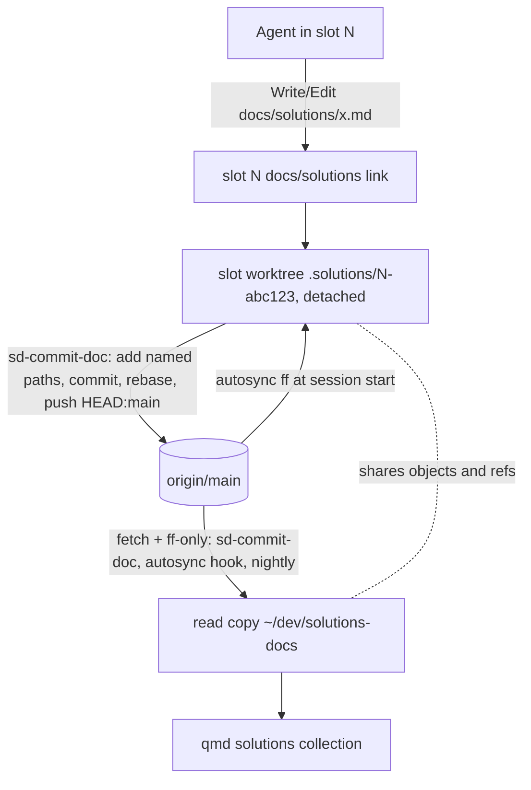
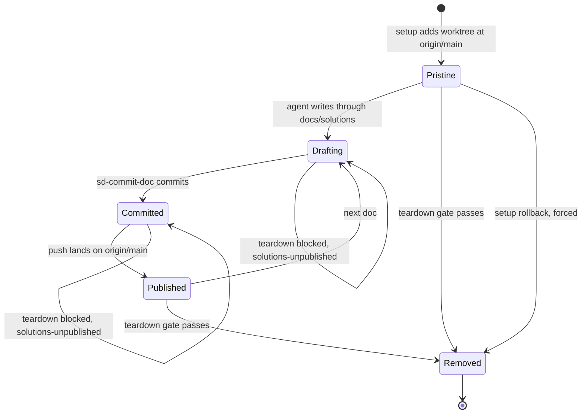
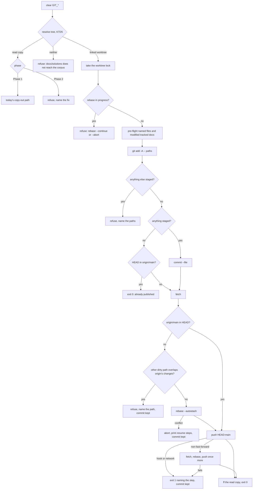

# Solutions Per-Writer Worktrees - Plan

## Goal Capsule

- **Objective:** no solutions doc is drafted in a working tree that another agent writes in, no unpublished doc is lost
  when its slot is deleted, and the clone qmd indexes holds only what origin holds.
- **Means:** each writer's checkout links `docs/solutions` to a detached worktree of brettdavies/solutions-docs that
  belongs to that checkout, and `sd-commit-doc` publishes from it in place (KTD1, KTD3). Slots come first (Phase 1).
  Prime checkouts come second, in the shape rex-linux picks (Q1, KTD10).
- **Product authority:** Brett's words in the brief and rex-linux's answer to Q1 outrank Requirements. Requirements
  govern behavior, KTDs govern mechanism within them, and units override neither. Git behavior measured on this host
  (git 2.56.0, Claude Code 2.1.314) outranks documentation or memory.
- **Execution profile:** Phase 1 changes `sd-commit-doc`, five agent-slot libraries, the SessionStart autosync hook,
  their suites, and the docs. Phase 2 changes the autosync hook again, `scripts/nightly-autocommit.sh`,
  `sd-commit-doc`'s shared-clone path, one permission rule, and the docs. No change to compound-engineering, qmd, or the
  solutions repo's hooks.
- **Stop conditions:** report to rex-linux and stop if a bypass-mode Write through a slot's `docs/solutions` into its
  worktree prompts, if publishing in place turns out to need a change to the solutions repo's own hooks, or if the work
  needs a compound-engineering change.
- **Who finishes:** implementation starts only on rex-linux's go-ahead. A slot ships Phase 1 (U1-U6) as one PR into
  `dev`. Phase 2 (U7-U9) is a second PR once Q1 is answered, and is dropped if the answer is option B. rex-linux
  approves and merges. Brett deploys with a `git pull` in `~/dotfiles`; slots made after the pull get worktrees, and
  slots made before it finish on the current flow.

---

## Product Contract

### Summary

Every agent slot gets its own detached worktree of the solutions repo at setup, and the slot's `docs/solutions` links to
it. ce-compound and ce-compound-refresh write there unchanged. `sd-commit-doc` commits the named paths in place,
deletions and renames included, rebases onto origin/main, and pushes. Teardown keeps the slot until the worktree holds
nothing origin lacks, then removes it. Phase 2 gives prime checkouts the same arrangement and makes
`~/dev/solutions-docs` a read copy: nothing links to it, nothing commits in it, and a stray edit there is reported to
the user instead of committed.

### Problem Frame

`~/dev/solutions-docs` is one clone shared by every agent. Each repo reaches it through a `docs/solutions` symlink,
agent-slot points each slot's link at it (`parity_solutions` in `scripts/agent-slot/lib/parity.sh`), and qmd indexes it
as the `solutions` collection. An agent, usually ce-compound at slot close-out, writes
`docs/solutions/<category>/<slug>.md` into that shared tree, then `sd-commit-doc` copies the named files into a
throwaway worktree, commits, pushes, and reverts the shared tree's copies. Only the commit is isolated.

Writing in the shared tree is where agents collide. On 2026-10-30, ingest-lab-prime found the clone holding one agent's
in-place edit of a doc another agent was editing, and an untracked doc nobody owned. That doc was published later, but
an in-flight doc and an orphan look the same in the shared tree: at 20:38 the same evening an untracked
`best-practices/` doc appeared there and was still unpublished four minutes later. `nightly-autocommit.service` commits
whatever it finds in the clone, so one writer's draft can ship under the nightly job's message. Brett's view: "The
shared solutions clone shouldn't really exist, everyone should be using their own detached worktree, right?"

### Requirements

**Writing and publishing**

- R1. An agent drafts, edits, renames, and deletes solutions docs through its checkout's `docs/solutions`, in a worktree
  that belongs to that checkout. A slot's worktree belongs to that slot alone.
- R2. `sd-commit-doc <msg-file> <path>...` publishes exactly the named paths, deletions and renames included, from the
  caller's worktree to origin/main.
- R3. When publishing fails at any step, the change stays in the caller's worktree, the command exits non-zero naming
  the step and the command that resumes it, and once that command has run, the same `sd-commit-doc` call finishes the
  publish.

**Slot lifecycle**

- R4. Every slot made after Phase 1 ships gets its own worktree at origin/main during setup, linked from its
  `docs/solutions`.
- R5. A slot is never deleted while its worktree holds a file or commit that origin/main lacks, and the teardown that
  deletes the slot removes its worktree.
- R6. A reopened slot gets a fresh worktree. A slot made before Phase 1 ships keeps today's flow until it is torn down.

**The read copy**

- R7. `~/dev/solutions-docs` stays the clone qmd indexes and the object store every worktree shares, and its working
  tree changes only by fast-forward to origin/main or by reverting a copy whose content origin already holds.
- R8. After Phase 2, no checkout's `docs/solutions` resolves to the read copy, and nothing commits in it.
- R9. After Phase 2, a change in the read copy that origin lacks (a stray) is reported at session start and in the
  nightly log, and automation never commits or deletes it.
- R10. A worktree under the slot root whose slot is gone is reported by `agent-slot doctor` with what it holds.

**Docs**

- R11. When each phase merges, the "Solutions repo" rule in `stow/claude/dot-claude/CLAUDE.md`, the "Shared solutions
  repo" section of `stow/claude/dot-claude/guides/workflows-and-skills.md`, `sd-commit-doc`'s usage text, and the
  solutions repo's `AGENTS.md` describe the live flow in present tense.

### Key Decisions

- **Slots first, prime checkouts by rex-linux's decision.** Slots run the close-out compound in every task, so they
  write most docs, and agent-slot already owns their setup and teardown. Prime checkouts share one link per checkout,
  which raises a scope and behavior question only the operator can settle (Q1). Governs R4, R5, R6, R8.
- **Strays are reported, never committed or deleted by automation.** A stray can be the only copy of someone's work, and
  the nightly job's commit is itself a write into the read copy. Governs R7, R9, R10.
- **Removing the `docs/solutions` symlink is out of scope.** Brett called it "kindof a different question all together";
  it is a follow-up.
- **Agent-facing docs drop the solo-writer exception.** The current docs let an agent commit straight in the shared
  clone when it is sure no other writer is active. No agent can be sure of that while slots run, and Brett wants every
  writer in its own worktree. Brett's manual use of the clone, such as the "Compounded Solutions" tmuxinator session, is
  unaffected. Governs R11.

### Scope Boundaries

Considered and not built:

- **A PreToolUse guard that denies writes into the read copy.** After Phase 2 the remaining way in is an agent using
  `~/dev/solutions-docs/<path>` as an absolute path, and a Bash `cd` there gets past any Write/Edit guard anyway
  (`docs/solutions/workflow-issues/worktree-agent-bash-cd-to-shared-checkout-escapes-isolation.md`). The session-start
  stray report (R9) catches the result. Strays that keep appearing in that report after Phase 2 would change the call.
- **A JSON output mode for `sd-commit-doc`.** Its callers act on the exit status and the `FAILED during <step>` line,
  and nothing parses its output.
- **More than one push retry.** A second rejection exits non-zero, and rerunning (R3) completes the publish.
- **Automatic removal of an orphaned worktree.** It may hold the only copy of a doc. R10 reports it instead.
- **Fast-forwarding a worktree that holds unpublished commits.** The teardown gate already reports them, and a merge
  there could conflict.
- **Counting ignored files as unpublished.** `git worktree remove` deletes ignored files silently, but CE writes
  `<category>/<slug>.md`, which no ignore rule matches. A draft lost under an ignored name would change the call.
- **A hint when a rename names only its new path.** The old path's deletion stays in the worktree, and the teardown
  blocker names it, so the slot cannot go without it.
- **Changing compound-engineering.** Its `docs_root` cannot point outside the repo (KTD1), so the link is the lever.

#### Deferred to Follow-Up Work

- Whether `docs/solutions` should be a symlink at all, given that agents mostly read the corpus through qmd.
- A `ce-compound-refresh` pass over
  `workflow-issues/shared-working-tree-git-add-commit-race-across-concurrent-agents.md`, whose rule 1 says to tear a
  worktree down in the flow that made it; a slot's worktree lives as long as the slot on purpose. This belongs to the
  implementing slot's close-out.

### Success Criteria

- During the first day of slot close-outs after Phase 1 deploys, `git -C ~/dev/solutions-docs status --porcelain` never
  lists a doc written by a slot made after the deploy, and `git -C ~/dev/solutions-docs worktree list` shows one
  worktree per live post-deploy slot and none for a torn-down one.
- After Phase 2, that `status --porcelain` stays empty apart from strays the session-start report names.

### Open Questions

- Q1. **How does a prime checkout get its worktree?** This blocks Phase 2 only and was sent to rex-linux. Options: (A) a
  per-checkout worktree the SessionStart hook makes and keeps current, shared by every session in that checkout; (B)
  primes stay linked to the shared clone with today's copy-out commit; (C) primes stay linked for reads, a guard refuses
  writes into the clone, and `sd-commit-doc open` hands out a worktree per write. Recommended: A, the only option that
  leaves no writer in the read copy without breaking ce-compound's write path. U7-U9 assume A. Under B they are dropped;
  under C, U7 is replaced (Alternatives).
- Q2. **Names (non-blocking).** The defaults used unless rex-linux renames them: the slot worktree path
  `<slot root>/<repo>/.solutions/<n>-<random>`, the record field `solutions_worktree`, the teardown blocker
  `solutions-unpublished`, the doctor warning `solutions-worktree-orphaned`, the nightly mode `sync`, and the prime
  worktree root `~/.local/state/solutions-worktrees/`.

### Sources

- Brett, relayed in the brief: "The shared solutions clone shouldn't really exist, everyone should be using their own
  detached worktree, right?"; "I thought all writing was done via `sd-commit-doc`? ... I guess we could reconsider the
  symlink at all given it is only accessed via qmd, but that's kindof a different question all together"; "I wonder if
  there is a config in ce that would help us."
- rex-linux, 2026-10-30: the untracked `performance-issues/` doc was published through `sd-commit-doc` (3efbb76); plan
  for orphans as a class.
- compound-engineering 3.33.2: `skills/ce-compound/SKILL.md` and `skills/ce-compound-refresh/SKILL.md` ("Artifact
  Root"), `skills/ce-setup/scripts/check-health` (`resolve_docs_root`), `skills/ce-setup/references/repo-fixes.md` (Step
  6b).
- The solutions repo's hooks: `.githooks/pre-commit` validates staged docs and modified tracked docs
  (`validate_changed_since HEAD` in `.githooks/lib-validate.sh`); `.githooks/pre-push` validates the pushed range.
  Neither starts a tool that runs git in another repo.
- Learnings: `docs/solutions/workflow-issues/shared-working-tree-git-add-commit-race-across-concurrent-agents.md`,
  `docs/solutions/workflow-issues/unattended-autocommit-on-shared-clone-must-sync-then-rebase.md`,
  `docs/solutions/logic-errors/phantom-revert-list-from-git-diff-against-origin-holds-in-flight-work.md`,
  `docs/solutions/best-practices/claude-code-sessionstart-plain-stdout-reaches-only-claude.md`,
  `docs/solutions/best-practices/disposable-clone-per-worker-for-parallel-multi-repo-dispatch.md`,
  `docs/solutions/logic-errors/exemption-in-advisory-check-but-not-pre-action-recheck-reports-safe-then-refuses.md`,
  `docs/solutions/workflow-issues/chained-worktree-integration-teardown-outruns-a-rejected-commit.md`,
  `docs/solutions/test-failures/linked-worktree-push-exports-git-dir-into-prepush-test-suite.md`,
  `docs/solutions/integration-issues/claude-code-workspace-trust-at-stable-paths.md`.

---

## Planning Contract

### Key Technical Decisions

- KTD1. **A checkout's `docs/solutions` link is the only lever on where CE writes.** CE reads `docs_root` from the
  tracked `.compound-engineering/config.yaml` only, rejects a value whose resolved path leaves the repo, and uses that
  one root for plans, brainstorms, and solutions alike. The default `docs` is never validated, which is why today's link
  out of the repo works (`ce-setup/scripts/check-health` `resolve_docs_root`). Re-pointing the link moves ce-compound's
  and ce-compound-refresh's writes with no CE change.
- KTD2. **A slot's worktree lives at `<slot root>/<repo>/.solutions/<n>-<random>`, recorded as `solutions_worktree` in
  the slot record.** It sits outside the clone because Claude Code asks before writing under `.git/` even with
  `--dangerously-skip-permissions` (README "Parallel Agents": "the few actions Claude never auto-approves"), and a
  prompt in a slot waits forever; any other path inside the clone is an untracked file every check flags. The random
  suffix keeps a leftover worktree from colliding with a later slot of the same number, so a leftover never blocks a
  launch and only this setup's rollback can remove what this setup made. The dot directory stays out of the
  `slot_numbers` and `slot_repos` globs, and no qmd collection covers the slot root.
- KTD3. **`sd-commit-doc` commits in place in a worktree, under a per-worktree lock.** It takes a lock in the worktree's
  own git dir (a directory lock with the holder's pid, a bounded wait under 10 s, and a dead holder's lock taken over),
  because one agent can start two publishes in parallel and an unlocked add-then-commit can bundle the other's paths.
  Then:
  1. It pre-flights the named files plus every modified tracked doc with the worktree's own `.githooks/lib-validate.sh`,
     the same set the repo's pre-commit validates, so a failing draft is named before anything is staged.
  2. It stages the named paths with `git add -A --`, which stages an add, a `R100` rename, and a delete (measured), and
     refuses when anything else is staged.
  3. It commits with `--file` when anything is staged.
  4. It fetches. When origin/main is not already in HEAD, it refuses before rebasing if any other dirty or untracked
     path is one that origin changed or added since HEAD, naming the path. Otherwise it runs
     `rebase --autostash origin/main`, whose stash can no longer conflict on re-apply, so nothing reaches the corpus's
     shared `refs/stash`.
  5. It pushes `HEAD:main`. Only a non-fast-forward rejection gets one more fetch, rebase, and push; a pre-push hook
     failure or a network failure exits with its own step name.
  6. It fast-forwards the read copy, as it does today, since qmd indexes only the read copy.
- KTD4. **A failed publish always has one resuming command, and rerunning never stacks a commit.** A rebase conflict on
  a named path is aborted when, and only when, a rebase is in progress. That leaves the commit local and the tree clean
  (measured), and the command prints `git -C <worktree> rebase origin/main`, then resolve,
  `git -C <worktree> add <path>`, and `git -C <worktree> rebase --continue`, before rerunning the same `sd-commit-doc`.
  A rerun while a rebase is in progress (the agent's own, or one a timeout killed) refuses and names `rebase --continue`
  or `rebase --abort`. A rerun with nothing to stage pushes the local commit. A rerun with nothing to stage or push
  exits 0 saying the paths are on origin/main.
- KTD5. **`sd-commit-doc` finds the caller's worktree from the caller's checkout.** Resolution order: `SD_TREE`, then
  the current directory when it is inside a linked worktree of the corpus (true from inside `docs/solutions`, since git
  reads the physical path), then the resolved `docs/solutions` of `git rev-parse --show-toplevel`. `SD_DIR` keeps naming
  the read copy. A tree that resolves to the read copy takes today's copy-out path in Phase 1 and is refused in Phase 2
  (U8). The script clears the `GIT_*` variables first, because a caller inside a git hook would otherwise steer every
  `git -C` (`docs/solutions/test-failures/linked-worktree-push-exports-git-dir-into-prepush-test-suite.md`).
- KTD6. **One helper judges a slot's worktree, from the recorded path and local state only, and both `check` and the
  teardown re-check call it.** It judges the worktree the record names whatever the link points at, so an agent
  re-pointing its link cannot hide a draft. It reads only that worktree's own state: status with untracked files, a
  rebase in progress in its git dir, and HEAD's containment in the local `refs/remotes/origin/main`. It never reads the
  corpus's shared stash or branches. Containment needs no fetch: a push from any worktree updates that shared ref, and a
  commit it does not contain counts as unpublished, the fail-closed side. A state it cannot read is `git-state-unknown`,
  never a pass. Sharing the helper follows
  `docs/solutions/logic-errors/exemption-in-advisory-check-but-not-pre-action-recheck-reports-safe-then-refuses.md`.
- KTD7. **Teardown removes the worktree before it trashes the clone, and never forces the removal.** After the re-check
  passes, `git worktree remove` without `--force` refuses a dirty tree on its own (measured), which keeps the slot, and
  `git worktree prune` follows. A setup rollback, which runs before the agent starts, removes the pristine worktree it
  recorded with `--force`. Reopen makes a new slot and so a new worktree, with nothing to carry over, because the old
  one was published before its slot went
  (`docs/solutions/workflow-issues/chained-worktree-integration-teardown-outruns-a-rejected-commit.md`).
- KTD8. **`agent-slot doctor` reports a worktree whose slot is gone.** `git worktree list --porcelain` on the read copy,
  filtered to paths under `<slot root>/*/.solutions/` that no live slot record names, gives each orphan with its dirty
  and unpublished counts. It is a warning, the doctor stays read-only, and the next step is `git -C <path> status`.
- KTD9. **The SessionStart autosync hook keeps the session's worktree current.** After it fast-forwards the read copy,
  it runs `merge --ff-only` without `--autostash` in the worktree the session's checkout links to, when that worktree is
  behind origin/main and holds no unpublished commit. Git itself refuses when an incoming change would overwrite a local
  edit or an untracked file, and the hook then leaves the worktree alone with a line naming the path. ce-compound's
  overlap search and an agent's edits then start from the current corpus, and fewer pushes need a rebase.
- KTD10. **Under Q1 option A, a prime checkout's worktree lives at `~/.local/state/solutions-worktrees/<checkout key>`
  and is made by the SessionStart autosync hook.** The hook makes it the first time a trusted session starts in a
  checkout outside the slot root whose `docs/solutions` symlink resolves to the read copy, then re-points the link
  (KTD11 covers a tracked one). Sessions in one checkout share that worktree the same way they already share the
  checkout, and KTD3's lock serializes their publishes. `~/.local/state` is outside every qmd collection, including
  `meum`, which is rooted at `~/dev` with `meum*/**/*.md`. Prime sessions run in `auto` mode, so the permission rule
  that lets them read `~/dev/solutions-docs/**` gains a sibling for the new root.
- KTD11. **A tracked `docs/solutions` link is re-pointed and marked `skip-worktree`.** dotfiles tracks its link as
  `../../dev/solutions-docs`. Marked `skip-worktree`, the re-pointed link stays out of `git status` and out of any
  `git add -A`, so no PR can commit a link to a slot's temporary path, and the clone keeps the path tracked for hosts
  that never run Claude. The check's existing `M docs/solutions` exemption stays as a fallback and accepts either
  target. Untracking the link instead was rejected, because a pull would delete every existing checkout's link.
- KTD12. **After Phase 2 the read copy is enforced by detection, not prevention.** `sd-commit-doc` refuses a tree that
  resolves to the read copy. The nightly job's solutions entry runs in a `sync` mode that fast-forwards and logs strays
  without committing. The autosync hook keeps reverting phantoms whose content equals origin's
  (`docs/solutions/logic-errors/phantom-revert-list-from-git-diff-against-origin-holds-in-flight-work.md`) and reports
  every other dirty path as a stray. Sessions outside the slot root get the report as a JSON `systemMessage` plus
  `additionalContext`, the channel
  `docs/solutions/best-practices/claude-code-sessionstart-plain-stdout-reaches-only-claude.md` names for a warning a
  person must act on. Slot agents get only `additionalContext`, saying the stray is not theirs to change.

### High-Level Technical Design

Where a doc goes, from draft to the read copy:

A slot worktree's lifecycle:

`sd-commit-doc`'s path through a worktree:

### Assumptions

- Claude Code writes through a slot's `docs/solutions` into `<slot root>/<repo>/.solutions/...` without a prompt in
  bypass mode, as it writes into `~/dev/solutions-docs` today. U2 verifies this in a real slot before it lands.
- Slots made before Phase 1 deploys are short-lived enough that a transitional period, in which they still write into
  the shared clone, needs no migration step. Phase 2 waits for them.
- Prime checkouts where agents compound are trusted in Claude Code, so the SessionStart hook runs there (KTD10). A first
  session in an untrusted checkout runs no hook, and its link keeps resolving to the read copy until a trusted session
  starts there (`docs/solutions/integration-issues/claude-code-workspace-trust-at-stable-paths.md`).
- No force-push ever rewrites origin/main, so a commit the local `refs/remotes/origin/main` contains is on origin
  (KTD6). The solutions repo's rules forbid force-pushes.
- rex-linux answers Q1 with A. Phase 1 holds under any answer.

### Sequencing

Phase 1 (U1-U6) ships as one PR. U1 lands first, because U2 makes the worktrees U1 publishes from, and U3 and U4 build
on U2's record field. U5 and U6 come last. Phase 2 (U7-U9) is a second PR after Q1, merged once no live slot record
lacks `solutions_worktree`.

### System-Wide Impact

- **Every slot's close-out.** The closing steps already say to run ce-compound and publish through `sd-commit-doc`. That
  still holds, but the files land in the slot's worktree, and a slot with an unpublished doc stays alive until its agent
  publishes or discards it. The automatic sweep's cleanup reminder covers the new blocker (U3).
- **qmd.** Nothing about indexing changes. A doc becomes searchable once the read copy fast-forwards, as it does today
  after `sd-commit-doc`.
- **Other agents' instructions.** Every instruction that names `~/dev/solutions-docs` as a place to write, or tells an
  agent to recreate `docs/solutions` pointing there, changes in the PR for the same phase (U6, U9): the global CLAUDE.md
  rule, the guide, the solutions repo's `AGENTS.md`, `slot-context.sh`, and the `qmd-learnings-researcher` description.
- **The Mac.** `sd-commit-doc` and the autosync hook run there too. Phase 1 changes nothing there unless a checkout's
  link resolves to a worktree. Phase 2's prime provisioning runs wherever a solutions clone exists.

### Risks

| Risk                                                                                                                | Mitigation                                                                                                                            |
| ------------------------------------------------------------------------------------------------------------------- | ------------------------------------------------------------------------------------------------------------------------------------- |
| A Write through the link prompts in bypass mode and stops the slot                                                  | Real-slot check in U2's verification, and a stop condition in the Goal Capsule                                                        |
| Formatter churn through the link dirties a worktree and holds a teardown                                            | The blocker names the files, and the cleanup reminder asks the agent to publish or discard them (U3)                                  |
| Concurrent fetches into the shared ref store fail with `cannot lock ref`                                            | The check never fetches (KTD6); setup and the hook fall back to the local ref; `sd-commit-doc` exits non-zero and its rerun completes |
| A slot made before the deploy and one made after edit the same doc                                                  | The second push hits a rebase conflict, keeps its commit, and prints the resume steps (KTD4)                                          |
| A prime session drafting through the old link when another session's start re-points it                             | The draft stays in the read copy as a stray, the report names it, and the stray recipe recovers it (Rollout Notes)                    |
| md-wrap or ce-compound's `validate-doc-claims.py` resolve the edited file's tree differently through the new target | U6's verification makes one real edit through the link and checks both                                                                |

### Alternatives Considered

- **One fresh worktree per publish, made by `sd-commit-doc`.** The brief offered this shape. It keeps every commit
  isolated, but ce-compound writes to `docs/solutions/` before `sd-commit-doc` runs, so the draft would still land
  wherever the link points. It is option C's write path for prime checkouts.
- **A full clone per slot instead of a worktree.** It isolates refs as well, but it duplicates the corpus per slot, and
  the read copy would no longer see a slot's pushes in its own remote-tracking ref, which KTD6 depends on.
- **The worktree inside the slot's `.git/`.** It would vanish with the clone and stay out of git status, but Claude
  Code's protected-path prompt rules it out (KTD2).

### Documentation Plan

- Phase 1 (U6): the global CLAUDE.md rule and the guide say that a slot's `docs/solutions` is the slot's own worktree
  and that a repo's own checkout links to the shared clone. `sd-commit-doc`'s usage text describes both trees and the
  resume steps. The solutions repo's `AGENTS.md` describes the worktree flow and drops the solo-writer exception.
  `README.md` covers the new teardown blocker, the doctor warning, and the slot layout. `CONCEPTS.md` gains "writer
  worktree" and "read copy".
- Phase 2 (U9): the same docs say that every checkout's `docs/solutions` is its own worktree, that the clone is a read
  copy that only fast-forwards, and how a stray is resolved.

### Operational / Rollout Notes

- Phase 1 needs no deploy step beyond the pull: setup, check, and teardown run from `~/dotfiles`, and `sd-commit-doc`
  and the hook are stowed links that change in place. It adds no hook script, so the pull-before-restow lock
  (`docs/solutions/deployment-issues/pull-before-restow-blocks-every-claude-tool-call.md`) does not apply.
- Phase 2 merges once `agent-slot list --output json` shows no live slot whose record lacks `solutions_worktree`, and
  the read copy is clean.
- Resolving a stray, as the Phase 2 docs describe: when it is work worth keeping, copy it to the same path under a
  checkout's `docs/solutions` and publish it with `sd-commit-doc`. Its copy in the read copy then matches origin, and
  the next session start reverts it as a phantom. Otherwise Brett discards it. A person decides either way, because the
  file can be the only copy.
- An orphaned worktree that `agent-slot doctor` reports is handled the same way: publish its files with
  `SD_TREE=<path> sd-commit-doc ...`, then `git -C ~/dev/solutions-docs worktree remove <path>`.

---

## Implementation Units

### U1. Publish in place from a worktree

- **Goal:** `sd-commit-doc` publishes the named paths from the caller's worktree, deletions and renames included, and
  keeps today's copy-out path for a tree that resolves to the shared clone.
- **Requirements:** R1, R2, R3, R7
- **Dependencies:** none
- **Files:** `stow/local/dot-local/bin/sd-commit-doc`, `tests/sd-commit-doc.bats`
- **Approach:**
  1. Clear the `GIT_*` set and resolve the tree (KTD5). A tree that is neither a linked worktree of the corpus nor the
     corpus itself fails, naming the checkout and the link's target.
  2. On the worktree path, accept each named path that is a file in the tree, or a path HEAD tracks that the tree no
     longer has (a deletion), and refuse a directory.
  3. Lock, pre-flight, stage, commit, rebase, push, and fast-forward the read copy (KTD3), with the resume behavior of
     KTD4. Each step sets `step`, so the existing EXIT marker names it.
  4. Leave the copy-out path as it is for a tree that resolves to the read copy.
- **Patterns to follow:** the script's own `step` and EXIT-marker shape, which already owns worktree cleanup and can own
  the lock; its push-retry block; `.githooks/lib/git-env.sh` for the variable set to clear.
- **Test scenarios:**
  - A new doc in a worktree is committed and pushed, origin has it, the worktree is clean at origin/main, and the read
    copy fast-forwarded without the doc ever being written into the read copy's tree.
  - An edit to a tracked doc, a deletion of a tracked doc, and a rename passed as old and new paths land on origin as M,
    D, and R.
  - A path staged in the worktree but not named makes it refuse, with nothing committed.
  - An invalid modified tracked doc beside a valid named one fails the pre-flight naming the invalid one, with nothing
    staged.
  - With origin advanced by another writer's unrelated doc, and an unrelated tracked edit in the worktree, the commit is
    rebased and pushed, the edit survives, and the corpus's `refs/stash` is unchanged.
  - With origin having changed a doc the worktree also edits without naming it, it refuses before rebasing, names that
    doc, and keeps the commit local.
  - With an untracked draft at a path origin has since added, it refuses before rebasing and names the path.
  - With origin having changed a named doc, it aborts the rebase, exits non-zero with the resume commands, and leaves no
    rebase in progress; after those commands run, the same call pushes.
  - A rerun while a rebase is in progress refuses and names `rebase --continue` and `rebase --abort`.
  - With origin unreachable, it exits non-zero, and once origin is reachable the same call pushes the existing commit
    without making a second one.
  - A pre-push hook rejection exits naming the push step, with no rebase attempted.
  - With nothing to stage or push, it exits 0 and says the paths are on origin/main.
  - Two calls started together in one worktree with different paths make two commits, each holding only its own path.
  - Called from a consuming checkout whose `docs/solutions` links to the worktree, from inside the worktree, and with
    `SD_TREE` set, it resolves the same tree.
  - A directory path is refused.
  - With a consuming checkout's link resolving to the read copy, the existing copy-out tests pass unchanged.
  - With `GIT_DIR` and `GIT_INDEX_FILE` exported by the caller, it still commits in the worktree.
- **Verification:** every scenario passes in `tests/sd-commit-doc.bats`, and each new one fails against the current
  script.

### U2. Give each new slot its own worktree

- **Goal:** slot setup makes the slot's worktree at origin/main, records it, and links `docs/solutions` to it; a failed
  setup removes it.
- **Requirements:** R1, R4, R6
- **Dependencies:** U1
- **Files:** `scripts/agent-slot/lib/parity.sh`, `scripts/agent-slot/lib/slotmake.sh`, `scripts/agent-slot/agent-slot`
  (header layout note), `tests/lib/agent-slot.bash`, `tests/agent-slot-launch.bats`, `tests/agent-slot-reopen.bats`
- **Approach:**
  1. `parity_solutions` prunes stale worktree registrations, makes a bounded best-effort fetch of the corpus, and adds a
     detached worktree at the local `refs/remotes/origin/main` under `<slot root>/<repo>/.solutions/` with a random
     suffix (KTD2). It writes `solutions_worktree` to the record and links `docs/solutions` to the worktree, marking a
     tracked link `skip-worktree` (KTD11). A corpus with no `refs/remotes/origin/main`, or a failed `worktree add`,
     fails setup with the existing `solutions-symlink-missing` reason and a message naming the step.
  2. `slot_rollback` force-removes the worktree the record names and prunes before it trashes the clone (KTD7).
  3. The test library makes `$AGENT_SLOT_SOLUTIONS` a clone of a bare origin with one seeded commit on `main`, the shape
     `prime()` already builds.
- **Patterns to follow:** `parity_repo_recon` for a setup-placed link; `bounded` for the fetch; `record_update` for the
  field.
- **Test scenarios:**
  - A launched slot's `docs/solutions` resolves to a linked worktree of the corpus at origin/main, the record names it,
    and the corpus's own working tree is unchanged.
  - Two launches of one repo get two different worktrees.
  - A repo that tracks `docs/solutions` as a relative link gets it re-pointed at the worktree, and `git status` in the
    slot is clean.
  - With the corpus's origin unreachable, the worktree is still made at the local origin/main.
  - A corpus with no origin/main refuses with `solutions-symlink-missing`, leaving no slot, no worktree directory, and
    no registration.
  - A setup that fails after the worktree step (git-crypt locked) leaves no registration and no directory.
  - A reopened slot gets a new worktree whose path differs from the source slot's.
- **Verification:** the suites pass, and in a real slot launched from the branch, a Write through `docs/solutions` lands
  in the worktree with no prompt.

### U3. Hold teardown until the worktree is published

- **Goal:** `check`, the teardown re-check, and the automatic sweep treat an unpublished worktree as a blocker, and
  teardown removes a published worktree before it trashes the clone.
- **Requirements:** R5, R6
- **Dependencies:** U2
- **Files:** `scripts/agent-slot/lib/check.sh`, `scripts/agent-slot/lib/teardown.sh`,
  `scripts/agent-slot/lib/autosweep.sh`, `README.md` (teardown blockers table), `tests/agent-slot-check.bats`,
  `tests/agent-slot-teardown.bats`, `tests/agent-slot-release.bats`
- **Approach:**
  1. Add `solutions-unpublished` to `CHECK_CODES`, and the KTD6 helper that `check_slot` and `_teardown_recheck` both
     call. It skips a record with no `solutions_worktree` (a slot made before Phase 1) and a recorded worktree whose
     directory is gone (only a removal that git allowed takes it). Its `values` are `docs/solutions/<path>` for each
     dirty path, so the agent sees them through its own link, plus `<n> unpublished commit(s)` and `rebase in progress`
     when they apply.
  2. `_check_uncommitted` exempts `M docs/solutions` when the link names the recorded worktree or the shared clone.
  3. `slot_teardown` removes the worktree without `--force` after the re-check and before `purge_before`, keeps the slot
     with `solutions-unpublished` through `_teardown_keep` when git refuses, then prunes (KTD7).
  4. Add `solutions-unpublished` to `RELEASE_FILE_CODES`, and have the cleanup reminder say that a `docs/solutions` path
     is published with `sd-commit-doc` or discarded.
- **Patterns to follow:** `_check_stash` and `_check_commits` for blocker shape and fail-closed reads; the exemption
  test in `tests/agent-slot-check.bats`, "a tracked docs/solutions link that setup points at the solutions repo".
- **Test scenarios:**
  - A finished slot whose worktree is clean and on origin/main tears down; the directory is gone and the corpus no
    longer lists it.
  - An untracked doc in the worktree blocks with `solutions-unpublished` and `docs/solutions/<path>` in `values`, and
    teardown keeps the slot.
  - A modified tracked doc blocks the same way.
  - A local commit origin/main lacks blocks with its count.
  - A rebase left in progress blocks.
  - Once `sd-commit-doc` publishes, the next check passes without any fetch.
  - A slot whose agent re-pointed its link at the shared clone is still judged by its recorded worktree.
  - A stash entry in the corpus does not block any slot.
  - A doc written after the verdict and before the re-check keeps the slot active, with the blocker recorded.
  - A slot with no `solutions_worktree` and a link to the shared clone is judged exactly as today.
  - A finished slot held only by `solutions-unpublished` gets the cleanup reminder once, and the reminder names
    `sd-commit-doc`.
- **Verification:** the suites pass, and `tests/agent-slot-docs.bats` holds the README table equal to `CHECK_CODES`.

### U4. Report orphaned worktrees

- **Goal:** `agent-slot doctor` names every worktree under the slot root that no live slot record names, with what it
  holds.
- **Requirements:** R10
- **Dependencies:** U2
- **Files:** `scripts/agent-slot/lib/doctor.sh`, `scripts/agent-slot/lib/contract.sh`, `README.md` (reasons table),
  `tests/agent-slot-doctor.bats`
- **Approach:**
  1. Extend the `solutions-corpus-missing` check to a corpus that is not a git repo with `refs/remotes/origin/main`.
  2. Add the warning reason `solutions-worktree-orphaned` (KTD8) to the closed table, with `values` of
     `<path> <dirty count> <unpublished count>` and the next step `git -C <path> status`.
- **Patterns to follow:** the existing `doctor_finding warning slot-path-untrusted` entries.
- **Test scenarios:**
  - A worktree under the slot root whose slot was deleted by hand is reported with its counts.
  - A live slot's worktree is not reported.
  - A worktree elsewhere, such as a scratch one under `/tmp`, is not reported.
  - A corpus that is a plain directory reports `solutions-corpus-missing`.
- **Verification:** the suite passes, and `tests/agent-slot-docs.bats` holds the README reasons table equal to the
  contract table.

### U5. Keep the session's worktree current

- **Goal:** at session start, the autosync hook fast-forwards the worktree the session's checkout links to, as well as
  the read copy.
- **Requirements:** R1, R7
- **Dependencies:** U2
- **Files:** `stow/claude/dot-claude/solutions-clone-autosync.sh`, `tests/solutions-clone-autosync.bats`
- **Approach:**
  1. Read the session's directory from the payload's `cwd`, falling back to the working directory, and resolve its
     checkout's `docs/solutions`.
  2. Fetch once. The early exit for a current read copy moves after the worktree step, so a current read copy no longer
     skips a worktree that is behind.
  3. Fast-forward the linked worktree when it qualifies (KTD9), capturing git's output. A worktree with unpublished
     commits is left alone, with a line naming the count and `sd-commit-doc`.
- **Patterns to follow:** the hook's own phantom-revert flow and its `revert` error shape.
- **Test scenarios:**
  - A session in a checkout whose worktree is behind origin/main fast-forwards both the worktree and the read copy.
  - An in-flight edit to a tracked doc origin did not change survives the fast-forward.
  - An in-flight edit to a doc origin did change leaves the worktree untouched, with a line naming the doc.
  - An untracked draft at a path origin just added leaves the worktree untouched, with a line naming it.
  - A worktree with an unpublished commit is left untouched, with a line naming the count.
  - A session outside any checkout, and one whose link resolves to the read copy, behave as today.
- **Verification:** the suite passes, and the hook still finishes within its SessionStart timeout on this host.

### U6. Describe the Phase 1 flow

- **Goal:** every doc that tells an agent where solutions docs are written and how they are published describes Phase 1
  in present tense.
- **Requirements:** R11
- **Dependencies:** U1, U2, U3, U4, U5
- **Files:** `stow/claude/dot-claude/CLAUDE.md`, `stow/claude/dot-claude/guides/workflows-and-skills.md`,
  `stow/local/dot-local/bin/sd-commit-doc` (header and usage), `stow/claude/dot-claude/slot-context.sh`,
  `stow/claude/dot-claude/agents/qmd-learnings-researcher.md`, `stow/git/dot-config/git/ignore` (comment), `README.md`,
  `CONCEPTS.md`, `tests/slot-context.bats`; in brettdavies/solutions-docs, `AGENTS.md`, published through a worktree
  with `sd-commit-doc`
- **Approach:**
  1. Rewrite the CLAUDE.md "Solutions repo" rule and the guide section around the two trees: a slot's own worktree,
     which the agent writes in and publishes from, and a repo's own checkout, which still links to the shared clone.
     Drop the solo-writer exception (Key Decisions). Limit the instruction to recreate a missing link to repos' own
     checkouts, since in a slot that would orphan the slot's worktree.
  2. Change `slot-context.sh`'s line to say that `docs/solutions` is the slot's own worktree of the solutions repo,
     published only through `sd-commit-doc`.
  3. Add "writer worktree" and "read copy" to `CONCEPTS.md`.
- **Patterns to follow:** the present-tense rule for in-repo docs in `~/.claude/guides/code-comments.md`; the existing
  README table formats.
- **Test scenarios:**
  - `tests/slot-context.bats` still finds `sd-commit-doc` in the context and finds the wording about the slot's own
    worktree.
- **Verification:** one real edit through a post-deploy slot's `docs/solutions` keeps md-wrap's width for the solutions
  repo and passes ce-compound's `validate-doc-claims.py`; `/unslop` and the solutions repo's hooks pass on its
  `AGENTS.md`.

### U7. Give prime checkouts their own worktree (Q1 option A)

- **Goal:** the first trusted session in a prime checkout gets that checkout its own worktree, and its link points
  there.
- **Requirements:** R1, R8
- **Dependencies:** U5, Q1
- **Files:** `stow/claude/dot-claude/solutions-clone-autosync.sh`, `stow/claude/dot-claude/settings.json` (one Read
  rule), `tests/solutions-clone-autosync.bats`, `tests/claude-settings.bats`
- **Approach:**
  1. For a session in a checkout outside the slot root whose `docs/solutions` symlink resolves to the read copy, add a
     detached worktree at `~/.local/state/solutions-worktrees/<checkout key>` when none exists, re-point the link, and
     mark a tracked link `skip-worktree` (KTD10, KTD11). An existing worktree at that path counts as success, so two
     sessions starting at once need no lock.
  2. A non-symlink path or a failed `worktree add` leaves the link alone and reports through the hook's `systemMessage`.
  3. Add `Read(~/.local/state/solutions-worktrees/**)` beside `Read(~/dev/solutions-docs/**)`.
- **Patterns to follow:** U2's worktree step; the hook's fail-open shape.
- **Test scenarios:**
  - A first session in a prime checkout gets a worktree and a re-pointed link, and a second session reuses both.
  - Two sessions starting at once end with one worktree and the link pointing at it.
  - A tracked link is re-pointed and `git status` in that checkout stays clean.
  - A checkout under the slot root, and one with no `docs/solutions`, are left alone.
  - `tests/claude-settings.bats` finds the new Read rule written with `~/`, which its "no machine-absolute home paths"
    test already requires.
- **Verification:** the suite passes, and a session started in `~/dotfiles` after deploy links to its own worktree with
  `git status` clean.

### U8. Keep the read copy read-only (Q1 option A)

- **Goal:** nothing commits in the read copy, and a stray there reaches a person.
- **Requirements:** R7, R8, R9
- **Dependencies:** U1, U7
- **Files:** `stow/local/dot-local/bin/sd-commit-doc`, `stow/claude/dot-claude/solutions-clone-autosync.sh`,
  `scripts/nightly-autocommit.sh`, `stow/local/dot-config/systemd/user/nightly-autocommit.service` (description),
  `tests/sd-commit-doc.bats`, `tests/solutions-clone-autosync.bats`, `tests/nightly-autocommit.bats` (new)
- **Approach:**
  1. `sd-commit-doc` refuses a tree that resolves to the read copy, naming the checkout and the new session that gives
     it a worktree. The copy-out path and its revert step go.
  2. The autosync hook prints one JSON object built with `jaq` (KTD12): `additionalContext` for its fast-forward lines,
     and a `systemMessage` naming each stray in sessions outside the slot root.
  3. `nightly-autocommit.sh` gains a per-repo mode. The solutions entry uses `sync`, which fast-forwards with the
     existing guard and logs each stray as a `WARNING:` line instead of committing.
- **Patterns to follow:** `scripts/fseventsd-check.sh --claude-hook` for the JSON shape.
- **Test scenarios:**
  - `sd-commit-doc` called from a checkout whose link resolves to the read copy exits non-zero with the fix named, and
    the read copy is unchanged.
  - A stray untracked doc in the read copy produces a `systemMessage` naming it in a prime session, only
    `additionalContext` in a slot session, and is neither committed nor deleted.
  - A phantom copy is still reverted and produces no stray report.
  - The hook's output parses as one JSON object in every case that prints anything.
  - The nightly job in `sync` mode fast-forwards a behind read copy and logs a stray without making a commit.
  - The nightly job's other repos still commit as today.
- **Verification:** the suites pass, and a session started after a stray is planted in a scratch read copy shows
  `SessionStart:startup says:` with the stray's path.

### U9. Describe the Phase 2 flow (Q1 option A)

- **Goal:** the docs describe every checkout's own worktree and the read copy.
- **Requirements:** R11
- **Dependencies:** U7, U8
- **Files:** `stow/claude/dot-claude/CLAUDE.md`, `stow/claude/dot-claude/guides/workflows-and-skills.md`,
  `stow/local/dot-local/bin/sd-commit-doc`, `stow/claude/dot-claude/agents/qmd-learnings-researcher.md`, `README.md`,
  `CONCEPTS.md`; in brettdavies/solutions-docs, `AGENTS.md`
- **Approach:** state that every checkout's `docs/solutions` is that checkout's own worktree, that
  `~/dev/solutions-docs` is the read copy, which only fast-forwards and is never a write target, and how a stray is
  resolved (Operational / Rollout Notes).
- **Test expectation:** none -- prose only; the docs-table suites from U3 and U4 still hold.
- **Verification:** no doc in either repo names `~/dev/solutions-docs` as a place to write.

---

## Verification Contract

| Gate           | Command or check                                                                                                                                                                                                                                                                                                    | Applies to     |
| -------------- | ------------------------------------------------------------------------------------------------------------------------------------------------------------------------------------------------------------------------------------------------------------------------------------------------------------------- | -------------- |
| Unit suites    | `scripts/run-tests tests/sd-commit-doc.bats tests/solutions-clone-autosync.bats tests/agent-slot-launch.bats tests/agent-slot-check.bats tests/agent-slot-teardown.bats tests/agent-slot-release.bats tests/agent-slot-reopen.bats tests/agent-slot-doctor.bats tests/agent-slot-docs.bats tests/slot-context.bats` | U1-U6          |
| Phase 2 suites | the above plus `tests/nightly-autocommit.bats`                                                                                                                                                                                                                                                                      | U7-U9          |
| Full mirror    | `.githooks/pre-push` (ShellCheck, actionlint, Bats, core-env guard)                                                                                                                                                                                                                                                 | each PR        |
| Red first      | each new scenario observed failing against the unchanged code, with the failure quoted in the PR                                                                                                                                                                                                                    | U1, U3, U5, U8 |
| Real slot      | after deploy, one new slot: its `docs/solutions` resolves to its worktree, a Write there lands with no prompt, `sd-commit-doc` publishes, `git -C ~/dev/solutions-docs status --porcelain` stays empty, and teardown removes the worktree                                                                           | Phase 1        |
| Real session   | a session started in `~/dotfiles` links to its own worktree with `git status` clean, and a planted stray shows in `SessionStart:startup says:`                                                                                                                                                                      | Phase 2        |

## Definition of Done

- Phase 1: U1-U6 merged into `dev` in one PR with every gate above green, the real-slot check recorded in the PR, and no
  abandoned code left in the diff.
- Phase 2: U7-U9 merged in a second PR after Q1 resolves to A, with the real-session check recorded; under B, the plan
  closes after Phase 1.
- Each unit is done when its Verification line holds.
- The implementing slot's close-out refreshes
  `workflow-issues/shared-working-tree-git-add-commit-race-across-concurrent-agents.md` rule 1 through
  `ce-compound-refresh`.
