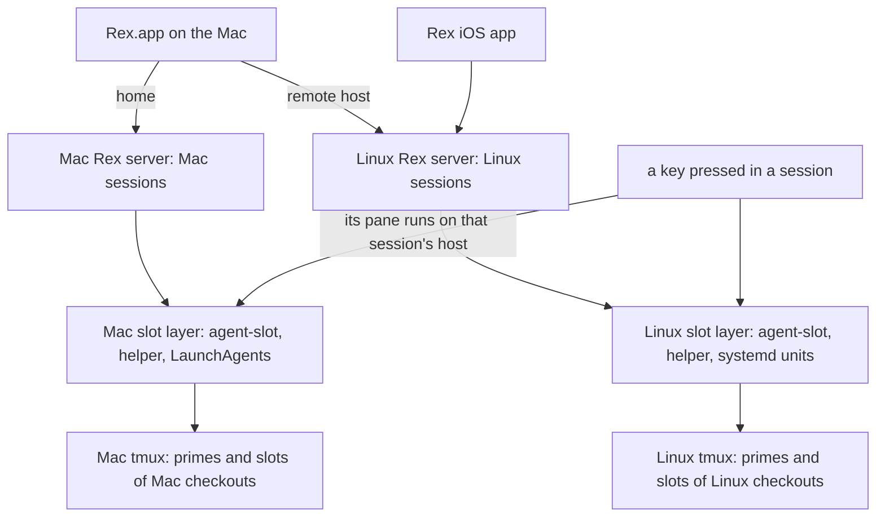

# Agent Slots on the Mac - Plan

## Goal Capsule

- **Objective:** The operator works in local Mac sessions exactly as on the Linux server: the new-agent key opens a
  repo's prime or starts an agent in a slot of the Mac's own checkout, slot tabs stay matched to live slots with no key
  press, and a Rex restart on either machine brings back what was open and nothing that was closed.
- **Means:** Each machine runs the whole slot layer for its own sessions, against its own repos, tmux, and Rex server,
  from one shared codebase with platform seams only where the OS forces them.
- **Product authority:** Requirements govern behavior; Key Decisions record why. This plan extends
  `docs/plans/2026-10-29-2303-feat-rex-agent-slots-on-linux-server-plan.md`, whose R2 and R18 (nothing about slots runs
  on the Mac) and whose "Running agents on the Mac" boundary it replaces. Everything that plan built on the Linux server
  stays as it is (R22).
- **Open blockers:** None.

---

## Product Contract

### Summary

The Mac gains its own complete slot layer: `agent-slot` and its timers, the Mac's Rex server driving the Mac's tmux and
slots, and the same keys, with each key acting on the host of the session it was pressed in. The new-agent key works the
same in Mac sessions against Mac repos and primes. On both machines, closing a session or tab saves the snapshot, and
closing everything records an empty state, so restores match what was open.

### Problem Frame

On 2026-11-02 the cutover moved every slot and repo session to the Linux server and made Rex.app a client into it. The
Mac half was retired: on macOS every `agent-slot-rex` verb forwards to the server over ssh, and `agent-slot` itself
depends on Linux (`/proc` for its teardown check, `flock`, `setsid`, GNU coreutils, trash-cli's trash layout, systemd
for its timers and its tmux server).

The operator also keeps local sessions on the Mac and wants the same development process there. Today a Mac session has
none of it: the new-agent key pressed in a Mac session forwards to the Linux server, there are no Mac slots, and no Mac
automation keeps tabs current.

Restores have their own gap on both machines. rexurrect autosaves every 15 minutes and, by design, never records an
empty server, so a session the operator closed comes back after a Rex restart: always when it was the last session, and
otherwise whenever the restart came before the next autosave.

### Actors

- A1. Operator: uses Rex.app on the Mac, whose home server is the Mac's and which also shows the Linux server's sessions
  as a remote host, and the Rex iOS app for the Linux server.
- A2. Slot agent: a Claude Code agent in a slot on either machine, which can launch and brief other slots on its own
  machine and releases its own slot.
- A3. Each machine's own automation: the sweep, the minute reconcile, the start-up step, the tab-number watcher, the
  saves.
- A4. Rex.app: offers only its home (Mac) server's actions; an action's pane opens in the focused session and runs on
  that session's host.

### Key Decisions

- **Each machine runs the whole slot layer for its own sessions.** (session-settled: user-directed — chosen over Rex.app
  being only a client into the Linux server, the direction the cutover was built on: "agent slot needs to run on the
  mac. exact same dev process on both mac and bigdaddy. mac rex will connect to mac tmux sessions", 2026-11-02.) Governs
  R1 through R9.
- **The Linux server keeps everything it has.** (session-settled: user-directed — chosen over the Mac taking over any of
  the server's work: the brief that carries Brett's statements frames the Mac capability as an extension, and asks that
  anything taking from the server be confirmed first.) Governs R22, R23.
- **A key acts on the host of the session it was pressed in.** Rex.app runs only the Mac's actions, but a pane an action
  opens lands in the focused session and runs on that host, so doing all of an action's work in such a pane makes every
  key host-relative without knowing which host it is on. A Mac shell's helper then acts on the Mac, and the ssh
  forwarder the cutover added (its KTD1) retires. (session-settled: user-approved — chosen over keeping the forwarder
  for Mac shells: a key in a Mac session and a Mac shell's helper act on the Mac, `ssh bigdaddy agent-slot-rex …` is the
  explicit route to the server, and nothing on the server changes; Brett through `rex-linux`, 2026-11-02.) Governs R10,
  R11.
- **The new-agent key behaves per Brett's spec on both machines.** (session-settled: user-directed — chosen over the
  cutover's key, which always started a slot: the spec of 2026-11-02 for sessions on both servers, "sessions on mac
  should connect to local mac repos, not bigdaddy repos".) Governs R12 through R15.
- **One prime map serves both machines.** The tmuxinator projects are shared between the machines, so each repo's prime
  session has the same name on both, and each machine looks it up on its own tmux. Governs R15.
- **rexurrect stays, and saves when something closes.** (session-settled: user-directed — chosen over replacing
  rexurrect: "`rexurrect` is fine, but we need to trigger a new snapshot when a session closes".) Closing a tab inside a
  session that stays open triggers it too, debounced. (session-settled: user-approved — chosen over session close only:
  a tab closed in a session that stays open comes back the same way until the next autosave; Brett through `rex-linux`,
  2026-11-02.) Governs R16, R17.
- **An empty state is recorded only after an observed close on a server whose restore finished.** rexurrect refuses
  empty saves so that a fresh or crashed server never replaces the snapshot; the layer keeps that guarantee and adds
  only the case where the operator closed everything. The fix lives in dotfiles, and an upstream issue asks rexurrect
  for an opt-in empty save ([cemcatik/rexurrect#93](https://github.com/cemcatik/rexurrect/issues/93)). (session-settled:
  user-approved — chosen over waiting for upstream and over a dotfiles-only fix: the dotfiles fix works now on the
  pinned version, and the issue lets the layer drop it once rexurrect offers the option; Brett through `rex-linux`,
  2026-11-02.) Governs R18, R19.
- **The Mac keeps the server's cap of 8 live slots per repo.** (session-settled: user-approved — chosen over a Mac
  default of 3 and over a Mac-wide cap across repos: the same development process on both machines, lowered later
  through `AGENT_SLOT_MAX_PER_REPO` if the Mac's 16 GB shows memory pressure; Brett through `rex-linux`, 2026-11-02.)
  Governs R1.
- **Slot keys stay per machine.** `<repo>/<N>` names a slot on its own machine, and the session holding its tab tells
  the machines apart; no verb takes a host. Governs R9.
- **The Mac's Rex server stays Rex.app's.** Rex.app starts and keeps the Mac's server; the layer adds no service of its
  own for it, since slots work with no Rex server (cutover R20) and the start-up step gives them tabs when it starts.
  Governs R8.
- **The same jobs on both machines, as systemd units on Linux and LaunchAgents on the Mac.** The qmd jobs set the
  precedent (`CONCEPTS.md`, *qmd daemon host*). Governs R4, R5.

### Requirements

**Slots on the Mac**

- R1. `agent-slot` runs on the Mac with every verb it has on the Linux server, making slots of the Mac's own checkouts,
  each agent in tmux on the Mac.
- R2. The teardown check holds on the Mac as on the Linux server: a slot is torn down only when its agent is idle or
  absent and nothing outside the slot's own panes holds it, and when the Mac cannot tell, the slot stays.
- R3. A Mac slot's agent keeps running, and reaches its credentials, whatever started its tmux server: a Rex tab, a
  scheduled pass, an agent, or an ssh shell; quitting, updating, or restarting Rex.app stops no agent.
- R4. The Mac runs the slot jobs the Linux server runs: the sweep, the minute reconcile, the orphan prune, the
  tab-number watcher, the autosave, and the close-triggered save; each starts again on its own after a failure.
- R5. One documented command per machine enables its jobs, and the helper's doctor on each machine names any job that is
  not running, with the command that starts it.
- R6. A scheduled pass that runs while the Mac has no network, as in a dark wake, tears nothing down that it could not
  check, and the first pass after wake brings the tabs back in step.

**The Mac's Rex server**

- R7. Each live Mac slot has exactly one tab in its repo's session on the Mac's Rex server, opened in the background,
  and loses it when torn down, by the same reconcile, push, and start-up step the Linux server uses.
- R8. Whenever the Mac's Rex server starts, the operator's own tabs are restored first and then every live slot gets its
  tab, once per server instance, and every Mac tab shows its number.
- R9. A slot key names a slot on its own machine; the same key may be live on both machines, and no verb, tab, or
  teardown on one machine touches the other's.

**Keys**

- R10. Every slot key and palette entry acts on the machine whose session it was pressed in: a Mac session's on the Mac,
  a Linux session's on the Linux server.
- R11. A Mac shell's `agent-slot` and `agent-slot-rex` act on the Mac; from the Mac, the Linux server is driven only
  through a key pressed in one of its sessions or over ssh.

**The new-agent key**

- R12. In a session named after one of its machine's repos that has no tabs, the key opens the repo's prime as the
  session's first tab, attached to the prime tmux session on that machine; a repo with no prime gets a new slot instead.
- R13. In such a session that has tabs, whichever tab is focused, the key opens the prime when no tab holds it, and
  otherwise starts a new slot of that repo with no picker.
- R14. In a session not named after one of its machine's repos, the key shows the repo picker, listing that machine's
  repos.
- R15. The map from repo to prime session is one file of dotfiles config that both machines read; each machine finds the
  prime session on its own default tmux server, so a Mac session reaches only Mac repos and Mac primes.

**Restores match what was open**

- R16. On both machines, closing a session saves the own-tab snapshot within seconds, so a Rex restart right after the
  close does not bring it back.
- R17. Closing a tab in a session that stays open saves the snapshot the same way.
- R18. Closing the last session worth saving records an empty state, and the next Rex start restores none of the closed
  sessions, while the earlier snapshots stay restorable by hand.
- R19. A server that starts empty, stops before its restore finishes, or whose restore failed never records an empty
  state, so the snapshot from before is the one the next start restores.
- R20. The 15-minute autosave and the save before a planned restart work on both machines, and on the Mac they and
  rexurrect itself come from dotfiles, replacing what was installed by hand.
- R21. Saves on either machine wait until that server's own-tab restore has run, so a save never records a half-restored
  server (cutover KTD4).

**What stays the same on the Linux server**

- R22. Everything the cutover built on the Linux server behaves as it does today: the Rex server service and the login
  server, the reconcile timer and start-up step, tab numbers, the sweep, the slot tmux scope, the phone's view, and the
  keys pressed in its sessions from Rex.app.
- R23. The Mac's additions change no behavior of the Linux server's slots: code the machines share takes its Linux path
  there, held by the suites that cover it today.

### Key Flows

- F1. A new agent in a Mac session
  - **Trigger:** The operator presses the new-agent key in the Mac session `dotfiles`, which has no tabs.
  - **Actors:** A1, A4
  - **Steps:** The tab opens in the Mac session, becomes the prime tab attached to the Mac's `dotfiles` tmux session,
    and moves to first. A second press starts slot `dotfiles/1` on the Mac, whose tab appears in the same session.
  - **Covered by:** R1, R7, R10, R12, R13, R15
- F2. A key pressed in a Linux session
  - **Trigger:** With the Linux server's `dotfiles` session focused in Rex.app, the operator presses the restore key,
    then the finish key on a slot tab.
  - **Actors:** A1, A4
  - **Steps:** Each key opens its pane in that Linux session, so the Linux server's helper restores its tabs and
    finishes its slot; nothing runs on the Mac.
  - **Covered by:** R10, R22
- F3. Closing a session, then restarting Rex
  - **Trigger:** The operator closes a Mac session and, a minute later, Rex.app updates and restarts its server.
  - **Actors:** A1, A3
  - **Steps:** The close saves the snapshot. On restart, the start-up step restores the remaining own tabs, then the
    slot tabs. The closed session does not come back.
  - **Covered by:** R8, R16, R21
- F4. Closing everything
  - **Trigger:** The operator closes the last session on a machine.
  - **Actors:** A1, A3
  - **Steps:** The save finds nothing worth saving on a server whose restore finished, and records the empty state. The
    next Rex start restores nothing. The earlier snapshot can still be restored by hand.
  - **Covered by:** R18, R19
- F5. The Mac sleeps with agents mid-turn
  - **Trigger:** The lid closes while two Mac slot agents work; the Mac dark-wakes overnight; the operator opens the lid
    in the morning.
  - **Actors:** A2, A3
  - **Steps:** Agents pause with the Mac. A pass in a dark wake with no network tears nothing down it could not check.
    After wake, the agents continue and the next reconcile pass corrects any tab.
  - **Covered by:** R3, R6, R7

### Acceptance Examples

- AE1. **Covers R12, R13.** Given the Mac session `dotfiles` with no tabs and the Mac's `dotfiles` tmux session running,
  when the operator presses the new-agent key, then the session's first tab is attached to the Mac's `dotfiles` prime;
  when they press it again, then slot `dotfiles/1` starts on the Mac with no picker.
- AE2. **Covers R14, R15.** Given a Mac session named `xurl-rs` and no `xurl-rs` checkout on the Mac, when the operator
  presses the new-agent key, then the repo picker lists the Mac's repos.
- AE3. **Covers R10, R22.** Given Rex.app showing the Linux server's `agentnative-cli` session with its prime tab open,
  when the operator presses the new-agent key, then a slot of `agentnative-cli` starts on the Linux server and nothing
  starts on the Mac.
- AE4. **Covers R7, R8.** Given Rex.app quit, when a Mac slot agent launches a slot, then the launch succeeds with no
  tab; when Rex.app starts, then the new slot has exactly one tab.
- AE5. **Covers R16.** Given two Mac sessions, when the operator closes one and Rex restarts within a minute, then only
  the other comes back.
- AE6. **Covers R18, R19.** Given the operator closed every Mac session, when Rex restarts, then no session is restored,
  and `rexurrect list` still shows the earlier snapshot.
- AE7. **Covers R19, R21.** Given the Linux server's Rex server crashed and restarted empty, when the autosave fires
  before the start-up step's restore has run, then no empty state is recorded and the restore brings the own tabs back.
- AE8. **Covers R2.** Given a Mac slot whose agent is idle and an editor outside the slot's panes with a file in the
  slot open, when the sweep runs, then the slot is not torn down and the check names the editor's process.
- AE9. **Covers R3.** Given no slot tmux server on the Mac, when the operator runs `agent-slot launch dotfiles` from an
  ssh shell into the Mac, then the slot's Claude starts signed in, and keeps running after Rex.app quits.
- AE10. **Covers R6.** Given a released Mac slot and the Mac in a dark wake with no network, when the sweep fires, then
  the slot is not torn down; when the Mac wakes with the network up, then the next sweep tears it down.

### Success Criteria

- AE1 through AE10 pass by hand on the Mac and the Linux server, because CI runs only on Linux, without tmux, Rex, or
  launchd.
- `agent-slot doctor` and `agent-slot-rex doctor` are clean on both machines after each machine's documented setup,
  which the README gives as one path per machine.
- On Linux CI and in the Mac's pre-push, the full suite passes; Mac-only behavior that cannot run on CI is covered by
  stubbed suites that run everywhere.

### Scope Boundaries

**Deferred for later**

- An agent on one machine launching or finishing a slot on the other.
- The phone reaching Mac sessions; the Rex iOS app connects only to the Linux server.
- Dev-server port allocation for parallel slots, and Mac-local dev servers colliding with the ports the `bd-tunnel`
  LaunchAgent binds (`docs/plans/2026-11-02-2120-feat-dev-server-access-from-the-mac-plan.md`).
- A cap on live slots across all repos on one machine.
- Dropping the dotfiles-side empty-state fix once rexurrect offers an opt-in empty save
  ([cemcatik/rexurrect#93](https://github.com/cemcatik/rexurrect/issues/93)).
- A Rex server service of the layer's own on the Mac.

**Outside this work**

- The teardown check's rules, the clone layout, trust handling, and the reconcile's planning, all of which stay one
  implementation on both machines.
- Dropping tmux from under the agents, or a reconcile driven by Rex's event stream.

**Deferred to Follow-Up Work**

- The `agent-slot` skill's text in the agent-skills repo (`agent-slot/SKILL.md`), which places slots on the Linux
  server; a matching PR there.

### Dependencies / Assumptions

- The new-agent key spec for Linux-server sessions, in progress in slot dotfiles/2 (task `rex-new-agent-key`, branch
  `feat/rex-new-agent-key-prime`), lands on `dev` first; this plan carries its prime map, `prime` verb, and
  `--wait-shown` to the Mac.
- The cutover's U7 (rexurrect v0.3.0 from dotfiles, on or after 2026-11-07) lands first or together with this plan's
  rexurrect work.
- The Mac runs macOS 27 on Apple silicon with Homebrew under `/opt/homebrew`, 16 GB and 8 cores (read on 2026-11-02);
  Homebrew bash 5.3, tmux 3.8, coreutils, `timeout`, jq, jaq, git-crypt with its key, and lsof are present; `flock`,
  `setsid`, GNU findutils, and trash-cli are not.
- Claude Code on the Mac keeps its credentials in the login Keychain (no `~/.claude/.credentials.json` there), which a
  process outside the operator's login session may not reach. Unverified until measured.
- Rex.app keeps the Mac's Rex server running while the app is quit (cutover KTD2's note on the Mac's background server)
  and loads `init.lua` on every server start.
- In a session with no tabs, Rex.app hands an action the last-focused pane's session, which can be on the other machine;
  the slot dotfiles/2 work documents the limit and makes such a tab wait to be shown.

### Outstanding Questions

**Resolve Before Planning**

- None.

**Deferred to Planning**

- How the Mac's slot tmux server reaches the login Keychain and outlives its starter, how the Mac's process scan reads
  what `/proc` gives the Linux server, and how a Mac job knows it is in a dark wake: measured on the Mac before any code
  depends on them.

<!-- ce-section: work-relationships -->
### How This Work Fits Together

This plan covers the Mac's slot layer, host-relative keys, and close-triggered saves on both machines. The breakdown
below is the current understanding, not a committed roadmap.

- The Linux-server cutover (`docs/plans/2026-10-29-2303-feat-rex-agent-slots-on-linux-server-plan.md`): this plan
  depends on it and changes only its Mac-side decisions (R2, R18, KTD1's forwarder).
  - The new-agent key in slot dotfiles/2: this plan depends on it.
  - rexurrect from dotfiles (cutover U7): this plan shares it and extends it to the Mac.
- The close-triggered save and the empty state: can proceed independently of Mac slots, and helps the Linux server on
  its own.
- Dev-server access from the Mac (`docs/plans/2026-11-02-2120-feat-dev-server-access-from-the-mac-plan.md`): shares the
  Mac's localhost ports with Mac-local dev servers; still to decide.
- Cross-machine slot launches: depend on this plan; still to decide whether they are wanted.

### Sources / Research

- `scripts/agent-slot/lib/agentstate.sh` (the `/proc` scan the teardown check rests on), `hook.sh`, `release.sh`,
  `record.sh`, `sessions.sh`, `purge.sh`, `env.sh` (the pinned PATH).
- `scripts/agent-slot-rex/agent-slot-rex` and `lib/forward.sh` (the Mac forwarder), `lib/settings.sh`,
  `stow/rex/dot-config/rex/{init,agent-slots,slot-startup,tab-numbers}.lua`.
- `scripts/host-jobs-enable.sh`, `stow/local/dot-config/systemd/user/`, `stow/tmux/dot-config/systemd/user/`,
  `stow/launchagent/Library/LaunchAgents/`, `tests/launchagents.bats`, `stow/brew/Brewfile`.
- `docs/solutions/integration-issues/rex-app-offers-only-its-home-servers-custom-actions-not-a-remote-hosts.md`,
  `docs/solutions/integration-issues/rexurrect-auto-restore-waits-for-ready-then-holds-30s-and-duplicates-sessions-made-first.md`,
  `docs/solutions/best-practices/macos-launchd-user-path-env-bash-resolves-system-bash-2026-10-05.md`,
  `docs/solutions/integration-issues/launchd-missed-daily-job-runs-in-darkwake-without-network.md`,
  `docs/solutions/integration-issues/tmux-started-from-a-systemd-unit-dies-with-it-unless-a-user-scope-holds-it.md`,
  `docs/solutions/integration-issues/replacing-an-ssh-hop-with-a-local-call-drops-what-the-ssh-login-supplied.md`.
- rexurrect v0.3.0 source (github.com/cemcatik/rexurrect): `src/save.rs` (empty servers are never saved, and a save
  restores first into an unrestored instance), `src/store.rs` (`latest.json` is a symlink), `src/restore.rs` (with no
  latest snapshot a restore records the instance and creates nothing).
- The tmuxinator projects shared through `config/shell/tmuxinator.sh`, whose `name:` fields are the prime session names.
