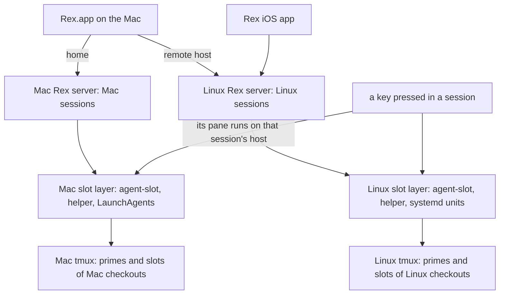
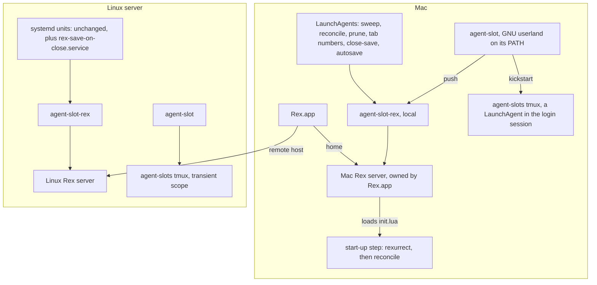
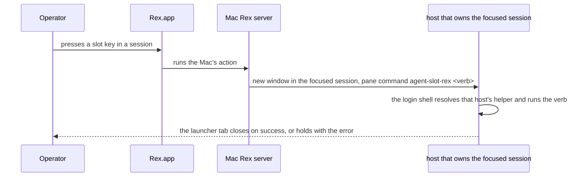
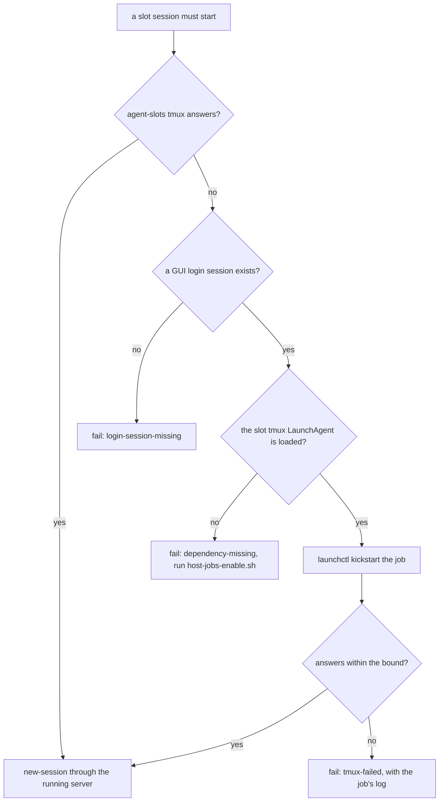
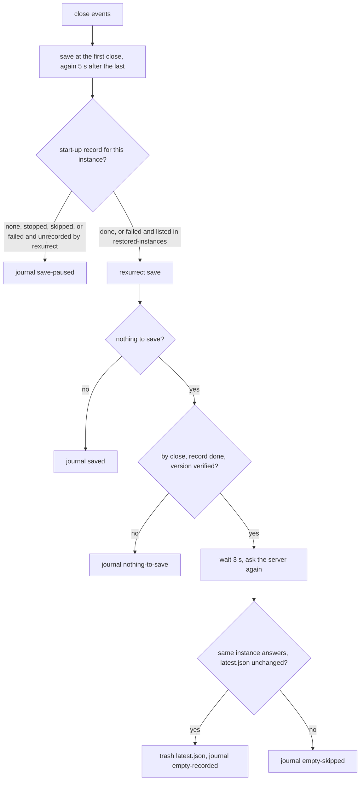

# Agent Slots on the Mac - Plan

## Goal Capsule

- **Objective:** The operator works in local Mac sessions exactly as on the Linux server: the new-agent key opens a
  repo's prime or starts an agent in a slot of the Mac's own checkout, slot tabs stay matched to live slots with no key
  press, and a Rex restart on either machine brings back what was open and nothing that was closed.
- **Means:** Each machine runs the whole slot layer for its own sessions, against its own repos, tmux, and Rex server,
  from one shared codebase with platform seams only where the OS forces them (KTD1, KTD2).
- **Product authority:** Requirements govern behavior; Key Decisions record why. This plan extends
  `docs/plans/2026-10-29-2303-feat-rex-agent-slots-on-linux-server-plan.md`, whose R2 and R18 (nothing about slots runs
  on the Mac) and whose "Running agents on the Mac" boundary it replaces. Everything that plan built on the Linux server
  stays as it is (R22).
- **Execution profile:** Bash CLIs and libraries, LaunchAgent plists and systemd user units, Lua Rex config, a Brewfile,
  and docs in dotfiles, with bats suites against stubs. CI runs only on Linux, without tmux, Rex, Lua, or launchd, so
  the Mac branches are proven by suites that stub `uname`, `ps`, `lsof`, and `launchctl`, by the Mac's pre-push, and by
  the hand-run checklist (U11). The work ships as six dotfiles PRs in a line, plus one in agent-skills (Implementation
  Units).
- **Stop conditions:** Stop and bring the finding to the operator when U1 shows a Claude in the launchd-held slot tmux
  server unable to read its credentials; a Mac slot's commit, or a scheduled pass's `git fetch`, stopping at a 1Password
  prompt; no Rex event that reports a session closing; a stopping Rex server emitting closes while it still answers as
  the same instance; or the Mac's process reader missing a process `/proc` would have named. Also stop when any teardown
  test shows a deletion the check should have blocked.
- **Who finishes:** `ce-work` executes U1 through U10 on `feat/` branches cut from `dev` in dotfiles and opens the PRs;
  U1 runs over ssh on the Mac while it is awake. U8 and U9 start once the cutover's U7 (rexurrect v0.3.0 from dotfiles,
  on or after 2026-11-07) has merged. The operator runs U11 on both machines before the docs PR merges, and a matching
  PR updates the `agent-slot` skill in the agent-skills repo.
- **Open blockers:** None.

---

## Product Contract

### Summary

The Mac gains its own complete slot layer: `agent-slot` and its timers, the Mac's Rex server driving the Mac's tmux and
slots, and the same keys, with each key acting on the host of the session it was pressed in. The new-agent key works the
same in Mac sessions against Mac repos and primes. On both machines, closing a session or tab saves the snapshot, and
closing everything records an empty state, so restores match what was open.

### Problem Frame

On 2026-11-02 the cutover moved every slot and repo session to the Linux server and made Rex.app a client into it. The
Mac half was retired: on macOS every `agent-slot-rex` verb forwards to the server over ssh, and `agent-slot` itself
depends on Linux (`/proc` for its teardown check, `flock`, `setsid`, GNU coreutils, trash-cli's trash layout, systemd
for its timers and its tmux server).

The operator also keeps local sessions on the Mac and wants the same development process there. Today a Mac session has
none of it: the new-agent key pressed in a Mac session forwards to the Linux server, there are no Mac slots, and no Mac
automation keeps tabs current.

Restores have their own gap on both machines. rexurrect autosaves every 15 minutes and, by design, never records an
empty server, so a session the operator closed comes back after a Rex restart: always when it was the last session, and
otherwise whenever the restart came before the next autosave.

### Actors

- A1. Operator: uses Rex.app on the Mac, whose home server is the Mac's and which also shows the Linux server's sessions
  as a remote host, and the Rex iOS app for the Linux server.
- A2. Slot agent: a Claude Code agent in a slot on either machine, which can launch and brief other slots on its own
  machine and releases its own slot.
- A3. Each machine's own automation: the sweep, the minute reconcile, the start-up step, the tab-number watcher, the
  saves.
- A4. Rex.app: offers only its home (Mac) server's actions; an action's pane opens in the focused session and runs on
  that session's host.

### Key Decisions

- **Each machine runs the whole slot layer for its own sessions.** (session-settled: user-directed — chosen over Rex.app
  being only a client into the Linux server, the direction the cutover was built on: "agent slot needs to run on the
  mac. exact same dev process on both mac and bigdaddy. mac rex will connect to mac tmux sessions", 2026-11-02.) Governs
  R1 through R9.
- **The Linux server keeps everything it has.** (session-settled: user-directed — chosen over the Mac taking over any of
  the server's work: the brief that carries Brett's statements frames the Mac capability as an extension, and asks that
  anything taking from the server be confirmed first.) Governs R22, R23.
- **A key acts on the host of the session it was pressed in.** Rex.app runs only the Mac's actions, but a pane an action
  opens lands in the focused session and runs on that host, so doing all of an action's work in such a pane makes every
  key host-relative without knowing which host it is on. A Mac shell's helper then acts on the Mac, and the ssh
  forwarder the cutover added (its KTD1) retires. (session-settled: user-approved — chosen over keeping the forwarder
  for Mac shells: a key in a Mac session and a Mac shell's helper act on the Mac, `ssh bigdaddy agent-slot-rex …` is the
  explicit route to the server, and nothing on the server changes; Brett through `rex-linux`, 2026-11-02.) Governs R10,
  R11.
- **The new-agent key behaves per Brett's spec on both machines.** (session-settled: user-directed — chosen over the
  cutover's key, which always started a slot: the spec of 2026-11-02 for sessions on both servers, "sessions on mac
  should connect to local mac repos, not bigdaddy repos".) Governs R12 through R15. Conflict: in a session with no tabs,
  Rex.app hands an action the last-focused pane's session, which can be another session on either machine
  (`docs/solutions/integration-issues/rex-app-gives-an-action-in-a-session-with-no-tabs-the-last-focused-panes-context.md`),
  so R12's no-tabs case holds only where Rex.app hands over the empty session itself. Until it does, a session with no
  tabs gets its prime when the operator opens a tab first, which R13 turns into the prime, and a press in an empty
  session acts on the last-focused one, the documented limit on both machines.
- **One prime map serves both machines.** The tmuxinator projects are shared between the machines, so each repo's prime
  session has the same name on both, and each machine looks it up on its own tmux. Governs R15.
- **rexurrect stays, and saves when something closes.** (session-settled: user-directed — chosen over replacing
  rexurrect: "`rexurrect` is fine, but we need to trigger a new snapshot when a session closes".) Closing a tab inside a
  session that stays open triggers it too, debounced. (session-settled: user-approved — chosen over session close only:
  a tab closed in a session that stays open comes back the same way until the next autosave; Brett through `rex-linux`,
  2026-11-02.) Governs R16, R17.
- **An empty state is recorded only after an observed close on a server whose restore finished.** rexurrect refuses
  empty saves so that a fresh or crashed server never replaces the snapshot; the layer keeps that guarantee and adds
  only the case where the operator closed everything. The fix lives in dotfiles, and an upstream issue asks rexurrect
  for an opt-in empty save ([cemcatik/rexurrect#93](https://github.com/cemcatik/rexurrect/issues/93)). (session-settled:
  user-approved — chosen over waiting for upstream and over a dotfiles-only fix: the dotfiles fix works now on the
  pinned version, and the issue lets the layer drop it once rexurrect offers the option; Brett through `rex-linux`,
  2026-11-02.) Governs R18, R19.
- **The Mac keeps the server's cap of 8 live slots per repo.** (session-settled: user-approved — chosen over a Mac
  default of 3 and over a Mac-wide cap across repos: the same development process on both machines, lowered later
  through `AGENT_SLOT_MAX_PER_REPO` if the Mac's 16 GB shows memory pressure; Brett through `rex-linux`, 2026-11-02.)
  Governs R1.
- **Slot keys stay per machine.** `<repo>/<N>` names a slot on its own machine, and the session holding its tab tells
  the machines apart; no verb takes a host. Governs R9.
- **The Mac's Rex server stays Rex.app's.** Rex.app starts and keeps the Mac's server; the layer adds no service of its
  own for it, since slots work with no Rex server (cutover R20) and the start-up step gives them tabs when it starts.
  Governs R8.
- **The same jobs on both machines, as systemd units on Linux and LaunchAgents on the Mac.** The qmd jobs set the
  precedent (`CONCEPTS.md`, *qmd daemon host*). Governs R4, R5.

### Requirements

**Slots on the Mac**

- R1. `agent-slot` runs on the Mac with every verb it has on the Linux server, making slots of the Mac's own checkouts,
  each agent in tmux on the Mac.
- R2. The teardown check holds on the Mac as on the Linux server: a slot is torn down only when its agent is idle or
  absent and nothing outside the slot's own panes holds it, and when the Mac cannot tell, the slot stays.
- R3. A Mac slot's agent keeps running, and reaches its credentials, whatever started its tmux server: a Rex tab, a
  scheduled pass, an agent, or an ssh shell; quitting, updating, or restarting Rex.app stops no agent.
- R4. The Mac runs the slot jobs the Linux server runs: the sweep, the minute reconcile, the orphan prune, the
  tab-number watcher, the autosave, and the close-triggered save; each starts again on its own after a failure.
- R5. One documented command per machine enables its jobs, and the helper's doctor on each machine names any job that is
  not running, with the command that starts it.
- R6. A scheduled pass that runs while the Mac has no network, as in a dark wake, tears nothing down that it could not
  check, and the first pass after wake brings the tabs back in step.

**The Mac's Rex server**

- R7. Each live Mac slot has exactly one tab in its repo's session on the Mac's Rex server, opened in the background,
  and loses it when torn down, by the same reconcile, push, and start-up step the Linux server uses.
- R8. Whenever the Mac's Rex server starts, the operator's own tabs are restored first and then every live slot gets its
  tab, once per server instance, and every Mac tab shows its number.
- R9. A slot key names a slot on its own machine; the same key may be live on both machines, and no verb, tab, or
  teardown on one machine touches the other's.

**Keys**

- R10. Every slot key and palette entry acts on the machine whose session it was pressed in: a Mac session's on the Mac,
  a Linux session's on the Linux server.
- R11. A Mac shell's `agent-slot` and `agent-slot-rex` act on the Mac; from the Mac, the Linux server is driven only
  through a key pressed in one of its sessions or over ssh.

**The new-agent key**

- R12. In a session named after one of its machine's repos that has no tabs, the key opens the repo's prime as the
  session's first tab, attached to the prime tmux session on that machine; a repo with no prime gets a new slot instead.
- R13. In such a session that has tabs, whichever tab is focused, the key opens the prime when no tab holds it, and
  otherwise starts a new slot of that repo with no picker.
- R14. In a session not named after one of its machine's repos, the key shows the repo picker, listing that machine's
  repos.
- R15. The map from repo to prime session is one file of dotfiles config that both machines read; each machine finds the
  prime session on its own default tmux server, so a Mac session reaches only Mac repos and Mac primes.

**Restores match what was open**

- R16. On both machines, closing a session saves the own-tab snapshot within seconds, so a Rex restart right after the
  close does not bring it back.
- R17. Closing a tab in a session that stays open saves the snapshot the same way.
- R18. Closing the last session worth saving records an empty state, and the next Rex start restores none of the closed
  sessions, while the earlier snapshots stay restorable by hand.
- R19. A server that starts empty, stops before its restore finishes, or whose restore failed never records an empty
  state, so the snapshot from before is the one the next start restores.
- R20. The 15-minute autosave and the save before a planned restart work on both machines, and on the Mac they and
  rexurrect itself come from dotfiles, replacing what was installed by hand.
- R21. Saves on either machine wait until that server's own-tab restore has run, so a save never records a half-restored
  server (cutover KTD4).

**What stays the same on the Linux server**

- R22. Everything the cutover built on the Linux server behaves as it does today: the Rex server service and the login
  server, the reconcile timer and start-up step, tab numbers, the sweep, the slot tmux scope, the phone's view, and the
  keys pressed in its sessions from Rex.app.
- R23. The Mac's additions change no behavior of the Linux server's slots: code the machines share takes its Linux path
  there, held by the suites that cover it today.

### Key Flows

- F1. A new agent in a Mac session
  - **Trigger:** The operator presses the new-agent key in the Mac session `dotfiles`, which has no tabs.
  - **Actors:** A1, A4
  - **Steps:** The tab opens in the Mac session, becomes the prime tab attached to the Mac's `dotfiles` tmux session,
    and moves to first. A second press starts slot `dotfiles/1` on the Mac, whose tab appears in the same session.
  - **Covered by:** R1, R7, R10, R12, R13, R15
- F2. A key pressed in a Linux session
  - **Trigger:** With the Linux server's `dotfiles` session focused in Rex.app, the operator presses the restore key,
    then the finish key on a slot tab.
  - **Actors:** A1, A4
  - **Steps:** Each key opens its pane in that Linux session, so the Linux server's helper restores its tabs and
    finishes its slot; nothing runs on the Mac.
  - **Covered by:** R10, R22
- F3. Closing a session, then restarting Rex
  - **Trigger:** The operator closes a Mac session and, a minute later, Rex.app updates and restarts its server.
  - **Actors:** A1, A3
  - **Steps:** The close saves the snapshot. On restart, the start-up step restores the remaining own tabs, then the
    slot tabs. The closed session does not come back.
  - **Covered by:** R8, R16, R21
- F4. Closing everything
  - **Trigger:** The operator closes the last session on a machine.
  - **Actors:** A1, A3
  - **Steps:** The save finds nothing worth saving on a server whose restore finished, and records the empty state. The
    next Rex start restores nothing. The earlier snapshot can still be restored by hand.
  - **Covered by:** R18, R19
- F5. The Mac sleeps with agents mid-turn
  - **Trigger:** The lid closes while two Mac slot agents work; the Mac dark-wakes overnight; the operator opens the lid
    in the morning.
  - **Actors:** A2, A3
  - **Steps:** Agents pause with the Mac. A pass in a dark wake with no network tears nothing down it could not check.
    After wake, the agents continue and the next reconcile pass corrects any tab.
  - **Covered by:** R3, R6, R7

### Acceptance Examples

- AE1. **Covers R13.** Given the Mac session `dotfiles` holding only a plain shell tab and the Mac's `dotfiles` tmux
  session running, when the operator presses the new-agent key, then the session's first tab is attached to the Mac's
  `dotfiles` prime; when they press it again, then slot `dotfiles/1` starts on the Mac with no picker.
- AE2. **Covers R14, R15.** Given a Mac session named `xurl-rs` and no `xurl-rs` checkout on the Mac, when the operator
  presses the new-agent key, then the repo picker lists the Mac's repos.
- AE3. **Covers R10, R22.** Given Rex.app showing the Linux server's `agentnative-cli` session with its prime tab open,
  when the operator presses the new-agent key, then a slot of `agentnative-cli` starts on the Linux server and nothing
  starts on the Mac.
- AE4. **Covers R7, R8.** Given Rex.app quit, when a Mac slot agent launches a slot, then the launch succeeds with no
  tab; when Rex.app starts, then the new slot has exactly one tab.
- AE5. **Covers R16.** Given two Mac sessions, when the operator closes one and Rex restarts within a minute, then only
  the other comes back.
- AE6. **Covers R18, R19.** Given the operator closed every Mac session, when Rex restarts, then no session is restored,
  and `rexurrect list` still shows the earlier snapshot.
- AE7. **Covers R19, R21.** Given the Linux server's Rex server crashed and restarted empty, when the autosave fires
  before the start-up step's restore has run, then no empty state is recorded and the restore brings the own tabs back.
- AE8. **Covers R2.** Given a Mac slot whose agent is idle, and a shell in a Mac terminal outside the slot's panes whose
  working directory is in the slot, when the sweep runs, then the slot is not torn down and the check names that shell.
- AE9. **Covers R3.** Given no slot tmux server on the Mac, when the operator runs `agent-slot launch dotfiles` from an
  ssh shell into the Mac, then the slot's Claude starts signed in, `gh auth status` succeeds in its shell, and both keep
  working after Rex.app quits.
- AE10. **Covers R6.** Given a released Mac slot and the Mac in a dark wake with no network, when the sweep fires, then
  the slot is not torn down; when the Mac wakes with the network up, then the next sweep tears it down.

### Success Criteria

- AE1 through AE10 pass by hand on the Mac and the Linux server, because CI runs only on Linux, without tmux, Rex, or
  launchd.
- `agent-slot doctor` and `agent-slot-rex doctor` are clean on both machines after each machine's documented setup,
  which the README gives as one path per machine.
- On Linux CI and in the Mac's pre-push, the full suite passes; Mac-only behavior that cannot run on CI is covered by
  stubbed suites that run everywhere.

### Scope Boundaries

**Deferred for later**

- An agent on one machine launching or finishing a slot on the other.
- The phone reaching Mac sessions; the Rex iOS app connects only to the Linux server.
- Dev-server port allocation for parallel slots, and Mac-local dev servers colliding with the ports the `bd-tunnel`
  LaunchAgent binds (`docs/plans/2026-11-02-2120-feat-dev-server-access-from-the-mac-plan.md`).
- A cap on live slots across all repos on one machine.
- Dropping the dotfiles-side empty-state fix once rexurrect offers an opt-in empty save
  ([cemcatik/rexurrect#93](https://github.com/cemcatik/rexurrect/issues/93)).
- A Rex server service of the layer's own on the Mac.

**Outside this work**

- The teardown check's rules, the clone layout, trust handling, and the reconcile's planning, all of which stay one
  implementation on both machines.
- Dropping tmux from under the agents, or a reconcile driven by Rex's event stream.

**Deferred to Follow-Up Work**

- The `agent-slot` skill's text in the agent-skills repo (`agent-slot/SKILL.md`), which places slots on the Linux
  server; a matching PR there.

**Considered and not built**

- A dark-wake gate on the reconcile: a pass with no network changes tabs correctly or not at all, and the next pass
  after wake converges. Only the sweep, which types into agents, runs behind a network check (KTD5).
- A doctor check that names a locked 1Password: a locked agent makes the sweep's `git fetch` fail, which already keeps
  the slot with `git-state-unknown`. Revisit if U1 shows 1Password prompting rather than failing.
- Reloading the Rex config from the restow-on-pull hook: until a reload, a host runs its old actions against the new
  helper, which in this rollout only acts on the wrong machine's tabs or fails on an unknown session; the deploy's own
  reload ends it, and U10 says to run it on both machines after PR 3. Revisit if a later change to the actions does harm
  in that window.
- More rexurrect snapshots kept for close-triggered saves: saves on close rotate the newest 10 faster, but a save of an
  empty server writes nothing, so the last snapshot worth restoring survives. Revisit if a restore by hand finds the
  wanted snapshot gone.
- Leaving the layer's own tab closes out of the close-triggered save: each teardown then saves once more, which costs a
  snapshot and records the right layout.
- A cap on how many dormant slots the start-up step resumes at once on the Mac: it resumes them all, as on the Linux
  server. Revisit if a Mac reboot shows memory pressure.
- Telling a Linux slot's PR from a Mac slot's when both use one branch name: GitHub keeps one branch per name, so two
  slots pushing the same name collide at push first.

### Dependencies / Assumptions

- The new-agent key spec for Linux-server sessions, in progress in slot dotfiles/2 (task `rex-new-agent-key`, branch
  `feat/rex-new-agent-key-prime`), lands on `dev` first; this plan carries its prime map, `prime` verb, and
  `--wait-shown` to the Mac.
- The cutover's U7 (rexurrect v0.3.0 from dotfiles, on or after 2026-11-07) lands first or together with this plan's
  rexurrect work.
- The Mac runs macOS 27 on Apple silicon with Homebrew under `/opt/homebrew`, 16 GB and 8 cores (read on 2026-11-02);
  Homebrew bash 5.3, tmux 3.8, coreutils, `timeout`, jq, jaq, git-crypt with its key, and lsof are present; `flock`,
  `setsid`, GNU findutils, and trash-cli are not.
- Claude Code on the Mac keeps its credentials in the login Keychain (no `~/.claude/.credentials.json` there), which a
  process outside the operator's login session may not reach. Unverified until measured.
- Rex.app keeps the Mac's Rex server running while the app is quit (cutover KTD2's note on the Mac's background server)
  and loads `init.lua` on every server start.
- In a session with no tabs, Rex.app hands an action the last-focused pane's session, which can be on the other machine;
  the slot dotfiles/2 work documents the limit and makes such a tab wait to be shown.

### Outstanding Questions

**Resolve Before Planning**

- None.

**Deferred to Implementation**

- How a Mac slot's commits are signed if the 1Password SSH agent asks for approval. Commits on the Mac sign through the
  1Password agent, and `op-ssh-sign-wrapper` falls back to `ssh-keygen` only on Linux (`AGENTS.md`, Git Signing), so an
  unattended slot could stop at a prompt. U1 measures it; a prompt stops the work for the operator's choice, since
  signing with a key file kept on the Mac would change where the signing key lives.

<!-- ce-section: work-relationships -->
### How This Work Fits Together

This plan covers the Mac's slot layer, host-relative keys, and close-triggered saves on both machines. The breakdown
below is the current understanding, not a committed roadmap.

- The Linux-server cutover (`docs/plans/2026-10-29-2303-feat-rex-agent-slots-on-linux-server-plan.md`): this plan
  depends on it and changes only its Mac-side decisions (R2, R18, KTD1's forwarder).
  - The new-agent key in slot dotfiles/2: this plan depends on it.
  - rexurrect from dotfiles (cutover U7): this plan shares it and extends it to the Mac.
- The close-triggered save and the empty state: can proceed independently of Mac slots, and helps the Linux server on
  its own.
- Dev-server access from the Mac (`docs/plans/2026-11-02-2120-feat-dev-server-access-from-the-mac-plan.md`): shares the
  Mac's localhost ports with Mac-local dev servers; still to decide.
- Cross-machine slot launches: depend on this plan; still to decide whether they are wanted.

### Sources / Research

- `scripts/agent-slot/lib/agentstate.sh` (the `/proc` scan the teardown check rests on), `hook.sh`, `release.sh`,
  `record.sh`, `sessions.sh`, `purge.sh`, `env.sh` (the pinned PATH).
- `scripts/agent-slot-rex/agent-slot-rex` and `lib/forward.sh` (the Mac forwarder), `lib/settings.sh`,
  `stow/rex/dot-config/rex/{init,agent-slots,slot-startup,tab-numbers}.lua`.
- `scripts/host-jobs-enable.sh`, `stow/local/dot-config/systemd/user/`, `stow/tmux/dot-config/systemd/user/`,
  `stow/launchagent/Library/LaunchAgents/`, `tests/launchagents.bats`, `stow/brew/Brewfile`.
- `docs/solutions/integration-issues/rex-app-offers-only-its-home-servers-custom-actions-not-a-remote-hosts.md`,
  `docs/solutions/integration-issues/rexurrect-auto-restore-waits-for-ready-then-holds-30s-and-duplicates-sessions-made-first.md`,
  `docs/solutions/best-practices/macos-launchd-user-path-env-bash-resolves-system-bash-2026-10-05.md`,
  `docs/solutions/integration-issues/launchd-missed-daily-job-runs-in-darkwake-without-network.md`,
  `docs/solutions/integration-issues/tmux-started-from-a-systemd-unit-dies-with-it-unless-a-user-scope-holds-it.md`,
  `docs/solutions/integration-issues/replacing-an-ssh-hop-with-a-local-call-drops-what-the-ssh-login-supplied.md`.
- rexurrect v0.3.0 source (github.com/cemcatik/rexurrect): `src/save.rs` (empty servers are never saved, and a save
  restores first into an unrestored instance), `src/store.rs` (`latest.json` is a symlink), `src/restore.rs` (with no
  latest snapshot a restore records the instance and creates nothing).
- The tmuxinator projects shared through `config/shell/tmuxinator.sh`, whose `name:` fields are the prime session names.

---

## Planning Contract

**Product Contract preservation:** changed: AE1, AE8, AE9 — AE1's setup moves from a session with no tabs to one holding
a plain tab, because Rex.app cannot hand an action a session with no tabs (the conflict call-out on the new-agent Key
Decision); AE8 names a holder the Mac's reader can see; AE9 also checks `gh`'s credentials. Otherwise restructured, no
scope change: Outstanding Questions' deferred item is answered by KTD3, KTD4, KTD5, and U1, and its place holds the one
execution-time question left (signing); Scope Boundaries gains a Considered and not built list; the Goal Capsule gains
its execution profile, stop conditions, and who finishes.

### Key Technical Decisions

- KTD1. **Platform differences live in one library that agent-slot and its hooks source.**
  `scripts/agent-slot/lib/platform.sh` answers what `/proc` answers on Linux (each process's parent and command, which
  processes hold a path under the slot root, a gitstatusd's tmux variables, this process's open descriptors), plus a
  UUID and the account's login shell. Its Linux functions are today's code moved as it is, so every Linux suite passes
  unchanged (R23); its macOS functions are new (KTD3). Chosen over branching inside each caller, since five files read
  those facts and two branches in each would drift. Governs R1, R2, R23.
- KTD2. **On the Mac, agent-slot runs on a GNU userland on its own pinned PATH.** `agent_slot_env` already pins PATH; on
  Darwin it puts Homebrew's coreutils and findutils `gnubin` directories, the keg-only util-linux `bin`, and an unlinked
  trash-cli keg first. That gives the GNU-only calls (`realpath -m`, `env -i -C`, `date +%s.%N`, `xargs -r`,
  `find -printf`) and `flock` and `setsid` their Linux behavior, keeps the purge on trash-cli's FreeDesktop layout, and
  leaves `/usr/bin/trash` the operator's own. The GNU directories stay inside agent-slot's processes: a slot's sessions
  get the PATH the account's login shell builds, so an agent sees the tools the operator sees. Chosen over porting each
  call to BSD forms, which would mean two implementations of every call, the second tested only where CI cannot run
  (`docs/solutions/developer-experience/gnu-coreutils-path-shim-for-macos-pre-push-gate.md` recommends the same shim).
  Governs R1.
- KTD3. **The Mac's process reader uses `ps` and `lsof`, and fails toward keeping the slot.** Parents and commands come
  from `ps -axo pid=,ppid=,args=`, read on both sides of the holder scan as the Linux scan reads `/proc/*/stat` twice;
  holders from one `lsof -nP -F pfn` over every process, kept when a name (the working directory included) is under the
  slot root; gitstatusd's `TMUX` and `TMUX_PANE` from `ps -E`. A process is named by its argv[0], because macOS names
  Claude Code's process after its version file ([cemcatik/rexurrect#42](https://github.com/cemcatik/rexurrect/issues/42)
  records the same). `lsof` exits 1 both when nothing matches and when it could not inspect a process, so a read counts
  as complete only when it exits 0, or exits 1 with nothing on standard error; any other read, and one that outlasts its
  bound, makes the state `unknown`, which blocks teardown as on Linux. A watcher that holds no descriptor under the
  slot, as FSEvents watchers do, is invisible here as inotify watchers are on Linux. U1 measures `lsof`'s time, exit
  codes, and standard error on the Mac, and whether `ps -E` shows another process's environment there. Governs R2.
- KTD4. **On the Mac, the slot tmux server is a launchd job in the login session.** A KeepAlive LaunchAgent,
  `com.user.agent-slots-tmux`, runs `tmux -L agent-slots -f ~/.config/tmux/slots.conf -D` (foreground, so `exit-empty`
  is off) with an explicit environment of `HOME`, `USER`, `LOGNAME`, `SHELL`, `LANG`, `TERM`, and `PATH`, so no Claude
  Code marker reaches it
  (`docs/solutions/runtime-errors/tmux-server-started-inside-claude-code-saves-no-transcripts.md`), and `ProcessType`
  Interactive, since agents run under it. When no slot tmux server answers, `sessions_start` on the Mac kicks the job
  and waits a bounded time for it, then creates the sessions as it does with a running server. Unlike Linux, the Mac
  never starts the server directly: the server is shared, so the first start fixes the security session of every agent
  started in it later, and one started from an ssh shell would leave all of them without the login Keychain that
  Claude's, `gh`'s, and git's credentials live in. A missing GUI login fails the launch with `login-session-missing`,
  naming a login at the Mac as the next step, and a job that is not loaded fails it with `dependency-missing`, naming
  `bash scripts/host-jobs-enable.sh`; doctor still reports a server launchd does not hold as `tmux-outside-scope`. This
  is the launchd counterpart of the cutover's KTD3 scope: the GUI domain is where the login Keychain is reachable,
  whoever asked for the slot (an ssh shell, a scheduled pass, an agent), and launchd ends no other job's processes with
  it. Nothing that runs routinely boots the job out or restarts it, since that ends every Mac agent. U1 measures the
  Keychain and lifetime behavior. Governs R3.
- KTD5. **The Mac's scheduled jobs are LaunchAgents matching the Linux units one for one.** The sweep runs every 10
  minutes, the reconcile every minute, the slot-client prune daily at 02:15, and the tab-number and close-save watchers
  stay alive; each runs through `/bin/sh -c 'PATH=…; exec …'` (`tests/launchagents.bats`) and `scripts/launchd-run.sh`
  for its log. A shared `scripts/agent-slot/lib/jobs.sh` answers, per OS, whether a job is running and which command
  starts it, for both doctors and for `scripts/host-jobs-enable.sh`, whose new Darwin branch loads an explicit `AGENTS`
  list as the Linux branch enables its `TIMERS` and `SERVICES`. A job counts as running when it is loaded and, for a
  kept-alive job, holds a pid, or, for an interval job, last exited 0, since a crash-looping job stays loaded. The
  teardown check already fails closed with no network (`pr-state-unknown`, `git-state-unknown`), but the sweep also
  types its closing steps and reminders into idle agents once each, and a dark wake would spend them on turns that fail
  offline, so the Mac's sweep runs only when the network probe `scripts/upgrade/daily-gate.sh` uses answers, moved into
  a script both call; a fire with no network exits 0 having done nothing. The reconcile runs ungated, since a pass with
  no network changes tabs correctly or not at all. Governs R4, R5, R6.
- KTD6. **Every slot action opens a pane in the session it was pressed in and does its work there.** The new-agent key
  already does. Restore and finish stop calling `rex.exec`, which runs on the Mac whatever session is focused, and open
  a background launcher tab whose command is the bare `agent-slot-rex restore --tab` or
  `agent-slot-rex finish --tab --session <id> --block <id>`, so the session's host runs it. A launcher tab closes itself
  once its verb succeeds and holds with the error otherwise (the cutover's DX review D9). Its label names its verb and
  no slot key, so the reconcile, which keys tabs by a slot key in the label, never adopts or closes it. A press in a
  session with no tabs reaches the last-focused session's host, the limit the new-agent Key Decision records. With every
  action host-relative, the Mac's helper acts locally: `scripts/agent-slot-rex/lib/forward.sh` and the dispatcher's
  Darwin branch go. `wrong-host` and `server-unreachable` stay in the closed reason set, documented as no longer
  emitted, so a consumer that branches on them still parses (additive envelope rule). The how-level choice instantiates
  the Key Decision that governs R10 and R11. Governs R10, R11.
- KTD7. **The rex package ships the same files to both machines.** `slot-startup.lua`, `tab-numbers.lua`, and the new
  `save-on-close.lua` link on the Mac too: `scripts/stow-deploy` drops its macOS `--ignore`, and `init.lua` requires the
  start-up module on every host, so the Mac's own `rexurrect auto-restore` line goes and both machines restore in the
  start-up step's order (cutover KTD4). The Mac's helper finds the CLI at
  `~/Library/Application Support/com.superlogical.rex/RexServer/Versions/Current/Rex Server.app/Contents/MacOS/rex`,
  whose `Current` link follows the server Rex.app installs, then in the app bundle, the candidates `scripts/stow-deploy`
  already reloads the config through. The Mac's LaunchAgents name the first path, and a test holds them, `settings.sh`,
  and `stow-deploy` to one text. Every Mac job passes `--autostart=false`, so none starts a Rex server in place of
  Rex.app's; U1 checks that a LaunchAgent's CLI finds Rex.app's socket, and `settings.sh` sets `REX_SERVER` on the Mac
  if it does not. Restarting the Mac's server is `rex --autostart=false server stop`, after which Rex.app starts a new
  one (U1 confirms), and doctor's restart next steps name that on the Mac. Governs R7, R8.
- KTD8. **Closes reach the save through a watcher that only reports them.** `save-on-close.lua`, run as
  `rex --autostart=false do --all`, prints one line per close event it hears. The helper's `save --watch` verb starts
  it, reads those lines, saves at the first close, and saves once more 5 s after the last of any closes that came
  meanwhile, with one save running and at most one queued, so a Rex restart inside the quiet period cannot lose the
  first close. The Lua stays thin and the debounce lives in bash, where the suites can drive it; whether a `rex do`
  script can start a detached command is unmeasured. U1 measures which events a session close and a tab close emit (the
  tab-number watcher hears `window_closed`). On Linux the watcher runs as `rex-save-on-close.service`, bound to
  `rex-server.service` like `rex-tab-numbers.service`; on the Mac as a KeepAlive LaunchAgent. Every save, whatever
  triggers it, takes the helper's save lock and passes one gate: the start-up record for the running instance shows
  rexurrect `done`, or `failed` with the instance listed in rexurrect's `restored-instances` file (its README documents
  it). A `failed` record from a restore whose every attempt failed leaves the instance unrecorded, and rexurrect's
  `save` then restores into a server the reconcile has already filled, doubling every repo session; the cutover's `save`
  gate (its KTD4) admits `failed` alone, which a 15-minute autosave hits at most once and a save on every close hits at
  once. The start-up step ends with one gated save, so a close during its restore is not lost. Governs R16, R17, R21.
- KTD9. **The empty state is recorded by trashing rexurrect's `latest.json` link, only on a close-triggered save over a
  restored server that is still running.** When `save --by close` reads `latest.json`'s target, runs `rexurrect save`,
  sees it exit 0 with its `nothing to save` line, and finds that the start-up record for the running instance shows
  rexurrect `done`, it waits 3 s and asks the server again. Only when the same instance still answers does it trash
  `latest.json` with trash-cli, which moves the symlink and never its snapshot, if the link still points where it did,
  and journal `empty-recorded`; otherwise it journals `empty-skipped`. The second look is the guard against a stopping
  server, whose closes would otherwise wipe the restore on every Rex.app update or service restart: a stopping server no
  longer answers, and one that restarted answers as another instance. A restored session that the operator has not
  touched still counts as worth saving, since it keeps its last command (rexurrect's README). The save lock covers the
  read, the save, the second look, and the trash, so no save of this layer's lands between them. With no latest
  snapshot, the next start's rexurrect restores nothing and records the instance, so later saves start fresh (rexurrect
  v0.3.0 `src/store.rs`, `src/restore.rs`), and every snapshot stays restorable with
  `rexurrect restore --snapshot <id>`. The autosave, a save run by hand, and an instance whose start-up shows rexurrect
  `failed`, `stopped`, or `skipped` never record it. The `nothing to save` wording is pinned with the rexurrect version
  in `scripts/agent-slot/verified-versions`, so an upgrade that rewords it skips the step and doctor warns, rather than
  losing the empty state silently. The step goes once
  [cemcatik/rexurrect#93](https://github.com/cemcatik/rexurrect/issues/93) ships an option. The how-level choice
  instantiates the Key Decision that governs R18 and R19. Governs R18, R19.
- KTD10. **rexurrect reaches the Mac through the same deploy script.** `scripts/rexurrect-deploy.sh` (cutover U7) pins
  the `aarch64-apple-darwin` archive and its binary's checksum beside the Linux pins and picks by `uname -s` and
  `uname -m`. The Mac's autosave runs `agent-slot-rex save --by timer` from a LaunchAgent every 15 minutes. Every
  rexurrect call the helper makes, on both machines, passes `REXURRECT_STATE_DIR` set in `settings.sh` to
  `${XDG_STATE_HOME:-~/.local/state}/rexurrect`, where the Mac's snapshots already are (its `init.lua` line and the
  hand-installed autosave both pass that directory, read 2026-11-02), so nothing depends on rexurrect's default on
  either OS. The migration runs in this order: boot out `io.github.cemcatik.rexurrect.autosave` and trash the plist that
  `rexurrect autosave install` wrote outside dotfiles, before the new binary lands, since that agent runs
  `rexurrect save` ungated and would race the start-up step once the binary is 0.3.0; replace the hand-installed binary
  the way the cutover's U7 replaces any file at the target that is not the verified one; load the dotfiles autosave;
  then restart the Mac's Rex server once, so the start-up step records the running instance instead of the post-limit
  pass recording rexurrect `skipped` and pausing saves until Rex.app next restarts. Doctor names any LaunchAgent
  dotfiles does not own that runs rexurrect, as `rexurrect-autosave-foreign`. Governs R20, R21.
- KTD11. **One prime map, read on each machine against its own tmux.** The map's header names each machine's default
  tmux server, and the key needs nothing more on the Mac once the helper acts locally (KTD6): the key's pane runs the
  Mac's helper, whose repo list holds the Mac's checkouts. Governs R12, R13, R14, R15.
- KTD12. **Live measurement on the Mac comes before dependent code.** U1 settles what KTD3, KTD4, and KTD8 rest on, and
  the signing question, each with a stop condition in the Goal Capsule (the cutover's KTD13 rule).

### High-Level Technical Design

Each machine runs the same layer against its own Rex server and tmux; only the Mac's column is new:

How a key reaches the right machine (KTD6):

How `sessions_start` starts the slot tmux server on the Mac (KTD4):

The Mac never starts the server outside the job, so its agents always run in the login session (KTD4); Linux keeps its
direct start when `systemd-run` fails.

Whether a save records the empty state (KTD8, KTD9):

### Assumptions

- Homebrew's keg-only util-linux on macOS installs `flock` and `setsid`: neither is on its formula's list of Linux-only
  tools. U1 confirms it on the Mac.
- `brew bundle` honors `link: false`, so trash-cli installs without shadowing `/usr/bin/trash`.
- Rex.app keeps the Mac's Rex server running while the app is quit, and its server runs `init.lua` at each start.
- launchd runs a `StartInterval` job that came due during sleep once after wake.
- The Mac is the only macOS host: the `launchagent` package deploys only there, so the Mac's jobs need no host gate.
- rexurrect v0.3.0 reads the state directory the Mac's hand-installed build wrote (checked in U9).

### Risks & Dependencies

| Risk                                                                                    | Mitigation                                                                                                                      |
| --------------------------------------------------------------------------------------- | ------------------------------------------------------------------------------------------------------------------------------- |
| A Claude in the launchd-held tmux server cannot read its Keychain credentials           | U1 measures it first, and it is a stop condition                                                                                |
| A Mac slot's commit stops at a 1Password approval prompt                                | U1 measures it; the operator chooses how Mac slots sign (Outstanding Questions)                                                 |
| `lsof` over every process is slow enough to widen the scan's race or outlast its bound  | the reader fails toward `unknown` (KTD3); U1 times it, and the bound is a setting                                               |
| `ps -E` hides another process's environment, so gitstatusd is not exempted              | the slot then reads `unknown` and stays, the safe side; U1 checks, and the exemption is the only thing lost                     |
| No Rex event reports a session closing                                                  | U1 checks, and it is a stop condition; the tab-number watcher's `window_closed` is the fallback for a session closed tab by tab |
| A rexurrect upgrade rewords `nothing to save`                                           | the version is pinned in `verified-versions`, the empty-state step skips on any other, and doctor warns (KTD9)                  |
| The shared Lua actions change for the Linux server's sessions                           | the outcome is the same, a key in a Linux session acts on the Linux server; the rex-config suite and U11's F2 hold it           |
| Slot agents on the Mac run in bypass mode inside the login session                      | the docs state their reach (System-Wide Impact); it is the operator's own account, as on the Linux server                       |
| Mac-local dev servers in slots collide with the ports the `bd-tunnel` LaunchAgent binds | deferred to the dev-server access plan; `ExitOnForwardFailure no` keeps the tunnel up                                           |
| The cutover's U7 slips past 2026-11-07                                                  | U1 through U7 do not wait on it; U8 and U9 do                                                                                   |
| A stopping Rex server emits closes, and a close-triggered save records the empty state  | the second look needs the same instance answering 3 s later (KTD9); U1 measures what a stop emits, and it is a stop condition   |
| A restore whose every attempt failed lets rexurrect's save restore into a filled server | the save gate needs `done`, or `failed` with the instance in `restored-instances` (KTD8)                                        |
| The hand-installed autosave runs rexurrect 0.3.0 ungated during the migration           | it is booted out before the new binary lands, and doctor names any rexurrect LaunchAgent dotfiles does not own (KTD10)          |
| A press in a session with no tabs starts another repo's slot on the Mac                 | a documented Rex.app limit (the new-agent Key Decision); the operator opens a tab first                                         |
| A pass frozen by sleep resumes with its bounds already spent                            | U1 measures `timeout` and `flock -w` across a sleep; a step cut short reports partial side effects, as on Linux                 |

### Alternative Approaches Considered

- Running Mac agents in a Linux VM on the Mac, so `/proc` and systemd come as they are: rejected, because the VM's
  checkouts would not be the Mac's (R15), and Keychain, Xcode, and macOS-only work would be out of reach.
- The Linux server driving Mac slots over ssh: rejected, because it fails whenever the Mac sleeps and contradicts R9 and
  R11.
- Porting each GNU-only call to BSD forms: rejected by KTD2.
- Keeping the forwarder and checking the focused session's host in exec-based actions: rejected by KTD6, since a pane
  already lands on the right host with no host lookup.
- A `launchctl submit` job per tmux start, as the scope is per start on Linux: rejected, since `submit` is deprecated
  and a KeepAlive job also restarts a server that dies.

### System-Wide Impact

- The Mac gains seven LaunchAgents (slot tmux server, sweep, reconcile, prune, tab numbers, close-save, autosave) and
  loses the hand-installed rexurrect autosave; the Linux server gains one user service, `rex-save-on-close.service`.
- The shared Lua actions, the helper, and agent-slot change on both machines; on the Linux server every change keeps
  today's behavior, the close-triggered save and empty state excepted, which are new there too.
- Slot agents on the Mac run as the operator inside the login session, so in bypass mode they can reach the login
  Keychain, other apps through automation, and every tab on the Mac's Rex server with `rex send` and `rex send-key`; the
  README's bypass-mode paragraph says so beside the Linux server's statement.
- The Brewfile adds util-linux, findutils, and an unlinked trash-cli on macOS; nothing changes in the operator's
  interactive tools.
- README.md, BOOTSTRAP.md, AGENTS.md, CONCEPTS.md, and the agent-skills repo's `agent-slot/SKILL.md` change, so the docs
  go through the feature-branch PR flow.

---

## Implementation Units

| U-ID | Title                                                 | Key files                                                                                     | Depends on     |
| ---- | ----------------------------------------------------- | --------------------------------------------------------------------------------------------- | -------------- |
| U1   | Measure the Mac behaviors the plan rests on           | `docs/solutions/integration-issues/`                                                          | none           |
| U2   | Read processes through a platform library             | `scripts/agent-slot/lib/platform.sh`, `agentstate.sh`, `hook.sh`, `release.sh`                | U1             |
| U3   | Give agent-slot a GNU userland on the Mac             | `scripts/agent-slot/lib/env.sh`, `sessions.sh`, `stow/brew/Brewfile`                          | U1             |
| U4   | Run the Mac's slot tmux server under launchd          | `com.user.agent-slots-tmux.plist`, `scripts/agent-slot/lib/sessions.sh`                       | U2, U3         |
| U5   | Schedule the Mac's slot jobs                          | `scripts/agent-slot/lib/jobs.sh`, sweep and prune plists, `scripts/host-jobs-enable.sh`       | U4             |
| U6   | Make the Mac's helper act locally                     | `scripts/agent-slot-rex/agent-slot-rex`, `lib/forward.sh`, `lib/settings.sh`, `lib/doctor.sh` | U5             |
| U7   | Make every key host-relative and share the Rex config | `stow/rex/dot-config/rex/`, `scripts/stow-deploy`, reconcile and tab-number plists            | U6             |
| U8   | Save on close, and record the empty state             | `save-on-close.lua`, the helper's `save`, `rex-save-on-close.service`                         | U7, cutover U7 |
| U9   | Bring rexurrect to the Mac from dotfiles              | `scripts/rexurrect-deploy.sh`, autosave plist, `scripts/host-jobs-enable.sh`                  | U8, cutover U7 |
| U10  | Document the Mac's slot layer                         | README, BOOTSTRAP, CONCEPTS, AGENTS, the agent-slot skill                                     | U9             |
| U11  | Run the two-machine checklist                         | none                                                                                          | U1 through U10 |

The PRs land in a line, each after the one before, because each later group adds to the `AGENTS` list, the helper's
settings, or the Rex config that an earlier group creates. Stack them with `gh stack` per
`~/.claude/guides/git-and-github.md` (Stacked PRs).

### Before any PR

#### U1. Measure the Mac behaviors the plan rests on

- **Goal:** Settle what KTD3, KTD4, KTD7, KTD8, and KTD9 rest on, and the signing question, before code depends on them
  (KTD12).
- **Requirements:** R2, R3, R6, R16, R17, R18, R19; Outstanding Questions.
- **Dependencies:** None.
- **Files:** `docs/solutions/integration-issues/` (one entry per finding worth keeping, published with `sd-commit-doc`).
- **Approach:** Over ssh to the Mac while it is awake, with a scratch tmux socket, a scratch LaunchAgent label, and a
  scratch Rex server on its own socket; never the operator's Rex server, tmux servers, or LaunchAgents:
  1. Load a scratch LaunchAgent running `tmux -L <scratch> -D`, start a session in it from the ssh shell, and in it run
     a one-word `claude -p` and `gh auth status`; record whether each signs in. Repeat with a tmux server started
     directly from the ssh shell. Record whether the launchd-held server outlives the ssh shell and a scratch interval
     job that kicked it, and what `launchctl kickstart` reports from an ssh shell when no GUI login exists, if one can
     be arranged.
  2. In that session, make a signed commit in a scratch repo, and from a scratch interval job run `git fetch` over ssh;
     record whether the 1Password agent prompts for either.
  3. Time `lsof -nP -F pfn` over every process with the operator's usual apps open, and record its exit codes and
     standard error with and without a match; confirm it lists a scratch process's working directory and an open file
     under a scratch root; confirm `ps -E` shows a scratch child's `TMUX` and `TMUX_PANE`; record `ps -o comm=` against
     argv[0] for a running Claude.
  4. Against the scratch Rex server, run a `rex do --all` script that logs every event it hears, then close a tab, a
     session with one tab, a session with two tabs, and the last session, and stop the server; record which events each
     emits, and whether the server still answers when the stop's events arrive.
  5. From a scratch LaunchAgent, run the Rex CLI at the `Versions/Current` path with `--autostart=false` against
     Rex.app's server (`server status` only), and record whether it finds the socket without `REX_SERVER`. Record
     whether Rex.app starts a new server after `rex --autostart=false server stop`, from a scratch server's behavior or
     Rex's docs, never by stopping the operator's.
  6. Run a scratch job that holds `flock -w 60` and a `timeout 60 sleep 120` across a lid-closed sleep, and record when
     each fires after wake.
  7. Confirm that Homebrew's keg-only util-linux provides `flock` and `setsid`, and that an unlinked trash-cli trashes a
     path under a scratch root in `~/slots` into `~/.local/share/Trash`, moves a symlink rather than its target, and
     `trash-rm` purges the entry.
- **Test expectation:** none -- live measurement; its findings adjust KTD3, KTD4, KTD7, KTD8, and KTD9 before U2 starts.
- **Verification:** Each measurement is recorded with the versions it ran on, and any stop condition reached is reported
  to the operator before U2 starts.

### PR 1: agent-slot runs on the Mac

Waits on: none; U1's findings are needed before this group starts.

#### U2. Read processes through a platform library

- **Goal:** agent-slot and its hooks read processes, UUIDs, and the login shell through one library with a Linux side
  and a macOS side (KTD1, KTD3).
- **Requirements:** R1, R2, R23; AE8.
- **Dependencies:** U1.
- **Files:** `scripts/agent-slot/lib/platform.sh` (new), `scripts/agent-slot/lib/agentstate.sh`,
  `scripts/agent-slot/lib/hook.sh`, `scripts/agent-slot/lib/release.sh`, `scripts/agent-slot/lib/slotmake.sh`,
  `scripts/agent-slot/lib/sessions.sh` (the login shell), `scripts/agent-slot-rex/lib/launch.sh` (the request UUID),
  `scripts/agent-slot/agent-slot` (sourcing), `tests/agent-slot-platform.bats` (new), `tests/lib/agent-slot.bash` (`ps`,
  `lsof`, and `dscl` stubs), `tests/bsd-portability.bats`.
- **Approach:**
  1. Move each `/proc` read in `agentstate.sh`, `hook.sh`, and `release.sh` into a named platform function; the Linux
     bodies are today's code.
  2. Write the macOS bodies per KTD3, keeping the twice-read parent map and the scan's own-pid exclusions.
  3. `os_uuid` reads `/proc/sys/kernel/random/uuid` on Linux and lowercases `uuidgen` on the Mac; `os_login_shell` reads
     `getent passwd` on Linux and `dscl . -read /Users/<user> UserShell` on the Mac, both falling back to `/bin/bash` as
     today.
  4. Release's walk over its own descriptors reads `/dev/fd` on the Mac.
  5. The library reads `uname -s` once, with an override the suites set.
- **Patterns to follow:** `_agent_read_parents`, `_agent_command`, and `_agent_pane_daemon` in `agentstate.sh`; the
  `uname` stub in `tests/lib/agent-slot-rex.bash`;
  `docs/solutions/best-practices/attribute-processes-to-a-tmux-pane-by-environment-not-ancestry.md`.
- **Test scenarios:** `tests/agent-slot-platform.bats` drives the macOS side through stubs on every OS; it catches
  parsing and policy errors but not what the real `ps` and `lsof` print, which U1 and the Mac's pre-push cover.
  - Covers AE8. On the macOS side, with an idle agent and a stubbed `lsof` listing an editor that holds a file under the
    slot, the state is `unknown` and the holders name the editor's pid and command.
  - On the macOS side, with stubbed `ps` and `lsof` showing only the slot's own panes and their children under the slot,
    the state is idle.
  - A gitstatusd whose stubbed `ps -E` names the slot tmux socket and one of the slot's panes is exempt; one naming
    another pane holds the slot.
  - A Bash tool command read from `ps -o args=` as one joined string shows as the command the agent wrote, as it does
    from `/proc`'s argv.
  - A process whose kernel name is `2.1.316` and whose argv[0] is `claude` counts as a Claude process.
  - A stubbed `lsof` that fails, and one that outlasts the bound, each make the state `unknown` with the reader's
    failure in the detail, and teardown refuses.
  - A child that appears only in the second parent read keeps its parent.
  - `os_uuid` prints a lowercase UUID on both sides, and `os_login_shell` prints the stubbed `dscl` shell on the macOS
    side.
  - On Linux, every existing agentstate, check, teardown, release, and hook suite passes unchanged.
  - `tests/bsd-portability.bats` fails on a `/proc/` read in agent-slot's libraries or the slot hooks outside
    `platform.sh`.
- **Verification:** The Linux suites pass unchanged, and the macOS-side suite passes on CI and in the Mac's pre-push.

#### U3. Give agent-slot a GNU userland on the Mac

- **Goal:** On the Mac, agent-slot's own processes resolve GNU coreutils and findutils, util-linux's `flock` and
  `setsid`, and trash-cli, while slot sessions keep the account's PATH (KTD2).
- **Requirements:** R1.
- **Dependencies:** U1.
- **Files:** `scripts/agent-slot/lib/env.sh`, `scripts/agent-slot/lib/sessions.sh` (the PATH a session gets, and its
  `env`), `scripts/agent-slot/lib/trust.sh` and `scripts/agent-slot/lib/parity.sh` (their `env`),
  `scripts/agent-slot/lib/doctor.sh`, `scripts/agent-slot/lib/release.sh` (the `setsid` next step),
  `stow/brew/Brewfile`, `tests/agent-slot-doctor.bats`, `tests/agent-slot-launch.bats`, `tests/agent-slot-release.bats`.
- **Approach:**
  1. On Darwin, `agent_slot_env` puts the coreutils and findutils `gnubin` directories, the util-linux keg's `bin`, and
     the trash-cli keg's `bin`, found under the Homebrew prefix, ahead of today's pinned PATH.
  2. `sessions_start` hands each new session the PATH without those directories.
  3. The calls that name `/usr/bin/env` by its path (`sessions.sh`, `trust.sh`, `parity.sh`) take `env` from the pinned
     PATH instead, since `/usr/bin/env` on the Mac is BSD's, without GNU's `-C`; on Linux the pinned PATH finds the same
     `/usr/bin/env`.
  4. The Brewfile gains util-linux and findutils for macOS and trash-cli for macOS with `link: false`, beside the
     existing Linux trash-cli line.
  5. On the Mac, agent-slot doctor checks that `realpath`, `env`, `find`, `flock`, `setsid`, and `trash` resolve to
     those builds, and reports `dependency-missing` with `brew bundle --file ~/dotfiles/stow/brew/Brewfile` as the next
     step; release's missing-`setsid` error names the same command there instead of `apt-get install util-linux`.
- **Patterns to follow:** the pinned PATH in `agent_slot_env`; the OS-gated lines in `stow/brew/Brewfile`.
- **Test scenarios:**
  - With `uname` stubbed to Darwin and a sandbox Homebrew prefix holding the four directories, the pinned PATH starts
    with them in that order; on Linux it is today's.
  - A session started on the Darwin side gets a PATH with none of the four directories.
  - Doctor on the Darwin side with util-linux missing from the prefix reports `dependency-missing` for `flock` and
    `setsid` with the `brew bundle` command, and with every directory present reports nothing.
  - Release on the Darwin side with no `setsid` fails with `dependency-missing` naming `brew bundle`.
  - On the Darwin side, the slot's tmux start, the trust step, and the git-crypt unlock run the `env` the pinned PATH
    resolves, and on Linux they run `/usr/bin/env` as today.
  - The Brewfile's util-linux and findutils lines are macOS-only, and its macOS trash-cli line carries `link: false`.
- **Verification:** On the Mac, `agent-slot doctor` is clean after `brew bundle`, and `trash` in an interactive shell is
  still `/usr/bin/trash`.

### PR 2: the Mac's slot jobs

Waits on: PR 1 (merge order).

#### U4. Run the Mac's slot tmux server under launchd

- **Goal:** The Mac's slot tmux server runs as a launchd job in the login session and outlives whatever asked for it
  (KTD4).
- **Requirements:** R3; AE9.
- **Dependencies:** U2, U3.
- **Files:** `stow/launchagent/Library/LaunchAgents/com.user.agent-slots-tmux.plist` (new),
  `scripts/agent-slot/lib/sessions.sh`, `scripts/agent-slot/lib/env.sh` (an `AGENT_SLOT_LAUNCHCTL` override),
  `scripts/agent-slot/agent-slot` (its header), `scripts/agent-slot/lib/contract.sh` (`login-session-missing`),
  `scripts/agent-slot-rex/lib/doctor.sh` (`tmux-outside-scope` on the Mac), `README.md` (the reasons table),
  `tests/agent-slot-launch.bats`, `tests/launchagents.bats`, `tests/agent-slot-rex-doctor.bats`,
  `tests/agent-slot-docs.bats`.
- **Approach:**
  1. The plist runs the server per KTD4 through the required `/bin/sh -c` shape, with `RunAtLoad`, `KeepAlive`,
     `ThrottleInterval` 10, and its standard error in a log file.
  2. On Darwin, `sessions_start` kicks the job when no slot tmux server answers and waits up to 10 s, and never starts
     the server outside the job (KTD4): with no GUI login it fails with the new reason `login-session-missing`, with the
     job not loaded it fails with `dependency-missing` naming `bash scripts/host-jobs-enable.sh`, and with no answer in
     time it fails with `tmux-failed` and the job's log. Each new reason gets its row in `CONTRACT_REASONS` and the
     README's reasons table.
  3. On the Mac, doctor compares the slot tmux server's pid with the job's and reports `tmux-outside-scope` when they
     differ, with the next step the Linux finding gives.
- **Patterns to follow:** `_sessions_scoped` and its fallback in `sessions.sh`;
  `stow/launchagent/Library/LaunchAgents/com.user.qmd-serve.plist`.
- **Test scenarios:**
  - Covers AE9. On the Darwin side with no server running, a stubbed `launchctl kickstart` that starts the stub server
    leads to sessions created through it, with no direct start, and the recorded calls show the kick before
    `new-session`.
  - With `launchctl` stubbed to report no GUI domain, the launch fails with `login-session-missing` and starts no tmux
    server; with the job not loaded, it fails with `dependency-missing` naming `host-jobs-enable.sh`; with a kick after
    which the server never answers, it fails with `tmux-failed`. None of the three starts the server directly.
  - With the server already running, no kick happens.
  - On Linux, the scope path and its tests are unchanged.
  - The plist passes the shape checks and runs `tmux -D` on the `agent-slots` socket with `slots.conf`, with
    `RunAtLoad`, `KeepAlive`, and an environment of exactly the seven variables KTD4 names.
  - Doctor on the Darwin side reports `tmux-outside-scope` when the stubbed server pid differs from the job's, and
    nothing when they match.
- **Verification:** On the Mac, a slot launched from an ssh shell with no server running sits under the job, its Claude
  is signed in, and quitting Rex.app leaves it running (AE9 in U11).

#### U5. Schedule the Mac's slot jobs

- **Goal:** The sweep and the slot-client prune run on the Mac as on the Linux server, and one jobs library serves both
  doctors and the enable script (KTD5).
- **Requirements:** R4, R5, R6; AE10.
- **Dependencies:** U4.
- **Files:** `scripts/agent-slot/lib/jobs.sh` (new), `scripts/agent-slot/lib/doctor.sh`, `scripts/upgrade/daily-gate.sh`
  and the probe script it moves into, `stow/launchagent/Library/LaunchAgents/com.user.agent-slot-sweep.plist` (new),
  `stow/launchagent/Library/LaunchAgents/com.user.tmux-prune-orphans-slots.plist` (new), `scripts/host-jobs-enable.sh`,
  `tests/agent-slot-jobs.bats` (new), `tests/host-scheduled-jobs.bats`, `tests/launchagents.bats`,
  `tests/agent-slot-doctor.bats`, `tests/agent-slot-teardown.bats`.
- **Approach:**
  1. `jobs.sh` maps each job name to its systemd unit and its LaunchAgent label in one table, and answers whether it
     runs (`systemctl --user is-active`, `launchctl print gui/<uid>/<label>`) and which command starts it
     (`systemctl --user enable --now`, `launchctl bootstrap gui/<uid> <plist>`).
  2. agent-slot doctor's sweep and prune findings go through it.
  3. Move the network probe out of `scripts/upgrade/daily-gate.sh` into a script both it and the sweep job call, so the
     probe is defined once (KTD5).
  4. The sweep plist runs the sweep unit's command every 600 s with `AGENT_SLOT_PUSH_WAIT=1` behind that probe, and the
     prune plist runs `scripts/tmux/prune-orphans.sh -L agent-slots` daily at 02:15, both through `launchd-run.sh`.
  5. `host-jobs-enable.sh` keeps its Linux branch as it is and gains a Darwin branch that loads each label in `AGENTS`
     not yet loaded, kicks a kept-alive one only when it holds no pid, and prints the same status listing; a rerun
     changes nothing. It never boots out or force-restarts a loaded job, so a rerun never ends the slot tmux server.
- **Patterns to follow:** the `TIMERS` and `SERVICES` lists in `scripts/host-jobs-enable.sh`;
  `stow/launchagent/Library/LaunchAgents/com.user.brew-upgrade.plist`.
- **Test scenarios:**
  - `jobs.sh` on the Linux side calls `systemctl --user is-active <unit>` and on the Darwin side
    `launchctl print gui/<uid>/<label>`, from stubs, and fails for a name the table lacks.
  - On the Darwin side, a kept-alive job that is loaded with no pid, and an interval job whose last exit is 1, count as
    not running.
  - With the slot tmux job loaded and holding a pid, a rerun of `host-jobs-enable.sh` on the Darwin side makes no
    `bootout` or `kickstart -k` call.
  - A sweep fire with the stubbed probe failing exits 0 and runs no `agent-slot sweep`; with it answering, the sweep
    runs.
  - `scripts/upgrade/daily-gate.sh` behaves as today through the moved probe (its suite unchanged).
  - Doctor on the Darwin side with the sweep job not loaded reports its finding with the `launchctl bootstrap` command;
    on Linux the finding and command are today's.
  - `host-jobs-enable.sh` on the Darwin side loads every label the stubbed `launchctl` reports missing, skips the loaded
    ones, and calls no `systemctl`; on Linux its lists and calls are today's.
  - Every slot LaunchAgent in `stow/launchagent` is in `AGENTS`, and every label in `AGENTS` has its plist.
  - The sweep plist's command equals the sweep unit's `ExecStart`, so a test holds them to one argv.
  - Covers AE10. A sweep whose stubbed `gh` fails as it does with no network keeps a released slot with
    `pr-state-unknown`, and the next sweep with `gh` answering tears it down.
- **Verification:** On the Mac after `host-jobs-enable.sh`, `launchctl print` shows the slot tmux, sweep, and prune
  jobs, and `agent-slot doctor` is clean.

### PR 3: the Mac's Rex layer

Waits on: PR 2 (merge order); the new-agent-key PR from slot dotfiles/2 (merge order, since U7 edits its Lua and prime
map).

#### U6. Make the Mac's helper act locally

- **Goal:** `agent-slot-rex` runs every verb on the Mac against the Mac's Rex server and tmux, and the forwarder is gone
  (KTD6, KTD7).
- **Requirements:** R7, R11, R22, R23.
- **Dependencies:** U5.
- **Files:** `scripts/agent-slot-rex/agent-slot-rex`, `scripts/agent-slot-rex/lib/forward.sh` (removed),
  `scripts/agent-slot-rex/lib/settings.sh`, `scripts/agent-slot-rex/lib/rex.sh` (the CLI lookup),
  `scripts/agent-slot-rex/lib/doctor.sh`, `scripts/agent-slot-rex/lib/help.sh`, `README.md` (the reasons table),
  `tests/agent-slot-rex-macos.bats` (rewritten), `tests/agent-slot-rex.bats`, `tests/agent-slot-rex-doctor.bats`,
  `tests/agent-slot-docs.bats`.
- **Approach:**
  1. Remove `forward.sh`, the dispatcher's Darwin branch, and the ssh settings only the forwarder read; the config
     object keeps its `server` key, now null.
  2. Add the Darwin CLI candidates (KTD7).
  3. Route doctor's job findings through `jobs.sh`: on the Mac there is no Rex server unit or login server to check, a
     Rex server that does not answer names starting Rex.app, and the reconcile, tab-number, close-save, and autosave
     findings name their LaunchAgents.
  4. Mark `wrong-host` and `server-unreachable` in the README's reasons table as no longer emitted.
- **Patterns to follow:** the local runner in `scripts/agent-slot-rex/lib/server.sh`; the CLI lookup before #393
  (`git show 482b3a8^:scripts/agent-slot-rex/lib/rex.sh`).
- **Test scenarios:**
  - On the Darwin side, `launch`, `restore`, `restore --tab`, `finish`, `sweep`, and `doctor` run locally: no ssh call
    is recorded, every `rex` call carries `--autostart=false`, and output and exit code match the Linux side for the
    same stubs.
  - On the Darwin side, `attach`, `restore --by push`, `restore --by poll`, and `restore --at-start` run instead of
    stopping with `wrong-host`.
  - On the Darwin side with `REX_BIN_DIR` unset, the lookup picks the `Versions/Current` path when it exists, else the
    app bundle's, else fails with `dependency-missing` and the start-Rex.app next step.
  - Doctor on the Darwin side reports no Rex server unit or login server finding, and names each slot LaunchAgent not
    loaded with its `launchctl bootstrap` command.
  - `wrong-host` and `server-unreachable` stay in `CONTRACT_REASONS`, the README marks them as no longer emitted, and no
    library emits them (text check).
  - agent-slot's push on the Darwin side runs a local `restore --by push`.
- **Verification:** On the Mac with Rex.app running, `agent-slot-rex doctor` is clean, and `agent-slot-rex restore` from
  a Mac shell changes only Mac tabs.

#### U7. Make every key host-relative and share the Rex config

- **Goal:** Each slot action acts on the pressed session's host (KTD6), the Mac loads the same Rex config as the Linux
  server (KTD7), and the Mac runs the reconcile and tab-number jobs.
- **Requirements:** R7, R8, R10, R12, R13, R14, R15, R22; F1, F2; AE1, AE2, AE3, AE4.
- **Dependencies:** U6; the new-agent-key PR.
- **Files:** `stow/rex/dot-config/rex/agent-slots.lua`, `stow/rex/dot-config/rex/init.lua`, `scripts/stow-deploy`,
  `scripts/agent-slot-rex/lib/reconcile.sh` and `scripts/agent-slot-rex/lib/finish.sh` (the `--tab` verbs),
  `config/agent-slot-rex/primes.tsv` (its header),
  `stow/launchagent/Library/LaunchAgents/com.user.agent-slot-reconcile.plist` (new),
  `stow/launchagent/Library/LaunchAgents/com.user.rex-tab-numbers.plist` (new), `scripts/host-jobs-enable.sh`
  (`AGENTS`), `tests/rex-config.bats`, `tests/stow-deploy-packages.bats`, `tests/agent-slot-rex.bats`,
  `tests/launchagents.bats`, `tests/host-scheduled-jobs.bats`.
- **Approach:**
  1. The restore and finish actions open a background window in the action's session with a helper pane, as the
     new-agent action does, the finish passing the session and the focused block.
  2. `restore --tab` and `finish --tab` do their work in the tab that runs them, close it on success, and hold it with
     the error on failure, instead of opening a tab in the `agent-slots` control session.
  3. Drop the macOS `--ignore` in `scripts/stow-deploy`, and have `init.lua` require `slot-startup.lua` on every host.
  4. Add the reconcile plist (every 60 s, the reconcile unit's command, through `launchd-run.sh`) and the tab-number
     plist (kept alive, `ThrottleInterval` 5, the CLI path KTD7 names), both in `AGENTS`.
  5. The prime map's header names each machine's default tmux server (KTD11).
- **Patterns to follow:** `agent_slot_new` in `agent-slots.lua`; `rex-tab-numbers.service`.
- **Test scenarios:**
  - No `rex.action` in `agent-slots.lua` calls `rex.exec`; each opens a window in its own session whose pane names the
    helper bare, and the finish passes the focused block.
  - Covers F2. `restore --tab` run in a tab reconciles and then closes that tab; with the lock held by another pass, it
    keeps the tab and shows `reconcile-busy`.
  - `finish --tab` on a slot with an open PR keeps its tab with the refusal; on a clean slot it tears the slot down,
    closes the slot's tab, then its own.
  - With `uname` stubbed to Darwin, deploying `rex` links `slot-startup.lua` and `tab-numbers.lua`.
  - `init.lua` requires the start-up module unconditionally and names no `rexurrect auto-restore`.
  - The reconcile plist's command equals the reconcile unit's `ExecStart`, and the tab-number plist's CLI path equals
    `settings.sh`'s first Darwin candidate.
  - Covers AE2. `launch --here` on the Darwin side in a session named `xurl-rs`, with the stubbed repo list lacking it,
    shows the picker of the listed repos.
  - Covers AE1. `launch --here` on the Darwin side in a session named `dotfiles` holding one plain tab, with the stubbed
    prime session running and no tab attached to it, makes the new tab the prime's; a second run starts a slot with no
    picker.
- **Verification:** Once PR 3 is deployed and `scripts/stow-deploy` has reloaded the Rex config on both machines, each
  key in Rex.app acts on the Mac when pressed in a Mac session and on the Linux server when pressed in a Linux session
  (F1, F2, AE1, AE3 in U11). Until a machine reloads, its old actions run against the new helper (Scope Boundaries,
  Considered and not built).

### PR 4: close-triggered saves on both machines

Waits on: PR 3 (merge order); the cutover's U7 PR (needed before this group starts: the `save` verb, its start-up gate,
and the rexurrect deploy).

#### U8. Save on close, and record the empty state

- **Goal:** Closing a session or tab saves the snapshot on both machines, and closing everything records an empty state
  (KTD8, KTD9).
- **Requirements:** R16, R17, R18, R19, R21; F3, F4; AE5, AE6, AE7.
- **Dependencies:** U7; the cutover's U7.
- **Files:** `stow/rex/dot-config/rex/save-on-close.lua` (new), the helper's `save` verb and its library from the
  cutover's U7, `scripts/agent-slot-rex/agent-slot-rex`, `scripts/agent-slot-rex/lib/help.sh`,
  `scripts/agent-slot-rex/lib/journal.sh`, `scripts/agent-slot-rex/lib/settings.sh`,
  `scripts/agent-slot-rex/lib/doctor.sh`, `scripts/agent-slot/verified-versions`,
  `stow/local/dot-config/systemd/user/rex-save-on-close.service` (new),
  `stow/launchagent/Library/LaunchAgents/com.user.rex-save-on-close.plist` (new), `scripts/host-jobs-enable.sh`
  (`SERVICES` and `AGENTS`), `tests/agent-slot-rex-save.bats` (new), `tests/rex-config.bats`,
  `tests/host-scheduled-jobs.bats`, `tests/launchagents.bats`.
- **Approach:**
  1. `save-on-close.lua` subscribes to the close events U1 found and prints one line per event; it does nothing else.
  2. `save --watch` runs the watcher, debounces per KTD8, and exits when the watcher does, so the job's restart rule
     restarts both.
  3. Saves carry `--by close`, `--by timer`, `--by start`, or nothing for a save by hand, and take the helper's save
     lock and the gate KTD8 defines, which replaces the cutover's `done or failed` test for every save.
  4. The start-up step ends with one gated save `--by start`.
  5. The empty state follows KTD9, with rexurrect's version recorded in `verified-versions`.
  6. The Linux unit is shaped like `rex-tab-numbers.service`, in `SERVICES`; the Mac's plist is kept alive with
     `ThrottleInterval` 5, in `AGENTS`.
- **Patterns to follow:** `rex-tab-numbers.service`; the journal lines in `scripts/agent-slot-rex/lib/journal.sh`; the
  lock in `scripts/agent-slot-rex/lib/lock.sh`.
- **Test scenarios:**
  - Covers AE5. Five close lines within one second lead to a save at the first and one more 5 s after the last.
  - A close during a running save queues one more; three further closes during that save still queue only one.
  - Covers AE6. A close-triggered save whose stubbed rexurrect prints the `nothing to save` line, with the start-up
    record showing `done` for the running instance and the same instance answering 3 s later, trashes `latest.json`,
    leaves every snapshot, and journals `empty-recorded`.
  - The same save whose second look finds no server answering, or another instance, leaves `latest.json` and journals
    `empty-skipped`.
  - Covers AE7. The same with the record showing `failed`, `stopped`, or `skipped`, with no record, or with a record for
    another instance, leaves `latest.json`.
  - A save of any kind with the record showing `failed` and the instance missing from the stubbed `restored-instances`
    never calls `rexurrect save` and journals `save-paused`; with the instance listed, it saves.
  - The start-up step's closing save runs once, after its reconcile, and never records the empty state.
  - A timer save and a save by hand that see nothing to save leave `latest.json`.
  - A close-triggered save during which `latest.json` comes to point at a new snapshot leaves it.
  - With a rexurrect version other than the verified one, the empty-state step is skipped, and doctor reports
    `version-unverified`.
  - The watcher exiting ends `save --watch` non-zero, and the unit and the plist both restart it after 5 s with no start
    limit.
  - `host-jobs-enable.sh` on Linux enables `rex-save-on-close.service` with `--no-block`.
- **Verification:** On each machine, closing a session and restarting Rex brings back only what stayed open, and closing
  everything brings back nothing (AE5, AE6 in U11).

### PR 5: rexurrect on the Mac

Waits on: PR 4 (merge order); the cutover's U7 PR (needed before this group starts).

#### U9. Bring rexurrect to the Mac from dotfiles

- **Goal:** The Mac runs the pinned rexurrect, autosaves from dotfiles, and no longer runs the hand-installed autosave
  (KTD10).
- **Requirements:** R20, R21.
- **Dependencies:** U8; the cutover's U7.
- **Files:** `scripts/rexurrect-deploy.sh`, `stow/launchagent/Library/LaunchAgents/com.user.rexurrect-autosave.plist`
  (new), `scripts/host-jobs-enable.sh`, `scripts/agent-slot-rex/lib/settings.sh` (`REXURRECT_STATE_DIR`), the helper's
  rexurrect calls in `scripts/agent-slot-rex/lib/startup.sh` and the `save` library,
  `scripts/agent-slot-rex/lib/doctor.sh` (`rexurrect-autosave-foreign`), `scripts/agent-slot/lib/contract.sh`,
  `README.md` (the reasons table), `tests/rexurrect-deploy.bats`, `tests/launchagents.bats`,
  `tests/host-scheduled-jobs.bats`, `tests/agent-slot-rex-doctor.bats`, `tests/agent-slot-rex-startup.bats`.
- **Approach:**
  1. Pin the `aarch64-apple-darwin` archive and its binary's SHA-256 beside the Linux pins, pick by `uname -s` and
     `uname -m`, and apply the same checksum and attestation checks and the same zsh recorder install.
  2. Pass `REXURRECT_STATE_DIR` from `settings.sh` on every rexurrect call the helper makes, on both machines (KTD10).
  3. The autosave plist runs `agent-slot-rex save --by timer` every 900 s through `launchd-run.sh`.
  4. The Darwin branch of `host-jobs-enable.sh` boots out `io.github.cemcatik.rexurrect.autosave` when it is loaded and
     trashes its plist, then loads the dotfiles autosave. On the Mac, `rexurrect-deploy.sh` refuses to install while
     that agent is loaded, naming `bash scripts/host-jobs-enable.sh`, so the migration's order (KTD10) holds whichever
     command runs first.
  5. Doctor reports `rexurrect-autosave-foreign` for any loaded LaunchAgent dotfiles does not own whose program is
     rexurrect, with the boot-out command; the reason joins `CONTRACT_REASONS` and the README.
  6. The setup path ends with one restart of the Mac's Rex server (KTD7's command), so the start-up step records the
     running instance.
- **Patterns to follow:** the cutover's U7 deploy script and its tests.
- **Test scenarios:**
  - A sandboxed deploy with `uname` stubbed to Darwin arm64 fetches the darwin archive and checks its pinned checksum,
    one stubbed to Linux x86_64 the Linux archive, and any other pair fails, naming the pair, with nothing installed.
  - A rerun on the Darwin side over its own install reports nothing to do without running the binary, and a different
    binary at the target is replaced.
  - `host-jobs-enable.sh` on the Darwin side, with the stubbed `launchctl` reporting
    `io.github.cemcatik.rexurrect.autosave` loaded, boots it out, trashes its plist, and loads the dotfiles autosave; a
    rerun does nothing more.
  - The autosave plist passes the shape checks and runs `agent-slot-rex save --by timer` every 900 s.
  - `rexurrect-deploy.sh` on the Darwin side, with the stubbed `launchctl` reporting the hand-installed agent loaded,
    installs nothing and names `host-jobs-enable.sh`.
  - Every rexurrect call the stubbed helper records, the start-up step's included, carries `REXURRECT_STATE_DIR` set to
    the sandbox state directory, on both sides.
  - Doctor on the Darwin side names a stubbed LaunchAgent outside dotfiles whose program is rexurrect as
    `rexurrect-autosave-foreign`, and nothing for the dotfiles autosave.
- **Verification:** On the Mac, `rexurrect --version` reports the pinned version, `launchctl print` shows only the
  dotfiles autosave, `rexurrect list` still shows the snapshots taken before the switch, and after the one Rex restart
  doctor reports no `own-tabs-unrestored`.

### PR 6: docs

Waits on: PR 5 (merge order); U11 runs once PRs 1 through 5 are merged and deployed on both machines (needed before this
PR merges).

#### U10. Document the Mac's slot layer

- **Goal:** The repo's docs and the `agent-slot` skill describe the slot layer on both machines.
- **Requirements:** R5, R10, R11, R20; Success Criteria.
- **Dependencies:** U9.
- **Files:** `README.md`, `BOOTSTRAP.md`, `CONCEPTS.md`, `AGENTS.md`, `tests/agent-slot-docs.bats`; in the agent-skills
  repo, `agent-slot/SKILL.md`.
- **Approach:**
  1. README's setup golden path gains the Mac, in this order: `scripts/stow-deploy --all` (which reloads Rex's config),
     `brew bundle --file stow/brew/Brewfile`, `bash scripts/host-jobs-enable.sh`, `scripts/rexurrect-deploy.sh`, one
     restart of the Mac's Rex server, then `agent-slot doctor` and `agent-slot-rex doctor` as the checklist.
  2. README states that a key acts on the host of the session it was pressed in, that a Mac shell acts on the Mac, and
     that `ssh bigdaddy agent-slot-rex …` drives the server; its bypass-mode paragraph adds the Mac reach (System-Wide
     Impact).
  3. BOOTSTRAP's Rex and agent-slot sections cover the Mac, including the retired hand-installed autosave.
  4. CONCEPTS updates *agent slot* and *slot reconcile* for both machines and adds the close-triggered save.
  5. AGENTS.md names the Darwin branch of `scripts/host-jobs-enable.sh` where it lists how jobs are enabled.
  6. The agent-skills PR places a slot on the machine the command runs on.
- **Test scenarios:**
  - The docs suite finds every helper verb, `save --watch` included, in the README; no forwarder wording in README,
    BOOTSTRAP, AGENTS, or CONCEPTS; and `Keychain` in the bypass-mode paragraph.
- **Verification:** `markdownlint-cli2` passes on the changed docs, which describe only the current layout.

#### U11. Run the two-machine checklist

- **Goal:** AE1 through AE10 and F1 through F5 pass by hand (Success Criteria).
- **Requirements:** R1 through R23; F1 through F5; AE1 through AE10.
- **Dependencies:** U1 through U10, merged and deployed on both machines.
- **Files:** none, beyond any `docs/solutions` entries the checklist produces.
- **Approach:** In order:
  1. Update Rex.app, deploy on the Mac per U10's setup path, and confirm both doctors are clean.
  2. Run AE1, AE2, AE4, and AE9 on the Mac, then AE3 and F2 from Rex.app in Linux sessions.
  3. Run AE5 and AE6 on both machines, and AE7 on the Linux server by stopping its Rex server process.
  4. Run AE8, then AE10 with the Mac's network off, then F5 overnight with the lid closed.
  5. Record versions, the Mac's `lsof` scan time, and the Mac's memory with three slots running in the docs PR's body.
- **Test expectation:** none -- live verification on two machines.
- **Verification:** Every AE and F passes, recorded in the docs PR.

---

## Verification Contract

| Gate           | Command or check                                                                        | Applies to                |
| -------------- | --------------------------------------------------------------------------------------- | ------------------------- |
| Shell lint     | `scripts/lint-shell --all`                                                              | U2 through U9             |
| Bats           | `scripts/run-tests --all` on Linux CI, and the pre-push on the Mac                      | U2 through U10            |
| Core env guard | `scripts/core-env-guard.sh` sweep (run by pre-push)                                     | every new or changed test |
| Workflows      | `scripts/lint-workflows` when a workflow changes                                        | none expected             |
| Plists         | `plutil -lint` through `tests/launchagents.bats`, which skips where `plutil` is missing | U4, U5, U7, U8, U9        |
| Units          | `systemd-analyze --user verify` on `rex-save-on-close.service` on the Linux server      | U8                        |
| Rex config     | `rex --autostart=false config check` on both machines                                   | U7, U8                    |
| Doctors        | `agent-slot doctor` and `agent-slot-rex doctor` clean on both machines                  | U3 through U9             |
| Markdown       | `markdownlint-cli2` on the changed docs                                                 | U10                       |
| Live           | AE1 through AE10 and F1 through F5 by hand                                              | U11                       |

CI runs ShellCheck and bats on Ubuntu without tmux, Rex, Lua, or launchd, so every macOS branch is proven on CI only
through stubs, and against the real tools only by the Mac's pre-push and U11.

---

## Definition of Done

- Every unit's Verification holds, and CI is green on each PR.
- AE1 through AE10 and F1 through F5 pass by hand, with versions recorded in the docs PR.
- U1's findings, and any surprise U11 turns up, are recorded under `docs/solutions/`.
- No library outside `scripts/agent-slot/lib/platform.sh` reads `/proc`, and the helper keeps no ssh forwarder; the diff
  carries no code from abandoned attempts.
- On the Linux server, every suite that passed before the work passes unchanged, and both doctors are clean.
- README.md, BOOTSTRAP.md, AGENTS.md, and CONCEPTS.md describe the slot layer on both machines, and the agent-skills PR
  updating the `agent-slot` skill is open.
- The signing question is answered: Mac slots sign without a prompt, or the operator's choice is built.
