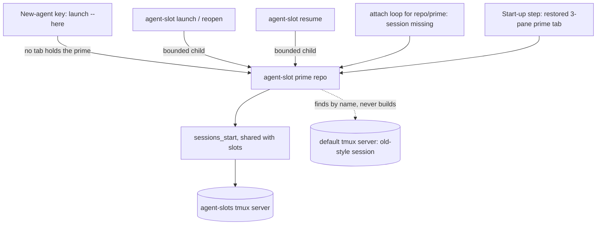
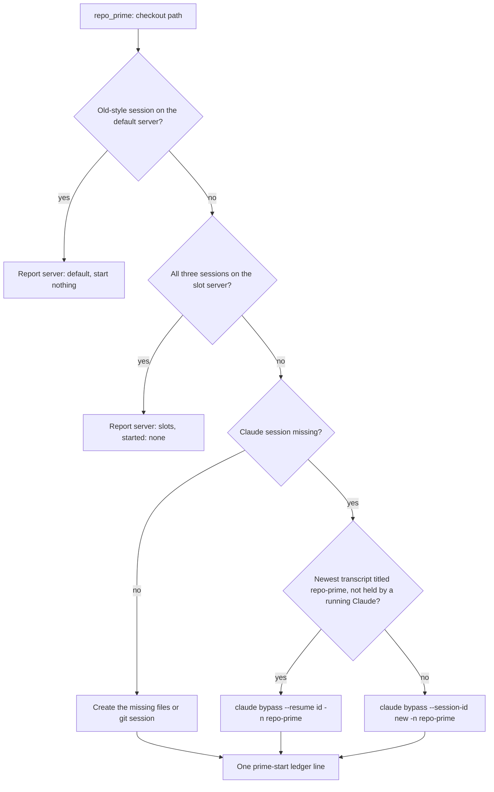
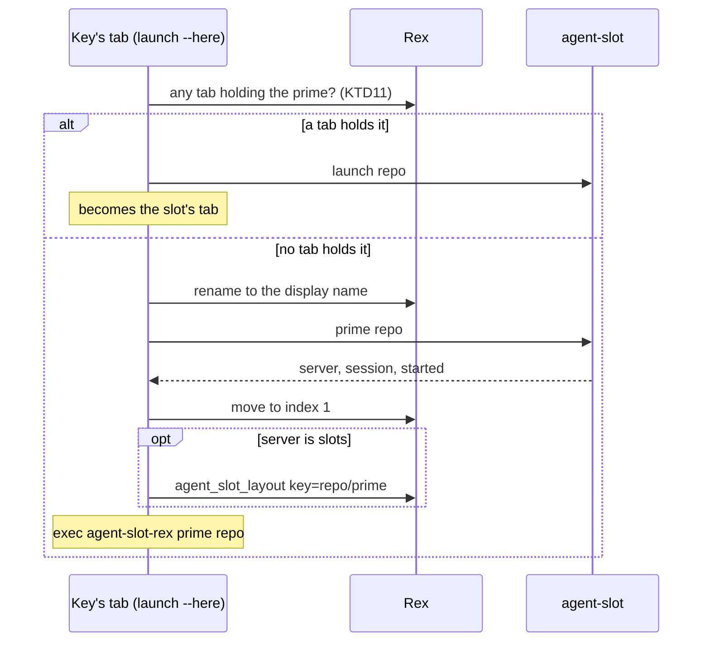

# Primes Built by the Slot Code - Plan

## Goal Capsule

- **Objective:** Brett opens any repo's prime with one key press and gets the same three-pane tab, keys, and phone view
  a slot has, with no per-repo session config to maintain.
- **Means:** one session builder for primes and slots, with a prime keyed `<repo>/prime` and started on demand (KTD1,
  KTD2).
- **Authority:** Brett's decisions in Key Decisions, then the Requirements, then the KTDs. A unit overrides none of
  them.
- **Stop conditions:**
  - Evidence that a settled decision cannot work: send it to `rex-linux` and stop that unit.
  - No merges, no `scripts/stow-deploy`, no edits to `~/dotfiles`.
  - No starting, killing, or attaching to live tmux sessions or Rex tabs. Reading a live session list is allowed; tests
    use stubs and scratch sockets.
- **Execution profile:** one PR to `dev`, one commit per unit, test-first with each new test observed failing. The
  deletion (U8) lands in the same PR, after the units that replace what it deletes.
- **Who finishes:** slot `dotfiles/5` opens the PR and runs the review stack. `skills-prime` merges it.

---

## Product Contract

### Summary

A prime becomes a slot-shaped set of three tmux sessions on the slot server, rooted in the repo's own checkout and
running bypass Claude named `<repo>-prime`. The new-agent key, a slot launch, a reopen, and a resume each start it when
it is not running. A prime still running the old way on the default tmux server is found by name and used until Brett
closes it. `stow/tmuxinator`, `tmux-new-session`, and `mux`/`mux-all` are deleted.

### Problem Frame

Slots and primes are built two ways. A slot is three tmux sessions shown as three Rex panes, which gives per-pane focus,
resize, zoom, and keys, a full-size pane on the phone, and a wedged yazi or lazygit that recovers without touching
Claude. A prime is one tmux session with three panes, because it predates Rex and agent-slot. It is started by hand or
from 29 tmuxinator projects whose pane 2 is a blank shell, and the key stops with `prime-not-running` when none is
running.

Slots already use a generic template, so the per-repo projects are a second source of truth. Brett asked why a prime is
started differently from a slot and chose to remove the difference.

### Key Decisions

- **Primes are built the same way as slots.** (session-settled: user-approved — chosen over keeping tmuxinator's
  one-session, three-pane layout, after `rex-linux` explained what the Rex layout gives and that primes kept the old one
  only because they predate it.) Governs R1, R2, R4.
- **Primes start on demand.** (session-settled: user-directed — chosen over having tmuxinator start Claude in every
  prime's pane 2: "a prime only _must_ be running if there is a slot running".) Governs R5, R6.
- **The source-controlled tmuxinator projects go away.** (session-settled: user-directed — chosen over keeping them
  beside the generic template: "we should probably delete the source controlled tmuxinator configs so we don't get
  confused".) Governs R19.
- **Running primes are left alone until Brett closes them.** (session-settled: user-approved — chosen over rebuilding
  them when this deploys.) Governs R8, R9.
- **A prime differs from a slot in eight named ways.** (session-settled: user-approved — chosen over a prime that
  behaves as a slot in every respect; Brett through `rex-linux`: "1 - true, 2 - true, 3 - true, 4 - true, 5 - true, 6 -
  ok, 7 - true, 8 - yes".) Governs R11 through R18.
- **Standing rules from Brett:** every session, prime and slot, starts Claude with
  `claude --dangerously-skip-permissions`, and each Rex tab keeps multiple tmux sessions. Governs R3, R4.

### Requirements

**Shape**

- R1. One builder creates the sessions of a prime and of a slot: Claude, yazi, and lazygit, shown as the slot's three
  Rex panes.
- R2. A prime runs in the repo's checkout that `agent-slot repos` names (`~/dev/<repo>`, or `~/dotfiles`), and its
  Claude is named `<repo>-prime`.
- R3. Every Claude a prime or slot session starts carries `--dangerously-skip-permissions`.
- R4. Each session keeps its own tmux session, so a Rex tab holds several.

**Starting**

- R5. In a Rex session named after a repo, the key opens that repo's prime when no tab holds it, starting it first when
  it is not running, and otherwise starts a slot. Every repo `agent-slot repos` lists has a prime, so "this repo has no
  prime" no longer exists. A session named after no repo still gets the picker.
- R6. A slot launch, reopen, or resume starts the repo's prime when it is not running, and a prime that fails to start
  never fails the slot.
- R7. Callers that race start one prime: each of its sessions is created once.

**Transition**

- R8. A prime session still running on the default tmux server is found by its name and used, and no second prime is
  built while it runs.
- R9. Nothing here kills, moves, renames, or attaches on its own to a running old-style session, apart from the key and
  start-up attaches that already exist.

**Names**

- R10. `config/agent-slot-rex/primes.tsv` keeps each repo's display name, which labels the prime's tab and names its
  old-style session. A repo with no line uses its own name.

**How a prime differs from a slot**

- R11. A prime is attended: `slot-unattended.sh` denies nothing in it, `slot-context.sh` tells it nothing, and ask rules
  such as `agent-slot finish` and `agent-slot sweep` still prompt there.
- R12. A host has one prime per repo, and a prime does not count toward the 8-slot limit.
- R13. Beyond starting the sessions, the builder writes nothing into the checkout, which stays the clone source and, for
  dotfiles, the deploy target.
- R14. A prime keeps whatever branch and uncommitted changes its checkout has; the builder never switches or cleans.
- R15. Check, the needs-you list, release, finish, sweep, trash purge, and automatic Rex tab closing never act on a
  prime. The ledger gets one `prime-start` line per start and nothing else (KTD9).
- R16. A prime's `docs/solutions` link stays pointed at the shared clone, never a per-slot worktree.
- R17. Starting a prime whose path Claude has not trusted shows Claude's trust dialog; nothing trusts that path
  automatically.
- R18. A restarted prime resumes its `<repo>-prime` conversation, and never starts fresh while one exists (KTD3 names
  the rule).

**Removal and portability**

- R19. `stow/tmuxinator`, `tmux-new-session`, and `mux`/`mux-all` are deleted, along with everything that exists only
  for them.
- R20. The new code runs on the Mac through the same paths once the Mac plan makes the helper act locally, and this plan
  states exactly what that plan inherits.

### Acceptance Examples

- AE1. **Covers R5, R8.** Given `xurl-rs`'s `XR CLI` session running on the default server and no tab holding it, when
  Brett presses the key in the `xurl-rs` Rex session, then the tab attaches to `XR CLI` and no `xurl-rs-prime` session
  exists.
- AE2. **Covers R1, R2, R3, R5, R18.** Given `bird` with no session anywhere and a transcript titled `bird-prime`, when
  Brett presses the key in the `bird` Rex session, then `bird-prime`, `bird-prime-files`, and `bird-prime-git` start in
  `~/dev/bird`, Claude resumes that transcript in bypass mode, and the tab has three panes.
- AE3. **Covers R5.** Given the prime's tab open, when Brett presses the key again, then a slot starts with no picker.
- AE4. **Covers R6, R8.** Given an agent runs `agent-slot launch dotfiles` while the old `dotfiles` session runs, then a
  slot starts and no `dotfiles-prime` session exists.
- AE5. **Covers R15.** Given a prime running and its repo's last slot torn down, then the prime's three sessions and its
  tab remain, and `agent-slot finish dotfiles/prime --yes` exits with a usage error.
- AE6. **Covers R8.** Given Brett closes the old `XR CLI` session, when he next presses the key there, then the prime is
  built on the slot server and resumes a conversation titled `xurl-rs-prime`.

### Scope Boundaries

Non-goals, considered and not built:

- **A prime record file.** The conversation rule reads titles from transcripts, and the sessions' existence is the
  running state, so a record would hold nothing else. A Claude release whose `/clear` drops the title would change this
  call.
- **A table of old conversation titles.** `/rename <repo>-prime` before closing a session carries a conversation over.
  Many running primes needing it would change this call; four do today.
- **A verb that stops a prime.** A prime is never torn down. To stop one by hand, close its tab, then
  `tmux -L agent-slots kill-session` its three sessions. An open tab's attach loop restarts killed sessions, as it does
  for a slot. Memory pressure from idle primes would change this call.
- **Primes in `agent-slot list`.** Reverse-mapping session names needs `repo_primes`, one `git config` per repo, on a
  call the reconcile timer runs every minute. `agent-slot prime <repo>` reports one prime, and `claude agents` names
  them all.
- **Detecting an old session Brett renamed.** Detection is by name (KTD5). Renaming one is rare, and the cost is a
  second prime he can see in the session's tab.
- **Teaching slots who their prime is.** Briefs name who a slot reports to, and `<repo>-prime` is predictable.

#### Deferred to Follow-Up Work

- Remove the old-style branch (default-server lookup, the helper's old attach, and the single-pane re-attach) once no
  old-style session runs on either machine.
- Add `~/box/TX-AI/streams-control` and `~/gbrain` to `AGENT_SLOT_EXTRA_PRIMES` if Brett's answer to the open question
  says so.
- Update `docs/plans/2026-11-02-2324-feat-agent-slots-on-the-mac-plan.md` per "What the Mac plan inherits".
- Name the `agent-slot prime` verb in the `agent-slot` skill, which lives in `brettdavies/agent-skills`.

### Outstanding Questions

Both were sent to `rex-linux` for Brett; neither blocks. The plan proceeds on the stated default.

- **What replaces each session with no repo?** See the "not a repo" rows in the Appendix. Default: nothing touches them,
  so they run as they do now, and only `mux` recreating Streams Control is lost.
- **Should a prime that a slot launch started get a tab automatically?** Default: no. It runs with no tab until the key
  opens one, the same first-press rule as today (Assumption A1).

---

## Planning Contract

### Assumptions

Inferred bets, not confirmed by Brett:

- A1. A prime started by a slot launch gets no tab until the key opens one. An untrusted path's dialog waits there, and
  the slot's own tab already says `· trust needed`. Reconcile opening prime tabs is additive if Brett wants it.
- A2. Primes run on the slot server (KTD4). Brett said "same as slots" without naming a server.
- A3. A three-pane tab that rexurrect restores under a prime's label means that prime was open, so the start-up step
  starts it if needed and replaces the tab (KTD12). This starts only primes whose tabs were open.
- A4. A prime's Claude pane gets the slot status marks (KTD10). Brett's list bars the unattended and context hooks and
  does not mention status.

### Key Technical Decisions

- KTD1. **A prime's key is `<repo>/prime`.** `slot_session <repo> prime <kind>` already gives `<repo>-prime`,
  `<repo>-prime-files`, and `<repo>-prime-git`. `SLOT_KEY_PATTERN` stays digits-only, so `check`, `finish`, `resume`,
  and reconcile's tab matching cannot match a prime, which makes R15 true by construction. Only `agent-slot-rex attach`
  takes the wider pattern. `agent_slot_layout` passes its key through to `attach`, so its Lua needs a description change
  only and works before a config reload.
- KTD2. **`sessions_start` takes the root path, and a prime passes its checkout.** A prime calls the same
  `sessions_start` and `sessions_command` a slot does, with `RECORD` set in memory to
  `{name, session_id, prompt_file: null}` and mode `resume`. `SESSIONS_CLAUDE` stays the one place the bypass flag is
  written (R3). Governs R1, R2. (Inherits the settled "built the same way" decision.)
- KTD3. **The conversation rule: the newest transcript, across Claude's project directories, whose latest `custom-title`
  is exactly `<repo>-prime` and whose session no running Claude holds; with none, a fresh session under that name.**
  - The newest transcript wins because `/clear` starts a new transcript that carries the title: the `rex-linux`
    transcript opens with its `custom-title` line and a `SessionStart:clear` hook. So the rule follows `/clear` with no
    record and no hook.
  - The search covers all project directories because a conversation resumed from elsewhere stays in the file it started
    in (`docs/solutions/best-practices/resume-a-claude-session-by-id-from-another-directory.md`).
  - Only the latest title counts, so a renamed conversation stops matching.
  - `claude --continue` is rejected because any `claude -p` run from the checkout would become "most recent".
  - The scan took 0.55 s over 342 transcripts (4.7 GB) and runs only when a Claude session is being created.
  - A running Claude is excluded through `claude agents --json`, 0.16 s.
- KTD4. **Primes run on the slot server, `agent-slots`.** That gives them `slots.conf` (`allow-passthrough`, status
  replay, `detach-on-destroy`) and no resurrect plugins, and the server outlives what started it through
  `_sessions_scoped`. The default server is rejected because its continuum restore would bring back prime sessions the
  builder also starts.
- KTD5. **An old-style prime is found by name, from `list-sessions` on `tmux -L default`.** Paths cannot identify one:
  `Bird CLI`'s session path is `~/dev`, `Meum Sites`' is `~`, and `Coordinator`'s Claude works in `~/dev/agent-skills`.
  The socket is named because `agent-slot` often runs inside a slot pane, whose `TMUX` points at the slot server. A
  default server that does not answer stops the start with `tmux-unresponsive` rather than risk a duplicate. Old-style
  wins when both exist. Governs R8.
- KTD6. **`agent-slot prime <repo>` is the one start path, under the existing lock mechanism.** It takes
  `record_lock_slot <repo> prime` (`~/slots/<repo>/.prime.lock`, which `slot_numbers` ignores), reads the sessions under
  the lock, and creates only what is missing, as `resume` does. It is idempotent and takes every caller. Governs R7,
  R12.
- KTD7. **Slots start their prime through a bounded child `agent-slot prime`.** `slot_make` and `cmd_resume` run it with
  a 60 s bound after their own sessions exist. A child keeps `contract_fail`, the `RECORD` global, and exit traps away
  from the slot's rollback. A failure goes into an additive `prime` field in the output, with the launch still
  succeeding. Governs R6.
- KTD8. **The map keeps its format, and one reader serves both dispatchers.** `prime_display_name` in `names.sh` reads
  `<repo><TAB><display>` and falls back to the repo's name, so `agent-slot` (new `AS_PRIMES`) and `agent-slot-rex`
  (`AR_PRIMES`) share it. The map lists only names that differ from the repo, plus the existing `dotfiles` line. Governs
  R10.
- KTD9. **A prime writes one ledger event: `prime-start`.** One line per `agent-slot prime` that created a session, with
  repo, key, path, started sessions, conversation mode, and session ID. The ledger is where automatic triggers are
  logged for tuning, and a prime started by a slot launch is one. Readers are safe: `doctor`, `reopenlookup`, and
  `release` each filter on `.event`. It writes no other event, and slot hooks do not run for it. Governs R15.
- KTD10. **Hooks split on session name.** `hook_claude_session` stays slot-only (`-[0-9]+$`), so `slot-unattended.sh`
  and `slot-context.sh` print nothing for a prime with no code change. A new `slot_session_is_prime` (`*-prime`) admits
  a prime's Claude to `slot-status.sh` alone. Slot names always end in digits, `-files`, or `-git`, so the two never
  overlap, whatever the repo's name. Governs R11.
- KTD11. **A tab holds the prime when any of three things is true**, and the key checks all of them before choosing:
  - a block's own process is `agent-slot-rex attach <repo>/prime claude`, which stays true while the loop waits for
    Enter after a detach;
  - a client of the old-style session runs on a block's terminal, the existing check;
  - another window carries the display label while its own process is `agent-slot-rex launch`, which a key's tab sets
    before it asks the server to start anything.

  Two near-simultaneous presses can still make two tabs on one prime, which costs a tab and never a duplicate prime.
  Governs R5.
- KTD12. **The start-up step replaces a restored three-pane prime tab.** rexurrect restores it as plain shells. When
  every pane is a shell at its prompt, the step runs `agent-slot prime`, opens a fresh tab with the layout at index 1,
  and closes the restored one, the order reconcile uses for slots. A one-pane tab keeps today's rules: old session
  running gets the prime command typed, otherwise `prime-not-running` and left alone. The walk covers map lines plus
  every other repo with a Rex session, since a repo with a default name has no line. Governs R9.
- KTD13. **`agent-slot-rex prime <repo>` holds a pane on the prime however it runs.** With the old session running, it
  attaches and then becomes a login shell, as today. Otherwise it `exec`s `attach <repo>/prime claude`. The key's tab
  and the typed re-attach keep using this one verb. Governs R5, R8.
- KTD14. **The builder never trusts and never touches git.** No `trust_accept`, no `parity_*`, no checkout, no `.git`
  write. `trust_prompt_expected` in the output comes from `trust_known`. `warm` keeps treating the prime path as the
  anchor for its slots. Governs R13, R14, R16, R17.
- KTD15. **`prime-not-running` leaves the closed set of reasons.** The key now starts the prime instead of stopping. The
  start-up step's journal outcome of the same name stays, because it is a log string and not an error reason.

### High-Level Technical Design

Who starts a prime:

What `agent-slot prime <repo>` decides, under `~/slots/<repo>/.prime.lock`:

What the key does in a Rex session named after a repo:

|               | Slot                           | Prime                            |
| ------------- | ------------------------------ | -------------------------------- |
| Key           | `<repo>/<N>`                   | `<repo>/prime`                   |
| Root          | `~/slots/<repo>/<N>`, a clone  | the checkout `repo_prime` names  |
| tmux sessions | `<repo>-<N>`, `-files`, `-git` | `<repo>-prime`, `-files`, `-git` |
| tmux server   | `agent-slots`                  | `agent-slots`                    |
| Claude        | bypass, named for the slot     | bypass, named `<repo>-prime`     |
| Record        | `.git/agent-slot.json`         | none                             |
| Lock          | `~/slots/<repo>/.<N>.lock`     | `~/slots/<repo>/.prime.lock`     |
| Count         | up to 8 per repo               | one per repo per host            |
| Hooks         | unattended, context, status    | status only                      |
| Ends          | `release`, `finish`, `sweep`   | never, except by hand            |

### System-Wide Impact

- **Slot launch latency:** each launch gains a child `agent-slot` that usually only reads session lists. U3 measures it,
  with a 300 ms target when the prime already runs.
- **Reconcile:** no change. Tests hold that prime tabs are never keyed, closed, or relabelled.
- **Mac:** deleting `mux` removes the Mac's way to start its local sessions until the Mac plan ships. Running sessions
  keep running, and `tmux new -s` still works by hand.
- **Running tmux servers:** `TMUXINATOR_CONFIG` stays in their environment until they restart, unused.
- **Open PRs:** #445 changes `slotmake.sh`. Whichever lands second rebases.

### Risks

| Risk                                                                                       | Handling                                                                                             |
| ------------------------------------------------------------------------------------------ | ---------------------------------------------------------------------------------------------------- |
| A Claude release changes the `custom-title` line, so resume finds nothing and starts fresh | The output and ledger say `fresh`, the tab shows it at once, and `/resume` recovers the conversation |
| Continuum restores an old-style session Brett closed less than 15 minutes before a reboot  | It is found and used as an old-style prime; closing it again settles it                              |
| An old-style session Brett keeps blocks his repo's new prime                               | That is R8 working as decided                                                                        |
| Reattach replaces a three-pane tab an operator labelled exactly like a prime               | Only when every pane is an idle shell, so only those shells are lost                                 |
| A failed prime start goes unnoticed in a launch                                            | The launch's `prime` field names the reason, and the next launch or key press retries                |

### What the Mac plan inherits

The Mac plan (`docs/plans/2026-11-02-2324-feat-agent-slots-on-the-mac-plan.md`) is still awaiting Brett's review, and
this PR does not edit it. These parts of it change:

1. **R12, R13, R15, KTD11, and the "One prime map" decision** describe a prime as a session on the machine's default
   tmux server. That is now the transition case. A prime built on the Mac runs on the Mac's `agent-slots` server in the
   Mac's checkout. R12's "a repo with no prime gets a new slot" no longer exists; R5 here replaces it.
2. **Line 388 and P18** rest on tmuxinator's `name:` fields. `primes.tsv` now holds those names. The Mac's local
   sessions are found by name through the same lookup until closed.
3. **Linux-only calls:** `agent-slot prime` runs on the Mac once KTD6 of that plan makes the helper act locally, through
   calls the plan already replaces (`env -i -C`, `getent`, `flock`). This work routes session ID generation through one
   function, so its `os_uuid` step changes one line.
4. **The Vault project's Taildrive mount** (`on_project_start: taildrive-mount vault`) has no replacement. The Mac plan
   owns the answer. `taildrive-mount vault` still works by hand.
5. **Until that plan ships,** a key pressed in a Linux session keeps acting on the Linux server (`forward.sh`), and the
   Mac has no `mux`.

---

## Implementation Units

### U1. Names and the prime map

- **Goal:** one definition of a prime's key, names, and display name.
- **Requirements:** R2, R10; KTD1, KTD8.
- **Dependencies:** none.
- **Files:** `scripts/agent-slot/lib/names.sh`, `scripts/agent-slot/lib/env.sh`, `scripts/agent-slot-rex/lib/prime.sh`,
  `config/agent-slot-rex/primes.tsv`, `tests/agent-slot-prime.bats` (new), `tests/agent-slot-rex.bats`.
- **Approach:**
  1. Add the prime token, its attach-only key pattern and parser, `slot_session_is_prime`, the Claude name helper, and
     `prime_display_name` to `names.sh`.
  2. Add `AS_PRIMES` (`AGENT_SLOT_PRIMES`) to `env.sh`.
  3. Make the helper's `prime_of` use the shared reader and always succeed, renaming `PRIME_SESSION` to say it holds a
     display name.
  4. Set `primes.tsv` to the table in the Appendix and rewrite its header for what the column now means.
- **Patterns to follow:** `slot_session`, `slot_parse_key`; `AR_PRIMES` in `scripts/agent-slot-rex/lib/settings.sh`.
- **Test scenarios:**
  - `prime_display_name` returns the listed name for `xurl-rs` and the repo's own name for `qmd`.
  - A commented line and a malformed line are ignored.
  - `slot_session repo prime` and its `files` and `git` forms give the three expected names; a repo with `.` is
    sanitized as a slot's is.
  - `slot_session_is_prime` is true for `x-prime` and `foo-2-prime`, and false for `x-prime-1`, `x-prime-files`, and
    `foo-2`.
  - `slot_session_is_claude` stays false for `foo-prime` and `foo-2-prime`.
  - The real `primes.tsv`: every line has two fields, each repo appears once, and no name holds `.` or `:`, which tmux
    refuses.
- **Verification:** both dispatchers source one reader, and no second parse of the map remains.

### U2. The shared builder and `agent-slot prime`

- **Goal:** a prime starts through the slot builder with one idempotent verb.
- **Requirements:** R1, R2, R3, R7, R8, R12, R13, R14, R16, R17, R18; KTD2, KTD3, KTD4, KTD5, KTD6, KTD9, KTD14, and the
  "built the same way" and "left alone" Key Decisions.
- **Dependencies:** U1.
- **Files:** `scripts/agent-slot/lib/prime.sh` (new), `scripts/agent-slot/lib/sessions.sh`,
  `scripts/agent-slot/lib/slotmake.sh`, `scripts/agent-slot/lib/bounded.sh`, `scripts/agent-slot/lib/help.sh`,
  `scripts/agent-slot/agent-slot`, `tests/agent-slot-prime.bats`, `tests/claude-bypass-flag.bats`,
  `tests/lib/agent-slot.bash`.
- **Approach:**
  1. `sessions_start` takes an optional root path, and `_sessions_fail` names the right retry command for a prime.
  2. Generalize the session listing in `bounded.sh` so the default server's list reads through the same bounded call,
     without `-f`, so it never starts a server.
  3. `prime.sh` holds the old-style lookup, the conversation rule, and `cmd_prime`.
  4. Move new session ID generation to one function that `slot_make` also uses.
  5. Output: `{key, repo, path, name, server: "slots"|"default", session, started[], conversation: {mode:
     "running"|"resumed"|"fresh", session_id}, trust_prompt_expected, next_step}`, with a text line that says what
     happened.
- **Patterns to follow:** `cmd_resume` for locking and the output shape; `sessions_transcript_find` for the
  project-directory walk; `launch_output` for `next_step`.
- **Execution note:** test-first; the fixture repo's fingerprint (`assert_prime_untouched`) backs R13 and R14 in every
  scenario that builds.
- **Test scenarios:**
  - Covers AE2. With no sessions, three sessions start on the slot socket with `-c` at the checkout, and the typed lines
    are the slot's yazi and lazygit commands and
    `claude --dangerously-skip-permissions --session-id <id> -n repoa-prime`.
  - A checkout with a dirty file, a non-default branch, and a `docs/solutions` link fingerprints the same afterwards,
    with no `git` write and no worktree added.
  - A transcript titled `repoa-prime` gives `--resume <its id> -n repoa-prime` and mode `resumed`.
  - Of two such transcripts, the newer is resumed.
  - A transcript whose latest title differs, after an earlier `repoa-prime`, is not resumed.
  - A transcript in another project directory is found.
  - A session `claude agents` lists as running is skipped for the next newest, and with none left the mode is `fresh`.
  - A `claude -p` transcript with no title in the same project directory is never chosen.
  - A killed `repoa-prime-files` alone restarts with no new Claude and no second session.
  - All three running starts nothing, reports `started: []`, and writes no ledger line.
  - Covers AE1. With `repoa`'s display-named session on the `default` socket, nothing starts on either socket and
    `server` is `default`.
  - A default socket with no server creates no session there.
  - A default server that does not answer exits `tmux-unresponsive` and starts nothing.
  - Two concurrent runs give one set of sessions, with three `new-session` calls in all.
  - Covers R12. With 8 live slots, `prime` still starts, and `launch` still refuses at the limit with the prime running.
  - An untrusted path starts Claude all the same, reports `trust_prompt_expected: true`, and leaves the trust record and
    trust socket untouched.
  - An unknown repo exits `repo-not-found`.
  - Exactly one `prime-start` ledger line follows a start, with the fields of KTD9.
  - `tests/claude-bypass-flag.bats` still passes over the new files, and gains a case that a prime's fresh and resumed
    Claude lines both come from `SESSIONS_CLAUDE`.
  - A checkout whose `.git` is a file, as `obsidian-vault`'s is, starts the same way.
- **Verification:** with real tmux on a scratch socket, a stub `claude`, and a fixture repo, the three sessions exist at
  the checkout's path and a second run starts nothing.

### U3. Slots start their prime

- **Goal:** a running slot implies a running prime.
- **Requirements:** R6, R8; KTD7.
- **Dependencies:** U2.
- **Files:** `scripts/agent-slot/lib/slotmake.sh`, `scripts/agent-slot/lib/launch.sh`,
  `scripts/agent-slot/lib/reopen.sh`, `scripts/agent-slot-rex/lib/launch.sh`, `tests/agent-slot-launch.bats`,
  `tests/agent-slot-reopen.bats`, `tests/agent-slot-prime.bats`.
- **Approach:**
  1. `slot_make` runs the child after the slot's sessions start and the slot is committed, before the push, so the
     reconcile sees the prime running.
  2. `cmd_resume` runs it after its own `sessions_start`.
  3. `launch`, `reopen`, and `resume` outputs gain `prime`: the child's object, or `{error: {reason, message, log}}`.
  4. Raise `launch_call`'s bound and comment by the child's 60 s.
- **Patterns to follow:** `bounded` for the child call; the `$fields` merge in `launch_output`.
- **Test scenarios:**
  - A launch starts the slot's three sessions and the prime's three, and `prime.started` lists the latter.
  - Covers AE4. A launch with the old-style session running gives `prime.server: default` and no prime session.
  - A second launch finds the prime running and starts no prime session.
  - A reopen starts the prime.
  - Resuming a dormant slot starts the prime.
  - A prime start that fails (stub tmux failing `new-session` for a `*-prime` name) leaves the launch at exit 0, the
    slot active, and `prime.error.reason` set.
  - A failed prime start never rolls the slot back.
  - Existing tests that count `new-session` calls or list session files are updated to the new counts, with each changed
    count checked against its reason.
- **Verification:** measure the launch's added wall-clock on a fixture repo with the prime already running, and record
  it in the PR.

### U4. Hooks classify a prime

- **Goal:** a prime's Claude shows status and is never treated as unattended.
- **Requirements:** R11; KTD10.
- **Dependencies:** U1.
- **Files:** `scripts/agent-slot/lib/hook.sh`, `stow/claude/dot-claude/slot-status.sh`, `tests/slot-status.bats`,
  `tests/slot-unattended.bats`, `tests/slot-context.bats`.
- **Approach:** add `hook_prime_session`; `status_report` accepts either kind of session, and the other two hooks stay
  as they are. The tests fix that.
- **Patterns to follow:** the pane and payload fixtures in `tests/slot-unattended.bats`.
- **Test scenarios:**
  - In a `repoa-prime` pane on the slot socket with its cwd at the checkout, a `PermissionRequest` gets no denial and
    writes no ledger line.
  - The same pane's `PreToolUse` on `AskUserQuestion` and `EnterPlanMode` gets no denial.
  - The same holds for a repo whose name ends in digits, `foo-2-prime`.
  - `SessionStart` there prints no additional context and writes no record or ledger line.
  - `slot-status.sh` writes the report and stores `@slot_status` for a prime's top-level Claude.
  - It writes nothing for a nested `claude -p` under that Claude, or for a Claude started by hand in
    `repoa-prime-files`.
  - A slot's Claude session behaves as before for all three hooks.
  - The ask rules in `stow/claude/dot-claude/settings.json` still list `agent-slot finish`, `agent-slot sweep`, and
    `agent-slot-rex finish`.
- **Verification:** the suites pass with the new scenarios observed failing first where behavior changes (status) and
  passing as characterization where it must not (unattended, context).

### U5. The key and the attach loop

- **Goal:** the key opens a prime in the slot's three-pane shape and falls back to old-style attachment during the
  transition.
- **Requirements:** R4, R5, R8; KTD1, KTD11, KTD13, KTD15, and the "on demand" Key Decision.
- **Dependencies:** U1, U2.
- **Files:** `scripts/agent-slot-rex/lib/launch.sh`, `scripts/agent-slot-rex/lib/prime.sh`,
  `scripts/agent-slot-rex/lib/attach.sh`, `scripts/agent-slot-rex/lib/rex.sh`, `scripts/agent-slot-rex/lib/help.sh`,
  `scripts/agent-slot-rex/agent-slot-rex`, `scripts/agent-slot/lib/contract.sh`,
  `stow/rex/dot-config/rex/agent-slots.lua`, `tests/agent-slot-rex.bats`, `tests/lib/agent-slot-rex.bash`,
  `tests/rex-config.bats`.
- **Approach:**
  1. `cmd_launch` drops the "map names a prime" condition.
  2. `launch_prime` follows the sequence in the High-Level Technical Design, using `launch_call` so a failure shows with
     a retry.
  3. `prime_tab_open` implements KTD11.
  4. `attach` takes `<repo>/prime`, and its resume path calls `agent-slot prime`; `repo-not-found` ends the pane as
     `slot-not-found` ends a slot's.
  5. `cmd_prime` implements KTD13.
  6. Remove the `prime-not-running` reason and fix the Lua descriptions.
- **Patterns to follow:** `launch_succeeded`, `launch_call`; the `rex_helper_block` process lookup; the existing key
  tests at "the new-agent key and the repo's prime" in `tests/agent-slot-rex.bats`.
- **Test scenarios:**
  - Covers AE2. In a repo session with no prime tab and no old session, the tab is renamed to the display name,
    `agent-slot prime X` runs, the tab moves to index 1, `agent_slot_layout key=X/prime` runs, and the last call is
    `agent-slot-rex prime X`.
  - Covers AE1. With the server answering `default`, no layout runs and the last call is `agent-slot-rex prime X`.
  - A repo with no map line behaves the same under its own name, and starts no slot on the first press.
  - Covers AE3. A block whose own process is `agent-slot-rex attach X/prime claude` makes the key start a slot, even
    when that loop is waiting after a detach (no tmux client).
  - A window carrying the display label while running `agent-slot-rex launch` makes a second press start a slot.
  - A failing `agent-slot prime` shows the error with a retry in the tab and starts no slot.
  - `launch --repo X` still starts a slot and never opens the prime.
  - A session named after no repo still shows the picker.
  - `attach X/prime git` attaches to `X-prime-git` on the slot socket.
  - A missing session calls `agent-slot prime X`, not `resume`.
  - `repo-not-found` ends the pane.
  - `attach X/prime` with a bad pane name is a usage error.
  - `cmd_prime` with the old session attaches then becomes a login shell; without it, it execs `attach X/prime claude`.
  - The `tests/agent-slot-rex-macos.bats` forwarding cases still pass, with `attach X/prime claude` stopping with
    `wrong-host` on the Mac.
- **Verification:** the Rex stubs show the exact call order above. A live Rex tab is out of bounds here, so Brett's
  first key press after merge is the end-to-end check, and the PR says so.

### U6. Nothing that ends a slot reaches a prime

- **Goal:** hold R15 with tests.
- **Requirements:** R15; KTD1.
- **Dependencies:** U2, U5.
- **Files:** `tests/agent-slot-teardown.bats`, `tests/agent-slot-check.bats`, `tests/agent-slot-release.bats`,
  `tests/agent-slot-rex.bats`, `tests/agent-slot-rex-startup.bats`.
- **Approach:** mostly characterization, since `SLOT_KEY_PATTERN` stays digits-only. Any test that fails here finds a
  real gap to fix in the code it names.
- **Test scenarios:**
  - Covers AE5. `finish`, `check`, and `resume` given `repoa/prime` exit with a usage error and change nothing.
  - `agent-slot-rex finish repoa/prime` is refused.
  - `sweep --yes` and `sweep --yes --auto`, with a finished slot beside a running prime, tear down the slot and leave
    the prime's sessions.
  - `slot_rollback` of a failed launch leaves the prime's sessions.
  - `whoami` and `release` from the prime's checkout exit `not-in-slot`.
  - `list` reports slots only and its output shape is unchanged.
  - A `~/slots/<repo>/` holding only `.prime.lock` lists no slot and does not stop a new slot taking number 1.
  - Reconcile with a tab running `attach X/prime claude` plans no open, rename, or close for it, whether or not the repo
    has slots.
  - `agent-slot-rex finish --tab` on a prime's tab fails with "not an agent slot's tab".
  - `startup_kill_slot_sessions` leaves a session holding a prime's tab and slot tabs, and a session holding only a
    prime's tab.
- **Verification:** each scenario passes against the built code; `ce-work` records which ones needed a fix.

### U7. The start-up step restores a prime's tab

- **Goal:** after a Rex restart, a prime's three-pane tab comes back holding the prime.
- **Requirements:** R5, R9; KTD12.
- **Dependencies:** U2, U5.
- **Files:** `scripts/agent-slot-rex/lib/reattach.sh`, `scripts/agent-slot-rex/lib/startup.sh`,
  `tests/agent-slot-rex-startup.bats`.
- **Approach:**
  1. Walk map lines plus every other `repos` entry with a Rex session.
  2. For a label-matched tab of three idle shells, call `agent-slot prime`, then replace the tab (open with layout, move
     to index 1, close the restored one), under the pin checks. The outcome is `reopened`.
  3. A server answer of `default` on a three-pane tab is `not-idle`.
  4. One-pane behavior stays as tested today.
- **Patterns to follow:** `reattach_repo`, `reattach_shell_idle`, and its per-repo subshell; `reconcile_open_tab`.
- **Test scenarios:**
  - Three idle shells under the label, no prime running: `agent-slot prime` runs, a new tab opens with the layout at
    index 1, the old one closes, and the outcome is `reopened`.
  - Three idle shells with the prime already running: the same, with `started: []`.
  - A pane running a program: nothing changes, and the outcome is `not-idle`.
  - A failing `agent-slot prime`: the restored tab stays, the outcome is that error's reason, and the next repo still
    runs.
  - A repo with no map line whose session has a tab labelled with its name is handled.
  - A Rex restart seen partway stops further changes, as the existing test holds.
  - A config reload's step replaces nothing.
  - All existing one-pane scenarios keep passing unchanged.
- **Verification:** the existing start-up suite passes with only additions.

### U8. Delete tmuxinator

- **Goal:** one way to build a prime remains.
- **Requirements:** R19, and the "projects go away" Key Decision.
- **Dependencies:** U5, because the key must start primes before the projects go.
- **Files:**
  - Delete: `stow/tmuxinator/` (29 files), `stow/local/dot-local/bin/tmux-new-session`, `config/shell/tmuxinator.sh`,
    `tests/tmuxinator-configs.bats`, `tests/mux-all.bats`, `tests/tmux-new-session.bats`.
  - Modify: `stow/brew/Brewfile`, `stow/zsh/dot-zshrc`, `scripts/core-env-allowlist.tsv`,
    `tests/stow-deploy-packages.bats`, `tests/shell-startup-shapes.bats`, `tests/shell-path-matrix.bats`,
    `tests/taildrive.bats`, `tests/sync-dev-after-release.bats`, `tests/agent-slot-launch.bats`,
    `stow/rex/dot-config/rex/layout.lua`.
- **Approach:**
  1. The shell-shape suites use `TMUXINATOR_CONFIG` as a canary for "the `config/shell` layer loaded". Swap it for
     `DO_NOT_TRACK` (`config/shell/telemetry.sh`), an unconditional export, and drop their `command -v tmuxinator`
     skips, so they run everywhere.
  2. Delete the test that lists tmuxinator projects.
  3. Reword the stale comments in `tests/taildrive.bats`, `layout.lua`, and the `tests/agent-slot-launch.bats` test
     title, and rename the `sync-dev-after-release` fixture path.
  4. Remove the `compdef mux=tmuxinator` wiring and the `NOT_DEPLOYED` exemption.
- **Test scenarios:**
  - A sweep test fails on `tmuxinator`, `tmux-new-session`, or `mux-all` in any tracked file outside `docs/plans/`,
    `CHANGELOG.md`, and `RELEASES-RATIONALE.md`.
  - The canary tests pass with no tmuxinator installed.
  - `scripts/core-env-guard.sh` passes with no allowlist entry left matching nothing.
  - `tests/stow-deploy-packages.bats` passes with `stow/tmuxinator` gone.
- **Verification:** the full suite and `scripts/lint-shell --all` pass. Nothing in `stow/` or `config/shell/` sets
  `TMUXINATOR_CONFIG`.

### U9. Docs say what is true

- **Goal:** the docs describe this design in the present tense.
- **Requirements:** R5, R10, R15, R19.
- **Dependencies:** U5, U7, U8.
- **Files:** `README.md`, `BOOTSTRAP.md`, `PROJECT.md`, `CONCEPTS.md`, `scripts/agent-slot/lib/sessions.sh` (header),
  `tests/agent-slot-docs.bats`.
- **Approach:**
  - **README:** the new verb; the key's rule, "Keys and tab labels", and the start-up paragraph; the `reopened` outcome;
    the reasons table without `prime-not-running`; a short "what a prime is" reference; the tmuxinator row, tool row,
    and section removed.
  - **CONCEPTS:** replace "Prime tab" with a "Prime" entry that holds the role Brett defined (orchestrates, answers
    other sessions, point of contact for other repos, as long-lived as the session) and the tab definition; update
    "New-agent key".
  - **BOOTSTRAP and PROJECT:** drop tmuxinator; step 4's trust instruction gains the key as the way to open a prime.
- **Test scenarios:**
  - `tests/agent-slot-docs.bats` holds the reasons table equal to the code and finds the `prime` verb named.
  - A new assertion that the README names `<repo>/prime`.
- **Verification:** no `previously`-style narration in the changed docs; `/code-comments` scan clean on changed scripts.

---

## Verification Contract

| Check                                      | Command                                                                                                                                                                       | Applies to                  |
| ------------------------------------------ | ----------------------------------------------------------------------------------------------------------------------------------------------------------------------------- | --------------------------- |
| Changed suites, each under the 300 s limit | `timeout 300 scripts/run-tests tests/agent-slot-prime.bats` and each suite a unit names                                                                                       | Every unit                  |
| New test observed failing                  | Stash the source change, run the test, quote the failure                                                                                                                      | Every behavior-bearing unit |
| Shell lint                                 | `scripts/lint-shell --all`                                                                                                                                                    | Every unit                  |
| Workflow lint                              | `scripts/lint-workflows --all`                                                                                                                                                | U8                          |
| Core env guard                             | `scripts/core-env-guard.sh`                                                                                                                                                   | U8 and new test files       |
| Whole gate                                 | `git push` runs the `pre-push` CI mirror in the background                                                                                                                    | Before the PR               |
| CI                                         | Rollup query from `~/.claude/guides/git-and-github.md`, every live conclusion `SUCCESS`                                                                                       | The PR                      |
| Real artifact                              | Real tmux on a scratch socket with a fixture repo and stub `claude`: `agent-slot prime` twice, then `tmux -L <scratch> list-sessions` and `display -p '#{pane_current_path}'` | U2, U3                      |

A green suite does not prove a live key press. Rex tabs are out of bounds in this slot, so the PR names Brett's first
press as the remaining end-to-end check, with AE1 through AE3 as what to look for.

---

## Definition of Done

- Every R has a test or a stated manual check, and every behavior test was observed failing against unfixed code.
- All nine units are committed, the PR to `dev` follows the repo's template, and the rollup is green.
- `ce-code-review` (report-only, no cross-model peer) and `devex-review` have run, with confirmed findings fixed in
  their own commits.
- The PR head and verdicts are with `skills-prime` and `rex-linux`.
- No abandoned-attempt code, scratch sockets, or fixture files remain in the tree.
- No live session, tab, or `~/dotfiles` was touched.

---

## Appendix

### The prime map after this work

`config/agent-slot-rex/primes.tsv` holds these lines. A repo not listed uses its own name, as `brettdavies`, `payg`, and
`qmd` do.

| Repo               | Display name             | Line     |
| ------------------ | ------------------------ | -------- |
| dotfiles           | dotfiles                 | existing |
| xurl-rs            | XR CLI                   | existing |
| agentnative-cli    | ANC CLI                  | existing |
| agentnative-site   | ANC Website              | existing |
| ingest-lab         | ingest-lab-prime         | existing |
| agent-skills       | Agent Skills             | existing |
| meum-api           | Meum API                 | existing |
| meum-sdk           | Meum SDK                 | existing |
| meum-ios           | Meum iOS                 | existing |
| meum-sites         | Meum Sites               | existing |
| meum-id-dot-github | Meum GitHub              | existing |
| meum-control       | Meum Control             | existing |
| agentnative-skill  | ANC Agent Skill          | new      |
| agentnative-spec   | ANC Spec                 | new      |
| bird               | Bird CLI                 | new      |
| bird-skill         | Bird Agent Skill         | new      |
| cf_office_hours    | CF Office Hours          | new      |
| crawl4ai-skill     | Crawl4AI Skill           | new      |
| dot-github         | _github                  | new      |
| homebrew-tap       | HB Tap                   | new      |
| home-media-server  | Home Media Server        | new      |
| last30days-skill   | last30days Skill         | new      |
| lmgroktfy          | Let Me Grok That For You | new      |
| paxel-main         | Paxel                    | new      |
| solutions-docs     | Compounded Solutions     | new      |
| streamsgrp         | Streams Website          | new      |
| xurl-rs-skill      | XR Agent Skill           | new      |
| obsidian-vault     | Vault                    | new      |

`_github` is the name tmux actually gave the `.github` project, since a session name cannot hold `.`.

### Inventory: the 29 tmuxinator projects

| Project          | Session name                | Repo                                                   | Becomes                       |
| ---------------- | --------------------------- | ------------------------------------------------------ | ----------------------------- |
| `anc`            | ANC CLI                     | agentnative-cli                                        | already a prime               |
| `ancsite`        | ANC Website                 | agentnative-site                                       | already a prime               |
| `ancskill`       | ANC Agent Skill             | agentnative-skill                                      | on-demand prime               |
| `ancspec`        | ANC Spec                    | agentnative-spec                                       | on-demand prime               |
| `bird`           | Bird CLI                    | bird                                                   | on-demand prime               |
| `birdskill`      | Bird Agent Skill            | bird-skill                                             | on-demand prime               |
| `brettdavies`    | brettdavies                 | brettdavies                                            | on-demand prime, default name |
| `cfoh`           | CF Office Hours             | cf_office_hours                                        | on-demand prime               |
| `crawl4ai-skill` | Crawl4AI Skill              | crawl4ai-skill                                         | on-demand prime               |
| `dotfiles`       | dotfiles                    | dotfiles                                               | already a prime               |
| `dotgithub`      | .github (`_github` in tmux) | dot-github                                             | on-demand prime               |
| `hbtap`          | HB Tap                      | homebrew-tap                                           | on-demand prime               |
| `hms`            | Home Media Server           | home-media-server                                      | on-demand prime               |
| `l30d`           | last30days Skill            | last30days-skill                                       | on-demand prime               |
| `lmgrok`         | Let Me Grok That For You    | lmgroktfy                                              | on-demand prime               |
| `mapi`           | Meum API                    | meum-api                                               | already a prime               |
| `meum`           | Meum Control                | meum-control                                           | already a prime               |
| `mios`           | Meum iOS                    | meum-ios                                               | already a prime               |
| `msdk`           | Meum SDK                    | meum-sdk                                               | already a prime               |
| `msites`         | Meum Sites                  | meum-sites                                             | already a prime               |
| `payg`           | payg                        | payg                                                   | on-demand prime, default name |
| `qmd`            | qmd                         | qmd                                                    | on-demand prime, default name |
| `skills`         | Agent Skills                | agent-skills                                           | already a prime               |
| `solutions`      | Compounded Solutions        | solutions-docs                                         | on-demand prime               |
| `ssite`          | Streams Website             | streamsgrp                                             | on-demand prime               |
| `streams`        | Streams Control             | none: `~/box/TX-AI/streams-control` is outside `~/dev` | not a repo                    |
| `vault`          | Vault                       | obsidian-vault                                         | on-demand prime               |
| `xrskill`        | XR Agent Skill              | xurl-rs-skill                                          | on-demand prime               |
| `xurl-rs`        | XR CLI                      | xurl-rs                                                | already a prime               |

### Inventory: default-server sessions, read 2026-11-03

Each session with a repo keeps running and is used as that repo's prime until Brett closes it.

| Session                | Repo                                                                 | Becomes                                               |
| ---------------------- | -------------------------------------------------------------------- | ----------------------------------------------------- |
| ANC CLI                | agentnative-cli                                                      | already a prime                                       |
| ANC Website            | agentnative-site                                                     | already a prime                                       |
| Agent Skills           | agent-skills                                                         | already a prime                                       |
| Bird CLI               | bird                                                                 | on-demand prime                                       |
| Brett GBrain Skillpack | none; pane at `~`                                                    | not a repo                                            |
| Compounded Solutions   | solutions-docs                                                       | on-demand prime                                       |
| Coordinator            | none; pane at `~`, its Claude `skills-prime` in `~/dev/agent-skills` | not a repo                                            |
| Crawl4AI Skill         | crawl4ai-skill                                                       | on-demand prime                                       |
| GBrain                 | none: `~/gbrain` is outside `~/dev`                                  | not a repo                                            |
| Home Media Server      | home-media-server                                                    | on-demand prime                                       |
| Meum API               | meum-api                                                             | already a prime                                       |
| Meum Control           | meum-control                                                         | already a prime                                       |
| Meum GitHub            | meum-id-dot-github                                                   | already a prime                                       |
| Meum SDK               | meum-sdk                                                             | already a prime                                       |
| Meum Sites             | meum-sites                                                           | already a prime                                       |
| Meum iOS               | meum-ios                                                             | already a prime                                       |
| Paxel                  | paxel-main                                                           | on-demand prime                                       |
| Streams Control        | none: `~/box/TX-AI/streams-control` is outside `~/dev`               | not a repo                                            |
| Streams Website        | streamsgrp                                                           | on-demand prime                                       |
| Vault                  | obsidian-vault                                                       | on-demand prime                                       |
| XR CLI                 | xurl-rs                                                              | already a prime                                       |
| _github                | dot-github                                                           | on-demand prime                                       |
| dotfiles               | dotfiles                                                             | already a prime                                       |
| ingest-lab-prime       | ingest-lab                                                           | already a prime; in the map, not running at this read |
| last30days Skill       | last30days-skill                                                     | on-demand prime                                       |
| qmd                    | qmd                                                                  | on-demand prime, default name                         |

### Sources

- Session and hook classification: `scripts/agent-slot/lib/names.sh`, `scripts/agent-slot/lib/hook.sh`,
  `scripts/agent-slot/lib/sessions.sh`.
- Key and tab holding: `scripts/agent-slot-rex/lib/launch.sh`, `scripts/agent-slot-rex/lib/prime.sh`,
  `docs/solutions/integration-issues/rex-tab-attached-to-a-tmux-session-is-found-by-its-terminal-not-its-foreground-process.md`.
- Layout ratios in a background tab:
  `docs/solutions/integration-issues/rex-app-records-even-splits-in-the-tab-it-is-showing.md`.
- Resume by session ID across directories:
  `docs/solutions/best-practices/resume-a-claude-session-by-id-from-another-directory.md`.
- Server lifetime:
  `docs/solutions/integration-issues/tmux-started-from-a-systemd-unit-dies-with-it-unless-a-user-scope-holds-it.md`.
- Bypass-flag sweep: `tests/claude-bypass-flag.bats`.
