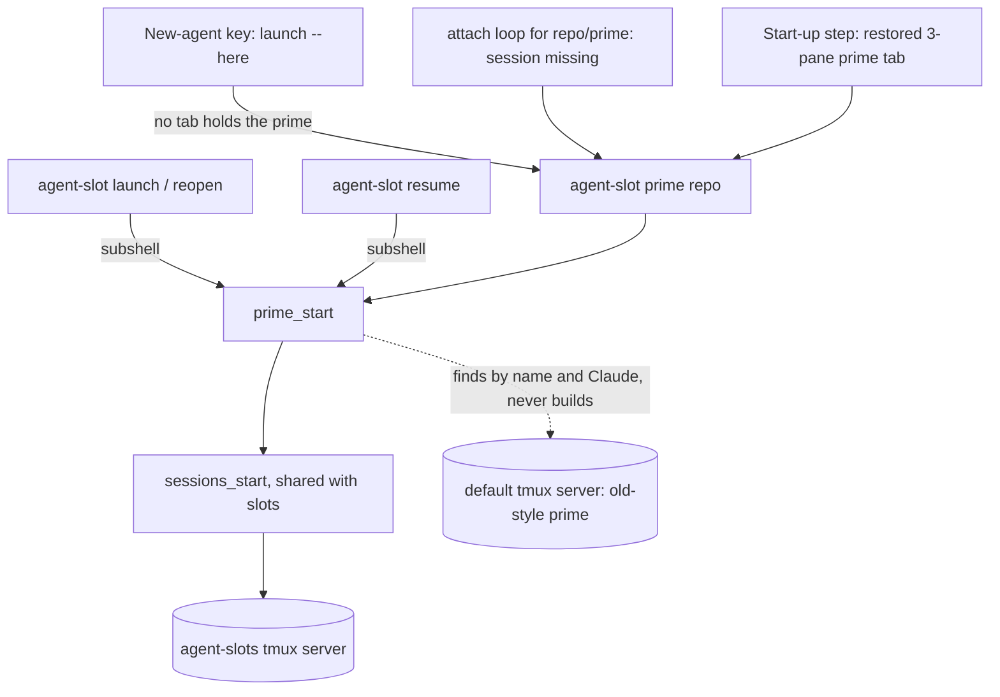
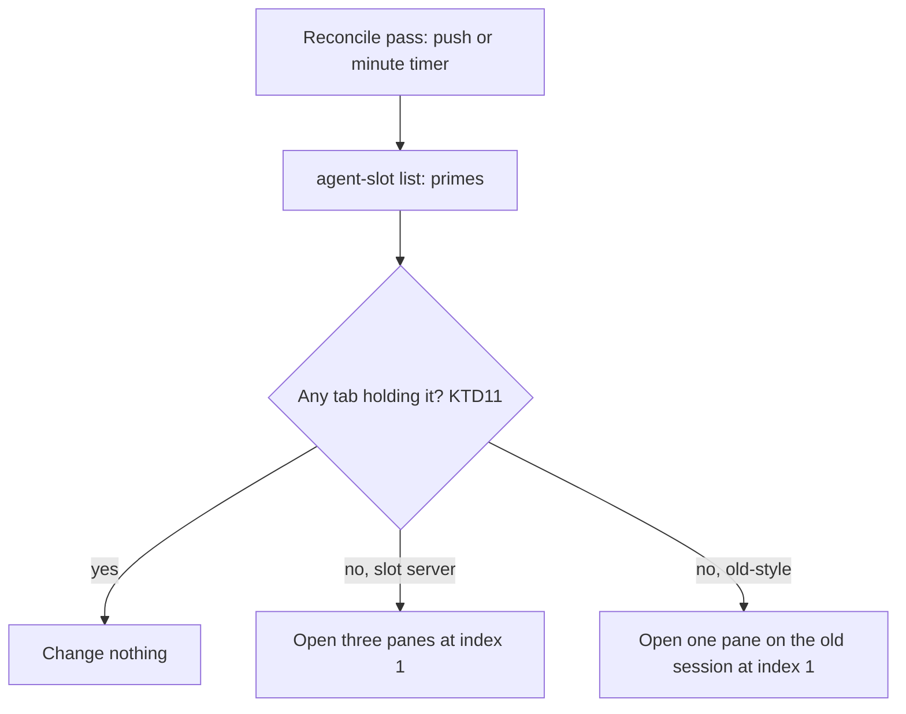
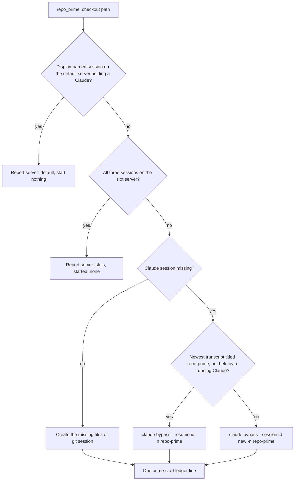
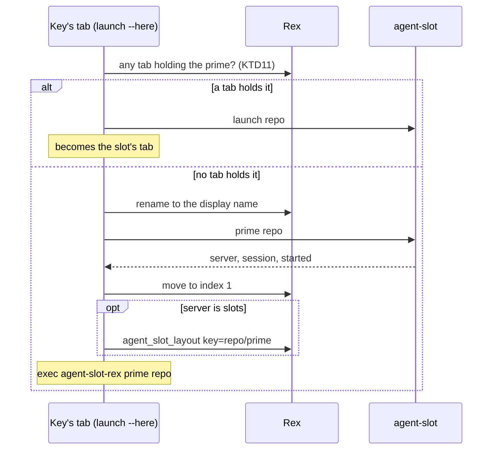

# Primes Built by the Slot Code - Plan

## Goal Capsule

- **Objective:** Brett sees every running prime as a tab in Rex.app and opens any repo's prime with one key press, with
  the same three-pane tab, keys, and phone view a slot has and no per-repo session config to maintain.
- **Means:** one session builder for primes and slots, with a prime keyed `<repo>/prime` and started on demand (KTD1,
  KTD2).
- **Authority:** Brett's decisions in Key Decisions, then the Requirements, then the KTDs. A unit overrides none of
  them.
- **Stop conditions:**
  - Evidence that a settled decision cannot work: send it to `dotfiles-prime`, the coordinating session, and stop that
    unit.
  - No merges, no `scripts/stow-deploy`, no edits to `~/dotfiles`.
  - No starting, killing, or attaching to live tmux sessions or Rex tabs. Reading a live session list is allowed; tests
    use stubs and scratch sockets.
- **Execution profile:** one PR to `dev`, one commit per unit, test-first. A test of new or changed behavior is observed
  failing against the unfixed code. A characterization test (U4's unattended and context scenarios, U6) already passes
  on today's code, so it is observed failing against a planted regression instead. The deletion (U8) lands in the same
  PR, after the units that replace what it deletes.
- **Who finishes:** slot `dotfiles/5` opens the PR and runs the review stack. `skills-prime` merges it.

---

## Product Contract

### Summary

A prime becomes a slot-shaped set of three tmux sessions on the slot server, rooted in the repo's own checkout and
running bypass Claude named `<repo>-prime`. The new-agent key, a slot launch, a reopen, and a resume each start it when
it is not running, and reconcile keeps a tab for every running prime, as it does for slots. A prime still running the
old way on the default tmux server, one holding a Claude, is found by name, shown in a tab, and used until Brett closes
it. `stow/tmuxinator`, `tmux-new-session`, and `mux`/`mux-all` are deleted, on the Mac as well.

### Problem Frame

Slots and primes are built two ways. A slot is three tmux sessions shown as three Rex panes, which gives per-pane focus,
resize, zoom, and keys, a full-size pane on the phone, and a wedged yazi or lazygit that recovers without touching
Claude. A prime is one tmux session with three panes, because it predates Rex and agent-slot. It is started by hand or
from 29 tmuxinator projects whose pane 2 is a blank shell, and the key stops with `prime-not-running` when none is
running.

Those blank panes mean a session on the default server is not always a prime: 11 of the sessions that map to a repo hold
no Claude today, and continuum brings sessions back after a reboot with shells only.

Slots already use a generic template, so the per-repo projects are a second source of truth. Brett asked why a prime is
started differently from a slot and chose to remove the difference.

### Key Decisions

- **Primes are built the same way as slots.** (session-settled: user-approved — chosen over keeping tmuxinator's
  one-session, three-pane layout, after `rex-linux` explained what the Rex layout gives and that primes kept the old one
  only because they predate it.) Governs R1, R2, R4.
- **Primes start on demand.** (session-settled: user-directed — chosen over having tmuxinator start Claude in every
  prime's pane 2: "a prime only _must_ be running if there is a slot running".) Governs R5, R6.
- **The source-controlled tmuxinator projects go away.** (session-settled: user-directed — chosen over keeping them
  beside the generic template: "we should probably delete the source controlled tmuxinator configs so we don't get
  confused".) Governs R19.
- **Running primes are left alone until Brett closes them.** (session-settled: user-approved — chosen over rebuilding
  them when this deploys.) Governs R8, R9.
- **A prime differs from a slot in eight named ways.** (session-settled: user-approved — chosen over a prime that
  behaves as a slot in every respect; Brett through `rex-linux`: "1 - true, 2 - true, 3 - true, 4 - true, 5 - true, 6 -
  ok, 7 - true, 8 - yes".) Governs R11 through R18.
- **Every running prime has a tab in Rex.app, old-style primes included.** (session-settled: user-directed — chosen over
  the key alone opening a prime's tab, and over leaving old-style primes key-opened until closed, with the first pass's
  new Rex sessions and tabs shown: "_all_ tabs must be visible in Rex.app at all times".) Governs R9, R21.
- **tmuxinator goes everywhere now, the Mac included.** (session-settled: user-directed — chosen over keeping it on the
  Mac until the Mac plan ships; the Mac uses `tmux new -s` by hand until then.) Governs R19.
- **Streams Control and GBrain become on-demand primes; Coordinator and Brett GBrain Skillpack stay hand-started.**
  (session-settled: user-approved — chosen over leaving every session with no listed repo hand-started.) Governs R22.
- **A prime's conversation is matched by its exact title, with no alias table.** (session-settled: user-approved —
  chosen over a table mapping old conversation names; Brett renames each conversation just before closing its session,
  since slots message those names today.) Governs R18.
- **Standing rules from Brett:** every session, prime and slot, starts Claude with
  `claude --dangerously-skip-permissions`, and each Rex tab keeps multiple tmux sessions. Governs R3, R4.

### Requirements

**Shape**

- R1. One builder creates the sessions of a prime and of a slot: Claude, yazi, and lazygit, shown as the slot's three
  Rex panes.
- R2. A prime runs in the repo's checkout that `agent-slot repos` names (`~/dev/<repo>`, or `~/dotfiles`), and its
  Claude is named `<repo>-prime`.
- R3. Every Claude a prime or slot session starts carries `--dangerously-skip-permissions`.
- R4. Each session keeps its own tmux session, so a Rex tab holds several.

**Starting**

- R5. In a Rex session named after a repo, the key opens that repo's prime when no tab holds it, starting it first when
  it is not running, and otherwise starts a slot. Every repo `agent-slot repos` lists has a prime, so "this repo has no
  prime" no longer exists. A session named after no repo still gets the picker.
- R6. A slot launch, reopen, or resume starts the repo's prime when it is not running, and a prime that fails to start
  never fails the slot.
- R7. Callers that race start one prime: each of its sessions is created once.

**Transition**

- R8. An old-style prime is a session on the default tmux server with the repo's display name and a Claude in one of its
  panes. It is found and used, and no second prime is built while it runs. A same-named session with no Claude is not a
  prime: it stays running and untouched, and the prime is built on the slot server.
- R9. Nothing here kills, moves, or renames a session on the default server. The only new thing done to one is a tab
  attaching to it (R21).

**Visibility**

- R21. Every running prime, old-style or on the slot server, has a tab in its repo's Rex session. Reconcile opens one
  when none holds it, creating the Rex session if needed, and opens it again if it is closed, as it does for a slot. A
  pass with nothing to do changes nothing.

**Names**

- R10. `config/agent-slot-rex/primes.tsv` keeps each repo's display name, which labels the prime's tab and names its
  old-style session. A repo with no line uses its own name.
- R22. `streams-control` and `gbrain` join the repos `agent-slot repos` lists, through the extra-primes default, under
  the display names `Streams Control` and `GBrain`. `Coordinator` and `Brett GBrain Skillpack` stay hand-started.

**How a prime differs from a slot**

- R11. A prime is attended: `slot-unattended.sh` denies nothing in it, `slot-context.sh` tells it nothing, and ask rules
  such as `agent-slot finish` and `agent-slot sweep` still prompt there.
- R12. A host has one prime per repo, and a prime does not count toward the 8-slot limit.
- R13. Beyond starting the sessions, the builder writes nothing into the checkout, which stays the clone source and, for
  dotfiles, the deploy target.
- R14. A prime keeps whatever branch and uncommitted changes its checkout has; the builder never switches or cleans.
- R15. Check, the needs-you list, release, finish, sweep, trash purge, and automatic Rex tab closing never act on a
  prime. The ledger gets one `prime-start` line per start and nothing else (KTD9).
- R16. A prime's `docs/solutions` link stays pointed at the shared clone, never a per-slot worktree.
- R17. Starting a prime whose path Claude has not trusted shows Claude's trust dialog; nothing trusts that path
  automatically.
- R18. A restarted prime resumes its `<repo>-prime` conversation, and starts fresh only when no such conversation is
  free. One that a running Claude holds is not free (KTD3 names the rule).

**Removal and portability**

- R19. `stow/tmuxinator`, `tmux-new-session`, and `mux`/`mux-all` are deleted, along with everything that exists only
  for them. The Mac starts its local sessions with `tmux new -s` by hand until its plan ships, and the README and the PR
  body say so.
- R20. The new code runs on the Mac through the same paths once the Mac plan makes the helper act locally, and this plan
  states exactly what that plan inherits.

### Acceptance Examples

- AE1. **Covers R5, R8.** Given `xurl-rs`'s `XR CLI` session on the default server holding a Claude and no tab holding
  it, when Brett presses the key in the `xurl-rs` Rex session, then the tab attaches to `XR CLI` and no `xurl-rs-prime`
  session exists.
- AE2. **Covers R1, R2, R3, R5, R18.** Given `bird` with no session anywhere and a transcript titled `bird-prime`, when
  Brett presses the key in the `bird` Rex session, then `bird-prime`, `bird-prime-files`, and `bird-prime-git` start in
  `~/dev/bird`, Claude resumes that transcript in bypass mode, and the tab has three panes.
- AE3. **Covers R5.** Given the prime's tab open, when Brett presses the key again, then a slot starts with no picker.
- AE4. **Covers R6, R8.** Given an agent runs `agent-slot launch dotfiles` while the old `dotfiles` session runs, then a
  slot starts and no `dotfiles-prime` session exists.
- AE5. **Covers R15.** Given a prime running and its repo's last slot torn down, then the prime's three sessions and its
  tab remain, and `agent-slot finish dotfiles/prime --yes` exits with a usage error.
- AE6. **Covers R8.** Given Brett closes the old `XR CLI` session, when the key is next pressed there, then the prime is
  built on the slot server and resumes a conversation titled `xurl-rs-prime`.
- AE7. **Covers R18.** Given a prime's Claude has exited and its pane is at a shell, when `exit` is typed there, then
  the tab's attach loop finds the session gone, `agent-slot prime` starts it again, and Claude resumes the same
  conversation.
- AE8. **Covers R8.** Given `Bird CLI` running on the default server with no Claude in it, when the key is pressed in
  `bird`'s Rex session, then `bird-prime`, `bird-prime-files`, and `bird-prime-git` start, and `Bird CLI` is untouched.
- AE9. **Covers R17, R21.** Given an agent runs `agent-slot launch bird` with no prime running, then `bird-prime`'s
  three-pane tab opens in the `bird` Rex session with no key press, showing Claude's trust dialog when the path is
  untrusted. Closing that tab brings it back on the next pass.
- AE10. **Covers R8, R21.** Given `XR CLI` holding a Claude and no tab holding it, then a pass opens a one-pane tab
  attached to it and starts no `xurl-rs-prime` session, and the next pass changes nothing.

### Scope Boundaries

Non-goals, considered and not built:

- **A prime record file.** The conversation rule reads titles from transcripts, and the sessions' existence is the
  running state, so a record would hold nothing else. A Claude release whose `/clear` drops the title would change this
  call.
- **A table of old conversation titles.** `/rename <repo>-prime` before closing a session carries a conversation over.
  Many running primes needing it would change this call; four do today.
- **A verb that stops a prime.** A prime is never torn down. To stop one by hand, close its tab and kill its three
  sessions right after: an open tab's attach loop restarts killed sessions, and a pass reopens the closed tab of a prime
  still running. Memory pressure from idle primes would change this call.
- **Letting the key start a slot while the prime cannot start.** A failed prime holds that press at its error and retry,
  and `agent-slot-rex launch --repo <repo>` starts a slot regardless. Primes failing often would change this call.
- **Detecting an old session Brett renamed.** Detection is by name (KTD5). Renaming one is rare, and the cost is a
  second prime that shows in the session's tab.
- **Teaching slots who their prime is.** Briefs name who a slot reports to, and `<repo>-prime` is predictable.
- **A `--dry-run` on `agent-slot prime`.** It would show which conversation a prime would resume before an old session
  closes, but `claude agents --json` already shows each running conversation's name, and a wrong guess costs a
  `/resume`.
- **A `mux` shim that points at the replacement.** Brett asked for the name to go so nothing stays confusing. The PR's
  Changelog names what replaces it.
- **A doctor check listing old-style sessions.** It would warn for as long as Brett keeps one by choice. The follow-up
  that removes the old-style branch can list them when it runs.
- **Cleaning up after a prime start that fails partway.** A slot's launch rolls back; a prime has no rollback, so a
  `send-keys` that fails right after its `new-session` leaves a session at a shell prompt that later runs count as
  running. It shows the moment a tab opens, and `tmux` has to fail between two calls milliseconds apart. Seeing this
  happen would change the call.
- **Telling a slot's conversation from a prime's when a slot's task is literally `<repo>-prime`.** Its conversation
  would carry that title and could be resumed. No task has been named that, and `/resume` corrects it.

#### Deferred to Follow-Up Work

- Remove the old-style branch (default-server lookup, the helper's old attach, and the single-pane re-attach) once no
  old-style session runs on either machine.
- Update `docs/plans/2026-11-02-2324-feat-agent-slots-on-the-mac-plan.md` per "What the Mac plan inherits".
- Name the `agent-slot prime` verb in the `agent-slot` skill, which lives in `brettdavies/agent-skills`.

### Outstanding Questions

Sent to the coordinating session for Brett. It does not block, and the plan proceeds on the stated default.

- **Does a prime keep user-bus access?** Old-style panes carry `DBUS_SESSION_BUS_ADDRESS`, and the slot builder starts
  from an empty environment, so `systemctl --user` fails with `Failed to connect to bus: No medium found` in a prime
  built the slot way. Default: a prime's sessions get that variable, a ninth difference from a slot (Assumption A5).
  Declining means a prime prefixes those commands by hand.

---

## Planning Contract

### Assumptions

Inferred bets, not confirmed by Brett:

- A2. Primes run on the slot server (KTD4). Brett said "same as slots" without naming a server.
- A3. A three-pane tab that rexurrect restores under a prime's label means that prime was open, so the start-up step
  starts it if needed and replaces the tab (KTD12). This starts only primes whose tabs were open.
- A4. A prime's Claude pane gets the slot status marks (KTD10). Brett's list bars the unattended and context hooks and
  does not mention status, and "same as slots" followed an explanation that named the Claude pane's status key.
- A5. A prime's sessions start with `DBUS_SESSION_BUS_ADDRESS` set where the user bus exists, pending Brett's answer.

### Key Technical Decisions

- KTD1. **A prime's key is `<repo>/prime`.** `slot_session <repo> prime <kind>` already gives `<repo>-prime`,
  `<repo>-prime-files`, and `<repo>-prime-git`. `SLOT_KEY_PATTERN` stays digits-only, so `check`, `finish`, and `resume`
  cannot name a prime, and reconcile's slot rules (relabel, close when gone, close duplicates) never match its tab,
  which makes R15 true by construction. Only `agent-slot-rex attach` takes the wider pattern. `agent_slot_layout` passes
  its key through to `attach`, so its Lua needs a description change only and works before a config reload.
- KTD2. **`sessions_start` takes the root path, and a prime passes its checkout.** A prime calls the same
  `sessions_start` and `sessions_command` a slot does, with `RECORD` set in memory to
  `{name, session_id, prompt_file: null}` and mode `resume`. `SESSIONS_CLAUDE` stays the one place the bypass flag is
  written (R3). Governs R1, R2. (Inherits the settled "built the same way" decision.)
- KTD3. **The conversation rule: the newest transcript, across Claude's project directories, whose latest `custom-title`
  is exactly `<repo>-prime` and whose session no running Claude holds; with none, a fresh session under that name.**
  - The newest transcript wins because `/clear` starts a new transcript that carries the title: a live transcript under
    `~/.claude/projects/-home-brett-dotfiles/` opens with its `custom-title` line and a `SessionStart:clear` hook. So
    the rule follows `/clear` with no record and no hook.
  - The search covers all project directories because a conversation resumed from elsewhere stays in the file it started
    in (`docs/solutions/best-practices/resume-a-claude-session-by-id-from-another-directory.md`).
  - Only the latest title counts, so a renamed conversation stops matching. A title line is one that starts with
    `{"type":"custom-title","customTitle":"`; a transcript that quotes one in a tool result holds it JSON-escaped, so it
    never matches.
  - `claude --continue` is rejected because any `claude -p` run from the checkout would become "most recent".
  - The scan took 0.55 s over 342 transcripts (4.7 GB) and runs only when a Claude session is being created.
  - A running Claude is excluded through `claude agents --json`, 0.16 s.
  - A scan that fails stops the start with `script-error` rather than choosing fresh blind (R18).
  - The title format lives in `prime.sh` alone, as the dialog's screen format lives in `trust.sh`, since neither is a
    supported interface.
- KTD4. **Primes run on the slot server, `agent-slots`.** That gives them `slots.conf` (`allow-passthrough`, status
  replay, `detach-on-destroy`) and no resurrect plugins, and the server outlives what started it through
  `_sessions_scoped`. The default server is rejected because its continuum restore would bring back prime sessions the
  builder also starts.
- KTD5. **An old-style prime is a display-named session holding a Claude, read from `list-panes -a` on
  `tmux -L default`.** A pane holds a Claude when its `pane_current_command` is `claude` or a bare version number, the
  name Claude's versioned binary can run under.
  - **By name:** paths cannot identify one. `Bird CLI`'s session path is `~/dev`, `Meum Sites`' is `~`, and
    `Coordinator`'s Claude works in `~/dev/agent-skills`.
  - **Holding a Claude:** 11 of the sessions that map to a repo hold none today, and continuum restores sessions with
    shells only, so a name alone would keep attaching the key to a blank session in those repos and report a prime that
    is not running. An old prime whose Claude has exited gets a new prime beside it on the next press, which this
    accepts.
  - **The socket is named** because `agent-slot` often runs inside a slot pane, whose `TMUX` points at the slot server.
    A default server that does not answer stops the start with `tmux-unresponsive` rather than risk a duplicate.
  - Old-style wins when both exist. `prime_start`, `cmd_prime`, the tab check, the start-up step, and `list` all use
    this one test, which lives in `names.sh`. Governs R8.
- KTD6. **`agent-slot prime <repo>` is the one start path, under the existing lock mechanism.** It takes a flock through
  `_record_lock` at `$AS_STATE_DIR/primes/<repo>.lock`, reads the sessions under the lock, and creates only what is
  missing, as `resume` does. It is idempotent and takes every caller. The lock stays out of `~/slots/<repo>/` because
  `doctor` walks `slot_repos`, so a directory made for a prime alone would warn about slot paths of a repo with no
  slots. Governs R7, R12.
- KTD7. **Slots start their prime in a subshell of their own process.** `slot_make` and `cmd_resume` run the same
  `prime_start` that `cmd_prime` runs, after their own sessions exist, in a subshell with its output captured, the shape
  `reattach_primes` uses.
  - A subshell keeps `contract_fail`, `RECORD`, and exit traps away from the slot's rollback, since bash resets traps in
    one.
  - The checkout path comes from what the caller already holds: `REPO_PRIME` in `slot_make`, the record's `.prime` in
    `cmd_resume`. A child `agent-slot` is rejected because `repo_prime` walks every repo, 0.47 s per launch here
    (`agent-slot repos`), and killing one at a time bound can leave a session with nothing typed into it.
  - Each step is already bounded (lock 30 s, each tmux call 5 to 10 s, the scan 30 s), so the subshell needs no timer.
  - `slot_make` runs it before `push_restore`, so the pass that opens the slot's tab opens the prime's too. `cmd_resume`
    runs it after `record_unlock_slot`, so the slot's other panes do not wait on the prime behind the slot lock.
  - The prime's worst case, 180 s, now sits inside `agent-slot resume`, so the helper's `server_call 60 resume` bounds
    in `attach.sh` and `reconcile.sh` rise to 240 s. A timeout there would otherwise cut a start between `new-session`
    and `send-keys`, and on the reconcile path end the pass with no tabs opened.
  - A failure goes into an additive `prime` field in the output, with the launch still succeeding. Governs R6.
- KTD8. **The map keeps its format, and one reader serves both dispatchers.** `prime_display_name` in `names.sh` reads
  `<repo><TAB><display>` and falls back to the repo's name, so `agent-slot` (new `AS_PRIMES`) and `agent-slot-rex`
  (`AR_PRIMES`) share it. The map lists only names that differ from the repo, plus the existing `dotfiles` line. Governs
  R10.
- KTD9. **A prime writes one ledger event: `prime-start`.** One line per `agent-slot prime` that created a session, with
  repo, key, path, started sessions, conversation mode, session ID, `started_at`, and `made_at`, the same stamps a
  launch line carries, so the time a start takes can be read back. The ledger is where automatic triggers are logged for
  tuning, and a prime started by a slot launch is one. Readers are safe: `doctor`, `reopenlookup`, and `release` each
  filter on `.event`. It writes no other event, and slot hooks do not run for it. Governs R15.
- KTD10. **Hooks split on session name.** `hook_claude_session` stays slot-only (`-[0-9]+$`), so `slot-unattended.sh`
  and `slot-context.sh` print nothing for a prime with no code change. A new `slot_session_is_prime` (`*-prime`) admits
  a prime's Claude to `slot-status.sh` alone. Slot names always end in digits, `-files`, or `-git`, so the two never
  overlap, whatever the repo's name. Governs R11.
- KTD11. **A tab holds the prime when any of three things is true**, and the key and reconcile both check all of them
  before choosing:
  - a block's own process is `agent-slot-rex attach <repo>/prime claude`, which stays true while the loop waits for
    Enter after a detach;
  - a client of the old-style session runs on a block's terminal, the existing check;
  - another window carries the display label while its own process is `agent-slot-rex launch`, which a key's tab sets
    before it asks the server to start anything.

  Two near-simultaneous presses can still make two tabs on one prime, which costs a tab and never a duplicate prime.
  Governs R5.
- KTD12. **The start-up step replaces a restored three-pane prime tab.** rexurrect restores it as plain shells, and
  without this step each Rex restart would leave those shells beside the tab reconcile opens. When every pane is a shell
  at its prompt, the step runs `agent-slot prime`, opens a fresh tab through reconcile's own open, and closes the
  restored one, the order reconcile uses for slots. A one-pane tab keeps today's rules: an old-style prime running gets
  the prime command typed, otherwise `prime-not-running` and left alone. The walk covers map lines plus every other repo
  with a Rex session, since a repo with a default name has no line. Governs R9, R21.
- KTD13. **`agent-slot-rex prime <repo>` holds a pane on the prime however it runs.** With an old-style prime running,
  it attaches and then becomes a login shell, as today. Otherwise it `exec`s `attach <repo>/prime claude`. The key's
  tab, reconcile's old-style tab, and the typed re-attach all use this one verb. Governs R5, R8, R21.
- KTD14. **The builder never trusts and never touches git.** No `trust_accept`, no `parity_*`, no checkout, no `.git`
  write. `trust_prompt_expected` in the output comes from `trust_known`. `warm` keeps treating the prime path as the
  anchor for its slots. Governs R13, R14, R16, R17.
- KTD15. **`prime-not-running` leaves the closed set of reasons.** The key now starts the prime instead of stopping. The
  start-up step's journal outcome of the same name stays, because it is a log string and not an error reason.
- KTD16. **Reconcile keeps a tab for every running prime, and only ever opens one.** Governs R21, and through it the
  settled decision on tabs.
  - **What it reads:** `agent-slot list` gains an additive `primes[]` of `{key, repo, server, session, label}`.
    Slot-server primes come from `list-sessions -F '#{session_name}\t#{session_path}'`: a `*-prime` session's path
    basename is its repo, since `repo_primes` names a repo by its directory. Old-style primes come from KTD5's read,
    mapped through `primes.tsv` or the session's own name and kept only when that repo exists. Old-style wins per repo.
  - **Cost:** `repo_prime` looks a name up directly (`$AS_DEV/<name>`, then the extra list) rather than walking every
    repo, which costs one `git config` per candidate on a call the timer runs every minute, and saves 0.47 s on each
    launch as well.
  - **What it plans:** prime rows join `open` only, so relabel, close, and duplicate handling never see a prime's tab
    (R15). A pass with no prime lacking a tab plans nothing.
  - **What it opens:** `rex_open_tab` in the repo's session, creating the session when there is none, then
    `window move --index 1`. A slot-server prime gets `attach <repo>/prime claude` and the layout. An old-style prime
    gets one pane running `agent-slot-rex prime <repo>`, which leaves the session itself untouched (R9).
  - **How it knows a tab holds a prime:** KTD11's test, in any Rex session. `rex_snapshot` adds each block's terminal
    from one `ps -A -o pid= -o tty=`, and each old-style prime adds one `list-clients`, so a session Brett attached by
    hand in any tab counts and gets no second tab.
  - **Who triggers it:** `slot_make`'s push (KTD7), the minute timer, and `agent-slot prime`, which pushes when it
    created a session and no helper called it, under the rule `AGENT_SLOT_REX_CLIENT` already sets for launches.
- KTD17. **Two more repos come through the extra-primes default.** `AS_EXTRA_PRIMES` adds
  `$HOME/box/TX-AI/streams-control:$HOME/gbrain`. A host without a checkout passes over it, so the Mac and other servers
  are unaffected, and these repos now also take slots and warm like any other. Governs R22.
- KTD18. **A prime's sessions carry the user bus.** Where `/run/user/$UID/bus` exists, a prime's `new-session` adds
  `-e DBUS_SESSION_BUS_ADDRESS=unix:path=/run/user/$UID/bus`, the value old-style panes carry. `systemctl --user` then
  works there: from a slot's shell it fails with `Failed to connect to bus: No medium found` and answers once this
  variable is set. Only this variable, so `AS_RUN_DIR` keeps resolving as it does. Pending Brett's answer (A5).

### High-Level Technical Design

Who starts a prime:



Who shows a prime:



What `prime_start` decides, under the lock in KTD6:



What the key does in a Rex session named after a repo:



|               | Slot                              | Prime                                     |
| ------------- | --------------------------------- | ----------------------------------------- |
| Key           | `<repo>/<N>`                      | `<repo>/prime`                            |
| Root          | `~/slots/<repo>/<N>`, a clone     | the checkout `repo_prime` names           |
| tmux sessions | `<repo>-<N>`, `-files`, `-git`    | `<repo>-prime`, `-files`, `-git`          |
| tmux server   | `agent-slots`                     | `agent-slots`                             |
| Claude        | bypass, named for the slot        | bypass, named `<repo>-prime`              |
| Record        | `.git/agent-slot.json`            | none                                      |
| Lock          | `~/slots/<repo>/.<N>.lock`        | `$AS_STATE_DIR/primes/<repo>.lock`        |
| Count         | up to 8 per repo                  | one per repo per host                     |
| Hooks         | unattended, context, status       | status only                               |
| Tab           | reconcile opens, relabels, closes | reconcile opens; never relabels or closes |
| Ends          | `release`, `finish`, `sweep`      | never, except by hand                     |

### System-Wide Impact

- **Slot launch latency:** each launch gains two `tmux list-sessions` calls when the prime already runs (KTD7). U3
  measures it, with a 50 ms target `[estimated]`.
- **Reconcile:** it now opens tabs for primes (KTD16) and never relabels or closes them. Each pass adds one more
  `list-sessions`, one `list-panes` on the default server, and one `ps`.
- **First pass after deploy:** it opens a tab for each old-style prime no tab holds, from the 12 that hold a Claude
  today, and creates the 7 Rex sessions they lack: the six Meum repos and `obsidian-vault`. The tmux sessions themselves
  do not change, and the sessions with no Claude get no tab.
- **Mac:** `mux` goes there too, so its local sessions start with `tmux new -s` by hand until the Mac plan ships.
  Running sessions keep running.
- **Running tmux servers:** `TMUXINATOR_CONFIG` stays in their environment until they restart, unused.
- **Open PRs:** #445 changes `slotmake.sh`. Whichever lands second rebases.

### Risks

| Risk                                                                                       | Handling                                                                                             |
| ------------------------------------------------------------------------------------------ | ---------------------------------------------------------------------------------------------------- |
| A Claude release changes the `custom-title` line, so resume finds nothing and starts fresh | The output and ledger say `fresh`, the tab shows it at once, and `/resume` recovers the conversation |
| Continuum restores old sessions after a reboot, with shells only                           | They hold no Claude, so they are not primes (R8); the key builds a prime and they stay until closed  |
| Primes and slots share one tmux server, so a wedge or a `kill-server` stops them together  | R18 limits the loss to a restart; each prime comes back on its own conversation                      |
| An old-style session Brett keeps blocks that repo's new prime                              | That is R8 working as decided                                                                        |
| Reattach replaces a three-pane tab an operator labelled exactly like a prime               | Only when every pane is an idle shell, so only those shells are lost                                 |
| A failed prime start goes unnoticed in a launch                                            | The launch's `prime` field names the reason, and the next launch or key press retries                |

### What the Mac plan inherits

The Mac plan (`docs/plans/2026-11-02-2324-feat-agent-slots-on-the-mac-plan.md`) is still awaiting Brett's review, and
this PR does not edit it. It needs an edit before it runs, because these parts of it change:

1. **R12, R13, R15, KTD11, and the "One prime map" decision** describe a prime as a session on the machine's default
   tmux server. That is now the transition case. A prime built on the Mac runs on the Mac's `agent-slots` server in the
   Mac's checkout. R12's "a repo with no prime gets a new slot" no longer exists; R5 here replaces it.
2. **Line 388 and P18** rest on tmuxinator's `name:` fields. `primes.tsv` now holds those names. The Mac's local
   sessions holding a Claude are found by name through the same lookup until closed.
3. **Linux-only calls:** `agent-slot prime` runs on the Mac once KTD6 of that plan makes the helper act locally, through
   calls the plan already replaces (`env -i -C`, `getent`, `flock`). This work routes session ID generation through one
   function, so its `os_uuid` step changes one line.
4. **The Vault project's Taildrive mount** (`on_project_start: taildrive-mount vault`) has no replacement. Brett
   assigned the answer to the Mac plan. `taildrive-mount vault` still works by hand.
5. **Reconcile:** the Mac's pass, once it runs one, reads `list.primes` and keeps prime tabs as this plan does (R21,
   KTD16). KTD18's bus variable is skipped where `/run/user/$UID/bus` does not exist, so it needs no Mac change.
6. **Until that plan ships,** a key pressed in a Linux session keeps acting on the Linux server (`forward.sh`), and the
   Mac starts its local sessions with `tmux new -s` by hand.

---

## Implementation Units

### U1. Names and the prime map

- **Goal:** one definition of a prime's key, names, and display name.
- **Requirements:** R2, R8, R10, R22; KTD1, KTD5, KTD8, KTD17.
- **Dependencies:** none.
- **Files:** `scripts/agent-slot/lib/names.sh`, `scripts/agent-slot/lib/env.sh`, `scripts/agent-slot-rex/lib/prime.sh`,
  `config/agent-slot-rex/primes.tsv`, `tests/agent-slot-prime.bats` (new), `tests/agent-slot-rex.bats`.
- **Approach:**
  1. Add the prime token, its attach-only key pattern and parser, `slot_session_is_prime`, the Claude name helper,
     `prime_display_name`, and KTD5's test of a `list-panes` line to `names.sh`.
  2. Add `AS_PRIMES` (`AGENT_SLOT_PRIMES`) to `env.sh`, and add `streams-control` and `gbrain` to the `AS_EXTRA_PRIMES`
     default (KTD17).
  3. Make the helper's `prime_of` use the shared reader and always succeed, renaming `PRIME_SESSION` to say it holds a
     display name.
  4. Set `primes.tsv` to the table in the Appendix and rewrite its header for what the column now means.
  5. `slot_parse_key` given `<repo>/prime` says so: "`<repo>/prime` is a prime, not a slot; `agent-slot prime <repo>`
     starts it, and nothing here ends it", still as a usage error, so an agent that tries `resume` or `finish` on a
     prime learns the right verb.
- **Patterns to follow:** `slot_session`, `slot_parse_key`; `AR_PRIMES` in `scripts/agent-slot-rex/lib/settings.sh`.
- **Test scenarios:**
  - `prime_display_name` returns the listed name for `xurl-rs` and the repo's own name for `qmd`.
  - A commented line and a malformed line are ignored.
  - `slot_session repo prime` and its `files` and `git` forms give the three expected names; a repo with `.` is
    sanitized as a slot's is.
  - `slot_session_is_prime` is true for `x-prime` and `foo-2-prime`, and false for `x-prime-1`, `x-prime-files`, and
    `foo-2`.
  - `slot_session_is_claude` stays false for `foo-prime` and `foo-2-prime`.
  - The real `primes.tsv`: every line has two fields, each repo appears once, and no name holds `.` or `:`, which tmux
    refuses.
  - KTD5's test holds for a pane running `claude` or `2.1.318`, and not for `zsh` or `lazygit`.
  - The extra-primes default lists a present `streams-control` and passes over an absent `gbrain`.
- **Verification:** both dispatchers source one reader, and no second parse of the map remains.

### U2. The shared builder and `agent-slot prime`

- **Goal:** a prime starts through the slot builder with one idempotent verb.
- **Requirements:** R1, R2, R3, R7, R8, R12, R13, R14, R16, R17, R18; KTD2, KTD3, KTD4, KTD5, KTD6, KTD9, KTD14, and the
  "built the same way" and "left alone" Key Decisions.
- **Dependencies:** U1.
- **Files:** `scripts/agent-slot/lib/prime.sh` (new), `scripts/agent-slot/lib/sessions.sh`,
  `scripts/agent-slot/lib/slotmake.sh`, `scripts/agent-slot/lib/bounded.sh`, `scripts/agent-slot/lib/help.sh`,
  `scripts/agent-slot/agent-slot`, `tests/agent-slot-prime.bats`, `tests/claude-bypass-flag.bats`,
  `tests/lib/agent-slot.bash`.
- **Approach:**
  1. `sessions_start` takes an optional root path and optional extra `new-session` arguments, and `_sessions_fail` names
     the right retry command for a prime. A prime passes KTD18's bus variable through them, read from a path the tests
     can override.
  2. Add a bounded read of `list-panes -a` on the default server to `bounded.sh`, without `-f`, so it never starts a
     server, and extend the fixture's tmux stub so `list-panes` answers per socket.
  3. `prime.sh` holds `prime_start`, the old-style lookup, the conversation rule, and `cmd_prime`.
  4. Move new session ID generation to one function that `slot_make` also uses, and name the verb in the README's verb
     list here, since `tests/agent-slot-docs.bats` holds that list equal to `VERBS`.
  5. Output: `{key, repo, path, name, server: "slots"|"default", session, started[], conversation: {mode:
     "running"|"resumed"|"fresh", session_id}, trust_prompt_expected, next_step}`. `next_step.command` is the attach
     that holds it (`agent-slot-rex prime <repo>`), and its note says other sessions reach it by the name
     `<repo>-prime`.
  6. The text line says what happened in one of three forms:
     - `xurl-rs/prime: runs in XR CLI on the default tmux server; close that session to rebuild it on the slot server`
     - `bird/prime: started bird-prime, bird-prime-files, bird-prime-git, resuming <id>`
     - `bird/prime: already running`
  7. `tmux_unresponsive` takes the socket it names, so a hung default server's error sends the reader to
     `tmux -L default list-sessions`, not to the slot server. Each `contract_fail` here retries with
     `agent-slot prime <repo>`.
  8. `help.sh` gets the verb's usage, one example, and a `returns:` line, as `warm` has.
  9. After a start that created a session, the verb calls `push_restore`, which skips itself when a helper called it.
- **Patterns to follow:** `cmd_resume` for locking and the output shape; `sessions_transcript_find` for the
  project-directory walk; `launch_output` for `next_step`.
- **Execution note:** test-first; the fixture repo's fingerprint (`assert_prime_untouched`) backs R13 and R14 in every
  scenario that builds.
- **Test scenarios:**
  - Covers AE2. With no sessions, three sessions start on the slot socket with `-c` at the checkout, and the typed lines
    are the slot's yazi and lazygit commands and
    `claude --dangerously-skip-permissions --session-id <id> -n repoa-prime`.
  - A checkout with a dirty file, a non-default branch, and a `docs/solutions` link fingerprints the same afterwards,
    with no `git` write and no worktree added.
  - A transcript titled `repoa-prime` gives `--resume <its id> -n repoa-prime` and mode `resumed`.
  - Of two such transcripts, the newer is resumed.
  - A transcript whose latest title differs, after an earlier `repoa-prime`, is not resumed.
  - A transcript in another project directory is found.
  - A session `claude agents` lists as running is skipped for the next newest, and with none left the mode is `fresh`.
  - A `claude -p` transcript with no title in the same project directory is never chosen.
  - A killed `repoa-prime-files` alone restarts with no new Claude and no second session.
  - All three running starts nothing, reports `started: []`, and writes no ledger line.
  - Covers AE1. With `repoa`'s display-named session on the `default` socket holding a Claude, nothing starts on either
    socket and `server` is `default`, and a slot launch there starts no prime session either.
  - Covers AE8. With that session holding no Claude, the three prime sessions start on the slot socket, and no call
    names the session on the `default` socket other than the read.
  - A prime's `new-session` carries the bus variable where the bus path exists, and omits it where it does not.
  - A start pushes a restore, and one run with `AGENT_SLOT_REX_CLIENT` set does not.
  - A default socket with no server creates no session there.
  - A default server that does not answer exits `tmux-unresponsive` with value `default` and a `next_step.command`
    naming that socket, and starts nothing.
  - An old-style session's text line names the session and how to rebuild it.
  - Two concurrent runs give one set of sessions, with three `new-session` calls in all.
  - Covers R12. With 8 live slots, `prime` still starts, and `launch` still refuses at the limit with the prime running.
  - An untrusted path starts Claude all the same, reports `trust_prompt_expected: true`, and leaves the trust record and
    trust socket untouched.
  - An unknown repo exits `repo-not-found`.
  - Exactly one `prime-start` ledger line follows a start, with the fields of KTD9.
  - `tests/claude-bypass-flag.bats` still passes over the new files, and gains a case that a prime's fresh and resumed
    Claude lines both come from `SESSIONS_CLAUDE`.
  - A checkout whose `.git` is a file, as `obsidian-vault`'s is, starts the same way.
  - A transcript that quotes `{"type":"custom-title","customTitle":"repoa-prime"}` inside a tool result, JSON-escaped,
    is not chosen.
  - A title scan that fails exits `script-error` and starts no Claude session.
  - A start creates nothing under the slot root, so `slot_repos` and `doctor` see no change.
- **Verification:** with real tmux on a scratch socket, a stub `claude`, and a fixture repo, the three sessions exist at
  the checkout's path and a second run starts nothing.

### U3. Slots start their prime

- **Goal:** a running slot implies a running prime.
- **Requirements:** R6, R8; KTD7.
- **Dependencies:** U2.
- **Files:** `scripts/agent-slot/lib/slotmake.sh`, `scripts/agent-slot/lib/launch.sh`,
  `scripts/agent-slot/lib/reopen.sh`, `scripts/agent-slot-rex/lib/launch.sh`, `scripts/agent-slot-rex/lib/attach.sh`,
  `scripts/agent-slot-rex/lib/reconcile.sh`, `tests/agent-slot-launch.bats`, `tests/agent-slot-reopen.bats`,
  `tests/agent-slot-prime.bats`.
- **Approach:**
  1. `slot_make` runs `prime_start` in a subshell after the slot is committed (`SLOT_ARMED` clear, slot lock released)
     and before `push_restore`, so nothing it does can roll the slot back and the pass that follows opens the prime's
     tab.
  2. `cmd_resume` runs it after `record_unlock_slot`, with the checkout path from the record's `.prime`.
  3. `launch`, `reopen`, and `resume` outputs gain `prime`: its object, or `{error: {reason, message, next_step, log}}`,
     so an agent reading a launch gets the retry command. A subshell that dies with no error object gives `script-error`
     with its stderr kept in `AS_LOG_DIR`, as `reattach_primes` does. A launch's text line adds "; its prime did not
     start: `<reason>`", so `ok: true` never hides it. A launch that returns a slot already holding its request starts
     nothing and reports `prime: null`.
  4. Raise `launch_call`'s bound and comment in the helper to cover the prime's worst case, and raise both
     `server_call 60 resume` bounds to 240 s (KTD7).
  5. `prime` in `tests/lib/agent-slot.bash` seeds a same-named session holding a Claude on the fixture's `default`
     socket, so the suites' existing `new-session` counts stay as they are with no test-only seam;
     `tests/agent-slot-prime.bats` clears it.
- **Patterns to follow:** the subshell and capture in `reattach_primes`; the `$fields` merge in `launch_output`.
- **Test scenarios:**
  - A launch starts the slot's three sessions and the prime's three, and `prime.started` lists the latter.
  - Covers AE4. A launch with the old-style session running gives `prime.server: default` and no prime session.
  - A second launch finds the prime running and starts no prime session.
  - A reopen starts the prime.
  - Resuming a dormant slot starts the prime.
  - A prime start that fails (stub tmux failing `new-session` for a `*-prime` name) leaves the launch at exit 0, the
    slot active, and `prime.error.reason` set.
  - A failed prime start never rolls the slot back.
  - That `prime.error.next_step.command` is `agent-slot prime <repo>`.
  - A subshell that dies with no error object reports `script-error` and keeps a log.
  - The launch's own exit traps run once, unchanged by the subshell's `contract_fail`.
  - The suites' existing `new-session` counts pass unchanged with the seeded fixture.
- **Verification:** measure the launch's added wall-clock on a fixture repo with the prime already running, and record
  it in the PR.

### U4. Hooks classify a prime

- **Goal:** a prime's Claude shows status and is never treated as unattended.
- **Requirements:** R11; KTD10.
- **Dependencies:** U1.
- **Files:** `scripts/agent-slot/lib/hook.sh`, `stow/claude/dot-claude/slot-status.sh`, `tests/slot-status.bats`,
  `tests/slot-unattended.bats`, `tests/slot-context.bats`.
- **Approach:** add `hook_prime_session`; `status_report` accepts either kind of session, and the other two hooks stay
  as they are. The tests fix that.
- **Patterns to follow:** the pane and payload fixtures in `tests/slot-unattended.bats`.
- **Test scenarios:**
  - In a `repoa-prime` pane on the slot socket with its cwd at the checkout, a `PermissionRequest` gets no denial and
    writes no ledger line.
  - The same pane's `PreToolUse` on `AskUserQuestion` and `EnterPlanMode` gets no denial.
  - The same holds for a repo whose name ends in digits, `foo-2-prime`.
  - `SessionStart` there prints no additional context and writes no record or ledger line.
  - `slot-status.sh` writes the report and stores `@slot_status` for a prime's top-level Claude.
  - It writes nothing for a nested `claude -p` under that Claude, or for a Claude started by hand in
    `repoa-prime-files`.
  - A slot's Claude session behaves as before for all three hooks.
  - The ask rules in `stow/claude/dot-claude/settings.json` still list `agent-slot finish`, `agent-slot sweep`, and
    `agent-slot-rex finish`.
- **Verification:** the suites pass with the new scenarios observed failing first where behavior changes (status) and
  passing as characterization where it must not (unattended, context).

### U5. The key and the attach loop

- **Goal:** the key opens a prime in the slot's three-pane shape and falls back to old-style attachment during the
  transition.
- **Requirements:** R4, R5, R8; KTD1, KTD11, KTD13, KTD15, and the "on demand" Key Decision.
- **Dependencies:** U1, U2.
- **Files:** `scripts/agent-slot-rex/lib/launch.sh`, `scripts/agent-slot-rex/lib/prime.sh`,
  `scripts/agent-slot-rex/lib/attach.sh`, `scripts/agent-slot-rex/lib/rex.sh`, `scripts/agent-slot-rex/lib/help.sh`,
  `scripts/agent-slot-rex/agent-slot-rex`, `scripts/agent-slot/lib/contract.sh`,
  `stow/rex/dot-config/rex/agent-slots.lua`, `tests/agent-slot-rex.bats`, `tests/lib/agent-slot-rex.bash`,
  `tests/rex-config.bats`.
- **Approach:**
  1. `cmd_launch` drops the "map names a prime" condition.
  2. `launch_prime` follows the sequence in the High-Level Technical Design, using `launch_call` so a failure shows with
     a retry. Its bound outlasts the verb's own: lock 30 s, three sessions at up to 30 s each, the lists and the scan,
     so 180 s. A helper timeout killing the verb mid-session would leave a pane with nothing typed.
  3. `prime_tab_open` implements KTD11.
  4. `attach` takes `<repo>/prime`, and its resume path calls `agent-slot prime` under the same 180 s bound;
     `repo-not-found` ends the pane as `slot-not-found` ends a slot's.
  5. `cmd_prime` implements KTD13.
  6. Remove the `prime-not-running` reason and its row in the README's reasons table, which `tests/agent-slot-docs.bats`
     holds equal, and fix the Lua descriptions.
  7. `launch_failed` names what failed: "the prime of X did not start", a label of `X · prime failed`, and a retry line
     with no request ID, since a prime has none.
  8. The 32 `launch --here` calls in `tests/agent-slot-rex.bats` assume a repo with no map line gets a slot. A fixture
     helper gives a session an open prime tab, and each test that expects a slot uses it, so the suite keeps testing
     what it tested.
- **Patterns to follow:** `launch_succeeded`, `launch_call`; the `rex_helper_block` process lookup; the existing key
  tests at "the new-agent key and the repo's prime" in `tests/agent-slot-rex.bats`.
- **Test scenarios:**
  - Covers AE2. In a repo session with no prime tab and no old session, the tab is renamed to the display name,
    `agent-slot prime X` runs, the tab moves to index 1, `agent_slot_layout key=X/prime` runs, and the last call is
    `agent-slot-rex prime X`.
  - Covers AE1. With the server answering `default`, no layout runs and the last call is `agent-slot-rex prime X`.
  - A repo with no map line behaves the same under its own name, and starts no slot on the first press.
  - Covers AE3. A block whose own process is `agent-slot-rex attach X/prime claude` makes the key start a slot, even
    when that loop is waiting after a detach (no tmux client).
  - A window carrying the display label while running `agent-slot-rex launch` makes a second press start a slot.
  - A failing `agent-slot prime` shows "the prime of X did not start" with a retry in the tab, labels it
    `X · prime failed`, and starts no slot.
  - Covers AE7. A client that ends with its session gone leads to `agent-slot prime X`, then a new attach.
  - `launch --repo X` still starts a slot and never opens the prime.
  - A session named after no repo still shows the picker.
  - `attach X/prime git` attaches to `X-prime-git` on the slot socket.
  - A missing session calls `agent-slot prime X`, not `resume`.
  - `repo-not-found` ends the pane.
  - `attach X/prime` with a bad pane name is a usage error.
  - `cmd_prime` with the old session attaches then becomes a login shell; without it, it execs `attach X/prime claude`.
  - The `tests/agent-slot-rex-macos.bats` forwarding cases still pass, with `attach X/prime claude` stopping with
    `wrong-host` on the Mac.
- **Verification:** the Rex stubs show the exact call order above. A live Rex tab is out of bounds here, so Brett's
  first key press after merge is the end-to-end check, and the PR says so.

### U10. Reconcile keeps a tab for every running prime

- **Goal:** every running prime is visible in Rex.app with no key press, and a pass with nothing to do changes nothing.
- **Requirements:** R9, R15, R17, R21; KTD11, KTD13, KTD16, and the "every running prime has a tab" Key Decision.
- **Dependencies:** U2, U5.
- **Files:** `scripts/agent-slot/lib/read.sh`, `scripts/agent-slot-rex/lib/reconcile.sh`,
  `scripts/agent-slot-rex/lib/rex.sh`, `tests/agent-slot-read.bats`,
  `tests/agent-slot-rex.bats`, `tests/lib/agent-slot-rex.bash`.
- **Approach:**
  1. `list` adds `primes[]`, and `repo_prime` becomes the direct lookup KTD16 describes.
  2. `reconcile_fetch` keeps the array, and `reconcile_plan` adds an `open` row for each prime no tab holds.
  3. `rex_snapshot` adds each block's terminal, so the plan can apply KTD11's client check.
  4. `reconcile_open_tab` opens by kind: a slot, a slot-server prime with the layout, or an old-style prime with one
     pane, the last two moved to index 1. The start-up step (U7) calls this same function.
  5. The ps stub in `tests/lib/agent-slot-rex.bash` answers `-A -o pid= -o tty=`.
- **Patterns to follow:** `reconcile_plan`, `reconcile_open_tab`, and the slot tab tests under "reconcile: restore and sweep" in
  `tests/agent-slot-rex.bats`, which these mirror.
- **Execution note:** test-first, as the slot tab tests are, against the `rex` stub's plan and call log.
- **Test scenarios:**
  - `list` reports `repoa/prime` with `server: slots` for a running `repoa-prime`, and `slots[]` keeps its shape.
  - `list` reports an old-style prime with `server: default` and its display name, for a session named by the map and
    for one named by its own repo.
  - `list` omits a blank old session, `Coordinator` (a Claude but no repo), and a repo with no checkout on this host.
  - `list` with both running reports one row, the old-style one.
  - Covers AE9. A running slot-server prime with no tab gets one on the next pass: `rex window new` in its repo's
    session, the layout with key `X/prime`, then `window move --index 1`.
  - A running prime in a repo with no live slot gets a tab too.
  - A repo with no Rex session gets one through `rex new`.
  - Closing the tab brings it back on the next pass.
  - Covers AE10. A running old-style prime no tab holds gets one pane running `agent-slot-rex prime X`, with no layout,
    and no call changes the tmux session.
  - A hand-attached old-style prime, whose client runs on a block's terminal in any Rex session, gets no second tab.
  - A prime tab with the label changed gets no rename, and two tabs on one prime get no close.
  - A window with the display label running `agent-slot-rex launch` counts, so a pass during a key press opens no second
    tab.
  - A pass with every prime's tab present makes no `window new`, `new`, `rename`, `move`, or `close` call, and journals
    an empty plan.
  - No session a pass reads on the default server gets any call but the read and `list-clients`.
  - A pass that a restart interrupts stops opening prime tabs, under the same pin checks as slot tabs.
- **Verification:** the reconcile journal shows prime keys under `open`. A live Rex pass is out of bounds here, so the
  PR names the first pass after deploy as the end-to-end check, with the System-Wide Impact counts as what to expect.

### U6. Nothing that ends a slot reaches a prime

- **Goal:** hold R15 with tests.
- **Requirements:** R15; KTD1.
- **Dependencies:** U2, U5, U10.
- **Files:** `tests/agent-slot-teardown.bats`, `tests/agent-slot-check.bats`, `tests/agent-slot-release.bats`,
  `tests/agent-slot-rex.bats`, `tests/agent-slot-rex-startup.bats`.
- **Approach:** characterization, since `SLOT_KEY_PATTERN` stays digits-only. Each test is observed failing against a
  planted regression, such as that pattern widened to admit `prime`, and is then restored. Any test that fails against
  the built code finds a real gap to fix in the code it names.
- **Test scenarios:**
  - Covers AE5. `finish`, `check`, and `resume` given `repoa/prime` exit with a usage error that names
    `agent-slot prime`, and change nothing.
  - `agent-slot-rex finish repoa/prime` is refused.
  - `sweep --yes` and `sweep --yes --auto`, with a finished slot beside a running prime, tear down the slot and leave
    the prime's sessions.
  - `slot_rollback` of a failed launch leaves the prime's sessions.
  - `whoami` and `release` from the prime's checkout exit `not-in-slot`.
  - Reconcile with a tab running `attach X/prime claude` plans no rename or close for it, whether or not the repo has
    slots.
  - `agent-slot-rex finish --tab` on a prime's tab fails with "not an agent slot's tab".
  - `startup_kill_slot_sessions` leaves a session holding a prime's tab and slot tabs, and a session holding only a
    prime's tab.
- **Verification:** each scenario passes against the built code; `ce-work` records which ones needed a fix.

### U7. The start-up step restores a prime's tab

- **Goal:** after a Rex restart, a prime's three-pane tab comes back holding the prime.
- **Requirements:** R5, R9, R21; KTD12.
- **Dependencies:** U2, U5, U10.
- **Files:** `scripts/agent-slot-rex/lib/reattach.sh`, `scripts/agent-slot-rex/lib/startup.sh`,
  `tests/agent-slot-rex-startup.bats`.
- **Approach:**
  1. Walk map lines plus every other `repos` entry with a Rex session.
  2. For a label-matched tab of three idle shells, call `agent-slot prime`, then replace the tab through U10's
     `reconcile_open_tab` and close the restored one, under the pin checks. The outcome is `reopened`.
  3. A server answer of `default` on a three-pane tab is `not-idle`.
  4. One-pane behavior stays as tested today.
- **Patterns to follow:** `reattach_repo`, `reattach_shell_idle`, and its per-repo subshell; `reconcile_open_tab`.
- **Test scenarios:**
  - Three idle shells under the label, no prime running: `agent-slot prime` runs, a new tab opens with the layout at
    index 1, the old one closes, and the outcome is `reopened`.
  - Three idle shells with the prime already running: the same, with `started: []`.
  - A pane running a program: nothing changes, and the outcome is `not-idle`.
  - A failing `agent-slot prime`: the restored tab stays, the outcome is that error's reason, and the next repo still
    runs.
  - A repo with no map line whose session has a tab labelled with its name is handled.
  - A Rex restart seen partway stops further changes, as the existing test holds.
  - A config reload's step replaces nothing.
  - All existing one-pane scenarios keep passing unchanged.
- **Verification:** the existing start-up suite passes with only additions.

### U8. Delete tmuxinator

- **Goal:** one way to build a prime remains.
- **Requirements:** R19, and the "projects go away" Key Decision.
- **Dependencies:** U5, because the key must start primes before the projects go.
- **Files:**
  - Delete: `stow/tmuxinator/` (29 files), `stow/local/dot-local/bin/tmux-new-session`, `config/shell/tmuxinator.sh`,
    `tests/tmuxinator-configs.bats`, `tests/mux-all.bats`, `tests/tmux-new-session.bats`.
  - Modify: `stow/brew/Brewfile`, `stow/zsh/dot-zshrc`, `scripts/core-env-allowlist.tsv`,
    `tests/stow-deploy-packages.bats`, `tests/shell-startup-shapes.bats`, `tests/shell-path-matrix.bats`,
    `tests/taildrive.bats`, `tests/sync-dev-after-release.bats`, `tests/agent-slot-launch.bats`,
    `stow/rex/dot-config/rex/layout.lua`.
- **Approach:**
  1. The shell-shape suites use `TMUXINATOR_CONFIG` as a canary because a `command -v` gate sets it, which proves PATH
     was assembled before the sourcing loop ran. Swap it for `UV_MALWARE_CHECK` (`config/shell/supply-chain.sh`), set
     under a `command -v uv` gate, and swap the `command -v tmuxinator` skips for `command -v uv`. An unconditional
     export would pass with the loop before PATH, the bug these suites exist to catch. Keep the comment saying why a
     gated file is the canary.
  2. Delete the test that lists tmuxinator projects.
  3. Reword the stale comments in `tests/taildrive.bats`, `layout.lua`, and the `tests/agent-slot-launch.bats` test
     title, and rename the `sync-dev-after-release` fixture path.
  4. Remove the `compdef mux=tmuxinator` wiring and the `NOT_DEPLOYED` exemption.
- **Test scenarios:**
  - The canary tests pass with no tmuxinator installed, and fail against a `.profile` planted to source `config/shell`
    before it assembles PATH.
  - `scripts/core-env-guard.sh` passes with no allowlist entry left matching nothing.
  - `tests/stow-deploy-packages.bats` passes with `stow/tmuxinator` gone.
- **Verification:** the full suite and `scripts/lint-shell --all` pass. Nothing in `stow/` or `config/shell/` sets
  `TMUXINATOR_CONFIG`. A one-time `rg` for `tmuxinator`, `tmux-new-session`, and `mux-all` over tracked files finds only
  `docs/plans/`, `CHANGELOG.md`, `RELEASES-RATIONALE.md`, and what U9 still has to edit.

### U9. Docs say what is true

- **Goal:** the docs describe this design in the present tense.
- **Requirements:** R5, R10, R15, R19, R21, R22.
- **Dependencies:** U5, U7, U8, U10.
- **Files:** `README.md`, `BOOTSTRAP.md`, `PROJECT.md`, `CONCEPTS.md`, `scripts/agent-slot/lib/sessions.sh` (header),
  `tests/agent-slot-docs.bats`.
- **Approach:**
  - **README:** the verb's example output; the key's rule, "Keys and tab labels", and the start-up paragraph; the
    `reopened` outcome; the reconcile section's rule that every running prime has a tab, which comes back within a
    minute of being closed; the tmuxinator row, tool row, and section removed; the Mac starting its local sessions with
    `tmux new -s` by hand until its plan ships. A "Primes" reference holds what a prime is plus these copy-paste steps:
    - **Move a running prime to the slot shape:** check the conversation's name with `claude agents --json`; run
      `/rename <repo>-prime` in it if the name differs; exit Claude;
      `tmux -L default kill-session -t '=<display name>'`; press the key in the repo's Rex session.
    - **Restart a prime's Claude:** type `exit` at the pane's shell; the tab brings it back on the same conversation.
    - **Stop a prime:** close its tab, then kill `<repo>-prime`, `<repo>-prime-files`, and `<repo>-prime-git` on
      `tmux -L agent-slots` right after, since an open tab restarts them and a pass reopens the closed tab of a prime
      still running.
    - **Start a slot without the prime tab first:** `agent-slot-rex launch --repo <repo>`.
  - **CONCEPTS:** replace "Prime tab" with a "Prime" entry that holds the role Brett defined (orchestrates, answers
    other sessions, point of contact for other repos, as long-lived as the session) and the tab definition; update
    "New-agent key" and "Slot reconcile".
  - **BOOTSTRAP and PROJECT:** drop tmuxinator; step 4's trust instruction gains the key as the way to open a prime.
- **Test scenarios:**
  - `tests/agent-slot-docs.bats` holds the reasons table equal to the code and finds the `prime` verb named.
  - A new assertion that the README names `<repo>/prime`.
- **Verification:** no `previously`-style narration in the changed docs; `/code-comments` scan clean on changed scripts;
  the one-time `rg` from U8 now finds only `docs/plans/`, `CHANGELOG.md`, and `RELEASES-RATIONALE.md`.

---

## Verification Contract

| Check                                      | Command                                                                                                                                                                       | Applies to                  |
| ------------------------------------------ | ----------------------------------------------------------------------------------------------------------------------------------------------------------------------------- | --------------------------- |
| Changed suites, each under the 300 s limit | `timeout 300 scripts/run-tests tests/agent-slot-prime.bats` and each suite a unit names                                                                                       | Every unit                  |
| New test observed failing                  | Stash the source change, run the test, quote the failure                                                                                                                      | Every behavior-bearing unit |
| Shell lint                                 | `scripts/lint-shell --all`                                                                                                                                                    | Every unit                  |
| Workflow lint                              | `scripts/lint-workflows --all`                                                                                                                                                | U8                          |
| Core env guard                             | `scripts/core-env-guard.sh`                                                                                                                                                   | U8 and new test files       |
| Whole gate                                 | `git push` runs the `pre-push` CI mirror in the background                                                                                                                    | Before the PR               |
| CI                                         | Rollup query from `~/.claude/guides/git-and-github.md`, every live conclusion `SUCCESS`                                                                                       | The PR                      |
| Real artifact                              | Real tmux on a scratch socket with a fixture repo and stub `claude`: `agent-slot prime` twice, then `tmux -L <scratch> list-sessions` and `display -p '#{pane_current_path}'` | U2, U3                      |

A green suite does not prove a live key press or a live pass. Rex tabs are out of bounds in this slot, so the PR names
the first pass after deploy and Brett's first press as the remaining end-to-end checks, with AE1 through AE3, AE9, and
AE10 as what to look for.

---

## Definition of Done

- Every R has a test or a stated manual check. Each test of new or changed behavior was observed failing against unfixed
  code, and each characterization test against a planted regression.
- All ten units are committed, the PR to `dev` follows the repo's template, and the rollup is green. The PR body says
  the Mac starts its local sessions with `tmux new -s` by hand until its plan ships.
- The PR's `## Changelog` names the removed `mux`, `mux-all`, and `tmux-new-session` and what replaces them, and the
  key's new first press in a repo session that had no prime, since each changes something Brett does by habit.
- `ce-code-review` (report-only, no cross-model peer) and `devex-review` have run, with confirmed findings fixed in
  their own commits.
- The PR head and verdicts are with `skills-prime` and `dotfiles-prime`.
- No abandoned-attempt code, scratch sockets, or fixture files remain in the tree.
- No live session, tab, or `~/dotfiles` was touched.

---

## Appendix

### The prime map after this work

`config/agent-slot-rex/primes.tsv` holds these lines. A repo not listed uses its own name, as `brettdavies`, `payg`, and
`qmd` do.

| Repo               | Display name             | Line     |
| ------------------ | ------------------------ | -------- |
| dotfiles           | dotfiles                 | existing |
| xurl-rs            | XR CLI                   | existing |
| agentnative-cli    | ANC CLI                  | existing |
| agentnative-site   | ANC Website              | existing |
| ingest-lab         | ingest-lab-prime         | existing |
| agent-skills       | Agent Skills             | existing |
| meum-api           | Meum API                 | existing |
| meum-sdk           | Meum SDK                 | existing |
| meum-ios           | Meum iOS                 | existing |
| meum-sites         | Meum Sites               | existing |
| meum-id-dot-github | Meum GitHub              | existing |
| meum-control       | Meum Control             | existing |
| agentnative-skill  | ANC Agent Skill          | new      |
| agentnative-spec   | ANC Spec                 | new      |
| bird               | Bird CLI                 | new      |
| bird-skill         | Bird Agent Skill         | new      |
| cf_office_hours    | CF Office Hours          | new      |
| crawl4ai-skill     | Crawl4AI Skill           | new      |
| dot-github         | _github                  | new      |
| homebrew-tap       | HB Tap                   | new      |
| home-media-server  | Home Media Server        | new      |
| last30days-skill   | last30days Skill         | new      |
| lmgroktfy          | Let Me Grok That For You | new      |
| paxel-main         | Paxel                    | new      |
| solutions-docs     | Compounded Solutions     | new      |
| streamsgrp         | Streams Website          | new      |
| xurl-rs-skill      | XR Agent Skill           | new      |
| obsidian-vault     | Vault                    | new      |
| streams-control    | Streams Control          | new      |
| gbrain             | GBrain                   | new      |

`_github` is the name tmux actually gave the `.github` project, since a session name cannot hold `.`.

### Inventory: the 29 tmuxinator projects

| Project          | Session name                | Repo                                                   | Becomes                       |
| ---------------- | --------------------------- | ------------------------------------------------------ | ----------------------------- |
| `anc`            | ANC CLI                     | agentnative-cli                                        | already a prime               |
| `ancsite`        | ANC Website                 | agentnative-site                                       | already a prime               |
| `ancskill`       | ANC Agent Skill             | agentnative-skill                                      | on-demand prime               |
| `ancspec`        | ANC Spec                    | agentnative-spec                                       | on-demand prime               |
| `bird`           | Bird CLI                    | bird                                                   | on-demand prime               |
| `birdskill`      | Bird Agent Skill            | bird-skill                                             | on-demand prime               |
| `brettdavies`    | brettdavies                 | brettdavies                                            | on-demand prime, default name |
| `cfoh`           | CF Office Hours             | cf_office_hours                                        | on-demand prime               |
| `crawl4ai-skill` | Crawl4AI Skill              | crawl4ai-skill                                         | on-demand prime               |
| `dotfiles`       | dotfiles                    | dotfiles                                               | already a prime               |
| `dotgithub`      | .github (`_github` in tmux) | dot-github                                             | on-demand prime               |
| `hbtap`          | HB Tap                      | homebrew-tap                                           | on-demand prime               |
| `hms`            | Home Media Server           | home-media-server                                      | on-demand prime               |
| `l30d`           | last30days Skill            | last30days-skill                                       | on-demand prime               |
| `lmgrok`         | Let Me Grok That For You    | lmgroktfy                                              | on-demand prime               |
| `mapi`           | Meum API                    | meum-api                                               | already a prime               |
| `meum`           | Meum Control                | meum-control                                           | already a prime               |
| `mios`           | Meum iOS                    | meum-ios                                               | already a prime               |
| `msdk`           | Meum SDK                    | meum-sdk                                               | already a prime               |
| `msites`         | Meum Sites                  | meum-sites                                             | already a prime               |
| `payg`           | payg                        | payg                                                   | on-demand prime, default name |
| `qmd`            | qmd                         | qmd                                                    | on-demand prime, default name |
| `skills`         | Agent Skills                | agent-skills                                           | already a prime               |
| `solutions`      | Compounded Solutions        | solutions-docs                                         | on-demand prime               |
| `ssite`          | Streams Website             | streamsgrp                                             | on-demand prime               |
| `streams`        | Streams Control             | streams-control, through the extra-primes default      | on-demand prime               |
| `vault`          | Vault                       | obsidian-vault                                         | on-demand prime               |
| `xrskill`        | XR Agent Skill              | xurl-rs-skill                                          | on-demand prime               |
| `xurl-rs`        | XR CLI                      | xurl-rs                                                | already a prime               |

### Inventory: default-server sessions, read 2026-11-03

A session that holds a Claude is used as its repo's prime until Brett closes it. A session with no Claude stays running and is not a prime (R8), so that repo's prime is built on the slot server. Claude is as read on this date.

| Session                | Repo                                                                 | Becomes                                               |
| ---------------------- | -------------------------------------------------------------------- | ----------------------------------------------------- |
| ANC CLI                | agentnative-cli                                                      | already a prime                                       |
| ANC Website            | agentnative-site                                                     | already a prime                                       |
| Agent Skills           | agent-skills                                                         | already a prime                                       |
| Bird CLI               | bird                                                                 | on-demand prime; old session holds no Claude |
| Brett GBrain Skillpack | none; pane at `~`                                                    | stays hand-started |
| Compounded Solutions   | solutions-docs                                                       | on-demand prime; old session holds no Claude |
| Coordinator            | none; pane at `~`, its Claude `skills-prime` in `~/dev/agent-skills` | stays hand-started |
| Crawl4AI Skill         | crawl4ai-skill                                                       | on-demand prime; old session holds no Claude |
| GBrain                 | gbrain, through the extra-primes default | on-demand prime; old session holds no Claude |
| Home Media Server      | home-media-server                                                    | on-demand prime; old session holds no Claude |
| Meum API               | meum-api                                                             | already a prime                                       |
| Meum Control           | meum-control                                                         | already a prime                                       |
| Meum GitHub            | meum-id-dot-github                                                   | already a prime                                       |
| Meum SDK               | meum-sdk                                                             | already a prime                                       |
| Meum Sites             | meum-sites                                                           | already a prime                                       |
| Meum iOS               | meum-ios                                                             | already a prime                                       |
| Paxel                  | paxel-main                                                           | on-demand prime; old session holds no Claude |
| Streams Control        | streams-control, through the extra-primes default | on-demand prime; old session holds no Claude |
| Streams Website        | streamsgrp                                                           | on-demand prime; old session holds no Claude |
| Vault                  | obsidian-vault                                                       | old-style prime until closed; holds a Claude |
| XR CLI                 | xurl-rs                                                              | already a prime                                       |
| _github                | dot-github                                                           | on-demand prime; old session holds no Claude |
| dotfiles               | dotfiles                                                             | already a prime                                       |
| ingest-lab-prime       | ingest-lab                                                           | already a prime; in the map, not running at this read |
| last30days Skill       | last30days-skill                                                     | on-demand prime; old session holds no Claude |
| qmd                    | qmd                                                                  | on-demand prime, default name; old session holds no Claude |

### Sources

- Session and hook classification: `scripts/agent-slot/lib/names.sh`, `scripts/agent-slot/lib/hook.sh`,
  `scripts/agent-slot/lib/sessions.sh`.
- Key and tab holding: `scripts/agent-slot-rex/lib/launch.sh`, `scripts/agent-slot-rex/lib/prime.sh`,
  `docs/solutions/integration-issues/rex-tab-attached-to-a-tmux-session-is-found-by-its-terminal-not-its-foreground-process.md`.
- Layout ratios in a background tab:
  `docs/solutions/integration-issues/rex-app-records-even-splits-in-the-tab-it-is-showing.md`.
- Resume by session ID across directories:
  `docs/solutions/best-practices/resume-a-claude-session-by-id-from-another-directory.md`.
- Server lifetime:
  `docs/solutions/integration-issues/tmux-started-from-a-systemd-unit-dies-with-it-unless-a-user-scope-holds-it.md`.
- Bypass-flag sweep: `tests/claude-bypass-flag.bats`.

---

## Engineering Review

Target: this plan. The session is unattended, so each choice below was decided from the code and recorded here, with no
prompt. Accepted changes are already in the plan above.

### Scope Challenge

The plan touches about 30 existing files, deletes 36, and adds `scripts/agent-slot/lib/prime.sh` and
`tests/agent-slot-prime.bats`, which trips the 8-file gate. No feature cut holds:

- Without U7, a Rex restart brings a prime's tab back as three shells and the key opens a second one, a regression
  of #421.
- Without U8, the deletion Brett asked for does not happen.

The 36 deletions are mechanical, so review size sits in about 300 lines of shell. No smaller arrangement keeps the
commitments: `prime.sh` holds the one thing that differs from a slot, and folding it into `sessions.sh` would mix the
conversation rule into the builder. Result: original arrangement, scope accepted as-is.

| Premise                                                 | Receipt                                                                                                                     | Verdict                          |
| ------------------------------------------------------- | --------------------------------------------------------------------------------------------------------------------------- | -------------------------------- |
| `slot_session <repo> prime` gives the three names       | `scripts/agent-slot/lib/names.sh:21`                                                                                        | true, read                       |
| `SLOT_KEY_PATTERN` admits digits only                   | `scripts/agent-slot/lib/names.sh:7`                                                                                         | true, read                       |
| The slot hooks gate on `-[0-9]+$`                       | `scripts/agent-slot/lib/names.sh:28`, `scripts/agent-slot/lib/hook.sh:82`                                                   | true, read                       |
| `sessions_command` passes `-n` in every mode            | `scripts/agent-slot/lib/sessions.sh:86`                                                                                     | true, read                       |
| `/clear` keeps the title                                | `~/.claude/projects/-home-brett-dotfiles/4b54ac01-*.jsonl` line 1 plus its `SessionStart:clear` attachment                  | true, live file                  |
| `agent_slot_layout` passes `key` to `attach` unchanged  | `stow/rex/dot-config/rex/agent-slots.lua:96`                                                                                | true, read                       |
| `prune-orphans.sh` kills clients, never sessions        | `scripts/tmux/prune-orphans.sh:2`                                                                                           | true, read                       |
| The ledger's readers filter on `.event`                 | `scripts/agent-slot/lib/doctor.sh:170`, `scripts/agent-slot/lib/reopenlookup.sh:73`, `scripts/agent-slot/lib/release.sh:60` | true, read                       |
| The default server restores closed sessions on boot     | `stow/tmux/dot-config/tmux/tmux.conf:24`                                                                                    | true, read                       |
| `claude` takes `--resume`, `--session-id`, and `-n`     | `claude --help` on 2.1.318                                                                                                  | true, live                       |
| `rex window move --index` exists                        | `rex window move --help`                                                                                                    | true, live                       |
| A bypass Claude still shows the trust dialog            | `scripts/agent-slot/lib/sessions.sh:16`                                                                                     | true by comment, not re-observed |
| `slot_tmux` can list another socket through the fixture | `tests/lib/agent-slot.bash:56`, `:78`                                                                                       | true, read                       |

unverified=0

```text
REALITY: premise-table pass 13 premises, unverified=0 docs/plans/2026-11-03-2116-feat-prime-as-slot-plan.md:1
REALITY: already-done pass #447 merged during planning and is folded in; no origin branch builds primes this way scripts/agent-slot/lib/names.sh:11
REALITY: surface-check finding the tmux fixture has no has-session case, so KTD5 reads list-sessions tests/lib/agent-slot.bash:78
REALITY: binding-decisions pass Key Decisions carry Brett's calls verbatim and no recent decision conflicts scripts/agent-slot/lib/slotmake.sh:80
REALITY: numbers pass each measured figure sits beside what produced it in KTD3 and KTD7, and the latency target is tagged estimated docs/plans/2026-11-03-2116-feat-prime-as-slot-plan.md:221
REALITY: deferred-asks pass no linked issue; each brief item maps to a unit or a named deferral scripts/agent-slot/lib/help.sh:8
REALITY: pr-count pass one PR, no ship-policy file, no split scripts/agent-slot/agent-slot:1
```

Prior learning applied: dotfiles-same-version-all-hosts (confidence 10/10, from 2026-09-22). No version-skew handling
between the Mac and the Linux server.

### Section 1. Architecture

Two shapes:

- **Chosen:** a prime is a key and one function. `prime_start` hides the old-session lookup, the conversation rule, and
  the lock behind one verb, and every slot path stays digits-only, so it cannot reach a prime by mistake.
- **Alternative:** a prime as a pseudo-slot, `~/slots/<repo>/prime`, a symlink with a record. `list`, `check`, and
  `teardown` would each need an `n == prime` branch to stay off it, and a missed branch is a teardown of a prime.

The chosen shape hides more behind less, and its failure mode is a usage error.

Red flags screened: one finding, C1 below (two verbs named `prime`). The `-prime` suffix lives in `names.sh` alone and
the title format in `prime.sh` alone. The map is not a hand-synced list of repos: a stale line does nothing and a
missing line takes the default.

Findings:

- [INFORMATIONAL] (confidence: 9/10) `scripts/agent-slot/lib/read.sh:42` — `done < <(repo_primes)` runs one `git config`
  per repo, measured 0.47 s for `agent-slot repos`, so a child `agent-slot prime` per launch would miss the target, and
  a time bound on it could kill it between `new-session` and `send-keys`.
- [INFORMATIONAL] (confidence: 9/10) `scripts/agent-slot/lib/doctor.sh:110` — `done < <(slot_repos)` walks every
  directory under the slot root, so a lock file there would warn about slot paths of repos with no slots.
- [INFORMATIONAL] (confidence: 8/10) `scripts/agent-slot-rex/lib/launch.sh:266` — "Outlasts the server's own bounds end
  to end" is the rule for a helper's bound. The first draft's 60 s on the key's call to the verb does not outlast 30 s
  of lock plus 90 s of session calls.
- [INFORMATIONAL] (confidence: 9/10) `scripts/agent-slot-rex/lib/reconcile.sh:85` —
  `reconcile_plan <tabs-json> <slots-json>` read no prime when this review ran, so U3's first draft had no reason to order the
  prime start before the push. Brett's later decision on tabs gives it one (KTD7, KTD16).

Dispositions: all four accepted and applied (KTD7, KTD6, U5, U3).

### Section 2. Code quality

- [INFORMATIONAL] (confidence: 9/10) `scripts/agent-slot-rex/lib/launch.sh:255` — `exec "$AR_SELF" prime "$LAUNCH_REPO"`
  names the helper's hold-a-pane verb, and this plan adds `agent-slot prime`, the start verb, with the same word. Their
  homes differ, but a reader can swap them. Medium cost; the DX review owns the naming call.
- [INFORMATIONAL] (confidence: 9/10) `~/.claude/projects/` transcripts — a transcript that discusses titles holds the
  text in a tool result. Matching anywhere in a line would resume the wrong conversation; JSON escaping and a line-start
  anchor rule it out.
- [INFORMATIONAL] (confidence: 8/10) `scripts/agent-slot/lib/sessions.sh:44` — `|| true` is the slot's transcript find,
  where a miss means fresh. Copying that for the title scan would turn a timed-out scan into a fresh conversation,
  against R18.
- [INFORMATIONAL] (confidence: 7/10) `scripts/agent-slot/lib/sessions.sh:113` — `send-keys` failing after `new-session`
  leaves a session at a prompt. A slot rolls back and a prime cannot.

Shared code: `sessions_start`, `sessions_command`, and `slot_tmux_sessions` are reused rather than copied, with callers
`slot_make`, `cmd_resume`, and `prime_start`. Session ID generation moves to one function with two callers, which is one
line of net saving and a single point for the Mac's `os_uuid`.

Dispositions: first finding deferred to the DX review; second and third accepted (KTD3); fourth considered and not built
(Scope Boundaries).

### Section 3. Tests

```text
CODE PATHS                                              USER FLOWS
[+] agent-slot prime <repo> (U2)                        [+] Key in a repo session (U5)
  |-- repo_prime: unknown repo     [GAP->U2]              |-- no tab, nothing running  [GAP->U5]
  |-- old-style on default server  [GAP->U2]              |-- no tab, old-style runs   [TESTED ** today, kept]
  |   |-- no default server        [GAP->U2]              |-- tab holds prime          [TESTED ** today, extended]
  |   `-- server hung              [GAP->U2]              |-- attach loop detached     [GAP->U5]
  |-- all three sessions exist     [GAP->U2]              |-- double press             [GAP->U5]
  |-- one session missing          [GAP->U2]              |-- verb fails, retry shown  [GAP->U5]
  `-- Claude session missing                              `-- session names no repo    [TESTED *** today]
      |-- newest titled, resumed   [GAP->U2]            [+] Agent launches a slot (U3)
      |-- renamed, skipped         [GAP->U2]              |-- prime down, started      [GAP->U3]
      |-- held by a live Claude    [GAP->U2]              |-- old-style runs, no-op    [GAP->U3]
      |-- quoted title, skipped    [GAP->U2]              `-- prime fails, slot lives  [GAP->U3]
      |-- scan fails, refuses      [GAP->U2]            [+] Rex restart (U7)
      `-- none, fresh              [GAP->U2]              |-- 3 idle shells replaced   [GAP->U7]
[+] Hook split (U4)                                       |-- 1 pane, old running      [TESTED *** today]
  |-- unattended, context: silent  [CHARACTERIZE->U4]     |-- pane busy, left alone    [TESTED *** today]
  `-- status: reports for a prime  [GAP->U4]              `-- restart seen partway     [TESTED *** today]
[+] attach <repo>/prime (U5)                            [+] Nothing ends a prime (U6)
  |-- session present              [GAP->U5]              |-- finish, check, resume    [CHARACTERIZE->U6]
  |-- missing, verb restarts it    [GAP->U5]              |-- sweep, rollback          [CHARACTERIZE->U6]
  `-- repo-not-found ends pane     [GAP->U5]              `-- reconcile, finish --tab  [CHARACTERIZE->U6]
Legend: *** behavior + edge + error  |  ** happy path  |  GAP->Un planned in that unit
        CHARACTERIZE: holds today by construction, so it may pass on first run; say so in the commit
COVERAGE today: 6/33 paths; every gap has a named scenario in its unit
```

A test that proves a prime stays out of slot paths passes before any code exists, since the key is refused today. That
is what U6's "characterization" means, and the green-is-not-evidence rule applies to the new behavior only: each such
test is proven by planting the failure it guards (`SLOT_KEY_PATTERN` widened to admit `prime`) and quoting the failure.

Regression risks, both CRITICAL and both carried by existing suites, fixed by the fixtures in U3 and U5:

- [CRITICAL] (confidence: 9/10) `tests/agent-slot-launch.bats:785` — `[ "$(grep -c 'new-session' "$CALLS")" -eq 3 ]` and
  similar counts break when a launch also starts a prime; a blanket raise would hide a real duplicate. Fixture seeds the
  `default` socket.
- [CRITICAL] (confidence: 9/10) `tests/agent-slot-rex.bats:60` and the 31 other `launch --here` calls — a repo with no
  map line now gets a prime first, so slot-path tests would stop testing slots. A helper opens the prime tab in each
  test that expects a slot.

Test plan artifact: `~/.gstack/projects/brettdavies-dotfiles/brett-dev-eng-review-test-plan-20261103-212544.md`.

Tests made obsolete: `tests/tmuxinator-configs.bats`, `tests/mux-all.bats`, `tests/tmux-new-session.bats`, and the
`prime of a repo the prime map does not name is a usage error` case.

Dispositions: both accepted and applied.

### Section 4. Performance

No issues found. Measured here: 0.55 s title scan and 0.16 s `claude agents`, each only when a Claude session is
created, and two `list-sessions` otherwise. A reboot's N dormant slots each pass through the prime lock once; the first
start does the scan and the rest find the sessions. Primes start only on demand, the concern behind Brett's "the gb
total".

### Outside Voice

Disabled: `codex_reviews` is `disabled` on this machine, so no outside process or replacement ran.

### What already exists

`sessions_start`, `sessions_command`, `_sessions_scoped`, and `slot_tmux_sessions` build the sessions. `_record_lock` is
the lock. `sessions_transcript_find` is the project-directory walk to mirror. `reattach_repo` and `reattach_shell_idle`
are the restored-tab checks. `agent_slot_layout` needs no behavior change. Not in scope: see Scope Boundaries.

### Failure modes

| Path                       | Realistic failure        | Test                     | Handling                                                      | User sees                                                         |
| -------------------------- | ------------------------ | ------------------------ | ------------------------------------------------------------- | ----------------------------------------------------------------- |
| Key starts a prime         | The verb fails           | U5                       | `launch_call` shows the error and offers retry                | Clear error in the tab                                            |
| Slot launch starts a prime | Slot server hung         | U3                       | `prime.error` in the output; the slot's own start fails first | Error in the launch output                                        |
| Old-session lookup         | Default server hung      | U2                       | `tmux-unresponsive`, nothing built                            | Clear error                                                       |
| Conversation rule          | Title format changes     | U2, for each match shape | Mode `fresh` in the output and the ledger                     | A fresh conversation in the tab, recoverable with `/resume`       |
| Conversation rule          | Scan fails               | U2                       | `script-error`                                                | Clear error                                                       |
| Untrusted path             | Dialog before Brett looks | U2                       | `trust_prompt_expected`; the slot's tab says `· trust needed` | Dialog in the tab the next pass opens (R21) |
| Partial start              | `send-keys` fails        | none                     | Not built; see Scope Boundaries                               | A shell prompt where Claude should be, visible on opening the tab |
| Restored tab               | `agent-slot prime` fails | U7                       | Tab left in place, reason journaled                           | Plain shells, reason in `restore.log`                             |

Critical gaps: 0. The one untested path is visible as soon as the tab opens.

### Decision ledger

Each choice was decided by this agent under the slot's brief, which authorizes settling what the code and precedent
settle, and none reopens a Key Decision.

| ID  | Choice                                           | Taken                                    | Evidence                                         |
| --- | ------------------------------------------------ | ---------------------------------------- | ------------------------------------------------ |
| ER1 | Structure                                        | Original arrangement                     | Scope Challenge above                            |
| ER2 | Slots start a prime by child process or subshell | Subshell (KTD7)                          | 0.47 s measured; `reattach_primes` precedent     |
| ER3 | Lock under the slot root or the state directory  | State directory (KTD6)                   | `doctor.sh:110`                                  |
| ER4 | Bound on the key's verb call                     | 180 s (U5)                               | `launch.sh:266`                                  |
| ER5 | Failed title scan                                | Refuse with `script-error` (KTD3)        | R18                                              |
| ER6 | Title match                                      | Anchored at line start (KTD3)            | JSON escaping in live transcripts                |
| ER7 | Keep existing test counts                        | Seed the fixture's `default` socket (U3) | `agent-slot-launch.bats:785`; no production seam |
| ER8 | Key-rule fixture                                 | Helper opens a prime tab (U5)            | 32 calls in `agent-slot-rex.bats`                |
| ER9 | Rollback for a partial prime start               | Not built (Scope Boundaries)             | Visible in the tab; milliseconds apart           |

Approval readiness: PASS for ER1 through ER9. Brett's open question stays with `dotfiles-prime` and does not gate this review.

### Worktree parallelization

Sequential implementation, no parallelization opportunity: one slot, and U2 through U7 all build on `names.sh` and
`prime.sh`.

## Implementation Tasks

Synthesized from this review's findings. Each is folded into the unit named.

- [ ] **T1 (P1, human: ~3h / CC: ~20min)** — agent-slot — Run `prime_start` in a subshell from `slot_make` and
  `cmd_resume`
  - Surfaced by: Architecture, `read.sh:42`
  - Files: `scripts/agent-slot/lib/slotmake.sh`, `scripts/agent-slot/lib/launch.sh`
  - Verify: U3's scenarios
- [ ] **T2 (P1, human: ~30min / CC: ~5min)** — agent-slot — Keep the prime lock in the state directory
  - Surfaced by: Architecture, `doctor.sh:110`
  - Files: `scripts/agent-slot/lib/prime.sh`
  - Verify: U2's "creates nothing under the slot root"
- [ ] **T3 (P1, human: ~1h / CC: ~10min)** — tests — Seed the `default` socket and add the open-prime-tab helper
  - Surfaced by: Tests, `agent-slot-launch.bats:785`, `agent-slot-rex.bats:60`
  - Files: `tests/lib/agent-slot.bash`, `tests/lib/agent-slot-rex.bash`, `tests/agent-slot-rex.bats`
  - Verify: existing suites pass with their counts unchanged
- [ ] **T4 (P2, human: ~1h / CC: ~10min)** — agent-slot — Anchor the title match and refuse on a failed scan
  - Surfaced by: Code quality, `sessions.sh:44`
  - Files: `scripts/agent-slot/lib/prime.sh`
  - Verify: U2's quoted-title and scan-failure scenarios
- [ ] **T5 (P2, human: ~15min / CC: ~2min)** — helper — 180 s bound on the verb call from the key and the attach loop
  - Surfaced by: Architecture, `launch.sh:266`
  - Files: `scripts/agent-slot-rex/lib/launch.sh`, `scripts/agent-slot-rex/lib/attach.sh`
  - Verify: code read; the bound's arithmetic sits beside it

### Completion summary

- Step 0: Scope Challenge — scope accepted as-is
- Reality rows: 7/7 applicable rows emitted, 0 unverified premises
- Architecture Review: 4 issues found
- Code Quality Review: 4 issues found
- Test Review: diagram produced, 2 gaps identified
- Performance Review: 0 issues found
- NOT in scope: written (Scope Boundaries)
- What already exists: written
- TODOS.md updates: 0 items proposed; the repo keeps no `TODOS.md`
- Failure modes: 0 critical gaps flagged
- Unresolved decisions: 0 in this review
- Outside voice: codex, disabled
- Parallelization: 1 lane, 0 parallel / 9 sequential
- Lake Score: N/A; no answers were scored for Completeness

## DX Review

Mode: DX POLISH, an enhancement to an existing tool. Product type: CLI tool on a platform. The session is unattended, so
each choice below was decided from the code and recorded here, with no prompt. Accepted changes are already in the plan
above.

### Developer Persona Card

```text
TARGET DEVELOPER PERSONA
========================
Who:       Brett, pressing the new-agent key in a repo's Rex session, on the Mac or the phone.
           Second reader: an agent running agent-slot unattended, which reads errors literally and cannot ask.
Context:   Moving between about 40 repos, wanting the repo's long-lived point of contact up now.
Tolerance: Seconds. Anything needing a manual step is what this work removes.
Expects:   The same key, the same three panes as a slot, the last conversation back.
```

### Developer Empathy Narrative

Predicted from the code and not sourced to Brett; the first person is the persona's.

I press the key in `bird`'s Rex session. A tab appears as `new agent`, turns into `Bird CLI`, and moves to the front.
Today it attaches to the old session if I started one, and otherwise stops with `prime-not-running`, telling me to start
something by hand. After this work the tab splits into three panes within seconds and Claude comes back with what I was
doing, or asks once to trust the folder. I press again and get a slot. In `xurl-rs`, where the old `XR CLI` session
still runs, nothing looks different, and I keep working until I choose to close it. When I do, I want to know whether my
conversation comes with me. If Claude ever exits, I want the obvious thing to bring it back. I type `mux qmd` out of
habit and it is gone, and I need to know what replaced it.

### Competitive DX Benchmark

Clock: from pressing the key, or running the one command, to a Claude ready in that repo with its panes on screen. No
peer publishes a time for an equivalent boundary, so the times below are this product's only, and the peers compare by
choice.

| Tool                     | Start to result                                                    | Time and evidence                                                                                             | DX choice                                                          | Source                                                                                                                                  |
| ------------------------ | ------------------------------------------------------------------ | ------------------------------------------------------------------------------------------------------------- | ------------------------------------------------------------------ | --------------------------------------------------------------------------------------------------------------------------------------- |
| tmuxinator               | `mux start <project>` to a session from YAML                       | not measured here                                                                                             | One declared file per project                                      | [tmux alternatives](https://tmux.app/alternatives/)                                                                                     |
| sesh                     | `sesh connect` to a session from a directory or config             | not published; the "more performant" claim is its author's                                                    | Idempotent connect, config optional                                | [sesh and tmux](https://wostal.eu/blog/tools-02-sesh-and-tmux/), [sesh discussion](https://github.com/joshmedeski/sesh/discussions/230) |
| tmux-sessionizer (`tms`) | Pick a git folder to a new session                                 | not published                                                                                                 | No per-project config                                              | [tms](https://github.com/stefhol/tmux-sessionizer)                                                                                      |
| Zellij                   | `zellij attach --create` plus a layout                             | not published                                                                                                 | Create-or-attach built in, KDL layouts                             | [Zellij guide](https://petronellatech.com/blog/zellij-terminal-multiplexer-guide-2026/)                                                 |
| This plan, today         | Key to the old session, or to `prime-not-running` and a hand start | about 30 s by hand [estimated]                                                                                | Per-project YAML, Claude started by hand                           | `scripts/agent-slot-rex/lib/launch.sh:246`                                                                                              |
| This plan, after         | Key to three panes and a Claude prompt                             | under 10 s [estimated]: 2 to 3 s for the app to show the tab, then the verb, then Claude's own start, unknown | Create-or-attach with no per-project config, plus the conversation | R5, KTD3                                                                                                                                |

The plan lands on what sesh and `tms` chose: no per-project config and an idempotent connect. What none of them offers
is the conversation coming back.

Target: Champion tier, under 10 s from the key to a Claude prompt. Search through Aside was unavailable, so the peer
facts came from one web search.

### Magical Moment Specification

Press the key in any repo's session, with nothing configured for that repo, and its prime comes up in three panes
holding its last conversation. The vehicle is the existing key (R5, AE2), so the moment needs nothing beyond the plan's
own units, and Brett's first press after merge is where it shows.

### Developer Journey Map

```text
STAGE           | DEVELOPER DOES                                | FRICTION POINT                                | STATUS
----------------|-----------------------------------------------|-----------------------------------------------|------
1. Discover     | Presses the same key                          | Nothing announces the change                  | fixed: PR Changelog
2. Install      | Pulls dotfiles; stow runs on pull             | None: no new tool or config                   | ok
3. Hello World  | First press in a repo session                 | Trust dialog, once per repo                   | ok: R17 keeps it
4. Real Usage   | Second press gets a slot; agents reach        | First press now a prime where it was a slot   | fixed: Changelog, launch --repo
                | the prime by name                             |                                               |
5. Debug        | Claude exits; a verb fails                    | No path back to the conversation              | fixed: `exit` restarts it (AE7)
                |                                               | Errors pointed at the wrong server or nowhere | fixed: U1, U2, U3, U5
6. Upgrade      | Closes an old session when ready              | No steps; conversation may not follow         | fixed: Primes reference
```

### First-Time Developer Confusion Report

Predicted from the code. Each line names how the plan answers it.

```text
FIRST-TIME DEVELOPER REPORT
============================
Persona: Brett, first key press after merge
Attempting: a prime in a repo with no session, then moving one that runs the old way

T+0:00  Press the key in bird's session. Bird CLI still runs, so the tab attaches as it always has.
        Nothing looks new. Fine, and agent-slot prime bird says how to rebuild it. (U2 text line)
T+0:30  Close Bird CLI, press again. Three panes. No title matched, so Claude starts fresh.
        "Where did my conversation go?" (README Primes: /rename first; /resume recovers it)
T+1:00  In homebrew-tap's session, which has slot tabs, press for another slot and get a prime.
        Second press gives the slot. (PR Changelog; agent-slot-rex launch --repo goes straight to one)
T+2:00  /exit in the prime's Claude, leaving a shell. The up-arrow retypes the start line, which on a
        session started fresh passes --session-id for a conversation that now exists. (README: type exit)
T+3:00  mux qmd: command not found. (PR Changelog names the key and agent-slot prime)
```

The up-arrow outcome at T+2:00 is predicted and not run here; the documented `exit` avoids it either way.

### Pass 1. Getting Started: 7 to 8

There is nothing to install: stow deploys it and the key already exists. The first press gives visible output, and the
only per-repo step is Claude's own trust dialog, which R17 requires and which also clears that repo from the
failed-units notice. To 10 would mean a tab with no Rex session named for the repo first, which is the documented
Rex.app limit in
`docs/solutions/integration-issues/rex-app-gives-an-action-in-a-session-with-no-tabs-the-last-focused-panes-context.md`.

### Pass 2. CLI Design: 7 to 8

The Eng Review's finding on two verbs named `prime` is resolved by keeping both. The pair already share verbs by role:
`launch`, `finish`, `sweep`, and `doctor` each exist on both, where `agent-slot` does the work and `agent-slot-rex`
shows it in a tab. `agent-slot prime` and `agent-slot-rex prime` follow that convention, and renaming one would break
it. The key `<repo>/prime` reads like `<repo>/<N>`, the verb is idempotent, and `launch --repo` is the escape hatch from
the key's first-press rule. Agent ergonomics: non-interactive, JSON on `--output json`, `--help` with `returns:`, and
exit codes from the closed table. To 10 would add a read-only status, recorded as a non-goal.

### Pass 3. Error Messages: 5 to 8

```text
ERROR PATH MATRIX (agent-ready-v1), after the fixes
Path                              | Class      | what | fix  | recovery | code | context | trace | redaction | channel | Cap in the draft
agent-slot prime <unknown repo>   | usage      | pass | pass | N/A      | pass | N/A     | N/A   | pass      | pass    | none
agent-slot resume <repo>/prime    | usage      | pass | pass | N/A      | pass | N/A     | N/A   | pass      | pass    | CAP6:fix
default tmux server hung          | dependency | pass | pass | pass     | pass | pass    | N/A   | pass      | pass    | CAP6:fix
launch whose prime fails          | partial    | pass | pass | pass     | pass | pass    | N/A   | pass      | pass    | CAP6:fix
prime_start subshell dies         | unexpected | pass | pass | pass     | pass | pass    | pass  | pass      | pass    | CAP6:trace
```

No CAP4 finding. `agent-slot prime` reads no stdin, and Claude's trust dialog waits in its own pane, so nothing blocks
the caller. A launch whose prime fails exits 0 because the slot it was asked for started, and its text line and
`prime.error` both say so.

The draft's capped paths and their corrections:

- **CAP6:agent-slot resume repo/prime:fix.** Today's line, `a slot is named <repo>/<N>, such as dotfiles/2`, gives no
  route to the prime. Corrected:
  `<repo>/prime is a prime, not a slot; agent-slot prime <repo> starts it, and nothing here ends it`.
- **CAP6:default server hung:fix.** `tmux_unresponsive` (`scripts/agent-slot/lib/bounded.sh:86`) names
  `$AS_TMUX_SOCKET`, so it would send the reader to the slot server. Corrected: `value: default`,
  `next_step.command: tmux -L default list-sessions`.
- **CAP6:launch with a failed prime:fix.** `{error: {reason, message, log}}` gave no command. Corrected: it carries
  `next_step`, `agent-slot prime <repo>`.
- **CAP6:subshell dies:trace.** The draft named no outcome. Corrected: `script-error` with stderr kept in `AS_LOG_DIR`.

In the key's tab, `launch_failed` said "the launch on X failed" and offered a retry "with the same request ID", neither
true of a prime (`scripts/agent-slot-rex/lib/launch.sh:151`); U5 corrects it. To 10 would mean each path observed live,
not only read.

### Pass 4. Documentation: 5 to 8

The draft had a "what a prime is" line and no steps. U9 now holds a Primes reference with copy-paste steps for the four
things Brett will do: move a prime, restart its Claude, stop one, and skip the prime tab. The verb's help shows an
example. The `agent-slot` skill text lives in another repo and stays deferred.

### Pass 5. Upgrade Path: 5 to 7

Nothing breaks at deploy: old sessions keep working and are used until closed, and the move is one repo at a time. What
does change at once is `mux` going away and the key's first press in a repo with no prime, so the PR's Changelog carries
both. Residual: the Mac has no `mux` and no local prime until its plan ships, which Brett accepted.

### Pass 6. Developer Environment: 7 to 7

Linux is complete: same deploy, same tests, a scratch-socket smoke in the Verification Contract. The Mac runs this
through its own plan, so that gap stays. No change.

### Pass 7. Community: 5 to 5

A personal dotfiles repo with one operator, so channels and plugins do not apply. No issues, moving on.

### Pass 8. DX Measurement: 4 to 7

The clock runs from the key to a Claude prompt. `prime-start` now carries `started_at` and `made_at`, which give the
verb's share. The rest needs a live tab, so `/devex-review` and Brett's first press measure it against the 10 s target.
No telemetry or recurring process is proposed. Doctor's key summary stays slot-only, since a prime starts rarely.

### Outside Voice

Disabled: `codex_reviews` is `disabled` on this machine.

### What already exists

The closed reason table and `contract_fail` carry the error contract, so the fixes are arguments rather than new
reasons. `launch_call` already shows a failure with a retry. The attach loop already restarts a missing session, which
makes `exit` the restart with no new code. README's "Keys and tab labels" and its reasons table are the docs to extend.
Not in scope: see Scope Boundaries.

### Decision record

| ID   | Choice                                | Taken                                  | Evidence                                                |
| ---- | ------------------------------------- | -------------------------------------- | ------------------------------------------------------- |
| DX1  | Product type and persona              | CLI on a platform; Brett, then agents  | The brief names both                                    |
| DX2  | Target                                | Champion, under 10 s                   | Key flow in `launch.sh`; no install step                |
| DX3  | Vehicle                               | The existing key                       | R5                                                      |
| DX4  | Mode                                  | POLISH                                 | Enhancement to an existing tool                         |
| DX5  | Two verbs named `prime`               | Keep both                              | `launch`, `finish`, `sweep`, `doctor` already pair      |
| DX6  | Error fixes                           | Apply all four, plus the tab's wording | Matrix above                                            |
| DX7  | Restarting Claude                     | Document `exit`; no new code           | `scripts/agent-slot-rex/lib/attach.sh:66`               |
| DX8  | Migration steps                       | Add to U9                              | R8 leaves the move to Brett, with no steps in the draft |
| DX9  | `--dry-run`, `mux` shim, doctor check | Not built (Scope Boundaries)           | Each fails the 3.8 test                                 |
| DX10 | Timing in the ledger line             | Add `started_at`, `made_at`            | Same stamps as a launch line                            |

### DX Implementation Checklist

```text
DX IMPLEMENTATION CHECKLIST
============================
[ ] Key to three panes and a Claude prompt under 10 s, measured on Brett's first press
[n/a] Installation is one command: nothing to install
[ ] First press produces the prime; second press produces a slot
[ ] Magical moment delivered via the key
[ ] Every error path in the matrix meets the agent-ready contract, each with a test
[ ] agent-slot prime --help shows usage, an example, and returns
[ ] agent-slot prime is idempotent and needs only the repo
[ ] README Primes steps are copy-paste complete
[ ] PR Changelog names what was removed and what replaces it
[n/a] Deprecation shim: Brett chose deletion
[ ] tests/agent-slot-prime.bats runs in CI with stubs only
```

### DX Implementation Tasks

Synthesized from this review's findings. Each is folded into the unit named.

- [ ] **DT1 (P1, human: ~1h / CC: ~10min)** — agent-slot — Fix the error paths in the matrix
  - Surfaced by: Pass 3
  - Files: `scripts/agent-slot/lib/names.sh`, `scripts/agent-slot/lib/bounded.sh`, `scripts/agent-slot/lib/slotmake.sh`
  - Verify: U1, U2, and U3 scenarios
- [ ] **DT2 (P1, human: ~30min / CC: ~5min)** — helper — Name the prime in `launch_failed`
  - Surfaced by: Pass 3, `launch.sh:151`
  - Files: `scripts/agent-slot-rex/lib/launch.sh`
  - Verify: U5 scenario
- [ ] **DT3 (P1, human: ~1h / CC: ~10min)** — docs — Add the Primes reference with its four steps
  - Surfaced by: Pass 4, journey stages 5 and 6
  - Files: `README.md`
  - Verify: `tests/agent-slot-docs.bats`
- [ ] **DT4 (P2, human: ~15min / CC: ~2min)** — agent-slot — Add `started_at` and `made_at` to `prime-start`
  - Surfaced by: Pass 8
  - Files: `scripts/agent-slot/lib/prime.sh`
  - Verify: U2's ledger scenario

## DX Review Scorecard

```text
+====================================================================+
|              DX PLAN REVIEW — SCORECARD                             |
+====================================================================+
| Dimension            | Score  | Prior  | Trend  |
|----------------------|--------|--------|--------|
| Getting Started      |  8/10  |  7/10  | +1     |
| API/CLI/SDK          |  8/10  |  7/10  | +1     |
| Error Messages       |  8/10  |  5/10  | +3     |
| Documentation        |  8/10  |  5/10  | +3     |
| Upgrade Path         |  7/10  |  5/10  | +2     |
| Dev Environment      |  7/10  |  7/10  |  0     |
| Community            |  5/10  |  5/10  |  0     |
| DX Measurement       |  7/10  |  4/10  | +3     |
|--------------------------------------------------------------------|
| TTHW                 | <10 s [estimated] | ~30 s by hand [estimated] |
| Competitive Rank     | Champion                                     |
| Magical Moment       | designed via the new-agent key               |
| Product Type         | CLI on a platform                            |
| Mode                 | POLISH                                       |
| Overall DX           |  7/10  |  6/10  | +1     |
+====================================================================+
| DX PRINCIPLE COVERAGE                                               |
| Zero Friction      | covered                                        |
| Learn by Doing     | covered: first press shows the result          |
| Fight Uncertainty  | covered: text lines and next_step on each path |
| Opinionated + Escape Hatches | covered: launch --repo               |
| Code in Context    | covered: Primes steps                          |
| Magical Moments    | covered                                        |
| Agents Are Users   | covered                                        |
+====================================================================+
```

Scores are this review's judgment of the plan; the "Prior" column is the draft before this review, and no earlier DX
review of this plan exists. The Community score is low because the dimension does not fit a one-operator repo, not
because of a defect.

### Unresolved Decisions

None from this review. Brett's open questions are listed under Outstanding Questions and do not gate implementation.

## GSTACK REVIEW REPORT

| Review         | Trigger               | Why                             | Runs | Status                              | Findings                                                  |
| -------------- | --------------------- | ------------------------------- | ---- | ----------------------------------- | --------------------------------------------------------- |
| CEO Review     | `/plan-ceo-review`    | Scope & strategy                | 0    | not run; Brett set the scope        | none                                                      |
| Outside Review | codex, default-on     | Independent 2nd opinion         | 0    | disabled                            | none                                                      |
| Eng Review     | `/plan-eng-review`    | Architecture & tests (required) | 1    | ISSUES OPEN (all mapped into units) | 10 issues, 0 critical gaps                                |
| Design Review  | `/plan-design-review` | UI/UX gaps                      | 0    | not run; no UI                      | none                                                      |
| DX Review      | `/plan-devex-review`  | Developer experience gaps       | 1    | ISSUES OPEN (all mapped into units) | score: 6/10 → 7/10, TTHW: about 30 s by hand → under 10 s |

- **OUTSIDE COVERAGE:** codex, plan-review, disabled by `codex_reviews`, for both the Eng and DX reviews. No outside
  reviewer ran.
- **CROSS-MODEL:** none; only native reviews ran.
- **VERDICT:** Eng, DX, and document reviews have run with every finding applied or recorded as not built, so implementation can
  start. The review log's other rows on this branch belong to other plans.

**UNRESOLVED DECISIONS:**

- Does a prime keep user-bus access? Sent to `dotfiles-prime`; the plan proceeds on yes (A5, KTD18), and it does not block.
