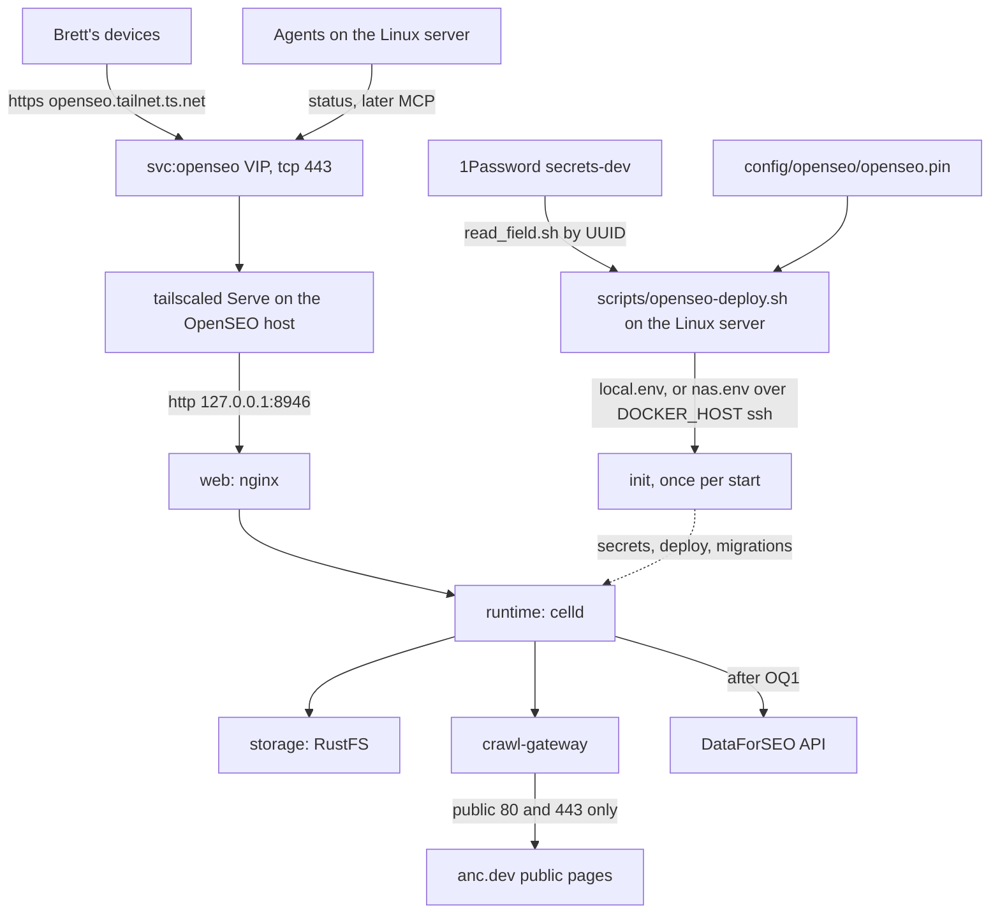
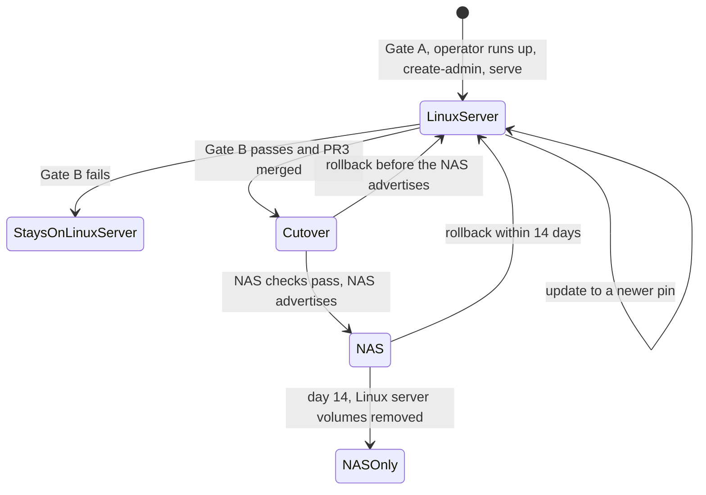
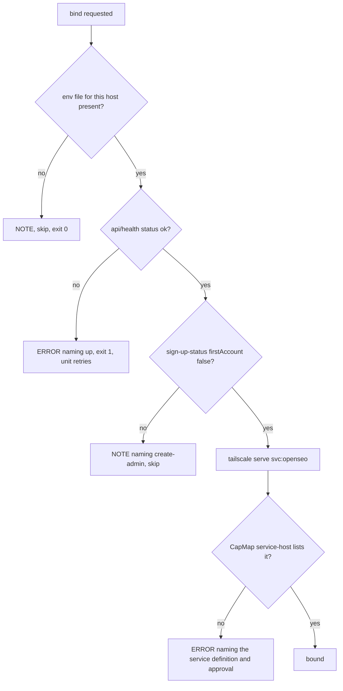
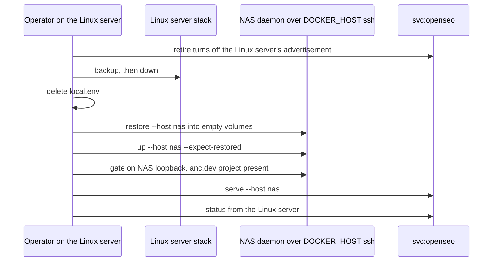

# OpenSEO on the Tailnet - Plan

## Goal Capsule

- **Objective:** Brett and his agents open OpenSEO at one tailnet-only HTTPS address and use it to research and audit
  anc.dev, while anc.dev, its search-console records, and Brett's spending stay exactly as he left them.
- **Means:** upstream's standalone Docker Compose edition, pinned in this repo and driven by one repo script, running
  first on the Linux server and later on the NAS, behind the Tailscale Service `svc:openseo` (KTD1, KTD4, KTD6, KTD10).
- **Authority:** Brett's limits (R10, R11) outrank every other line here. This plan's R-IDs decide behavior. KTDs decide
  mechanism within them. Upstream's docs at the pinned tag decide how the stack itself runs.
- **Execution profile:** three PRs to `dev` (PR1, PR2, PR3), each sized for two review rounds, built by agent slots.
  Three operator gates sit between them: Gate A (first deploy and first read-only run), Gate B (soak and memory), Gate C
  (cutover to the NAS). Steps that need `docker` or root are operator steps (KTD14).
- **Stop conditions:** stop and report to dotfiles-prime when a step would write to anc.dev or any system listed in R10,
  when it needs an outside account, key, or spend (R11), when Gate B fails (OpenSEO stays on the Linux server), or when
  an upstream release changes the services or volumes of `deploy/standalone/compose.yaml`.
- **Who finishes:** build slots write and test each PR. Brett, or a session he lets run `docker`, runs the gates.
  dotfiles-prime merges.

---

## Product Contract

### Summary

OpenSEO is an MIT-licensed, self-hosted alternative to Semrush and Ahrefs (`every-app/open-seo`). Its Docker edition is
a five-container Compose stack that publishes one nginx port on loopback. This plan vendors that stack into
`config/openseo/`, pins every image by digest, and adds `scripts/openseo-deploy.sh` to render its secrets from 1Password
and run it. The stack runs first on the Linux server, reached only through the Tailscale Service `svc:openseo` at
`https://openseo.<tailnet>.ts.net`. It moves to the NAS once a measured soak shows it fits there. The first run against
anc.dev is a crawl-only site audit that spends nothing and writes nowhere.

### Problem Frame

Brett asked for OpenSEO as a service on the tailnet, aimed at anc.dev, and asked how it runs. Today the search-presence
skill reads Search Console and Bing Webmaster data for anc.dev and checks its on-page signals. It has no keyword,
backlink, SERP, or rank data. OpenSEO adds those through the paid DataForSEO API, plus a site-audit crawler, a web UI,
and an MCP server for agents. Brett wants it reachable from his devices and agents and from nowhere else. Its eventual
home is the NAS, which already runs the household's containers, but setup must not wait on the NAS. And nothing may
touch anc.dev or spend money without his decision.

### Requirements

**Hosting and reach**

- R1. OpenSEO runs as upstream's standalone Docker Compose stack on the Linux server, and no step of getting it running
  there waits on the NAS.
- R2. OpenSEO is reachable only inside the tailnet, at one HTTPS address. Each host publishes it on loopback only, and
  nothing routes it to the public internet or the LAN.
- R3. The address stays the same when OpenSEO moves between hosts, so bookmarks, MCP clients, and OAuth redirect URIs
  need no change, and only one host answers it at a time.
- R4. OpenSEO moves to the NAS only after a soak on the Linux server shows the stack fits the NAS's free memory. Until
  then, or if it does not fit, it stays on the Linux server.

**Versions**

- R5. Every image the stack runs is pinned by digest in a tracked file, with its version beside it, and no mutable tag
  reaches a host.
- R6. The tracked pin moves only forward, only to an upstream release at least 7 days old, and a host applies a new pin
  only after backing up its data.

**Config, data, and secrets**

- R7. Tracked files hold no secret and no private identifier. Secrets reach a host at deploy time from 1Password
  `secrets-dev`, into a file only its owner can read.
- R8. OpenSEO's data lives in the stack's volumes on the host that runs it, and a backup taken on one host restores on
  the other.
- R9. Signing in is required, and the address never answers while the installation still lets its first visitor become
  administrator.

**anc.dev and spending**

- R10. Runs against anc.dev only read. They crawl and audit its public pages and read data. Nothing writes to anc.dev,
  its repo, Cloudflare, DNS, Search Console, or Bing Webmaster, and nothing submits a sitemap or an IndexNow ping.
- R11. No new outside account, key, or spending starts without Brett's decision, and the first run needs no paid key.

**Operations**

- R12. Any agent can check whether OpenSEO is up without `docker` or `sudo`, and a failed check names the command that
  fixes it.
- R13. Every step that needs `docker` or root on a host has its exact command in the runbook.

### Key Decisions

- **The Linux server first, the NAS as the home once it fits.** Brett: "if its best in a docker container lets put it on
  pool ... host it here so you can get the config going". Governs R1, R4.
- **Tailnet only.** Brett asked for a service on the tailnet. Governs R2, R3.
- **anc.dev read-only; no new account, key, or spend without Brett.** Brett's limits for this work. Governs R10, R11.
- **Sign-in on.** Chosen over upstream's no-sign-in mode for tailnet installs, because the app can spend DataForSEO
  money and every granted tailnet node can reach it (KTD8). Governs R9.

### Success Criteria

- From the Mac, `https://openseo.<tailnet>.ts.net` shows OpenSEO's sign-in page; outside the tailnet the name does not
  resolve, and port 8946 on the host refuses connections from the LAN.
- A crawl-only audit of anc.dev's public pages completes, and nothing listed in R10 shows a change made by it.
- After the cutover, the same address serves the same projects and audit history from the NAS.

### Scope Boundaries

**Not built (considered and judged unnecessary)**

- Backup rotation. Backups happen before each update and before the move, and the operator prunes them. Revisit if the
  backup directory passes a few GiB.
- A deploy-time refusal of pins younger than 7 days. The bump script (U7) is where the tracked pin moves, and a hand
  edit is reviewed in its PR.
- Uptime alerting. OpenSEO is used interactively, so an outage shows when someone opens it, and `status` (U3) names the
  fix.
- Per-host 1Password items. Every value re-renders from the same items, and retiring a host deletes its env file
  (KTD12).
- A one-shot `move` verb. The cutover runs as one verb per step (U9, U10), because each step has a check a person should
  see before the next.

**Deferred to Follow-Up Work**

- OpenSEO's MCP server as a connection for Claude Code agents. OpenSEO's API keys carry the whole workspace's power, so
  this needs a decision on agent keys and a tool allowlist that excludes write tools such as `submit_indexnow_urls`.
- Search Console inside OpenSEO, after Brett decides OQ2.
- DataForSEO-backed recurring work (rank trackers, AI visibility), after Brett decides OQ1.
- A scheduled job that opens bump PRs, in the shape of `scripts/upgrade/yazi-pins.sh`. U7 runs by hand first.
- Re-binding the NAS's Serve bindings after a tailscaled restart, for every service on the NAS (`svc:pinchflat`,
  `svc:languagetool`, and `svc:openseo`). Nothing does this today.
- SAM, OpenSEO's in-app agent, pointed at the Linux server's Ollama through `OPENROUTER_BASE_URL`, which would cost
  nothing.

### Open Questions

These need Brett. dotfiles-prime carries them to him.

- OQ1. **DataForSEO account.** Keyword, backlink, domain, SERP, rank, and Lighthouse data all come from DataForSEO,
  billed per call. No DataForSEO item exists in `secrets-dev`. A new account gets $1 of credit, and top-ups start at
  $50. Once the key is set, merely opening a project's dashboard calls DataForSEO's backlinks endpoints, so approving
  the key approves spend. Options: create it and spend only the signup credit; create it and top up $50; skip it.
  Recommendation: create it with no automatic top-up and spend only the signup credit until Brett has seen Gate A's
  results. Without it, OpenSEO is a site crawler, which search-presence largely covers already.
- OQ2. **Search Console inside OpenSEO.** It needs a new Google OAuth web client, with the redirect URI
  `https://openseo.<tailnet>.ts.net/api/gsc/oauth/callback` and the consent screen in production (a client left in
  testing loses its refresh token after 7 days), plus the signing-in Google account added to the anc.dev property.
  OpenSEO requests `webmasters.readonly` only (`src/shared/gsc.ts` at v0.1.25). Recommendation: defer it, since
  search-presence already reads Search Console and Bing through existing credentials. OpenSEO has no Bing Webmaster
  integration at all.
- OQ3. **First deploy date.** v0.1.25 is the first release whose Docker edition runs DataForSEO features, and it turns 7
  days old on 2026-11-13. Options: deploy on or after 2026-11-13, or waive the age gate for this one image.
  Recommendation: wait. PR1 can be built and merged before then, because nothing runs until the operator deploys.
- OQ4. **Who runs the docker steps.** Agent slots cannot run `docker` (KTD14). Recommendation: Brett runs each gate's
  commands from `~/dotfiles`, a handful per gate, as the runbook lists them.
- OQ5. **The NAS gate.** KTD10 moves OpenSEO only when the NAS keeps 1.5 GiB free with the stack at its measured peak.
  Options: accept that gate, or keep OpenSEO on the Linux server for good. Recommendation: accept the gate.

### Sources

- Upstream at v0.1.25 (commit `505d4859622c02175e203e528c1669fdf10dcfe4`, published 2026-11-06T05:00:18Z): `README.md`,
  `docs/SELF_HOSTING_DOCKER.md`, `docs/DATAFORSEO_API_KEY.md`, `docs/SELF_HOSTING_GOOGLE_SEARCH_CONSOLE.md`,
  `SECURITY.md`, `deploy/standalone/compose.yaml`, `scripts/celld/runtime/configure.mjs`, `scripts/celld/backup.mjs`,
  `src/server/standalone/sign-up.ts`, `src/routes/api/sign-up-status.ts`, `src/server/lib/audit/web-bot-auth.ts`,
  `src/server/mcp/tools/submit-indexnow-urls.ts`, `docs/release-notes/v0.1.20.md` through `v0.1.25.md`.
- Probes on 2026-11-06: the NAS (`ssh pool`, read-only) is x86_64 with 4 KiB pages, Docker 29.5.3, Compose v5.5.0, node
  22.18, 7.5 GiB RAM, 4.1 GiB available, no swap, serving `svc:pinchflat` and `svc:languagetool`. The Linux server is
  x86_64 with 16 cores, 93 GiB RAM, Docker active, serving `svc:codex-proxy` and `svc:ollama`. Port 8946 is free on
  both. anc.dev's robots.txt allows every agent, its sitemap lists 174 URLs, and it answers the `OpenSEO-Audit/1.0`
  agent with 200.
- GHCR: `ghcr.io/every-app/open-seo-standalone` carries tags `0.1.20`, `0.1.21`, `0.1.22`, `0.1.24`, `0.1.25` (with `v`
  forms), `main`, and `latest`. `latest` follows upstream's main branch, not releases. `v0.1.25` resolves to
  `sha256:6c5d514649b550fc7bdcefaa52314e7a98c7846b7fc5f7a288c486575698bb04`, a multi-arch index.
- Repo patterns: `scripts/tailscale-serve-setup.sh`, `scripts/host-jobs-enable.sh` (1Password into a mode-600 env file,
  item UUID in a variable), `scripts/upgrade/yazi-pins.sh` (age-gated pin moves),
  `docs/plans/2026-06-29-001-feat-pinchflat-install-plan.md` (NAS conventions),
  `docs/plans/2026-11-03-1526-feat-stable-chrome-for-browser-consumers-plan.md` (phase format).
- Learnings: `docs/solutions/configuration-fixes/tailscale-service-define-before-approve-2026-06-23.md`,
  `.../tailscale-autoapprovers-gate-fresh-advertisements-2026-06-23.md`,
  `.../ollama-loopback-binding-via-stow-2026-06-08.md`,
  `docs/solutions/architecture-patterns/self-hosted-languagetool-for-prose-check-stacks-2026-05-20.md`,
  `docs/solutions/developer-experience/gogcli-multi-account-google-auth-recovery-and-hardening.md`,
  `docs/solutions/best-practices/audit-tools-send-their-own-user-agent-and-test-crawler-serving-with-a-parity-check.md`,
  `docs/solutions/design-patterns/search-rules-as-dated-sourced-data-with-a-verdict-per-engine-and-engines-judge-their-stored-copy.md`,
  `docs/solutions/integration-issues/mcp-stateless-streamable-http-get-hang-405.md`.

---

## Planning Contract

### How OpenSEO runs

| Aspect     | At v0.1.25                                                                                                                                                                                                                                                                                                           |
| ---------- | -------------------------------------------------------------------------------------------------------------------------------------------------------------------------------------------------------------------------------------------------------------------------------------------------------------------- |
| Project    | `github.com/every-app/open-seo`, MIT, about 26.5k stars, a release every few days (v0.1.15 through v0.1.25 between 2026-10-24 and 2026-11-06)                                                                                                                                                                        |
| Runtime    | Code written for Cloudflare Workers, run in Docker on celld (`denoland/celld`). Five services: `storage` (RustFS, S3-compatible), `runtime` (celld, capped at 2 GiB), `init` (one-shot; generates secrets, deploys the app, applies migrations), `crawl-gateway` (keeps crawls off private addresses), `web` (nginx) |
| Images     | `ghcr.io/every-app/open-seo-standalone` for runtime, init, and crawl-gateway through `${OPENSEO_IMAGE:-...:latest}`. `rustfs/rustfs:1.0.3` and `nginx:1.28-alpine` are digest-pinned upstream                                                                                                                        |
| Port       | nginx publishes `127.0.0.1:${PORT:-3001}` only. Crawls reach public addresses on ports 80 and 443 only                                                                                                                                                                                                               |
| Data       | Named volumes `storage`, `runtime`, `config` (holds `secrets.json`: `BETTER_AUTH_SECRET`, `OPENSEO_OPERATOR_SECRET`, `CRAWL_GATEWAY_SECRET`), `web-config`. Contents: projects, saved keywords, rank history, audits, reports, SAM conversations, sessions, API keys, Google tokens encrypted at rest                |
| Sign-in    | `AUTH_MODE=password` (the first account becomes administrator, then registration closes) or `local_noauth` (one admin, no sign-in). `BETTER_AUTH_URL` must be HTTPS unless it is loopback, and in password mode it is the address the app builds its links from                                                      |
| Health     | `/api/health` answers 200 with a JSON body whose `status` is `ok` or `issues`; `/api/sign-up-status` returns `{"firstAccount": true or false}`                                                                                                                                                                       |
| Keys       | `DATAFORSEO_API_KEY` for nearly all SEO data. Optional: `OPENROUTER_*` (SAM), `GOOGLE_CLIENT_ID`/`SECRET` (Search Console, Analytics), `CONTEXT_API_KEY` (JavaScript rendering), `GOOGLE_MAPS_API_KEY`                                                                                                               |
| Telemetry  | Forced off in the Docker edition (`configure.mjs` sets `OPENSEO_TELEMETRY_DISABLED` and `DO_NOT_TRACK`)                                                                                                                                                                                                              |
| Host needs | Docker with Compose, 4 GiB of memory for Docker, 4 KiB pages, x86_64 or arm64                                                                                                                                                                                                                                        |
| Agents     | MCP at `/mcp` (OAuth sign-in or an API key from Settings, either with the workspace's full power). Its write tools include `submit_indexnow_urls`                                                                                                                                                                    |

### Key Technical Decisions

- KTD1. **Upstream's standalone Docker edition, never older than v0.1.25.** The legacy single image
  (`ghcr.io/every-app/open-seo`) keeps a data format the standalone edition must migrate from, and upstream points new
  installs away from it. The Cloudflare self-host runs on the public internet, which R2 rules out. v0.1.25 is the floor
  because its release notes fix DataForSEO on Docker, and v0.1.22 fixed audits freezing partway. Instantiates R1, R5.
- KTD2. **Byte-identical copies of upstream's files.** `config/openseo/compose.yaml` is upstream's
  `deploy/standalone/compose.yaml` at the pinned commit, unedited, and `config/openseo/backup.mjs` (PR2) is its
  `scripts/celld/backup.mjs` from the same commit, whose manifest rejects backups from another version. A bump is a copy
  plus checksums. Upstream already binds the web port to `127.0.0.1` and digest-pins RustFS and nginx, so no override
  file is needed. The file sets `name: openseo-standalone`, and every compose call keeps that project name, because the
  backup script finds volumes through it. Instantiates R2, R5.
- KTD3. **One pin file holds the version, and it reaches compose through `OPENSEO_IMAGE`.** `config/openseo/openseo.pin`
  records the upstream tag, its commit, its release time, the image as
  `ghcr.io/every-app/open-seo-standalone@sha256:<digest>`, and the sha256 of each vendored file. One parser in
  `scripts/openseo/lib/pin.sh` reads it, accepting only those keys. The env render writes `OPENSEO_IMAGE` from it, which
  upstream's `x-app` anchor applies to runtime, init, and crawl-gateway. An override file would not work: the backup
  script passes compose exactly one file, so a restore would pull `:latest`. A compose run without the env file fails on
  upstream's required `STORAGE_ACCESS_KEY` before it can pull anything. Instantiates R5.
- KTD4. **`scripts/openseo-deploy.sh` plus `config/openseo/`, with no stow package, no systemd unit, and no project
  files on either host.** One copy serves both hosts, and stow cannot reach the NAS. Every service except `init` has
  `restart: unless-stopped`, so dockerd brings the stack back after a reboot (verified at Gate A). The script runs from
  the canonical checkout `~/dotfiles`, as `scripts/tailscale-serve-deploy.sh` does, and sets `COMPOSE_FILE` and
  `COMPOSE_ENV_FILES` for every compose call and for the backup script, so no call depends on its working directory.
  Instantiates R1, R13.
- KTD5. **Secrets come from 1Password by item UUID, into a mode-600 env file per host at deploy time.** The script reads
  each field through the 1password skill's `read_field.sh` (test seam `OP_SKILL`, as in `scripts/host-jobs-enable.sh`),
  one item per read, so a missing item names itself instead of blanking the whole file as one failed `op inject` would.
  Files live on the Linux server in `~/.config/openseo/` (mode 700): `local.env` for a stack on the Linux server,
  `nas.env` for one on the NAS (KTD11). Values never appear in argv or output; checks grep key names only.
  - New items, inside the vault only: `OpenSEO Storage (openseo)` with a generated secret, which a restore needs
    unchanged; and `OpenSEO Admin (openseo)`, a Login with a generated password and a non-personal email such as
    `admin@openseo.internal`. The never-send guard would block Brett's address in a command anyway.
  - Render refuses to change `STORAGE_ACCESS_KEY` or `STORAGE_SECRET_KEY` in an existing env file, because RustFS keeps
    the keys it first started with and a silent change would lock the stack out of its own data.
  - DataForSEO and Google OAuth items exist only after OQ1 and OQ2. Until then their keys render empty with a `NOTE:`.
  - `BETTER_AUTH_URL` is built at render time from `tailscale status --json` `.MagicDNSSuffix`, so the tailnet name is
    never tracked.
  - Item UUIDs live in the script with their titles in comments, as `STARS_TOKEN_ITEM` does in
    `scripts/host-jobs-enable.sh`.
  - Instantiates R7.
- KTD6. **`svc:openseo` proxies straight to `http://127.0.0.1:8946` on HTTPS 443, and binds only when the stack is
  healthy and closed to first sign-up.** nginx forwards the request's Host, and the app's origin is `BETTER_AUTH_URL`,
  set to the service's own address, so the Host check that forced a Caddy shim for Ollama does not apply. Serve also
  forwards the WebSocket upgrades SAM uses.
  - Before any host advertises it, the operator defines `svc:openseo` (endpoint `tcp:443`), adds a grant for Brett's
    devices and the Linux server's tag, and adds an autoApprover for the tag of each host that will advertise it. Proof
    is `CapMap."service-host"` listing the service, not the `serve` exit code.
  - The bind gate, shared by every path that binds: `/api/health` returns `status: ok` and `/api/sign-up-status` returns
    `firstAccount: false`.
  - On the Linux server, a block appended last in `scripts/tailscale-serve-setup.sh` binds only when
    `~/.config/openseo/local.env` exists. Without it the block prints a `NOTE:` and skips, so retiring the Linux server
    (KTD12) stops the re-bind without editing the script, and a re-render brings it back for rollback. With `local.env`
    present and the stack unhealthy, the block fails, so the unit's retries cover boot order; with `firstAccount: true`
    it prints a `NOTE:` and skips, since retries cannot fix that.
  - The `serve` verb applies the same gate on either host, and `up` calls it last, so a unit that gave up its retries is
    repaired by the next `up`.
  - Instantiates R2, R3, R9.
- KTD7. **Port 8946, not upstream's 3001.** Dev servers on the Linux server fall back to 3001 when 3000 is taken, and
  its SSH tunnel config forwards dev ports. 8946 is free on both hosts. Instantiates R2.
- KTD8. **Password sign-in, with the administrator created from the host before the address binds.** `SECURITY.md` says
  `local_noauth` "has no login by design". On this tailnet every granted node can reach the address, including the Linux
  server, where agent slots run third-party code, and the app can spend DataForSEO money. `create-admin` runs upstream's
  operator command on loopback, `src/server/standalone/sign-up.ts` closes registration once one account exists, and
  KTD6's gate keeps the address dark until then. Instantiates R9.
- KTD9. **The first run is the crawl OpenSEO starts by itself.** Creating the project `anc.dev` inside OpenSEO starts a
  50-page site audit with Lighthouse `none` and no JavaScript rendering (`DashboardFirstAuditService`), and that audit
  is the first run. A full-site audit of up to 250 pages with the same settings may follow. The crawl is OpenSEO's own,
  makes no DataForSEO call, leaves from the host's public IP, and identifies itself as `OpenSEO-Audit/1.0` with RFC 9421
  request signatures (`src/server/lib/audit/web-bot-auth.ts`), so anc.dev's crawler analytics can tell it from search
  engines. If Cloudflare challenges it, that is a finding, never a reason to change Cloudflare. DataForSEO reads run
  only after OQ1. Rank trackers, AI visibility, SAM, Search Console, JavaScript rendering, and the IndexNow tool stay
  off. OpenSEO's audit warnings do not override search-presence's per-engine verdicts. Instantiates R10, R11.
- KTD10. **The NAS gate.** After at least 7 days of use on the Linux server, including one reboot, the operator sums
  each OpenSEO container's cgroup `memory.peak` and reads the NAS's `MemAvailable` while Plex is idle. OpenSEO moves
  only if `MemAvailable` minus that peak leaves at least 1.5 GiB. The NAS has 7.5 GiB and no swap, so an overrun means
  the kernel's OOM killer, not slowness. Instantiates R4.
- KTD11. **The NAS is driven from the Linux server through `DOCKER_HOST=ssh://pool`.** Compose reads the vendored file
  and `nas.env` on the Linux server and creates the containers and named volumes on the NAS's daemon, and the backup
  script streams archives over the same connection. Nothing is written to the NAS's disk outside Docker. That keeps the
  env file off the NAS's vfat flash, where it could not be mode 600, needs no 1Password CLI there, and keeps the project
  name `openseo-standalone` that a compose.manager project might change. `serve --host nas` runs `tailscale serve` on
  the NAS through `ssh pool`. The NAS's containers keep running when the Linux server is down; only changes need it.
  Instantiates R4, R7, R8.
- KTD12. **The move freezes writes first, and only one host answers at a time.** In order:
  1. On the Linux server, `retire`: turn off its `svc:openseo` advertisement.
  2. `backup` there (the backup script stops the app while it archives, then restarts it on loopback only).
  3. `down` there, then delete `local.env`, so the setup block skips from then on.
  4. `restore --host nas` into empty volumes, check the NAS's volume names, `up --host nas`.
  5. Check the NAS on its own loopback through ssh: health, `firstAccount: false`, the anc.dev project present.
  6. `serve --host nas`, then `status` from the Linux server.

  The Linux server keeps its volumes for 14 days. Rollback within that window: turn off the NAS's advertisement and
  stop its stack, then on the Linux server `render`, `up`, which binds again. Instantiates R3, R8.
- KTD13. **Pin bumps are agent-runnable; applying and rolling back are not.** `scripts/upgrade/openseo-pin.sh` uses only
  `gh api` and GHCR's anonymous token endpoint, so a slot can run it and open the PR. It picks the newest release whose
  GitHub `published_at` is at least 7 days old and that has a standalone image tag (v0.1.23 has none), and refuses to
  move backwards. It copies the compose file and backup script from that release's commit, writes the pin file, and
  prints upstream's diff of `deploy/standalone/` and `docs/SELF_HOSTING_DOCKER.md` for the reviewer. Applying a pin is
  `update` (U8): back up, pull, stop `web`, `crawl-gateway`, and `runtime`, start, wait for `init`, check health.
  Migrations only go forward, so a failed update rolls back by restoring the backup with the pin it recorded, the one
  sanctioned move to an older version; a PR then reverts the tracked pin. Instantiates R5, R6.
- KTD14. **Live docker steps belong to the operator.** `docker` and `sg docker` are ask rules for agent tool calls, and
  nobody answers prompts in a slot. Wrapping docker in a script to avoid that prompt would sidestep the rule, so slots
  test the script with docker stubbed, and every check an agent runs goes through `status`, which needs no docker.
  Instantiates R12, R13.

### High-Level Technical Design

Topology on whichever host runs OpenSEO:

Where OpenSEO lives across the gates:

The bind gate shared by `serve`, `up`, and the setup block (KTD6):

The cutover (KTD12):

### System-Wide Impact

- **The Linux server's serve-setup unit.** The OpenSEO block runs last, so a failing OpenSEO block marks the unit failed
  and spends its retries, but `svc:ollama` and `svc:codex-proxy` are already bound by then.
- **The tailnet policy.** A new service definition, grant, and autoApprover, all changed in the admin console. The grant
  lets any process on the Linux server reach the sign-in page, agent slots included, which is why sign-in stays on
  (KTD8).
- **Where secrets end up.** Env values become container configuration, readable through `docker inspect` by anyone with
  docker access on the running host: root on the NAS, and on the Linux server the `docker` group, which is already
  root-equivalent. Backups hold the init-generated secrets and any Google tokens, so they stay in mode-700 directories
  outside every synced directory.
- **anc.dev's analytics.** The crawl shows up as `OpenSEO-Audit/1.0` from the running host's public IP, which
  search-presence's crawler log check can tell apart from search engines.
- **Search Console quota.** Only if OQ2 is approved later: OpenSEO and search-presence would draw on the same property's
  quota.
- **Agents.** `status` is their whole surface for now; MCP waits (Deferred to Follow-Up Work).

### Assumptions

These are bets this plan has not verified. Gate A checks each one.

- A site audit with Lighthouse `none` makes no DataForSEO call and works with `DATAFORSEO_API_KEY` empty
  (`src/server/lib/audit/lighthouse.ts` returns no Lighthouse targets for `none`).
- The first account made with upstream's operator command becomes the workspace owner, as one made in the browser does
  (`sign-up.ts` comment).
- After dockerd restarts, the stack serves again without `init` running, since `init` has `restart: "no"`.
- The Linux server can reach its own service address. If it cannot, `status` on the OpenSEO host relies on its loopback
  checks, which it runs anyway.
- `COMPOSE_ENV_FILES` reaches the compose calls inside upstream's backup script, since it runs `docker compose` from the
  same environment.
- Compose over `DOCKER_HOST=ssh://pool` works with the NAS's root login, as `ssh pool` does today.

### Risks

| Risk                                                                                           | Mitigation                                                                                                          |
| ---------------------------------------------------------------------------------------------- | ------------------------------------------------------------------------------------------------------------------- |
| Upstream churns fast, and its Docker edition is three weeks old                                | 7-day gate, backup before every update, reviewer reads upstream's diff in each bump PR (KTD13)                      |
| The 7-day gate leaves only defective Docker releases eligible before 2026-11-13                | First deploy waits for OQ3                                                                                          |
| The NAS runs out of memory with no swap                                                        | Gate B (KTD10); the stack stays on the Linux server if it fails                                                     |
| The NAS drops `svc:openseo` after a tailscaled upgrade, as it can for its other services today | `status` reports the dead address and names `scripts/openseo-deploy.sh --host nas serve`; a general fix is deferred |
| A tailscaled restart on the Linux server re-binds mid-move                                     | `retire` deletes `local.env` before the NAS advertises (KTD12), so the block skips                                  |
| DataForSEO spend runs past intent                                                              | Prepaid balance with no automatic top-up (OQ1), recurring jobs off (KTD9)                                           |
| Search Console quota is shared with search-presence if OQ2 is approved later                   | search-presence's ledger already stops on a provider refusal                                                        |

### Build phases and gates

| Phase  | Kind     | Delivers                                                                                                              | Requirements                       | After                                    | Budget, script / tests |
| ------ | -------- | --------------------------------------------------------------------------------------------------------------------- | ---------------------------------- | ---------------------------------------- | ---------------------- |
| PR1    | PR       | Pinned stack, env render, `up`, `down`, `serve`, `status`, `create-admin`, `svc:openseo` on the Linux server, runbook | R1, R2, R5, R7, R9, R12, R13       | none                                     | 340 / 450              |
| Gate A | Operator | Tailnet policy, first deploy, admin, first read-only run                                                              | R10, R11, success criteria 1 and 2 | PR1 merged; on or after 2026-11-13 (OQ3) | none                   |
| PR2    | PR       | `backup`, `restore`, `update`, `rollback`, the bump script                                                            | R6, R8                             | PR1                                      | 300 / 400              |
| Gate B | Operator | Soak, a reboot, the memory reading                                                                                    | R4                                 | Gate A plus 7 days                       | none                   |
| PR3    | PR       | `--host nas` for every verb, `retire`, the cutover runbook                                                            | R3, R4, R8                         | PR2; started only if Gate B passes       | 200 / 300              |
| Gate C | Operator | Cutover; day-14 cleanup                                                                                               | R3, success criterion 3            | PR3 merged                               | none                   |

Rules for every PR, taken from the browser plan's build phases: each slot's brief copies its phase's `Touches:` and
`Adds:` lines; a diff more than 1.5 times its budget stops before review and reports what grew; nothing from a later
phase; docs ride with behavior; every requirement a phase lists has a bats case or a named live check. Gate results go
to Brett as a note in the prime's `.context/`, and anything worth keeping goes into the runbook by a docs-only commit to
`dev`.

### Alternatives Considered

- **Cloudflare self-host** (Workers on Brett's Cloudflare account, optionally behind Cloudflare Access): rejected,
  because it puts OpenSEO on the public internet.
- **A stow package plus a user unit**, in the shape of `stow/codex-proxy/`: rejected (KTD4). That precedent also runs an
  unpinned `:latest` with a mode-644 `.env`.
- **A compose.manager project on the NAS**, as pinchflat uses: rejected (KTD11).
- **Running from source with pnpm** (`docs/LOCAL_DEVELOPMENT.md`): a development server, not a service.

---

## Implementation Units

### PR1: OpenSEO on the Linux server

Waits on: nothing.

Touches: `config/openseo/**`, `scripts/openseo-deploy.sh`, `scripts/openseo/**`, `scripts/tailscale-serve-setup.sh`,
`tests/openseo-deploy.bats`, `tests/tailscale-serve-setup.bats`, `docs/runbooks/openseo.md`, `BOOTSTRAP.md`,
`README.md`, `AGENTS.md`

Adds: `config/openseo/compose.yaml`, `config/openseo/openseo.pin`, `scripts/openseo-deploy.sh` with verbs `render`,
`up`, `down`, `serve`, `status`, `create-admin`, `scripts/openseo/lib/`, the `svc:openseo` block, two bats suites,
`docs/runbooks/openseo.md`.

### U1. Vendored stack and pin file

**Goal:** the stack's definition and its one version record live in the repo, verifiably unedited and fully pinned.

**Requirements:** R5; KTD1, KTD2, KTD3.

**Dependencies:** none.

**Files:** `config/openseo/compose.yaml`, `config/openseo/openseo.pin`, `scripts/openseo/lib/pin.sh`,
`tests/openseo-deploy.bats`.

**Approach:**

1. Copy `deploy/standalone/compose.yaml` from commit `505d4859622c02175e203e528c1669fdf10dcfe4` byte for byte. Its
   sha256 at that commit is `a0f02d293cb923796908b09ea3ab70ea639fb896dfe3199a4eceb30b56c9cbda`.
2. Write the pin file: tag `v0.1.25`, the commit, the release time `2026-11-06T05:00:18Z`, the image by digest, and the
   compose file's sha256. Paste the digests from command output, not from this plan, and check that the digest resolves
   on GHCR before committing.
3. `pin.sh` parses the file strictly: known keys, a 64-hex digest, an image reference by digest only.

**Patterns to follow:** `config/playwright/browsers.pin` and `scripts/playwright-browsers/lib/pin.sh` (one parser,
strict shapes, a header naming the parser).

**Test scenarios:**

- The vendored compose file's sha256 equals the pin file's recorded value. A hand edit to the compose file fails this.
- Every `image:` line in the compose file except the `${OPENSEO_IMAGE...}` one carries `@sha256:` with 64 hex
  characters.
- The parser accepts the committed pin file and prints the image reference.
- The parser rejects a pin whose image has a tag and no digest, a digest shorter than 64 hex characters, and an unknown
  key, each with exit 1 and an `ERROR:` naming the line.
- Where `docker` is installed, `docker compose config` over the vendored file with a fixture env shows the pinned digest
  on `runtime`, `init`, and `crawl-gateway`, and no port published on anything but `127.0.0.1`. The test skips without
  `docker`. This seam catches a compose shape that publishes beyond loopback or loses the pin; it says nothing about
  runtime behavior.

**Verification:** the suite passes, and the pin's digest is the one GHCR serves for the tag.

### U2. Env render from 1Password

**Goal:** `scripts/openseo-deploy.sh render` writes the host's env file from 1Password and the pin, with no secret ever
printed.

**Requirements:** R7; KTD3, KTD5, KTD7.

**Dependencies:** U1.

**Files:** `scripts/openseo-deploy.sh`, `scripts/openseo/lib/env.sh`, `tests/openseo-deploy.bats`.

**Approach:**

1. Read `STORAGE_SECRET_KEY` from the storage item. Read `DATAFORSEO_API_KEY` and `GOOGLE_CLIENT_*` only when their UUID
   variables are set; otherwise leave them empty with a `NOTE:`.
2. Write `AUTH_MODE=password`, `PORT=8946`, `STORAGE_ACCESS_KEY=openseo`, `OPENSEO_IMAGE` from the pin, and
   `BETTER_AUTH_URL=https://openseo.<MagicDNSSuffix>` from `tailscale status --json`.
3. Refuse when an existing file's `STORAGE_*` values differ from the new ones (KTD5).
4. Write under `umask 077` to a temporary file in the same directory, then rename it, so a failed read leaves the
   previous file intact.
5. Refuse on macOS (`uname`), since only the Linux server runs this script.

**Execution note:** start with the test that asserts no stub secret appears in the script's output or in any stub's argv
log.

**Patterns to follow:** `scripts/host-jobs-enable.sh:47-63` and its stubs in `tests/host-scheduled-jobs.bats:31-70`.

**Test scenarios:**

- With `read_field.sh` and `tailscale` stubbed, render writes `local.env` with mode 600 in a mode-700 directory, holding
  every key in step 2 with the stubbed suffix in `BETTER_AUTH_URL`.
- The stub secret values appear in neither stdout, stderr, nor any stub's argv log.
- A failing read of the storage item exits 1 with an `ERROR:` naming the item title and the 1password skill command to
  inspect it, and leaves an existing env file byte-identical.
- An existing env file whose `STORAGE_SECRET_KEY` differs from the item's exits 1, names both the item and the restore
  path, and changes nothing.
- With no DataForSEO UUID configured, `DATAFORSEO_API_KEY` is empty and a `NOTE:` says how to add it.
- With `tailscale status` failing, render exits 1 naming `tailscale status` and writes nothing.
- On a stubbed Darwin `uname`, render exits 1 before reading any secret.

**Verification:** the suite passes, and the rendered file's key names cover every `${...}` reference the compose file
requires.

### U3. Run, serve, and check verbs

**Goal:** the operator brings the stack up and down, creates the administrator, and binds the address with one command
each, and any agent can check it.

**Requirements:** R9, R12, R13; KTD4, KTD6, KTD8, KTD14.

**Dependencies:** U2.

**Files:** `scripts/openseo-deploy.sh`, `scripts/openseo/lib/compose.sh`, `scripts/openseo/lib/gate.sh`,
`tests/openseo-deploy.bats`.

**Approach:**

- `up`: render, `docker compose pull`, `docker compose up -d`, wait for `init` to exit 0 with upstream's
  `OpenSEO initialized and ready.`, then `serve`. When `firstAccount` is still true, it stops before binding and prints
  `create-admin` as the next step.
- `down`: `docker compose stop`. No verb ever passes `-v` or `--volumes`, which delete the data and the generated
  secrets.
- `create-admin`: pipe the admin item's password on stdin to
  `docker compose exec -T runtime node /opt/standalone/admin.mjs create-user <email> OpenSEO`, then print `serve` as the
  next step.
- `serve`: apply KTD6's gate on loopback (`gate.sh`, parsing the JSON bodies), then
  `tailscale serve --service=svc:openseo --https=443 --yes http://127.0.0.1:8946`, then check `CapMap."service-host"`.
- `status` needs no docker. On a host holding `local.env` it runs the gate on loopback and checks
  `CapMap."service-host"`; from anywhere it fetches `/api/health` at the tailnet address with `curl --max-time 5`. It
  exits 0 when healthy, 1 with an `ERROR:` naming the failing check and its fix command, and 2 on usage errors.

**Patterns to follow:** exit codes and `ERROR:`/`NOTE:` prefixes from AGENTS.md "Shell Script Conventions"; `--check`
modes in `scripts/sysctl-deploy.sh`.

**Test scenarios:**

- With `docker` stubbed, `up` calls `compose pull` then `compose up -d` with `COMPOSE_FILE` and `COMPOSE_ENV_FILES` set
  to the vendored file and `local.env`.
- `up` stops before any docker call when render fails.
- When the stubbed `init` exits non-zero, `up` exits 1 and prints the `docker compose logs init` command.
- With `firstAccount: true`, `up` and `serve` never call `tailscale serve` and print `create-admin`.
- With health `status: issues`, `serve` exits 1 and never calls `tailscale serve`.
- `create-admin` sends the stubbed password on stdin; the docker stub's argv log never contains it.
- No verb passes `-v` or `--volumes` to compose.
- `status` with both checks passing exits 0; with the address refusing it exits 1 and names `serve`; with loopback down
  it names `up`.
- `status` on a host without `local.env` skips the loopback and CapMap checks, even when `nas.env` exists there.
- `status` never calls `docker`; the stub fails the test if called.

**Verification:** the suite passes, and `status` runs in a slot with no docker access.

### U4. `svc:openseo` on the Linux server

**Goal:** tailscaled re-binds `svc:openseo` on the Linux server at every start, only while that host runs OpenSEO and
only behind KTD6's gate.

**Requirements:** R2, R3, R9; KTD6.

**Dependencies:** U3 (`gate.sh` and the env file location).

**Files:** `scripts/tailscale-serve-setup.sh`, `tests/tailscale-serve-setup.bats`, `BOOTSTRAP.md`, `README.md`.

**Approach:**

1. Append an OpenSEO block after the codex-proxy block, sourcing `scripts/openseo/lib/gate.sh`: skip with a `NOTE:` when
   `~/.config/openseo/local.env` is absent; fail when the health check fails; skip with a `NOTE:` naming `create-admin`
   when `firstAccount` is true; otherwise bind as `serve` does.
2. Add the binding and its approve URL to the script's header, and the binding to `BOOTSTRAP.md` "Tailscale Serve" and
   `README.md`'s script tree.
3. The unit and `scripts/tailscale-serve-deploy.sh` stay unchanged; the next tailscaled start picks up the block.

**Patterns to follow:** the codex-proxy block in `scripts/tailscale-serve-setup.sh`; the qmd VIP plan's rule that a new
block goes after the existing binds.

**Test scenarios:**

- The new suite stubs `hostname`, `tailscale`, and `curl`. On a host other than the expected one, the script exits 0
  with its `NOTE:` and calls no `serve`.
- On the expected host with every upstream healthy, `local.env` present, and `firstAccount: false`, `serve` runs for
  `svc:ollama`, `svc:codex-proxy`, then `svc:openseo`, in that order.
- With `local.env` absent, the script binds the first two, prints the OpenSEO `NOTE:`, and exits 0.
- With `local.env` present and OpenSEO's health failing, the first two are already bound, and the script exits non-zero
  naming `scripts/openseo-deploy.sh up`.
- With `firstAccount: true`, the script binds the first two, prints the `create-admin` `NOTE:`, and exits 0.

**Verification:** the new suite passes, and so does `tests/tailscale-serve-deploy.bats`.

### U5. Runbook and repo docs

**Goal:** the operator can run Gate A from the runbook alone, and the repo's docs name the new config directory.

**Requirements:** R10, R11, R13; KTD6, KTD9, KTD14.

**Dependencies:** U1 through U4.

**Files:** `docs/runbooks/openseo.md`, `AGENTS.md`.

**Approach:**

- One-time setup: create the two 1Password items with the skill's `create_item.sh`; define `svc:openseo`, its grant, and
  the autoApprover, and confirm the Linux server's tag.
- First deploy, in order: `render`, `up`, `create-admin`, `serve`, `status`.
- The first read-only run per KTD9: what to open, what never to click (the IndexNow tool, rank trackers, Search Console
  connect, AI visibility), and the note for Brett in the prime's `.context/`.
- Which steps are the operator's (KTD14) and which any agent can run.
- AGENTS.md gets a subsection beside "Hex Transforms" naming `config/openseo/`, the deploy script, and the runbook.

**Test expectation:** none -- documentation; the commands it names are covered in U2 through U4.

**Verification:** every command in the runbook exists in the script with the same flags.

### PR2: Backup, restore, and pin updates

Waits on: PR1, merge order only. A separate PR because the brief caps each PR at two review rounds and PR1 already fills
its budget.

Touches: `config/openseo/**`, `scripts/openseo-deploy.sh`, `scripts/openseo/**`, `scripts/upgrade/openseo-pin.sh`,
`tests/openseo-deploy.bats`, `tests/openseo-pin.bats`, `docs/runbooks/openseo.md`

Adds: `config/openseo/backup.mjs`, verbs `backup`, `restore`, `update`, `rollback`, `scripts/upgrade/openseo-pin.sh`,
`tests/openseo-pin.bats`.

### U6. Backup and restore

**Goal:** the operator backs up the running stack and restores it into an empty install, with the image that made the
backup.

**Requirements:** R8; KTD2, KTD4.

**Dependencies:** U3.

**Files:** `config/openseo/backup.mjs`, `config/openseo/openseo.pin`, `scripts/openseo-deploy.sh`,
`tests/openseo-deploy.bats`.

**Approach:**

1. Vendor upstream's `scripts/celld/backup.mjs` at the pinned commit (sha256
   `16011f9927da1c0cec0443fb5d1a99396dc277f35de2d2315aa4a4d477ab1356`), recorded in the pin file.
2. `backup [dir]` defaults to `~/.local/share/openseo/backups/<UTC timestamp>` (mode 700, since a backup holds
   credentials), copies the active pin file into it, and runs `node config/openseo/backup.mjs backup <dir>` with the
   compose variables from KTD4.
3. `restore <dir>` renders `OPENSEO_IMAGE` from the backup's own pin, warns when that differs from the tracked pin, and
   surfaces upstream's refusal of a non-empty install as an `ERROR:` naming `rollback`.

**Test scenarios:**

- The vendored `backup.mjs` matches the pin's sha256.
- `backup` with `node` and `docker` stubbed calls `node` with `COMPOSE_FILE` and `COMPOSE_ENV_FILES` set, creates the
  default directory with mode 700, and leaves a copy of the pin in it.
- `restore` passes the backup's pinned image to compose, not the tracked one, and prints a `WARNING:` when they differ.
- `restore` into a non-empty install (the stub exits non-zero with upstream's message) exits 1 and names `rollback`.
- `restore` with a missing directory or a directory without a pin file exits 2.

**Verification:** the suite passes. The first live backup happens at the first `update` or at Gate C.

### U7. Pin bump script

**Goal:** a slot can move the tracked pin to the newest eligible upstream release and open a reviewable PR, with no
docker.

**Requirements:** R5, R6; KTD13.

**Dependencies:** U1.

**Files:** `scripts/upgrade/openseo-pin.sh`, `scripts/openseo/lib/pin.sh`, `tests/openseo-pin.bats`.

**Approach:**

1. List releases with `gh api`; keep non-draft, non-prerelease ones with `published_at` at least 7 days old and a
   version above the pin's.
2. From newest down, take the first whose standalone image tag resolves on GHCR, reading the multi-arch index digest
   with an anonymous token.
3. Resolve the tag to its commit, dereferencing annotated tags.
4. Fetch `deploy/standalone/compose.yaml` and `scripts/celld/backup.mjs` at that commit, then write them and the pin
   file only after every fetch succeeded.
5. Print upstream's compare of `deploy/standalone/` and `docs/SELF_HOSTING_DOCKER.md`, with a `WARNING:` when the
   compose file's set of services or volumes changed, which is a stop condition for the reviewer.

**Patterns to follow:** `scripts/upgrade/yazi-pins.sh` and `scripts/upgrade/lib/yazi-pins-lib.sh` (age gate by the
host's record, never backwards).

**Test scenarios:**

- From a fixture release list, the script picks the newest release exactly 7 days old and skips one 6 days 23 hours old.
- A release without a standalone image tag is skipped for the next older eligible one; with none newer than the pin, it
  reports up to date and changes nothing.
- A candidate older than the current pin is never chosen.
- A malformed digest or a failed file fetch exits 1 and leaves every tracked file unchanged.
- On success, the new pin parses, its checksums match the newly written files, and the output names the old and new
  tags.
- A fixture compose file with an added service prints the `WARNING:`.

**Verification:** the suite passes with `gh` and `curl` stubbed, and the script never calls `docker`.

### U8. Update and rollback verbs

**Goal:** the operator applies a merged pin with one command, backed up first, and can return to the backup if it fails.

**Requirements:** R6, R8; KTD13.

**Dependencies:** U6.

**Files:** `scripts/openseo-deploy.sh`, `tests/openseo-deploy.bats`, `docs/runbooks/openseo.md`.

**Approach:**

- `update`: `backup`, render, `pull`, `stop web crawl-gateway runtime`, `up -d`, wait for `init`, then `serve`,
  following upstream's "Updates" section. On failure it prints the `rollback` command with the backup path it just took.
- `rollback <dir> --yes`: back up the current state to a new directory, remove the stack's volumes by their
  `openseo-standalone_` names, `restore <dir>`, `up`. Without `--yes` it prints the volumes it would remove and exits 2.
- The runbook gains update and rollback, including the follow-up PR that reverts the tracked pin.

**Test scenarios:**

- With stubs, `update` makes its calls in that order.
- A failed backup stops `update` before `pull`.
- An `init` failure during `update` exits 1 and prints `rollback` with the backup directory.
- `rollback` without `--yes` removes nothing and lists the volume names.
- `rollback --yes` backs up before removing any volume and removes only volumes named `openseo-standalone_*`.

**Verification:** the suite passes.

### PR3: OpenSEO on the NAS

Waits on: PR2, merge order only. Starts only after Gate B passes; if Gate B fails, PR3 is not built. A separate PR
because whether to build it at all depends on Gate B, which comes 7 days after Gate A.

Touches: `scripts/openseo-deploy.sh`, `scripts/openseo/**`, `tests/openseo-deploy.bats`, `docs/runbooks/openseo.md`,
`README.md`

Adds: `--host nas` for every verb; verb `retire`.

### U9. NAS target and retire

**Goal:** every verb runs against the NAS from the Linux server, and the Linux server can step down cleanly.

**Requirements:** R3, R4, R7, R8; KTD11, KTD12.

**Dependencies:** U6, U8.

**Files:** `scripts/openseo-deploy.sh`, `scripts/openseo/lib/nas.sh`, `tests/openseo-deploy.bats`.

**Approach:**

1. `--host nas` sets `DOCKER_HOST=ssh://pool` (alias overridable by `OPENSEO_NAS_SSH`) and uses `nas.env` in place of
   `local.env`.
2. `serve --host nas` and `status --host nas` run their loopback checks and `tailscale serve` on the NAS through
   `ssh pool`.
3. `up --host nas` refuses to start against fresh volumes when `--expect-restored` is given and `docker volume ls` on
   the NAS lacks the `openseo-standalone_storage` and `_config` volumes.
4. `retire` (Linux server only) runs `tailscale serve --service=svc:openseo --https=443 off`, `down`, and deletes
   `local.env`, in that order.

**Test scenarios:**

- With `docker` and `ssh` stubbed, every compose call under `--host nas` carries `DOCKER_HOST=ssh://pool` and
  `COMPOSE_ENV_FILES` pointing at `nas.env`.
- No verb under `--host nas` writes a file on the NAS; the ssh stub sees only `tailscale`, `curl`, and `docker`
  commands.
- Secret values never appear in any stub's argv log.
- `serve --host nas` refuses when the NAS's gate fails and never calls `tailscale serve`.
- `up --host nas --expect-restored` with the restored volumes missing exits 1 before any `up`.
- `retire` turns the advertisement off before stopping the stack, and leaves `local.env` in place if either step fails.

**Verification:** the suite passes.

### U10. Cutover and rollback runbook

**Goal:** the operator moves OpenSEO with one documented command per KTD12 step and can roll back for 14 days.

**Requirements:** R3, R8; KTD10, KTD12.

**Dependencies:** U9.

**Files:** `docs/runbooks/openseo.md`, `README.md`.

**Approach:** the runbook adds Gate B's memory reading, the NAS's tag and autoApprover check, the KTD12 sequence with
each step's check, rollback, and day-14 cleanup (volume removal on the Linux server). README names the NAS target.

**Test expectation:** none -- documentation; U9 covers the commands.

**Verification:** every runbook command exists with the same flags.

---

## Verification Contract

| Check             | Command                                                                                                                                 | When                                     | Pass signal                                                                                                                              |
| ----------------- | --------------------------------------------------------------------------------------------------------------------------------------- | ---------------------------------------- | ---------------------------------------------------------------------------------------------------------------------------------------- |
| Bats              | `scripts/run-tests tests/openseo-deploy.bats tests/openseo-pin.bats tests/tailscale-serve-setup.bats tests/tailscale-serve-deploy.bats` | each PR, for the suites it has           | all pass                                                                                                                                 |
| ShellCheck        | `scripts/lint-shell` over the changed scripts                                                                                           | each PR                                  | clean                                                                                                                                    |
| Pre-push mirror   | `.githooks/pre-push` (runs on `git push`)                                                                                               | each PR                                  | passes                                                                                                                                   |
| Pin resolves      | GHCR manifest request for the pinned digest                                                                                             | PR1, each bump                           | 200                                                                                                                                      |
| Gate A, operator  | runbook "First deploy": `render`, `up`, `create-admin`, `serve`                                                                         | after PR1 merges, on or after 2026-11-13 | `init` prints its ready line; `serve` sees the service in `CapMap`                                                                       |
| Gate A, any agent | `scripts/openseo-deploy.sh status` on the Linux server                                                                                  | after the operator steps                 | exit 0                                                                                                                                   |
| Gate A, reach     | from the Mac the address loads and sign-in works; from a LAN host port 8946 is refused                                                  | after the operator steps                 | as stated                                                                                                                                |
| Gate A, restart   | operator restarts dockerd, then `status`                                                                                                | after the first run                      | exit 0 with no `up`                                                                                                                      |
| Gate A, first run | the audit OpenSEO starts on project creation, per KTD9                                                                                  | after the reach checks                   | audit completes; no DataForSEO call; nothing listed in R10 changed                                                                       |
| Gate B            | sum of `memory.peak` for the stack's containers after a reboot and 7 days of use; the NAS's `MemAvailable`                              | 7 days after Gate A                      | KTD10's threshold holds                                                                                                                  |
| Gate C            | runbook "Move to the NAS"                                                                                                               | after PR3 merges                         | the NAS passes the gate on its loopback before it advertises; `status` exits 0 from the Linux server; projects and audit history present |

---

## Definition of Done

- Each PR: its units' tests pass in `scripts/run-tests`, ShellCheck is clean, its diff stays within 1.5 times its
  budget, and it changes only its `Touches:` paths.
- No tracked file holds a secret, a tailnet name, an email address, or a mutable image tag.
- Every verb in the runbook exists in the script with the same flags, and every operator step is marked as one.
- Gate A's results, including the first run's findings, reach Brett as a note in the prime's `.context/`.
- Abandoned attempts are removed from each diff before review.
- Done overall when the address serves OpenSEO from its final host, nothing listed in R10 shows a change from this work,
  and no spend happened without Brett's yes.
