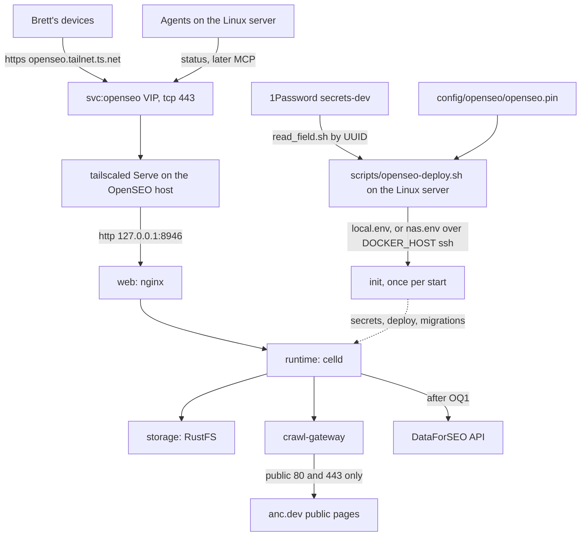
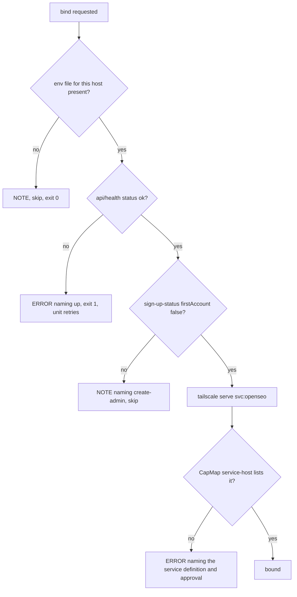
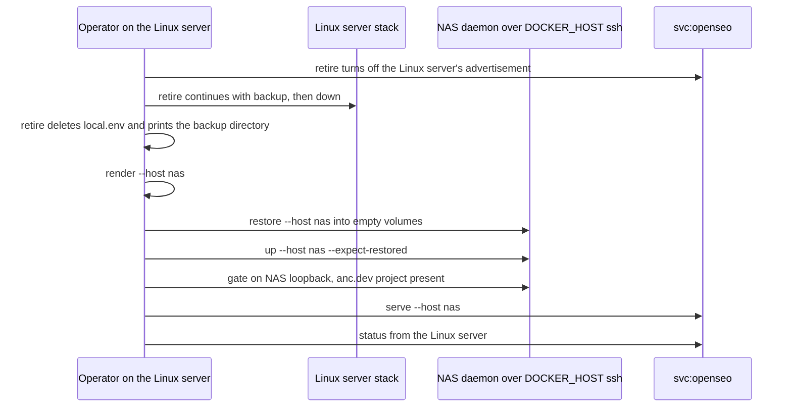

# OpenSEO on the Tailnet - Plan

## Goal Capsule

- **Objective:** Brett opens OpenSEO at one tailnet-only HTTPS address and uses it to research and audit anc.dev, and
  his agents can check that it is up there, while anc.dev, its search-console records, and Brett's spending stay exactly
  as he left them.
- **Means:** upstream's standalone Docker Compose edition, pinned in this repo and driven by one repo script, running
  first on the Linux server and later on the NAS, behind the Tailscale Service `svc:openseo` (KTD1, KTD4, KTD6, KTD10).
- **Authority:** Brett's limits (R10, R11) outrank every other line here. This plan's R-IDs decide behavior. KTDs decide
  mechanism within them. Upstream's docs at the pinned tag decide how the stack itself runs.
- **Execution profile:** three PRs to `dev` (PR1, PR2, PR3), each sized for two review rounds, built by agent slots.
  Three operator gates sit between them: Gate A (first deploy and first read-only run), Gate B (soak and memory), Gate C
  (cutover to the NAS). Steps that need `docker` or root are operator steps (KTD14).
- **Stop conditions:** stop and report to dotfiles-prime when a step would write to anc.dev or any system listed in R10,
  when it needs an outside account, key, or spend (R11), when Gate B fails (OpenSEO stays on the Linux server), or when
  an upstream release changes the services or volumes of `deploy/standalone/compose.yaml`.
- **Who finishes:** build slots write and test each PR. Brett, or a session he lets run `docker`, runs the gates.
  dotfiles-prime merges.

---

## Product Contract

### Summary

OpenSEO is an MIT-licensed, self-hosted alternative to Semrush and Ahrefs (`every-app/open-seo`). Its Docker edition is
a five-container Compose stack that publishes one nginx port on loopback. This plan vendors that stack into
`config/openseo/`, pins every image by digest, and adds `scripts/openseo-deploy.sh` to render its secrets from 1Password
and run it. The stack runs first on the Linux server, reached only through the Tailscale Service `svc:openseo` at
`https://openseo.<tailnet>.ts.net`. It moves to the NAS once a measured soak shows it fits there. The first run against
anc.dev is a crawl-only site audit that spends nothing and writes nowhere.

### Problem Frame

Brett asked for OpenSEO as a service on the tailnet, aimed at anc.dev, and asked how it runs. Today the search-presence
skill reads Search Console and Bing Webmaster data for anc.dev and checks its on-page signals. It has no keyword,
backlink, SERP, or rank data. OpenSEO adds those through the paid DataForSEO API, plus a site-audit crawler, a web UI,
and an MCP server for agents. Brett wants it reachable from his devices and agents and from nowhere else. Its eventual
home is the NAS, which already runs the household's containers, but setup must not wait on the NAS. And nothing may
touch anc.dev or spend money without his decision.

### Requirements

**Hosting and reach**

- R1. OpenSEO runs as upstream's standalone Docker Compose stack on the Linux server, and no step of getting it running
  there waits on the NAS.
- R2. OpenSEO is reachable only inside the tailnet, at one HTTPS address. Each host publishes it on loopback only, and
  nothing routes it to the public internet or the LAN.
- R3. The address stays the same when OpenSEO moves between hosts, so bookmarks, MCP clients, and OAuth redirect URIs
  need no change, and only one host answers it at a time.
- R4. OpenSEO moves to the NAS only after a soak on the Linux server shows the stack fits the NAS's free memory. Until
  then, or if it does not fit, it stays on the Linux server.

**Versions**

- R5. Every image the stack runs is pinned by digest in a tracked file, with its version beside it, and no mutable tag
  reaches a host.
- R6. The tracked pin moves only forward, except a PR that reverts a pin whose `update` failed and was rolled back
  (KTD13). A forward move goes only to an upstream release at least 7 days old, and a host applies a new pin only after
  backing up its data.

**Config, data, and secrets**

- R7. Tracked files hold no secret and no private identifier. Secrets reach a host at deploy time from 1Password
  `secrets-dev`, into a file only its owner can read.
- R8. OpenSEO's data lives in the stack's volumes on the host that runs it, and a backup taken on one host restores on
  the other.
- R9. Signing in is required, and the address never answers while the installation still lets its first visitor become
  administrator.

**anc.dev and spending**

- R10. Runs against anc.dev only read. They crawl and audit its public pages and read data. Nothing writes to anc.dev,
  its repo, Cloudflare, DNS, Search Console, or Bing Webmaster, and nothing submits a sitemap or an IndexNow ping.
- R11. No new outside account, key, or spending starts without Brett's decision, and the first run needs no paid key.

**Operations**

- R12. Any agent can check whether OpenSEO is up without `docker` or `sudo`, and a failed check names the command that
  fixes it.
- R13. Every step that needs `docker` or root on a host has its exact command in the runbook.

### Key Decisions

- **The Linux server first, the NAS as the home once it fits.** Brett: "if its best in a docker container lets put it on
  pool ... host it here so you can get the config going". Governs R1, R4.
- **Tailnet only.** Brett asked for a service on the tailnet. Governs R2, R3.
- **anc.dev read-only; no new account, key, or spend without Brett.** Brett's limits for this work. Governs R10, R11.
- **Sign-in on.** Chosen over upstream's no-sign-in mode for tailnet installs, because the app can spend DataForSEO
  money and every granted tailnet node can reach it (KTD8). Governs R9.

### Success Criteria

- From the Mac, `https://openseo.<tailnet>.ts.net` shows OpenSEO's sign-in page; outside the tailnet the name does not
  resolve, and port 8946 on the host refuses connections from the LAN.
- A crawl-only audit of anc.dev's public pages completes, and nothing listed in R10 shows a change made by it.
- After the cutover, the same address serves the same projects and audit history from the NAS.

### Scope Boundaries

**Not built (considered and judged unnecessary)**

- Backup rotation. Backups happen before each update and before the move, and the operator prunes them. Revisit if the
  backup directory passes a few GiB.
- A deploy-time refusal of pins younger than 7 days. The bump script (U7) is where the tracked pin moves, and a hand
  edit is reviewed in its PR.
- Uptime alerting. OpenSEO is used interactively, so an outage shows when someone opens it, and `status` (U3) names the
  fix.
- Per-host 1Password items. Every value re-renders from the same items, and retiring a host deletes its env file
  (KTD12).
- A one-shot `move` verb. The cutover runs as one verb per step (U9, U10), because each step has a check a person should
  see before the next.

**Deferred to Follow-Up Work**

- OpenSEO's MCP server as a connection for Claude Code agents. OpenSEO's API keys carry the whole workspace's power, so
  this needs a decision on agent keys and a tool allowlist that excludes write tools such as `submit_indexnow_urls`.
- Search Console inside OpenSEO, after Brett decides OQ2.
- DataForSEO-backed recurring work (rank trackers, AI visibility), after Brett decides OQ1.
- A scheduled job that opens bump PRs, in the shape of `scripts/upgrade/yazi-pins.sh`. U7 runs by hand first.
- Re-binding the NAS's Serve bindings after a tailscaled restart, for every service on the NAS (`svc:pinchflat`,
  `svc:languagetool`, and `svc:openseo`). Nothing does this today.
- SAM, OpenSEO's in-app agent, pointed at the Linux server's Ollama through `OPENROUTER_BASE_URL`, which would cost
  nothing.

### Open Questions

These need Brett. dotfiles-prime carries them to him.

- OQ1. **DataForSEO account.** Keyword, backlink, domain, SERP, rank, and Lighthouse data all come from DataForSEO,
  billed per call. No DataForSEO item exists in `secrets-dev`. A new account gets $1 of credit, and top-ups start at
  $50. Once the key is set, merely opening a project's dashboard calls DataForSEO's backlinks endpoints, so approving
  the key approves spend. Options: create it and spend only the signup credit; create it and top up $50; skip it.
  Recommendation: create it with no automatic top-up and spend only the signup credit until Brett has seen Gate A's
  results. Without it, OpenSEO is a site crawler, which search-presence largely covers already.
- OQ2. **Search Console inside OpenSEO.** It needs a new Google OAuth web client, with the redirect URI
  `https://openseo.<tailnet>.ts.net/api/gsc/oauth/callback` and the consent screen in production (a client left in
  testing loses its refresh token after 7 days), plus the signing-in Google account added to the anc.dev property.
  OpenSEO requests `webmasters.readonly` only (`src/shared/gsc.ts` at v0.1.25). Recommendation: defer it, since
  search-presence already reads Search Console and Bing through existing credentials. OpenSEO has no Bing Webmaster
  integration at all.
- OQ3. **First deploy date.** v0.1.25 is the first release whose Docker edition runs DataForSEO features, and it turns 7
  days old on 2026-11-13. Options: deploy on or after 2026-11-13, or waive the age gate for this one image.
  Recommendation: wait. PR1 can be built and merged before then, because nothing runs until the operator deploys.
- OQ4. **Who runs the docker steps.** Agent slots cannot run `docker` (KTD14). Recommendation: Brett runs each gate's
  commands from `~/dotfiles`, a handful per gate, as the runbook lists them.
- OQ5. **The NAS gate.** KTD10 moves OpenSEO only when the NAS keeps 1.5 GiB of memory free with the stack at its
  measured peak, and its 20 GiB Docker storage file keeps 5 GiB free with room for three times the stack's measured
  data. Options: accept that gate, or keep OpenSEO on the Linux server for good. Recommendation: accept the gate.

### Sources

- Upstream at v0.1.25 (commit `505d4859622c02175e203e528c1669fdf10dcfe4`, published 2026-11-06T05:00:18Z): `README.md`,
  `docs/SELF_HOSTING_DOCKER.md`, `docs/DATAFORSEO_API_KEY.md`, `docs/SELF_HOSTING_GOOGLE_SEARCH_CONSOLE.md`,
  `SECURITY.md`, `deploy/standalone/compose.yaml`, `scripts/celld/runtime/configure.mjs`, `scripts/celld/backup.mjs`,
  `src/server/standalone/sign-up.ts`, `src/routes/api/sign-up-status.ts`, `src/server/lib/audit/web-bot-auth.ts`,
  `src/server/mcp/tools/submit-indexnow-urls.ts`, `docs/release-notes/v0.1.20.md` through `v0.1.25.md`.
- Probes on 2026-11-06: the NAS (`ssh pool`, read-only) is x86_64 with 4 KiB pages, Docker 29.5.3, Compose v5.5.0, node
  22.18, 7.5 GiB RAM, 4.1 GiB available, no swap, serving `svc:pinchflat` and `svc:languagetool`. The Linux server is
  x86_64 with 16 cores, 93 GiB RAM, Docker active, serving `svc:codex-proxy` and `svc:ollama`. Port 8946 is free on
  both. anc.dev's robots.txt allows every agent, its sitemap lists 174 URLs, and it answers the `OpenSEO-Audit/1.0`
  agent with 200.
- GHCR: `ghcr.io/every-app/open-seo-standalone` carries tags `0.1.20`, `0.1.21`, `0.1.22`, `0.1.24`, `0.1.25` (with `v`
  forms), `main`, and `latest`. `latest` follows upstream's main branch, not releases. `v0.1.25` resolves to
  `sha256:6c5d514649b550fc7bdcefaa52314e7a98c7846b7fc5f7a288c486575698bb04`, a multi-arch index.
- Repo patterns: `scripts/tailscale-serve-setup.sh`, `scripts/host-jobs-enable.sh` (1Password into a mode-600 env file,
  item UUID in a variable), `scripts/upgrade/yazi-pins.sh` (age-gated pin moves),
  `docs/plans/2026-06-29-001-feat-pinchflat-install-plan.md` (NAS conventions),
  `docs/plans/2026-11-03-1526-feat-stable-chrome-for-browser-consumers-plan.md` (phase format).
- Learnings: `docs/solutions/configuration-fixes/tailscale-service-define-before-approve-2026-06-23.md`,
  `.../tailscale-autoapprovers-gate-fresh-advertisements-2026-06-23.md`,
  `.../ollama-loopback-binding-via-stow-2026-06-08.md`,
  `docs/solutions/architecture-patterns/self-hosted-languagetool-for-prose-check-stacks-2026-05-20.md`,
  `docs/solutions/developer-experience/gogcli-multi-account-google-auth-recovery-and-hardening.md`,
  `docs/solutions/best-practices/audit-tools-send-their-own-user-agent-and-test-crawler-serving-with-a-parity-check.md`,
  `docs/solutions/design-patterns/search-rules-as-dated-sourced-data-with-a-verdict-per-engine-and-engines-judge-their-stored-copy.md`,
  `docs/solutions/integration-issues/mcp-stateless-streamable-http-get-hang-405.md`.

---

## Planning Contract

### How OpenSEO runs

| Aspect     | At v0.1.25                                                                                                                                                                                                                                                                                                           |
| ---------- | -------------------------------------------------------------------------------------------------------------------------------------------------------------------------------------------------------------------------------------------------------------------------------------------------------------------- |
| Project    | `github.com/every-app/open-seo`, MIT, about 26.5k stars, a release every few days (v0.1.15 through v0.1.25 between 2026-10-24 and 2026-11-06)                                                                                                                                                                        |
| Runtime    | Code written for Cloudflare Workers, run in Docker on celld (`denoland/celld`). Five services: `storage` (RustFS, S3-compatible), `runtime` (celld, capped at 2 GiB), `init` (one-shot; generates secrets, deploys the app, applies migrations), `crawl-gateway` (keeps crawls off private addresses), `web` (nginx) |
| Images     | `ghcr.io/every-app/open-seo-standalone` for runtime, init, and crawl-gateway through `${OPENSEO_IMAGE:-...:latest}`. `rustfs/rustfs:1.0.3` and `nginx:1.28-alpine` are digest-pinned upstream                                                                                                                        |
| Port       | nginx publishes `127.0.0.1:${PORT:-3001}` only. Crawls reach public addresses on ports 80 and 443 only                                                                                                                                                                                                               |
| Data       | Named volumes `storage`, `runtime`, `config` (holds `secrets.json`: `BETTER_AUTH_SECRET`, `OPENSEO_OPERATOR_SECRET`, `CRAWL_GATEWAY_SECRET`), `web-config`. Contents: projects, saved keywords, rank history, audits, reports, SAM conversations, sessions, API keys, Google tokens encrypted at rest                |
| Sign-in    | `AUTH_MODE=password` (the first account becomes administrator, then registration closes) or `local_noauth` (one admin, no sign-in). `BETTER_AUTH_URL` must be HTTPS unless it is loopback, and in password mode it is the address the app builds its links from                                                      |
| Health     | `/api/health` answers 200 with a JSON body whose `status` is `ok` or `issues`; `/api/sign-up-status` returns `{"firstAccount": true or false}`                                                                                                                                                                       |
| Keys       | `DATAFORSEO_API_KEY` for nearly all SEO data. Optional: `OPENROUTER_*` (SAM), `GOOGLE_CLIENT_ID`/`SECRET` (Search Console, Analytics), `CONTEXT_API_KEY` (JavaScript rendering), `GOOGLE_MAPS_API_KEY`                                                                                                               |
| Telemetry  | Forced off in the Docker edition (`configure.mjs` sets `OPENSEO_TELEMETRY_DISABLED` and `DO_NOT_TRACK`)                                                                                                                                                                                                              |
| Host needs | Docker with Compose, 4 GiB of memory for Docker, 4 KiB pages, x86_64 or arm64                                                                                                                                                                                                                                        |
| Agents     | MCP at `/mcp` (OAuth sign-in or an API key from Settings, either with the workspace's full power). Its write tools include `submit_indexnow_urls`                                                                                                                                                                    |

### Key Technical Decisions

- KTD1. **Upstream's standalone Docker edition, never older than v0.1.25.** The legacy single image
  (`ghcr.io/every-app/open-seo`) keeps a data format the standalone edition must migrate from, and upstream points new
  installs away from it. The Cloudflare self-host runs on the public internet, which R2 rules out. v0.1.25 is the floor
  because its release notes fix DataForSEO on Docker, and v0.1.22 fixed audits freezing partway. Instantiates R1, R5.
- KTD2. **Byte-identical copies of upstream's files.** `config/openseo/compose.yaml` is upstream's
  `deploy/standalone/compose.yaml` at the pinned commit, unedited, and `config/openseo/backup.mjs` (PR2) is its
  `scripts/celld/backup.mjs` from the same commit, whose manifest checks only its format and celld version, not the
  OpenSEO image, so the backup's own recorded image (U6) is the only image check on restore. A bump is a copy plus
  checksums. Upstream already binds the web port to `127.0.0.1` and digest-pins RustFS and nginx, so no override file is
  needed. The file sets `name: openseo-standalone`, and every compose call keeps that project name, because the backup
  script finds volumes through it. Instantiates R2, R5.
- KTD3. **One pin file holds the version, and it reaches compose through `OPENSEO_IMAGE`.** `config/openseo/openseo.pin`
  records the upstream tag, its commit, its release time, the image as
  `ghcr.io/every-app/open-seo-standalone@sha256:<digest>`, and the sha256 of each vendored file. One parser in
  `scripts/openseo/lib/pin.sh` reads it, accepting only those keys. The env render writes `OPENSEO_IMAGE` from it, which
  upstream's `x-app` anchor applies to runtime, init, and crawl-gateway. An override file would not work: the backup
  script passes compose exactly one file, so a restore would pull `:latest`. A compose run without the env file fails on
  upstream's required `STORAGE_ACCESS_KEY` before it can pull anything. Instantiates R5.
- KTD4. **`scripts/openseo-deploy.sh` plus `config/openseo/`, with no stow package, no systemd unit, and no project
  files on either host.** One copy serves both hosts, and stow cannot reach the NAS. Every service except `init` has
  `restart: unless-stopped`, so dockerd brings the stack back after a reboot (verified at Gate A). The script runs from
  the canonical checkout `~/dotfiles`, as `scripts/tailscale-serve-deploy.sh` does, and sets `COMPOSE_FILE` and
  `COMPOSE_ENV_FILES` for every compose call and for the backup script, so no call depends on its working directory.
  Instantiates R1, R13.
- KTD5. **Secrets come from 1Password by item UUID, into a mode-600 env file per host at deploy time.** The script reads
  each field through the 1password skill's `read_field.sh` (test seam `OP_SKILL`, as in `scripts/host-jobs-enable.sh`),
  one item per read, so a missing item names itself instead of blanking the whole file as one failed `op inject` would.
  Files live on the Linux server in `~/.config/openseo/` (mode 700): `local.env` for a stack on the Linux server,
  `nas.env` for one on the NAS (KTD11). Values never appear in argv or output; checks grep key names only.
  - New items, inside the vault only: `OpenSEO Storage (openseo)` with a generated secret, which a restore needs
    unchanged; and `OpenSEO Admin (openseo)`, a Login with a generated password and a non-personal email such as
    `admin@openseo.internal`. The never-send guard would block Brett's address in a command anyway.
  - Render refuses to change `STORAGE_ACCESS_KEY` or `STORAGE_SECRET_KEY` in an existing env file. Upstream restores
    only "into a stopped, empty installation with the same storage credentials" and documents no way to rotate them
    (`docs/SELF_HOSTING_DOCKER.md`, "Backup and restore"), so a silent change would strand the stack's backups.
  - DataForSEO and Google OAuth items exist only after OQ1 and OQ2. Until then their keys render empty with a `NOTE:`.
  - `BETTER_AUTH_URL` is built at render time from `tailscale status --json` `.MagicDNSSuffix`, so the tailnet name is
    never tracked.
  - Item UUIDs live in the script with their titles in comments, as `STARS_TOKEN_ITEM` does in
    `scripts/host-jobs-enable.sh`.
  - Instantiates R7.
- KTD6. **`svc:openseo` proxies straight to `http://127.0.0.1:8946` on HTTPS 443, and binds only when the stack is
  healthy and closed to first sign-up.** nginx forwards the request's Host, and the app's origin is `BETTER_AUTH_URL`,
  set to the service's own address, so the Host check that forced a Caddy shim for Ollama does not apply. Serve also
  forwards the WebSocket upgrades SAM uses.
  - Before any host advertises it, the operator defines `svc:openseo` (endpoint `tcp:443`), adds a grant for Brett's
    devices and the Linux server's tag, and adds an autoApprover for the tag of each host that will advertise it. Proof
    is `CapMap."service-host"` listing the service, not the `serve` exit code.
  - The bind gate, shared by every path that binds: `/api/health` returns `status: ok` and `/api/sign-up-status` returns
    `firstAccount: false`. The gate, the bind itself, the port, the service name, and the env file paths are defined
    once in `scripts/openseo/lib/gate.sh`, which the deploy script and the setup block both source, so no second copy of
    any of them can drift. A bound service stays bound when its stack restarts, so when any path finds
    `firstAccount: true` on a host that already advertises `svc:openseo`, it turns that binding off before it reports.
    `jq` parses the gate's JSON; on the Linux server it lives only under Homebrew, outside the setup unit's default
    `PATH`, so the setup block puts Homebrew's `bin` on `PATH` before it sources `gate.sh`.
  - On the Linux server, a block appended last in `scripts/tailscale-serve-setup.sh` binds only when
    `~/.config/openseo/local.env` exists. Without it the block prints a `NOTE:` and skips, so retiring the Linux server
    (KTD12) stops the re-bind without editing the script, and a re-render brings it back for rollback. With `local.env`
    present and the stack unhealthy, the block fails, so the unit's retries cover boot order; with `firstAccount: true`
    it prints a `NOTE:` and skips, since retries cannot fix that.
  - The `serve` verb applies the same gate on either host, and `up` and `create-admin` call it last, so a first deploy
    binds without a separate step and a unit that gave up its retries is repaired by the next `up`.
  - Instantiates R2, R3, R9.
- KTD7. **Port 8946, not upstream's 3001.** Dev servers on the Linux server fall back to 3001 when 3000 is taken, and
  its SSH tunnel config forwards dev ports. 8946 is free on both hosts. Instantiates R2.
- KTD8. **Password sign-in, with the administrator created from the host before the address binds.** `SECURITY.md` says
  `local_noauth` "has no login by design". On this tailnet every granted node can reach the address, including the Linux
  server, where agent slots run third-party code, and the app can spend DataForSEO money. `create-admin` runs upstream's
  operator command on loopback, `src/server/standalone/sign-up.ts` closes registration once one account exists, and
  KTD6's gate keeps the address dark until then. Instantiates R9.
- KTD9. **The first run is the crawl OpenSEO starts by itself.** Creating the project `anc.dev` inside OpenSEO starts a
  50-page site audit with Lighthouse `none` and no JavaScript rendering (`DashboardFirstAuditService`), and that audit
  is the first run. A full-site audit of up to 250 pages with the same settings may follow. The crawl is OpenSEO's own,
  makes no DataForSEO call, leaves from the host's public IP, and identifies itself only by the `OpenSEO-Audit/1.0`
  User-Agent: it sends no request signatures, because the Docker edition sets no `WEB_BOT_AUTH_JWK`
  (`src/server/lib/audit/web-bot-auth.ts`, `scripts/celld/runtime/configure.mjs`). anc.dev's crawler analytics can still
  tell it from search engines by that User-Agent, and Cloudflare sees it as an unverified bot. If Cloudflare challenges
  it, that is a finding, never a reason to change Cloudflare. DataForSEO reads run only after OQ1. Rank trackers, AI
  visibility, SAM, Search Console, JavaScript rendering, and the IndexNow tool stay off. OpenSEO's audit warnings do not
  override search-presence's per-engine verdicts. Instantiates R10, R11.
- KTD10. **The NAS gate.** After at least 7 days of use on the Linux server, including one reboot, the operator sums
  each OpenSEO container's cgroup `memory.peak` and reads the NAS's `MemAvailable` while Plex is idle. A container's
  `memory.peak` counts only since that container last started, and a reboot, a dockerd restart, `up`, `update`, and
  `backup` all restart containers. So the reading is taken after a full-site audit of anc.dev that began after the
  stack's last container start, with no restart between that audit and the reading. OpenSEO moves only if `MemAvailable`
  minus that peak leaves at least 1.5 GiB. The NAS has 7.5 GiB and no swap, so an overrun means the kernel's OOM killer,
  not slowness. The operator also records the stack's image and volume sizes. The NAS keeps every image and named volume
  in one 20 GiB `docker.img` file with 12 GiB free, shared by Plex, pinchflat, LanguageTool, and Postgres [measured
  2026-11-06: `/boot/config/docker.cfg`, `df /var/lib/docker`], and a full file stops all of them. OpenSEO also moves
  only if that file keeps at least 5 GiB free with OpenSEO's images plus three times its measured volume size. The image
  is 115 MiB compressed for amd64 [measured: GHCR manifest]; volume growth is unknown until the soak. Instantiates R4.
- KTD11. **The NAS is driven from the Linux server through `DOCKER_HOST=ssh://pool`.** Compose reads the vendored file
  and `nas.env` on the Linux server and creates the containers and named volumes on the NAS's daemon, and the backup
  script streams archives over the same connection. Nothing is written to the NAS's disk outside Docker. That keeps the
  env file off the NAS's vfat flash, where it could not be mode 600, needs no 1Password CLI there, and keeps the project
  name `openseo-standalone` that a compose.manager project might change. `serve --host nas` runs `tailscale serve` on
  the NAS through `ssh pool`. The NAS's containers keep running when the Linux server is down; only changes need it.
  Instantiates R4, R7, R8.
- KTD12. **The move freezes writes first, and only one host answers at a time.** In order:
  1. On the Linux server, `retire`, one verb that turns off its `svc:openseo` advertisement, takes a `backup` (the
     backup script stops the app while it archives, then restarts it on loopback only), runs `down`, and deletes
     `local.env`, so the setup block skips from then on. It stops at the first failure with everything still in place
     and prints the backup directory.
  2. `render --host nas`, then `restore --host nas` from that directory into empty volumes, then
     `up --host nas --expect-restored`.
  3. Check the NAS on its own loopback through ssh: health, `firstAccount: false`, the anc.dev project present.
  4. `serve --host nas`, then `status` from the Linux server.

  The Linux server keeps its volumes for 14 days. Rollback before the NAS advertises: on the Linux server `render`,
  `up`, which binds again. Rollback after it advertises: `retire --host nas`, which does the same four things on the
  NAS, then on the Linux server `render` and `rollback <that NAS backup> --yes`, so the Linux server resumes with the
  NAS's data and the image that last wrote it. Instantiates R3, R8.
- KTD13. **Pin bumps are agent-runnable; applying and rolling back are not.** `scripts/upgrade/openseo-pin.sh` uses only
  `gh api` and GHCR's anonymous token endpoint, so a slot can run it and open the PR. It picks the newest release whose
  GitHub `published_at` is at least 7 days old and that has a standalone image tag (v0.1.23 has none), and refuses to
  move backwards. It copies the compose file and backup script from that release's commit, writes the pin file, and
  prints upstream's diff of `deploy/standalone/` and `docs/SELF_HOSTING_DOCKER.md` for the reviewer. Applying a pin is
  `update` (U8): back up, pull, stop `web`, `crawl-gateway`, and `runtime`, start, wait for `init`, check health.
  Migrations only go forward, so a failed update rolls back by restoring the backup with the pin it recorded, the one
  sanctioned move to an older version; a PR then reverts the tracked pin. On a host, `OPENSEO_IMAGE` changes only
  through `update` (forward to the tracked pin, after its backup) and `rollback` or `restore` (to the backup's pin).
  `render` and `up` keep the value already in the host's env file and write the tracked pin only into a new file, so an
  `up` after a bump merges cannot apply the new image, and its one-way migrations, without a backup. `status` notes when
  the tracked pin is newer than the host's. Instantiates R5, R6.
- KTD14. **Live docker steps belong to the operator.** `docker` and `sg docker` are ask rules for agent tool calls, and
  nobody answers prompts in a slot. Wrapping docker in a script to avoid that prompt would sidestep the rule, so slots
  test the script with docker stubbed, and every check an agent runs goes through `status`, which needs no docker.
  Instantiates R12, R13.
- KTD15. **Errors follow the global error contract, and the agent-facing commands speak JSON.** Every `ERROR:` line from
  the deploy script and the bump script starts with a stable kebab-case reason from one closed set in
  `scripts/openseo/lib/errors.sh`, names the values involved, says whether a rerun is safe or what to run first, and
  ends with a `fix:` line holding the exact command or the precise thing a person must supply. The runbook's
  troubleshooting section has one anchor per reason. `status` and `scripts/upgrade/openseo-pin.sh`, the two commands
  agents run, take `--output json` and print the global envelope: `reason`, `exit_code`, `message`, the offending value,
  and `next_step` `{action, command, docs}`, with `action` from a closed set; `status` adds its per-check results.
  Operator verbs stay text, since a person runs them. `--help` lists every verb, marks the ones that need docker as
  operator steps, and lists the exit codes. Every ssh call an agent can trigger passes
  `-o BatchMode=yes -o ConnectTimeout=10`, so a missing key fails at once instead of waiting for a terminal. When a
  command the script runs (compose, node, ssh, tailscale) fails in a way the script does not expect, the error carries
  that command's last stderr lines under `cause:`. While `up` waits for `init`, which upstream gives up to two minutes,
  it prints what it is waiting for and the log command, so a person never watches a silent terminal. Instantiates R12,
  R13.

### High-Level Technical Design

Topology on whichever host runs OpenSEO:



Where OpenSEO lives across the gates:


The bind gate shared by `serve`, `up`, and the setup block (KTD6):



The cutover (KTD12):



### System-Wide Impact

- **The Linux server's serve-setup unit.** The OpenSEO block runs last, so a failing OpenSEO block marks the unit failed
  and spends its retries, but `svc:ollama` and `svc:codex-proxy` are already bound by then.
- **The tailnet policy.** A new service definition, grant, and autoApprover, all changed in the admin console. The grant
  lets any process on the Linux server reach the sign-in page, agent slots included, which is why sign-in stays on
  (KTD8).
- **Where secrets end up.** Env values become container configuration, readable through `docker inspect` by anyone with
  docker access on the running host: root on the NAS, and on the Linux server the `docker` group, which is already
  root-equivalent. Backups hold the init-generated secrets and any Google tokens, so they stay in mode-700 directories
  outside every synced directory.
- **anc.dev's analytics.** The crawl shows up as `OpenSEO-Audit/1.0` from the running host's public IP, which
  search-presence's crawler log check can tell apart from search engines.
- **Search Console quota.** Only if OQ2 is approved later: OpenSEO and search-presence would draw on the same property's
  quota.
- **Agents.** `status` is their whole surface for now; MCP waits (Deferred to Follow-Up Work).

### Assumptions

These are bets this plan has not verified. Gate A checks each one.

- A site audit with Lighthouse `none` makes no DataForSEO call and works with `DATAFORSEO_API_KEY` empty
  (`src/server/lib/audit/lighthouse.ts` returns no Lighthouse targets for `none`).
- The first account made with upstream's operator command becomes the workspace owner, as one made in the browser does
  (`sign-up.ts` comment).
- After dockerd restarts, the stack serves again without `init` running, since `init` has `restart: "no"`.
- The Linux server can reach its own service address. If it cannot, `status` on the OpenSEO host relies on its loopback
  checks, which it runs anyway.
- `COMPOSE_ENV_FILES` reaches the compose calls inside upstream's backup script, since it runs `docker compose` from the
  same environment.
- Compose over `DOCKER_HOST=ssh://pool` works with the NAS's root login, as `ssh pool` does today.

### Risks

| Risk                                                                                                   | Mitigation                                                                                                          |
| ------------------------------------------------------------------------------------------------------ | ------------------------------------------------------------------------------------------------------------------- |
| Upstream churns fast, and its Docker edition is three weeks old                                        | 7-day gate, backup before every update, reviewer reads upstream's diff in each bump PR (KTD13)                      |
| The 7-day gate leaves only defective Docker releases eligible before 2026-11-13                        | First deploy waits for OQ3                                                                                          |
| The NAS runs out of memory with no swap                                                                | Gate B (KTD10); the stack stays on the Linux server if it fails                                                     |
| OpenSEO's volumes fill the NAS's shared 20 GiB `docker.img`, stopping every container there            | Gate B's disk threshold (KTD10); the stack stays on the Linux server if it fails                                    |
| An `up` after a bump merges applies the new image without a backup                                     | Only `update` and `rollback` change a host's image (KTD13)                                                          |
| The NAS drops `svc:openseo` after a tailscaled upgrade, as it can for its other services today         | `status` reports the dead address and names `scripts/openseo-deploy.sh --host nas serve`; a general fix is deferred |
| A tailscaled restart on the Linux server re-binds mid-move                                             | `retire` deletes `local.env` before the NAS advertises (KTD12), so the block skips                                  |
| The NAS's Docker service may not restart a stack it did not start, so a NAS reboot leaves OpenSEO down | Gate C restarts the NAS's array once and runs `status`; if the stack stays down, `status` names `up --host nas`     |
| DataForSEO spend runs past intent                                                                      | Prepaid balance with no automatic top-up (OQ1), recurring jobs off (KTD9)                                           |
| Search Console quota is shared with search-presence if OQ2 is approved later                           | search-presence's ledger already stops on a provider refusal                                                        |

### Build phases and gates

| Phase  | Kind     | Delivers                                                                                                              | Requirements                       | After                                    | Budget, script / tests [estimated] |
| ------ | -------- | --------------------------------------------------------------------------------------------------------------------- | ---------------------------------- | ---------------------------------------- | ---------------------------------- |
| PR1    | PR       | Pinned stack, env render, `up`, `down`, `serve`, `status`, `create-admin`, `svc:openseo` on the Linux server, runbook | R1, R2, R5, R7, R9, R12, R13       | none                                     | 380 / 500                          |
| Gate A | Operator | Tailnet policy, first deploy, admin, first read-only run                                                              | R10, R11, success criteria 1 and 2 | PR1 merged; on or after 2026-11-13 (OQ3) | none                               |
| PR2    | PR       | `backup`, `restore`, `update`, `rollback`, the bump script                                                            | R6, R8                             | PR1                                      | 320 / 430                          |
| Gate B | Operator | Soak, a reboot, the memory and disk readings                                                                          | R4                                 | Gate A plus 7 days                       | none                               |
| PR3    | PR       | `--host nas` for every verb, `retire`, the cutover runbook                                                            | R3, R4, R8                         | PR2; started only if Gate B passes       | 200 / 300                          |
| Gate C | Operator | Cutover; day-14 cleanup                                                                                               | R3, success criterion 3            | PR3 merged                               | none                               |

Rules for every PR, taken from the browser plan's build phases: each slot's brief copies its phase's `Touches:` and
`Adds:` lines; a diff more than 1.5 times its budget stops before review and reports what grew; nothing from a later
phase; docs ride with behavior; every requirement a phase lists has a bats case or a named live check. Gate results go
to Brett as a note in the prime's `.context/`. Measurements worth keeping go into a Measured Findings section of this
plan by a docs-only commit to `dev`, and any change they call for in `docs/runbooks/openseo.md` lands through a `fix/`
branch PR to `dev`, because the runbook is an in-repo runbook that the branch rules send through review.

Before PR1 is built, the operator creates the two 1Password items in KTD5 with the skill's `create_item.sh`, and PR1's
brief carries their UUIDs, because the script commits them and Gate A cannot render without them.

### Alternatives Considered

- **Cloudflare self-host** (Workers on Brett's Cloudflare account, optionally behind Cloudflare Access): rejected,
  because it puts OpenSEO on the public internet.
- **A stow package plus a user unit**, in the shape of `stow/codex-proxy/`: rejected (KTD4). That precedent also runs an
  unpinned `:latest` with a mode-644 `.env`.
- **A compose.manager project on the NAS**, as pinchflat uses: rejected (KTD11).
- **Running from source with pnpm** (`docs/LOCAL_DEVELOPMENT.md`): a development server, not a service.

---

## Implementation Units

### PR1: OpenSEO on the Linux server

Waits on: nothing.

Touches: `config/openseo/**`, `scripts/openseo-deploy.sh`, `scripts/openseo/**`, `scripts/tailscale-serve-setup.sh`,
`tests/openseo-deploy.bats`, `tests/tailscale-serve-setup.bats`, `docs/runbooks/openseo.md`, `BOOTSTRAP.md`,
`README.md`, `AGENTS.md`

Adds: `config/openseo/compose.yaml`, `config/openseo/openseo.pin`, `scripts/openseo-deploy.sh` with verbs `render`,
`up`, `down`, `serve`, `status`, `create-admin`, `scripts/openseo/lib/`, the `svc:openseo` block, two bats suites,
`docs/runbooks/openseo.md`.

### U1. Vendored stack and pin file

**Goal:** the stack's definition and its one version record live in the repo, verifiably unedited and fully pinned.

**Requirements:** R5; KTD1, KTD2, KTD3.

**Dependencies:** none.

**Files:** `config/openseo/compose.yaml`, `config/openseo/openseo.pin`, `scripts/openseo/lib/pin.sh`,
`tests/openseo-deploy.bats`.

**Approach:**

1. Copy `deploy/standalone/compose.yaml` from commit `505d4859622c02175e203e528c1669fdf10dcfe4` byte for byte. Its
   sha256 at that commit is `a0f02d293cb923796908b09ea3ab70ea639fb896dfe3199a4eceb30b56c9cbda`.
2. Write the pin file: tag `v0.1.25`, the commit, the release time `2026-11-06T05:00:18Z`, the image by digest, and the
   compose file's sha256. Paste the digests from command output, not from this plan, and check that the digest resolves
   on GHCR before committing.
3. `pin.sh` parses the file strictly: known keys, a 64-hex digest, an image reference by digest only.

**Patterns to follow:** `config/playwright/browsers.pin` and `scripts/playwright-browsers/lib/pin.sh` (one parser,
strict shapes, a header naming the parser).

**Test scenarios:**

- The vendored compose file's sha256 equals the pin file's recorded value. A hand edit to the compose file fails this.
- Every `image:` line in the compose file except the `${OPENSEO_IMAGE...}` one carries `@sha256:` with 64 hex
  characters.
- The parser accepts the committed pin file and prints the image reference.
- The parser rejects a pin whose image has a tag and no digest, a digest shorter than 64 hex characters, and an unknown
  key, each with exit 1 and an `ERROR:` naming the line.
- Where `docker` is installed, `docker compose config` over the vendored file with a fixture env shows the pinned digest
  on `runtime`, `init`, and `crawl-gateway`, and no port published on anything but `127.0.0.1`. The test skips without
  `docker`. This seam catches a compose shape that publishes beyond loopback or loses the pin; it says nothing about
  runtime behavior.

**Verification:** the suite passes, and the pin's digest is the one GHCR serves for the tag.

### U2. Env render from 1Password

**Goal:** `scripts/openseo-deploy.sh render` writes the host's env file from 1Password and the pin, with no secret ever
printed.

**Requirements:** R7; KTD3, KTD5, KTD7.

**Dependencies:** U1.

**Files:** `scripts/openseo-deploy.sh`, `scripts/openseo/lib/env.sh`, `tests/openseo-deploy.bats`.

**Approach:**

1. Read `STORAGE_SECRET_KEY` from the storage item. Read `DATAFORSEO_API_KEY` and `GOOGLE_CLIENT_*` only when their UUID
   variables are set; otherwise leave them empty with a `NOTE:`.
2. Write `AUTH_MODE=password`, `PORT=8946`, `STORAGE_ACCESS_KEY=openseo`, `OPENSEO_IMAGE`, and
   `BETTER_AUTH_URL=https://openseo.<MagicDNSSuffix>` from `tailscale status --json`. `OPENSEO_IMAGE` comes from the
   tracked pin only for a new file; an existing file keeps its value (KTD13).
3. Refuse when an existing file's `STORAGE_*` values differ from the new ones (KTD5).
4. Write under `umask 077` to a temporary file in the same directory, then rename it, so a failed read leaves the
   previous file intact.
5. Refuse on macOS (`uname`), since only the Linux server runs this script.

**Execution note:** start with the test that asserts no stub secret appears in the script's output or in any stub's argv
log.

**Patterns to follow:** `scripts/host-jobs-enable.sh:47-63` and its stubs in `tests/host-scheduled-jobs.bats:31-70`.

**Test scenarios:**

- With `read_field.sh` and `tailscale` stubbed, render writes `local.env` with mode 600 in a mode-700 directory, holding
  every key in step 2 with the stubbed suffix in `BETTER_AUTH_URL`.
- The stub secret values appear in neither stdout, stderr, nor any stub's argv log.
- With an existing env file and a pin file whose image has since changed, render keeps the file's `OPENSEO_IMAGE`.
- A failing read of the storage item exits 1 with an `ERROR:` naming the item title and the 1password skill command to
  inspect it, and leaves an existing env file byte-identical.
- An existing env file whose `STORAGE_SECRET_KEY` differs from the item's exits 1, names both the item and the restore
  path, and changes nothing.
- With no DataForSEO UUID configured, `DATAFORSEO_API_KEY` is empty and a `NOTE:` says how to add it.
- With `tailscale status` failing, render exits 1 naming `tailscale status` and writes nothing.
- On a stubbed Darwin `uname`, render exits 1 before reading any secret.

**Verification:** the suite passes, and the rendered file's key names cover every `${...}` reference the compose file
requires.

### U3. Run, serve, and check verbs

**Goal:** the operator brings the stack up and down, creates the administrator, and binds the address with one command
each, and any agent can check it.

**Requirements:** R9, R12, R13; KTD4, KTD6, KTD8, KTD14, KTD15.

**Dependencies:** U2.

**Files:** `scripts/openseo-deploy.sh`, `scripts/openseo/lib/compose.sh`, `scripts/openseo/lib/gate.sh`,
`scripts/openseo/lib/errors.sh`, `tests/openseo-deploy.bats`.

**Approach:**

- `up`: render, `docker compose pull`, `docker compose up -d`, then
  `docker compose up -d --force-recreate init web crawl-gateway`, upstream's documented way to apply a changed setting
  such as a newly added DataForSEO key (`docs/SELF_HOSTING_DOCKER.md`, "Enable features"). It waits for `init` to exit 0
  with upstream's `OpenSEO initialized and ready.`, then runs `serve`. When `firstAccount` is still true, it stops
  before binding and prints `create-admin` as the next step.
- `down`: `docker compose stop`. No verb ever passes `-v` or `--volumes`, which delete the data and the generated
  secrets.
- `create-admin`: pipe the admin item's password on stdin to
  `docker compose exec -T runtime node /opt/standalone/admin.mjs create-user <email> OpenSEO`, then run `serve`. On
  success it prints the address, the 1Password item to sign in with, and the next step: create the project `anc.dev`
  (KTD9).
- `serve`: apply KTD6's gate on loopback (`gate.sh`, parsing the JSON bodies), then
  `tailscale serve --service=svc:openseo --https=443 --yes http://127.0.0.1:8946`, then check `CapMap."service-host"`.
- `status` needs no docker. On a host holding `local.env` it runs the gate on loopback and checks
  `CapMap."service-host"`; from anywhere it fetches `/api/health` at the tailnet address with `curl --max-time 5`. It
  exits 0 when healthy, 1 with an `ERROR:` naming the failing check and its fix command, and 2 on usage errors. On the
  OpenSEO host it also prints a `NOTE:` naming `update` when the tracked pin is newer than the env file's image. With
  `--output json` it prints KTD15's envelope. On the host holding `local.env`, when the loopback gate and
  `CapMap."service-host"` both pass but the address fetch fails, it exits 0 with a `NOTE:` that this host cannot reach
  its own service address, since agents elsewhere still can.
- `serve` and `up` follow KTD6's unbind rule: finding `firstAccount: true` on a bound host turns the binding off.
- Errors and `--help` follow KTD15.

**Patterns to follow:** exit codes and `ERROR:`/`NOTE:` prefixes from AGENTS.md "Shell Script Conventions"; `--check`
modes in `scripts/sysctl-deploy.sh`.

**Test scenarios:**

- With `docker` stubbed, `up` calls `compose pull` then `compose up -d` with `COMPOSE_FILE` and `COMPOSE_ENV_FILES` set
  to the vendored file and `local.env`.
- `up` stops before any docker call when render fails.
- After `up -d`, `up` force-recreates exactly `init`, `web`, and `crawl-gateway`.
- When the stubbed `compose pull` fails, `up` exits 1 naming the image and never calls `up -d`.
- When the stubbed `init` exits non-zero, `up` exits 1 and prints the `docker compose logs init` command.
- With `firstAccount: true`, `up` and `serve` never call `tailscale serve` and print `create-admin`.
- With health `status: issues`, `serve` exits 1 and never calls `tailscale serve`.
- `create-admin` sends the stubbed password on stdin; the docker stub's argv log never contains it.
- `create-admin` when an account already exists (the stub exits non-zero with upstream's message) exits 1 and names
  `serve`.
- After a successful account creation, `create-admin` runs the gate and `tailscale serve`, then prints the address, the
  admin item's title, and the project step.
- Every `ERROR:` the suite triggers starts with a reason from `errors.sh` and ends with a `fix:` line; a reason outside
  the closed set fails the test.
- `status --output json` parses with `jq`, carries `reason`, `exit_code`, `message`, and `next_step`, and its
  `exit_code` matches the process's.
- `--help` exits 0, names every verb, and marks the docker verbs; an unknown verb exits 2 and points at `--help`.
- `status` on the OpenSEO host with a tracked pin newer than the env file's image exits 0 and prints the `update`
  `NOTE:`.
- No verb passes `-v` or `--volumes` to compose.
- `status` with both checks passing exits 0; with the address refusing it exits 1 and names `serve`; with loopback down
  it names `up`.
- `status` on a host without `local.env` skips the loopback and CapMap checks, even when `nas.env` exists there.
- `status` on the OpenSEO host with loopback and CapMap passing and the address refused exits 0 with the
  cannot-reach-own-address `NOTE:`.
- With `firstAccount: true` and `tailscale serve status` showing `svc:openseo` bound, `serve` turns the binding off and
  names `create-admin`.
- `status` never calls `docker`; the stub fails the test if called.

**Verification:** the suite passes, and `status` runs in a slot with no docker access.

### U4. `svc:openseo` on the Linux server

**Goal:** tailscaled re-binds `svc:openseo` on the Linux server at every start, only while that host runs OpenSEO and
only behind KTD6's gate.

**Requirements:** R2, R3, R9; KTD6.

**Dependencies:** U3 (`gate.sh` and the env file location).

**Files:** `scripts/tailscale-serve-setup.sh`, `tests/tailscale-serve-setup.bats`, `BOOTSTRAP.md`, `README.md`.

**Approach:**

1. Append an OpenSEO block after the codex-proxy block. It puts Homebrew's `bin` on `PATH` (KTD6), sources
   `scripts/openseo/lib/gate.sh`, and then: skip with a `NOTE:` when `~/.config/openseo/local.env` is absent; fail when
   the health check fails; skip with a `NOTE:` naming `create-admin` when `firstAccount` is true, turning off any
   existing binding; otherwise bind as `serve` does.
2. Add the binding and its approve URL to the script's header, and the binding to `BOOTSTRAP.md` "Tailscale Serve" and
   `README.md`'s script tree.
3. The unit and `scripts/tailscale-serve-deploy.sh` stay unchanged; the next tailscaled start picks up the block.

**Patterns to follow:** the codex-proxy block in `scripts/tailscale-serve-setup.sh`; the qmd VIP plan's rule that a new
block goes after the existing binds.

**Test scenarios:**

- The new suite stubs `hostname`, `tailscale`, and `curl`. On a host other than the expected one, the script exits 0
  with its `NOTE:` and calls no `serve`.
- On the expected host with every upstream healthy, `local.env` present, and `firstAccount: false`, `serve` runs for
  `svc:ollama`, `svc:codex-proxy`, then `svc:openseo`, in that order.
- With `local.env` absent, the script binds the first two, prints the OpenSEO `NOTE:`, and exits 0.
- With `local.env` present and OpenSEO's health failing, the first two are already bound, and the script exits non-zero
  naming `scripts/openseo-deploy.sh up`.
- With `firstAccount: true`, the script binds the first two, prints the `create-admin` `NOTE:`, and exits 0.
- With `PATH` limited to the stub directory plus `/usr/bin:/bin`, as the unit runs it, and `jq` only in a fake Homebrew
  `bin`, the OpenSEO block still parses the gate's JSON and binds.

**Verification:** the new suite passes, and so does `tests/tailscale-serve-deploy.bats`.

### U5. Runbook and repo docs

**Goal:** the operator can run Gate A from the runbook alone, and the repo's docs name the new config directory.

**Requirements:** R10, R11, R13; KTD6, KTD9, KTD14.

**Dependencies:** U1 through U4.

**Files:** `docs/runbooks/openseo.md`, `AGENTS.md`.

**Approach:**

- One-time setup, as exact commands: the two 1Password items exist before PR1 is built (Build phases and gates), and the
  runbook keeps their `create_item.sh` commands for rebuilding a lost item; define `svc:openseo` with the `tailscale`
  skill's `ts-api.sh service-set`; add the grant and the autoApprover with `ts-api.sh acl`, `acl-validate`, and
  `acl-apply`; confirm the Linux server's tag and, after the first bind, `ts-api.sh service-hosts svc:openseo`.
- First deploy, in order: `up`, then `create-admin`, which binds the address; `status` confirms it.
- Troubleshooting, one anchor per KTD15 reason, and where upstream takes bug reports (its GitHub issues, and
  `SECURITY.md` for security problems).
- The first read-only run per KTD9: what to open, what never to click (the IndexNow tool, rank trackers, Search Console
  connect, AI visibility), and the note for Brett in the prime's `.context/`.
- Which steps are the operator's (KTD14) and which any agent can run.
- AGENTS.md gets a subsection beside "Hex Transforms" naming `config/openseo/`, the deploy script, and the runbook.

**Test expectation:** none -- documentation; the commands it names are covered in U2 through U4.

**Verification:** every command in the runbook exists in the script with the same flags.

### PR2: Backup, restore, and pin updates

Waits on: PR1, merge order only. A separate PR because the brief caps each PR at two review rounds and PR1 already fills
its budget.

Touches: `config/openseo/**`, `scripts/openseo-deploy.sh`, `scripts/openseo/**`, `scripts/upgrade/openseo-pin.sh`,
`tests/openseo-deploy.bats`, `tests/openseo-pin.bats`, `docs/runbooks/openseo.md`

Adds: `config/openseo/backup.mjs`, verbs `backup`, `restore`, `update`, `rollback`, `scripts/upgrade/openseo-pin.sh`,
`tests/openseo-pin.bats`.

### U6. Backup and restore

**Goal:** the operator backs up the running stack and restores it into an empty install, with the image that made the
backup.

**Requirements:** R8; KTD2, KTD4.

**Dependencies:** U3.

**Files:** `config/openseo/backup.mjs`, `config/openseo/openseo.pin`, `scripts/openseo-deploy.sh`,
`tests/openseo-deploy.bats`.

**Approach:**

1. Vendor upstream's `scripts/celld/backup.mjs` at the pinned commit (sha256
   `16011f9927da1c0cec0443fb5d1a99396dc277f35de2d2315aa4a4d477ab1356`), recorded in the pin file.
2. `backup [dir]` defaults to `~/.local/share/openseo/backups/<UTC timestamp>`. It creates only the parent
   `~/.local/share/openseo/backups` (mode 700, since a backup holds credentials), because upstream's script creates the
   target itself with a plain `mkdir` and refuses one that exists. It runs `node config/openseo/backup.mjs backup <dir>`
   with the compose variables from KTD4, and after that succeeds writes the host env file's `OPENSEO_IMAGE`, the image
   that wrote the data, into the directory as the backup's pin. It never records the tracked `openseo.pin`, which may
   already name a newer image.
3. `restore <dir>` writes `OPENSEO_IMAGE` from the backup's own pin into the host's env file (KTD13), warns when that
   differs from the tracked pin, and surfaces upstream's refusal of a non-empty install as an `ERROR:` naming
   `rollback`.

**Test scenarios:**

- The vendored `backup.mjs` matches the pin's sha256.
- `backup` with `node` and `docker` stubbed calls `node` with `COMPOSE_FILE` and `COMPOSE_ENV_FILES` set; the parent
  exists with mode 700 and the target directory does not exist when `node` is called.
- With the tracked pin newer than the env file's image, `backup` records the env file's image as the backup's pin.
- `restore` passes the backup's pinned image to compose, not the tracked one, and prints a `WARNING:` when they differ.
- `restore` into a non-empty install (the stub exits non-zero with upstream's message) exits 1 and names `rollback`.
- `restore` with a missing directory or a directory without a pin file exits 2.

**Verification:** the suite passes. The first live backup happens at the first `update` or at Gate C.

### U7. Pin bump script

**Goal:** a slot can move the tracked pin to the newest eligible upstream release and open a reviewable PR, with no
docker.

**Requirements:** R5, R6; KTD13.

**Dependencies:** U1.

**Files:** `scripts/upgrade/openseo-pin.sh`, `scripts/openseo/lib/pin.sh`, `tests/openseo-pin.bats`.

**Approach:**

1. List releases with `gh api`; keep non-draft, non-prerelease ones with `published_at` at least 7 days old and a
   version above the pin's.
2. From newest down, take the first whose standalone image tag resolves on GHCR, reading the multi-arch index digest
   with an anonymous token.
3. Resolve the tag to its commit, dereferencing annotated tags.
4. Fetch `deploy/standalone/compose.yaml` and `scripts/celld/backup.mjs` at that commit, then write them and the pin
   file only after every fetch succeeded.
5. Print upstream's compare of `deploy/standalone/` and `docs/SELF_HOSTING_DOCKER.md`, with a `WARNING:` when the
   compose file's set of services or volumes changed, which is a stop condition for the reviewer.
6. With `--output json`, print one outcome object (`bumped`, `up-to-date`, or a KTD15 error envelope) naming the old and
   new tags and the warning, so the slot that runs it can write its PR body from it.

**Patterns to follow:** `scripts/upgrade/yazi-pins.sh` and `scripts/upgrade/lib/yazi-pins-lib.sh` (age gate by the
host's record, never backwards).

**Test scenarios:**

- From a fixture release list, the script picks the newest release exactly 7 days old and skips one 6 days 23 hours old.
- A release without a standalone image tag is skipped for the next older eligible one; with none newer than the pin, it
  reports up to date and changes nothing.
- A candidate older than the current pin is never chosen.
- A malformed digest or a failed file fetch exits 1 and leaves every tracked file unchanged.
- On success, the new pin parses, its checksums match the newly written files, and the output names the old and new
  tags.
- A fixture compose file with an added service prints the `WARNING:`.
- `--output json` on each outcome above parses with `jq` and carries the outcome, both tags, and, on failure, KTD15's
  `reason` and `next_step`.

**Verification:** the suite passes with `gh` and `curl` stubbed, and the script never calls `docker`.

### U8. Update and rollback verbs

**Goal:** the operator applies a merged pin with one command, backed up first, and can return to the backup if it fails.

**Requirements:** R4 (Gate B's runbook steps), R6, R8; KTD10, KTD13.

**Dependencies:** U6.

**Files:** `scripts/openseo-deploy.sh`, `tests/openseo-deploy.bats`, `docs/runbooks/openseo.md`.

**Approach:**

- `update`: `backup`, write the tracked pin's `OPENSEO_IMAGE` into the env file, `pull`,
  `stop web crawl-gateway runtime`, `up -d`, wait for `init`, then `serve`, following upstream's "Updates" section. On
  failure it prints the `rollback` command with the backup path it just took. Once the new stack passes the bind gate,
  it removes the `open-seo-standalone` image digest it replaced, so repeated updates do not fill the NAS's shared
  `docker.img`; a later `restore` pulls that digest again if it needs it.
- `rollback <dir> --yes`: turn off this host's `svc:openseo` advertisement, back up the current state to a new
  directory, remove the stack's containers with `docker compose down` (never `-v`), remove the stack's volumes by their
  `openseo-standalone_` names, `restore <dir>`, then `up`, which binds again through the gate. Docker refuses to remove
  a volume any container still references, stopped or not. Without `--yes` it prints the volumes it would remove and
  exits 2.
- The runbook gains update and rollback, including the follow-up PR that reverts the tracked pin, and Gate B's memory
  and disk readings (KTD10), which happen before PR3 exists.

**Test scenarios:**

- With stubs, `update` makes its calls in that order.
- A failed backup stops `update` before `pull`.
- An `init` failure during `update` exits 1 and prints `rollback` with the backup directory.
- `rollback` without `--yes` removes nothing and lists the volume names.
- `rollback --yes` turns the advertisement off first, backs up before removing anything, runs `compose down` without
  `-v` before removing volumes, and removes only volumes named `openseo-standalone_*`.
- A successful `update` removes exactly the replaced image digest and no other image.

**Verification:** the suite passes.

### PR3: OpenSEO on the NAS

Waits on: PR2, merge order only. Starts only after Gate B passes; if Gate B fails, PR3 is not built. A separate PR
because whether to build it at all depends on Gate B, which comes 7 days after Gate A.

Touches: `scripts/openseo-deploy.sh`, `scripts/openseo/**`, `tests/openseo-deploy.bats`, `docs/runbooks/openseo.md`,
`README.md`

Adds: `--host nas` for every verb; verb `retire`.

### U9. NAS target and retire

**Goal:** every verb runs against the NAS from the Linux server, and the Linux server can step down cleanly.

**Requirements:** R3, R4, R7, R8; KTD11, KTD12.

**Dependencies:** U6, U8.

**Files:** `scripts/openseo-deploy.sh`, `scripts/openseo/lib/nas.sh`, `tests/openseo-deploy.bats`.

**Approach:**

1. `--host nas` sets `DOCKER_HOST=ssh://pool` (alias overridable by `OPENSEO_NAS_SSH`) and uses `nas.env` in place of
   `local.env`.
2. `serve --host nas` and `status --host nas` run their loopback checks and `tailscale serve` on the NAS through
   `ssh pool`, with KTD15's non-interactive options.
3. `up --host nas` refuses to start against fresh volumes when `--expect-restored` is given and `docker volume ls` on
   the NAS lacks the `openseo-standalone_storage` and `_config` volumes.
4. `retire`, on either host, runs `tailscale serve --service=svc:openseo --https=443 off`, `backup`, `down`, and deletes
   that host's env file (`local.env`, or `nas.env` with `--host nas`), in that order (KTD12). It stops at the first
   failure with the env file in place and prints the backup directory.
5. When `local.env` is absent and `nas.env` present, `status` names `scripts/openseo-deploy.sh --host nas serve` as the
   fix for a refused address, and `--host nas up` for a NAS whose loopback is down.

**Test scenarios:**

- With `docker` and `ssh` stubbed, every compose call under `--host nas` carries `DOCKER_HOST=ssh://pool` and
  `COMPOSE_ENV_FILES` pointing at `nas.env`.
- No verb under `--host nas` writes a file on the NAS; the ssh stub sees only `tailscale`, `curl`, and `docker`
  commands.
- Secret values never appear in any stub's argv log.
- When the ssh stub fails to connect, every `--host nas` verb exits 1 naming `ssh pool` and makes no further call.
- Every ssh call the stub sees carries `BatchMode=yes` and `ConnectTimeout=10`.
- `serve --host nas` refuses when the NAS's gate fails and never calls `tailscale serve`.
- `up --host nas --expect-restored` with the restored volumes missing exits 1 before any `up`.
- `retire` turns the advertisement off, then backs up, then stops the stack, then deletes `local.env`; when any step
  fails it stops there and `local.env` stays.
- `retire --host nas` does the same on the NAS through ssh and `DOCKER_HOST`, deleting `nas.env` last.
- With `local.env` absent, `nas.env` present, and the address refused, `status` exits 1 naming `--host nas serve`.

**Verification:** the suite passes.

### U10. Cutover and rollback runbook

**Goal:** the operator moves OpenSEO with one documented command per KTD12 step and can roll back for 14 days.

**Requirements:** R3, R8; KTD10, KTD12.

**Dependencies:** U9.

**Files:** `docs/runbooks/openseo.md`, `README.md`.

**Approach:** the runbook adds the NAS's tag and autoApprover check, the KTD12 sequence with each step's check, both
rollback paths (before and after the NAS advertises), one restart of the NAS's array followed by `status`, and day-14
cleanup (volume removal on the Linux server). README names the NAS target.

**Test expectation:** none -- documentation; U9 covers the commands.

**Verification:** every runbook command exists with the same flags.

---

## Verification Contract

| Check             | Command                                                                                                                                                                                                                                                               | When                                     | Pass signal                                                                                                                                                                                                      |
| ----------------- | --------------------------------------------------------------------------------------------------------------------------------------------------------------------------------------------------------------------------------------------------------------------- | ---------------------------------------- | ---------------------------------------------------------------------------------------------------------------------------------------------------------------------------------------------------------------- |
| Bats              | `scripts/run-tests tests/openseo-deploy.bats tests/openseo-pin.bats tests/tailscale-serve-setup.bats tests/tailscale-serve-deploy.bats`                                                                                                                               | each PR, for the suites it has           | all pass                                                                                                                                                                                                         |
| ShellCheck        | `scripts/lint-shell` over the changed scripts                                                                                                                                                                                                                         | each PR                                  | clean                                                                                                                                                                                                            |
| Pre-push mirror   | `.githooks/pre-push` (runs on `git push`)                                                                                                                                                                                                                             | each PR                                  | passes                                                                                                                                                                                                           |
| Pin resolves      | GHCR manifest request for the pinned digest                                                                                                                                                                                                                           | PR1, each bump                           | 200                                                                                                                                                                                                              |
| Gate A, operator  | runbook "First deploy": `up`, `create-admin`, each timed with `gtime -f '%e s'` for the Gate A note                                                                                                                                                                   | after PR1 merges, on or after 2026-11-13 | `init` prints its ready line; `serve` sees the service in `CapMap`                                                                                                                                               |
| Gate A, any agent | `scripts/openseo-deploy.sh status` on the Linux server                                                                                                                                                                                                                | after the operator steps                 | exit 0                                                                                                                                                                                                           |
| Gate A, reach     | from the Mac the address loads and sign-in works; from a LAN host port 8946 is refused                                                                                                                                                                                | after the operator steps                 | as stated                                                                                                                                                                                                        |
| Gate A, restart   | operator restarts dockerd, then `status`; then restarts `tailscale-serve-setup.service`, then `status`                                                                                                                                                                | after the first run                      | exit 0 both times with no `up` or `serve`                                                                                                                                                                        |
| Gate A, first run | the audit OpenSEO starts on project creation, per KTD9                                                                                                                                                                                                                | after the reach checks                   | audit completes; no DataForSEO call; nothing listed in R10 changed                                                                                                                                               |
| Gate B            | sum of `memory.peak` for the stack's containers, read after a full-site audit that began after the last container start, at least 7 days and one reboot after Gate A; the stack's image and volume sizes; the NAS's `MemAvailable` and free space in its `docker.img` | 7 days after Gate A                      | KTD10's threshold holds                                                                                                                                                                                          |
| Gate C            | runbook "Move to the NAS"                                                                                                                                                                                                                                             | after PR3 merges                         | the NAS passes the gate on its loopback before it advertises; `status` exits 0 from the Linux server; projects and audit history present; after one NAS array restart, `status` exits 0 or names `up --host nas` |

---

## Definition of Done

- Each PR: its units' tests pass in `scripts/run-tests`, ShellCheck is clean, its diff stays within 1.5 times its
  budget, and it changes only its `Touches:` paths.
- No tracked file holds a secret, a tailnet name, an email address, or a mutable image tag, except the
  `${OPENSEO_IMAGE:-...:latest}` default in the byte-identical vendored compose file, which the env file's digest always
  overrides (KTD2, KTD3).
- Every verb in the runbook exists in the script with the same flags, and every operator step is marked as one.
- Gate A's results, including the first run's findings, reach Brett as a note in the prime's `.context/`.
- Abandoned attempts are removed from each diff before review.
- Done overall when the address serves OpenSEO from its final host, nothing listed in R10 shows a change from this work,
  and no spend happened without Brett's yes.

---

## Appendix: Engineering Review (plan-eng-review, 2026-11-06)

Target: this plan at `da918cf`. The review ran in an unattended agent slot, where the question tool is denied, so each
choice below is decided from upstream's v0.1.25 source, the repo on `dev`, read-only probes of the NAS and GHCR, and
repo precedent, and is recorded with its evidence. Brett's open questions (OQ1 to OQ5) are left to him; none was decided
here. Evidence kinds: static reads and live read-only probes; no proposed code ran, and `docker` is denied in this slot,
so no compose command was run against a live CLI.

### Scope Challenge

- **What already exists.** The Serve setup script and its unit (`scripts/tailscale-serve-setup.sh`,
  `config/systemd/system/tailscale-serve-setup.service`); the 1Password-to-env-file pattern
  (`scripts/host-jobs-enable.sh:47-63`) and its stubs (`tests/host-scheduled-jobs.bats:31-70`); the age-gated pin move
  (`scripts/upgrade/yazi-pins.sh`); upstream's compose file, backup script, and operator command, which the plan vendors
  or calls rather than rebuilding.
- **Minimum change.** PR1 alone puts OpenSEO on the tailnet and makes the first run possible. PR2 and PR3 are separable,
  and PR3 is built only if Gate B passes.
- **Complexity.** About 19 repo paths across the three PRs' `Touches:` lines [estimated] and two new script families:
  the deploy script with its libraries, and the bump script. The gate trips; E-D1 settles the structure. No feature cut
  is proposed: every verb traces to a requirement in the brief.
- **Search.** The patterns are standard: Compose's `COMPOSE_FILE` and `COMPOSE_ENV_FILES` variables (the Linux server
  has the `docker-compose-plugin` 5.6.0 package [measured: dpkg], the NAS Compose v5.5.0 [measured: probe]), Docker's
  `ssh://` transport for `DOCKER_HOST`, and Tailscale Services [Layer 1]. No web search ran; in-distribution knowledge
  only.
- **TODOS.** The repo tracks no TODOS file; local TODO files are gitignored by policy.
- **Distribution.** Nothing is published. Images come from GHCR and Docker Hub by digest.
- **Prior learning applied:** `dotfiles-same-version-all-hosts` (10/10, 2026-09-22). The NAS phase runs from the Linux
  server's checkout, so no host can run a different version of the script.
- **Retrospective.** `git log` of `scripts/tailscale-serve-setup.sh` shows #245 (re-run on every tailscaled
  start), #149, and #146; no reverts.

```text
REALITY: premise-table pass about 40 factual claims carry source, probe, or registry receipts; unverified=5 (password-mode links from BETTER_AUTH_URL, dockerd restart without init, the Linux server reaching its own service address, COMPOSE_ENV_FILES inside the backup script, compose over ssh as root) docs/plans/2026-11-06-0100-feat-openseo-tailnet-service-plan.md:415
REALITY: already-done pass origin/dev since 2026-11-05 touches none of the named paths except this plan's own commit da918cf, and no commit mentions openseo docs/plans/2026-11-06-0100-feat-openseo-tailnet-service-plan.md:1
REALITY: surface-check pass tailscale serve 1.104.2 --help lists --service, --https, --http, --yes; GHCR answers the pinned digest; docker compose flags could not be checked in this slot and rest on the 5.6.0 plugin and Compose's documentation, recorded as an assumption docs/plans/2026-11-06-0100-feat-openseo-tailnet-service-plan.md:415
REALITY: binding-decisions pass no recorded decision touches OpenSEO, compose, or Tailscale Services; Brett's limits (R10, R11) hold throughout docs/plans/2026-11-06-0100-feat-openseo-tailnet-service-plan.md:94
REALITY: numbers finding the size budgets were untagged; now [estimated]; memory, disk, and image size carry [measured] receipts in KTD10 docs/plans/2026-11-06-0100-feat-openseo-tailnet-service-plan.md:286
REALITY: deferred-asks pass no linked issue; the brief's asks (where it runs, the move, tailnet reach, pinning and updates, config and data, secrets, the first read-only run) each map to KTDs and units docs/plans/2026-11-06-0100-feat-openseo-tailnet-service-plan.md:14
REALITY: pr-count pass no ship policy on file; three PRs, PR2 split by the brief's two-round cap and PR3 by Gate B; each extra PR costs one CI run and up to two review rounds docs/plans/2026-11-06-0100-feat-openseo-tailnet-service-plan.md:444
```

Scope result: scope accepted as-is. MODE: FULL_REVIEW.

### Decision ledger

Each choice was decided on its recommendation from the evidence named, because no person answers in the slot.

| ID   | Finding         | Options                                                                                      | Chosen                   | Evidence                                                                                                                                                                | Accepted scope                                                                    |
| ---- | --------------- | -------------------------------------------------------------------------------------------- | ------------------------ | ----------------------------------------------------------------------------------------------------------------------------------------------------------------------- | --------------------------------------------------------------------------------- |
| E-D1 | Complexity gate | Original arrangement; smaller arrangement                                                    | Original                 | Folding the libraries into the deploy script would put about 700 lines in one file [estimated from the budgets], past the 200-line refactor trigger                     | No change                                                                         |
| E-D2 | A1              | Only `update` and `rollback` change a host's image; keep render writing the tracked pin      | Only update and rollback | R6; U2 step 2 wrote the tracked pin on every render, and U3's `up` renders; upstream: "Going back to an older image does not undo them" (`docs/SELF_HOSTING_DOCKER.md`) | KTD13's last sentences; U2 step 2; U3 `status`; U6 step 3; U8 `update`; two tests |
| E-D3 | A2              | Add a disk threshold to Gate B; keep the gate on memory alone                                | Disk threshold           | The NAS's `docker.img` is 20 GiB with 12 GiB free and holds every container's images and volumes [measured: `/boot/config/docker.cfg`, `df`]                            | KTD10; OQ5; Risks; Gate B rows; U8's runbook                                      |
| E-D4 | A3              | Define port, service name, paths, and the bind once in `gate.sh`; keep copies in each script | One definition           | Port 8946, `svc:openseo`, and `local.env` appeared in both U3 and U4 (red flags 6 and 8)                                                                                | KTD6's gate bullet                                                                |
| E-D5 | A4              | `up` force-recreates `init`, `web`, `crawl-gateway`; plain `up -d`                           | Force-recreate           | Upstream applies changed settings that way ("Enable features", `docs/SELF_HOSTING_DOCKER.md`)                                                                           | U3 `up`; one test                                                                 |

Factual corrections, no question needed: F1, KTD5's reason for refusing a storage-key change now cites upstream's
restore requirement instead of an unverified RustFS behavior. F2, the build-phase budgets are tagged [estimated]. F3,
Gate B's readings move from U10 (PR3) to U8's runbook (PR2), because Gate B happens before PR3 exists.

Regression contract, carried as required proof: the Serve setup script's host gate and its `svc:ollama` then
`svc:codex-proxy` order and failure behavior stay as they are; U4's first four scenarios hold them, in a suite that does
not exist today.

Approval readiness: PASS (E-D1 to E-D5, decided from evidence in an unattended slot; F1 to F3 change no behavior).

### 1. Architecture

```text
 1Password secrets-dev ──read_field.sh──▶ scripts/openseo-deploy.sh ◀── config/openseo/openseo.pin
                                                │   (render: local.env | nas.env, mode 600, on the Linux server)
                       ┌────────────────────────┴───────────────────────┐
                       ▼                                                ▼
     docker (local daemon)                               docker over DOCKER_HOST=ssh://pool
     storage, runtime, init, crawl-gateway, web          same five services on the NAS daemon
     web on 127.0.0.1:8946                               web on 127.0.0.1:8946
                       │                                                │
     tailscale-serve-setup.sh block ──gate.sh──┐         serve --host nas ──gate.sh (over ssh)
                       ▼                       │                        ▼
                svc:openseo  ◀── exactly one host advertises at a time (KTD12)
```

- [CRITICAL] (confidence: 8/10) plan U2 step 2 and U3 `up`, "Write ... `OPENSEO_IMAGE` from the pin" and "`up`: render,
  `docker compose pull`, `docker compose up -d`". After a bump PR merges and the operator pulls `~/dotfiles`, any `up`
  would start the new image and run its one-way migrations without the backup `update` takes, against R6. Accepted as
  E-D2.
- [CRITICAL] (confidence: 8/10) plan KTD10, "OpenSEO moves only if `MemAvailable` minus that peak leaves at least 1.5
  GiB". The gate read memory only, while the NAS keeps every container's images and volumes in one 20 GiB `docker.img`
  with 12 GiB free; OpenSEO's volumes growing there could stop Plex, pinchflat, LanguageTool, and Postgres. Accepted as
  E-D3.
- [INFORMATIONAL] (confidence: 8/10) plan U3 and U4, the port, the service name, and `~/.config/openseo/local.env` named
  in two scripts. Accepted as E-D4.
- [INFORMATIONAL] (confidence: 7/10) plan U3 `up`. A key added after OQ1 reaches `init` through its changed environment,
  but upstream's documented way to apply changed settings recreates `init`, `web`, and `crawl-gateway` together.
  Accepted as E-D5.

**Two shapes.** Shape A, chosen: one deploy script with libraries, run from the canonical checkout, driving either
host's Docker daemon behind about a dozen verbs. Shape B: native packaging per host, a stow package with a user unit on
the Linux server (`stow/codex-proxy/`) and a compose.manager project on the NAS (the pinchflat plan). A hides the
1Password reads, the pin, the env file, compose, the bind gate, and host targeting behind one interface; B splits the
same knowledge across two packagings and puts the env file on the NAS's vfat flash. Red flags: (1) `render` exposes a
stage of `up`, kept because it is the only docker-free way to prepare and inspect a host's env file; (6) and (8) were
the shared constants, fixed by E-D4; no others found.

**One realistic failure per new path.** Render with 1Password unreachable: `ERROR:`, file untouched, tested. `up` with
GHCR unreachable: exit 1, tested. The setup block at boot before the stack is up: the unit retries, tested. A backup
that fails: `update` stops before `pull`, tested. Any `--host nas` verb with ssh down: exit 1, tested. The NAS losing
its binding after a tailscaled upgrade: `status` names the fix, live only. The Linux server unable to reach its own
service address: `status` relies on loopback there, an assumption Gate A checks.

Security: no new finding. The grant reaches the Linux server's agent slots, which is why sign-in stays on (KTD8).

Dispositions: A1 accepted (E-D2), A2 accepted (E-D3), A3 accepted (E-D4), A4 accepted (E-D5).

### 2. Code quality

- [INFORMATIONAL] (confidence: 7/10) plan U3 `create-admin` had no planned behavior when an account already exists;
  upstream's operator command fails then. A test now pins the exit and the `serve` hint; required proof of planned
  behavior, no question.
- [INFORMATIONAL] (confidence: 5/10, medium; verify) plan U3 `status` is text-only while agents are its main users, and
  the global error contract asks agent-facing modes for structured output. Output modes are the DX review's call, so it
  is handed to `/plan-devex-review`.

Shared code: `scripts/openseo/lib/gate.sh` has two proposed callers, the deploy script and the setup block, with the
same contract, so it passes the rubric. Dispositions: Q1 accepted as required proof; Q2 handed to the DX review.

### 3. Tests

Framework: bats through `scripts/run-tests` (AGENTS.md "Local gates mirror CI").

```text
CODE PATHS (proposed)                                   USER FLOWS
[+] scripts/openseo/lib/pin.sh                          [+] Gate A, operator deploy
  ├── [★★★ PLANNED] parse, reject tag-only/short/unknown    ├── [→E2E live] render → up → create-admin → serve
  └── [★★  PLANNED] compose checksum + digest lines         └── [→E2E live] sign-in over the tailnet address
[+] render (env.sh)                                     [+] Gate A, first run
  ├── [★★★ PLANNED] happy, 1P failure, storage-key change   └── [→E2E live] project creation starts the crawl
  ├── [★★★ PLANNED] keeps OPENSEO_IMAGE (E-D2)          [+] Gate C, cutover
  └── [★★  PLANNED] no secret in output or argv             ├── [→E2E live] retire → backup → restore → serve
[+] up / down / create-admin / serve / status               └── [→E2E live] rollback within 14 days
  ├── [★★★ PLANNED] order, force-recreate (E-D5), pull and init failures
  ├── [★★★ PLANNED] firstAccount gate, no -v, stdin password, existing account
  └── [★★★ PLANNED] status: healthy, refused, no local.env, pin note, never docker
[+] tailscale-serve-setup.sh block
  └── [★★★ PLANNED] host gate, order, absent env, unhealthy, firstAccount (regression contract)
[+] backup / restore / update / rollback
  └── [★★★ PLANNED] env vars, mode 700, backup pin, order, --yes, volume names
[+] openseo-pin.sh
  └── [★★★ PLANNED] 7-day edge, missing image tag, never backwards, failed fetch, warning
[+] --host nas
  └── [★★★ PLANNED] DOCKER_HOST, no NAS writes, stdin only, ssh failure, gate, restored volumes

COVERAGE: every proposed code path has a planned bats case; user flows are live gates
GAPS ADDED BY THIS REVIEW: 6 (render keeps image, force-recreate, pull failure, existing account, status pin note, ssh failure)
```

Legend: ★★★ behavior plus edge plus error | ★★ happy path | →E2E live = an operator gate, not a bats case.

The test plan artifact is at
`~/.gstack/projects/brettdavies-dotfiles/brett-dev-eng-review-test-plan-20261106-011342.md`. Tests made obsolete: none.

### 4. Performance

No issues found beyond A2's disk threshold. The first run crawls 50 pages, and a full audit up to 250, against a site
whose sitemap lists 174 URLs [measured]; upstream allows 10,000. Memory is capped by upstream's 2 GiB runtime limit.
Every probe the plan adds is bounded: `status` uses `--max-time 5` and the setup block `--max-time 3`.

### Outside voice

codex, disabled by `codex_reviews`; disabled is a terminal branch, so no fallback reviewer ran.

### NOT in scope

The plan's "Deferred to Follow-Up Work" list stands unchanged: OpenSEO's MCP connection for agents, Search Console
inside OpenSEO, DataForSEO-backed recurring work, scheduled bump PRs, re-binding the NAS's Serve bindings after a
tailscaled restart, and SAM through the Linux server's Ollama.

### What already exists

Reused, not rebuilt: the Serve setup script and unit, the `read_field.sh` env-file pattern and its test stubs, the yazi
pin mover's age-gate shape, upstream's compose file, backup script, operator command, health route, and `sign-up-status`
route. Rebuilt: nothing.

### Failure modes

| Path         | Realistic failure               | Handled                | Test | What the operator sees                 |
| ------------ | ------------------------------- | ---------------------- | ---- | -------------------------------------- |
| render       | 1Password unreachable           | exit 1, file untouched | yes  | `ERROR:` naming the item               |
| up           | GHCR unreachable                | exit 1 before `up -d`  | yes  | `ERROR:` naming the image              |
| up           | `init` fails                    | exit 1                 | yes  | the `docker compose logs init` command |
| setup block  | stack not up at boot            | unit retries           | yes  | unit retrying, then bound              |
| update       | backup fails                    | stops before `pull`    | yes  | `ERROR:` and no change                 |
| `--host nas` | ssh down                        | exit 1                 | yes  | `ERROR:` naming `ssh pool`             |
| NAS binding  | dropped by a tailscaled upgrade | `status`               | live | `ERROR:` naming `--host nas serve`     |

Critical gaps: 0. Every failure is either tested or visible through `status`.

### Parallelization

Sequential implementation, no parallelization opportunity: the three PRs share `scripts/openseo-deploy.sh`, and within
PR1 each unit builds on the one before.

### Implementation Tasks

Synthesized from this review's findings; each is already written into the units above. The JSONL artifact is not
persisted: the `dev` branch's task list belongs to other plans, and adding this list would retire theirs.

- [ ] **T1 (P1, human: ~1h / CC: ~10min)** — env and update — only `update` and `rollback` change a host's image
  - Surfaced by: Architecture — A1
  - Files: `scripts/openseo/lib/env.sh`, `scripts/openseo-deploy.sh`, `tests/openseo-deploy.bats`
  - Verify: the render-keeps-image and status pin-note cases pass
- [ ] **T2 (P1, human: ~30min / CC: ~5min)** — runbook — Gate B's memory and disk readings in PR2's runbook
  - Surfaced by: Architecture — A2, and correction F3
  - Files: `docs/runbooks/openseo.md`
  - Verify: the runbook names both thresholds and the commands that read them
- [ ] **T3 (P2, human: ~30min / CC: ~5min)** — gate — one definition of port, service, paths, and bind
  - Surfaced by: Architecture — A3
  - Files: `scripts/openseo/lib/gate.sh`, `scripts/tailscale-serve-setup.sh`
  - Verify: `rg 8946 scripts/` finds the port only in `gate.sh`
- [ ] **T4 (P2, human: ~15min / CC: ~5min)** — up — force-recreate `init`, `web`, `crawl-gateway`
  - Surfaced by: Architecture — A4
  - Files: `scripts/openseo-deploy.sh`, `tests/openseo-deploy.bats`
  - Verify: the force-recreate case passes
- [ ] **T5 (P2, human: ~30min / CC: ~10min)** — tests — existing account, pull failure, ssh failure
  - Surfaced by: Code quality — Q1; Tests
  - Files: `tests/openseo-deploy.bats`
  - Verify: the three cases pass

_No new tasks from Performance._

### Completion summary

- Step 0: Scope Challenge — scope accepted as-is
- Reality rows: 7/7 applicable rows emitted, 5 unverified premises
- Architecture Review: 4 issues found
- Code Quality Review: 2 issues found
- Test Review: diagram produced, 6 gaps identified
- Performance Review: 0 issues found
- NOT in scope: written
- What already exists: written
- TODOS.md updates: 0 items proposed (no tracked TODOS file)
- Failure modes: 0 critical gaps flagged
- Unresolved decisions: 0 in this review (Q2 is handed to the DX review; Brett's OQ1 to OQ5 stay open in the plan)
- Outside voice: codex, disabled (`codex_reviews`)
- Parallelization: 1 lane, 0 parallel / 3 sequential
- Lake Score: N/A (no answers scored for Completeness)

## Appendix: DX Review (plan-devex-review, 2026-11-06)

Target: this plan at `47d767e`. Run in the same unattended slot under the same rule: each choice is decided from the
evidence named and recorded here, because no person answers questions in the slot. Base `dev`. No design doc exists; the
`/office-hours` offer is answered as skip, since the plan already holds the problem frame and alternatives. Mode: DX
POLISH, because the plan's scope is right and this is an internal service, not a product for outside developers. Product
type: a CLI (`scripts/openseo-deploy.sh` and the bump script) delivering a platform (the tailnet service). Web research:
none ran; the benchmark uses upstream's own documentation.

### Developer Persona Card

```text
TARGET DEVELOPER PERSONA
========================
Who:       Brett as the operator, at a terminal on the Linux server, running each gate's commands from ~/dotfiles;
           AI coding agents are the second reader of every error and the only users of status and the bump script
Context:   once at Gate A, again at each update, once at the move; agents check status any time
Tolerance: a few commands per gate; zero tolerance for a prompt that blocks an agent or a secret on screen
Expects:   the repo's conventions (ERROR:/NOTE: prefixes, --help, exit 2 on usage), 1Password items by UUID, a runbook
```

### Developer Empathy Narrative

I open `docs/runbooks/openseo.md` on the Linux server. The one-time part asks me to make two 1Password items with
`create_item.sh` and to define `svc:openseo` with `ts-api.sh`, then paste a grant and an autoApprover into the ACL and
validate it before applying. That is about fifteen minutes the first time [estimated]; I do it once. Then I run
`scripts/openseo-deploy.sh up`. It pulls about 115 MiB and tells me it is waiting for `init`, which upstream allows two
minutes, and prints the log command in case it stalls. It finishes by telling me no administrator exists yet and to run
`create-admin`. I run it; it reads the password from 1Password, creates the account, binds the tailnet address, and
prints `https://openseo.<tailnet>.ts.net` with the item to sign in with. On the Mac I sign in, create the project
`anc.dev`, and a 50-page audit starts on its own. What I could not confirm from the plan alone: whether sign-in works
first time through Serve (Gate A checks it), and how long `up` really takes (Gate A times it).

### Competitive DX Benchmark

Clock: from "PR1 merged and the one-time setup done" to "OpenSEO's sign-in page at the tailnet address". Times are not
comparable across rows, because each starts from a different state; the table compares DX choices.

| Tool                          | Start → result                                        | Time + evidence type                                                                                      | DX choice                                                   | Source                        |
| ----------------------------- | ----------------------------------------------------- | --------------------------------------------------------------------------------------------------------- | ----------------------------------------------------------- | ----------------------------- |
| Upstream Docker edition       | clone → sign-in on localhost                          | "ready a few seconds after it starts" (reported); six manual steps                                        | prebuilt image, first visitor becomes admin                 | `docs/SELF_HOSTING_DOCKER.md` |
| Upstream hosted               | sign-up → app                                         | not measured; $10 a month                                                                                 | nothing to run                                              | `README.md`                   |
| Upstream Cloudflare self-host | one deploy command → public URL                       | not measured (reported "one deploy command")                                                              | public internet                                             | `README.md`                   |
| pinchflat on the NAS          | hand-written compose, env file, serve command → app   | not measured; every step by hand                                                                          | compose.manager, manual serve                               | pinchflat plan                |
| This plan                     | `up`, `create-admin` → sign-in at the tailnet address | 2 to 4 minutes [estimated: 115 MiB pull, `init` up to 120 s]; one-time setup about 15 minutes [estimated] | pinned, 1Password-rendered, admin before bind, tailnet only | U3                            |

Target: Competitive (2 to 5 minutes) for the repeatable path after the one-time setup, measured at Gate A. Champion
(under 2 minutes) would need the image pre-pulled, which buys nothing for a service deployed a handful of times.

### Magical Moment Specification

`create-admin` ends by binding the address and printing `https://openseo.<tailnet>.ts.net`, the 1Password item to sign
in with, and "create the project anc.dev". Brett signs in from the Mac, creates the project, and minutes later reads a
50-page audit of the live site, with nothing changed on it and nothing spent. Vehicle: existing capabilities only
(upstream's auto-started first audit, KTD9; `create-admin` running `serve`, U3).

### Developer Journey Map

```text
STAGE           | DEVELOPER DOES                                   | FRICTION POINTS                     | STATUS
----------------|--------------------------------------------------|-------------------------------------|--------
1. Discover     | finds AGENTS.md's OpenSEO entry and the runbook  | none                                | ok
2. Install      | 1Password items, svc:openseo, grant, approver    | console clicks with no commands     | fixed (DX-D6)
3. Hello World  | up, create-admin, sign in, create anc.dev        | separate serve step; silent init    | fixed (DX-D7, DX-D10)
4. Real Usage   | reads audits; agents run status                  | status text-only for agents         | fixed (DX-D9)
5. Debug        | reads an ERROR, runs its fix                     | no stable codes, no recovery class  | fixed (DX-D8)
6. Upgrade      | bump PR reviewed, then update; rollback if bad   | none beyond the eng review's        | ok
```

### First-Time Developer Confusion Report

```text
FIRST-TIME DEVELOPER REPORT
============================
Persona: the operator (an agent reads every error as a second reader)
Attempting: Gate A from docs/runbooks/openseo.md

CONFUSION LOG:
T+0:00  Reads one-time setup. Before review: "define svc:openseo, its grant, and the autoApprover" with no commands.
        Addressed: exact ts-api.sh service-set, acl, acl-validate, acl-apply, service-hosts commands (DX-D6).
T+15:00 Runs up. Before review: init can sit two minutes with no output. Addressed: progress line (DX-D10).
T+18:00 up says to run create-admin. Before review: then a separate serve. Addressed: create-admin binds (DX-D7).
T+19:00 An agent runs status from a slot. Before review: text only. Addressed: --output json (DX-D9).
T+20:00 Signs in from the Mac, creates anc.dev; the audit starts on its own. Success, pending Gate A's live check.
```

### Passes

**Pass 1, Getting Started: 6 → 8.** The repeatable path is now two commands, and the one-time setup is exact commands. A
10 would pre-pull the image and script the ACL edit end to end; neither pays for itself at this deploy count.

**Pass 2, CLI design: 7 → 8.** Verbs are guessable (`up`, `down`, `serve`, `status`, `update`, `rollback`, `retire`),
`--host nas` is the one switch, and the destructive verb needs `--yes`. `--help` now lists verbs, marks the operator
ones, and lists exit codes (KTD15). A 10 would also print each verb's own help.

**Pass 3, Error messages: 5 → 8.** The agent reader is the second lens on every path.

```text
ERROR PATH MATRIX (agent-ready-v1)
Path                         | Class       | what | fix  | recovery | code | context | trace | redaction | channel | Cap
render: 1Password item read  | dependency  | pass | pass | pass     | pass | pass    | N/A   | pass      | pass    | none
status: address unreachable  | dependency  | pass | pass | pass     | pass | pass    | N/A   | pass      | pass    | none
up: init fails               | partial     | pass | pass | pass     | pass | pass    | pass  | pass      | pass    | none
backup: node throws          | unexpected  | pass | pass | pass     | pass | pass    | pass  | pass      | pass    | none
```

Before the review two paths were capped. CAP6:status:recovery: the plan named a fix but no recovery class. Corrected
line: `ERROR: address-unreachable: https://openseo.<tailnet>.ts.net/api/health refused (loopback healthy; nothing
changed; safe to rerun)` then `fix: scripts/openseo-deploy.sh serve`. CAP6:backup:trace: an unexpected failure had no
trace. Corrected: the error carries the child command's last stderr lines under `cause:` (KTD15). No CAP4 path: render
never prints a value, every docker call is non-interactive (`exec -T`), `rollback` without `--yes` exits 2 and names
`--yes`, and ssh runs with `BatchMode=yes`.

**Pass 4, Documentation: 6 → 8.** The runbook carries the golden path, the read-only run's do and do-not list,
troubleshooting by reason, and where upstream takes reports. A 10 would add a transcript of a real Gate A run, which
Gate A's note supplies.

**Pass 5, Upgrade path: 7 → 8.** Bump PRs carry upstream's diff; `update` backs up first; `rollback` restores with the
backup's own pin; `status` says when an update is waiting. A 10 would warn before a migration-bearing release.

**Pass 6, Dev environment: 8 → 8.** Bats with stubs for docker, ssh, curl, tailscale, and `read_field.sh`; the Mac
refuses cleanly; CI runs the suites. No issues found.

**Pass 7, Community: 5 → 6.** Upstream is MIT with GitHub issues and a Discord; the runbook now names where to report.
This plan has no community of its own to grow.

**Pass 8, DX measurement: 5 → 7.** Gate A times `up` and `create-admin` with `gtime` and records them against the
2-to-5-minute target. No telemetry is added; upstream's is forced off and stays off.

### Decision ledger

Each choice was decided on its recommendation from the evidence named, because no person answers in the slot.

| ID     | Finding              | Options                                                                         | Chosen                                   | Evidence                                                                                                                                        | Accepted scope    |
| ------ | -------------------- | ------------------------------------------------------------------------------- | ---------------------------------------- | ----------------------------------------------------------------------------------------------------------------------------------------------- | ----------------- |
| DX-D1  | Product type         | CLI; platform; both                                                             | CLI delivering a platform                | The plan's surface is two scripts and a tailnet service                                                                                         | Review lens       |
| DX-D2  | Persona              | Operator; agent; both                                                           | Operator, with agents as second reader   | Docker steps are the operator's (KTD14); agents run only `status` and the bump script                                                           | Review lens       |
| DX-D3  | Target               | Champion; Competitive; current                                                  | Competitive                              | 115 MiB pull and `init` up to 120 s [measured: GHCR, upstream compose]                                                                          | Gate A timing     |
| DX-D4  | Magical moment       | `create-admin` prints the address and next step; a scripted project via the API | Print and let upstream's first audit run | POLISH uses existing capabilities; `DashboardFirstAuditService` already crawls                                                                  | U3 `create-admin` |
| DX-D5  | Mode                 | Expansion; Polish; Triage                                                       | Polish                                   | Internal service with its scope settled                                                                                                         | Review mode       |
| DX-D6  | Install friction     | Exact `ts-api.sh` commands; console clicks                                      | Exact commands                           | The `tailscale` skill's `ts-api.sh` has `service-set`, `acl-validate`, `acl-apply`, `service-hosts`                                             | U5 one-time setup |
| DX-D7  | Hello-world friction | `create-admin` runs `serve`; keep a separate step                               | Runs `serve`                             | The bind gate passes the moment the account exists (`sign-up.ts`)                                                                               | KTD6; U3; U5      |
| DX-D8  | Pass 3               | Stable reasons, recovery class, `fix:` line, runbook anchors; prose errors      | Stable reasons                           | Global error contract (`~/.claude/CLAUDE.md`, "Error contract and output modes")                                                                | KTD15; U3; U5     |
| DX-D9  | Eng handoff Q2       | `--output json` on `status` and the bump script; text only                      | JSON on the two agent commands           | Agents are their only regular users; `agent-slot` sets the precedent with `--output json` and `next_step` (`scripts/agent-slot/lib/help.sh:90`) | KTD15; U3; U7     |
| DX-D10 | Silent `init` wait   | Progress line with the log command; silence                                     | Progress line                            | Upstream's `init` loops quietly for up to 90 s per stage (`deploy/standalone/init.sh`)                                                          | KTD15             |

Required work recorded without a question: ssh `BatchMode=yes` and `ConnectTimeout=10` on every agent-triggered ssh call
(prevents a CAP4 terminal block), `--help` content, Gate A's `gtime` timing, and the runbook's upstream-report line.

Outside voice: codex, disabled by `codex_reviews`; no fallback reviewer ran.

### NOT in scope

- A pre-pulled image for a Champion time: no payoff at this deploy count.
- Scripting the ACL edit end to end: the snippet plus `acl-validate` keeps a person's eyes on a tailnet-wide policy.
- Per-verb `--help` pages: one `--help` covers a dozen verbs.
- A warning before migration-bearing releases: upstream does not mark them; the bump PR's diff is the review point.

### What already exists

The repo's `ERROR:`/`NOTE:` conventions and exit codes (AGENTS.md); `agent-slot`'s `--output json` envelope with
`next_step`; the `tailscale` skill's `ts-api.sh`; the 1password skill's `create_item.sh` and `read_field.sh`; `gtime`
for timing (`~/.claude/CLAUDE.md`, "CLI tools"); upstream's first-audit service and health routes.

### DX Implementation Checklist

```text
DX IMPLEMENTATION CHECKLIST
============================
[ ] up plus create-admin reach the sign-in page in 2 to 5 minutes, timed at Gate A
[ ] One-time setup is exact commands in the runbook
[ ] create-admin prints the address, the 1Password item, and the next step
[ ] Every ERROR carries a reason from errors.sh, a recovery class, and a fix: line
[ ] status and openseo-pin.sh take --output json with the global envelope
[ ] --help lists verbs, marks operator verbs, lists exit codes
[ ] Every agent-triggered ssh call is non-interactive
[ ] Runbook troubleshooting has one anchor per reason
```

### Implementation Tasks

The JSONL artifact is not persisted: the `dev` branch's DX task list belongs to the browser plan, and adding this list
would retire it.

- [ ] **DX-T1 (P1, human: ~2h / CC: ~20min)** — errors — the closed reason set, recovery class, `fix:` line, `cause:`
  - Surfaced by: Pass 3 — CAP6:status:recovery, CAP6:backup:trace
  - Files: `scripts/openseo/lib/errors.sh`, `scripts/openseo-deploy.sh`, `tests/openseo-deploy.bats`
  - Verify: every triggered `ERROR:` carries a known reason and a `fix:` line
- [ ] **DX-T2 (P1, human: ~1h / CC: ~15min)** — status and bump — `--output json`
  - Surfaced by: eng handoff Q2 — DX-D9
  - Files: `scripts/openseo-deploy.sh`, `scripts/upgrade/openseo-pin.sh`, both suites
  - Verify: the JSON cases parse with `jq` and match the exit code
- [ ] **DX-T3 (P2, human: ~30min / CC: ~5min)** — create-admin — run `serve` and print the next step
  - Surfaced by: Journey stage 3 — DX-D7
  - Files: `scripts/openseo-deploy.sh`, `tests/openseo-deploy.bats`
  - Verify: the create-admin success case passes
- [ ] **DX-T4 (P2, human: ~1h / CC: ~10min)** — runbook — exact tailnet commands and troubleshooting anchors
  - Surfaced by: Journey stage 2 — DX-D6; Pass 4
  - Files: `docs/runbooks/openseo.md`
  - Verify: every command in the runbook exists with the same flags

## DX Review Scorecard

```text
+====================================================================+
|              DX PLAN REVIEW — SCORECARD                             |
+====================================================================+
| Dimension            | Score  | Prior  | Trend  |
|----------------------|--------|--------|--------|
| Getting Started      |  8/10  |  8/10* |   =    |
| API/CLI/SDK          |  8/10  |  8/10* |   =    |
| Error Messages       |  8/10  |  8/10* |   =    |
| Documentation        |  8/10  |  8/10* |   =    |
| Upgrade Path         |  8/10  |  8/10* |   =    |
| Dev Environment      |  8/10  |  8/10* |   =    |
| Community            |  6/10  |  3/10* |   ↑    |
| DX Measurement       |  7/10  |  7/10* |   =    |
+--------------------------------------------------------------------+
| TTHW                 | 2-4 min [estimated] | Gate A measures        |
| Competitive Rank     | Competitive                                 |
| Magical Moment       | designed via create-admin's printed address |
| Product Type         | CLI delivering a platform                   |
| Mode                 | POLISH                                      |
| Overall DX           |  7/10  |  7/10* |   =    |
+====================================================================+
| DX PRINCIPLE COVERAGE                                               |
| Zero Friction      | covered (two commands after one-time setup)    |
| Learn by Doing     | covered (golden path in the runbook)           |
| Fight Uncertainty  | covered (progress, reasons, fix lines)         |
| Opinionated + Escape Hatches | covered (defaults; --host, --yes)    |
| Code in Context    | covered (real commands, real items)            |
| Magical Moments    | covered (first audit of anc.dev)               |
| Agents Are Users   | covered (--output json, non-interactive ssh)   |
+====================================================================+
```

`*` Prior is the latest DX review on `dev` (2026-11-05, the browser plan), same rubric (`agent-ready-v1`), a different
plan; read it as context, not as this plan's history. This plan's own start was 6/10 overall before the review.

No pass is below 6; TTHW is under 10 minutes [estimated]. Unresolved Decisions: none.

## GSTACK REVIEW REPORT

| Review         | Trigger                                                    | Why                             | Runs | Status             | Findings                                                                                                     |
| -------------- | ---------------------------------------------------------- | ------------------------------- | ---- | ------------------ | ------------------------------------------------------------------------------------------------------------ |
| CEO Review     | `/plan-ceo-review`                                         | Scope & strategy                | 0    | —                  | —                                                                                                            |
| Outside Review | codex, plan-eng-review and plan-devex-review outside voice | Independent 2nd opinion         | 23   | disabled           | —                                                                                                            |
| Eng Review     | `/plan-eng-review`                                         | Architecture & tests (required) | 14   | ISSUES OPEN (PLAN) | 12 issues, 0 critical gaps                                                                                   |
| Design Review  | `/plan-design-review`                                      | UI/UX gaps                      | 0    | —                  | —                                                                                                            |
| DX Review      | `/plan-devex-review`                                       | Developer experience gaps       | 14   | ISSUES OPEN        | score: 6/10 → 7/10, TTHW: 3-6 min, 5 commands [estimated] → 2-4 min, 2 commands [estimated, timed at Gate A] |

- **OUTSIDE COVERAGE:** codex, plan-review phase, disabled by `codex_reviews` for both reviews; no findings.
- **VERDICT:** no review CLEAR yet; eng review required. Both reviews' findings are accepted into the plan as mapped
  work. A document review (`ce-doc-review`, 2026-11-06) followed them with five reviewers; its 19 corrections are in the
  plan body and it left no open item.

NO UNRESOLVED DECISIONS
