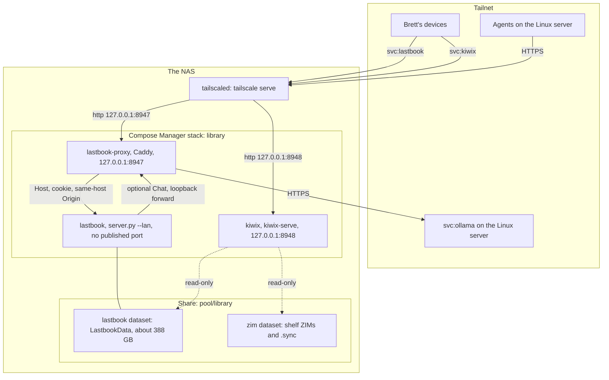
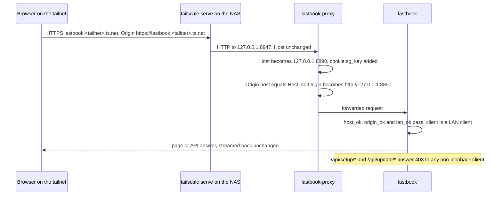
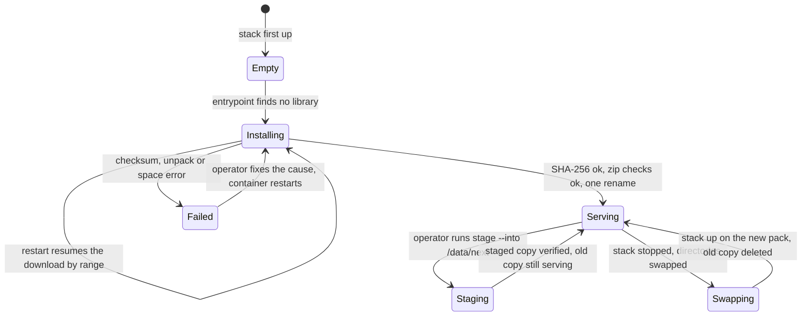
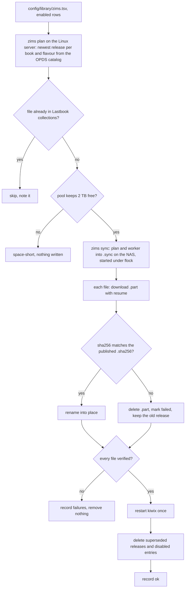

# Offline Library on the NAS - Plan

## Goal Capsule

- **Objective:** From any device on the tailnet, Brett and his agents can read the whole Lastbook survival library (its
  guides, manuals, videos, encyclopedias and nationwide US map) and a wider offline shelf led by the full English
  Wikipedia, all served from disks in the house, so reading never depends on an outside site staying up.
- **Means:** one Compose Manager stack, `library`, on the NAS: Lastbook's own library server built from a pinned
  upstream commit behind a small proxy, plus kiwix-serve for the Kiwix shelf, each on a NAS loopback port and its own
  Tailscale Service (KTD1, KTD2, KTD4, KTD5, KTD7).
- **Authority:** Brett's limits (R2, R3, R10) outrank every other line here. R-IDs decide behavior and KTDs decide
  mechanism. How Lastbook itself runs is decided by upstream's `docs/LIBRARY-SERVER.md`, `docs/SETUP-API.md` and
  `packaging/docker/README.md` at the pinned commit. The NAS rules in
  `docs/solutions/best-practices/nas-compose-apps-run-as-compose-manager-stacks-not-plain-projects.md` and
  `docs/solutions/best-practices/nas-docker-img-is-one-shared-file-so-gate-new-services-on-disk-too.md` bind every unit.
- **Execution profile:** one PR to `dev` holding U1 to U5, built by an agent slot. Six operator gates follow it (Gate A
  to Gate F in Build phases and gates). Every step that writes on the NAS or changes tailnet policy is an operator step
  (KTD14).
- **Stop conditions:** stop and report when Gate C's memory check fails; when the pinned commit's `packaging/docker/` no
  longer matches KTD2 and KTD3; when `manifest-v1.json` changes its `version` or the All pack's data-folder layout
  changes; when a step would publish a port on a LAN or public address; or when the pool's free space would fall below 2
  TB.
- **Who finishes:** a build slot writes and tests the PR. Brett creates the share, applies the tailnet policy, starts
  the stack, and turns on each optional shelf tier and Chat. Agents run only the read-only verbs: `status` and
  `zims plan`.

---

## Product Contract

### Summary

Lastbook is an MIT-licensed offline survival library for Mac, Windows and Linux desktops, first published at
lastbook.org on 2026-11-12. Its largest download, All, is 387.9 GB. This plan runs All on the NAS in the browser-facing
library server that upstream ships beside the desktop apps. It adds kiwix-serve for a curated, tiered shelf of Kiwix ZIM
collections, led by the full English Wikipedia without pictures that All already contains. Each service answers at a
tailnet-only HTTPS address and at a NAS loopback port. A repo script reports health and brings the Kiwix shelf in line
with a list kept in the repo. Lastbook's Chat can write cited answers with the Gemma model the Linux server already
serves.

### Problem Frame

Brett asked for a local copy of lastbook.org with its full library on the NAS, served as a Compose stack behind a
Tailscale Service with localhost access, and for the same treatment of full Wikipedia without media and other
preparedness datasets. Lastbook is a desktop app, not a website, so there is no hosted library to mirror: the library
ships as downloadable packs, and upstream's `server.py` serves a pack to a browser. A library like this earns its keep
when the sites it came from are gone, so every byte has to be on local disk and readable without the internet.

The NAS has room (13.7 TB free on its ZFS pool on 2026-11-16) but little memory: 7.5 GiB, about 2.1 GiB available, no
swap. Every container shares one 20 GiB `docker.img`. The plan has to keep 900 GB of downloads out of `docker.img` and
keep two new services from starving Plex, OpenSEO, LanguageTool and Postgres.

Upstream is four days old and moving fast: 31 commits since 2026-11-12 and no tags. Its server refuses any `Host` header
except `localhost` or an IP address. It serves a non-loopback client only after a one-time key. An open upstream PR, #33
(opened 2026-11-16, unreviewed), packages that server for Docker with a headless installer built on upstream's own setup
engine.

### Requirements

**Lastbook**

- R1. Lastbook's All pack is installed on the NAS and served by Lastbook's library server: its curated guides, 4,451
  PDFs, 3,819 saved web guides, 2,324 videos, four encyclopedias and nationwide US map, with keyword search across them.
- R2. Each service answers at one tailnet-only HTTPS address and at a loopback port on the NAS, and at no LAN or public
  address.
- R3. A reader, over the tailnet or the loopback port, cannot start, change, repair or delete a library install, and
  cannot run Lastbook's update check.
- R4. Agents on the Linux server can query both services over their tailnet addresses: Lastbook's search, retrieval and
  tool endpoints (`/api/find`, `/api/retrieve`, `/api/tools`, `/api/tool/<name>`) and kiwix-serve's search and OPDS
  catalog.
- R5. When Brett turns Chat on, it writes cited answers with the Gemma 4 26B A4B model the Linux server serves. While
  Chat is off or the model is unreachable, Chat lists the matching pages and everything else works.

**The Kiwix shelf**

- R6. The full English Wikipedia without pictures is served by kiwix-serve from the copy inside Lastbook's library, and
  no second copy is stored.
- R7. The shelf is a list in the repo, in tiers. Each entry names a Kiwix book and flavour and says why it is there. A
  sync brings the NAS in line with the enabled entries.
- R8. An entry takes the no-picture flavour when Kiwix publishes one, except where pictures carry the instructions
  (medicine, repair, knots, field manuals), which the list marks.
- R9. The large tiers (Survivor Library, all of English Gutenberg, Stack Overflow, world maps, Wikipedia with pictures)
  are in the list but stay off until Brett turns each on.

**Running it**

- R10. The stack never starves the NAS: bulk data lives on the ZFS pool and not in `docker.img`, each container has a
  memory cap, and the stack is measured under real use before it counts as done.
- R11. Every container shows in the Unraid Docker tab as part of the `library` stack, with autostart on.
- R12. Every download resumes after an interruption and is checked against its published SHA-256 before use. A working
  library or collection is never replaced until its successor checks out.
- R13. A newer Lastbook pack, a newer Lastbook release, and newer Kiwix releases each have an operator procedure that
  keeps the old copy serving until the new one verifies.
- R14. One read-only command reports whether both services answer locally and on the tailnet, the Lastbook install's
  progress, the shelf's sync state, and the NAS's memory, `docker.img` and pool headroom.

### Key Decisions

- **"Full size" is the All pack.** It is the largest pack in `manifest-v1.json` (published 2026-11-13) and already holds
  the whole US map, so it needs none of the 52 state maps. Lastbook's pack spec also defines two add-ons, Corporal's
  Corner videos (93.1 GB) and firearms and hunting (4.6 GB), which the manifest does not publish. Governs R1.
- **Compose is preferred, not required.** Brett, 2026-11-16: "docker compose isnt hard and fast. just preferred." The
  plan uses a Compose Manager stack because it fits this work best (KTD1, Alternatives Considered), not because it is
  mandated. Governs R11.
- **Tailnet and loopback only.** Brett asked for a Tailscale Service and localhost access. A LAN entry point for a day
  without internet is a separate decision and is deferred. Governs R2.
- **Readers cannot administer the library.** Installs, upgrades and repairs are operator actions, never browser actions.
  Governs R3.
- **Text first, pictures where they teach.** "Minus media" applies per collection, with the exceptions R8 names.
  Video-first Kiwix collections (TED, Khan Academy, Crash Course, the prepper channels) stay off the shelf, and
  Lastbook's 2,324 curated videos are the video shelf. Governs R8, R9.
- **The model stays on the Linux server.** The NAS cannot hold Gemma 4 26B A4B, which needs about 18 GB of memory, while
  the Linux server's RTX 3090 Ti already serves the same model. Governs R5.

### Success Criteria

- From Brett's Mac over the tailnet, `https://lastbook.<tailnet>.ts.net` opens, a search for "purify water" returns WHO
  and MSF pages, a cited PDF page opens at its page, a video plays and seeks, and the map shows streets and finds an
  address in any US state.
- `https://kiwix.<tailnet>.ts.net` lists every enabled shelf entry plus Lastbook's four encyclopedias, a Wikipedia
  article search returns results, and pages from Ready.gov and the DIY Stack Exchange open.
- An agent on the Linux server gets JSON from Lastbook's `/api/find?q=tourniquet` and from kiwix-serve's catalog, both
  over the tailnet addresses.
- Seven days after the core shelf is synced, including Gate C's load, the NAS keeps at least 1 GiB of memory available,
  `docker.img` is at most 75% used, and no container on the NAS was OOM-killed.

### Scope Boundaries

Considered and not built:

- **A LAN entry point.** Not requested, and it widens exposure to every LAN device. Brett asking for access during an
  internet outage would change this; see Deferred to Follow-Up Work.
- **Semantic search.** Packs ship no embedding model (`pack-spec.json` `vectors.ship: false`), PR #33's image leaves out
  onnxruntime, and embedding about 408,000 chunks on the NAS's CPU is a large one-off job for a smaller search gain.
  Measured keyword-search misses would change this.
- **Running the model on the NAS.** 7.5 GiB of RAM against a model that needs about 18 GB.
- **Library backups.** Every byte is public data that can be downloaded again while the internet is up. The real loss
  case, the internet gone and the NAS failing, is the cold copy under Deferred to Follow-Up Work.
- **Hot reload of the Kiwix library.** A restart takes seconds after a sync. Users complaining about the interruption
  would change this.
- **A scheduled shelf sync.** Run by hand until two syncs have run cleanly. Missed Kiwix releases would change this.
- **A wrapper verb for stack writes.** The `unraid-compose` skill's `stack-push.sh` and `stack-compose.sh` already plan,
  confirm and run them (KTD16).

Outside this product's identity:

- **Shadow libraries** (LibGen, Anna's Archive, Sci-Hub) and any collection whose distribution rights are doubtful.
- **Turnkey platforms that own a host** (Project N.O.M.A.D., Internet-in-a-Box, RACHEL). See Alternatives Considered.
- **Languages other than English.** Lastbook's search and chat are English-only (upstream issue #3), and Brett reads
  English.

### Deferred to Follow-Up Work

- **Offline LAN mode:** publish both services on the NAS's LAN address, behind Lastbook's own LAN key, for use when the
  tailnet cannot reach its control plane.
- **Cold copy:** a laptop or external drive holding Lastbook (desktop app over a copied data folder) and the core shelf,
  refreshed quarterly, for when the NAS has no power or fails.
- **Re-pin KTD2** from the fork commit to upstream `main` when PR #33 merges.
- **Lastbook add-on packs**, once the manifest publishes them.
- **Wikipedia XML dumps, an OpenStreetMap planet extract with routing, and a model-weights vault**: machine-readable
  sources for agents, each its own plan.
- **One shared error library** under `scripts/lib/` for `openseo`, `playwright-browsers` and `library`, which today each
  keep their own `errors.sh`.

### Sources

- lastbook.org: `/`, `/library/`, `/download/`, `/credits/` (read 2026-11-16).
- `https://downloads.lastbook.org/manifest-v1.json`, published 2026-11-13: All is one zip of 387,878,571,619 bytes,
  installed size 387,861,708,053 bytes, 12,864 records, SHA-256 `4b4ea73f…`, served from Cloudflare R2 with
  `accept-ranges: bytes`.
- Upstream source, `Immortal-Protocols/lastbook` at `aa8bc54` (MIT): `README.md`; `docs/LIBRARY-SERVER.md`;
  `docs/SETUP-API.md`; `engine/setup/README.md`; `derived/packs/pack-spec.json` (All: 231.75 GB of video, 80.5 GB of
  map, 61.75 GB of ZIMs including `wikipedia_en_all_nopic_2026-06.zim`, 12.3 GB of documents); `server.py` `host_ok`,
  `origin_ok`, `lan_ok` and `serve`; `engine/setup/api.py` `handle` and `engine/update.py` `handle`, each refusing
  non-loopback clients.
- Upstream PR #33, "Docker: run the library server in a container", head `30dc38181b94673129c53d84b01f386be2c6563d` on
  `mfbergmann/lastbook`: `packaging/docker/{Dockerfile,entrypoint.sh,headless_setup.py,compose.example.yml,README.md}`.
- Kiwix OPDS catalog, `https://library.kiwix.org/catalog/v2/entries?count=-1` (3,680 entries on 2026-11-16);
  `download.kiwix.org` serves a `.sha256` beside each ZIM and redirects to mirrors that support ranges.
- `kiwix/kiwix-tools` 3.8.2: `src/server/kiwix-serve.cpp` usage and `docker/server/start.sh`.
- kiwix-serve memory: https://github.com/kiwix/operations/issues/147 and https://github.com/kiwix/libkiwix/issues/1025.
- Project N.O.M.A.D.: https://github.com/Crosstalk-Solutions/project-nomad.
- Learnings: the two NAS best-practice files under Authority;
  `docs/solutions/configuration-fixes/ollama-403-host-header-caddy-proxy-2026-06-22.md`;
  `docs/solutions/configuration-fixes/tailscale-service-define-before-approve-2026-06-23.md`;
  `docs/solutions/configuration-fixes/tailscale-serve-off-keeps-a-host-advertising-so-drain-a-service-before-moving-it.md`.
- Read-only probe of the NAS, 2026-11-16: Unraid 7.2.8, 12 threads, 7.5 GiB RAM, about 2.1 GiB available, no swap, ARC
  capped near 0.94 GiB; ZFS pool `pool`, 13.7 TB available, compression off, 128K records; `docker.img` 20 GiB with 3.8
  GB used; Docker 29.5.3, Compose v5.5.0, buildx 0.34, git, curl, sha256sum, bsdtar, setsid, flock-capable util-linux;
  Compose Manager Plus 2026.10.07; loopback ports 8945 and 8946 taken, 8947 and 8948 free; Tailscale 1.104.4 serving
  `svc:languagetool`, `svc:openseo`, `svc:pinchflat`, `svc:postgres`.
- The Linux server's Ollama serves `gemma4:26b-a4b-it-q4_K_M` on an RTX 3090 Ti (24 GiB).

---

## Planning Contract

### How it runs

`lastbook` runs upstream's library server (`server.py --lan --no-index`) on a pack in `/data/LastbookData`. On its first
start, with no library, its entrypoint installs the All pack through upstream's setup engine, then serves. It publishes
no port. `lastbook-proxy` is the one way in: it forwards to `lastbook:8890`, so each reader reaches Lastbook as a LAN
client holding the key. `kiwix` serves the shelf's ZIMs and Lastbook's four encyclopedias. The NAS's own
`tailscale serve` maps each Tailscale Service to its loopback port. `scripts/library.sh` runs on the Linux server and
reaches the NAS over `ssh pool`.

### Key Technical Decisions

- KTD1. **One Compose Manager stack with three services.** `library` holds `lastbook`, `lastbook-proxy` and `kiwix`.
  kiwix reads Lastbook's ZIM files (R6), and all three share one share and one lifecycle, so they read as one row in the
  Docker tab. Separate stacks would only add independent restarts, which `docker restart` already gives. Unraid template
  containers were weighed and rejected (Alternatives Considered).
- KTD2. **The Lastbook image is built on the NAS from a pinned git commit.** The `lastbook` service's `build.context` is
  a git URL ending in a full 40-character commit SHA, with `dockerfile: packaging/docker/Dockerfile`. Until PR #33
  merges, the commit is the PR head `30dc381…` on `mfbergmann/lastbook`, whose five added files were read in full at
  that SHA. Once it merges, the commit is the upstream `main` commit that contains it. The image is tagged
  `library-lastbook:<first 12 of the SHA>`. Upstream publishes no image, a pinned SHA meets the supply-chain rule, and
  the NAS has git, Docker 29.5.3 and buildx 0.34 for a BuildKit git context. Rejected: vendoring a Dockerfile, which
  leaves a copy to keep in step with a fast-moving upstream. Rejected: a GHCR image built by a workflow here, which adds
  a public image carrying GPL components (python-libzim) and a pipeline this config repo has no other use for. Whether
  the fork commit is acceptable is Open Question 1.
- KTD3. **Install and upgrade use upstream's own setup engine.** `LASTBOOK_PACK=all`. The entrypoint runs
  `headless_setup.py install` when `/data/LastbookData` holds no library. That engine checks the zip's SHA-256 against
  the manifest, refuses unsafe zip paths and sizes, resumes a stopped download by range with an ETag check, unpacks
  beside the target, and switches with one rename. The entrypoint also refuses a data folder holding
  `library-data/tools/`. Upgrades use `headless_setup.py status` and `stage --into` (KTD12). Peak space for the install
  is the download plus the installed size plus 2 GB, about 778 GB. Rejected: a curl-and-unzip path, which would re-solve
  every one of those checks.
- KTD4. **Every reader reaches Lastbook as a LAN client, through the proxy.** `lastbook` runs with `--lan`, as PR #33's
  entrypoint already does, and publishes no port. `lastbook-proxy` (Caddy) forwards to `lastbook:8890` and does exactly
  three things to each request:
  1. It sets `Host` to `127.0.0.1:8890`, which `host_ok` accepts.
  2. It sends the cookie `sg_key=<LAN key>`, which `lan_ok` accepts.
  3. It rewrites `Origin` to `http://127.0.0.1:8890` only when the Origin's host equals the request's `Host`. Any other
     Origin passes through unchanged, so `origin_ok` still refuses a cross-site POST.

  Responses, streaming and `Range` requests pass through untouched. Lastbook's redirects are path-relative, so they survive the `Host` rewrite. Setup and update answer non-loopback clients with 403, so R3 holds by upstream's own rule. Rejected: running Caddy in Lastbook's network namespace, which turns every request into loopback with setup rights and leaves R3 to a proxy deny-list that must track upstream's routes. Rejected: upstream's own LAN link, which refuses host names (no `ts.net` address) and needs a LAN-facing port.
- KTD5. **Loopback ports 8947 and 8948, and one Tailscale Service each.** `lastbook-proxy` publishes `127.0.0.1:8947`,
  and `kiwix` publishes `127.0.0.1:8948`. `svc:lastbook` and `svc:kiwix` on `tcp:443` are defined, granted to
  `autogroup:member` and the Linux server's tag, auto-approved for the NAS's tag, and bound on the NAS with
  `tailscale serve --service=svc:<name> --https=443 http://127.0.0.1:<port>`. This follows the OpenSEO runbook's Tailnet
  policy steps and the NAS's existing `svc:pinchflat` (8945) and `svc:openseo` (8946). Loopback access from the Linux
  server is `ssh -L 8947:127.0.0.1:8947 pool`, and the same for 8948.
- KTD6. **Data lives on a new pool share with tuned datasets.** A new Unraid share `library` lives on the ZFS pool only,
  which makes the dataset `pool/library` with `compression=lz4`. Under it, `pool/library/lastbook` keeps 128K records,
  because the map's SQLite reads are small and random. `pool/library/zim` uses `recordsize=1M`, because ZIM clusters are
  read whole. Both are created before any data lands, since record size applies only to new writes. Every bind mount
  uses long syntax with `create_host_path: false`: if the pool is not mounted, the container fails to start instead of
  writing 388 GB into the NAS's RAM-backed root filesystem. Creating the share in the Shares tab keeps it visible there,
  which matches Brett's preference for the Docker tab.
- KTD7. **kiwix-serve reads two read-only trees.** `ghcr.io/kiwix/kiwix-serve:3.8.2` is pinned by digest. It mounts
  `pool/library/zim` at `/zim/shelf` and the Lastbook data root at `/zim/lastbook`, both read-only, and serves `*.zim`
  from the shelf and from `LastbookData/library-data/collections/`. It runs with `--nodatealiases`, so URLs stay stable
  across releases, and `--skipInvalid`, so a bad file is skipped and does not stop the server. Mounting the data root
  rather than the collections folder lets kiwix start before the Lastbook install finishes and survive a pack swap. A
  container restart picks up new or replaced files. Rejected: a library XML with `--monitorLibrary`, which needs a
  writable XML and `kiwix-manage` calls to avoid a restart that takes seconds.
- KTD8. **The shelf is a list resolved against Kiwix's catalog at sync time.** `config/library/zims.tsv` holds five
  columns per row: tier, enabled, book, flavour and why. `zims plan` fetches the OPDS catalog, takes the newest release
  of each enabled book and flavour, and skips any book whose file is already in Lastbook's `collections/` (R6). It then
  prints downloads, removals and sizes, and whether the pool would keep 2 TB free. Following Kiwix's newest release
  matches Brett's choice to follow OpenSEO's rolling tag. Rejected: pinning dated file names, which costs a PR per Kiwix
  release for content that is only ever replaced by its newer self.
- KTD9. **The sync runs on the NAS, detached, and is started from the Linux server.** `zims sync` resolves the plan on
  the Linux server, writes the plan and a worker script into `pool/library/zim/.sync/`, and starts the worker on the NAS
  with `setsid nohup` under `flock`. The worker outlives the ssh session, and a second sync is refused. The worker
  handles each file in three steps:
  1. Download to `<name>.zim.part` with resume, following download.kiwix.org's mirror redirects.
  2. Check the file against the `.sha256` published beside it.
  3. Rename it into place.

  When every download has verified, it restarts the `kiwix` container once, then deletes superseded releases and the files of disabled entries. It records state and a log in `.sync/`. Rejected: a one-shot service in the stack, whose script would have to live inside `compose.yaml` and which the Compose tab cannot start on its own. Rejected: downloading on the Linux server and copying, which moves every byte twice.
- KTD10. **Every container has a memory cap and bounded caches.** Starting caps are 1 GiB for `lastbook`, 128 MiB for
  `lastbook-proxy` and 768 MiB for `kiwix`. kiwix gets bounded `KIWIX_ARCHIVE_CACHE_SIZE` and
  `KIWIX_SEARCHER_CACHE_SIZE` and a `--searchLimit`. `lastbook` runs `--no-index`: packs ship no embedding model, so its
  five-minute semantic-index loop has nothing to do. Gate C reads each container's `memory.peak` after a load that began
  after its last restart, and sets the final caps. The NAS has about 2.1 GiB available and no swap. kiwix-serve's caches
  are bounded only by count, and Kiwix reports about 10 GB of growth in 3.5 days on library.kiwix.org (libkiwix#1025,
  kiwix/operations#147). With a cap, an overrun kills the offending container instead of Plex.
- KTD11. **Chat goes through the proxy to `svc:ollama`.** Chat is off by default. When the stack's `.env` sets the three
  Chat values, Lastbook's entrypoint forwards `127.0.0.1:11434` inside its container to an internal port on
  `lastbook-proxy`. That port is not published. The proxy forwards it over HTTPS to `svc:ollama`, and the Linux server's
  loopback Caddy there already clears Ollama's `Host` 403. The model is `gemma4:26b-a4b-it-q4_K_M`: the same Gemma 4 26B
  A4B at the same 4-bit level as Lastbook's pin, though it is Ollama's build, not Unsloth's `UD-Q4_K_M` file. Lastbook
  keeps its rule that the assistant talks only to loopback. Turning Chat on also needs a grant from the NAS's tag to
  `svc:ollama`. Rejected: Lastbook's local runner on the NAS, which needs about 18 GB of memory.
- KTD12. **Each kind of update has its own path.** For new Lastbook code, a PR moves KTD2's SHA, then the operator
  rebuilds and recreates the stack. For Kiwix and Caddy, a PR moves the digest. For a new Lastbook pack:
  1. `headless_setup.py status`, run through `docker exec`, reports `update_available`.
  2. `stage --into /data/next` builds the new library beside the old one, about 776 GB more at peak.
  3. With the stack stopped, the operator swaps the two directories, starts the stack, and deletes the old copy only
     once the new one serves.

  The Compose tab's Update has nothing to pull for `lastbook`. Gate B records what pressing it does, and the runbook says so.
- KTD13. **The stack keeps one secret.** It is the LAN key, which the operator generates at the first stack write and
  keeps in the stack's `.env` on the flash drive, root-only by the flash's mount mode. Both `lastbook`
  (`LASTBOOK_LAN_KEY`) and `lastbook-proxy` read it. It has no 1Password item: it guards nothing outside the stack's own
  network, and a lost key is replaced by writing a new one and recreating the stack.
- KTD14. **The operator writes and agents read.** The operator runs the share and dataset setup, tailnet policy, stack
  writes and starts, `tailscale serve`, `zims sync`, pack swaps and turning Chat on. Agents run `status` and
  `zims plan`. This is the OpenSEO runbook's split.
- KTD15. **`scripts/library.sh` reports in the repo's error contract.** It has three verbs: `status`, `zims plan` and
  `zims sync`. Output is text by default, or one JSON object with `--output json`. Each error carries `reason` (a closed
  kebab-case set), `exit_code`, `message`, `value`, `next_step` (`action` from `run-command`, `ask-operator`, `retry` or
  `none`, plus `command` and `docs`), and `checks` and `notes`. It is modeled on `scripts/openseo/lib/errors.sh`.
  `status` reads the install's progress from upstream's setup job file under the data share, so it needs no docker call.
- KTD16. **Stack writes use the `unraid-compose` skill.** The runbook creates and updates the stack with
  `stack-push.sh --name library --autostart --webui ...` and starts it with `stack-compose.sh library up`. Both print a
  plan first and act only with `--yes`. The `--webui` values carry the tailnet addresses, so the tailnet name never
  enters this public repo. Rejected: a deploy verb here, which would copy the skill's staging, labeling and `compose.sh`
  handling, as `scripts/openseo/lib/stack.sh` did before the skill existed.

### High-Level Technical Design

Topology:



A reader's request through the proxy:



Lastbook's data folder over its life:



One shelf sync:



### Output Structure

```text
config/library/
  compose.yaml            three services, the Caddyfile as an inline config
  compose.override.yaml   Compose Manager labels for each service
  env.example             the .env keys, with no values
  zims.tsv                the shelf: tier, enabled, book, flavour, why
scripts/library.sh        status, zims plan, zims sync
scripts/library/lib/      errors.sh, nas.sh, status.sh, zims.sh
scripts/library/remote/   zim-sync.sh, the worker the NAS runs
tests/library-stack.bats
tests/library-status.bats
tests/library-zims.bats
tests/fixtures/library/   catalog snapshot, job files, a header-echo server
docs/runbooks/library.md
```

### System-Wide Impact

- **NAS memory:** three more capped containers on a host with about 2.1 GiB available (KTD10). This is the binding
  constraint, and a RAM upgrade is already in the vault's infrastructure backlog.
- **`docker.img`:** about 0.5 GB of images (an estimate until Gate B measures it) plus BuildKit cache from building on
  the NAS. The runbook prunes the build cache after each build.
- **Pool disk and drives:** about 498 GB at rest with the core shelf, with a peak near 778 GB plus the shelf during the
  first install, against 13.7 TB free. The three HC520 drives are about six years old in raidz1 and hold the only local
  copy.
- **Internet link:** about 388 GB for Lastbook and 110 GB for the core shelf, each over hours, shared with Plex and the
  rest of the house.
- **Tailnet policy:** two new services, their grants and autoApprovers, and for Chat a grant from the NAS's tag to
  `svc:ollama`.
- **The Linux server's GPU:** Chat shares Ollama with the embedding models qmd uses. The 26B model takes about 18 GB of
  the card's 24 GiB while it is loaded.

### Assumptions

- "Localhost access" means a loopback port on the NAS, as `svc:openseo` and `svc:pinchflat` have, reached from the Linux
  server with `ssh -L`.
- "Full size db" means Lastbook's All pack, the largest the manifest publishes.
- The collections are English-only.
- The names are `library` for the stack, `svc:lastbook` and `svc:kiwix` for the services, and 8947 and 8948 for the
  loopback ports.
- The house's internet link can carry about 1 TB over a few days with no data cap.
- The tailnet's `tailscale serve` passes the original `Host` to the backend. KTD4 rewrites `Host` either way, so this
  only matters for `status`'s messages.

### Risks

| Risk                                                                     | Mitigation                                                                                                                                      |
| ------------------------------------------------------------------------ | ----------------------------------------------------------------------------------------------------------------------------------------------- |
| Upstream churn breaks the pinned build or changes the data-folder layout | The SHA is pinned and moved only by PR; layout changes are a stop condition; Gate B's checks run again after every bump                         |
| PR #33 changes, stalls or is rejected                                    | The pinned fork SHA keeps building; re-pin on merge (deferred); if rejected, Brett decides between vendoring its five files and dropping Docker |
| Trusting a fork commit                                                   | Immutable SHA; its five files were read in full; the code sees only the library share and the network                                           |
| NAS memory runs out                                                      | Per-container caps (KTD10), the Gate C measurement, and a stop condition; the RAM upgrade is in the vault backlog                               |
| kiwix-serve memory grows with uptime and with large ZIMs                 | Count-bounded caches, `--searchLimit`, the cap, and `restart: unless-stopped`; Gate F re-measures after each large tier                         |
| BuildKit cache fills `docker.img`                                        | The runbook prunes the build cache after each build; `status` fails above 75% used                                                              |
| The install stops partway                                                | Upstream resumes by range with an ETag check, and the restart policy restarts it                                                                |
| A drive fails during or after the install                                | raidz1 survives one disk; the cold copy is deferred and named in the runbook                                                                    |
| Containers cannot resolve or reach `svc:ollama`                          | Gate E checks it; the runbook gives the fallback of the service's tailnet address with an explicit TLS server name                              |
| Upstream adds an admin route that LAN clients can reach                  | Gate B's 403 checks through the proxy run again after every SHA bump                                                                            |
| ZIM licences                                                             | Wikimedia content is CC BY-SA and the rest is mostly public domain or CC; it is served only inside the tailnet and never redistributed          |

### Open Questions

1. **Build from the PR #33 fork commit now, or wait for upstream to merge it?** Recommendation: build from the fork
   commit now (KTD2). It is an immutable SHA, its five files were read in full, and it reaches upstream's own setup
   engine, while waiting leaves the NAS empty for an unknown time. This blocks Gate B only.
2. **Which large tiers, if any, should start enabled?** Recommendation: none. Sync the core tiers first (about 110 GB),
   then add Survivor Library (220 GB), which is the classic preparedness collection, once Gate C's numbers are in. This
   blocks only Gate F.

### Build phases and gates

| Step   | Who                                 | What                                                                                                                                                                                                   | Pass                                                                                                                                                                                                               |
| ------ | ----------------------------------- | ------------------------------------------------------------------------------------------------------------------------------------------------------------------------------------------------------ | ------------------------------------------------------------------------------------------------------------------------------------------------------------------------------------------------------------------ |
| PR1    | build slot                          | U1 to U5                                                                                                                                                                                               | CI green, reviews logged, merged to `dev`                                                                                                                                                                          |
| Gate A | Brett                               | Create the `library` share on the pool in the Shares tab (no SMB export) and the two child datasets with their properties (KTD6); define, grant and auto-approve `svc:lastbook` and `svc:kiwix` (KTD5) | `zfs get` shows the properties; `ts-api.sh service-get` lists both services                                                                                                                                        |
| Gate B | Brett                               | Generate the `.env` (KTD13), push and start the stack (KTD16), wait for the All install, bind both services, prune the build cache                                                                     | `scripts/library.sh status` exits 0; the first three Success Criteria hold; through the proxy, `/api/setup/state` answers 403 and a POST with a foreign Origin answers 403; Update's effect on `lastbook` recorded |
| Gate C | Brett                               | The load: 20 guides opened, 3 videos played and sought, the map panned in 3 states, 30 searches on each service including a multi-ZIM search; then each container's `memory.peak`                      | Each peak stays under its cap with at least 25% margin and 1 GiB stays available; final caps go back to the repo by PR if they changed                                                                             |
| Gate D | Brett                               | `zims plan`, read the plan, then `zims sync` for the core tiers                                                                                                                                        | `status` shows the shelf in sync; the second Success Criterion holds                                                                                                                                               |
| Gate E | Brett, optional                     | Grant the NAS's tag to `svc:ollama`, set the three Chat values, recreate                                                                                                                               | A Chat question returns an answer citing library pages                                                                                                                                                             |
| Gate F | Brett, optional, one tier at a time | Enable a large tier, then plan, sync and re-measure kiwix                                                                                                                                              | Gate C's memory rule still holds                                                                                                                                                                                   |

The seven-day soak in Success Criteria starts after Gate D.

### Alternatives Considered

- **Unraid template containers instead of a stack.** These are also managed in the Docker tab. Rejected because a
  template cannot build from a git context or carry an inline proxy config, and three templates would each repeat the
  share paths and the LAN key.
- **Project N.O.M.A.D.** (Crosstalk Solutions, Apache-2.0: Kiwix, Ollama, ProtoMaps, Kolibri). Rejected because its
  installer owns `/opt/project-nomad` on a Debian-family host and its Command Center manages its own containers. My
  inference, not tested: on Unraid those containers would show as third-party, and it does not serve Lastbook.
- **Internet-in-a-Box or RACHEL.** Both want a dedicated host, usually a Raspberry Pi or a Debian install, and neither
  serves Lastbook.
- **An Ubuntu VM on the NAS running Lastbook's `.deb`.** Rejected because a VM needs its own memory on an 8 GB host, and
  the `.deb` is a desktop app that needs a display.
- **Patching `host_ok` in a fork.** Rejected: it carries a patch against a fast-moving upstream, and KTD4 gets the same
  effect with no code change.
- **Our own installer (curl, sha256sum, unzip).** Rejected because it re-solves resume, ETag, zip-safety and
  atomic-switch checks that upstream already tests (KTD3).

---

## Implementation Units

### U1. The stack definition

**Goal:** `config/library/` describes the whole stack, so a `stack-push.sh` of that folder plus a `.env` yields R1, R2,
R3, R6 and R11.

**Requirements:** R1, R2, R3, R5, R6, R10, R11, R12.

**Dependencies:** none.

**Files:**

- `config/library/compose.yaml`
- `config/library/compose.override.yaml`
- `config/library/env.example`
- `tests/library-stack.bats`
- `tests/fixtures/library/echo-headers.py`

**Approach:**

1. Write `lastbook` per KTD2, KTD3 and KTD10: the git build context pinned to the full SHA, the image tag,
   `user: "99:100"` (Unraid's `nobody:users`), the data bind mount, `LASTBOOK_PACK=all`, `LASTBOOK_LAN_KEY`, the three
   Chat variables defaulting to empty, `command: ["--no-index"]`, the memory cap, `restart: unless-stopped`, and no
   `ports`.
2. Write `lastbook-proxy` per KTD4 and KTD11. Pin a Caddy Alpine image by digest. Its Caddyfile is a top-level `configs`
   entry with inline `content`, so it travels inside `compose.yaml` through `stack-push.sh`. Turn off admin and
   automatic HTTPS, use tmpfs for Caddy's data and config, publish `127.0.0.1:8947`, run the internal Chat listener that
   answers 503 when no upstream is set, and set the memory cap.
3. Write `kiwix` per KTD7 and KTD10: the image pinned by digest, the two read-only mounts, the flags and cache
   variables, `127.0.0.1:8948`, a healthcheck, and the memory cap.
4. Mirror `config/openseo/compose.override.yaml` in the override: `net.unraid.docker.managed: composeman` and empty
   icon, webui and shell labels for every service. `stack-push.sh --webui` fills the webui labels at create time
   (KTD16).
5. In `env.example`, name every key `.env` takes, each with a one-line purpose and no value.

**Patterns to follow:** `config/openseo/compose.override.yaml`; the label checks in `tests/openseo-deploy.bats`;
`tests/lib/processes.bash` (`spawn`, `stop_spawned`, `assert_no_leaks`) for the proxy test's background processes.

**Test scenarios:**

- The override's service names equal `compose.yaml`'s, and every service carries
  `net.unraid.docker.managed: composeman`.
- Every published port binds `127.0.0.1`, and the only published ports are 8947 on `lastbook-proxy` and 8948 on `kiwix`.
- `lastbook` has no `ports` key.
- Every bind mount uses long syntax with `create_host_path: false` and a source under `/mnt/pool/library/`, and both of
  `kiwix`'s mounts are read-only.
- Every service sets a memory limit.
- Every pulled image carries `@sha256:`, and the `lastbook` build context ends in `#` plus 40 hex characters.
- `docker compose config` over both files with `env.example`'s keys set to sample values exits 0. It skips with an
  install hint when `docker compose` is missing.
- With `caddy` on `PATH`, the inline Caddyfile runs against `echo-headers.py`, and the echo shows: `Host` is
  `127.0.0.1:8890`; the cookie is `sg_key=<sample key>`; a same-host Origin arrives as `http://127.0.0.1:8890`; a
  foreign Origin arrives unchanged; a `Range` header arrives unchanged. It skips when `caddy` is missing. This seam
  proves the proxy's header handling, not Lastbook's response to it, which Gate B checks live.

**Verification:** the stack definition passes its suite. A `stack-push.sh` plan run against the NAS (Gate B) reads
`mode: create` with no unlabeled services.

### U2. The shelf list

**Goal:** `config/library/zims.tsv` is the reviewable statement of R7 to R9.

**Requirements:** R6, R7, R8, R9.

**Dependencies:** none.

**Files:**

- `config/library/zims.tsv`
- `tests/library-zims.bats`, covering the list

**Approach:**

1. One row per Kiwix book and flavour, in the tiers and members of Appendix A. The `why` column says what each entry is
   for, and for a picture-keeping entry, why its pictures matter (R8).
2. Every `core-*` row is enabled and every `big-*` row is disabled (R9). The `big-gutenberg-all` row's `why` says it
   replaces the `core-books` tier.
3. Lastbook's four encyclopedias are not listed. `zims plan` finds them in Lastbook's `collections/` (R6).

**Test scenarios:**

- Every row has exactly five tab-separated fields.
- Every tier is one of the tiers in Appendix A.
- `enabled` is `yes` or `no`.
- Every book matches `^[a-z0-9._-]+$`.
- Every flavour is one of `nopic`, `maxi`, `mini` or `-`.
- No book and flavour pair appears twice.
- Every `big-*` row is disabled.

**Verification:** the list passes its suite, and `zims plan` (U4) resolves every enabled row against the live catalog at
Gate D.

### U3. `status`

**Goal:** `scripts/library.sh status` answers R14 for Brett and for agents, read-only.

**Requirements:** R4, R10, R14.

**Dependencies:** U1.

**Files:**

- `scripts/library.sh`
- `scripts/library/lib/errors.sh`
- `scripts/library/lib/nas.sh`
- `scripts/library/lib/status.sh`
- `tests/library-status.bats`
- `tests/fixtures/library/` (job files)

**Approach:**

1. The dispatcher parses `status`, `zims plan`, `zims sync` and `--output json`, and prints usage when given no verb.
2. `errors.sh` follows KTD15's envelope, with `docs` pointing to the runbook's reason anchors.
3. `nas.sh` makes every NAS call one `ssh pool` with `-o BatchMode=yes -o ConnectTimeout=10`. `LIBRARY_NAS_SSH`
   overrides the alias, as `OPENSEO_NAS_SSH` does.
4. `status.sh` runs its checks in this order and stops at the first failure: NAS reachable; the install's state from
   upstream's job file, then the stamp file once installed; the proxy's `/api/health` on 8947; kiwix on 8948; both serve
   bindings; both tailnet addresses from the Linux server, with the suffix read from `tailscale status --json`;
   available memory at least 1 GiB; `docker.img` at most 75% used; `pool/library` at least 2 TB available; the shelf's
   last sync state.
5. Notes that do not fail the run: a newer published pack, an empty shelf, and Chat being off.

**Patterns to follow:** `scripts/openseo-deploy.sh` and `scripts/openseo/lib/{errors,nas,status}.sh`; the `tailscale`
and `curl` stubs in `tests/openseo-deploy.bats`.

**Test scenarios:**

- Everything healthy: exit 0, the text names each check as ok, and the JSON `reason` is `ok` with every check present.
- ssh exits 255: `nas-unreachable`, exit 1, with a `next_step.command` that reruns the probe.
- The job file shows `downloading` at 40%: `lastbook-installing`, exit 1, action `retry`, and the message carries the
  percentage and rate.
- The job file shows `failed` with code `checksum`: `lastbook-install-failed`, carrying upstream's error sentence.
- The proxy answers 502: `lastbook-down`.
- kiwix refuses the connection: `kiwix-down`.
- `tailscale serve status` lacks `svc:kiwix`: `not-served`, with the exact bind command.
- Loopback answers but the tailnet address times out: `address-unreachable`.
- `MemAvailable` reads 700 MiB: `low-memory`.
- `docker.img` is 80% used: `docker-img-full`.
- The pool has 1.5 TB available: `pool-low`.
- The stamp's SHA-256 differs from the manifest's: exit 0, with an `update-available` note.
- The shelf's state file reads `failed`: `sync-failed`, naming the log path.
- An unknown verb or flag: `usage`, exit 2.
- `--output json` prints exactly one JSON object on stdout in every case above.

**Verification:** the suite passes, and at Gate B `status` exits 0 against the live NAS.

### U4. `zims plan` and `zims sync`

**Goal:** the shelf on the NAS matches the enabled rows, by R7 and R12's rules.

**Requirements:** R6, R7, R9, R12, R13.

**Dependencies:** U2, U3.

**Files:**

- `scripts/library/lib/zims.sh`
- `scripts/library/remote/zim-sync.sh`
- `tests/library-zims.bats`
- `tests/fixtures/library/` (catalog snapshot)

**Approach:**

1. `zims plan` (read-only, per KTD8) fetches the catalog, resolves each enabled row, lists the NAS's shelf and
   Lastbook's `collections/` over one ssh call, and prints downloads, skips, removals, total bytes and the pool's free
   space after downloading.
2. `zims sync` (per KTD9) recomputes the plan, refuses on any plan error, writes the plan and worker to `.sync/` in one
   ssh call, starts the worker detached, and prints the log path and the `status` command to follow it.
3. The worker is bash run by the NAS's own shell. It does per-file download, check and rename; then one restart of
   `library-kiwix-1`; then removals, only when every download verified; with state written after each file.

**Execution note:** test the worker against a sandbox directory with stubbed `curl`, `sha256sum` results and `docker`,
never against the NAS.

**Test scenarios:**

- The catalog lists two releases of one book and flavour: the plan picks the newer.
- An enabled row's file already exists in the fixture `collections/`: it is skipped with a note and not downloaded.
- The NAS holds an older release of a planned book and a file from a disabled row: both appear under removals.
- Downloads would leave 1.9 TB free: `space-short`, exit 1, nothing written.
- An enabled row is missing from the catalog: `book-not-found`, naming the row.
- The catalog fetch fails: `catalog-unreachable`.
- `.sync/lock` is held: `zims sync` exits 1 with `sync-running`.
- The worker meets a matching SHA-256: the `.part` file becomes `<name>.zim`, and the state reads `ok` for that file.
- The worker meets a mismatched SHA-256: no `<name>.zim` appears, the `.part` is deleted, the old release stays, and the
  state reads `failed`.
- A `.part` file already exists: the stubbed `curl` is called with resume.
- Every file verifies: the `docker` stub is called once with `restart library-kiwix-1`, before any removal.
- One file fails: no removal happens, and kiwix is still restarted when another file did change.

**Verification:** the suite passes, and at Gate D one plan-then-sync brings `status`'s shelf check to ok.

### U5. Runbook and repo docs

**Goal:** an operator can run every gate from the runbook alone, and the repo's maps name the new pieces.

**Requirements:** R2, R3, R11, R13, R14.

**Dependencies:** U1, U2, U3, U4.

**Files:**

- `docs/runbooks/library.md`
- `AGENTS.md`, a section beside OpenSEO's
- `README.md`, the tree lines for `config/library/` and `scripts/library.sh`

**Approach:**

1. Runbook sections:
   1. What runs where.
   2. Who runs what (KTD14).
   3. One-time setup: the share and datasets, and tailnet policy, citing the OpenSEO runbook's Tailnet policy steps
      instead of copying them.
   4. First deploy: `.env`, push, up, watching the install with `status`, binding, pruning the build cache, and the Gate
      B checks.
   5. Gate C's load.
   6. The shelf: plan, sync, turning on a large tier.
   7. Chat.
   8. Updates per KTD12, including what the Compose tab's Update does.
   9. Stopping and draining a service.
   10. One troubleshooting anchor per `reason`.
2. Describe present behavior only, with no history, per the repo's prose rules.

**Test expectation:** none. This unit is documentation; the U3 and U4 suites hold each `docs` anchor to a heading that
exists.

**Verification:** every `reason` in `errors.sh` has a matching runbook heading, and a reader can run Gate B from the
runbook without opening this plan.

---

## Verification Contract

| Check              | Command                                                                                          | Runs at                           |
| ------------------ | ------------------------------------------------------------------------------------------------ | --------------------------------- |
| ShellCheck         | `scripts/lint-shell` (staged paths, or `--all`)                                                  | pre-commit, pre-push, CI          |
| Bats               | `scripts/run-tests`, which picks up `tests/library-*.bats`                                       | pre-commit (staged), pre-push, CI |
| Core-env guard     | `scripts/core-env-guard.sh`                                                                      | pre-push, CI                      |
| Bash version guard | `tests/bash-version-guard.bats` holds any bash 4 construct in the new scripts to the guard block | pre-push, CI                      |
| Live checks        | each gate's Pass column in Build phases and gates                                                | Gates A to F                      |

`docker compose config` and the Caddy header test run in `tests/library-stack.bats` and skip with an install hint when
their tool is missing. CI has Docker, so the compose check runs there. CI has no Caddy, so the header test runs at the
Linux server's pre-push and is checked live at Gate B.

---

## Definition of Done

- PR1 is merged to `dev` with green CI, its reviews logged here and in PR comments.
- Gates A to D have passed with their evidence (status JSON, `memory.peak` readings) in PR1's comments, and Gates E and
  F have run or are explicitly left off by Brett.
- Every Success Criterion holds at the end of the seven-day soak.
- The final memory caps in `config/library/compose.yaml` are the Gate C values.
- The diff holds no abandoned approach, scratch file or unused fixture.

---

## Review log

| #   | Review | Of  | Model, effort | Started (UTC) | Finished (UTC) | Verdict |
| --- | ------ | --- | ------------- | ------------- | -------------- | ------- |

---

## Appendix

### A. The shelf at planning time

Sizes come from the Kiwix catalog on 2026-11-16. `zims plan` reads the current ones.

| Tier                                        | Enabled | Members (book, flavour)                                                                                                                                                                                                                                                                                                         | Size     |
| ------------------------------------------- | ------- | ------------------------------------------------------------------------------------------------------------------------------------------------------------------------------------------------------------------------------------------------------------------------------------------------------------------------------- | -------- |
| `core-reference`                            | yes     | `wiktionary_en_all` nopic; `wikisource_en_all` nopic; `wikiversity_en_all` nopic; `wikiquote_en_all` nopic; `wikispecies_en_all` nopic; `wikivoyage_en_all` nopic; `wikipedia_en-simple_all` nopic; `theworldfactbook_en_all`                                                                                                   | 24.2 GB  |
| `core-medicine` (pictures kept)             | yes     | `wikipedia_en_medicine` maxi; `medlineplus.gov_en_all`; `quickguidesformedicine_en_all`; `nhs.uk_en_medicines`; `librepathology_en_all` maxi; `irp.fas.org_en_military-medicine`; `zimgit-medicine_en`                                                                                                                          | 4.6 GB   |
| `core-preparedness`                         | yes     | `ready.gov_en_all`; `zimgit-post-disaster_en`; `zimgit-water_en`; `zimgit-food-preparation_en`; `zimgit-knots_en`; `usda-2015_en`; `wikipedia_en_knots` maxi; `cd3wdproject.org_en_all`; `energypedia_en_all` maxi; `solar.lowtechmagazine.com_mul_all`; `armypubs_en_all`; `ifixit_en_all`; `gardenology_en_all`               | 16.9 GB  |
| `core-stem`                                 | yes     | LibreTexts `bio`, `chem`, `eng`, `geo`, `med`, `phys`, `math`, `stats`, `workforce`; `phet_en_all`; `wikipedia_en_chemistry`, `wikipedia_en_physics`, `wikipedia_en_mathematics` maxi                                                                                                                                           | 12.0 GB  |
| `core-qa`                                   | yes     | Stack Exchange: diy, electronics, gardening, cooking, ham, outdoors, sustainability, mechanics, engineering, chemistry, physics, biology, medicalsciences, woodworking, homebrew, bicycles, earthscience, crafts, pets, 3dprinting, arduino, raspberrypi, unix, askubuntu, superuser, serverfault, networkengineering, security | 23.0 GB  |
| `core-books`                                | yes     | Project Gutenberg by Library of Congress class: S (agriculture), T (technology), Q (science), R (medicine), U (military), V (naval)                                                                                                                                                                                             | 29.1 GB  |
| `big-survivorlibrary`                       | no      | `survivorlibrary.com_en_all`                                                                                                                                                                                                                                                                                                    | 220.4 GB |
| `big-gutenberg-all` (replaces `core-books`) | no      | `gutenberg_en_all`                                                                                                                                                                                                                                                                                                              | 221.3 GB |
| `big-stackoverflow`                         | no      | `stackoverflow.com_en_all`; `math.stackexchange.com_en_all`                                                                                                                                                                                                                                                                     | 122.3 GB |
| `big-world-maps`                            | no      | `maps_en_all`                                                                                                                                                                                                                                                                                                                   | 77.7 GB  |
| `big-wikipedia-pictures`                    | no      | `wikipedia_en_all` maxi                                                                                                                                                                                                                                                                                                         | 127.4 GB |

The core tiers total about 110 GB. Lastbook's All already supplies `wikipedia_en_all_nopic_2026-06` (52.7 GB, the newest
nopic release on 2026-11-16), `wikibooks_en_all_maxi_2026-04`, `mdwiki_en_all_maxi_2025-11` and
`appropedia_en_all_maxi_2026-02`.

Collections left off on purpose: video-first ones (TED at 91 GB, Khan Academy at 180 GB from 2023, Crash Course, and the
Canadian Prepper, Urban Prepper, S2 Underground and Learning Self-Reliance channels); `wikipedia_en_top1m` and
`wikipedia_en_all` mini, which the full nopic copy covers; and entertainment wikis.

### B. Lastbook facts the plan rests on

- A pack is a data folder. `LASTBOOK_DATA` points at it, and `derived/` must be writable for caches, logs and the LAN
  key.
- Packs ship the keyword index `library-data/search.sqlite` and the map set `derived/geo/`, but no embedding model.
- `server.py` serves Range requests for videos and renders PDF pages with pypdfium2. It reads ZIMs with libzim at
  `/zim/<name>/`.
- Non-loopback clients get the app, its APIs, the encyclopedias and the library folders, but no worker state, logs,
  databases or directory listings (`docs/LIBRARY-SERVER.md`, "Sharing with phones on the same network").
- The assistant calls an OpenAI-compatible `/v1/chat/completions` with tools and streaming at `SURVIVAL_MODEL_BASE`,
  which must be a loopback address. PR #34 lets the server version set `reasoning_effort`.
