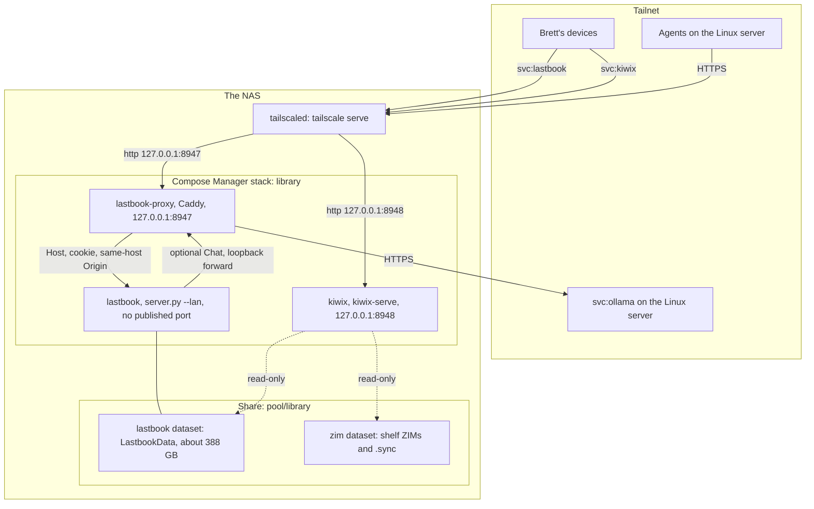
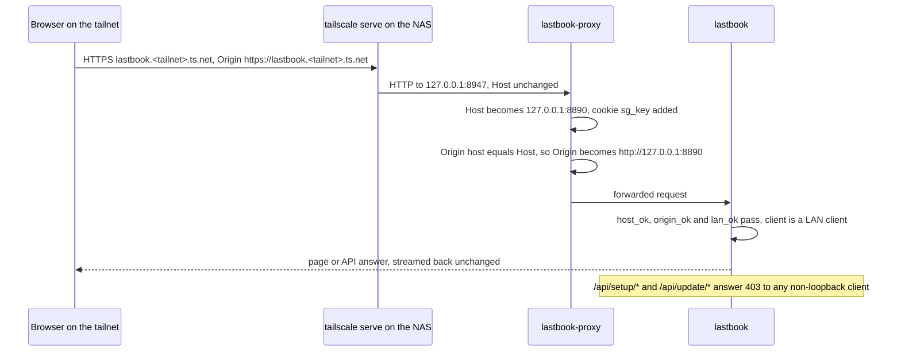
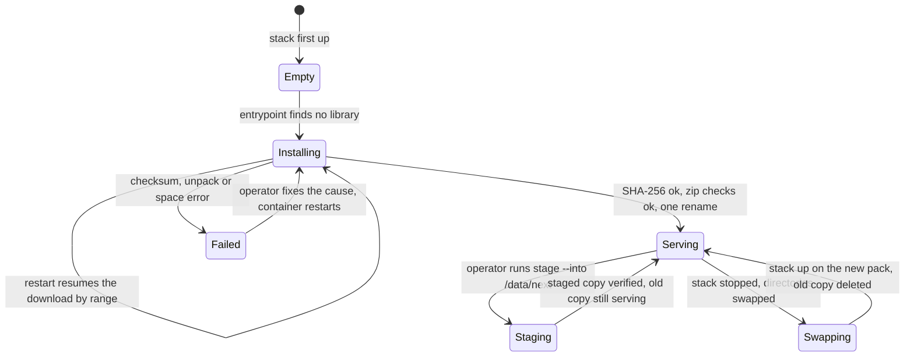
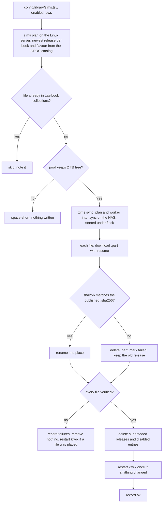

# Offline Library on the NAS - Plan

## Goal Capsule

- **Objective:** From any device on the tailnet, Brett and his agents can read the whole Lastbook survival library (its
  guides, manuals, videos, encyclopedias and nationwide US map) and a wider offline shelf led by the full English
  Wikipedia, all served from disks in the house, so reading never depends on an outside site staying up.
- **Means:** one Compose Manager stack, `library`, on the NAS: Lastbook's own library server built from a pinned
  upstream commit behind a small proxy, plus kiwix-serve for the Kiwix shelf, each on a NAS loopback port and its own
  Tailscale Service (KTD1, KTD2, KTD4, KTD5, KTD7).
- **Authority:** Brett's limits (R2, R3, R10) outrank every other line here. R-IDs decide behavior and KTDs decide
  mechanism. How Lastbook itself runs is decided by upstream's `docs/LIBRARY-SERVER.md`, `docs/SETUP-API.md` and
  `packaging/docker/README.md` at the pinned commit. The NAS rules in
  `docs/solutions/best-practices/nas-compose-apps-run-as-compose-manager-stacks-not-plain-projects.md` and
  `docs/solutions/best-practices/nas-docker-img-is-one-shared-file-so-gate-new-services-on-disk-too.md` bind every unit.
- **Execution profile:** one PR to `dev` holding U1 to U5, built by an agent slot. Six operator gates follow it (Gate A
  to Gate F in Build phases and gates). Every step that writes on the NAS or changes tailnet policy is an operator step
  (KTD14).
- **Stop conditions:** stop and report when Gate C's memory check fails; when the pinned commit's `packaging/docker/` no
  longer matches KTD2 and KTD3; when `manifest-v1.json` changes its `version` or the All pack's data-folder layout
  changes; when a step would publish a port on a LAN or public address; or when the pool's free space would fall below 2
  TB.
- **Who finishes:** a build slot writes and tests the PR. Brett creates the share, applies the tailnet policy, starts
  the stack, and turns on each optional shelf tier and Chat. Agents run only the read-only verbs: `status` and
  `zims plan`.

---

## Product Contract

### Summary

Lastbook is an MIT-licensed offline survival library for Mac, Windows and Linux desktops, first published at
lastbook.org on 2026-11-12. Its largest download, All, is 387.9 GB. This plan runs All on the NAS in the browser-facing
library server that upstream ships beside the desktop apps. It adds kiwix-serve for a curated, tiered shelf of Kiwix ZIM
collections, led by the full English Wikipedia without pictures that All already contains. Each service answers at a
tailnet-only HTTPS address and at a NAS loopback port. A repo script reports health and brings the Kiwix shelf in line
with a list kept in the repo. Lastbook's Chat can write cited answers with the Gemma model the Linux server already
serves.

### Problem Frame

Brett asked for a local copy of lastbook.org with its full library on the NAS, served as a Compose stack behind a
Tailscale Service with localhost access, and for the same treatment of full Wikipedia without media and other
preparedness datasets. Lastbook is a desktop app, not a website, so there is no hosted library to mirror: the library
ships as downloadable packs, and upstream's `server.py` serves a pack to a browser. A library like this earns its keep
when the sites it came from are gone, so every byte has to be on local disk and readable without the internet.

The NAS has room (13.7 TB free on its ZFS pool on 2026-11-16) but little memory: 7.5 GiB, about 2.1 GiB available, no
swap. Every container shares one 20 GiB `docker.img`. The plan has to keep 900 GB of downloads out of `docker.img` and
keep two new services from starving Plex, OpenSEO, LanguageTool and Postgres.

Upstream is four days old and moving fast: 31 commits since 2026-11-12 and no tags. Its server refuses any `Host` header
except `localhost` or an IP address. It serves a non-loopback client only after a one-time key. An open upstream PR, #33
(opened 2026-11-16, unreviewed), packages that server for Docker with a headless installer built on upstream's own setup
engine.

### Requirements

**Lastbook**

- R1. Lastbook's All pack is installed on the NAS and served by Lastbook's library server: its curated guides, 4,451
  PDFs, 3,819 saved web guides, 2,324 videos, four encyclopedias and nationwide US map, with keyword search across them.
- R2. Each service answers at one tailnet-only HTTPS address and at a loopback port on the NAS, and at no LAN or public
  address.
- R3. A reader, over the tailnet or the loopback port, cannot start, change, repair or delete a library install, and
  cannot run Lastbook's update check.
- R4. Agents on the Linux server can query both services over their tailnet addresses: Lastbook's search, retrieval and
  tool endpoints (`/api/find`, `/api/retrieve`, `/api/tools`, `/api/tool/<name>`) and kiwix-serve's search and OPDS
  catalog.
- R5. When Brett turns Chat on, it writes cited answers with the Gemma 4 26B A4B model the Linux server serves. While
  Chat is off or the model is unreachable, Chat lists the matching pages and everything else works.

**The Kiwix shelf**

- R6. The full English Wikipedia without pictures is served by kiwix-serve from the copy inside Lastbook's library, and
  no second copy is stored.
- R7. The shelf is a list in the repo, in tiers. Each entry names a Kiwix book and flavour and says why it is there. A
  sync brings the NAS in line with the enabled entries.
- R8. An entry takes the no-picture flavour when Kiwix publishes one, except where pictures carry the instructions
  (medicine, repair, knots, field manuals), which the list marks.
- R9. The large tiers (Survivor Library, all of English Gutenberg, Stack Overflow, world maps, Wikipedia with pictures)
  are in the list but stay off until Brett turns each on.

**Running it**

- R10. The stack never starves the NAS: bulk data lives on the ZFS pool and not in `docker.img`, each container has a
  memory cap, and the stack is measured under real use before it counts as done.
- R11. Every container shows in the Unraid Docker tab as part of the `library` stack, with autostart on.
- R12. Every download resumes after an interruption and is checked against its published SHA-256 before use. A working
  library or collection is never replaced until its successor checks out.
- R13. A newer Lastbook pack, a newer Lastbook release, and newer Kiwix releases each have an operator procedure that
  keeps the old copy serving until the new one verifies.
- R14. One read-only command reports whether both services answer locally and on the tailnet, the Lastbook install's
  progress, the shelf's sync state, and the NAS's memory, `docker.img` and pool headroom.

### Key Decisions

- **"Full size" is the All pack.** It is the largest pack in `manifest-v1.json` (published 2026-11-13) and already holds
  the whole US map, so it needs none of the 52 state maps. Lastbook's pack spec also defines two add-ons, Corporal's
  Corner videos (93.1 GB) and firearms and hunting (4.6 GB), which the manifest does not publish. Governs R1.
- **Compose is preferred, not required.** Brett, 2026-11-16: "docker compose isnt hard and fast. just preferred." The
  plan uses a Compose Manager stack because it fits this work best (KTD1, Alternatives Considered), not because it is
  mandated. Governs R11.
- **Tailnet and loopback only.** Brett asked for a Tailscale Service and localhost access. A LAN entry point for a day
  without internet is a separate decision and is deferred. Governs R2.
- **Readers cannot administer the library.** Installs, upgrades and repairs are operator actions, never browser actions.
  Governs R3.
- **Text first, pictures where they teach.** "Minus media" applies per collection, with the exceptions R8 names.
  Video-first Kiwix collections (TED, Khan Academy, Crash Course, the prepper channels) stay off the shelf, and
  Lastbook's 2,324 curated videos are the video shelf. Governs R8, R9.
- **The model stays on the Linux server.** The NAS cannot hold Gemma 4 26B A4B, which needs about 18 GB of memory, while
  the Linux server's RTX 3090 Ti already serves the same model. Governs R5.

### Success Criteria

- From Brett's Mac over the tailnet, `https://lastbook.<tailnet>.ts.net` opens, a search for "purify water" returns WHO
  and MSF pages, a cited PDF page opens at its page, a video plays and seeks, and the map shows streets and finds an
  address in any US state.
- `https://kiwix.<tailnet>.ts.net` lists every enabled shelf entry plus Lastbook's four encyclopedias, a Wikipedia
  article search returns results, and pages from Ready.gov and the DIY Stack Exchange open.
- An agent on the Linux server gets JSON from Lastbook's `/api/find?q=tourniquet` and from kiwix-serve's catalog, both
  over the tailnet addresses.
- Seven days after the core shelf is synced, including Gate C's load, the NAS keeps at least 1 GiB of memory available,
  `docker.img` is at most 75% used, and no container on the NAS was OOM-killed.

### Scope Boundaries

Considered and not built:

- **A LAN entry point.** Not requested, and it widens exposure to every LAN device. Brett asking for access during an
  internet outage would change this; see Deferred to Follow-Up Work.
- **Semantic search.** Packs ship no embedding model (`pack-spec.json` `vectors.ship: false`), PR #33's image leaves out
  onnxruntime, and embedding about 408,000 chunks on the NAS's CPU is a large one-off job for a smaller search gain.
  Measured keyword-search misses would change this.
- **Running the model on the NAS.** 7.5 GiB of RAM against a model that needs about 18 GB.
- **Library backups.** Every byte is public data that can be downloaded again while the internet is up. The real loss
  case, the internet gone and the NAS failing, is the cold copy under Deferred to Follow-Up Work.
- **Hot reload of the Kiwix library.** A restart takes seconds after a sync. Users complaining about the interruption
  would change this.
- **A scheduled shelf sync.** Run by hand until two syncs have run cleanly. Missed Kiwix releases would change this.
- **A wrapper verb for stack writes.** The `unraid-compose` skill's `stack-push.sh` and `stack-compose.sh` already plan,
  confirm and run them (KTD16).

Outside this product's identity:

- **Shadow libraries** (LibGen, Anna's Archive, Sci-Hub) and any collection whose distribution rights are doubtful.
- **Turnkey platforms that own a host** (Project N.O.M.A.D., Internet-in-a-Box, RACHEL). See Alternatives Considered.
- **Languages other than English.** Lastbook's search and chat are English-only (upstream issue #3), and Brett reads
  English.

### Deferred to Follow-Up Work

- **Offline LAN mode:** publish both services on the NAS's LAN address, behind Lastbook's own LAN key, for use when the
  tailnet cannot reach its control plane.
- **Cold copy:** a laptop or external drive holding Lastbook (desktop app over a copied data folder) and the core shelf,
  refreshed quarterly, for when the NAS has no power or fails.
- **Re-pin KTD2** from the fork commit to upstream `main` when PR #33 merges.
- **Lastbook add-on packs**, once the manifest publishes them.
- **Wikipedia XML dumps, an OpenStreetMap planet extract with routing, and a model-weights vault**: machine-readable
  sources for agents, each its own plan.
- **One shared error library** under `scripts/lib/` for `openseo`, `playwright-browsers` and `library`, which today each
  keep their own `errors.sh`.

### Sources

- lastbook.org: `/`, `/library/`, `/download/`, `/credits/` (read 2026-11-16).
- `https://downloads.lastbook.org/manifest-v1.json`, published 2026-11-13: All is one zip of 387,878,571,619 bytes,
  installed size 387,861,708,053 bytes, 12,864 records, SHA-256 `4b4ea73f…`, served from Cloudflare R2 with
  `accept-ranges: bytes`.
- Upstream source, `Immortal-Protocols/lastbook` at `aa8bc54` (MIT): `README.md`; `docs/LIBRARY-SERVER.md`;
  `docs/SETUP-API.md`; `engine/setup/README.md`; `derived/packs/pack-spec.json` (All: 231.75 GB of video, 80.5 GB of
  map, 61.75 GB of ZIMs including `wikipedia_en_all_nopic_2026-06.zim`, 12.3 GB of documents); `server.py` `host_ok`,
  `origin_ok`, `lan_ok` and `serve`; `engine/setup/api.py` `handle` and `engine/update.py` `handle`, each refusing
  non-loopback clients. `main` moved to `8767e98` on 2026-11-16 with no change to `server.py` or `engine/`.
- Upstream PR #33, "Docker: run the library server in a container", head `30dc38181b94673129c53d84b01f386be2c6563d` on
  `mfbergmann/lastbook`: `packaging/docker/{Dockerfile,entrypoint.sh,headless_setup.py,compose.example.yml,README.md}`.
- Kiwix OPDS catalog, `https://library.kiwix.org/catalog/v2/entries?count=-1` (3,680 entries on 2026-11-16);
  `download.kiwix.org` serves a `.sha256` beside each ZIM and redirects to mirrors that support ranges.
- `kiwix/kiwix-tools` 3.8.2: `src/server/kiwix-serve.cpp` usage and `docker/server/start.sh`.
- kiwix-serve memory: https://github.com/kiwix/operations/issues/147 and https://github.com/kiwix/libkiwix/issues/1025.
- Project N.O.M.A.D.: https://github.com/Crosstalk-Solutions/project-nomad.
- Learnings: the two NAS best-practice files under Authority;
  `docs/solutions/configuration-fixes/ollama-403-host-header-caddy-proxy-2026-06-22.md`;
  `docs/solutions/configuration-fixes/tailscale-service-define-before-approve-2026-06-23.md`;
  `docs/solutions/configuration-fixes/tailscale-serve-off-keeps-a-host-advertising-so-drain-a-service-before-moving-it.md`.
- Read-only probe of the NAS, 2026-11-16: Unraid 7.2.8, 12 threads, 7.5 GiB RAM, about 2.1 GiB available, no swap, ARC
  capped near 0.94 GiB; ZFS pool `pool`, 13.7 TB available, compression off, 128K records; `docker.img` 20 GiB with 3.8
  GB used; Docker 29.5.3, Compose v5.5.0, buildx 0.34, git, curl, sha256sum, bsdtar, setsid, flock-capable util-linux;
  Compose Manager Plus 2026.10.07; loopback ports 8945 and 8946 taken, 8947 and 8948 free; Tailscale 1.104.4 serving
  `svc:languagetool`, `svc:openseo`, `svc:pinchflat`, `svc:postgres`.
- The Linux server's Ollama serves `gemma4:26b-a4b-it-q4_K_M` on an RTX 3090 Ti (24 GiB).

---

## Planning Contract

### How it runs

`lastbook` runs upstream's library server (`server.py --lan --no-index`) on a pack in `/data/LastbookData`. On its first
start, with no library, its entrypoint installs the All pack through upstream's setup engine, then serves. It publishes
no port. `lastbook-proxy` is the one way in: it forwards to `lastbook:8890`, so each reader reaches Lastbook as a LAN
client holding the key. `kiwix` serves the shelf's ZIMs and Lastbook's four encyclopedias. The NAS's own
`tailscale serve` maps each Tailscale Service to its loopback port. `scripts/library.sh` runs on the Linux server and
reaches the NAS over `ssh pool`.

### Key Technical Decisions

- KTD1. **One Compose Manager stack with three services.** `library` holds `lastbook`, `lastbook-proxy` and `kiwix`.
  kiwix reads Lastbook's ZIM files (R6), and all three share one share and one lifecycle, so they read as one row in the
  Docker tab. Separate stacks would only add independent restarts, which `docker restart` already gives. Unraid template
  containers were weighed and rejected (Alternatives Considered).
- KTD2. **The Lastbook image is built on the NAS from a pinned git commit.** The `lastbook` service's `build.context` is
  a git URL ending in a full 40-character commit SHA, with `dockerfile: packaging/docker/Dockerfile`. Until PR #33
  merges, the commit is the PR head `30dc381…` on `mfbergmann/lastbook`, whose five added files were read in full at
  that SHA. Once it merges, the commit is the upstream `main` commit that contains it. The image is tagged
  `library-lastbook:<first 12 of the SHA>`. Upstream publishes no image, a pinned SHA meets the supply-chain rule, and
  the NAS has git, Docker 29.5.3 and buildx 0.34 for a BuildKit git context. Rejected: vendoring a Dockerfile, which
  leaves a copy to keep in step with a fast-moving upstream. Rejected: a GHCR image built by a workflow here, which adds
  a public image carrying GPL components (python-libzim) and a pipeline this config repo has no other use for. Whether
  the fork commit is acceptable is Open Question 1.
- KTD3. **Install and upgrade use upstream's own setup engine.** `LASTBOOK_PACK=all`. The entrypoint runs
  `headless_setup.py install` when `/data/LastbookData` holds no library. That engine checks the zip's SHA-256 against
  the manifest, refuses unsafe zip paths and sizes, resumes a stopped download by range with an ETag check, unpacks
  beside the target, and switches with one rename. The entrypoint also refuses a data folder holding
  `library-data/tools/`. Upgrades use `headless_setup.py status` and `stage --into` (KTD12). Peak space for the install
  is the download plus the installed size plus 2 GB, about 778 GB. Rejected: a curl-and-unzip path, which would re-solve
  every one of those checks.
- KTD4. **Every reader reaches Lastbook as a LAN client, through the proxy.** `lastbook` runs with `--lan`, as PR #33's
  entrypoint already does, and publishes no port. `lastbook-proxy` (Caddy) forwards to `lastbook:8890` and does exactly
  three things to each request:
  1. It sets `Host` to `127.0.0.1:8890`, which `host_ok` accepts.
  2. It sends the cookie `sg_key=<LAN key>`, which `lan_ok` accepts.
  3. It rewrites `Origin` to `http://127.0.0.1:8890` only when the Origin's host equals the request's `Host`. Any other
     Origin passes through unchanged, so `origin_ok` still refuses a cross-site POST.

  Responses, streaming and `Range` requests pass through untouched. Lastbook's redirects are path-relative, so they
  survive the `Host` rewrite. Setup and update answer non-loopback clients with 403, so R3 holds by upstream's own rule.
  Rejected: running Caddy in Lastbook's network namespace, which turns every request into loopback with setup rights and
  leaves R3 to a proxy deny-list that must track upstream's routes. Rejected: upstream's own LAN link, which refuses
  host names (no `ts.net` address) and needs a LAN-facing port.
- KTD5. **Loopback ports 8947 and 8948, and one Tailscale Service each.** `lastbook-proxy` publishes `127.0.0.1:8947`,
  and `kiwix` publishes `127.0.0.1:8948`. `svc:lastbook` and `svc:kiwix` on `tcp:443` are defined, granted to
  `autogroup:member` and the Linux server's tag, auto-approved for the NAS's tag, and bound on the NAS with
  `tailscale serve --service=svc:<name> --https=443 http://127.0.0.1:<port>`. This follows the OpenSEO runbook's Tailnet
  policy steps and the NAS's existing `svc:pinchflat` (8945) and `svc:openseo` (8946). Loopback access from the Linux
  server is `ssh -L 8947:127.0.0.1:8947 pool`, and the same for 8948.
- KTD6. **Data lives on a new pool share with tuned datasets.** A new Unraid share `library` lives on the ZFS pool only,
  which makes the dataset `pool/library` with `compression=lz4`. Under it, `pool/library/lastbook` keeps 128K records,
  because the map's SQLite reads are small and random. `pool/library/zim` uses `recordsize=1M`, because ZIM clusters are
  read whole. Both are created before any data lands, since record size applies only to new writes. Every bind mount
  uses long syntax with `create_host_path: false`: if the pool is not mounted, the container fails to start instead of
  writing 388 GB into the NAS's RAM-backed root filesystem. Creating the share in the Shares tab keeps it visible there,
  which matches Brett's preference for the Docker tab. `zfs create` leaves a child dataset owned by root, so Gate A
  gives `pool/library/lastbook` to `99:100`, the user `lastbook` runs as; its entrypoint's first act is creating
  `/data/config`, and under `set -e` a refusal there stops the container. `pool/library/zim` stays root's: the sync
  writes it as root, and kiwix's uid 1001 reads files at mode 0644.
- KTD7. **kiwix-serve reads two read-only trees.** `ghcr.io/kiwix/kiwix-serve:3.8.2` is pinned by digest. It mounts
  `pool/library/zim` at `/zim/shelf` and the Lastbook data root at `/zim/lastbook`, both read-only, and serves `*.zim`
  from the shelf and from `LastbookData/library-data/collections/`. It runs with `--nodatealiases`, so URLs stay stable
  across releases, and `--skipInvalid`, so a bad file is skipped and does not stop the server. Mounting the data root
  rather than the collections folder lets kiwix start before the Lastbook install finishes and survive a pack swap: with
  `--skipInvalid`, a pattern that matches nothing is skipped and kiwix serves an empty library. The image's `start.sh`
  expands the patterns once, when the container starts, so a restart picks up new or replaced files, and Lastbook's four
  ZIMs appear only after the restart that follows the install (Gate B). Rejected: a library XML with `--monitorLibrary`,
  which needs a writable XML and `kiwix-manage` calls to avoid a restart that takes seconds.
- KTD8. **The shelf is a list resolved against Kiwix's catalog at sync time.** `config/library/zims.tsv` holds five
  columns per row: tier, enabled, book, flavour and why. `zims plan` fetches the OPDS catalog, takes the newest release
  of each enabled book and flavour, and skips any book whose file is already in Lastbook's `collections/` (R6). It then
  prints downloads, removals and sizes, and whether the pool would keep 2 TB free. Following Kiwix's newest release
  matches Brett's choice to follow OpenSEO's rolling tag. Rejected: pinning dated file names, which costs a PR per Kiwix
  release for content that is only ever replaced by its newer self.
- KTD9. **The sync runs on the NAS, detached, and is started from the Linux server.** `zims sync` resolves the plan on
  the Linux server, writes the plan and a worker script into `pool/library/zim/.sync/`, and starts the worker on the NAS
  with `setsid nohup` under `flock`. The worker outlives the ssh session, and a second sync is refused. The worker
  handles each file in three steps:
  1. Download to `<name>.zim.part` with resume, following download.kiwix.org's mirror redirects.
  2. Check the file against the `.sha256` published beside it.
  3. Rename it into place.

  When every download has verified, it deletes superseded releases and the files of disabled entries, then restarts the
  `kiwix` container once. Deleting first matters: kiwix holds every file open, so a file deleted after the restart stays
  in its library and keeps its disk space until the next one. When a download failed, nothing is deleted, and kiwix
  restarts only if another file was placed. It records state and a log in `.sync/`. Rejected: a one-shot service in the
  stack, whose script would have to live inside `compose.yaml` and which the Compose tab cannot start on its own.
  Rejected: downloading on the Linux server and copying, which moves every byte twice.
- KTD10. **Every container has a memory cap and bounded caches, and the caps fit one budget.** Starting caps are 1 GiB
  for `lastbook`, 128 MiB for `lastbook-proxy` and 768 MiB for `kiwix`; they are ceilings for Gate C's measurement, not
  the final values. kiwix gets bounded `KIWIX_ARCHIVE_CACHE_SIZE` and `KIWIX_SEARCHER_CACHE_SIZE` and a `--searchLimit`.
  `lastbook` runs `--no-index`: packs ship no embedding model, so its five-minute semantic-index loop has nothing to do.
  Gate C reads each container's `memory.peak`, the `anon` line of `memory.stat` and the `oom_kill` count in
  `memory.events` after a load that began after its last restart. Each final cap is its peak plus a third. The final
  caps together must fit the budget: `MemAvailable` read before the stack starts, less 1 GiB, so the NAS keeps 1 GiB
  even with every container at its cap. With 2.19 GiB available on 2026-11-16 the budget is about 1.19 GiB, and the
  starting caps sum to 1.875 GiB, so they would not hold the floor if kept. Caps that cannot fit the budget are a stop
  condition. kiwix-serve's caches are bounded only by count, and Kiwix reports about 10 GB of growth in 3.5 days on
  library.kiwix.org (libkiwix#1025, kiwix/operations#147). With a cap, an overrun kills the offending container instead
  of Plex.
- KTD11. **Chat goes through the proxy to `svc:ollama`.** Chat is off by default. When the stack's `.env` sets the three
  Chat values, Lastbook's entrypoint forwards `127.0.0.1:11434` inside its container to an internal port on
  `lastbook-proxy`. That port is not published. The proxy forwards it over HTTPS to `svc:ollama`, and the Linux server's
  loopback Caddy there already clears Ollama's `Host` 403. The model is `gemma4:26b-a4b-it-q4_K_M`: the same Gemma 4 26B
  A4B at the same 4-bit level as Lastbook's pin, though it is Ollama's build, not Unsloth's `UD-Q4_K_M` file. Lastbook
  keeps its rule that the assistant talks only to loopback. Turning Chat on also needs a grant from the NAS's tag to
  `svc:ollama`. Rejected: Lastbook's local runner on the NAS, which needs about 18 GB of memory.
- KTD12. **Each kind of update has its own path.** For new Lastbook code, a PR moves KTD2's SHA, then the operator
  rebuilds and recreates the stack. For Kiwix and Caddy, a PR moves the digest. For a new Lastbook pack:
  1. `headless_setup.py status`, run through `docker exec`, reports `update_available`.
  2. `stage --into /data/next`, started with `docker exec -d` so it outlives the ssh session, builds the new library
     beside the old one, about 776 GB more at peak. It writes the same job file as the install, so `status` follows it.
  3. With the stack stopped, the operator swaps the two directories, starts the stack, and deletes the old copy only
     once the new one serves.

  The Compose tab's Update has nothing to pull for `lastbook`. Gate B records what pressing it does, and the runbook
  says so.
- KTD13. **The stack keeps one secret.** It is the LAN key, which the operator generates at the first stack write and
  keeps in the stack's `.env` on the flash drive, root-only by the flash's mount mode. Both `lastbook`
  (`LASTBOOK_LAN_KEY`) and `lastbook-proxy` read it. It has no 1Password item: it guards nothing outside the stack's own
  network. Lastbook also prints it in its startup log, which the Docker tab shows to root alone. The entrypoint writes
  the key to `derived/lan-key` only when that file is missing or empty, so a new key takes three steps: write it to
  `.env`, delete `derived/lan-key`, and recreate the stack. Skipping the delete leaves Lastbook on the old key while the
  proxy sends the new one, and every request answers 403; `status` names that case `lan-key-mismatch`.
- KTD14. **The operator writes and agents read.** The operator runs the share and dataset setup, tailnet policy, stack
  writes and starts, `tailscale serve`, `zims sync`, pack swaps and turning Chat on. Agents run `status` and
  `zims plan`. This is the OpenSEO runbook's split.
- KTD15. **`scripts/library.sh` reports in the repo's error contract.** It has three verbs: `status`, `zims plan` and
  `zims sync`. `zims sync` is the operator's, and it acts only with `--yes`; without it, it prints the plan and exits 2
  naming `--yes`, as `stack-push.sh` does. `--help` lists the verbs, marks the operator's, and lists the exit codes.
  Output is text by default, or one JSON object with `--output json`. A text error is `ERROR: <reason>: <message>`, any
  `cause:` lines, and a last `fix:` line. Each JSON error carries `reason` (a closed kebab-case set), `exit_code`,
  `message`, `value`, `cause` (the last lines of the failing command's stderr), `next_step` (`action` from
  `run-command`, `ask-operator`, `retry` or `none`, plus `command` and `docs`), and `checks` and `notes`. Every message
  says what changed, if anything, and whether a rerun is safe. It is modeled on `scripts/openseo/lib/errors.sh`.
  `status` reads the install's `state` and `error` from upstream's setup job file, `config/Lastbook/setup/job.json` in
  the `lastbook` dataset. Upstream rewrites that file only when the state changes (`engine/setup/api.py` `_set`), so the
  byte counts in it stand still for a whole download. During a download, `status` reads the bytes from the download's
  own `<zip>.part.json` in the job folder's `.setup/downloads/`, which `engine/setup/download.py` rewrites every 2
  seconds, and reports how long ago it was written. It needs no docker call, and it never reads the container log, which
  prints the LAN link. Whether a newer pack is published is not a `status` check: `headless_setup.py status` owns that
  rule, and the runbook's update procedure runs it. The ports, data paths, container names and service names the scripts
  use are defined once, in `scripts/library/lib/nas.sh`, and a test holds `compose.yaml` to them.
- KTD16. **Stack writes use the `unraid-compose` skill.** The runbook creates and updates the stack with
  `stack-push.sh --name library --autostart --webui ...` and starts it with `stack-compose.sh library up`. Both print a
  plan first and act only with `--yes`. The `--webui` values carry the tailnet addresses, so the tailnet name never
  enters this public repo. Rejected: a deploy verb here, which would copy the skill's staging, labeling and `compose.sh`
  handling, as `scripts/openseo/lib/stack.sh` did before the skill existed.

### High-Level Technical Design

Topology:



A reader's request through the proxy:



Lastbook's data folder over its life:



One shelf sync:



### Output Structure

```text
config/library/
  compose.yaml            three services, the Caddyfile as an inline config
  compose.override.yaml   Compose Manager labels for each service
  env.example             the .env keys, with no values
  zims.tsv                the shelf: tier, enabled, book, flavour, why
scripts/library.sh        status, zims plan, zims sync
scripts/library/lib/      errors.sh, nas.sh, status.sh, zims.sh
scripts/library/remote/   zim-sync.sh, the worker the NAS runs
tests/library-stack.bats
tests/library-status.bats
tests/library-zims.bats
tests/fixtures/library/   catalog snapshot, job files
docs/runbooks/library.md
```

### System-Wide Impact

- **NAS memory:** three more capped containers on a host with about 2.1 GiB available (KTD10). This is the binding
  constraint, and a RAM upgrade is already in the vault's infrastructure backlog.
- **`docker.img`:** about 0.5 GB of images (an estimate until Gate B measures it) plus BuildKit cache from building on
  the NAS. The runbook prunes the build cache after each build.
- **Pool disk and drives:** about 498 GB at rest with the core shelf, with a peak near 778 GB plus the shelf during the
  first install, against 13.7 TB free. The three HC520 drives are about six years old in raidz1 and hold the only local
  copy.
- **Internet link:** about 388 GB for Lastbook and 110 GB for the core shelf, each over hours, shared with Plex and the
  rest of the house.
- **Tailnet policy:** two new services, their grants and autoApprovers, and for Chat a grant from the NAS's tag to
  `svc:ollama`.
- **The Linux server's GPU:** Chat shares Ollama with the embedding models qmd uses. The 26B model takes about 18 GB of
  the card's 24 GiB while it is loaded.

### Assumptions

- "Localhost access" means a loopback port on the NAS, as `svc:openseo` and `svc:pinchflat` have, reached from the Linux
  server with `ssh -L`.
- "Full size db" means Lastbook's All pack, the largest the manifest publishes.
- The collections are English-only.
- The names are `library` for the stack, `svc:lastbook` and `svc:kiwix` for the services, and 8947 and 8948 for the
  loopback ports.
- The house's internet link can carry about 1 TB over a few days with no data cap.
- The tailnet's `tailscale serve` passes the original `Host` to the backend. KTD4 rewrites `Host` either way, so this
  only matters for `status`'s messages.

### Risks

| Risk                                                                     | Mitigation                                                                                                                                                                          |
| ------------------------------------------------------------------------ | ----------------------------------------------------------------------------------------------------------------------------------------------------------------------------------- |
| Upstream churn breaks the pinned build or changes the data-folder layout | The SHA is pinned and moved only by PR; layout changes are a stop condition; Gate B's checks run again after every bump                                                             |
| PR #33 changes, stalls or is rejected                                    | The pinned fork SHA keeps building; re-pin on merge (deferred); if rejected, Brett decides between vendoring its five files and dropping Docker                                     |
| Trusting a fork commit                                                   | Immutable SHA; its five files were read in full; the code sees only the library share and the network                                                                               |
| NAS memory runs out                                                      | Per-container caps (KTD10), the Gate C measurement, and a stop condition; the RAM upgrade is in the vault backlog                                                                   |
| kiwix-serve memory grows with uptime and with large ZIMs                 | Count-bounded caches, `--searchLimit`, the cap, and `restart: unless-stopped`; Gate F re-measures after each large tier                                                             |
| Cold reads are slow: ARC is capped near 0.94 GiB over HDD raidz1         | Gate C notes search and map response times; the RAM upgrade is the remedy                                                                                                           |
| BuildKit cache fills `docker.img`                                        | The runbook prunes the build cache after each build; `status` fails above 75% used                                                                                                  |
| The install stops partway                                                | Upstream resumes by range with an ETag check, and the restart policy restarts it; `status` reports `lastbook-install-stalled` once the download has written nothing for 10 minutes  |
| A checksum failure repeats, and each restart downloads 388 GB again      | Upstream deletes a download that fails its checksum (`engine/setup/download.py`); `status` reports `lastbook-install-failed`, and that reason's runbook entry stops the stack first |
| A drive fails during or after the install                                | raidz1 survives one disk; the cold copy is deferred and named in the runbook                                                                                                        |
| Containers cannot resolve or reach `svc:ollama`                          | Gate E checks it; the runbook gives the fallback of the service's tailnet address with an explicit TLS server name                                                                  |
| Upstream adds an admin route that LAN clients can reach                  | Gate B's 403 checks through the proxy run again after every SHA bump                                                                                                                |
| ZIM licences                                                             | Wikimedia content is CC BY-SA and the rest is mostly public domain or CC; it is served only inside the tailnet and never redistributed                                              |

### Open Questions

1. **Build from the PR #33 fork commit now, or wait for upstream to merge it?** Recommendation: build from the fork
   commit now (KTD2). It is an immutable SHA, its five files were read in full, and it reaches upstream's own setup
   engine, while waiting leaves the NAS empty for an unknown time. This blocks Gate B only.
2. **Which large tiers, if any, should start enabled?** Recommendation: none. Sync the core tiers first (about 110 GB),
   then add Survivor Library (220 GB), which is the classic preparedness collection, once Gate C's numbers are in. This
   blocks only Gate F.

### Build phases and gates

| Step   | Who                                 | What                                                                                                                                                                                                                                              | Pass                                                                                                                                                                                                                                                                                        |
| ------ | ----------------------------------- | ------------------------------------------------------------------------------------------------------------------------------------------------------------------------------------------------------------------------------------------------- | ------------------------------------------------------------------------------------------------------------------------------------------------------------------------------------------------------------------------------------------------------------------------------------------- |
| PR1    | build slot                          | U1 to U5                                                                                                                                                                                                                                          | CI green, reviews logged, merged to `dev`                                                                                                                                                                                                                                                   |
| Gate A | Brett                               | Create the `library` share on the pool in the Shares tab (no SMB export) and the two child datasets with their properties, `pool/library/lastbook` owned by `99:100` (KTD6); define, grant and auto-approve `svc:lastbook` and `svc:kiwix` (KTD5) | `zfs get` shows the properties; `ts-api.sh service-get` lists both services                                                                                                                                                                                                                 |
| Gate B | Brett                               | Generate the `.env` (KTD13), push and start the stack (KTD16), wait for the All install, restart `kiwix` once so it opens Lastbook's ZIMs (KTD7), bind both services, prune the build cache                                                       | `scripts/library.sh status` exits 0; the first three Success Criteria hold; through the proxy, `/api/setup/state` answers 403 and a POST with a foreign Origin answers 403; Update's effect on `lastbook` recorded; the install's start and finish times and the attended commands recorded |
| Gate C | Brett                               | The load: 20 guides opened, 3 videos played and sought, the map panned in 3 states, 30 searches on each service including a multi-ZIM search; then each container's `memory.peak`, `anon` and `oom_kill` (KTD10)                                  | No `oom_kill`; each final cap is its peak plus a third, and the final caps sum to at most `MemAvailable` before the stack, less 1 GiB; the final caps go back to the repo by PR                                                                                                             |
| Gate D | Brett                               | `zims plan`, read the plan, then `zims sync --yes` for the core tiers                                                                                                                                                                             | `status` shows the shelf in sync; the second Success Criterion holds                                                                                                                                                                                                                        |
| Gate E | Brett, optional                     | Grant the NAS's tag to `svc:ollama`, set the three Chat values, recreate                                                                                                                                                                          | A Chat question returns an answer citing library pages                                                                                                                                                                                                                                      |
| Gate F | Brett, optional, one tier at a time | Enable a large tier, then plan, sync and re-measure kiwix                                                                                                                                                                                         | Gate C's memory rule still holds                                                                                                                                                                                                                                                            |

The seven-day soak in Success Criteria starts after Gate D.

### Alternatives Considered

- **Unraid template containers instead of a stack.** These are also managed in the Docker tab. Rejected because a
  template cannot build from a git context or carry an inline proxy config, and three templates would each repeat the
  share paths and the LAN key.
- **Project N.O.M.A.D.** (Crosstalk Solutions, Apache-2.0: Kiwix, Ollama, ProtoMaps, Kolibri). Rejected because its
  installer owns `/opt/project-nomad` on a Debian-family host and its Command Center manages its own containers. My
  inference, not tested: on Unraid those containers would show as third-party, and it does not serve Lastbook.
- **Internet-in-a-Box or RACHEL.** Both want a dedicated host, usually a Raspberry Pi or a Debian install, and neither
  serves Lastbook.
- **An Ubuntu VM on the NAS running Lastbook's `.deb`.** Rejected because a VM needs its own memory on an 8 GB host, and
  the `.deb` is a desktop app that needs a display.
- **Patching `host_ok` in a fork.** Rejected: it carries a patch against a fast-moving upstream, and KTD4 gets the same
  effect with no code change.
- **Our own installer (curl, sha256sum, unzip).** Rejected because it re-solves resume, ETag, zip-safety and
  atomic-switch checks that upstream already tests (KTD3).

---

## Implementation Units

### U1. The stack definition

**Goal:** `config/library/` describes the whole stack, so a `stack-push.sh` of that folder plus a `.env` yields R1, R2,
R3, R6 and R11.

**Requirements:** R1, R2, R3, R5, R6, R10, R11, R12.

**Dependencies:** none.

**Files:**

- `config/library/compose.yaml`
- `config/library/compose.override.yaml`
- `config/library/env.example`
- `tests/library-stack.bats`

**Approach:**

1. Write `lastbook` per KTD2, KTD3 and KTD10: the git build context pinned to the full SHA, the image tag,
   `user: "99:100"` (Unraid's `nobody:users`), the data bind mount, `LASTBOOK_PACK=all`, `LASTBOOK_LAN_KEY`, the three
   Chat variables defaulting to empty, `command: ["--no-index"]`, the memory cap, `restart: unless-stopped`, and no
   `ports`. No service waits on `lastbook`'s health: its image's healthcheck allows a 24-hour start period for the
   install, and `docker compose up -d` blocks on a `service_healthy` condition until it passes.
2. Write `lastbook-proxy` per KTD4 and KTD11. Pin a Caddy Alpine image by digest. Its Caddyfile is a top-level `configs`
   entry with inline `content`, so it travels inside `compose.yaml` through `stack-push.sh`. Turn off admin and
   automatic HTTPS, use tmpfs for Caddy's data and config, publish `127.0.0.1:8947`, run the internal Chat listener that
   answers 503 when no upstream is set, and set the memory cap. Compose interpolates `$` in inline config content, so
   the LAN key enters the Caddyfile as `${LASTBOOK_LAN_KEY}` and any Caddy placeholder that holds a `$` is written `$$`.
   Caddy 2.11.9 accepts the three header rules as an `expression` matcher on `Origin` against `{http.request.hostport}`,
   a `request_header` for the matched case, and `header_up` for `Host` and `Cookie`.
3. Write `kiwix` per KTD7 and KTD10: the image pinned by digest, the two read-only mounts, the flags and cache
   variables, `127.0.0.1:8948`, a healthcheck, and the memory cap.
4. Mirror `config/openseo/compose.override.yaml` in the override: `net.unraid.docker.managed: composeman` and empty
   icon, webui and shell labels for every service. `stack-push.sh --webui` fills the webui labels at create time
   (KTD16).
5. In `env.example`, name every key `.env` takes, each with a one-line purpose and no value.

**Patterns to follow:** `config/openseo/compose.override.yaml`; the label checks in `tests/openseo-deploy.bats`.

**Test scenarios:**

- The override's service names equal `compose.yaml`'s, and every service carries
  `net.unraid.docker.managed: composeman`.
- Every published port binds `127.0.0.1`, and the only published ports are 8947 on `lastbook-proxy` and 8948 on `kiwix`.
- `lastbook` has no `ports` key.
- Every bind mount uses long syntax with `create_host_path: false` and a source under `/mnt/pool/library/`, and both of
  `kiwix`'s mounts are read-only.
- Every service sets a memory limit.
- Every pulled image carries `@sha256:`, and the `lastbook` build context ends in `#` plus 40 hex characters.
- No `depends_on` entry names `lastbook` with `condition: service_healthy`.
- The published ports, bind-mount sources and project name in `compose.yaml` equal the constants in
  `scripts/library/lib/nas.sh`.
- `docker compose config` over both files with `env.example`'s keys set to sample values exits 0. It skips with an
  install hint when `docker compose` is missing.
- The Caddyfile that `docker compose config` renders with the sample `.env` runs in the pinned Caddy image, with its
  upstream pointed at a second Caddy site in the same process that answers with the request headers it received. The
  echo shows: `Host` is `127.0.0.1:8890`; the cookie is `sg_key=<sample key>`; a same-host Origin arrives as
  `http://127.0.0.1:8890`; a foreign Origin arrives unchanged; a `Range` header arrives unchanged. Reading the rendered
  file catches a key lost to interpolation. The container is started with `--rm` under a per-test name and removed in
  `teardown`. It skips with a hint when `docker` is missing or `docker info` cannot reach a daemon; CI has Docker, so CI
  runs it. This seam proves the proxy's header handling, not Lastbook's response to it, which Gate B checks live.

**Verification:** the stack definition passes its suite. A `stack-push.sh` plan run against the NAS (Gate B) reads
`mode: create` with no unlabeled services.

### U2. The shelf list

**Goal:** `config/library/zims.tsv` is the reviewable statement of R7 to R9.

**Requirements:** R6, R7, R8, R9.

**Dependencies:** none.

**Files:**

- `config/library/zims.tsv`
- `tests/library-zims.bats`, covering the list

**Approach:**

1. One row per Kiwix book and flavour, in the tiers and members of Appendix A. The `why` column says what each entry is
   for, and for a picture-keeping entry, why its pictures matter (R8).
2. Every `core-*` row is enabled and every `big-*` row is disabled (R9). The `big-gutenberg-all` row's `why` says it
   replaces the `core-books` tier.
3. Lastbook's four encyclopedias are not listed. `zims plan` finds them in Lastbook's `collections/` (R6).

**Test scenarios:**

- Every row has exactly five tab-separated fields.
- Every tier matches `^(core|big)-[a-z0-9-]+$`.
- `enabled` is `yes` or `no`.
- Every book matches `^[a-z0-9._-]+$`.
- Every flavour is one of `nopic`, `maxi`, `mini` or `-`.
- No book and flavour pair appears twice.
- Every `big-*` row is disabled.

**Verification:** the list passes its suite, and `zims plan` (U4) resolves every enabled row against the live catalog at
Gate D.

### U3. `status`

**Goal:** `scripts/library.sh status` answers R14 for Brett and for agents, read-only.

**Requirements:** R4, R10, R14.

**Dependencies:** U1.

**Files:**

- `scripts/library.sh`
- `scripts/library/lib/errors.sh`
- `scripts/library/lib/nas.sh`
- `scripts/library/lib/status.sh`
- `tests/library-status.bats`
- `tests/fixtures/library/` (job files)

**Approach:**

1. The dispatcher parses `status`, `zims plan`, `zims sync`, `--yes`, `--output json` and `--help`, and prints usage
   when given no verb.
2. `errors.sh` follows KTD15's envelope, with `docs` pointing to the runbook's reason anchors.
3. `nas.sh` makes every NAS call one `ssh pool` with `-o BatchMode=yes -o ConnectTimeout=10`. `LIBRARY_NAS_SSH`
   overrides the alias, as `OPENSEO_NAS_SSH` does. It also holds the one definition of the ports, data paths, container
   names and service names (KTD15).
4. `status.sh` runs its checks in this order and stops at the first failure:
   1. The NAS is reachable.
   2. The install. With no stamp file, the job file's state decides. An active state is `lastbook-installing`, with the
      percentage from `.part.json` while downloading. A `.part.json` not written for 10 minutes is
      `lastbook-install-stalled`: a stopped container leaves the job file at `downloading` until its next start.
      `failed` is `lastbook-install-failed`. With the stamp file present, an active job is a pack staging beside the
      served library (KTD12), reported as a note with its percentage. A job file that does not parse as upstream's
      layout is `job-file-unreadable`, which is a stop condition (Goal Capsule).
   3. The proxy's `/api/health` on 8947, where a 403 means the proxy and Lastbook hold different LAN keys (KTD13).
      `status` reads neither `.env` nor `derived/lan-key`, so no output can carry the key.
   4. kiwix on 8948, then its OPDS catalog. A catalog with fewer books than there are `.zim` files on the shelf and in
      Lastbook's `collections/` is `kiwix-stale`: the state a missed restart leaves (KTD7).
   5. Both serve bindings, then both tailnet addresses from the Linux server, with the suffix read from
      `tailscale status --json`.
   6. Available memory at least 1 GiB, `docker.img` at most 75% used, `pool/library` at least 2 TB available, and the
      shelf's last sync state.
5. Notes that do not fail the run: an empty shelf, Chat being off, and a pack staging. A passing run's text ends with
   both tailnet addresses.

**Patterns to follow:** `scripts/openseo-deploy.sh` and `scripts/openseo/lib/{errors,nas,status}.sh`; the `tailscale`
and `curl` stubs in `tests/openseo-deploy.bats`.

**Test scenarios:**

- Everything healthy: exit 0, the text names each check as ok and ends with both tailnet addresses, and the JSON
  `reason` is `ok` with every check present.
- ssh exits 255: `nas-unreachable`, exit 1, with ssh's stderr under `cause` and a `next_step.command` that reruns the
  probe.
- The job file shows `downloading` and `.part.json` holds 40% of the bytes, written 30 seconds ago:
  `lastbook-installing`, exit 1, action `retry`, and the message carries the percentage and the age of the write.
- The same, with `.part.json` written 11 minutes ago: `lastbook-install-stalled`, action `ask-operator`.
- The stamp file exists and the job file shows `downloading`: exit 0, with a note carrying the staging percentage.
- The job file is not JSON, or has no `state`: `job-file-unreadable`, with jq's error under `cause`.
- The job file shows `failed` with code `checksum`: `lastbook-install-failed`, carrying upstream's error sentence.
- The proxy answers 502: `lastbook-down`.
- The proxy answers 403 on `/api/health`: `lan-key-mismatch`, with `next_step.docs` at the runbook's key steps.
- kiwix refuses the connection: `kiwix-down`.
- kiwix's catalog lists 3 books while 5 `.zim` files exist: `kiwix-stale`, action `ask-operator`, with the restart
  command.
- `tailscale serve status` lacks `svc:kiwix`: `not-served`, with the exact bind command.
- Loopback answers but the tailnet address times out: `address-unreachable`.
- `MemAvailable` reads 700 MiB: `low-memory`.
- `docker.img` is 80% used: `docker-img-full`.
- The pool has 1.5 TB available: `pool-low`.
- The shelf's state file reads `failed`: `sync-failed`, naming the log path, with action `ask-operator` and
  `scripts/library.sh zims sync --yes` as the command.
- An unknown verb or flag: `usage`, exit 2.
- `--help`: exit 0, every verb listed, `zims sync` marked as the operator's, and the exit codes listed.
- `--output json` prints exactly one JSON object on stdout in every case above.

**Verification:** the suite passes, and at Gate B `status` exits 0 against the live NAS.

### U4. `zims plan` and `zims sync`

**Goal:** the shelf on the NAS matches the enabled rows, by R7 and R12's rules.

**Requirements:** R6, R7, R9, R12, R13.

**Dependencies:** U2, U3.

**Files:**

- `scripts/library/lib/zims.sh`
- `scripts/library/remote/zim-sync.sh`
- `tests/library-zims.bats`
- `tests/fixtures/library/` (catalog snapshot)

**Approach:**

1. `zims plan` (read-only, per KTD8) fetches the catalog, resolves each enabled row, lists the NAS's shelf and
   Lastbook's `collections/` over one ssh call, and prints downloads, skips, removals, total bytes and the pool's free
   space after downloading.
2. `zims sync` (per KTD9) recomputes the plan and prints it. Without `--yes` it stops there and exits 2 naming `--yes`,
   since the worker deletes files. With `--yes` it refuses on any plan error, writes the plan and worker to `.sync/` in
   one ssh call, starts the worker detached, and prints the log path and the `status` command to follow it.
3. The worker is bash run by the NAS's own shell. It does per-file download, check and rename; then removals, only when
   every download verified; then one restart of `library-kiwix-1` when anything changed; with state written after each
   file.

**Execution note:** test the worker against a sandbox directory with stubbed `curl`, `sha256sum` results and `docker`,
never against the NAS.

**Test scenarios:**

- The catalog lists two releases of one book and flavour: the plan picks the newer.
- An enabled row's file already exists in the fixture `collections/`: it is skipped with a note and not downloaded.
- The NAS holds an older release of a planned book and a file from a disabled row: both appear under removals.
- Downloads would leave 1.9 TB free: `space-short`, exit 1, nothing written.
- An enabled row is missing from the catalog: `book-not-found`, naming the row.
- The catalog fetch fails: `catalog-unreachable`.
- `.sync/lock` is held: `zims sync` exits 1 with `sync-running`.
- `zims sync` without `--yes`: the plan is printed, no ssh write runs, and the exit is 2 with `usage` naming `--yes`.
- The worker meets a matching SHA-256: the `.part` file becomes `<name>.zim`, and the state reads `ok` for that file.
- The worker meets a mismatched SHA-256: no `<name>.zim` appears, the `.part` is deleted, the old release stays, and the
  state reads `failed`.
- A `.part` file already exists: the stubbed `curl` is called with resume.
- Every file verifies: the `docker` stub is called once with `restart library-kiwix-1`, after the removals.
- One file fails: no removal happens, and kiwix is still restarted when another file did change.
- `curl` exits non-zero partway: the `.part` stays for the next run to resume, the state reads `failed`, and nothing is
  removed.
- Nothing changed (every planned file already present, nothing to remove): no download, no restart.

**Verification:** the suite passes, and at Gate D one plan-then-sync brings `status`'s shelf check to ok.

### U5. Runbook and repo docs

**Goal:** an operator can run every gate from the runbook alone, and the repo's maps name the new pieces.

**Requirements:** R2, R3, R4, R11, R13, R14.

**Dependencies:** U1, U2, U3, U4.

**Files:**

- `docs/runbooks/library.md`
- `AGENTS.md`, a section beside OpenSEO's
- `README.md`, the tree lines for `config/library/` and `scripts/library.sh`

**Approach:**

1. Runbook sections:
   1. What runs where.
   2. Who runs what (KTD14).
   3. One-time setup: the share and datasets, and tailnet policy, citing the OpenSEO runbook's Tailnet policy steps
      instead of copying them.
   4. First deploy: `.env`, with the key written straight into the file and never shown; push, up, watching the install
      with `status`, binding, pruning the build cache, and the Gate B checks.
   5. Reading the library: both addresses, and one copy-paste call each for Lastbook's `/api/find`, `/api/retrieve`,
      `/api/tools` and `/api/tool/<name>`, and for kiwix's search and OPDS catalog, with the tailnet suffix as a
      placeholder. It ends with what a reader cannot do (R3).
   6. Gate C's load.
   7. The shelf: plan, sync, turning on a large tier.
   8. Chat.
   9. Updates per KTD12, including what the Compose tab's Update does.
   10. Stopping and draining a service.
   11. One troubleshooting anchor per `reason`.
   12. Where to report: Lastbook issues upstream, citing the pinned SHA; kiwix-serve issues on `kiwix/kiwix-tools`.
2. The `AGENTS.md` section names the read-only verbs, the reading calls, and the runbook.
3. Describe present behavior only, with no history, per the repo's prose rules.

**Test expectation:** none. This unit is documentation; the U3 and U4 suites hold each `docs` anchor to a heading that
exists.

**Verification:** every `reason` in `errors.sh` has a matching runbook heading, a reader can run Gate B from the runbook
without opening this plan, and each reading call in the runbook answers as written at Gate B.

---

## Verification Contract

| Check              | Command                                                                                          | Runs at                           |
| ------------------ | ------------------------------------------------------------------------------------------------ | --------------------------------- |
| ShellCheck         | `scripts/lint-shell` (staged paths, or `--all`)                                                  | pre-commit, pre-push, CI          |
| Bats               | `scripts/run-tests`, which picks up `tests/library-*.bats`                                       | pre-commit (staged), pre-push, CI |
| Core-env guard     | `scripts/core-env-guard.sh`                                                                      | pre-push, CI                      |
| Bash version guard | `tests/bash-version-guard.bats` holds any bash 4 construct in the new scripts to the guard block | pre-push, CI                      |
| Live checks        | each gate's Pass column in Build phases and gates                                                | Gates A to F                      |

`docker compose config` and the Caddy header test run in `tests/library-stack.bats` and skip with an install hint when
`docker` is missing, the header test also when no daemon answers. CI has Docker, so both run there; the header test runs
Caddy from its pinned image, and Gate B checks the same rules live. PR1 times CI's pull of that image cold and warm and
adds a cache only if it saves time.

---

## Definition of Done

- PR1 is merged to `dev` with green CI, its reviews logged here and in PR comments.
- Gates A to D have passed with their evidence (status JSON, `memory.peak` readings) in PR1's comments, and Gates E and
  F have run or are explicitly left off by Brett.
- Every Success Criterion holds at the end of the seven-day soak.
- The final memory caps in `config/library/compose.yaml` are the Gate C values.
- The diff holds no abandoned approach, scratch file or unused fixture.

---

## Review log

| #   | Review               | Of                     | Model, effort                    | Started (UTC)    | Finished (UTC)   | Verdict                                                                                                                                            |
| --- | -------------------- | ---------------------- | -------------------------------- | ---------------- | ---------------- | -------------------------------------------------------------------------------------------------------------------------------------------------- |
| 1   | `/plan-eng-review`   | this plan at `71d701f` | Opus, inline in the slot session | 2026-11-17 02:03 | 2026-11-17 02:14 | 17 findings (8 architecture, 3 code quality, 3 test gaps, 3 performance), 0 critical gaps; 13 choices decided from evidence and fixed in this plan |
| 2   | `/plan-devex-review` | this plan at `87340dc` | Opus, inline in the slot session | 2026-11-17 02:16 | 2026-11-17 02:29 | score 5/10 → 7/10; 1 CAP4 and 4 CAP6 error paths fixed; 15 choices decided from evidence and 2 factual errors corrected in this plan               |
| 3 | `/compound-engineering:ce-doc-review` | this plan at `b357562` | Opus, inline in the slot session, reviewers dispatched on Opus | 2026-11-17 02:31 | | running |

---

## Appendix

### A. The shelf at planning time

Sizes come from the Kiwix catalog on 2026-11-16. `zims plan` reads the current ones.

| Tier                                        | Enabled | Members (book, flavour)                                                                                                                                                                                                                                                                                                         | Size     |
| ------------------------------------------- | ------- | ------------------------------------------------------------------------------------------------------------------------------------------------------------------------------------------------------------------------------------------------------------------------------------------------------------------------------- | -------- |
| `core-reference`                            | yes     | `wiktionary_en_all` nopic; `wikisource_en_all` nopic; `wikiversity_en_all` nopic; `wikiquote_en_all` nopic; `wikispecies_en_all` nopic; `wikivoyage_en_all` nopic; `wikipedia_en-simple_all` nopic; `theworldfactbook_en_all`                                                                                                   | 24.2 GB  |
| `core-medicine` (pictures kept)             | yes     | `wikipedia_en_medicine` maxi; `medlineplus.gov_en_all`; `quickguidesformedicine_en_all`; `nhs.uk_en_medicines`; `librepathology_en_all` maxi; `irp.fas.org_en_military-medicine`; `zimgit-medicine_en`                                                                                                                          | 4.6 GB   |
| `core-preparedness`                         | yes     | `ready.gov_en_all`; `zimgit-post-disaster_en`; `zimgit-water_en`; `zimgit-food-preparation_en`; `zimgit-knots_en`; `usda-2015_en`; `wikipedia_en_knots` maxi; `cd3wdproject.org_en_all`; `energypedia_en_all` maxi; `solar.lowtechmagazine.com_mul_all`; `armypubs_en_all`; `ifixit_en_all`; `gardenology_en_all`               | 16.9 GB  |
| `core-stem`                                 | yes     | LibreTexts `bio`, `chem`, `eng`, `geo`, `med`, `phys`, `math`, `stats`, `workforce`; `phet_en_all`; `wikipedia_en_chemistry`, `wikipedia_en_physics`, `wikipedia_en_mathematics` maxi                                                                                                                                           | 12.0 GB  |
| `core-qa`                                   | yes     | Stack Exchange: diy, electronics, gardening, cooking, ham, outdoors, sustainability, mechanics, engineering, chemistry, physics, biology, medicalsciences, woodworking, homebrew, bicycles, earthscience, crafts, pets, 3dprinting, arduino, raspberrypi, unix, askubuntu, superuser, serverfault, networkengineering, security | 23.0 GB  |
| `core-books`                                | yes     | Project Gutenberg by Library of Congress class: S (agriculture), T (technology), Q (science), R (medicine), U (military), V (naval)                                                                                                                                                                                             | 29.1 GB  |
| `big-survivorlibrary`                       | no      | `survivorlibrary.com_en_all`                                                                                                                                                                                                                                                                                                    | 220.4 GB |
| `big-gutenberg-all` (replaces `core-books`) | no      | `gutenberg_en_all`                                                                                                                                                                                                                                                                                                              | 221.3 GB |
| `big-stackoverflow`                         | no      | `stackoverflow.com_en_all`; `math.stackexchange.com_en_all`                                                                                                                                                                                                                                                                     | 122.3 GB |
| `big-world-maps`                            | no      | `maps_en_all`                                                                                                                                                                                                                                                                                                                   | 77.7 GB  |
| `big-wikipedia-pictures`                    | no      | `wikipedia_en_all` maxi                                                                                                                                                                                                                                                                                                         | 127.4 GB |

The core tiers total about 110 GB. Lastbook's All already supplies `wikipedia_en_all_nopic_2026-06` (52.7 GB, the newest
nopic release on 2026-11-16), `wikibooks_en_all_maxi_2026-04`, `mdwiki_en_all_maxi_2025-11` and
`appropedia_en_all_maxi_2026-02`.

Collections left off on purpose: video-first ones (TED at 91 GB, Khan Academy at 180 GB from 2023, Crash Course, and the
Canadian Prepper, Urban Prepper, S2 Underground and Learning Self-Reliance channels); `wikipedia_en_top1m` and
`wikipedia_en_all` mini, which the full nopic copy covers; and entertainment wikis.

### B. Lastbook facts the plan rests on

- A pack is a data folder. `LASTBOOK_DATA` points at it, and `derived/` must be writable for caches, logs and the LAN
  key.
- Packs ship the keyword index `library-data/search.sqlite` and the map set `derived/geo/`, but no embedding model.
- `server.py` serves Range requests for videos and renders PDF pages with pypdfium2. It reads ZIMs with libzim at
  `/zim/<name>/`.
- Non-loopback clients get the app, its APIs, the encyclopedias and the library folders, but no worker state, logs,
  databases or directory listings (`docs/LIBRARY-SERVER.md`, "Sharing with phones on the same network").
- The assistant calls an OpenAI-compatible `/v1/chat/completions` with tools and streaming at `SURVIVAL_MODEL_BASE`,
  which must be a loopback address. PR #34 lets the server version set `reasoning_effort`.

---

## Appendix: Engineering Review (plan-eng-review, 2026-11-16)

Target: this plan at `71d701f`. The review ran in an unattended agent slot, where the question tool is denied, so each
choice below was decided on its recommendation from the evidence named and is recorded here. Brett's own decisions stay
under Key Decisions; this review made none of them. Evidence kinds: static reads of upstream source at `aa8bc54` and of
PR #33's diff at `30dc381`, read-only probes of the NAS on 2026-11-16, `caddy adapt` on a sample Caddyfile with Caddy
2.11.9, and repo precedent. No proposed code ran.

### Scope Challenge

- **What already exists.** Upstream's setup engine and `headless_setup.py` (install, stage, status, resume, checksum,
  one-rename switch); the `unraid-compose` skill's `stack-push.sh` (repeatable `--webui`, `.env` handling) and
  `stack-compose.sh`; the OpenSEO deploy script's error envelope, ssh wrapper and stubs; the Tailscale Service steps in
  the OpenSEO runbook. The plan reuses each and rebuilds none.
- **Minimum change.** U1 and U5 alone put Lastbook on the tailnet; U2 to U4 serve the shelf (R6 to R9) and R14. Every
  verb traces to a requirement, so no feature cut is proposed.
- **Complexity.** About 20 repo paths and three new services plus one script family [estimated from Output Structure].
  The gate trips; E-D1 settles the arrangement.
- **Search.** Caddy header rewriting behind a reverse proxy, Compose `configs` with inline `content`, a BuildKit git
  build context and kiwix-serve are standard [Layer 1]. No web search ran beyond the upstream reads; in-distribution
  knowledge otherwise.
- **TODOS.** The repo tracks no TODOS file; local TODO files are gitignored by policy.
- **Distribution.** Nothing is published. The Lastbook image is built on the NAS from a pinned commit; the others pull
  by digest.
- **Prior learnings applied:** `compose-stub-hides-init-blocking` (9/10, 2026-11-07), behind E-D4;
  `tailscale-skill-ts-api-services` (9/10, 2026-11-06), already used by Gate A's pass check.
- **Retrospective.** Every named path is new; `git log origin/dev --since=2026-11-12` touches none of them.

```text
REALITY: premise-table pass about 45 factual claims carry source, probe, manifest or catalog receipts; unverified=5 (tailscale serve passes Host unchanged, containers reach svc:ollama, the Compose tab's Update on a build service, the containers' real memory use, a BuildKit git context fetching a bare SHA on the NAS) docs/plans/2026-11-16-1956-feat-offline-library-on-nas-plan.md:197
REALITY: already-done pass origin/dev since 2026-11-12 touches none of config/library, scripts/library*, docs/runbooks/library.md or tests/library-* docs/plans/2026-11-16-1956-feat-offline-library-on-nas-plan.md:1
REALITY: surface-check finding server.py --lan, --port and --no-index, headless_setup.py install, stage --into and status, kiwix-serve 3.8.2 --nodatealiases, --skipInvalid and --searchLimit, and stack-push.sh's repeatable --webui all verified; the plan never restarted kiwix after the install, though start.sh expands its patterns only at start (A4) docs/plans/2026-11-16-1956-feat-offline-library-on-nas-plan.md:268
REALITY: binding-decisions pass no recorded decision touches Lastbook, kiwix or the library share; the OpenSEO review's docker.img gate is carried in R10 docs/plans/2026-11-16-1956-feat-offline-library-on-nas-plan.md:97
REALITY: numbers finding the starting memory caps sum to 1.875 GiB against 2.19 GiB available [measured: /proc/meminfo on the NAS], so they could not hold the 1 GiB floor; now a budget rule (E-D5); pack and shelf sizes are [measured: manifest, catalog], image size [estimated] docs/plans/2026-11-16-1956-feat-offline-library-on-nas-plan.md:297
REALITY: deferred-asks pass no linked issue; Brett's asks (full-size Lastbook, a compose stack on the NAS, a Tailscale Service, localhost access, Wikipedia without media, other preparedness sets) each map to R1, R11, R2, R6, R8 and R7 docs/plans/2026-11-16-1956-feat-offline-library-on-nas-plan.md:79
REALITY: pr-count pass no ship policy on file; one PR for U1 to U5, then operator gates docs/plans/2026-11-16-1956-feat-offline-library-on-nas-plan.md:13
```

Scope result: scope accepted as-is. MODE: FULL_REVIEW.

### Decision ledger

Each choice was decided on its recommendation from the evidence named, because no person answers in the slot.

| ID    | Finding        | Options                                                                                                                  | Chosen                   | Evidence                                                                                                                                                                  | Accepted scope                                         |
| ----- | -------------- | ------------------------------------------------------------------------------------------------------------------------ | ------------------------ | ------------------------------------------------------------------------------------------------------------------------------------------------------------------------- | ------------------------------------------------------ |
| E-D1  | Complexity     | Original arrangement; fold `status.sh` and `zims.sh` into `library.sh`                                                   | Original                 | Folding puts the dispatcher, status and sync in one file past the 200-line trigger; the layout matches `scripts/openseo/`                                                 | No change                                              |
| E-D2  | A1             | Three-step rotation and a `lan-key-mismatch` reason (10/10); document the rotation only (7/10); proxy reads the key file | Rotation and reason      | `entrypoint.sh` writes `derived/lan-key` only when `[ ! -s ... ]`; `server.py` `do_GET` applies `lan_ok` before every route, `/api/health` included                       | KTD13; U3 step 4; one U3 scenario                      |
| E-D3  | A2             | Gate A gives `pool/library/lastbook` to `99:100`; run `lastbook` as root                                                 | Chown in Gate A          | PR #33's own example runs as `user: "1000:1000"`, "the owner of the folder below"; shares are `nobody:users` 777 but `zfs create` children are root's                     | KTD6; Gate A                                           |
| E-D4  | A3             | No `service_healthy` wait on `lastbook`, held by a test (10/10); leave it to the implementer (7/10)                      | No wait, with a test     | Dockerfile `HEALTHCHECK --start-period=24h`; prior learning `compose-stub-hides-init-blocking`                                                                            | U1 step 1; one U1 scenario                             |
| E-D5  | P1, P2         | Caps fit one budget and Gate C reads `anon` and `oom_kill` (10/10); per-container margin only (7/10)                     | Budget                   | Caps 1 GiB + 128 MiB + 768 MiB = 1.875 GiB; `MemAvailable` 2.19 GiB [measured]; cgroup v2 [measured: `stat -f /sys/fs/cgroup`] counts file pages in `memory.peak`         | KTD10; Gate C                                          |
| E-D6  | A5             | Drop the new-pack note from `status`; re-implement upstream's rule in `status`                                           | Drop                     | `headless_setup.py` `cmd_status` owns the rule (SHA-256 list and revision); R14 does not ask for it                                                                       | KTD15; U3 step 5; one U3 scenario removed              |
| E-D7  | A6             | One constants block in `nas.sh`, held to `compose.yaml` by a test; copies in each file                                   | One block                | Ports, data paths, container names and service names appear in `compose.yaml`, `status.sh`, `zims.sh` and the worker (red flag 8)                                         | KTD15; U3 step 3; one U1 scenario                      |
| E-D8  | A7             | `stage` with `docker exec -d`; foreground as PR #33's README shows                                                       | Detached                 | A 388 GB stage outlives any ssh session; it writes the same `job.json`, so `status` follows it                                                                            | KTD12 step 2                                           |
| E-D9  | A8             | Delete superseded files, then restart kiwix; restart, then delete                                                        | Delete first             | kiwix holds every ZIM open from start (`kiwix-serve.cpp` adds books at startup only); an unlinked open file keeps its space and stays listed until the next restart       | KTD9; sync diagram; U4 step 3; one U4 scenario changed |
| E-D10 | Q1             | Tier pattern `^(core\|big)-[a-z0-9-]+$`; the test reads Appendix A                                                       | Pattern                  | A test that reads a plan couples the shipped suite to an unshipped document (red flag 8)                                                                                  | U2 scenario                                            |
| E-D11 | Q2, Q3, T1     | Rendered Caddyfile in the pinned image under Docker, Caddy echo site (10/10); local `caddy` and a Python echo (6/10)     | Rendered, pinned, Docker | Compose interpolates `$` in `configs.content`; CI has Docker and no Caddy, and AGENTS.md makes CI the backstop for a skipped tool; `caddy adapt` accepted the three rules | U1 step 2, scenarios and Files; Output Structure       |
| E-D12 | T2, T3         | Add the `curl`-failure and no-change worker scenarios (10/10); keep the twelve (7/10)                                    | Add both                 | R12: a broken download must resume and keep the old release; neither path had a scenario                                                                                  | Two U4 scenarios                                       |
| E-D13 | Failure mode 2 | Runbook stops the stack on `lastbook-install-failed`, plus a Risks row (10/10); Risks row only (7/10)                    | Runbook and row          | `engine/setup/download.py` discards a file that fails its checksum, so each restart under `unless-stopped` downloads 388 GB again                                         | Risks; U5 troubleshooting anchor                       |

Factual corrections, no question needed: F1, Gate B now restarts `kiwix` once the install is done, and KTD7 says why;
without it the second Success Criterion cannot hold at Gate B. F2, the Sources line records that upstream `main` moved
to `8767e98` with no change to `server.py` or `engine/`. F3, a Risks row names cold reads with ARC capped near 0.94 GiB
[measured: `zfs_arc_max` 1007322624].

Regression contract: none. Every path is new, and no existing behavior changes.

Approval readiness: PASS (E-D1 to E-D13, decided from evidence in an unattended slot; F1 to F3 change no approved
behavior).

### 1. Architecture

```text
 browser / agent ──HTTPS──▶ tailscaled (tailscale serve, svc:lastbook / svc:kiwix)
                                   │ http 127.0.0.1:8947             │ http 127.0.0.1:8948
                                   ▼                                 ▼
                     lastbook-proxy (Caddy)                     kiwix (kiwix-serve, uid 1001)
                     Host ▶ 127.0.0.1:8890                       --nodatealiases --skipInvalid
                     Cookie ▶ sg_key=<key from .env>             patterns expanded once at start
                     same-host Origin ▶ http://127.0.0.1:8890            │ read-only
                                   │ 172.x, a LAN client                 │
                                   ▼                                     ▼
                     lastbook (server.py --lan, 99:100) ──▶ /data = pool/library/lastbook ◀── kiwix /zim/lastbook
                       host_ok ▶ origin_ok ▶ lan_ok(derived/lan-key) ▶ routes   pool/library/zim ◀── kiwix /zim/shelf
                       /api/setup/*, /api/update/*: 403 to any non-loopback client

 scripts/library.sh (Linux server) ──ssh pool──▶ reads job.json, .sync/state, meminfo, df
                                              └─▶ starts the root sync worker, which writes pool/library/zim under flock
```

Findings, most severe first:

- [INFORMATIONAL] (confidence: 9/10) KTD13 — A1, "a lost key is replaced by writing a new one and recreating the stack".
  PR #33's `entrypoint.sh` writes the key only when `[ ! -s "$LASTBOOK_DATA/derived/lan-key" ]`, so after that recreate
  the proxy sends the new key, Lastbook holds the old one, and `lan_ok` refuses every request, `/api/health` included.
  Fixed by E-D2.
- [INFORMATIONAL] (confidence: 9/10) KTD7 and Gate B — A4, kiwix is started before the install finishes, and `start.sh`
  runs `CMD="/usr/local/bin/kiwix-serve --port=$PORT $@"` once, so Lastbook's four ZIMs never appear until something
  restarts kiwix. Corrected by F1.
- [INFORMATIONAL] (confidence: 8/10) KTD6 — A2, `user: "99:100"` with a root-owned child dataset. The entrypoint opens
  with `set -e` and `mkdir -p "$XDG_CONFIG_HOME"` under `/data`, so the container exits at once. Fixed by E-D3.
- [INFORMATIONAL] (confidence: 8/10) KTD9 — A8, "restarts the `kiwix` container once, then deletes superseded releases".
  Fixed by E-D9.
- [INFORMATIONAL] (confidence: 8/10) U3 and U4 — A6, the same ports, paths and names in YAML and three bash files. Fixed
  by E-D7.
- [INFORMATIONAL] (confidence: 7/10) U1 — A3, nothing stopped a `depends_on` on `lastbook`'s health, which would hold
  `stack-compose.sh up` for up to 24 hours. Fixed by E-D4.
- [INFORMATIONAL] (confidence: 7/10) U3 — A5, "The stamp's SHA-256 differs from the manifest's" re-implements
  `headless_setup.py`'s rule (red flag 6). Fixed by E-D6.
- [INFORMATIONAL] (confidence: 6/10) KTD12 — A7, a multi-hour `stage` in a foreground `docker exec`. Medium confidence:
  whether dockerd ends a non-tty exec when its client goes away was not tested. Fixed by E-D8.

Two shapes. Shape 1 (the plan): a Linux-server CLI that reaches the NAS over ssh and starts a detached worker there.
Shape 2: the whole of `status` and the sync on the NAS, called over ssh as one remote script. Shape 2 needs a catalog
parser on a host with no Python and no XML tools, so the plan keeps shape 1, which hides ssh, the catalog and the dedupe
behind three verbs. Red flags: 6 and 8 found and fixed (E-D6, E-D7, E-D10); split ownership checked, with one writer
each for `job.json` (upstream), `.sync/state` (the worker) and `derived/lan-key` (the entrypoint).

Security: R3 rests on upstream's `client_address[0]` checks (`engine/setup/api.py:1258`, `engine/update.py:229`), which
a proxy on another address cannot pass. `origin_ok` still refuses a foreign Origin, because the proxy rewrites only a
same-host one. Dispositions: A1 to A8 accepted.

### 2. Code quality

- [INFORMATIONAL] (confidence: 8/10) U1 step 2 — Q2, an inline Caddyfile in `compose.yaml` passes through Compose's
  interpolation, so a Caddy `{$VAR}` loses its `$` and the key can arrive empty. Fixed by E-D11.
- [INFORMATIONAL] (confidence: 8/10) U2 — Q1, "Every tier is one of the tiers in Appendix A". Fixed by E-D10.
- [INFORMATIONAL] (confidence: 7/10) U1 Files — Q3, `echo-headers.py` brings a Python fixture where Caddy, already
  needed, can echo headers itself. Fixed by E-D11.

Shared code: `scripts/openseo/lib/errors.sh` and `scripts/playwright-browsers/lib/errors.sh` are two verified callers of
the same envelope, and `library` would be the third. Extracting it would touch both existing script families and their
suites, outside this brief; it stays under Deferred to Follow-Up Work. Dispositions: Q1 to Q3 accepted.

### 3. Tests

Framework: bats through `scripts/run-tests` (AGENTS.md, Local gates mirror CI).

```text
CODE PATHS                                               USER FLOWS
[+] config/library (U1)                                  [+] First deploy (Gates A, B)
  ├── [★★★ PLANNED] labels, ports, mounts, caps, pins      ├── [LIVE] share, chown, push, up, install, kiwix restart
  ├── [★★  PLANNED] no service_healthy wait (E-D4)        └── [LIVE] bind both services, status exits 0
  ├── [★★  PLANNED] compose.yaml equals nas.sh (E-D7)    [+] Reading over the tailnet
  ├── [★★  PLANNED] docker compose config                 ├── [LIVE] search, PDF page, video seek, map
  └── [★★★ PLANNED] rendered Caddyfile headers (E-D11)    └── [LIVE] setup and foreign-Origin POST answer 403
[+] config/library/zims.tsv (U2)                         [+] Agents (R4)
  └── [★★★ PLANNED] fields, tier pattern, flavours, dups   └── [LIVE] /api/find and kiwix catalog from the Linux server
[+] scripts/library.sh status (U3)                       [+] Shelf sync (Gate D)
  ├── [★★★ PLANNED] 15 reasons incl. lan-key-mismatch      └── [LIVE] plan, sync, status shows in sync
  └── [★★  PLANNED] one JSON object per case             [+] Error states
[+] zims plan / sync and worker (U4)                       ├── [★★★ PLANNED] install failed: reason and runbook stop
  ├── [★★★ PLANNED] newest release, dedupe, removals       └── [★★★ PLANNED] key mismatch: reason, not lastbook-down
  ├── [★★★ PLANNED] space-short, not-found, lock held
  └── [★★★ PLANNED] verify ok/bad, resume, curl failure,
                    delete-then-restart, no change

COVERAGE: every planned path has a planned test or a live gate check
QUALITY: no ★ tests planned  |  GAPS: 3 found and closed (E-D11, E-D12)  |  [LIVE] = operator gate, not CI
```

Legend: ★★★ behavior + edge + error | ★★ happy path | [LIVE] checked at an operator gate.

- [INFORMATIONAL] (confidence: 7/10) U1 — T1, the header test skipped in CI and read the Caddyfile before interpolation.
  Fixed by E-D11.
- [INFORMATIONAL] (confidence: 8/10) U4 — T2, no scenario for `curl` failing partway. Fixed by E-D12.
- [INFORMATIONAL] (confidence: 7/10) U4 — T3, no scenario for a sync with nothing to do. Fixed by E-D12.

No LLM or prompt change: Chat uses upstream's assistant unchanged, so no eval applies. Tests made obsolete: none. Test
plan artifact: `~/.gstack/projects/brettdavies-dotfiles/brett-dev-eng-review-test-plan-20261117-022500.md`.
Dispositions: T1 to T3 accepted.

### 4. Performance

- [INFORMATIONAL] (confidence: 9/10) KTD10 — P1, the starting caps sum to 1.875 GiB against 2.19 GiB available
  [measured], so a stack at its caps leaves 0.31 GiB, below Success Criteria's 1 GiB. Fixed by E-D5.
- [INFORMATIONAL] (confidence: 6/10) Gate C — P2, `memory.peak` on cgroup v2 includes file pages charged to the
  container. Medium confidence: reads through ZFS go to ARC, which is not charged, so the effect may be small; mmap'd
  files and tmpfs are charged. Fixed by E-D5.
- [INFORMATIONAL] (confidence: 5/10) Risks — P3, ARC is capped at 0.94 GiB over three HDDs in raidz1, so cold map and
  search reads go to disk. Medium confidence, verify this is actually an issue at Gate C. Corrected by F3.

Per-request paths: the proxy streams and buffers nothing large; kiwix's caches are bounded by count and its multi-ZIM
search by `--searchLimit`; Lastbook's semantic index is off. Scale: one household's readers plus agents [estimated].
Dispositions: P1 and P2 accepted; P3 recorded as a risk.

### Outside voice

Disabled: `codex_reviews` is `disabled` in gstack's config, so no outside reviewer and no native fallback ran.

### NOT in scope

- Proxy reads the key from `derived/lan-key` instead of `.env`: one owner for the key, but it mounts Lastbook's
  `derived/` into the proxy and rests on a Caddy file placeholder this review did not verify.
- One shared `errors.sh` for the three script families: already under Deferred to Follow-Up Work.
- Response-time thresholds for map and search: Gate C records times, and the RAM upgrade is the remedy if they are poor.

### What already exists

Upstream's setup engine and `headless_setup.py` (reused whole); `stack-push.sh` and `stack-compose.sh` (reused, no
wrapper); `scripts/openseo/lib/{errors,nas,status}.sh` and the stubs in `tests/openseo-deploy.bats` (patterns copied,
not shared, per Code quality); the OpenSEO runbook's Tailnet policy steps (cited, not copied).

### Failure modes

| Path                | Realistic failure                                   | Test or handling                            | User sees                                        |
| ------------------- | --------------------------------------------------- | ------------------------------------------- | ------------------------------------------------ |
| Proxy to Lastbook   | LAN keys differ after a rotation                    | `lan-key-mismatch` scenario; KTD13's steps  | `status` names the cause; readers see a 403 page |
| First install       | Checksum fails repeatedly, each restart redownloads | `lastbook-install-failed` scenario; runbook | `status` reason with the stop step               |
| First install       | Child dataset root-owned                            | Gate A's chown                              | Container exits; Docker tab shows it stopped     |
| kiwix after install | Lastbook's ZIMs missing                             | Gate B restart                              | kiwix lists only the shelf                       |
| Shelf sync          | Mirror breaks mid-file                              | `curl`-failure scenario                     | `status` reports `sync-failed` with the log      |
| Shelf sync          | Old release deleted after the restart               | delete-then-restart scenario                | none once fixed                                  |
| Memory              | All containers at their caps at once                | Gate C's budget rule; stop condition        | Gate C fails before the soak                     |
| Chat                | Containers cannot reach `svc:ollama`                | Gate E                                      | Chat lists matching pages without an answer      |

Critical gaps: 0. Every failure has a test or a gate, and none is silent once `status` runs.

### Parallelization

| Step | Modules touched                         | Depends on |
| ---- | --------------------------------------- | ---------- |
| U1   | `config/library/`, `tests/`             | none       |
| U2   | `config/library/`, `tests/`             | none       |
| U3   | `scripts/library/`, `tests/`            | U1         |
| U4   | `scripts/library/`, `tests/`            | U2, U3     |
| U5   | `docs/runbooks/`, `AGENTS.md`, `README` | U1 to U4   |

Lane A: U1, then U3, then U4. Lane B: U2. Both share `config/library/` and `tests/`, and the plan ships as one PR, so
one slot builds them in order; U2 can be written while U1's suite runs. Sequential implementation in one slot.

### Implementation Tasks

Synthesized from this review's findings; each is already written into the unit it names.

- [ ] **T1 (P1, human: ~30min / CC: ~5min)** — status — Map a 403 from the proxy's `/api/health` to `lan-key-mismatch`
  - Surfaced by: Architecture A1
  - Files: `scripts/library/lib/status.sh`, `tests/library-status.bats`, `docs/runbooks/library.md`
  - Verify: `scripts/run-tests tests/library-status.bats`
- [ ] **T2 (P1, human: ~30min / CC: ~5min)** — stack — No `service_healthy` wait on `lastbook`, held by a test
  - Surfaced by: Architecture A3
  - Files: `config/library/compose.yaml`, `tests/library-stack.bats`
  - Verify: `scripts/run-tests tests/library-stack.bats`
- [ ] **T3 (P1, human: ~1h / CC: ~10min)** — stack — One constants block in `nas.sh`, held to `compose.yaml`
  - Surfaced by: Architecture A6
  - Files: `scripts/library/lib/nas.sh`, `tests/library-stack.bats`
  - Verify: `scripts/run-tests tests/library-stack.bats`
- [ ] **T4 (P1, human: ~1h / CC: ~10min)** — worker — Delete, then restart kiwix once when anything changed
  - Surfaced by: Architecture A8, Tests T2 and T3
  - Files: `scripts/library/remote/zim-sync.sh`, `tests/library-zims.bats`
  - Verify: `scripts/run-tests tests/library-zims.bats`
- [ ] **T5 (P1, human: ~2h / CC: ~20min)** — stack tests — Header test on the rendered Caddyfile in the pinned image
  - Surfaced by: Code quality Q2 and Q3, Tests T1
  - Files: `tests/library-stack.bats`
  - Verify: the test runs, not skips, in CI's bats shard
- [ ] **T6 (P2, human: ~30min / CC: ~5min)** — runbook — Gate A chown, Gate B kiwix restart, detached stage, key
  rotation, stop on `lastbook-install-failed`
  - Surfaced by: Architecture A1, A2, A4, A7; Failure modes
  - Files: `docs/runbooks/library.md`
  - Verify: a reader runs Gate B from the runbook alone
- [ ] **T7 (P2, human: ~15min / CC: ~5min)** — shelf tests — Tier pattern instead of Appendix A
  - Surfaced by: Code quality Q1
  - Files: `tests/library-zims.bats`
  - Verify: `scripts/run-tests tests/library-zims.bats`

_No new tasks from Performance beyond Gate C's budget rule, which is an operator step._

### Unresolved decisions

None from this review. Open Questions 1 and 2 are Brett's and predate it.

### Completion summary

- Step 0: Scope Challenge — scope accepted as-is
- Reality rows: 7/7 applicable rows emitted, 5 unverified premises
- Architecture Review: 8 issues found
- Code Quality Review: 3 issues found
- Test Review: diagram produced, 3 gaps identified
- Performance Review: 3 issues found
- NOT in scope: written
- What already exists: written
- TODOS.md updates: 0 items proposed to user
- Failure modes: 0 critical gaps flagged
- Unresolved decisions: 0 in this review
- Outside voice: codex, disabled (`codex_reviews` disabled)
- Parallelization: 2 lanes, 0 parallel / 2 sequential
- Lake Score: 6/6

## Appendix: DX Review (plan-devex-review, 2026-11-16)

Target: this plan at `87340dc`. The review ran in the same unattended slot under the same rule as the engineering
review: each choice is decided on its recommendation from the evidence named and recorded here, because no person
answers questions in the slot. Base `dev`. No design doc exists, so the `/office-hours` offer is answered as skip; the
plan already holds the problem frame and the alternatives. Mode: DX POLISH, because Brett's Key Decisions and review 1
settled the scope, and this is an internal service, not a product for outside developers. Product type: a CLI
(`scripts/library.sh`) delivering a platform (the stack and its two tailnet services). Web research: none new; the
benchmark uses the upstream documentation read for the plan. Evidence kinds: static reads of upstream's
`engine/setup/api.py` and `engine/setup/download.py` at `aa8bc54`, PR #33's diff at `30dc381`, and repo precedent.

Prior learning applied: `compose-stub-hides-init-blocking` (confidence 9/10, 2026-11-07), already covered by review 1's
no-`service_healthy` rule. Prior learning applied: `slot-docker-ask-rule-even-help` (confidence 9/10, 2026-11-06), in
Pass 6.

### Developer Persona Card

```text
TARGET DEVELOPER PERSONA
========================
Who:       Brett as the operator, at a terminal on the Linux server, running each gate from the runbook; AI agents on
           the Linux server are the second reader of every error, the only regular users of status and zims plan,
           and the main users of Lastbook's /api/find and kiwix's catalog
Context:   once at each gate (A to F), again at each pack, Kiwix or Lastbook update; agents check status and read
           the library at any time
Tolerance: a dozen commands per gate and hours of unattended download; none for a prompt that blocks an agent, the
           LAN key on screen, or a status that calls a stopped install "installing"
Expects:   the repo's conventions (ERROR:/NOTE:, --output json with reason and next_step, exit 2 on usage), the
           unraid-compose skill for stack writes, the Docker tab as the place to see the stack, a runbook by reason
```

### Developer Empathy Narrative

PR1 has merged and I open `docs/runbooks/library.md`. Gate A is the Shares tab, two `zfs` commands and a `chown`, then
the tailnet policy I have already run for OpenSEO and Pinchflat. Gate B: I write a key into `.env`, run `stack-push.sh`
with two `--webui` values, read a plan that says `mode: create`, rerun it with `--yes`, and start the stack. Then there
is nothing to do for hours, because All is 388 GB. I run `scripts/library.sh status` and it says `lastbook-installing`.
[Observed in upstream's source, as the plan stood before this review:] the percentage it would print comes from a job
file that upstream rewrites only when the state changes, so it would read the same after dinner as it did at the start.
[Predicted:] I would not know whether the download had stalled, and if I had stopped the stack to give Plex memory back,
`status` would still say installing and an agent would keep retrying. When the install finishes, the runbook says to
restart kiwix, bind both services and prune the build cache. [Predicted:] if I skip the restart, kiwix serves the shelf
without Lastbook's Wikipedia and `status` still exits 0. Then I want the address: `status` has just checked it, but the
plan did not have it print the address. My agent wants `/api/find`, and the runbook had no call to copy.

### Competitive DX Benchmark

Clock: Brett as the operator, from Gate A passed to the first Lastbook search answered over the tailnet, counted as
attended time. The install's wall-clock time is set by the house's link and the pool's disks, so it is reported, not
targeted.

| Tool                        | Start → result                                                           | Time + evidence type                                                             | DX choice                                                     | Source                                               |
| --------------------------- | ------------------------------------------------------------------------ | -------------------------------------------------------------------------------- | ------------------------------------------------------------- | ---------------------------------------------------- |
| Lastbook in Docker (PR #33) | `docker build`, `docker run` with a pack → the library over the LAN link | three commands; "Small takes minutes; All (about 388 GB) takes hours" [reported] | the access link is printed in the container log               | PR #33 `packaging/docker/README.md`                  |
| kiwix-serve in Docker       | ZIM files already on disk → served                                       | one `docker run` [reported]; fetching the ZIMs is separate                       | a glob of ZIM files; no catalog sync                          | `kiwix/kiwix-tools` `docker/server`                  |
| Project N.O.M.A.D.          | a Debian-family host → its Command Center with Kiwix and Ollama          | one installer script, then content chosen in a web UI [reported]                 | owns the host                                                 | https://github.com/Crosstalk-Solutions/project-nomad |
| This plan                   | Gate A passed → first Lastbook search over the tailnet                   | about 12 commands and 15 minutes attended, plus hours of install [estimated]     | plan-then-`--yes` stack writes; `status` names each next step | this plan, Gate B                                    |

The peers' times are not on equivalent boundaries: none of them reaches a tailnet address or keeps the install behind an
operator gate, so the comparison is of DX choices. Target (DX-D3): the current trajectory, flagged. TTHW exceeds 10
minutes: the attended steps are the operator gates KTD14 and KTD16 keep on purpose, and the wall clock is the 388 GB
that R1 asks for. No change in scope shortens either, so this review makes every wait observable and every stop name its
next command instead of cutting steps.

### Magical Moment Specification

The moment: on Brett's Mac, the Lastbook address opens and "purify water" returns WHO and MSF pages, served from disks
in the house (the first Success Criterion). Vehicle (DX-D4): a passing `status` ends with both tailnet addresses, which
it has already computed for its address check, and the runbook's First deploy ends at that search, followed by its
Reading the library section, where an agent's first call is `/api/find?q=tourniquet`. Requirements: U3 step 5 and U5
sections 4 and 5.

### Developer Journey Map

```text
STAGE           | DEVELOPER DOES                                      | FRICTION POINTS                                   | STATUS
----------------|-----------------------------------------------------|---------------------------------------------------|--------
1. Discover     | reads the runbook's What runs where                 | none                                              | ok
2. Install      | Gate A: share, datasets, chown, tailnet policy      | none new; the policy steps are cited from OpenSEO | ok
3. Hello World  | Gate B: .env, push, up, status, restart, bind       | percentage stands still; a skipped kiwix restart  | fixed
                |                                                     | is silent; the address is not printed             |
4. Real Usage   | reads in a browser and from agents; Gate D sync     | no reading calls documented; sync deletes files   | fixed
                |                                                     | with no confirmation                              |
5. Debug        | status reasons and runbook anchors                  | a stopped install reads as installing; a job file | fixed
                |                                                     | that does not parse gets no envelope; no cause:   |
6. Upgrade      | KTD12: SHA bump, digest bump, pack stage and swap   | a staging pack reads as a failed install          | fixed
```

### First-Time Developer Confusion Report

```text
FIRST-TIME DEVELOPER REPORT
============================
Persona: Brett as the operator, agents as the second reader
Attempting: Gate B from docs/runbooks/library.md (T+ is hours:minutes of wall clock)

CONFUSION LOG:
T+0:00  Writes .env, pushes and starts the stack; stack-push.sh prints mode: create, then acts with --yes.
T+0:10  status: lastbook-installing at the percentage the job file held when downloading began.
T+3:00  The same percentage. Stuck, or stale? Nothing said where live progress lives.         -> fixed, DX-D6
T+3:05  Stops the stack to give Plex memory; status still says installing, action retry, so an
        agent retries for hours.                                                              -> fixed, DX-D7
T+8:00  Install done; status exits 0. kiwix lacks Lastbook's Wikipedia because the restart was
        skipped, and nothing said so.                                                         -> fixed, DX-D9
T+8:05  Looks for the Lastbook address; status checked it but did not print it.               -> fixed, DX-D4
T+8:10  An agent wants /api/find; the runbook listed no call to copy.                          -> fixed, DX-D13
```

### Passes

**Pass 1, Getting Started: 5 → 7.** Gate B is about 12 attended commands around hours of install, and before this review
the install was visible only as a percentage that stood still. Each wait now reports live progress and how old it is,
each stop names its next command, and a passing run prints both addresses. A 10 would leave no operator step between the
install and the first read, which KTD14 keeps with the operator.

**Pass 2, CLI design: 7 → 8.** Three verbs, guessable once `--help` ties `zims` (Kiwix's name for the files) to the
shelf. `zims sync` deletes superseded and disabled files, so it now acts only with `--yes`, as `stack-push.sh` and
`stack-compose.sh` do (DX-D11). `--help` lists the verbs, marks the operator's, and lists the exit codes. Agent
ergonomics: non-interactive by default (ssh `BatchMode=yes`), `--output json` on every verb, and one JSON object in
every case. A 10 would add per-verb help, which three verbs do not need.

**Pass 3, Error messages: 4 → 8.** The agent reader is the second lens on every path.

```text
ERROR PATH MATRIX (agent-ready-v1)
Path                                  | Class      | what | fix  | recovery | code | context | trace | redaction | channel | Cap
status: kiwix lacks Lastbook's ZIMs   | dependency | pass | pass | pass     | pass | pass    | N/A   | pass      | pass    | none (was CAP4:channel)
status: install stopped mid-download  | partial    | pass | pass | pass     | pass | pass    | N/A   | pass      | pass    | none (was CAP6:recovery)
status: NAS unreachable               | dependency | pass | pass | pass     | pass | pass    | N/A   | pass      | pass    | none (was CAP6:context)
status: shelf sync failed             | partial    | pass | pass | pass     | pass | pass    | N/A   | pass      | pass    | none (was CAP6:recovery)
status: job file does not parse       | unexpected | pass | pass | pass     | pass | pass    | pass  | pass      | pass    | none (was CAP6:trace)
zims sync: unknown flag               | usage      | pass | pass | N/A      | pass | N/A     | N/A   | pass      | pass    | none
```

Before the review:

- **CAP4:status:channel kiwix serves without Lastbook's ZIMs and `status` exits 0.** kiwix-serve expands its file
  patterns once, at start (KTD7), so a skipped restart leaves R6 unserved while every check passes. Corrected: `ERROR:
  kiwix-stale: kiwix serves 4 books but 9 .zim files are on disk; a restart picks up new files; nothing changed; safe to
  rerun`, then `fix: ssh pool docker restart library-kiwix-1 (the operator runs it)` (DX-D9).
- **CAP6:status:recovery an install stopped mid-download reads as `lastbook-installing` until the container starts
  again.** Upstream marks an active job `paused` only at the container's next start (`_load_job`), and an agent told
  `retry` has no bound. Corrected: `ERROR: lastbook-install-stalled: the All download has written nothing for 47 minutes
  (last at 41.2%); the job file still says downloading; nothing changed`, then `fix: check library-lastbook-1 in the
  Docker tab, and if it is stopped, start it with stack-compose.sh library up (the operator runs it)` (DX-D6, DX-D7).
- **CAP6:status:context the envelope had no `cause`.** ssh's or curl's own error was dropped. Corrected:
  `cause: ssh: connect to host pool port 22: Connection timed out` under the error, and a `cause` field in JSON (DX-D8).
- **CAP6:sync-failed:recovery no side effects and no safe next step.** Corrected: `ERROR: sync-failed: the last shelf
  sync failed on wikipedia_en_chemistry (sha256 mismatch); 3 files placed, nothing removed, .part files kept for resume;
  log /mnt/pool/library/zim/.sync/log`, then
  `fix: scripts/library.sh zims sync --yes (the operator runs it; it resumes and is safe to rerun)`, with action
  `ask-operator` (DX-D14).
- **CAP6:status:trace a job file in a layout upstream no longer writes had no envelope.** Under `set -e` a failed `jq`
  would end the run with jq's message and no JSON, breaking the one-object rule. Corrected: `job-file-unreadable`, the
  file's path as `value`, jq's error under `cause`, and a fix that stops and reports, because the pinned commit no
  longer matches KTD3, which is a stop condition (DX-D12).

Permission and safety model: agents run only `status` and `zims plan`, which write nothing; `zims sync` needs `--yes`;
every ssh call runs with `BatchMode=yes`. `status` reads neither `.env` nor `derived/lan-key`, and never the container
log, which prints the LAN link, so no output can carry the key. No verbose mode: `cause` carries the dependency's last
stderr lines, and the sync's log in `.sync/` holds the full record. No CAP4 path remains.

**Pass 4, Documentation: 6 → 8.** The runbook gains Reading the library, with one copy-paste call for each of R4's
endpoints, and `AGENTS.md` names the read-only verbs and those calls (DX-D13). The key goes straight into `.env` and is
never shown. A 10 would carry a transcript of a real Gate B `status` run, which Gate B's PR comment supplies.

**Pass 5, Upgrade path: 6 → 7.** Each kind of update has its own path (KTD12), and Gate B's 403 checks run again after
every SHA bump. A pack staging beside the served library read as an unfinished install, which failed `status` while
everything served; it is now a note with its percentage (DX-D10). What remains is the swap itself, a rename by hand with
the stack stopped, as upstream's README gives it; KTD16 keeps a deploy verb out of this plan.

**Pass 6, Dev environment: 7 → 8.** Bats with stubs for ssh, curl, tailscale and docker, and fixtures for job files and
the catalog. The Verification Contract said CI had no Caddy, though U1's header test runs Caddy from its pinned image
under Docker (review 1, E-D11); it now matches. The header test needs a running daemon, so it skips with a hint when
`docker info` fails, as on a Mac with Docker Desktop closed (DX-D15). Prior learning applied: in a slot a direct
`docker` command is denied by the ask rule, so PR1's slot runs the Docker-backed tests through `scripts/run-tests`, and
every live Docker step stays the operator's.

**Pass 7, Community: 5 → 6.** Lastbook is MIT with GitHub issues; it is four days old, and PR #33 is unreviewed. Kiwix
is active on `kiwix/kiwix-tools`. The runbook now says where to report each, citing the pinned SHA for Lastbook. This
plan has no community of its own to grow.

**Pass 8, DX measurement: 4 → 6.** Gate B records the install's start and finish (the job's `started` and the stamp's
`installed`) and the attended commands, and Gate C records search and map response times. No telemetry is added. The
measurement that would settle Pass 1 is `/devex-review` after Gate B, comparing these records with this plan's estimate.

### Decision ledger

Each choice was decided on its recommendation from the evidence named, because no person answers in the slot.

| ID     | Finding                       | Options                                                                  | Chosen                                     | Evidence                                                                                                                                         | Accepted scope            |
| ------ | ----------------------------- | ------------------------------------------------------------------------ | ------------------------------------------ | ------------------------------------------------------------------------------------------------------------------------------------------------ | ------------------------- |
| DX-D1  | Product type                  | CLI; platform; both                                                      | CLI delivering a platform                  | The surface is one script and two tailnet services (R2, R4, R14)                                                                                 | Review lens               |
| DX-D2  | Persona                       | Operator; agent; both                                                    | Operator, with agents as the second reader | The operator writes and agents read (KTD14)                                                                                                      | Review lens               |
| DX-D3  | Clock and target              | Champion; Competitive; current trajectory                                | Current trajectory, flagged                | The attended steps are KTD14's and KTD16's gates; the install is R1's 388 GB                                                                     | Gate B records            |
| DX-D4  | Magical moment                | Addresses on a passing `status` and the runbook's calls; keep as planned | Addresses and calls                        | `status` already computes both addresses for its address check (U3 step 4)                                                                       | U3; U5                    |
| DX-D5  | Mode                          | Expansion; Polish; Triage                                                | Polish                                     | Scope settled by Brett's Key Decisions and review 1                                                                                              | Review mode               |
| DX-D6  | Install progress source       | Job file; `.part.json`; container log                                    | Job file for state, `.part.json` for bytes | `api.py` `_set` saves the job only on a state change; `download.py` rewrites `.part.json` every 2 s; the log prints the LAN link (PR #33 README) | KTD15; U3                 |
| DX-D7  | Stopped install               | `lastbook-install-stalled` after 10 minutes; keep `lastbook-installing`  | New reason                                 | A stopped container leaves the job at `downloading` until its next start (`_load_job`)                                                           | U3; Risks                 |
| DX-D8  | Error envelope                | `cause`, side effects and a last `fix:` line; prose only                 | All three                                  | KTD15 names `scripts/openseo/lib/errors.sh` as its model, which has all three                                                                    | KTD15; U3                 |
| DX-D9  | kiwix missing files           | `kiwix-stale` from the catalog count; leave it to Gate B                 | `kiwix-stale`                              | `start.sh` expands the patterns once (KTD7); review 1's failure-modes row had no `status` signal                                                 | U3                        |
| DX-D10 | Staging pack                  | A note while the stamp exists; a failure                                 | Note                                       | KTD12 step 2: the stage writes the same job file while the old library serves                                                                    | U3                        |
| DX-D11 | `zims sync` confirmation      | `--yes`; none                                                            | `--yes`                                    | The worker deletes files (KTD9); `stack-push.sh` and `stack-compose.sh` act only with `--yes` (KTD16)                                            | KTD15; U3; U4; Gate D     |
| DX-D12 | Job file in an unknown layout | `job-file-unreadable` with `cause`; let `jq` fail                        | New reason                                 | U3's one-JSON-object rule; the Goal Capsule's stop condition on KTD3                                                                             | U3                        |
| DX-D13 | Reading calls                 | A runbook section and an `AGENTS.md` pointer; the Success Criteria only  | Section and pointer                        | R4 is a requirement with no place in U5's list                                                                                                   | U5                        |
| DX-D14 | `sync-failed` next step       | `ask-operator` with `zims sync --yes`; `run-command`                     | `ask-operator`                             | `zims sync` is the operator's (KTD14)                                                                                                            | U3                        |
| DX-D15 | Header test with no daemon    | Skip when `docker info` fails; skip only when `docker` is missing        | Skip on `docker info`                      | The test starts a container; `docker compose config` alone needs no daemon                                                                       | U1; Verification Contract |

Corrected without a question, as factual errors: KTD15 said the job file holds the per-item byte counts that
`headless_setup.py`'s `progress()` reads, but `progress()` reads the in-memory job, and the file holds the counts from
the last state change. The Verification Contract said CI has no Caddy, where U1 runs Caddy from its image.

Required work recorded without a question: `--help` content, the key written into `.env` unseen, the runbook's
where-to-report section, and timing CI's Caddy image pull cold and warm under the CI caching rule.

Outside voice: codex, disabled by `codex_reviews`; no fallback reviewer ran.

### NOT in scope

- Installing Small first for an early search: it downloads twice, and Brett asked for the full size.
- Restarting kiwix and binding the services automatically after the install: KTD14 keeps writes with the operator, and
  `kiwix-stale` and `not-served` print the commands.
- A scripted pack swap: KTD16 rejects a deploy verb, and upstream documents the swap as a rename.
- A download rate and finish time in `status`: only the container log has the rate, and it prints the LAN link.
- Per-verb `--help`: three verbs.
- Renaming `zims`: Kiwix calls the files ZIMs, and `--help` ties the verb to the shelf; no change proposed.

### What already exists

`scripts/openseo/lib/errors.sh` (`cause:` lines, the last `fix:` line, and side-effect wording); `stack-push.sh` and
`stack-compose.sh`, which print a plan and act only with `--yes`; upstream's job file and `.part.json`; kiwix-serve's
OPDS catalog; the OpenSEO runbook's troubleshooting-by-reason layout; the stubs in `tests/openseo-deploy.bats`.

### DX Implementation Checklist

```text
DX IMPLEMENTATION CHECKLIST
============================
[ ] Gate B records its attended commands and the install's start and finish times
[ ] status shows live download progress from .part.json and the age of its last write
[ ] status names a stalled install, a stale kiwix and a staging pack as such
[ ] A passing status ends with both tailnet addresses
[ ] Every ERROR carries a reason, cause: lines when a command failed, its side effects, and a last fix: line
[ ] Every verb takes --output json and prints one JSON object in every case
[ ] zims sync acts only with --yes, and --help marks it as the operator's
[ ] status reads none of .env, derived/lan-key and the container log
[ ] The runbook's Reading the library calls answer at Gate B
[ ] Runbook troubleshooting has one anchor per reason
[ ] The header test skips with a hint when no Docker daemon answers
```

### Implementation Tasks

The JSONL artifact is not persisted: the `dev` branch's DX task list belongs to the browser plan, and adding this list
would retire it. Each task is already written into the unit it names.

- [ ] **DX-T1 (P1, human: ~1h / CC: ~10min)** — status — Live download bytes from `.part.json`,
  `lastbook-install-stalled`, and a staging pack as a note
  - Surfaced by: Pass 3 CAP6:status:recovery; Pass 5 (DX-D6, DX-D7, DX-D10)
  - Files: `scripts/library/lib/status.sh`, `tests/library-status.bats`, `tests/fixtures/library/`
  - Verify: `scripts/run-tests tests/library-status.bats`
- [ ] **DX-T2 (P1, human: ~1h / CC: ~10min)** — status — `kiwix-stale` from kiwix's catalog against the files on disk
  - Surfaced by: Pass 3 CAP4:status:channel (DX-D9)
  - Files: `scripts/library/lib/status.sh`, `tests/library-status.bats`, `tests/fixtures/library/`
  - Verify: `scripts/run-tests tests/library-status.bats`
- [ ] **DX-T3 (P1, human: ~1h / CC: ~10min)** — errors — `cause`, side effects, a last `fix:` line,
  `job-file-unreadable`, and `sync-failed`'s next step
  - Surfaced by: Pass 3 CAP6:status:context, CAP6:status:trace, CAP6:sync-failed:recovery (DX-D8, DX-D12, DX-D14)
  - Files: `scripts/library/lib/errors.sh`, `scripts/library/lib/status.sh`, `tests/library-status.bats`
  - Verify: every triggered `ERROR:` carries a known reason and ends with a `fix:` line
- [ ] **DX-T4 (P2, human: ~30min / CC: ~5min)** — CLI — `--help`, `zims sync --yes`, and the addresses on a passing run
  - Surfaced by: Pass 1; Pass 2 (DX-D4, DX-D11)
  - Files: `scripts/library.sh`, `scripts/library/lib/zims.sh`, `tests/library-status.bats`, `tests/library-zims.bats`
  - Verify: `scripts/run-tests tests/library-status.bats tests/library-zims.bats`
- [ ] **DX-T5 (P2, human: ~30min / CC: ~5min)** — runbook — Reading the library, the key into `.env` unseen, where to
  report, and the `AGENTS.md` section
  - Surfaced by: Pass 4; Pass 7 (DX-D13)
  - Files: `docs/runbooks/library.md`, `AGENTS.md`
  - Verify: each reading call answers as written at Gate B
- [ ] **DX-T6 (P2, human: ~15min / CC: ~5min)** — stack tests — Skip the header test when no daemon answers, and time
  CI's image pull
  - Surfaced by: Pass 6 (DX-D15)
  - Files: `tests/library-stack.bats`
  - Verify: the test skips with a hint on a host whose daemon is down, and runs in CI's bats shard

## DX Review Scorecard

```text
+====================================================================+
|              DX PLAN REVIEW — SCORECARD                             |
+====================================================================+
| Dimension            | Score  | Prior  | Trend  |
|----------------------|--------|--------|--------|
| Getting Started      |  7/10  |  8/10* |   ↓    |
| API/CLI/SDK          |  8/10  |  8/10* |   =    |
| Error Messages       |  8/10  |  8/10* |   =    |
| Documentation        |  8/10  |  8/10* |   =    |
| Upgrade Path         |  7/10  |  8/10* |   ↓    |
| Dev Environment      |  8/10  |  8/10* |   =    |
| Community            |  6/10  |  6/10* |   =    |
| DX Measurement       |  6/10  |  7/10* |   ↓    |
+--------------------------------------------------------------------+
| TTHW                 | ~15 min attended + hours of install [est.]  |
| Competitive Rank     | Needs Work (attended steps are gates)       |
| Magical Moment       | designed via the addresses status prints    |
| Product Type         | CLI delivering a platform                   |
| Mode                 | POLISH                                      |
| Overall DX           |  7/10  |  7/10* |   =    |
+====================================================================+
| DX PRINCIPLE COVERAGE                                               |
| Zero Friction      | gap (gates by design; every wait observable)   |
| Learn by Doing     | covered (runbook golden path and calls)        |
| Fight Uncertainty  | covered (live progress, stall, stale kiwix)    |
| Opinionated + Escape Hatches | covered (defaults; --yes, LIBRARY_NAS_SSH) |
| Code in Context    | covered (real commands, real endpoints)        |
| Magical Moments    | covered (first search over the tailnet)        |
| Agents Are Users   | covered (--output json, ask-operator steps)    |
+====================================================================+
```

`*` Prior is the latest DX review on `dev` (2026-11-06, the OpenSEO plan), under the same rubric (`agent-ready-v1`), for
a different plan; read it as context, not as this plan's history. This plan started at 5/10 overall before the review.

TTHW exceeds 10 minutes, flagged: the attended steps are operator gates kept on purpose (KTD14, KTD16) and the wall
clock is the size R1 asks for; DX-D3 records why no change in scope shortens either. No pass is below 6. Unresolved
decisions: none.

## GSTACK REVIEW REPORT

| Review         | Trigger                                                    | Why                             | Runs | Status             | Findings                                                                                                                                            |
| -------------- | ---------------------------------------------------------- | ------------------------------- | ---- | ------------------ | --------------------------------------------------------------------------------------------------------------------------------------------------- |
| CEO Review     | `/plan-ceo-review`                                         | Scope & strategy                | 0    | not run            | —                                                                                                                                                   |
| Outside Review | codex, plan-eng-review and plan-devex-review outside voice | Independent 2nd opinion         | 25   | disabled           | —                                                                                                                                                   |
| Eng Review     | `/plan-eng-review`                                         | Architecture & tests (required) | 15   | ISSUES OPEN (PLAN) | 17 issues, 0 critical gaps                                                                                                                          |
| Design Review  | `/plan-design-review`                                      | UI/UX gaps                      | 0    | not run            | —                                                                                                                                                   |
| DX Review      | `/plan-devex-review`                                       | Developer experience gaps       | 15   | ISSUES OPEN        | score: 5/10 → 7/10, TTHW: ~15 min attended + hours of install [estimated] → ~15 min attended, every wait observable [estimated, recorded at Gate B] |

- **OUTSIDE COVERAGE:** codex, plan-review phase, disabled by `codex_reviews` for both reviews; no outside reviewer and
  no native fallback ran.
- **VERDICT:** no review CLEAR yet; eng review required. Every finding from both reviews is fixed in this plan's text,
  so none remains open as work.

NO UNRESOLVED DECISIONS
