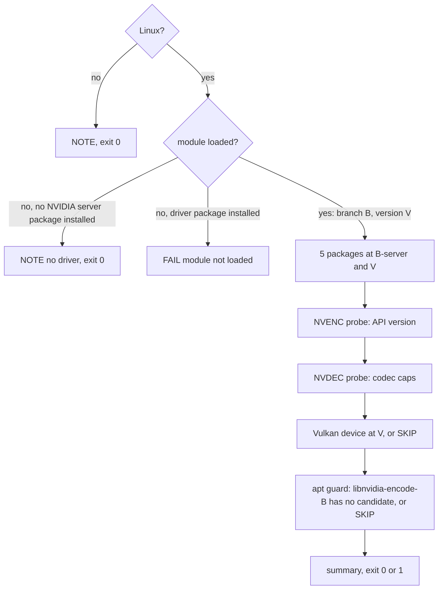

# NVIDIA Userspace Guard and Check - Plan

## Goal Capsule

- **Objective:** On the Linux GPU server, losing NVENC, NVDEC, Vulkan, CUDA, or `nvidia-smi` to a package change is
  reported by one command, and installing a package that would swap the driver's userspace is refused by apt. Both hold
  for whichever driver branch Brett runs, and the runbook says how to stay there.
- **Means:** a check command that reads the branch from the loaded kernel module (KTD1, KTD2, KTD3); an apt preferences
  guard on the non-server driver families (KTD5) with a copy-deploy script (KTD6); and runbook and solutions docs (U5,
  U6).
- **Authority:** Brett (the operator) decides the driver branch and runs every root command. The research report at the
  prime's `.context/nvidia-driver/report.md` holds the evidence and the recommendation. The brief in
  `.git/agent-slot-prompt.md` sets scope and limits; this plan decides mechanism within them.
- **Execution profile:** one PR to `dev`. Every unit runs without root: apt changes are simulated, and the guard and
  check are proven against real apt in a sandbox and against the live box read-only.
- **Stop conditions:**
  - A live probe on the server would need a driver change, module reload, reboot, or GPU-consumer restart before
    2026-11-28 12:00 CST: stop and report instead.
  - A push is denied for a path outside the slot's recorded scope: stop and ask the coordinating session for the grant.
  - The guard blocks a `-server` package or the container toolkit in any simulation: stop, because a wrong pin would
    block driver installs.
- **Who finishes:** this slot builds, reviews, and readies the PR. Brett merges, then runs the deploy and the install
  commands in the runbook.

---

## Product Contract

### Summary

Add `nvidia-gpu-verify`, a read-only check of the NVIDIA userspace and its video engines, and an apt pin that refuses
the non-server NVIDIA driver packages from any repository. Deploy the pin with `scripts/nvidia-deploy.sh`, test both
against real apt resolution in a sandbox, and bring the runbook and solutions docs to present truth.

### Problem Frame

The server runs `nvidia-headless-580-server-open`. NVENC and NVDEC have never stayed installed: Procedure D installed
the encode and decode libraries on 2026-10-14 and they were removed 35 minutes later, once the Remotion consumer showed
no gain. A parade consumer now needs them. Every way of losing them is silent. A branch change that names only the
headless metapackage drops the Vulkan ICD and `nvidia-smi` (simulated: 12 removed, 9 installed, no `libnvidia-gl`). The
obvious package name `libnvidia-encode-580` removes the server driver (8 removed). NVIDIA's CUDA repository now also
ships unversioned driver packages, so `apt install cuda-drivers` removes it as well (11 removed). A point upgrade from
unattended-upgrades leaves the loaded module and the libraries at different versions until a reboot. Nothing reports any
of these until a consumer fails.

### Requirements

**The check**

- R1. One command reports, for the loaded driver branch, whether `nvidia-utils`, `libnvidia-compute`, `libnvidia-gl`,
  `libnvidia-encode`, and `libnvidia-decode` are installed as `-<branch>-server` at the loaded module's version.
- R2. The check fails, with a verbatim fix command on the next line, when any of those is missing or at another version,
  and names a pending reboot when every one is at a version other than the loaded module's.
- R3. The check proves NVENC and NVDEC answer through the driver without opening an encode or decode session, and prints
  the NVENC API version the driver supports.
- R4. The check proves Vulkan enumerates the NVIDIA GPU at the loaded version.
- R5. The check fails when apt would still offer a non-server NVIDIA package for the loaded branch, naming the deploy
  command.
- R6. The check exits 0 with a note on macOS and on a Linux host with no NVIDIA driver, so it is safe on every host the
  `local` package reaches.

**The guard**

- R7. apt refuses every non-server NVIDIA driver package, versioned or unversioned, from any repository, while every
  `-server` package, the container toolkit, `libnvidia-egl-wayland1`, the CUDA toolkit, and `dist-upgrade` resolve as
  before.
- R8. The guard deploys from the repo by copy, with a no-root check that reports drift, as the repo's other `/etc`
  config does.

**Documentation**

- R9. The runbook states the canonical package set, the guard, the check, the NVENC API compatibility of ffmpeg builds,
  and a branch-change procedure that names every add-on package.
- R10. A solutions doc records the NVENC API version as the axis between driver branch and ffmpeg build, and the wider
  form of the package-name trap.

### Scope Boundaries

Considered and not built:

- **A JSON output mode for the check.** The brief adds one check and no output mode, and `qmd-gpu-verify`, its
  precedent, is text-only with stable line prefixes. A caller that branches on fields would change this call.
- **An alert outside a session, or an apt hook, that runs the check.** The check runs at Procedure B, D, and E, after
  every deploy, and daily from a systemd user timer on the Linux server, which the operator chose over a live bats test;
  a second daily timer, `nvidia-lts-watch`, waits for 620. Both report through the failed-units notice at session start.
  Evidence of a failure going unseen between sessions would change this call.
- **An encode or decode session in the probes.** It would prove the encoder end to end. It also consumes a GeForce NVENC
  session while long encodes run, and the session-free calls plus a measured ffmpeg run on the live box (U5 docs)
  already show the libraries work. A probe passing while real encodes fail would change this call.
- **A guard on branch changes from unattended-upgrades.** The GPU host plan's U2
  (`docs/plans/2026-10-23-1750-feat-gpu-host-performance-plan.md`) owns that blacklist; the check reports the mismatch
  it prevents.

Not in scope for this brief:

- Running any apt change, the deploy, or a reboot; Brett runs them from the runbook and the report.
- The runbook's persistence-mode text (A.3 step 5), which the GPU host plan's R8 owns.
- Declaring the NVIDIA packages in `config/linux/apt-packages.txt`, which the declaration reconciliation plan owns.

### Sources

- Research report with every simulation, measurement, and source: the prime's `.context/nvidia-driver/report.md`.
- `docs/solutions/configuration-fixes/nvidia-addon-userspace-packages-match-driver-branch-and-version.md` (the
  plain-name trap and Procedure D's shape).
- `docs/solutions/configuration-fixes/nvidia-driver-dkms-headless-gpu-server-2026-05-18.md` (why DKMS and server-open).
- NVIDIA branch lifecycle and `releases.json`; nv-codec-headers README per tag; Ubuntu Server's NVIDIA driver page,
  which also says `nvidia-fabricmanager-NNN` and `libnvidia-nscq-NNN` match the `-server` drivers despite their names.

---

## Planning Contract

### Key Technical Decisions

- KTD1. **The check reads branch and version from the loaded kernel module.** `/proc/driver/nvidia/version` names the
  version the GPU is actually running, so the check holds for any branch with no configuration, and a userspace upgrade
  awaiting a reboot shows up as a version difference. The metapackage name would miss that case and would differ between
  open, closed, and DKMS flavors. A test seam, `NVIDIA_GPU_VERIFY_PROC_VERSION`, points the check at a fixture file,
  following `SYSCTL_PROC_DIR` in `scripts/sysctl-deploy.sh`.
- KTD2. **The required userspace set is five packages, stated once, in the check.** They are `nvidia-utils`,
  `libnvidia-compute`, `libnvidia-gl`, `libnvidia-encode`, and `libnvidia-decode`, each `-<branch>-server`. Each one is
  either something the headless metapackage leaves out or the first thing the trap removes. Their version must equal the
  loaded module's upstream version (the Debian version up to its first `-`). The open and closed server flavors share
  these names. Detecting non-server packages separately is unnecessary: they conflict with the `-server` ones, so a swap
  always shows up as a missing `-server` package.
- KTD3. **NVENC and NVDEC are probed by two session-free driver calls, from a stdlib Python block inside the bash
  check.** `NvEncodeAPIGetMaxSupportedVersion` (libnvidia-encode) returns the driver's NVENC API version, which is what
  decides which ffmpeg builds work. `cuvidGetDecoderCaps` (libnvcuvid, under a retained CUDA primary context) reports
  H.264, HEVC, and AV1 decode support. Neither opens a session, so neither takes one of GeForce's capped NVENC sessions
  from a running encode. Measured on the server with the 580 libraries unpacked from their `.deb`: `api=13.0`, all three
  codecs supported, 0.47 s and 110 MB RSS. The block runs as `python3 -I -B`, so neither the user's site-packages nor
  the working directory can shadow `ctypes`, and no bytecode lands beside the interpreter. It runs under `timeout 30`,
  because `cuInit` can hang on a GPU wedged after an Xid; exit 124 is a FAIL naming the timeout, with
  `next: nvidia-smi`. A CUDA call that fails reports its name through `cuGetErrorName`
  (`cuDevicePrimaryCtxRetain=CUDA_ERROR_OUT_OF_MEMORY`, the likely one on a GPU shared with ollama and qmd), and that
  FAIL's `next:` is `nvidia-smi`. The check stays bash because its other steps are command calls, as in
  `qmd-gpu-verify`.
- KTD4. **Vulkan is proven with `vulkaninfo --summary`.** It must list a device with `driverName = NVIDIA` and
  `driverInfo` equal to the loaded version. It runs under `timeout 30` as well. When `vulkaninfo` is absent (exit 127,
  which `timeout` passes through) the step is SKIP, not FAIL: the runbook makes `vulkan-tools` optional, and KTD2
  already fails a missing `libnvidia-gl`.
- KTD5. **The guard pins everything built from the non-server driver source to -1, from any origin, in a file that sorts
  first.** `config/apt/preferences.d/00-nvidia-server-branch.pref` holds one stanza:
  `Package: src:/^nvidia-graphics-drivers(-[0-9]+)?$/ /^nvidia-open(-[0-9]+)?$/ /^cuda-drivers(-[0-9]+)?$/`, then
  `Pin: version *` and `Pin-Priority: -1`.
  - Every binary of the non-server driver, Ubuntu's or the CUDA repository's, versioned or unversioned, firmware
    included, is built from source `nvidia-graphics-drivers` or `nvidia-graphics-drivers-NNN`, and every `-server`
    binary from `nvidia-graphics-drivers-NNN-server` [measured: `apt-cache show` over 16 names]. So one source rule
    covers a family NVIDIA adds later, where a list of binary families has to name each one, the non-server firmware
    among them, whose install alone removes the whole `-server` driver (12 packages). The two name regexes cover the
    metapackages built from their own sources.
  - `nvidia-fabricmanager-NNN`, `libnvidia-nscq-NNN`, `libnvidia-egl-wayland1`, `libnvidia-container*`, and
    `nvidia-container-toolkit` come from other sources and stay installable.
  - apt takes the first matching pin in file order. NVIDIA's `nvidia-driver-pinning-<version>` package installs
    `nvidia-driver-pin`, which pins the non-server source at 1000; sorted after it, the guard loses
    (`libnvidia-encode-580` regains a candidate), and sorted first with `00-`, it holds [measured: both orders].
  - Against this box's real apt (`-o Dir::Etc::PreferencesParts`), the stanza refused 22 non-server names, the firmware,
    `cuda-drivers`, and `nvidia-open` among them, and kept every `-server`, container, and CUDA toolkit name. Procedure
    D (2 new, 0 removed), the 615 swap with its add-ons (14 in, 12 out), `cuda` (68 new, 0 removed),
    `cuda-toolkit-12-8`, and `nvidia-container-toolkit` resolved as before, and `dist-upgrade` stayed at 59 packages.
    Simulating an install of each of 74 non-server names left five that still remove `-server` packages, the same five a
    binary-family list leaves: another branch's add-ons (`nvidia-fabricmanager-615`, `nvidia-fabricmanager-dev-615`,
    `nvidia-imex-615`) and Debian's `primus-vk` (`nvidia-primus-vk-common`, `nvidia-primus-vk-wrapper`), which conflict
    with `libnvidia-gl-580-server`. Neither is a non-server driver package; the runbook names the branch trap (U5).
- KTD6. **`scripts/nvidia-deploy.sh` copies the guard, modelled on `scripts/sysctl-deploy.sh`.** It has the same three
  modes: deploy as root with `install -m 0644`; `--check`, which compares by `cmp` and needs no root; and `--dest DIR`
  for tests. It is Linux-only, a no-op on macOS, and exits 0, 1, or 2. It copies every file in
  `config/apt/preferences.d/`. The name is the one the GPU host plan's U2 gives its NVIDIA deployer, so U2 extends this
  script instead of adding a second one. Whether apt honours the copied file is a resolution question, and the check
  answers it (KTD7). The deploy's last line names that command.
- KTD7. **The check proves the guard through apt itself.** `apt-cache policy libnvidia-encode-<branch>` must show
  `Candidate: (none)`, and so must unversioned `libnvidia-encode` when apt knows it (only the CUDA repository ships it).
  When apt knows neither name, the step is SKIP. A failure names `sudo ~/dotfiles/scripts/nvidia-deploy.sh`. Asking apt
  rather than comparing files also catches a later preferences file that raises the pin.
- KTD8. **Output follows `qmd-gpu-verify`.** Lines start with `PASS`, `FAIL`, `SKIP`, `INFO`, or `NOTE`. Every FAIL is
  followed by an indented `next:` line holding one command that is safe to paste. Every FAIL is one line: a probe that
  prints no `nvenc` or `nvdec` answer, such as one that dies with a traceback, is reported with the last line of its
  output only. A summary line closes the run. Exit 0 means no FAIL, 1 means at least one, and 2 is a usage error. `-h`
  and `--help` print usage, which says the check is read-only and that a `next:` line starting with `sudo` needs root,
  so an agent without it hands that line to the operator. A missing package's `next:` pins `=<Debian version>`, taken
  from an installed package of the branch (`nvidia-kernel-common-<B>-server` or one of the five) at the loaded version,
  so the fix never reaches the trap. When no such package exists but some `-server` NVIDIA userspace is installed,
  either a reboot is pending (an upgrade within the branch, or a branch change whose new module is not loaded yet) or
  another branch's package replaced this one. The package step then prints one FAIL naming the loaded module and the
  installed `-server` userspace with both causes, with `next: /usr/sbin/dkms status nvidia` and no install line, which
  could undo a branch change. `dkms status` needs no root [measured: exit 0 from the slot], and the full path reaches it
  from a PATH without `/usr/sbin`, as an agent slot's is; `sudo` would make the line one that only the operator can run.
  A reboot is the fix only when DKMS shows the new module built; after the branch trap it is not, and a reboot would
  come up with no module. The NVENC, NVDEC, and Vulkan steps print SKIP naming the mismatch, since a userspace at
  another version than the module fails them all. Status and version come from
  `dpkg-query -f='${db:Status-Abbrev} ${Version}'` split by `read`, since the abbreviation is `ii` with a trailing
  space.
- KTD9. **The guard's suite drives real apt in a throwaway repository.** It builds a flat `file:` repo of stub packages
  in `setup_file`, with every `Dir::State`, `Dir::Cache`, and `Dir::Etc` path redirected into `BATS_FILE_TMPDIR` and
  `Debug::NoLocking`. Each stub carries the `Source:` its real package has, so the `src:` rule is exercised [measured:
  apt honours `src:` pins on stub sources]. It runs `apt-get update` once (0.6 s, no root), and the tests assert
  `apt-cache policy` candidates against a must-block list and a must-allow list, with the guard alone and with a second
  file that sorts after it and pins the must-block names at 1000. This tests what apt does with the rule rather than
  what a grep thinks it does. It needs apt, so those tests call `require_linux`; CI runs on Ubuntu.

### High-Level Technical Design

The check's steps in order. Each step prints a line, and the run exits 1 when any step printed FAIL.



### Assumptions

- Brett accepts the report's recommendation: stay on 580, run Procedure D, move to 620 once it leaves -proposed. Nothing
  in this plan depends on that choice; the runbook's branch procedure takes the branch as `B`.
- `python3` is present on every Linux host that has an NVIDIA driver. Ubuntu ships it, and the check's NVENC step fails
  naming it when it is missing.
- Brett runs the operator grant for `config/apt/**`, `stow/local/dot-local/bin/**`, `scripts/**`, `tests/**`,
  `AGENTS.md`, and `README.md` that the coordinating session passed on. The slot's recorded scope kept only the docs
  globs.

---

## Implementation Units

### U1. The apt guard and its deploy script

- **Goal:** the guard file exists and deploys by copy (R7, R8).
- **Requirements:** R7, R8; KTD5, KTD6, KTD9.
- **Dependencies:** none.
- **Files:**
  - `config/apt/preferences.d/00-nvidia-server-branch.pref` (create)
  - `scripts/nvidia-deploy.sh` (create)
  - `tests/nvidia-deploy.bats` (create)
- **Approach:**
  1. The guard holds the KTD5 stanza under comment lines that say why the non-server source is pinned, why the file
     sorts first, and which plain-named packages serve the `-server` driver.
  2. The deploy script follows `scripts/sysctl-deploy.sh` step for step: usage, mode parse, platform and root
     pre-flight, copy loop with `cmp`, `--check` drift report, closing line naming `nvidia-gpu-verify`.
  3. The suite marks itself `# run-tests: parallel` and builds the apt sandbox and stubs once in `setup_file`.
- **Patterns to follow:** `scripts/sysctl-deploy.sh` and `tests/sysctl-deploy.bats`; `tests/lib/platform.bash`
  (`stub_uname`, `require_linux`).
- **Test scenarios:**
  - `--dest` copies the guard byte for byte at mode 0644 and prints which file it copied.
  - A second `--dest` run reports nothing to copy.
  - `--dest` overwrites a target that differs from the repo.
  - `--dest` into a missing directory exits 1 naming the path.
  - `--check` exits 0 when the deployed copy matches, and 1 naming the file when it differs or is missing.
  - On a stubbed Darwin, deploy and `--check` exit 0 with a note.
  - Deploy without root exits 1 naming sudo.
  - An unknown flag, a bare `--dest`, and two modes together exit 2.
  - Sandbox apt with the guard gives no candidate for each must-block name, each stub carrying its real `Source:`:
    `libnvidia-encode-580`, `libnvidia-decode-580`, `libnvidia-compute-580`, `libnvidia-gl-580`,
    `libnvidia-gpucomp-580`, `nvidia-utils-580`, `nvidia-headless-580-open`, `nvidia-headless-no-dkms-580-open`,
    `nvidia-driver-580-open`, `nvidia-dkms-580-open`, `nvidia-kernel-open-575`, `nvidia-kernel-common-580`,
    `nvidia-firmware-580-580.178.04`, `libnvidia-encode-620`, the unversioned `libnvidia-encode`, `libnvidia-compute`,
    `nvidia-driver-open`, `nvidia-dkms-open`, and the metapackages `nvidia-open`, `nvidia-open-580`, `cuda-drivers`,
    `cuda-drivers-580`.
  - Sandbox apt with the guard keeps a candidate for each must-allow name: the `-server` and `-server-open` siblings of
    the names above, `nvidia-firmware-580-server-580.178.04`, `nvidia-container-toolkit`, `libnvidia-container1`,
    `libnvidia-egl-wayland1`, `nvidia-fabricmanager-580`, `libnvidia-nscq-580`, `cuda-toolkit-12-8`, `nvidia-gds-12-8`.
  - Sandbox apt without the guard offers every must-block name. That proves the fixture is live and the guard does the
    blocking.
  - Sandbox apt with the guard and a second file, `nvidia-driver-pin`, that sorts after it and pins the must-block names
    at 1000 (the shape of NVIDIA's pinning package) still gives no candidate for any of them.
- **Test seam:** the sandbox catches a rule that apt reads differently than intended. It misses priority interactions
  with the live box's other preferences files, which U4's live simulation covers.
- **Verification:** the suite passes on Linux; the guard without its `src:` rule turns the must-block scenario red, and
  the guard renamed to sort after `nvidia-driver-pin` turns the later-pin scenario red.

### U2. The check command

- **Goal:** `nvidia-gpu-verify` reports the five packages, NVENC, NVDEC, Vulkan, and the guard for the loaded branch (R1
  to R6).
- **Requirements:** R1, R2, R3, R4, R5, R6; KTD1, KTD2, KTD3, KTD4, KTD7, KTD8.
- **Dependencies:** U1. The guard step's `next:` names U1's script.
- **Files:**
  - `stow/local/dot-local/bin/nvidia-gpu-verify` (create)
  - `tests/nvidia-gpu-verify.bats` (create)
- **Approach:**
  1. Header comment in the `qmd-gpu-verify` shape: what each step proves, why the probes are session-free, the exit
     codes, and the test seam variable.
  2. Steps in the High-Level Technical Design order. Shell constructs stay within bash 3.2, so the bash 4.4 guard block
     is not needed.
  3. The probe block prints one machine-shaped line per engine (`nvenc ok api=13.0`, `nvdec ok h264=yes ...`,
     `... load-failed <reason>`, `nvdec cuda-failed <call>=<CUDA error name>`). The bash side turns each into PASS or
     FAIL with a `next:` line: the pinned install when the package is missing, the `ldconfig -p` lookup for the library
     when it is installed, and `nvidia-smi` for a CUDA failure or a timeout.
- **Patterns to follow:** `stow/local/dot-local/bin/qmd-gpu-verify` (output and summary); `tests/qmd-serve.bats`
  (stubbed `nvidia-smi`).
- **Execution note:** stubs for `dpkg-query`, `apt-cache`, `vulkaninfo`, `python3`, and `timeout` are written once in
  `setup_file`, mode 555. Each reads its answers from files the test writes, so a test changes only the answer it is
  about. The `python3` stub runs the real interpreter when the test writes no canned probe, so the real-probe scenario
  runs real Python. The `timeout` stub exits 124 when the test asks for a timeout and otherwise runs its command
  directly, so the suite needs no GNU `timeout` on a Mac.
- **Test scenarios:**
  - A loaded 580.178.04 module with all five packages at `580.178.04-0ubuntu0.24.04.1`, both probes ok, Vulkan at
    580.178.04, and the guard in effect: exit 0, five package PASS lines, `NVENC API 13.0`, and the summary line.
  - `libnvidia-encode-580-server` not installed: FAIL naming it, with `next:` pinning
    `libnvidia-encode-580-server=580.178.04-0ubuntu0.24.04.1`. Exit 1.
  - The same check with a 615.71.09 module and `-615-server` packages passes. That proves nothing is pinned to 580.
  - Every package at 580.196.07 while the module is 580.178.04: one FAIL naming both versions with
    `next: /usr/sbin/dkms status nvidia`, and three SKIPs (NVENC, NVDEC, Vulkan), not five mismatched packages.
  - Three packages at 580.196.07 and encode and decode missing, module 580.178.04: the same FAIL and no install `next:`
    line.
  - A 580.178.04 module with only `nvidia-kernel-common-615-server` installed, the branch trap's leftover: the same FAIL
    naming 615.71.09, and no `next:` line that installs a 580 package or reboots.
  - One package at another version while the rest match: FAIL naming that package and both versions.
  - No module loaded but `nvidia-kernel-common-580-server` installed: FAIL module not loaded, with
    `next: /usr/sbin/dkms status nvidia`.
  - No module and no NVIDIA server package: NOTE and exit 0, with no other step run.
  - A stubbed Darwin `uname`: NOTE and exit 0.
  - The probe reports `nvenc load-failed`: FAIL naming `libnvidia-encode`. The probe reports `nvdec load-failed`: FAIL
    naming `libnvidia-decode`.
  - The probe dies with a three-line Python traceback and prints no answer: one FAIL line per engine carrying the
    traceback's last line, and no traceback line elsewhere in the output.
  - The probe reports `nvdec cuda-failed cuDevicePrimaryCtxRetain=CUDA_ERROR_OUT_OF_MEMORY`: FAIL carrying that name,
    with `next: nvidia-smi`.
  - The probe times out (stubbed `timeout` exits 124): FAIL naming the 30 s limit, with `next: nvidia-smi`; the same for
    `vulkaninfo`.
  - The real embedded probe, run on a host without `libnvidia-encode.so.1` (CI): the NVENC and NVDEC steps FAIL with the
    loader's reason. Skipped when the host has the library.
  - `vulkaninfo` lists only llvmpipe: FAIL. `vulkaninfo` absent: SKIP, and the exit stays 0 when all else passes.
  - `apt-cache policy` offers a candidate for `libnvidia-encode-580`: FAIL whose `next:` is the deploy command; the same
    when only unversioned `libnvidia-encode` has one. apt knows neither canary: SKIP.
  - `--help` prints usage and exits 0; an unknown argument exits 2.
- **Test seam:** stubs catch the decision logic and every message. They miss whether the ctypes calls work against a
  real driver, which U4 measures live.
- **Verification:** the suite passes; `scripts/lint-shell` passes on the new file.

### U3. The GPU host plan's deployer line

- **Goal:** the GPU host plan's U2 extends `scripts/nvidia-deploy.sh` instead of creating a second NVIDIA deployer
  (KTD6).
- **Requirements:** KTD6.
- **Dependencies:** U1.
- **Files:**
  - `docs/plans/2026-10-23-1750-feat-gpu-host-performance-plan.md` (modify: U2's file list and Approach say the script
    exists and already deploys `config/apt/preferences.d/`)
- **Approach:** change only the U2 lines that create the script, so the other plan stays its own owner.
- **Test expectation:** none -- a planning doc's file list.
- **Verification:** U2 reads as an extension of the existing script; no other line of that plan changes.

### U4. Live verification on the server, read-only

- **Goal:** the check, the probes, and the guard behave on the real box as the suites claim, with no change to the box.
- **Requirements:** R1 to R7.
- **Dependencies:** U1, U2.
- **Files:** none committed. The evidence goes in the PR body.
- **Approach:**
  1. Run the check from the slot under `gtime -f '%e s %M KB'`, so the PR body carries its real time and peak memory.
     Expected today: FAIL for `libnvidia-encode` and `libnvidia-decode` with pinned `next:` lines, NVENC and NVDEC FAIL,
     Vulkan PASS at 580.178.04, and the guard FAIL with the deploy command.
  2. Rerun it with `LD_LIBRARY_PATH` pointing at the 580 encode and decode libraries unpacked from `apt-get download`.
     The two probes then PASS (`api=13.0`, three codecs), which proves the ctypes calls against the real driver.
  3. Run `apt-get install -s` with `-o Dir::Etc::PreferencesParts` pointing at a copy of `/etc/apt/preferences.d` plus
     the repo's guard and a copy of the `nvidia-driver-pin` file NVIDIA's `nvidia-driver-pinning-580` package installs.
     The traps (`nvidia-firmware-580-580.178.04`, `libnvidia-encode-580`, `cuda-drivers`, `nvidia-open`) must fail to
     resolve, and the Procedure D (2 new, 0 removed), branch-swap (14 new, 12 removed), and `cuda` (68 new, 0 removed)
     sets must stay unchanged.
  4. Run `scripts/nvidia-deploy.sh --check`, which reports the guard as not deployed (exit 1).
- **Execution note:** no session-opening encode before 2026-11-28 12:00 CST; the probes open none.
- **Test expectation:** none -- this unit measures U1 and U2 on the real box.
- **Verification:** each expected line above appears; nothing on the box changed (`dpkg -l` and `/etc/apt/preferences.d`
  identical before and after).

### U5. Runbook to present truth

- **Goal:** `docs/runbooks/headless-gpu-server-nvidia-driver.md` states the canonical set, the guard, the check, and how
  to change branch (R9).
- **Requirements:** R9.
- **Dependencies:** U1, U2.
- **Files:**
  - `docs/runbooks/headless-gpu-server-nvidia-driver.md` (modify)
  - `AGENTS.md` (modify: an `### NVIDIA apt guard (config/apt/preferences.d/)` section beside the other `/etc` config
    sections, naming `nvidia-gpu-verify` as the command that proves apt honours the guard, and stating that the guard
    serves `-server`-driver hosts only and that it does not refuse another branch's `-server` add-ons)
  - `README.md` (modify: the `config/` tree line, the `scripts/` tree line, and a row in the local commands table)
- **Approach:**
  1. **Current canonical state:** the five-package set at the driver's exact version, the guard, and the check as the
     arbiter. The check's section opens with how to reach it on a host that just pulled the change, since a pull relinks
     only the `claude` and `secrets` packages: `cd ~/dotfiles && scripts/stow-deploy --headless --only local`, then
     `nvidia-gpu-verify`. It shows U4's healthy-probe output, trimmed, and one FAIL with its `next:` line, and says that
     a `next:` starting with `sudo` is the operator's to run. When the guard step fails on a host where
     `scripts/nvidia-deploy.sh --check` reports the guard deployed, a preferences file sorting before it overrides it,
     and `apt-cache policy libnvidia-encode-<B>` shows the winning pin.
  2. **Procedure D:** both libraries named at `=$V` and `NEEDRESTART_MODE=l`, with the install command taken from the
     check's `next:` line or built from the loaded module's branch and version, and a simulation that must show 0 to
     remove before the real run. It names the branch trap with its measured examples: an add-on of another branch
     (`nvidia-fabricmanager-615`, `libnvidia-encode-615-server`) installs that branch's `nvidia-kernel-common` and
     removes the loaded one, which the guard does not refuse. The runbook states in present tense that the encode and
     decode libraries are optional, absent until a consumer needs NVENC or NVDEC, and installed by Procedure D; the
     2026-10-14 run stays in the report and git history. Add a table of NVENC API version, nv-codec-headers, minimum
     driver, and example builds (BtbN n8.1 versus n9.0, jellyfin-ffmpeg, Ubuntu's ffmpeg).
  3. **Procedure E, changing driver branch:** every add-on named with the branch as `B`, the simulation's expected
     shape, DKMS status, reboot, `qmd-llama-rebuild.sh`, the check, and rollback by naming the old branch's set. Branch
     type matters: prefer an NVIDIA Long Term Support or Production branch from noble-updates or noble-security, since
     Ubuntu transitions a New Feature Branch to the next supported one. The guard serves `-server`-driver hosts only:
     moving a host to the non-server family starts by removing `/etc/apt/preferences.d/00-nvidia-server-branch.pref`,
     since the guard refuses every package of that family.
  4. **Procedure B:** gains the check.
  5. **A.4's closing lockdown sentence:** names the apt guard (`config/apt/preferences.d/00-nvidia-server-branch.pref`,
     deployed by `scripts/nvidia-deploy.sh`) as the one apt pin, and keeps "no unattended-upgrades blacklist and no
     hold", since the GPU host plan's U2 owns the blacklist; it says the two daily timers report drift and change
     nothing.
  6. **"What this runbook deliberately does not do":** names what the timers do not do: alert outside a session.
  7. Every new section is written to the repo's present-tense, no-history rule.
- **Test expectation:** none -- prose. The release-docs and markdown gates in `pre-push` check it.
- **Verification:** every command in the runbook matches a simulation in the report or a script in this PR.

### U6. Solutions doc

- **Goal:** the durable lessons reach `docs/solutions/` (R10).
- **Requirements:** R10.
- **Dependencies:** U4, since the doc quotes its measurements.
- **Files:**
  - `docs/solutions/configuration-fixes/nvenc-api-version-decides-ffmpeg-build-per-nvidia-driver-branch.md` (create, in
    the solutions repo)
  - `docs/solutions/configuration-fixes/nvidia-addon-userspace-packages-match-driver-branch-and-version.md` (modify: the
    unversioned CUDA-repo names, the headless-only swap, and the guard)
- **Approach:** published with `sd-commit-doc` from the slot's solutions worktree, not in the dotfiles PR. The new doc
  covers:
  - the probe that reads the driver's NVENC API version
  - the nv-codec-headers floors
  - BtbN's header choice per ffmpeg version
  - branch types and Ubuntu's transitions
- **Test expectation:** none -- prose.
- **Verification:** `qmd` finds the new doc for "NVENC API version driver ffmpeg"; both docs pass `/unslop`.

---

## Verification Contract

| Gate              | Command                                                                                                                                                                                                                     | Proves                                                  |
| ----------------- | --------------------------------------------------------------------------------------------------------------------------------------------------------------------------------------------------------------------------- | ------------------------------------------------------- |
| New suites        | `scripts/run-tests tests/nvidia-deploy.bats tests/nvidia-gpu-verify.bats`                                                                                                                                                   | U1, U2 behavior, including real apt resolution          |
| Lint              | `scripts/lint-shell` over the new script, the check, and both suites                                                                                                                                                        | ShellCheck and the bash-version guard                   |
| Full local mirror | `pre-push` (backgrounded `git push` with its timeout)                                                                                                                                                                       | every CI job, the core-env guard, and test-cost budgets |
| Red proof         | Drop the guard's `src:` pattern and run its suite, then restore it; rename the guard so it sorts after `nvidia-driver-pin` and run it again. Drop the version comparison from the check and run its suite, then restore it. | the new tests fail without the code they cover          |
| Live, read-only   | U4 steps 1 to 4                                                                                                                                                                                                             | the probes and guard against the real driver and apt    |

## Definition of Done

- U1, U2, U3, and U5 are in one PR to `dev`, every check is green, and U4's live output is in the PR body.
- Each new test was seen failing against the unfixed code, with that output quoted in the PR.
- `/compound-engineering:ce-code-review` and `/devex-review` each ran one round, with verdicts in PR comments and every
  in-scope finding fixed.
- U6 is published through `sd-commit-doc`.
- No scratch files, unpacked `.deb` trees, or dead-end code remain in the diff or the slot.

---

## Review log

- 2026-11-26 15:32 CST: plan written.
- 2026-11-26 15:35 CST: `/compound-engineering:ce-doc-review mode:non-interactive` started.
- 2026-11-26 15:48 CST: `/compound-engineering:ce-doc-review` ended (lite: one reviewer, coherence, feasibility, and
  scope lenses). Applied 4 fixes: the guard gains the non-server firmware family, whose install alone removes the whole
  `-server` driver; the check reports a pending reboot with no install line whenever no package of the loaded branch is
  at the loaded version; the runbook unit rewrites A.4's "No apt pinning"; Procedure D's text stays present tense. One
  advisory: KTD3 credited `charcount` with isolation flags it lacks, and that clause is removed.
- 2026-11-26 15:49 CST: `/plan-eng-review` started.
- 2026-11-26 16:12 CST: `/plan-eng-review` ended (FULL_REVIEW, scope accepted as-is): 11 issues, 0 critical gaps, 0
  unresolved. Applied: the guard becomes one `src:` stanza in `00-nvidia-server-branch.pref`, sorted ahead of NVIDIA's
  `nvidia-driver-pin`; the probe and `vulkaninfo` run under `timeout 30`; CUDA failures carry their error names; the
  pending-reboot and branch-trap shapes point at `sudo dkms status nvidia`; status and version parse with `read`; the
  runbook names the branch trap and the non-server-host rule. Ledger and tasks in the appendix below.
- 2026-11-26 16:20 CST: `/plan-devex-review` started.
- 2026-11-26 16:48 CST: `/plan-devex-review` ended (DX POLISH): score 6/10 to 7/10, TTHW target under 2 minutes, 0
  unresolved. Applied: the pending-reboot and module-not-loaded FAILs point at `/usr/sbin/dkms status nvidia`, which
  needs no root; a probe with no answer is reported on one line; usage says the check is read-only and who runs `sudo`
  lines; the runbook gains the restow step, real output, and the overridden-guard diagnosis; AGENTS.md names the check;
  U4 times the live run. Ledger and tasks in the DX appendix below.
- 2026-11-27 00:48 CST: `/compound-engineering:ce-code-review` round 1 started on PR #541 at `74031bf`.
- 2026-11-27 00:48 CST: `/devex-review` started on PR #541 at `74031bf`.
- 2026-11-27 00:56 CST: `/devex-review` ended (Opus, 384 s): 7/10, 1 P1, 4 P2, 3 nits; verdict in a PR #541 comment. The
  P1 is confirmed by simulation: `apt-get -s remove --autoremove nvidia-utils-570-server` also removes
  `nvidia-utils-580-server`, which only the 570 transitional package holds, and marking it manual first keeps it.
- 2026-11-27 01:20 CST: `/compound-engineering:ce-code-review` round 1 ended (Opus, full depth, 1842 s): Ready with
  fixes, 1 P1, 2 P2, 3 P3, all six confirmed by its validator; verdict in a PR #541 comment. The P1: a half-configured
  `nvidia-dkms` package, which a failed DKMS build in its postinst leaves, makes the DKMS step skip while the first FAIL
  reads as a pending reboot.
- 2026-11-27 01:33 CST: `/compound-engineering:ce-code-review` round 2 started on the two round-1 P1 fixes (the
  half-configured `nvidia-dkms` package and the autoremove trap), run from a clone of the fixed head with base
  `74031bf`.

## Appendix: Engineering Review (plan-eng-review, 2026-11-26)

Target: this plan at `edcc325`. The review ran in an unattended agent slot, where the question tool is denied, so each
choice below is decided from evidence and recorded with it: the repo on `dev`, read-only `apt-cache policy` and
`apt-get install -s` runs against this box's real package lists, a no-root sandbox apt, and a scratch draft of the check
run live (not committed). Brett's limits (no root, no driver change or GPU consumer restart before 2026-11-28 12:00 CST)
held throughout: nothing here installed, removed, or opened an encode session.

### Scope Challenge

- **What already exists.** `stow/local/dot-local/bin/qmd-gpu-verify` (the PASS/FAIL output and summary),
  `scripts/sysctl-deploy.sh` and its suite (the copy-deploy shape), `tests/lib/platform.bash` (`stub_uname`,
  `require_linux`), and apt preferences themselves. Two existing mechanisms were weighed and do not do this job:
  - NVIDIA's `nvidia-driver-pinning-<version>` package (CUDA repository) installs
    `/etc/apt/preferences.d/nvidia-driver-pin`, which pins `src:nvidia-graphics-drivers-580` and its metas at 1000 to
    one version. It locks a version of the non-server family rather than excluding it, and once installed it defeats a
    guard that sorts after it (E-D5).
  - `apt-mark hold` on the `-server` set makes apt refuse the removal, but it also stops the within-branch security
    upgrades that unattended-upgrades applies to those packages.
- **Minimum change.** The guard, its deploy, the check, their suites, and the docs the brief names. Nothing is
  deferrable without leaving the trap open or the docs wrong.
- **Complexity.** 11 paths [counted from U1 to U6's file lists] and 2 new commands. The gate trips; E-D1 settles the
  structure. No feature cut is proposed: each file traces to a requirement.
- **Search.** No new architectural pattern: apt pins, `dpkg-query`, and stdlib `ctypes` are [Layer 1]. No web search
  ran; the apt behavior below is measured, not recalled.
- **TODOS.** The repo tracks no TODOS file; local TODO files are gitignored by policy.
- **Distribution.** The check ships through the `local` stow package; the guard deploys by script on the GPU host.
  Nothing is published.
- **Prior learning applied:** `dotfiles-same-version-all-hosts` (10/10, 2026-09-22). The check and the guard need no
  version-skew handling.
- **Retrospective.** `git log` of the runbook shows 60f8d6b (#277, Procedure D) and bc1d76c (reflow); of
  `scripts/sysctl-deploy.sh`, 3c39261 (#335); of `qmd-gpu-verify`, 1eb131c (#179). No reverts.

```text
REALITY: premise-table pass 18 claims carry receipts (apt simulations, sandbox apt, live draft run, /proc, dpkg); unverified=2 (python3 on every NVIDIA Linux host; Brett runs the operator grant) docs/plans/2026-11-26-1532-feat-nvidia-userspace-guard-and-check-plan.md:199
REALITY: already-done pass origin/dev since 2026-11-25 touches none of the named paths except this plan's own commits 57f7ac3, 2b5e8f1, d8c5e21, edcc325 docs/plans/2026-11-26-1532-feat-nvidia-userspace-guard-and-check-plan.md:1
REALITY: surface-check finding dpkg-query's ${db:Status-Abbrev} is three characters with a trailing space, so splitting on one space misreads every package (F1); dkms status nvidia, NEEDRESTART_MODE (/usr/sbin/needrestart:278), vulkaninfo --summary driverInfo, apt-cache policy on an unknown name (empty, exit 0), and src: regex pins all verified live docs/plans/2026-11-26-1532-feat-nvidia-userspace-guard-and-check-plan.md:170
REALITY: binding-decisions pass no recorded decision touches the NVIDIA driver, apt pins, or GPU checks; Brett's limits in the brief hold docs/plans/2026-11-26-1532-feat-nvidia-userspace-guard-and-check-plan.md:101
REALITY: numbers pass 0.47 s and 110 MB (probe), 0.96 s and 171 MB (whole draft check, gtime), 0.6 s (sandbox update), 59 packages (dist-upgrade), 12 removed (firmware trap), 11 removed (another branch's add-on) are all [measured] docs/plans/2026-11-26-1532-feat-nvidia-userspace-guard-and-check-plan.md:138
REALITY: deferred-asks pass no linked issue; the brief's asks (report, check, guard, deploy step, docs) map to U1 to U6, and the driver update itself stays Brett's to run per the brief docs/plans/2026-11-26-1532-feat-nvidia-userspace-guard-and-check-plan.md:101
REALITY: pr-count pass no ship policy on file; one PR docs/plans/2026-11-26-1532-feat-nvidia-userspace-guard-and-check-plan.md:398
```

Scope result: scope accepted as-is. MODE: FULL_REVIEW.

### Decision ledger

Each choice was decided on its recommendation from the evidence named, because no person answers in the slot.

| ID   | Finding                                                                                         | Evidence                                                                                                            | Options (completeness)                                                                  | Chosen            |
| ---- | ----------------------------------------------------------------------------------------------- | ------------------------------------------------------------------------------------------------------------------- | --------------------------------------------------------------------------------------- | ----------------- |
| E-D1 | Complexity gate: 11 paths, 2 new commands                                                       | each path traces to R1 to R9; the brief names the check, the guard, its deploy, and the docs                        | A) original arrangement; B) fold the deploy into the check (differ in kind)             | A                 |
| E-D2 | A wedged GPU hangs `cuInit` or `vulkaninfo`, and the check never returns                        | the check runs after Xid errors by design (KTD1); no timeout in the draft                                           | A) `timeout 30` on the probe and `vulkaninfo`, 124 is a FAIL (10); B) none (6)          | A                 |
| E-D3 | A CUDA failure prints a bare number                                                             | draft line `cuDevicePrimaryCtxRetain=2`; the GPU is shared with ollama and qmd                                      | A) `cuGetErrorName` plus `next: nvidia-smi` (10); B) number only (7)                    | A                 |
| E-D4 | The guard on a non-server-driver host blocks that host's own driver upgrades                    | no such host in the fleet; the check FAILs on that host's missing `-server` add-ons                                 | A) a runbook and AGENTS line (7); B) a deploy pre-flight that refuses (9)               | A, ceiling below  |
| E-D5 | NVIDIA's `nvidia-driver-pin` (priority 1000) defeats a guard that sorts after it                | sandbox apt, measured: the first matching pin in file order wins                                                    | A) `00-` prefix plus a later-pin sandbox test (10); B) keep the name (5)                | A                 |
| E-D6 | The family list enumerates 20 names and missed the firmware                                     | `apt-cache show` over 16 names: every non-server binary is built from `nvidia-graphics-drivers(-NNN)`; sweeps equal | A) 20 families (8); B) `src:` rule plus the `nvidia-open` and `cuda-drivers` metas (10) | B                 |
| E-D7 | The pending-reboot advice `sudo reboot` is wrong after the branch trap                          | `nvidia-fabricmanager-615` simulation removes the loaded branch (11 removals); a reboot then loads no module        | A) `next: sudo dkms status nvidia`, no install line (10); B) `sudo reboot` (4)          | A                 |
| E-D8 | Another branch's `-server` add-on removes the loaded branch, and neither guard shape refuses it | same simulation; a branch lock would make Procedure E edit the guard first                                          | A) runbook docs with the measured examples; B) a branch lock (differ in kind)           | A                 |
| F1   | `${db:Status-Abbrev}` is `ii` with a trailing space                                             | the draft misread every installed package on the live box                                                           | factual correction, no choice                                                           | parse with `read` |

Each row was auto-decided on its recommended option, because AskUserQuestion is denied in the slot and the brief says to
answer review questions from evidence. E-D4's ceiling: a host running the non-server driver that deploys the guard
cannot upgrade its driver until someone removes the file. Upgrade trigger: the first fleet host that runs the non-server
family; then the deploy gains the pre-flight.

The unversioned-canary scenario (KTD7) and the regression contract (U4 step 3 live, the must-allow sandbox test in CI)
are carried as required proof, not as choices.

Approval readiness: PASS (E-D1 to E-D8 and F1, each an authorized auto-decision under the slot's unattended rule).

### 1. Architecture

```text
 config/apt/preferences.d/00-nvidia-server-branch.pref
        │  scripts/nvidia-deploy.sh: install -m 0644 as root; --check compares by cmp, no root
        ▼
 /etc/apt/preferences.d/ (first matching pin in file order wins) ──read by──▶ apt, on every install and upgrade
                                                                                 ▲
 nvidia-gpu-verify                                                               │ guard step: apt-cache policy
   ├─ /proc/driver/nvidia/version ─▶ branch B, version V                         │ libnvidia-encode-B and
   ├─ dpkg-query ─▶ kernel-common-B-server and the five add-ons at V             │ libnvidia-encode: (none)
   │     └─ none at V but -server userspace present ─▶ one FAIL, three SKIPs ────┤
   ├─ timeout 30 python3 -I -B ─▶ NVENC (libnvidia-encode.so.1), NVDEC (libcuda.so.1, libnvcuvid.so.1)
   └─ timeout 30 vulkaninfo --summary ─▶ an NVIDIA device at V, or SKIP when absent (exit 127)
```

**Two shapes for the guard.** Shape A, the plan's: regexes over 20 named `nvidia-` and `libnvidia-` families plus the
firmware form the doc review added. Shape B: one rule over the non-server source packages,
`src:/^nvidia-graphics-drivers(-[0-9]+)?$/`, plus the two metapackage families built from other sources,
`nvidia-open(-[0-9]+)?` and `cuda-drivers(-[0-9]+)?`. Every binary of the non-server driver, Ubuntu's or the CUDA
repository's, versioned or not, is built from `nvidia-graphics-drivers` or `nvidia-graphics-drivers-NNN`, and every
`-server` binary from `nvidia-graphics-drivers-NNN-server` [measured: `apt-cache show` over 16 names]. B hides the
policy "nothing built from the non-server driver source" behind one pattern, so a family NVIDIA adds later is covered
without an edit; A enumerates families and already missed one (the firmware, found by the doc review). Pick: B (E-D6).

**Red flags.**

- 8, hand-synced list: the five add-ons appear in the check and in the runbook's Procedure E command. Drift is caught
  rather than silent: Procedure E ends by running the check, which fails on any add-on the command left out.
- 6, two ways to do one task: `nvidia-deploy.sh --check` and the check's guard step. They answer different questions
  (the deployed file matches the repo; apt honours it), as KTD7 states, so both stay.
- No shallow module, leakage, temporal split, pass-through, split ownership, or importable internals: each new command
  owns one thing, and the guard file is the one owner of the pin.

**Failure per new path.**

- GPU wedged after an Xid: `cuInit` or `vulkaninfo` can hang, and the check never returns (E-D2).
- A later preferences file raises the pin: NVIDIA's pinning package does exactly that (E-D5); KTD7's apt-based step
  reports it.
- The guard deployed on a host that runs the non-server driver: its driver packages can no longer be upgraded (E-D4).
- Another branch's package installed by mistake: `nvidia-fabricmanager-615` or `libnvidia-encode-615-server` pulls in
  `nvidia-kernel-common-615-server` and removes the loaded 580 branch (11 removals) [measured]. Neither guard shape
  covers the branch axis, and a branch lock would also block Procedure E (E-D8). The check's pending-reboot advice must
  not send the operator into a reboot with no module built (E-D7).

### 2. Code quality

- [INFORMATIONAL] (confidence: 9/10) KTD8, plan line 170 — "`-h` and `--help` print usage. A missing package's `next:`
  pins `=<Debian version>`": parsing `dpkg-query -f='${db:Status-Abbrev} ${Version}'` by its first space reads every
  installed package as a version mismatch, because the abbreviation is `ii` with a trailing space. The scratch draft hit
  this on the live box. Factual correction F1: U2 parses status and version with `read`.
- [INFORMATIONAL] (confidence: 8/10) KTD3, plan line 133 — "`cuvidGetDecoderCaps` (libnvcuvid, under a retained CUDA
  primary context)": a CUDA failure prints a bare number (`cuDevicePrimaryCtxRetain=2`), and the most likely one on a
  GPU shared with ollama and qmd is out of memory. E-D3.
- Error paths otherwise covered: a probe that crashes prints no `nvenc`/`nvdec` line and falls to the FAIL branch; an
  unknown `apt-cache` name prints nothing and the guard step SKIPs.

### 3. Tests

Framework: bats through `scripts/run-tests` (AGENTS.md § Local gates mirror CI).

```text
CODE PATHS                                              USER FLOWS
[+] scripts/nvidia-deploy.sh                            [+] Operator deploys the guard
  ├── [★★★ PLANNED] --dest copy, rerun, overwrite         ├── [★★★ PLANNED] sudo deploy, then the check PASSes
  ├── [★★  PLANNED] missing dest, no root, usage           └── [★★★ PLANNED] --check drift: differs, missing
  ├── [★★  PLANNED] Darwin no-op
  └── guard semantics (real apt sandbox)                 [+] Operator runs the check
      ├── [★★★ PLANNED] must-block: no candidate          ├── [★★★ PLANNED] healthy 580, healthy 615
      ├── [★★★ PLANNED] must-allow: candidate kept        ├── [★★★ PLANNED] missing add-on, pinned next:
      ├── [★★★ PLANNED] fixture live without guard        ├── [★★★ PLANNED] pending reboot: 3 shapes
      ├── [GAP]         a later pin file at 1000 (E-D5)   ├── [★★  PLANNED] no module, no driver, Darwin
      └── [GAP]         src: matching on stub sources     └── [GAP]         wedged GPU (E-D2)
[+] stow/local/dot-local/bin/nvidia-gpu-verify
  ├── packages: [★★★ PLANNED] match, missing, mismatch, pending reboot
  ├── probes:   [★★★ PLANNED] canned ok, load-failed; real probe on a host without the libraries
  ├── vulkan:   [★★★ PLANNED] NVIDIA at V, llvmpipe only, absent
  └── guard:    [★★  PLANNED] versioned canary offered, neither known
                [GAP]         unversioned canary offered (KTD7 names it; required proof)

COVERAGE: 22/26 paths planned  |  GAPS: 4, each closed by a decision below or carried as required proof
```

Gaps:

- Unversioned canary (KTD7 already requires it): the guard-candidate scenario also runs with only `libnvidia-encode`
  offered. Value: protects=the CUDA-repository canary; fails_when=the step checks only the versioned name; why_new=the
  planned scenario offers only `libnvidia-encode-580`; seam=none; no_claim=real apt (stubbed apt-cache). Carried as
  required proof of KTD7, no question.
- A later pin at 1000 (E-D5), `src:` matching on stub `Source:` fields (E-D6), and a probe timeout (E-D2): each lands
  with its decision.

Regression contract, carried as required proof: under the guard, Procedure D's install (2 new, 0 removed), the 615 swap
with its add-ons, `cuda-toolkit-12-8`, `nvidia-container-toolkit`, and `dist-upgrade` (59 packages) resolve as they do
without it. U4 step 3 holds this live; the sandbox's must-allow test holds it in CI.

Test plan artifact: `~/.gstack/projects/brettdavies-dotfiles/brett-dev-eng-review-test-plan-20261126-160927.md`.

### 4. Performance

- [INFORMATIONAL] (confidence: 7/10) No per-request or looped path. The whole draft check takes 0.96 s and 171 MB peak
  RSS [measured: `gtime`]. The CUDA context costs GPU memory for under a second [VRAM not measured]; on a full GPU it
  fails cleanly, which E-D3 names.

### Outside voice

Disabled by configuration (`codex_reviews: disabled`); no outside reviewer ran, and none substitutes for it.

### NOT in scope

- A branch lock in apt preferences: it would make Procedure E edit the guard first; the GPU host plan's U2 owns upgrade
  holds (E-D8).
- A deploy pre-flight that refuses a host running the non-server driver (E-D4 chose the docs).
- JSON output and session-opening probes, as the plan's Scope Boundaries already state.

### What already exists

`qmd-gpu-verify`, `scripts/sysctl-deploy.sh`, `tests/lib/platform.bash`, and apt's own pin resolution are reused as
patterns; NVIDIA's pinning package and `apt-mark hold` were weighed and rejected above. Nothing is rebuilt.

### Failure modes

| Path              | Realistic failure                        | Test                  | Handling                           | Silent?              |
| ----------------- | ---------------------------------------- | --------------------- | ---------------------------------- | -------------------- |
| NVENC/NVDEC probe | wedged GPU hangs `cuInit`                | stubbed `timeout`     | FAIL after 30 s (E-D2)             | no                   |
| NVDEC probe       | GPU memory full                          | canned probe line     | FAIL naming the CUDA error (E-D3)  | no                   |
| Vulkan            | `vulkaninfo` hangs                       | stubbed `timeout`     | FAIL after 30 s (E-D2)             | no                   |
| Guard             | a later pin file at 1000                 | sandbox, E-D5         | `00-` prefix; KTD7 step            | no                   |
| Guard             | deployed on a non-server-driver host     | none                  | runbook and AGENTS line (E-D4)     | until the check runs |
| Packages          | another branch's add-on removed this one | pending-reboot shapes | FAIL naming both, dkms next (E-D7) | no                   |

Critical gaps: 0. The non-server-host row is silent until someone runs the check, and that host class does not exist in
this fleet today; E-D4 records the choice.

### Worktree parallelization strategy

| Step                | Modules touched                     | Depends on |
| ------------------- | ----------------------------------- | ---------- |
| U1 guard and deploy | `config/apt/`, `scripts/`, `tests/` | —          |
| U2 check            | `stow/local/`, `tests/`             | —          |
| U3, U5 docs         | `docs/`, `AGENTS.md`, `README.md`   | U1, U2     |
| U6 solutions doc    | `docs/solutions/`                   | U1, U2     |

Lane A: U1. Lane B: U2. Then U3 and U5, then U6. The slot builds them sequentially: the two lanes total under an hour
and share `tests/`.

## Implementation Tasks

Synthesized from this review's findings. Each task derives from a specific finding above. Effort assumes tests at about
50x and bug fixes with regressions at about 20x human-to-CC time.

- [ ] **NV1 (P1, human: ~2h / CC: ~15min)** — apt guard — Write the guard as the `src:` stanza in
  `00-nvidia-server-branch.pref`
  - Surfaced by: Architecture, the two guard shapes (E-D6) and the later pin file (E-D5)
  - Files: `config/apt/preferences.d/00-nvidia-server-branch.pref`, `tests/nvidia-deploy.bats`
  - Verify: `scripts/run-tests tests/nvidia-deploy.bats`, with stubs carrying `Source:` and a later `nvidia-driver-pin`
    at 1000; red when the `src:` pattern is dropped or the file sorts after `nvidia-driver-pin`
- [ ] **NV2 (P1, human: ~1h / CC: ~10min)** — check — Run the probe and `vulkaninfo` under `timeout 30`
  - Surfaced by: Architecture, failure per path (E-D2)
  - Files: `stow/local/dot-local/bin/nvidia-gpu-verify`, `tests/nvidia-gpu-verify.bats`
  - Verify: the timeout scenarios FAIL with `next: nvidia-smi`
- [ ] **NV3 (P1, human: ~1h / CC: ~10min)** — check — One FAIL with `next: /usr/sbin/dkms status nvidia` (DX-D1) for the
  pending-reboot and branch-trap shapes
  - Surfaced by: Architecture, failure per path (E-D7, E-D8)
  - Files: `stow/local/dot-local/bin/nvidia-gpu-verify`, `tests/nvidia-gpu-verify.bats`
  - Verify: the three pending-reboot scenarios print no install line and SKIP NVENC, NVDEC, and Vulkan
- [ ] **NV4 (P1, human: ~30min / CC: ~5min)** — check — Parse `dpkg-query` status and version with `read`
  - Surfaced by: Code quality, F1
  - Files: `stow/local/dot-local/bin/nvidia-gpu-verify`, `tests/nvidia-gpu-verify.bats`
  - Verify: the stubbed `dpkg-query` emits the real `ii` format and the healthy scenario PASSes
- [ ] **NV5 (P2, human: ~30min / CC: ~5min)** — check — Name the CUDA error in the probe's failure line
  - Surfaced by: Code quality (E-D3)
  - Files: `stow/local/dot-local/bin/nvidia-gpu-verify`, `tests/nvidia-gpu-verify.bats`
  - Verify: the canned OOM line FAILs naming `CUDA_ERROR_OUT_OF_MEMORY`
- [ ] **NV6 (P2, human: ~30min / CC: ~5min)** — check tests — Cover the unversioned canary
  - Surfaced by: Tests, the unversioned-canary gap (KTD7)
  - Files: `tests/nvidia-gpu-verify.bats`
  - Verify: a candidate for `libnvidia-encode` alone makes the guard step FAIL
- [ ] **NV7 (P2, human: ~1h / CC: ~10min)** — runbook — State the non-server-host rule and the branch trap
  - Surfaced by: Architecture, failure per path (E-D4, E-D8)
  - Files: `docs/runbooks/headless-gpu-server-nvidia-driver.md`, `AGENTS.md`
  - Verify: Procedure D names the check's `next:` line and "0 to remove"; Procedure E names the guard's removal for the
    non-server family
- [ ] **NV8 (P2, human: ~30min / CC: ~5min)** — live evidence — Simulate with NVIDIA's `nvidia-driver-pin` beside the
  guard
  - Surfaced by: Architecture (E-D5)
  - Files: none committed; output goes in the PR body
  - Verify: U4 step 3's expected counts appear

_No new tasks from Performance._

Prior tasks on `dev` from other plans' reviews are carried forward unchanged in the JSONL list; none of them touches
this plan's paths.

### Unresolved decisions

None in this review.

### Completion summary

- Step 0: Scope Challenge — scope accepted as-is
- Reality rows: 7/7 applicable rows emitted (`PLAN_REALITY` line), 2 unverified premises
- Architecture Review: 5 issues found (E-D2, E-D4, E-D5, E-D6, E-D8, with E-D7 following from E-D8)
- Code Quality Review: 2 issues found (F1, E-D3)
- Test Review: diagram produced, 4 gaps identified
- Performance Review: 0 issues found
- NOT in scope: written
- What already exists: written
- TODOS.md updates: 0 items proposed to user (the repo tracks no TODOS file)
- Failure modes: 0 critical gaps flagged
- Unresolved decisions: 0 in this review
- Outside voice: codex, disabled (`codex_reviews: disabled`)
- Parallelization: 2 lanes, 2 parallel / 2 sequential
- Lake Score: 5/6 = answers picking a 10/10 option / answers scored for Completeness (E-D4 took the 7/10 docs option)

## Appendix: Developer Experience Review (plan-devex-review, 2026-11-26)

Target: this plan at `077e71a`, in DX POLISH mode: the brief fixes the scope (one check, one guard, its deploy, the
docs), so the review hardens those touchpoints and adds no surface. It ran in the unattended slot, so each choice below
is decided from evidence and recorded with it. Web search was unavailable (no Aside on this host); the benchmark uses
local measurement and in-distribution knowledge, each labelled.

### Developer persona

```text
TARGET DEVELOPER PERSONA
========================
Who:       Brett, the operator, in an ssh shell on the Linux GPU server; second, an AI agent (a slot or the
           coordinating session) that runs the check unattended and has no root.
Context:   right after a driver or add-on package change, before a NVENC/NVDEC workload, or when a consumer
           (ollama, qmd-serve, an ffmpeg job) fails on the GPU.
Tolerance: one command and under a minute; the agent reads every line literally and cannot answer a prompt.
Expects:   a verdict per piece of the stack and a command that fixes each failure without reaching the
           package-name trap.
```

Evidence: the brief ("Brett runs every root command"; slots deny sudo), the GPU host's consumers in the runbook, and the
precedent `qmd-gpu-verify`, which the operator and agents already run.

### Developer perspective

I just let unattended-upgrades run, or I installed the encode library for a new consumer. Today nothing tells me whether
the stack is whole. `nvidia-smi` answers in 0.03 s [measured] and says nothing about the encode or decode libraries.
`dpkg -l | grep nvidia` lists two dozen packages and leaves me to compare versions with the loaded module by eye. The
only proof NVENC works is an encode, which takes a session from a running job and is off limits before 2026-11-28. If I
guess the obvious name, `apt install libnvidia-encode-580`, apt removes the `-server` userspace, and I find out when the
next consumer fails. With the plan: I pull, restow `local`, and run `nvidia-gpu-verify`. In about a second it prints a
PASS or FAIL per package, the NVENC API version, the decode caps, the Vulkan device, and the guard, and each FAIL
carries the exact pinned install line. As an agent I can run all of it, and every `next:` line either runs without root
or starts with `sudo`, which tells me to hand it to Brett. (Predicted, from the plan and the draft run; the trace below
found the restow step and two error lines as the friction points.)

### Competitive DX benchmark

Clock: from "a package changed" to "I know which piece is broken and the command that fixes it", for the operator in an
ssh shell.

| Tool                          | Start → result                                     | Time + evidence type                         | DX choice                                    | Source                    |
| ----------------------------- | -------------------------------------------------- | -------------------------------------------- | -------------------------------------------- | ------------------------- |
| `nvidia-smi`                  | driver answers; no add-on, NVENC, or Vulkan answer | 0.03 s [measured]                            | one fast health line                         | this host                 |
| `vulkaninfo --summary`        | Vulkan device and driver version only              | 0.41 s, 170 MB [measured]                    | full device dump, no verdict                 | this host                 |
| `nvidia-bug-report.sh`        | everything, as a log for NVIDIA support            | minutes, root [in-distribution]              | collect all, judge nothing                   | NVIDIA driver package     |
| `ubuntu-drivers list`         | which driver Ubuntu recommends                     | seconds [in-distribution]                    | recommends, does not verify                  | Ubuntu                    |
| A test encode with ffmpeg     | NVENC end to end                                   | seconds, but takes an NVENC session [report] | proves the path, costs a session             | research report           |
| Today, by hand                | `dpkg -l`, `nvidia-smi`, `vulkaninfo`, an encode   | 5 to 10 min [estimated], and expertise       | the operator is the arbiter                  | runbook Procedure B       |
| `nvidia-gpu-verify` (planned) | a verdict per piece with a pinned fix line         | 0.96 s, 171 MB for the draft [measured]      | one command, read-only, fix on the next line | scratch draft, eng review |

Target: Champion (under 2 minutes), from the documented start (a fresh pull) to the verdict: two commands and about a
second of run time. Decided on evidence: the draft already runs in under a second, and the only added step is the restow
the trace found.

### Magical moment

A missing or mismatched add-on prints its fix pinned to the loaded driver's exact Debian version, for example
`sudo NEEDRESTART_MODE=l apt-get install "libnvidia-encode-580-server=580.178.04-0ubuntu0.24.04.1"`, so the command the
operator pastes cannot pull in the non-server build. Vehicle: the check's existing `next:` line (KTD8); no new surface.
Beside it, the NVENC line names the API version (`API 13.0`) that decides which ffmpeg builds can encode.

### Developer journey

```text
STAGE           | DEVELOPER DOES                                        | FRICTION POINTS                         | STATUS
----------------|-------------------------------------------------------|-----------------------------------------|--------
1. Discover     | reads the runbook, README's local commands, AGENTS.md | agents look in AGENTS.md first          | fixed (R-4)
2. Install      | git pull, then restow `local`                         | a pull relinks only claude and secrets  | fixed (R-1)
3. Hello World  | nvidia-gpu-verify                                     | none; ~1 s                              | ok
4. Real Usage   | Procedure D or E, then the check                      | none; next: lines are the commands      | ok
5. Debug        | follows a FAIL's next: line                           | sudo dkms unrunnable for an agent;      | fixed (DX-D1, R-3)
                |                                                       | a probe traceback spans lines           |
6. Upgrade      | branch change (Procedure E), guard redeploy           | none; the check reads the branch itself | ok
```

### First-time developer confusion report

```text
FIRST-TIME DEVELOPER REPORT
============================
Persona: the operator, then an agent in a slot
Attempting: nvidia-gpu-verify after the PR merges

CONFUSION LOG:
T+0:00  Operator: `cd ~/dotfiles && git pull`, then `nvidia-gpu-verify`: "command not found". The pull ran
        .githooks/lib/restow.sh, which relinks only claude and secrets (AGENTS.md, Restow on pull). [addressed: R-1]
T+0:30  Restows with `scripts/stow-deploy --headless --only local`; the check prints two FAILs for the encode and
        decode libraries, each with its pinned install line, and a guard FAIL naming the deploy. [ok]
T+1:30  Pastes the install, the deploy, reruns: all PASS. [ok]
T+2:00  Agent, after a point upgrade awaiting reboot: one FAIL with `next: sudo dkms status nvidia`. The slot denies
        sudo, so the agent stops or retries. [addressed: DX-D1, the line becomes /usr/sbin/dkms status nvidia]
T+2:30  Agent, on a host where the probe crashed: the FAIL line embeds a multi-line traceback, and the summary list
        breaks across lines. [addressed: R-3]
T+3:00  Final state: succeeded, with the two fixes above.
```

### Decision ledger

| ID    | Finding                                                                               | Evidence                                                                                                                                   | Options (completeness)                                                        | Chosen |
| ----- | ------------------------------------------------------------------------------------- | ------------------------------------------------------------------------------------------------------------------------------------------ | ----------------------------------------------------------------------------- | ------ |
| DX-D1 | E-D7's `next: sudo dkms status nvidia` is unrunnable for the agent persona (reopened) | `/usr/sbin/dkms status nvidia` exits 0 with no root [measured from the slot]; the slot's PATH lacks `/usr/sbin`; `/etc/environment` has it | A) `/usr/sbin/dkms status nvidia` (10); B) keep `sudo dkms status nvidia` (7) | A      |
| DX-D2 | The runbook's check section shows no output                                           | the runbook lists commands only; U4 produces real output                                                                                   | A) a trimmed healthy run and one FAIL with its `next:` (9); B) none (6)       | A      |
| DX-D3 | Nothing records the check's real time on the box                                      | the 0.96 s figure comes from the draft; U4 runs the real one                                                                               | A) U4 step 1 under `gtime` (9); B) no timing (7)                              | A      |
| DX-D4 | FAIL lines carry no stable reason token for an agent to branch on                     | the Scope Boundary rejects a JSON mode until a caller branches on fields; `qmd-gpu-verify` has none                                        | A) no tokens now (7); B) a closed set of kebab-case reasons (9)               | A      |

Each row was auto-decided on its recommended option. DX-D1 reopens E-D7 on new evidence (no root needed, measured) and
keeps its substance: a diagnosis, no install line, no reboot. DX-D4's ceiling: an agent that branches on the failure
class parses prose. Upgrade trigger: the first caller that branches on a failure class, which is also the Scope
Boundary's trigger for a JSON mode.

Routine work within the accepted scope, recorded without a choice:

- R-1: the runbook's check section opens with `cd ~/dotfiles && scripts/stow-deploy --headless --only local`, since a
  pull relinks only `claude` and `secrets` (U5 step 1).
- R-2: usage says the check is read-only and that a `next:` starting with `sudo` needs root (KTD8).
- R-3: a probe with no answer is reported with its output's last line only, so every FAIL is one line (KTD8, U2).
- R-4: the AGENTS.md section names `nvidia-gpu-verify` (U5 files).
- R-5: the runbook names `apt-cache policy libnvidia-encode-<B>` for a deployed guard that something overrides (U5).

Approval readiness: PASS (DX-D1 to DX-D4, each an authorized auto-decision under the slot's unattended rule).

### Passes

1. **Getting started: 6 → 8.** One command, on PATH through the `local` package, output in about a second. The gap was
   the restow after a pull (R-1). A 10 would link the command on pull; the restow hook's package list is another
   change's scope.
2. **CLI design: 8 → 8.** `nvidia-gpu-verify` follows `qmd-gpu-verify`; `nvidia-deploy.sh` follows `sysctl-deploy.sh`
   (`--check`, `--dest`). No flags to learn. Non-interactive by default; text with stable line prefixes, no JSON (Scope
   Boundaries).
3. **Error messages: 6 → 7.** Matrix below. DX-D1 and R-3 close the capped paths. No stable reason codes (DX-D4) keeps
   it below 8.
4. **Documentation: 7 → 8.** Runbook, README row, AGENTS section, and solutions doc are planned; DX-D2 adds real output
   and R-1, R-5 the two missing steps. A 10 would keep the runbook's examples tested; nothing in the repo does that for
   prose.
5. **Upgrade path: 8 → 8.** The check reads the branch from the module, so a branch change needs no edit; the `src:`
   rule covers a family NVIDIA adds later; Procedure E names every add-on; E-D4 states how a host leaves the `-server`
   family.
6. **Dev environment: 8 → 8.** Suites run in Linux CI; on the Mac, the apt cases skip through `require_linux`, and the
   stubbed `timeout` removes the need for GNU `timeout`. The check is a no-op with a NOTE off Linux.
7. **Community: 3 → 3.** A personal dotfiles repo; the solutions doc and AGENTS entry are the findability that applies.
8. **DX measurement: 6 → 7.** DX-D3 records the real time; the check itself is the feedback loop at Procedures B, D, and
   E. `/devex-review` on the PR can compare the measured run with this plan.

### Error path matrix (agent-ready-v1)

```text
ERROR PATH MATRIX (agent-ready-v1)
Path                         | Class      | what | fix  | recovery | code | context | trace | redaction | channel | Cap
unknown argument             | usage      | pass | pass | N/A      | pass | N/A     | N/A   | pass      | pass    | -
add-on missing or mismatched | check      | pass | pass | pass     | gap  | pass    | N/A   | pass      | pass    | -
pending reboot / branch trap | check      | pass | fail | pass     | gap  | pass    | N/A   | pass      | pass    | CAP6:fix (DX-D1)
probe dies (traceback)       | unexpected | pass | pass | pass     | gap  | pass    | fail  | pass      | pass    | CAP6:trace (R-3)
probe or vulkaninfo hangs    | unexpected | pass | pass | pass     | gap  | pass    | N/A   | pass      | pass    | -
guard not in effect          | check      | pass | pass | pass     | gap  | pass    | N/A   | pass      | pass    | -
deploy without root          | usage      | pass | pass | N/A      | pass | N/A     | N/A   | pass      | pass    | -
```

`code` is the exit status for usage errors (2) and has no per-failure reason token on check lines (DX-D4). Recovery for
every check FAIL: the check is read-only, so fix the `next:` line and rerun; a `sudo` line goes to the operator.
Redaction: the output holds package names, versions, and paths, no secret. Channel: FAIL lines on stdout with exit 1, as
`qmd-gpu-verify` does; usage errors on stderr with exit 2.

Capped paths, before and after:

- Pending reboot, as an agent sees it today: `next: sudo dkms status nvidia`, refused in the slot. After DX-D1:
  `next: /usr/sbin/dkms status nvidia`, which prints whether the new branch's module is built for the running kernel.
- Probe death today: `FAIL  NVENC does not answer: no answer from the probe: Traceback (most recent call last):`, with
  the rest of the traceback on the lines after it. After R-3: the same FAIL ending with the traceback's last line (the
  exception and its message), on one line.

Permission model: the check changes nothing; the deploy writes one file under `/etc/apt/preferences.d/` as root and
`--check` reads it without root.

### Outside voice

Disabled by configuration (`codex_reviews: disabled`); no outside reviewer ran.

### NOT in scope

- Stable reason tokens on FAIL lines (DX-D4), with the JSON mode the Scope Boundaries already defer.
- Relinking `local` on pull: `.githooks/lib/restow.sh` owns which packages a pull restows; widening it is another
  change.
- A tested runbook example: no repo gate executes runbook prose.

### What already exists

`qmd-gpu-verify` (the output shape and summary), `scripts/sysctl-deploy.sh` (the deploy modes), README's local commands
table and its `scripts/stow-deploy local yazi` precedent for a newly added command, and the runbook's Procedure B, D,
and E, which the check slots into.

### TODOS.md updates

None: the repo tracks no TODOS file, and local TODO files stay unshared by policy.

### DX implementation checklist

```text
DX IMPLEMENTATION CHECKLIST
============================
[ ] Time to hello world < 2 min (restow local, run the check)
[ ] Installation is one command (the restow; the guard's deploy is one more)
[ ] First run produces meaningful output (a verdict per package, NVENC API version, decode caps, Vulkan, guard)
[ ] Magical moment delivered via the pinned next: line
[ ] Every error path meets the matrix above after DX-D1 and R-3
[ ] CLI naming is guessable without docs (nvidia-gpu-verify beside qmd-gpu-verify)
[ ] Every parameter has a sensible default (the check takes none)
[ ] Docs have copy-paste examples that work (runbook commands match the report's simulations)
[ ] Examples show real use (U4's live output in the runbook)
[ ] Upgrade path documented (Procedure E, the guard's removal for the non-server family)
[ ] Breaking changes: none; the check and guard are new
[ ] Works in CI without special configuration (Linux CI; apt cases skip off Linux)
```

### Implementation Tasks (DX review)

Effort assumes docs at about 10x and small fixes with tests at about 20x human-to-CC time.

- [ ] **DX1 (P1, human: ~30min / CC: ~5min)** — check — `next: /usr/sbin/dkms status nvidia` for the module-not-loaded,
  pending-reboot, and branch-trap FAILs
  - Surfaced by: Pass 3, pending reboot path (DX-D1)
  - Files: `stow/local/dot-local/bin/nvidia-gpu-verify`, `tests/nvidia-gpu-verify.bats`
  - Verify: the three pending-reboot scenarios and the module-not-loaded scenario assert that line
- [ ] **DX2 (P1, human: ~30min / CC: ~5min)** — check — One-line FAIL for a probe with no answer
  - Surfaced by: Pass 3, probe death path (R-3)
  - Files: `stow/local/dot-local/bin/nvidia-gpu-verify`, `tests/nvidia-gpu-verify.bats`
  - Verify: the traceback scenario prints one FAIL line per engine and no traceback line
- [ ] **DX3 (P2, human: ~15min / CC: ~2min)** — check — Usage says read-only and who runs `sudo` lines
  - Surfaced by: Pass 3, recovery (R-2)
  - Files: `stow/local/dot-local/bin/nvidia-gpu-verify`
  - Verify: `nvidia-gpu-verify --help` shows both sentences
- [ ] **DX4 (P2, human: ~1h / CC: ~10min)** — runbook — Restow step, real output, `sudo` note, overridden-guard
  diagnosis
  - Surfaced by: Passes 1 and 4 (R-1, DX-D2, R-5)
  - Files: `docs/runbooks/headless-gpu-server-nvidia-driver.md`
  - Verify: the check section reads in that order, and its output block matches U4's run
- [ ] **DX5 (P2, human: ~15min / CC: ~2min)** — AGENTS.md — Name `nvidia-gpu-verify` in the guard section
  - Surfaced by: journey stage 1 (R-4)
  - Files: `AGENTS.md`
  - Verify: the section names the check and what it proves
- [ ] **DX6 (P2, human: ~10min / CC: ~2min)** — live evidence — Run U4 step 1 under `gtime`
  - Surfaced by: Pass 8 (DX-D3)
  - Files: none committed; the PR body
  - Verify: the PR body carries the time and peak memory

_No new tasks from Passes 2, 5, 6, or 7._

Prior tasks on `dev` from other plans' DX reviews are carried forward unchanged in the JSONL list.

### Unresolved decisions

None in this review.

## DX Review Scorecard

```text
+====================================================================+
|              DX PLAN REVIEW — SCORECARD                             |
+====================================================================+
| Dimension            | Score  | Prior  | Trend  |
|----------------------|--------|--------|--------|
| Getting Started      | 8/10   | 6/10   | ↑      |
| API/CLI/SDK          | 8/10   | 8/10   | =      |
| Error Messages       | 7/10   | 6/10   | ↑      |
| Documentation        | 8/10   | 7/10   | ↑      |
| Upgrade Path         | 8/10   | 8/10   | =      |
| Dev Environment      | 8/10   | 8/10   | =      |
| Community            | 3/10   | 3/10   | =      |
| DX Measurement       | 7/10   | 6/10   | ↑      |
+--------------------------------------------------------------------+
| TTHW                 | <2 min | 5-10 min [estimated] | ↑ |
| Competitive Rank     | Champion                                     |
| Magical Moment       | designed via the pinned next: line           |
| Product Type         | CLI tool + runbook docs                      |
| Mode                 | POLISH                                       |
| Overall DX           | 7/10   | 6/10   | ↑      |
+====================================================================+
| DX PRINCIPLE COVERAGE                                               |
| Zero Friction      | covered (after R-1)                            |
| Learn by Doing     | covered (DX-D2)                                |
| Fight Uncertainty  | covered (one-line FAILs, next: per FAIL)       |
| Opinionated + Escape Hatches | covered (no flags; the deploy's --dest) |
| Code in Context    | covered (pinned install lines)                 |
| Magical Moments    | covered                                        |
| Agents Are Users   | gap: no reason tokens (DX-D4, deferred)        |
+====================================================================+
```

"Prior" is this plan's state before the review; the earlier `plan-devex-review` rows on `dev` score other plans and fall
outside the 7-day window, so no cross-review trend applies. Community sits below 6 because the repo is personal dotfiles
with no community surface; it does not affect adoption here. TTHW is under 10 minutes.

Unresolved decisions: none.

## GSTACK REVIEW REPORT

| Review         | Trigger               | Why                             | Runs | Status      | Findings                                                |
| -------------- | --------------------- | ------------------------------- | ---- | ----------- | ------------------------------------------------------- |
| CEO Review     | `/plan-ceo-review`    | Scope & strategy                | 0    | not run     | —                                                       |
| Outside Review | codex (plan reviews)  | Independent 2nd opinion         | 0    | disabled    | `codex_reviews: disabled`, both reviews                 |
| Eng Review     | `/plan-eng-review`    | Architecture & tests (required) | 1    | ISSUES OPEN | 11 issues, 0 critical gaps                              |
| Design Review  | `/plan-design-review` | UI/UX gaps                      | 0    | not run     | no UI in scope                                          |
| DX Review      | `/plan-devex-review`  | Developer experience gaps       | 1    | ISSUES OPEN | score: 6/10 → 7/10, TTHW: 5-10 min [estimated] → <2 min |

Earlier `dev` entries in the review log belong to other plans and fall outside the 7-day window.

- **OUTSIDE COVERAGE:** codex, plan-review phase, disabled by configuration for both reviews; no findings, and no native
  fallback counts as outside coverage.
- **VERDICT:** no review CLEAR yet. ISSUES OPEN means mapped work: every finding has an applied plan change and a task,
  with 0 unresolved decisions. Eng and DX reviews ran; the plan's reviews are complete, and the build starts.

NO UNRESOLVED DECISIONS
