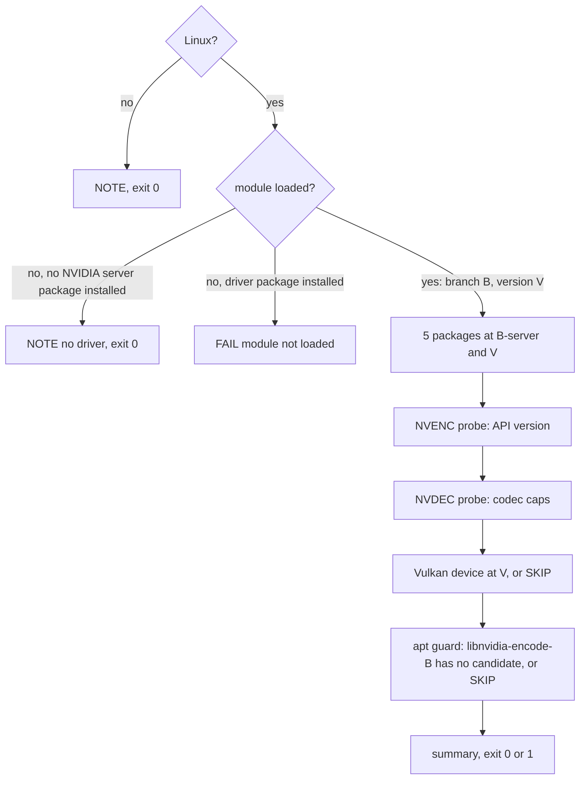

# NVIDIA Userspace Guard and Check - Plan

## Goal Capsule

- **Objective:** On the Linux GPU server, losing NVENC, NVDEC, Vulkan, CUDA, or `nvidia-smi` to a package change is
  reported by one command, and installing a package that would swap the driver's userspace is refused by apt. Both hold
  for whichever driver branch Brett runs, and the runbook says how to stay there.
- **Means:** a check command that reads the branch from the loaded kernel module (KTD1, KTD2, KTD3); an apt preferences
  guard on the non-server driver families (KTD5) with a copy-deploy script (KTD6); and runbook and solutions docs (U5,
  U6).
- **Authority:** Brett (the operator) decides the driver branch and runs every root command. The research report at the
  prime's `.context/nvidia-driver/report.md` holds the evidence and the recommendation. The brief in
  `.git/agent-slot-prompt.md` sets scope and limits; this plan decides mechanism within them.
- **Execution profile:** one PR to `dev`. Every unit runs without root: apt changes are simulated, and the guard and
  check are proven against real apt in a sandbox and against the live box read-only.
- **Stop conditions:**
  - A live probe on the server would need a driver change, module reload, reboot, or GPU-consumer restart before
    2026-11-28 12:00 CST: stop and report instead.
  - A push is denied for a path outside the slot's recorded scope: stop and ask the coordinating session for the grant.
  - The guard blocks a `-server` package or the container toolkit in any simulation: stop, because a wrong pin would
    block driver installs.
- **Who finishes:** this slot builds, reviews, and readies the PR. Brett merges, then runs the deploy and the install
  commands in the runbook.

---

## Product Contract

### Summary

Add `nvidia-gpu-verify`, a read-only check of the NVIDIA userspace and its video engines, and an apt pin that refuses
the non-server NVIDIA driver packages from any repository. Deploy the pin with `scripts/nvidia-deploy.sh`, test both
against real apt resolution in a sandbox, and bring the runbook and solutions docs to present truth.

### Problem Frame

The server runs `nvidia-headless-580-server-open`. NVENC and NVDEC have never stayed installed: Procedure D installed
the encode and decode libraries on 2026-10-14 and they were removed 35 minutes later, once the Remotion consumer showed
no gain. A parade consumer now needs them. Every way of losing them is silent. A branch change that names only the
headless metapackage drops the Vulkan ICD and `nvidia-smi` (simulated: 12 removed, 9 installed, no `libnvidia-gl`). The
obvious package name `libnvidia-encode-580` removes the server driver (8 removed). NVIDIA's CUDA repository now also
ships unversioned driver packages, so `apt install cuda-drivers` removes it as well (11 removed). A point upgrade from
unattended-upgrades leaves the loaded module and the libraries at different versions until a reboot. Nothing reports any
of these until a consumer fails.

### Requirements

**The check**

- R1. One command reports, for the loaded driver branch, whether `nvidia-utils`, `libnvidia-compute`, `libnvidia-gl`,
  `libnvidia-encode`, and `libnvidia-decode` are installed as `-<branch>-server` at the loaded module's version.
- R2. The check fails, with a verbatim fix command on the next line, when any of those is missing or at another version,
  and names a pending reboot when every one is at a version other than the loaded module's.
- R3. The check proves NVENC and NVDEC answer through the driver without opening an encode or decode session, and prints
  the NVENC API version the driver supports.
- R4. The check proves Vulkan enumerates the NVIDIA GPU at the loaded version.
- R5. The check fails when apt would still offer a non-server NVIDIA package for the loaded branch, naming the deploy
  command.
- R6. The check exits 0 with a note on macOS and on a Linux host with no NVIDIA driver, so it is safe on every host the
  `local` package reaches.

**The guard**

- R7. apt refuses every non-server NVIDIA driver package, versioned or unversioned, from any repository, while every
  `-server` package, the container toolkit, `libnvidia-egl-wayland1`, the CUDA toolkit, and `dist-upgrade` resolve as
  before.
- R8. The guard deploys from the repo by copy, with a no-root check that reports drift, as the repo's other `/etc`
  config does.

**Documentation**

- R9. The runbook states the canonical package set, the guard, the check, the NVENC API compatibility of ffmpeg builds,
  and a branch-change procedure that names every add-on package.
- R10. A solutions doc records the NVENC API version as the axis between driver branch and ffmpeg build, and the wider
  form of the package-name trap.

### Scope Boundaries

Considered and not built:

- **A JSON output mode for the check.** The brief adds one check and no output mode, and `qmd-gpu-verify`, its
  precedent, is text-only with stable line prefixes. A caller that branches on fields would change this call.
- **A timer, alert, or apt hook that runs the check.** The runbook rejects probes and timers. The check runs at
  Procedure B, D, and E, and after every deploy. Evidence of a silent failure lasting days would change this call.
- **An encode or decode session in the probes.** It would prove the encoder end to end. It also consumes a GeForce NVENC
  session while long encodes run, and the session-free calls plus a measured ffmpeg run on the live box (U5 docs)
  already show the libraries work. A probe passing while real encodes fail would change this call.
- **A guard on branch changes from unattended-upgrades.** The GPU host plan's U2
  (`docs/plans/2026-10-23-1750-feat-gpu-host-performance-plan.md`) owns that blacklist; the check reports the mismatch
  it prevents.

Not in scope for this brief:

- Running any apt change, the deploy, or a reboot; Brett runs them from the runbook and the report.
- The runbook's persistence-mode text (A.3 step 5), which the GPU host plan's R8 owns.
- Declaring the NVIDIA packages in `config/linux/apt-packages.txt`, which the declaration reconciliation plan owns.

### Sources

- Research report with every simulation, measurement, and source: the prime's `.context/nvidia-driver/report.md`.
- `docs/solutions/configuration-fixes/nvidia-addon-userspace-packages-match-driver-branch-and-version.md` (the
  plain-name trap and Procedure D's shape).
- `docs/solutions/configuration-fixes/nvidia-driver-dkms-headless-gpu-server-2026-05-18.md` (why DKMS and server-open).
- NVIDIA branch lifecycle and `releases.json`; nv-codec-headers README per tag; Ubuntu Server's NVIDIA driver page,
  which also says `nvidia-fabricmanager-NNN` and `libnvidia-nscq-NNN` match the `-server` drivers despite their names.

---

## Planning Contract

### Key Technical Decisions

- KTD1. **The check reads branch and version from the loaded kernel module.** `/proc/driver/nvidia/version` names the
  version the GPU is actually running, so the check holds for any branch with no configuration, and a userspace upgrade
  awaiting a reboot shows up as a version difference. The metapackage name would miss that case and would differ between
  open, closed, and DKMS flavors. A test seam, `NVIDIA_GPU_VERIFY_PROC_VERSION`, points the check at a fixture file,
  following `SYSCTL_PROC_DIR` in `scripts/sysctl-deploy.sh`.
- KTD2. **The required userspace set is five packages, stated once, in the check.** They are `nvidia-utils`,
  `libnvidia-compute`, `libnvidia-gl`, `libnvidia-encode`, and `libnvidia-decode`, each `-<branch>-server`. Each one is
  either something the headless metapackage leaves out or the first thing the trap removes. Their version must equal the
  loaded module's upstream version (the Debian version up to its first `-`). The open and closed server flavors share
  these names. Detecting non-server packages separately is unnecessary: they conflict with the `-server` ones, so a swap
  always shows up as a missing `-server` package.
- KTD3. **NVENC and NVDEC are probed by two session-free driver calls, from a stdlib Python block inside the bash
  check.** `NvEncodeAPIGetMaxSupportedVersion` (libnvidia-encode) returns the driver's NVENC API version, which is what
  decides which ffmpeg builds work. `cuvidGetDecoderCaps` (libnvcuvid, under a retained CUDA primary context) reports
  H.264, HEVC, and AV1 decode support. Neither opens a session, so neither takes one of GeForce's capped NVENC sessions
  from a running encode. Measured on the server with the 580 libraries unpacked from their `.deb`: `api=13.0`, all three
  codecs supported, 0.47 s and 110 MB RSS. The block runs as `python3 -I -B`, so neither the user's site-packages nor
  the working directory can shadow `ctypes`, and no bytecode lands beside the interpreter. The check stays bash because
  its other steps are command calls, as in `qmd-gpu-verify`.
- KTD4. **Vulkan is proven with `vulkaninfo --summary`.** It must list a device with `driverName = NVIDIA` and
  `driverInfo` equal to the loaded version. When `vulkaninfo` is absent the step is SKIP, not FAIL: the runbook makes
  `vulkan-tools` optional, and KTD2 already fails a missing `libnvidia-gl`.
- KTD5. **The guard pins named driver families to -1, with branch number and `-open` both optional, from any origin.**
  `config/apt/preferences.d/nvidia-server-branch.pref` holds one stanza: `Package:` with three regexes, one over the
  `nvidia-` families (driver, headless, headless-no-dkms, dkms, kernel-common, kernel-source, kernel-open, open, utils,
  compute-utils), one over the `libnvidia-` families (cfg1, common, compute, decode, encode, extra, fbc1, gl, gpucomp),
  and `^nvidia-firmware(-[0-9]+)?(-[0-9][0-9.]*)?$` for the non-server firmware, then `Pin: version *` and
  `Pin-Priority: -1`. The firmware form matches `nvidia-firmware-580-580.178.04` but not
  `nvidia-firmware-580-server-580.178.04`; the non-server firmware Breaks the `-server` one, and a simulated install of
  it alone removes 12 packages, the whole `-server` driver, while pulling in no other pinned family. apt's regexes are
  POSIX ERE with no negative lookahead, so "anything without `-server`" is not expressible. Naming families also keeps
  `nvidia-fabricmanager-NNN`, `libnvidia-nscq-NNN`, `libnvidia-egl-wayland1`, `libnvidia-container*`, and
  `nvidia-container-toolkit` installable. A draft run against this box's real apt (`-o Dir::Etc::PreferencesParts`) did
  three things:
  - It refused `libnvidia-encode-580`, `libnvidia-encode`, `nvidia-open`, `nvidia-driver-580-open`,
    `nvidia-headless-580-open`, and `cuda-drivers`.
  - It left Procedure D (2 new, 0 removed), the 615 swap with add-ons (14 in, 12 out), `cuda-toolkit-12-8`, `cuda`, and
    `nvidia-container-toolkit` resolving as before.
  - It changed nothing in the `dist-upgrade` set (59 packages either way).
- KTD6. **`scripts/nvidia-deploy.sh` copies the guard, modelled on `scripts/sysctl-deploy.sh`.** It has the same three
  modes: deploy as root with `install -m 0644`; `--check`, which compares by `cmp` and needs no root; and `--dest DIR`
  for tests. It is Linux-only, a no-op on macOS, and exits 0, 1, or 2. It copies every file in
  `config/apt/preferences.d/`. The name is the one the GPU host plan's U2 gives its NVIDIA deployer, so U2 extends this
  script instead of adding a second one. Whether apt honours the copied file is a resolution question, and the check
  answers it (KTD7). The deploy's last line names that command.
- KTD7. **The check proves the guard through apt itself.** `apt-cache policy libnvidia-encode-<branch>` must show
  `Candidate: (none)`, and so must unversioned `libnvidia-encode` when apt knows it (only the CUDA repository ships it).
  When apt knows neither name, the step is SKIP. A failure names `sudo ~/dotfiles/scripts/nvidia-deploy.sh`. Asking apt
  rather than comparing files also catches a later preferences file that raises the pin.
- KTD8. **Output follows `qmd-gpu-verify`.** Lines start with `PASS`, `FAIL`, `SKIP`, `INFO`, or `NOTE`. Every FAIL is
  followed by an indented `next:` line holding one command that is safe to paste. A summary line closes the run. Exit 0
  means no FAIL, 1 means at least one, and 2 is a usage error. `-h` and `--help` print usage. A missing package's
  `next:` pins `=<Debian version>`, taken from an installed package of the branch (`nvidia-kernel-common-<B>-server` or
  one of the five) at the loaded version, so the fix never reaches the trap. When no such package exists but some
  `-server` NVIDIA userspace is installed, a reboot is pending: after an upgrade within the branch, or after a branch
  change whose new module is not loaded yet. The package step then prints one FAIL naming both versions with
  `next: sudo reboot` and no install line, which could undo a branch change, and the NVENC, NVDEC, and Vulkan steps
  print SKIP naming the pending reboot, since a userspace at another version than the module fails them all.
- KTD9. **The guard's suite drives real apt in a throwaway repository.** It builds a flat `file:` repo of stub packages
  in `setup_file`, with every `Dir::State`, `Dir::Cache`, and `Dir::Etc` path redirected into `BATS_FILE_TMPDIR` and
  `Debug::NoLocking`. It runs `apt-get update` once (0.6 s, no root), and the tests assert `apt-cache policy` candidates
  against a must-block list and a must-allow list. This tests what apt does with the regex rather than what a grep
  thinks it does. It needs apt, so those tests call `require_linux`; CI runs on Ubuntu.

### High-Level Technical Design

The check's steps in order. Each step prints a line, and the run exits 1 when any step printed FAIL.

### Assumptions

- Brett accepts the report's recommendation: stay on 580, run Procedure D, move to 620 once it leaves -proposed. Nothing
  in this plan depends on that choice; the runbook's branch procedure takes the branch as `B`.
- `python3` is present on every Linux host that has an NVIDIA driver. Ubuntu ships it, and the check's NVENC step fails
  naming it when it is missing.
- Brett runs the operator grant for `config/apt/**`, `stow/local/dot-local/bin/**`, `scripts/**`, `tests/**`,
  `AGENTS.md`, and `README.md` that the coordinating session passed on. The slot's recorded scope kept only the docs
  globs.

---

## Implementation Units

### U1. The apt guard and its deploy script

- **Goal:** the guard file exists and deploys by copy (R7, R8).
- **Requirements:** R7, R8; KTD5, KTD6, KTD9.
- **Dependencies:** none.
- **Files:**
  - `config/apt/preferences.d/nvidia-server-branch.pref` (create)
  - `scripts/nvidia-deploy.sh` (create)
  - `tests/nvidia-deploy.bats` (create)
- **Approach:**
  1. The guard holds the KTD5 stanza under comment lines that say why each family is pinned and why the named-family
     form was chosen.
  2. The deploy script follows `scripts/sysctl-deploy.sh` step for step: usage, mode parse, platform and root
     pre-flight, copy loop with `cmp`, `--check` drift report, closing line naming `nvidia-gpu-verify`.
  3. The suite marks itself `# run-tests: parallel` and builds the apt sandbox and stubs once in `setup_file`.
- **Patterns to follow:** `scripts/sysctl-deploy.sh` and `tests/sysctl-deploy.bats`; `tests/lib/platform.bash`
  (`stub_uname`, `require_linux`).
- **Test scenarios:**
  - `--dest` copies the guard byte for byte at mode 0644 and prints which file it copied.
  - A second `--dest` run reports nothing to copy.
  - `--dest` overwrites a target that differs from the repo.
  - `--dest` into a missing directory exits 1 naming the path.
  - `--check` exits 0 when the deployed copy matches, and 1 naming the file when it differs or is missing.
  - On a stubbed Darwin, deploy and `--check` exit 0 with a note.
  - Deploy without root exits 1 naming sudo.
  - An unknown flag, a bare `--dest`, and two modes together exit 2.
  - Sandbox apt with the guard gives no candidate for each must-block name: `libnvidia-encode-580`,
    `libnvidia-compute-580`, `libnvidia-gl-580`, `nvidia-utils-580`, `nvidia-headless-580-open`,
    `nvidia-headless-no-dkms-580-open`, `nvidia-driver-580-open`, `nvidia-dkms-580-open`, `nvidia-kernel-open-580`,
    `nvidia-firmware-580-580.178.04`, `nvidia-firmware-580`, `libnvidia-encode-620`, and the unversioned
    `libnvidia-encode`, `libnvidia-compute`, `nvidia-open`, `nvidia-driver-open`, `nvidia-dkms-open`.
  - Sandbox apt with the guard keeps a candidate for each must-allow name: every `-server` and `-server-open` sibling of
    the names above, `nvidia-firmware-580-server-580.178.04`, `nvidia-container-toolkit`, `libnvidia-container1`,
    `libnvidia-egl-wayland1`, `nvidia-fabricmanager-580`, `libnvidia-nscq-580`, `cuda-toolkit-12-8`, `nvidia-gds-12-8`.
  - Sandbox apt without the guard offers every must-block name. That proves the fixture is live and the guard does the
    blocking.
- **Test seam:** the sandbox catches a regex that apt reads differently than intended. It misses priority interactions
  with the live box's other preferences files, which U4's live simulation covers.
- **Verification:** the suite passes on Linux, and a must-block name dropped from the guard turns its scenario red.

### U2. The check command

- **Goal:** `nvidia-gpu-verify` reports the five packages, NVENC, NVDEC, Vulkan, and the guard for the loaded branch (R1
  to R6).
- **Requirements:** R1, R2, R3, R4, R5, R6; KTD1, KTD2, KTD3, KTD4, KTD7, KTD8.
- **Dependencies:** U1. The guard step's `next:` names U1's script.
- **Files:**
  - `stow/local/dot-local/bin/nvidia-gpu-verify` (create)
  - `tests/nvidia-gpu-verify.bats` (create)
- **Approach:**
  1. Header comment in the `qmd-gpu-verify` shape: what each step proves, why the probes are session-free, the exit
     codes, and the test seam variable.
  2. Steps in the High-Level Technical Design order. Shell constructs stay within bash 3.2, so the bash 4.4 guard block
     is not needed.
  3. The probe block prints one machine-shaped line per engine (`nvenc ok api=13.0`, `nvdec ok h264=yes ...`,
     `... load-failed <reason>`). The bash side turns each into PASS or FAIL with a `next:` line: the pinned install
     when the package is missing, or the `ldconfig -p` lookup for the library when it is installed.
- **Patterns to follow:** `stow/local/dot-local/bin/qmd-gpu-verify` (output and summary); `tests/qmd-serve.bats`
  (stubbed `nvidia-smi`).
- **Execution note:** stubs for `dpkg-query`, `apt-cache`, `vulkaninfo`, and `python3` are written once in `setup_file`,
  mode 555. Each reads its answers from files the test writes, so a test changes only the answer it is about. `python3`
  is stubbed only in the tests that need a canned probe, so the real-probe scenario runs real Python.
- **Test scenarios:**
  - A loaded 580.178.04 module with all five packages at `580.178.04-0ubuntu0.24.04.1`, both probes ok, Vulkan at
    580.178.04, and the guard in effect: exit 0, five package PASS lines, `NVENC API 13.0`, and the summary line.
  - `libnvidia-encode-580-server` not installed: FAIL naming it, with `next:` pinning
    `libnvidia-encode-580-server=580.178.04-0ubuntu0.24.04.1`. Exit 1.
  - The same check with a 615.71.09 module and `-615-server` packages passes. That proves nothing is pinned to 580.
  - Every package at 580.196.07 while the module is 580.178.04: one FAIL reporting a pending reboot and three SKIPs
    (NVENC, NVDEC, Vulkan), not five mismatched packages.
  - Three packages at 580.196.07 and encode and decode missing, module 580.178.04: the pending-reboot FAIL and no
    install `next:` line.
  - A 580.178.04 module with the `-620-server` set installed and no `-580-server` package: the pending-reboot FAIL, and
    no `next:` line that installs a 580 package.
  - One package at another version while the rest match: FAIL naming that package and both versions.
  - No module loaded but `nvidia-kernel-common-580-server` installed: FAIL module not loaded, pointing at Procedure B.
  - No module and no NVIDIA server package: NOTE and exit 0, with no other step run.
  - A stubbed Darwin `uname`: NOTE and exit 0.
  - The probe reports `nvenc load-failed`: FAIL naming `libnvidia-encode`. The probe reports `nvdec load-failed`: FAIL
    naming `libnvidia-decode`.
  - The real embedded probe, run on a host without `libnvidia-encode.so.1` (CI): the NVENC and NVDEC steps FAIL with the
    loader's reason. Skipped when the host has the library.
  - `vulkaninfo` lists only llvmpipe: FAIL. `vulkaninfo` absent: SKIP, and the exit stays 0 when all else passes.
  - `apt-cache policy` offers a candidate for `libnvidia-encode-580`: FAIL whose `next:` is the deploy command. apt
    knows neither canary: SKIP.
  - `--help` prints usage and exits 0; an unknown argument exits 2.
- **Test seam:** stubs catch the decision logic and every message. They miss whether the ctypes calls work against a
  real driver, which U4 measures live.
- **Verification:** the suite passes; `scripts/lint-shell` passes on the new file.

### U3. The GPU host plan's deployer line

- **Goal:** the GPU host plan's U2 extends `scripts/nvidia-deploy.sh` instead of creating a second NVIDIA deployer
  (KTD6).
- **Requirements:** KTD6.
- **Dependencies:** U1.
- **Files:**
  - `docs/plans/2026-10-23-1750-feat-gpu-host-performance-plan.md` (modify: U2's file list and Approach say the script
    exists and already deploys `config/apt/preferences.d/`)
- **Approach:** change only the U2 lines that create the script, so the other plan stays its own owner.
- **Test expectation:** none -- a planning doc's file list.
- **Verification:** U2 reads as an extension of the existing script; no other line of that plan changes.

### U4. Live verification on the server, read-only

- **Goal:** the check, the probes, and the guard behave on the real box as the suites claim, with no change to the box.
- **Requirements:** R1 to R7.
- **Dependencies:** U1, U2.
- **Files:** none committed. The evidence goes in the PR body.
- **Approach:**
  1. Run the check from the slot. Expected today: FAIL for `libnvidia-encode` and `libnvidia-decode` with pinned `next:`
     lines, NVENC and NVDEC FAIL, Vulkan PASS at 580.178.04, and the guard FAIL with the deploy command.
  2. Rerun it with `LD_LIBRARY_PATH` pointing at the 580 encode and decode libraries unpacked from `apt-get download`.
     The two probes then PASS (`api=13.0`, three codecs), which proves the ctypes calls against the real driver.
  3. Run `apt-get install -s` with `-o Dir::Etc::PreferencesParts` pointing at a copy of `/etc/apt/preferences.d` plus
     the repo's guard. The traps, `nvidia-firmware-580-580.178.04` among them, must fail to resolve, and the Procedure D
     and branch-swap sets must stay unchanged.
  4. Run `scripts/nvidia-deploy.sh --check`, which reports the guard as not deployed (exit 1).
- **Execution note:** no session-opening encode before 2026-11-28 12:00 CST; the probes open none.
- **Test expectation:** none -- this unit measures U1 and U2 on the real box.
- **Verification:** each expected line above appears; nothing on the box changed (`dpkg -l` and `/etc/apt/preferences.d`
  identical before and after).

### U5. Runbook to present truth

- **Goal:** `docs/runbooks/headless-gpu-server-nvidia-driver.md` states the canonical set, the guard, the check, and how
  to change branch (R9).
- **Requirements:** R9.
- **Dependencies:** U1, U2.
- **Files:**
  - `docs/runbooks/headless-gpu-server-nvidia-driver.md` (modify)
  - `AGENTS.md` (modify: an `### NVIDIA apt guard (config/apt/preferences.d/)` section beside the other `/etc` config
    sections)
  - `README.md` (modify: the `config/` tree line, the `scripts/` tree line, and a row in the local commands table)
- **Approach:**
  1. **Current canonical state:** the five-package set at the driver's exact version, the guard, and the check as the
     arbiter.
  2. **Procedure D:** both libraries named at `=$V` and `NEEDRESTART_MODE=l`. The runbook states in present tense that
     the encode and decode libraries are optional, absent until a consumer needs NVENC or NVDEC, and installed by
     Procedure D; the 2026-10-14 run stays in the report and git history. Add a table of NVENC API version,
     nv-codec-headers, minimum driver, and example builds (BtbN n8.1 versus n9.0, jellyfin-ffmpeg, Ubuntu's ffmpeg).
  3. **Procedure E, changing driver branch:** every add-on named with the branch as `B`, the simulation's expected
     shape, DKMS status, reboot, `qmd-llama-rebuild.sh`, the check, and rollback by naming the old branch's set. Branch
     type matters: prefer an NVIDIA Long Term Support or Production branch from noble-updates or noble-security, since
     Ubuntu transitions a New Feature Branch to the next supported one.
  4. **Procedure B:** gains the check.
  5. **A.4's closing lockdown sentence:** names the apt guard (`config/apt/preferences.d/nvidia-server-branch.pref`,
     deployed by `scripts/nvidia-deploy.sh`) as the one apt pin, and keeps "no unattended-upgrades blacklist, no systemd
     timers", since the GPU host plan's U2 owns the blacklist.
  6. **"What this runbook deliberately does not do":** the check is a command, still no timer.
  7. Every new section is written to the repo's present-tense, no-history rule.
- **Test expectation:** none -- prose. The release-docs and markdown gates in `pre-push` check it.
- **Verification:** every command in the runbook matches a simulation in the report or a script in this PR.

### U6. Solutions doc

- **Goal:** the durable lessons reach `docs/solutions/` (R10).
- **Requirements:** R10.
- **Dependencies:** U4, since the doc quotes its measurements.
- **Files:**
  - `docs/solutions/configuration-fixes/nvenc-api-version-decides-ffmpeg-build-per-nvidia-driver-branch.md` (create, in
    the solutions repo)
  - `docs/solutions/configuration-fixes/nvidia-addon-userspace-packages-match-driver-branch-and-version.md` (modify: the
    unversioned CUDA-repo names, the headless-only swap, and the guard)
- **Approach:** published with `sd-commit-doc` from the slot's solutions worktree, not in the dotfiles PR. The new doc
  covers:
  - the probe that reads the driver's NVENC API version
  - the nv-codec-headers floors
  - BtbN's header choice per ffmpeg version
  - branch types and Ubuntu's transitions
- **Test expectation:** none -- prose.
- **Verification:** `qmd` finds the new doc for "NVENC API version driver ffmpeg"; both docs pass `/unslop`.

---

## Verification Contract

| Gate              | Command                                                                                                                                                      | Proves                                                  |
| ----------------- | ------------------------------------------------------------------------------------------------------------------------------------------------------------ | ------------------------------------------------------- |
| New suites        | `scripts/run-tests tests/nvidia-deploy.bats tests/nvidia-gpu-verify.bats`                                                                                    | U1, U2 behavior, including real apt resolution          |
| Lint              | `scripts/lint-shell` over the new script, the check, and both suites                                                                                         | ShellCheck and the bash-version guard                   |
| Full local mirror | `pre-push` (backgrounded `git push` with its timeout)                                                                                                        | every CI job, the core-env guard, and test-cost budgets |
| Red proof         | Drop one must-block family from the guard and run its suite, then restore it. Drop the version comparison from the check and run its suite, then restore it. | the new tests fail without the code they cover          |
| Live, read-only   | U4 steps 1 to 4                                                                                                                                              | the probes and guard against the real driver and apt    |

## Definition of Done

- U1, U2, U3, and U5 are in one PR to `dev`, every check is green, and U4's live output is in the PR body.
- Each new test was seen failing against the unfixed code, with that output quoted in the PR.
- `/compound-engineering:ce-code-review` and `/devex-review` each ran one round, with verdicts in PR comments and every
  in-scope finding fixed.
- U6 is published through `sd-commit-doc`.
- No scratch files, unpacked `.deb` trees, or dead-end code remain in the diff or the slot.

---

## Review log

- 2026-11-26 15:32 CST: plan written.
- 2026-11-26 15:35 CST: `/compound-engineering:ce-doc-review mode:non-interactive` started.
- 2026-11-26 15:48 CST: `/compound-engineering:ce-doc-review` ended (lite: one reviewer, coherence, feasibility, and
  scope lenses). Applied 4 fixes: the guard gains the non-server firmware family, whose install alone removes the whole
  `-server` driver; the check reports a pending reboot with no install line whenever no package of the loaded branch is
  at the loaded version; the runbook unit rewrites A.4's "No apt pinning"; Procedure D's text stays present tense. One
  advisory: KTD3 credited `charcount` with isolation flags it lacks, and that clause is removed.
